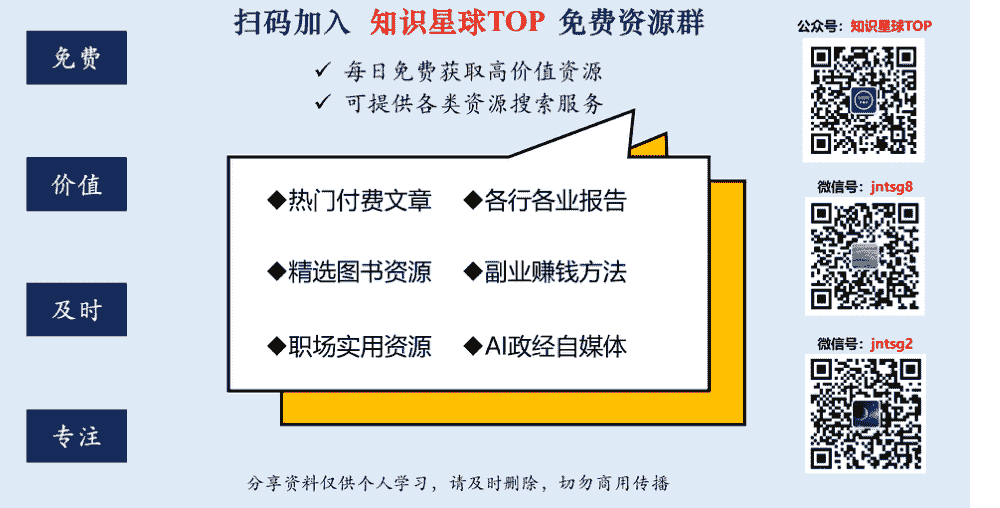

# 米联储兜闻20250529——今时亦弃青云士

川总对美国高校留学生带来了一串三板斧，先是驱哈佛留学生，被叫停，然后暂停全球留学生面试预约，借着又来一记重钟，直接转向兔子留学生，亲华的马克斯退出白宫，一直积极反对卢比特登场——看来就是宣布将积极地（aggressively）撤销兔子学生的签证。怎么理解这个词，主动的，积极的，甚至是激进地做着这件事。所以搞来搞去，最终目标还是兔子。

与与之对应的，国际媒体留意，这个周末即将举行的新加坡香格里拉对话论坛，兔子至今未宣布兔子代表团由谁率领，之前海外媒体盛传兔子长防军不会出席，当时大家还在推测是不是防长长出问题，现在看来概率不是防长长出问题，但兔子可能不会出席，接下来可能会看到兔子在军事方面会有比较积极的动作。原本是中美防长可以第一次接触的官方场合，但是兔子选择不出席的话，也就意味着，兔子阶段不意愿跟美国在军事方面有多大的高层接触，换句话说，印印冲突之后，高层和中方的想法可能确实转变了。不管是南海，还是东海，似乎都已不再局限于过家家了。这个事情，我们过去顾虑很多，但是这次印度的打败之后还能海外宣讲团，全国放假日，确实让我们的管理层也学到了，以前怕输了不好交待，现在印度教会了我们，只要我不承认输，就会一直赢下去，少了这层顾虑，加上我们对网络信息和舆情的高度控制力，高层的态度会激进很多。

新加坡会是亚太地区规模最大、规格最高的防务安全对话机制，每年都有40多个核心国家的防长参加，美国防长每届都出席。自从2019年以来，除了2020年和2021年香会因新冠疫情取消，兔子的后三任防长魏凤、李尚福和董军都会赴发言。中美防长在会会上隔层壕战，已成为省会的一大风景。不过，兔子市长赴省会其实非常常态。兔子是从2007年开始重视省会，在2007年到2010年先后派出解放军副总参谋长秦生和马晚天出席。2011年老八访美、中美关系回暖，才首次派出国防部长梁光烈参加省会，但期间就大降层级，派出军事科学学院副院长任海泉。2013年到2018年，每次省会的中国代表团团长分别是副总参长咸建国（2013年）、副总参长王冠中（2014年）、副总参谋孙建国（2015年、2016年）和军事科学学院副院长何雷（2017年、2018年）。从会安排来看，兔子派出代表的层级，与当时的国际形势和美国对华政策有直接关系。2017年南海仲裁裁决公布后的第一次省会，兔子只派出军事科学学院副院长赴会，相信是避免兔子海主权纷争成为焦点，也不希望给美方制造当面对兔子市长的视觉效果。

依据主办方的思维，有分歧所以更应该公开讨论，但对兔子来说，香会一直是西方主场，主办方有时会故意设计主题刻意凸显中美对抗，因为这符合新加坡喜欢左右逢源，两边做和事佬的国防逻辑，中美没矛盾，新加坡还有什么价值呢？所以中美关系缓和的时候，反而是愿意派高级官员捧场，矛盾尖锐的时期，都会相对低调。所以，当国际对峙气氛紧张时，中国多数选择不给新加坡面子，不派防长级代表参会，甚至以这种方式表达对美方的态度。

因为兔子已经连续两届防长出事，所以最初董军不亮相会，也引发外界联想，但是董军5月中旬刚到德国柏林三天，在第六届联合国维和部长级会议上作大会发言，又与德国防长会谈，5月23日还高调访华。泰国、美国军队最高司令衔，这都是兔子。外界臆想，董军不亮相会，不是因为董军没时间，个人问题，仅仅是因为兔子现在不想跟美国在军事上进行断接触。接下来关于一把手要不要参加G20峰会，外界开始猜测，如果川总真的参加，中美领导人第一次接触的官方平台，可能就是这次G20峰会。所以，如果按照川总这个玩法，下半年这个会必须要出点大事，中美高层才会真正坐下来好好谈。兔子现在对中美接触非常谨慎，上次在瑞士会面达成了一定的效果，但是美国这边折腾一直没停。如果说新任防长赫格森是个完全入流的摆设，对五角楼的影响也是有限，而且作为媒体人出身的他表现欲估计很强。

赫格森上任以来频繁问兔子是否跟他接触十分感兴趣，兔子现在也不急于与美国进行交流，而是寻找其他国家的战略支持，开拓市场和组建供应链。兔子一直在东南亚活动，这次参加香会可以看到兔子在重新整理外交资源。5月30日会开幕式上，法国总统马克龙将发表致辞，欧洲大国领导人在开幕式上会议及防务问题、俄乌战争的责任分担，每次扯这些事会让兔子左右为难，欧美在防务方面的矛盾就会突出一些，兔子不派人去，这些国家又集合起来嘲兔子。

所以干脆不参与其中，兔子不派人去，这几个套路兔子也腻了，少打口炮，直接开干，这才是兔子该有的风格。谁要咬人之前还要反复说：我要咬人了，我真的准备咬人了。兔子打算怎么咬人尚不可，但是川总咬人的方式很明确，就是狮子开口，最后咬最弱者。其实兔子赴留学生可能是世界上比美国人还爱美国的存在，这些人为了美国，不但从内心处到身体都完全相信和爱美国的高教育，不惜重金培养孩子去美国，说真的对美国的感情真是感动的，是不容疑的。但是美国政府现在这样打击赴留学生真是伤透了这些人的心，连渣男不如。卢比特一句aggressively撤销兔子学生证，让兔子家庭十年的努力成镜花水月，甚至千万的教育投入打水漂。按卢比特说法，这个行动将涵盖“与兔子有联系，或是在关键领域学习”的兔子学生。什么叫有关系？是不是父母是党员意味着关系？这对于很多把孩子送到美国的体制人员真是一记重钟。

根据估算，去年约有28万兔子学生在美国留学。最高峰时已经减少了10万人，不少在美留学生已经转向英国、加拿大、新加坡和香港，甚至有人开始向内寻找机会。这个举动对于已经拿到毕业证书的留学生来说有逃一劫的感觉，而对于就读中和今年赴美的留学生来说，真是天塌了。此外，卢比特在宣布签证收紧政策的简单声明中没有给“关键领域”定义，但这个表述可能指的是物理科学领域的研究。目前清楚会不会像当年麦卡锡主义一样以极端手法审查这些人与兔子的关系，鉴于美国有这个历史，走向这一步也不是可能的。相比于当时主要针对苏联，这次针对兔子的操作，让有着一张华人面孔的亚洲人都成为行走的间谍，这会导致很多已经在美的华人不得不采取对华更激进的态度来表现对美的忠诚，另一方面会让美国白人在政府引导下出现集体的反华心理。目前局面虽然停留在留学生，未来也必然会延至其他领域，只要兔子趋势不变，黄色的面孔就是原罪。

近十年来，国内干部和精英把子女送到美国读书几乎是必选项目，甚至包括现在的这一把手。2020年，川普1.0时期，就曾经通过折腰这部分人的签证问题，让中国在某些问题上妥协，毕竟这些都是过去所属的质子。当时的目标主要是与兔子军事系统大学有直接联系的数千名研究生和研究人员的签证，这是美国政府自中美建立以来首次禁止特定类别的兔子学生进入美国大学。拜登政府执政期间，因为美国高校是民主党的基本盘，双方多次沟通后，这方面的交流获得一定的恢复。2023年11月，特朗普访问旧金山期间还宣布，兔子准备在五年内接收5万美国学生。目前看来，接收五万留学生位置还不够。美国本质上来说，是靠吸纳其他国家的精英而壮大的，美国科研的中流柱事实上来自五湖海，这也是美国的软实力所在，包括川普本人，也是德国后裔。但像所有爬上救生的人一样，不是希望更多的人上船，而是希望紧关门锁定利益，避免自己被挤下船，现在的美国早已不是当年的美国了。

# 米糕祝各位晚安

加微信jntsg2，进资料分享群
