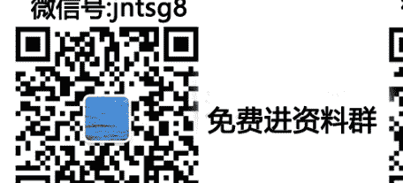

# 米联储见20250616——中东已合重围

终于，以色列还是动手了。从拜登下令美军从阿富汗撤离，或许就注定以色列会在中东掀起乱局，美国的全球战略会收缩，会引发一系列问题，以色列必然是其中最激烈动荡的一环。川普一再再劝说以色列不要动手，等待美国与伊朗的谈判进展，但内塔尼亚似乎收到的情况是，伊朗的核武器已经在路上，谈判只是拖延，以色列已经无法继续等下了。眼下出手就是最佳时机，内外受敌的川普此时根本没有办法拒绝以色列的要求，对以色列的安全承诺是美国全球安全战略的核心的一环，如果失去这块核心牌牌，美国对全球的安全承诺都将随而去，世界必将迎来更激烈的动荡。换言，如果面对伊朗射向特拉维夫的导弹无所作为，那么任何国家对于美国的安全承诺都将不抱期待，毕竟连乌克兰的周都难以维护的人，你觉得其他盟友还能望什么？

加微信jnts2，免费进资料群

目前，川普还没有松口美军直接下场，但是如果以色列自身无法在短时间内获得压倒性优势，美军几乎没有选择。实际在这次发起的打击前，美国和以色列多次挑衅伊朗，都没有遭受强有力的报复，以至于美国和以色列会形成一种错觉，就是情报信息和摩萨的布局让伊朗沦为没有还手之力的肉鸡。加上第一波打击就对伊朗革命军的高层将领出了致命打击，以色列想象中的毫毫不还手之力并没有发生，相反伊朗做出了强有力的报复，将导弹直接打到了特拉维夫的闹市区，甚至击穿了几十层的高楼，并通过画面转播全世界，让以色列再无法掩饰自己已是金刚不坏的事实，包括对以色列国民的心理震慑，让常年习惯了以色列屠杀沙沙人民无动于衷的以色列人尝到了家园被炸毁的痛苦。

微信信号jntsg2，免费资料群

在真正对伊朗动手之前，以色列在地区内做过很多前期工作，包括去年无人机偷袭真主党事件、颠覆利亚政权、对哈马斯一轮又一轮的打击，包括要求美国亲自下场打击什叶武装，这一系列操作的目的其实都是削弱伊朗可以与周边国家联动的能力。以色列虽然，也知道伊朗不是省油的灯，哪怕是漏成筛子，哪怕跟敌人遍地，总是有些家底的。

微信公众号:jntsg8
免费资料群

实际上，川普在第一任期，对以色列表现出高度的配合，包括把耶路撒冷划给以色列，甚至把美国驻以色列大使馆搬回耶路撒冷。但川总这次回归，看中国库的家底，真的对以色列的各种要求不感兴趣。国内内阁中也有犹裔，上一次中东之之旅更是绕开了以色列，对伊朗的核谈判也是一拖再拖，甚至说出希望

加微信号jntsg2，免费进资料群

普京来调停以色列和伊朗的关系，对内塔尼亚来说，现在只能靠冒险走险将美国拉下场，所以不顾一切的开始疯狂撕咬。即便如此，美国国务卿布林肯在空袭消息传出后发表简短声明还在跟以色列保持距离。他形容这是盟友的“单方面行动”，我们并未参与对伊朗的空袭，我们的首要任务是保护派驻区内的美国部队。

伊朗对以色列作出强硬回击，川普依然对美国直接参与与伊冲突很慎重，这与去年加沙的情况相比，当时以色列扩大了地区战事，美国试图控制局势协助以色列防御，但同时避免直接介入。在周四空袭发生前，美国官员透露，若以色列出手，美方不会提供支援，甚至不会协助空中加油。这种说法主要是传达给伊朗当局的信号，希望伊朗不要报复，但是以色列这次没有给美国继续策准的机会，一来

加微信号jnts2，免费进资料群

就把伊朗军事高层给灭了，这个力度让伊朗无法继续抵抗。川普非常烦恼的是，他越是让美国从俄乌冲突中释放出来，越是想全心全意对付以色列，越是有各种矛盾拖住美国无法脱身，以至于最后还是要跟东好好说话。这次以色列对伊朗的攻击，不仅比去年两次军事行动更猛烈，也采取了以色列在贝鲁特（此处应为贝鲁特或以色列的）攻真主党的部分战略。即不仅限于摧毁伊朗基地、削弱其能力，还包括“斩首行动”，针对高层领导人。美国媒体披露，不希望卷进以色列，川总现在政府预算还要花钱陪以色列，川总实在是肉疼。去年以色列打真主党，过程非常顺利。当时以色列炸了南部郊区，导致真主党几乎无法组织有效的还击，整个过程太顺利。这次以色列用无人机战术，伊朗革命卫队司令侯赛拉米遭遇杀害。但伊朗不是芭，很快做出的反击，尤其是超音速导弹对特拉维夫的袭击，还是颇为印象深刻，而且情报显示伊朗累积足够材料制造核弹。这也是以色列认为此时必须打击的原因。

事实上，美国和伊朗有关的黑兰核计划将于6月15日开展，以色列在谈判开始之前动手，本质上就是否定了美国斡旋的作用。从军事角度来看，不仅伊朗本身，包括真主党在内的地区势力已经被削弱，不如前以色列以色列选择先斩后奏。

加微信号jtsg2，免费进资料群

上周，国际原子能署（IAEA）在其最新的报告中显示，伊朗已累积浓缩至60%纯度的铀，这距离武器级的90%只有一步遥——理论上足以制造核弹。对于伊朗核进展问题，美以双方存在巨大分歧，以色列军方认为伊朗政权在制造武器部件方面取得了具体进展，但美方认为，以色列“并未提出任何明确或有说服力的证据”。对于以色列的操作第一时间跳出来责怪以色列，表明了中方在此事上的立场。巴基斯坦、伊拉克在空袭发生后都表达了一个意思，如果美国下场，他们将对以色列发起攻击。也门胡塞武装则直接上场通过打击以色列声援伊朗。由于以色列和伊朗并不打算跟胡塞武装隔着沙特瞭望，至于这场冲突是一场跨越国的幻象，以色列靠战斗机远程袭直接控制了伊朗的西部制空权，而伊朗目前唯一的有效手段还是导弹和无人机。

俄罗斯从空袭开始后没有做出任何立场性声明，反而第一时间开始撤侨（应为撤侨），俄罗斯这个动作表明俄罗斯支持事态升级，希望美国被拖进来，毕竟自己也深陷乌克兰冲突，能拖一个是算一个，所以普京肯定是看热闹不嫌大的。加上俄罗斯与伊朗的关系，如果鼓励事态升级，军事援助必不可少。美国也开始撤离人员，明确警告伊朗，若对美国目标发动攻击，将承担后果。伊朗目前首选对以色列本土发起攻击，伊朗的打击目标来看，想要快速打溃以色列后让局势尽快降温。虽然伊朗不希望局势扩大化，所以用了饱和攻击打击以色列的首都，包括内塔尼亚的住宅，实际上就是要让以色列无法承受冲突造成的严重后果。美国其实也希望停火不要升级，但以色列显然不这么想。

以色列如果要把美国拖下水，必须要让伊朗成为全球公敌，包括引导伊朗去攻击沙特的油田，打击阿联酋，袭击美国当地的空军基地，甚至封锁石油大动脉霍尔木兹海峡。

某种意义上来说，以色列用险棋将自己和美国都拖入险境。如果那400公斤浓缩至60%的铀没有被摧毁，如果核燃料距离武器级只差一步，以色列的攻击反而会让伊朗领导层相信，唯一阻止未来攻击的方法，就是尽快冲刺发展核武器能力。以色列拳到肉的对伊朗打会让伊朗国内的投降派不得放弃幻想。

目前，川普还没有松口美军直接下场，但是如果以色列自身无法在短时间内获得压倒性优势，美军几乎没有选择。实际在这次发起的打击前，美国和以色列多次挑衅伊朗，都没有遭受强有力的报复，以至于美国和以色列会形成一种错觉，就是情报信息和摩萨的布局让伊朗沦为没有还手之力的肉鸡。加上第一波打击就对伊朗革命军的高层将领出了致命打击，以色列想象中的毫毫不还手之力并没有发生，相反伊朗做出了强有力的报复，将导弹直接打到了特拉维夫的闹市区，甚至击穿了几十层的高楼，并通过画面转播全世界，让以色列再无法掩饰自己已是金刚不坏的事实，包括对以色列国民的心理震慑，让常年习惯了以色列屠杀沙沙人民无动于衷的以色列人尝到了家园被炸毁的痛苦。

## 局势与未来

现在放在美国面前的选择是：
- 或者让伊朗放弃提炼低浓度的浓缩铀
- 或者让以色列接受伊朗在国际原子机构严谨监管下继续提炼低浓度民用浓缩铀，以换取伊朗同意最终放弃浓缩铀提炼，改由外国供应商民用浓缩铀。

两个方向如何取舍就于这一波交手中谁先被淘汰到要求喊停了。

# 米糕祝各位晚安
