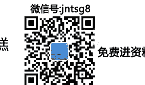

## 米联储闻250620——黄河西来昆仑（世界烽遍地，中国这边独好——安全）

你好，我是米糕

美国边境美丽国内部陷入noking战役，中东那哥哥引导弹搜搜，欧洲乌克兰战场无人机嗡响，中国大地抢夺布局到肉，世界是烽遍地，看全球球坠入各种地区流洒，美国的媒体发现，只有中国的斗争充满了钱的味道，而且跨越不是味。数据上看，前五个月，中国的贸易出口量不断创新高，顺差越来越离离远。20年前，中国以以前所未有的速度、廉价的制造和运输能力震慑了美国；20年后，中国出口不但重塑了美国的经济和政治，也牢牢捏住了全球经济命脉，让美国想要遏制中国的所有努力都显得力不从心，如同一要提着自己的头发把自己抬起来。现在单单是美国欧洲这样的国家，连被美欧定义为中国替代者的印度、东盟、日韩，都不不可逆的闯入了中国的贸易海洋。

这一波流布在海外的疯狂狂背后，是中国制造的再次升级，而且美国发现，关税虽然降低了中国货物发向美国，却让中国工厂一种正在重塑经济和地缘政治的速度玩玩具、汽车和鞋子运往其他国家，然后洗个送送到美国。中国的成本产能优势，让任何想要通过关税手段调整生产线的策略都失败了，根本原因在于全球局势大波动，没有任何国家都能抵御局势动荡的问题。

在这种情况下根本不敢乱动，而中国借助整体优势，反而成为乱世的最优。今年到为止，中国对世界的贸易顺差已经接近500亿美元，比去年同期增长了40%以上。过去是世界混沌中国越好收割，现在是世界越混乱中国越能生产。

随着国际局势的震荡，近年来，中国在所有类别产品的全球市场份额都大幅上升，关税已经无法阻止这种上涨趋势，通过将其货物向东南亚、拉丁洲和欧洲，倒逼川不得不得不把关税大炮对着所有国家。而稀土管制让美国关闭了中国的脖子，导致现在的局面是，为了对中国，美国将枪口对准所有国家，宁错错放，结果中国的枪口直接顶着美国脑勺，最后美国调低了对中国的枪口，其他国家就像傻了，我说你俩干呛，演戏黄甥吗？结果是让美国的关税彻底破产，根本没有真正落在美国。

川普这一系列操作对那些依靠中国商品和加工产品的企业面临巨大的不确定性，也就是说在大搅动的水中，先死的一定是小船。或许保持巨大的产能优势将横扫全球，也就是说现在全球对产能破坏越大，未来的优势越大。这段时间，A股表现出非常强的抗跌力，虽然还没有涨，是因为现在钱都不准备进去，但抗跌属性已经慢慢显现。现在确实没有任何地方的安全属性比中国强了。

美国很头疼，在中国大力推动技术含量更高、价值更高的产品，而在精密电脑和电动汽车的同时，中国也在努力制造小型商品，也就是中国廉价产品。20年前擅长制造那些标准又便宜的东西，今年在全球暴涨改变了人们对中国廉价产品的认知。一个成本不足20元的玩具在国外卖出50美元的高价，简直是比毒品还要力的产品，把玩具卖出利润，让全世界都羡慕不已。现在海关已经将重点放在布局上，简直是不敢的魔幻，但中国就是改了规则。如果全球开放贸易限制，中国可以以己之力供应全球优质商品。为了非洲实行零关税，这种产能优势让非洲国家成为了中国的消费者和资源供应商，不可能发展自己的工业。海外经济学家表示，中国模式已经不能用传统经济学来解释，随着经济变得更加成熟，传统的经济轨迹逐渐远离低端制造业。

中国的电动汽车产量增加了45%，根据汽车协会的数据，今年电动汽车出口量飙升了64.6%。在印度，服装厂在关闭，由于他们无法与中国的廉价服装竞争。2023年和2024年，印度服装业约有万人失业。由于中国的电动汽车，泰国汽车零件已经关闭。

最近波Labubu的操作让海外观察者几乎懵愕，因为来自中国的玩具近乎疯狂的架势席卷全球，甚至在海外引起抢购。在英国，引发购物者之间的争抢；在洛杉矶，有人通宵排队等待，甚至有人专门飞中国只为了买到Labubu。Labubu正以前所未有的速度增长，各国商家都得益满满。从去年话语境到DeepSeek再现在的Labubu，中国冲击一波接一波。发达国家这几年都忙着处理内外矛盾，对全球输出的贡献非常稀缺，这些发达国家让出来的阵地正在被中国疯狂填充。中国的游戏、人工智能、短视频、Labubu，还有免签的中国游，再加上过去润物无声的中国制造，中国目前已经无可争议地成为全球关注点，甚至导致一些能跟中国上一点关系的海外人士都回中国寻找机会。咨询公司今年5月发布的分析报告显示，中国的全球地位超过了美国，包括在美国盟友中的地位。皮尤研究中心的数据显示，即便是在对中国压倒性负面报道的媒体中，对中国负面的媒体比例也出现了以往首次的下降。

尤其是美国年轻人对中国的敌意更少。尤其是在川普台上后，美国好感度的下降速度远远快于中国好感度的上升速度。一些Labubu粉丝正在通过Labubu认识中国的其他产品，那些为了Labubu来中国旅游的外国人，虽然没买到却关注到了其他的中国品牌，从而对中国有了更正面的看法。随着免签来中国的外国人越来越多，西方国家苦心经营多年的中国恐怖滤镜正在逐渐瓦解。所以，川普拆掉那些基金也不是完全没有道理，因为在这种大趋势之下，这种关门说坏话的操作本身就越来越没有效率和价值了。

在高精尖领域，中国也在做出更大的布局。值得关注的是，今年以来中国A半导体板块已被披露至少23份并购公告，若将统计时间延伸至2024年，相关并购案例超过50件，涉及交易总额突破4000亿元。这个动作当年中国收稀土企业的节奏和手法非寻常。中国芯片大厂近期动作频繁，国科微日前宣布布局中芯国际下中芯宇波94%股权；海光信息信息宣布接近1160亿元规模，换股吸合并中芯微；老牌芯片微刻器件中颖电也对外发布变更公司控制权的公告。之前，华大科技揭露重组预算案，拟收购国内领先的EDA（电子设计自动化）企业和半导体全部股权。
