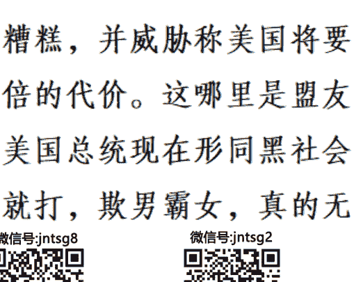

# 米联储见闻20250626——四海雄侠皆相Short

（兔子=中国，小岛=台湾）

川总公开爆雷，万斯当场竖中指，现在的美国领导层汇焰是越聚越旺，北约秘书长公开堪诫，这些过去高高大上，讲绅士风度的老西们，现在也全全顾不上所谓体面了。既然不讲体面，肯定要学会讲实务，这次北约峰会，兔子话题竟然消失了，这是近五年来罕见的。与与之对应的，北约已不再商讨在日本开设联络办事处一事，形同已放弃相关计划。

两年年前，北约公开表示考虑在日本亚太地区盟友的合作。如今民主党下台了，乌克兰都没有人管了，更不要万里之外的远东。如果齐实挑下阵风还足以让北约眼睛清澈，那么兔子频繁试闯的老底，足以让北约明白现在哪里是真正的浑水。

这次北约峰会主要解决一个问题：搞钱。吕特疯狂擦川普普之余，积极推动北约成员国把国防支出提高到GDP的5%，说白了就是保护费加价了，从过去的2%翻了一倍多，这对于经济下行的欧洲各国真可谓是雪上加霜。

西班牙第一个跳出来不同意，认为目前2%的国防支出已经足够符合现实，与福利国家相兼容，拒绝北约规定的提高到5%的目标。5%是川总提出的要求的，北约这次会同意在10年内把国防支出提高到GDP的5%。西班牙拒扣保护费，川总马上公开批评西班牙的决定很糟糕，并威胁美国将西班牙视为贸易协议支付双倍的代价。这哪里是盟友政治，明明是教父欺负娘，美国总统在形同黑社会大佬一样，公开勒索，不给脸打，胆敢霸权真的无法无天了。

如今国际秩序陷入丛林规则的趋势越发明确，从俄乌战争到巴以冲突再到现在的伊冲突，都是横瘫起手，说打就打了。过去被认为是常识和基本规矩的现代国际秩序，正义与否、国家道义，似乎都成了摆设，取而代之的是，打了就打了，你能怎样？联合国都成了个花架子，除了让各方吐槽模样，在执行力和约束力上没有一点用处。

俄乌战争前，美国警告俄罗斯不能动武，欧洲各国为避免战争也向俄罗斯集体施压，马克龙甚至顶着疫情前往莫斯科会见普京，但最后当普京拍板发起战争，谁能把俄罗斯怎样？即便国际法庭把普京定为战争罪犯，丝毫不影响他人出访、决策。战争就这么公然延续了三年多，打到美国开始劝乌克兰接受丢失地，变相接受俄罗斯发起侵略战争的合法性。

乌克兰被打得将国不国，不但拿回失地，还被吞噬了5000亿美元宝贵的矿产资源。即便美国卖到这个地步，这次在北约峰会上还上不了主席，川总甚至不愿意多看泽连斯坦基一眼。不管乌冲突的历史经费有多复杂，这场战争究竟是俄罗斯起的侵略战争，打到现在硬要侵略事实，攻的土地合法化，大家心里都不认，但是你又能怎么样？

伊以战争以及此前以色列在加沙的屠杀、动用军事乃至恐怖手段对哈马斯和真主党穷尽杀戮、越袭叙利亚内乱占领叙利亚领土，这一轮中东冲突突发生近两年的时间内，以色列几乎遭到了除美国之外所有的国家谴责。甚至连欧盟都差点和内塔尼亚翻脸，以色列的欧洲盟友也对以色列发起制裁，国际法庭还对以色列总理及国防部长签发了通缉令。

但以色列从加沙打到黎巴嫩，又打到了伊朗黑兰，对伊朗核设施与军事目标进行了连续十余天轰炸，几乎围困了伊朗军方高层。那些被霸凌被轰炸的国家，又能拿以色列怎么样？家里有导弹的，如伊朗，可以打回去；家里没点底的，如叙利亚、加沙、黎巴嫩，默默挨揍，除了哭还是哭，多做不了半点，指望谁能仗义出手？实在的，这世界比菜市场还冷漠，屠刀之下都是看，没有人真的会挺身而出。

美国这次轰炸伊朗设施更是将随心所欲四个字打在大屏幕上：我要打打就打，关你什么事？主权国家，管我们之间有没有宣战，管什么联合国宪章，我要炸你就炸你，炸完了，还要你接受停战。伊朗除了象征性的轰炸一下又能怎样？从本次伊以战争爆发以来，开始动手的是以色列，随意的加入的是美国，然后还不手，逼着伊朗必须停止还击，否则就打得更狠。这不是黑恶势力，什么是黑恶势力？世界何止是草台班子，简直就是黑社会本会。全世界都在谴责美的霸道行为，但伊朗却在为不再挨打举国欢庆。对美而言，打了就打了，谁又能怎样？

说真的，这些腰圆腿粗的大佬里，还只有兔子依然处处讲道理，时时讲理，面对小岛这么一块顽固不化的台独岛还在循环试图讲道理。相比之下，现在世界上这几场主要的军事冲突或说战争，都是非正义的、不道德的战争，都违反了国际法和联合国宪章，是一个国家对另一个国家公然侵略霸凌，都应该谴责。

但也堂而皇之的发生了，主导者遵循成王霸寇的原则，就是现在国际政治的新常态。百年未有之大变化的常态操作，就是战后几十年形成的一系列国际法概念被剥去，国际政治的丛林规则暴露其最原始的面目。

新常态下，实力即正义，大国更不惜使用武力维护和谋取利益，小国不要指望来国际规范、国际法、道德价值契约大国来实现保护自身。类似于菲律宾这种频频挑衅的操作应该让它痛一下，如果挑战大国的底线，就要挨惩，打了就打了，你能怎样？
