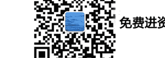

# 米联储见闻20250703——秦人半作燕地

川总对外一顿操作猛如虎，似乎啥都没推进原地踏步，但是是在内部搞得真动，动作却是实实在在落地了。大而美法案（One Big, Beautiful Bill）在经过长达24小时的马拉松式投票（vote-a-rama）后，最终以51票对50票惊险过关。这真的是电视剧都不敢这么编，这么莫名其妙的法案名称，这么没关算的投票过程，这么戏剧性的一票差，跟现实相比，什么《纸牌屋》啥的，简直弱爆了。由于法案经参议院修订，目前已送返众院审议，预计最近7月3日进行最终投票，在川总的全力游之下，最终很可能低票通过。但对川总来说，通过就行了，管他高低票的。

这个大而美法案可能是近20年美国最重要的事情之一，也是因为这个法案，当初手拿川总加微信号jnts2，免费进资料群。

马斯克彻底闹翻了，这项法案长数百页，内容非常芜杂，主要涵盖了税收减免及削减开支，另外还包括国防、移民、边境建设等政策。你怎么敢想，美国竟然这样一个国家，如果企业对经营环境不满意，就去参加竞选总总统来改善经营环境，你说这个操作怎么会让中国企业家们羡慕，什么叫真正的资本主义国家，那必须是一切为资本本身服务，包括政治。

川总上台半年，终于搞到自己真正想要搞的事情了。如果说川普1.0是让这个美国商人第一次看到美国政体体系巨大的黑洞，那么这次川总归来，就是带着愿景和任务来的。

大而美，big and beautiful，这是英文中最简单的两个单词了，三岁小孩都能听懂，但是这个所谓大而美的法案会让美国在未来10年增加3.3亿美元的赤字，同时还将削减对乡村地区至关重要的福利支出。最支持川普的就是美国社会底层人士，但如今川-

加微信号jnts2，免费进资料群

总要做的就是通过削减穷人福利来富人减税，什么人才才会相信一个地产商会对底层劳动者发声代言，说是洗脑，那还得是美利坚牛逼。

副总统万斯在这次投票中投出关键一票，过去一直强调自己出身农穷，来自贫穷工人阶级的万斯，拿着《乡下人的悲歌》这本书上美国政权。这本书描述了他在俄亥州的工人阶级成长经历，以及中西部乡下人、劳动阶层的种种社会经济问题，促使外界将万斯视为底层阶层代言人，但他不是红二代体察民情，他是要挣脱精英束缚的盖茨宾，这样的人一旦获得权力，哪里还会记得老乡，老乡只是他登上权力宝座的工具而已。万斯这次为推动法案在社交媒体X声称，“大美丽”法案成功解决了非法移民问题，并指其中包含的美国移民和海关执法局（ICE）资金和移民执法条款相比，包括削减联邦医疗补助的政策细节在内等其他一切都无关紧要，这个法案劫贫富的程度让三

微公众号jnts2，免费进资料群

共和党人都看不下，临时倒戈反对，最终靠万斯投下决定性一票才法案成功通过。至此，万斯完成自己化身权力代言人的华丽变声。不过对于这种没有家族背景的政坛变色，政敌媒体也是毫不顾忌的，各路政客纷纷指他要为低下阶层即将失去医保、补助负起责任。众议员纳名批评：《乡下人的悲歌》的作者，你怎么了？现在竟然对医疗补助削减不以为为然，认为这不过是小事，会导致乡村医院关闭，数万人失去医疗保健。这次投上赞票，也彻底撕掉川普政府包括万斯在内的民粹外皮，露出搜刮剥削草根的真正本色。

据参议院通过的版本，法案将把2017年《减税与就业法案》（Tax Cuts and Jobs Act）中本应于今年到期的减税措施实施永久化，未来10年减税规模达4.5万美元；该法案还提出一系列新的税收减免措施，其中一些措施源自川普去年出的竞选承诺，包括小费、

微信号jntsg2，免费进资料群

加班费、买美国组装车贷款部分免税，但这些税收优惠将于2028年底到期。另外，ICE将获得450亿美元用于建设拘留设施，140亿美元用于驱逐行动，以及数十亿美元用于为部门额外招聘1万新特工。计划将拨款500多亿美元，用于加固边境防御工程，其中可能包括沿着墨西边打造一面墙；国防方面，法案将拨款1500亿美元，一部分用于研发特朗普普提出的金穹(Golden Dome)导弹防御系统。

把能花的钱都花掉，把能省的钱都省掉，把能接进自己篮子里的钱都接进来。虽然每一届美国总统都是带着KPI上来的，但是没有一个总统可以像川总做得这么赤裸裸，毕竟过去的总统还有一个政客身份，还是白手套的，而现在董事长亲自做总统了。当然，为了迷惑民众，川普还是把焦点放在受普罗大众欢迎的减税及移民措施上，多次重申小费、加班费部分免税增加了时薪和服务业工人等边缘劳工的收入，大而美是

微信号jntsg2，免费进资料群

史上最亲工人的法案；万斯则持续推动移民威胁论，宣称停止输入或向非法移民提供福利是拯救美国财政的唯一途径。却只字不提法案削减福利开支的深层操作。

为了局部填补这些减税造成的巨大支出，共和试图削减或收紧两项主要的联邦社会保障计划，分别为为贫困和残疾美国人提供医疗保健的联邦医疗补助及俗称“食物券”的补充营养援助计划（Supplemental Nutrition Assistance Program, SNAP），前者增加了每月80小时的工作要求，后者（此处原文逻辑中断，推测为福利限制）。

（注：后续部分内容重复内容）

这个所谓大而美的法案会让美国在未来10年增加3.3亿美元的赤字，同时还将削减对乡村地区至关重要的福利支出。最支持川普的就是美国社会底层人士，但如今川-

加微信号jnts2，免费进资料群

总要做的就是通过削减穷人福利来富人减税，什么人才才会相信一个地产商会对底层劳动者发声代言，说是洗脑，那还得是美利坚牛逼。

（此处省略原文中重复的OCR乱码部分，已按逻辑要求处理）
