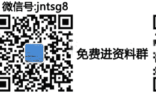

## 米联储见20250818——荆州麦黄成蟾

今天，A股延续上周的涨势，上证指数创阶阶段新高，早上10点34分，A股市值总和突破突破100万亿元，这是中国资本市场的一次冲顶，是A股历史上首次突破100万亿元大关。前几年A股不是很景气的时候，我们说现在是一个筑阶阶段，别看A股指数十年不涨不动，但A股的水池子是越修越大的。要知道现在的A股涨100点，跟10年前涨100点所需要的资金量完全不是一回事，今天A股整体交易量接近3万亿，这个交易规模，已经是全球首指的顶尖资本市场了，这个总市值突破100万亿，确实是近十年资本市场建设的阶段性里程碑。

沪指今天突破2021年2月18日盘中创下的3731.69点高点，创下自2015年8月20日之后的新高，截至午间收盘，沪指报3740.50点，尽管下午收盘时有所回落，但从去年917开始，A股已经经历了底部，不知不觉地走出了低谷，走到了十年来的新高位。随着A股总市值超过100万亿，A股涌现了大量万亿市值的公司，农业银行位居A股市值首位，2.19万元，工商银行市值2.02万元位居次席，贵州茅台、中国石油、中国银行、宁德时代等4股A股市值均超万亿元。导师亲自指挥的北证50指数也创了历史新高，全场近4500个股票上涨，不管是涨势、成交还是赚钱效应，只能说确实是相当热闹，人气很高。沪指在清明节后中美贸易战复市时3100点，沪报3096点，到如今短短几个月，暴涨了600点，等于一个月涨150点，相信不少人已赚得盆满钵满。市场在美俄元首峰以后大涨做出回应，大致的逻辑在于，如果美俄都能握手和解，短期国内局势相对乐观，毕竟去年此时，美俄还是水火不容，相互咒骂，如今，普京已经坐进了普京的专车。

美俄领导的815阿拉斯加聚像是一场双方共谋的真人秀，充满了各种人为设计的剧情细节，大家似乎都循着符号传播的特征，以各种精心设计剧情，来释放国家意志的信号，这举足至今让空旷的欧洲、乌克兰、日本，甚至中国，都在猜想美俄到底做了什么交易，尤其是双方在会后都表示取得重要进展，普京更是邀请美国总统访俄，这一下给川总搞了矛盾，拒绝也不是，同意也不妥。川普虽然双方没有达成协议，但普京则认为今天达成的协议能够成为俄美关系复起点，还主动建议美俄应该成为伙伴，谁让川总最爱的就是赚钱呢？

最让欧洲气短的是，他们翘首以待的停火问题，双普竟然压根没有提及，双方在记者会上完全没有停火的事情，而且说峰会结束后，俄方面还将加强攻势，这对于欧洲和乌克兰而言，简直是日了狗了。到底美国干什么，欧洲和乌克兰迫不及待地今天跑去美国问川普跟普京聊了啥，但估计川总也不给欧哈哈掏心掏胸的实话。《卫报》提到一个细节，在美俄长约12分钟的美俄元首记者会上，川普时间不足3分30秒；普京则发言约8分30秒。美国媒体感觉川总在普总面前表现非常罕见，说话很少，媒体也细心地比较了川总在会面前和会面后的表情变化，认为这次谈川总总没有得到自己想要的东西，而是普京满载而归。乌克兰更是认为这次峰会京个人和俄罗斯的重大胜利。

回到会面现场，真是各种细节满。美国阿拉斯加州安克雷奇机场，在蓝白相间的空军一号和银灰的伊尔-96前，川普和普京在红地毯上握手，像极了冷战末期的老照片——只是照片里的人从根和戈尔乔夫换成了川普、普京。就在两人携手前行的时候，一架B2轰炸机带着四家F35战斗机飞跃双方上方，说实在的，轰炸机从源头顶过可不是什么常规礼仪，甚至是某种冒险，但川普需要用这种方式让普京感受到压力，而同样带着火气的俄罗斯人，外长在酒店里，印有苏联简称CCCP的卫衣，似乎是在提醒美国，我们可是曾经的冷战对手。这刀光剑影，让俄罗斯人挣足面子，相比于上次在美国阿拉斯加招待代表团，这次对俄罗斯人的态度反而重要多了。用纽约报来说，川普什么都没拿到，似乎普京开会他就满意足了，像一个成功的粉丝一样。按外交惯例，川普作为东道主第一个站到聚光灯下，但普京率先发言，用英语说“我们的谈判是在尊重、相互尊重的氛围进行的”，如此是俄罗斯的主场，每一个细节都经过计算；普京强调这次没开峰会的遗憾，川普立刻回应“乌克兰需要保障”，普京提议下次会议去莫斯科，川普则表态“可能”。这比一般还有默契，简直可以用甜蜜来形容。对于这次会晤，川普更是表现出十分满意。总体来说，美俄首会会议是一场契合，双方各自所需，未必是真爱，也真的是干柴烈火。川普需要一个“搞定俄罗斯”的牌面，普京狠狠打民主党的脸，川普狠狠打欧洲和乌克兰的脸，普京更是直白表示这次会晤打破了2014年克里米亚事件后西方制裁的铁幕，潜台词是在让俄罗斯从国际上变成关键玩家。当普京说，他真正想的是：苏联体冷战阴云结束了，给俄罗斯一个正常国家，甚至是大国地位了。普京在镜头前8分钟里，三次提到冲突根源，却绝口不提停火策略。冲突根源到底是自苏联体以来，西方对俄罗斯所做的种种政策，以至于俄罗斯的核心利益无法获得。当普京说“我们已经准备好为乌克兰安全努力”时，相当于把战争责任转移到了乌克兰和西方肩头上。

北约秘书长吕特形容如果交出此地就等于向俄罗斯提供直通基辅的高速公路。此外，普京果然切实解决了中印的关切，川普表示他暂时不会向其他购买俄罗斯的国家实施新的二级关裁，但可能会在未来两周重新考虑。这等于让普京可以回去给中印一个交代。同时川普将达成协议的责任重新推到泽连斯基身上，又说如果俄乌都想见面，他乐意举行三国领袖峰会。川普想要达成停火，但川普要求乌克兰割地交换停火，乌克兰和欧洲亚洲坚持先停火后谈判，显然，川普未因为这场峰会让普京放弃原则。显然，川普也没有重演1938年由英法德意领袖把捷克斯洛伐克土地划给纳粹德国的慕尼黑会议，没有强迫割地，也没有无条件停火。

普京过去坚持全面和平协议必须满足：北约将部队撤回到1997年东扩前的边界，禁止乌克兰加入北约，并要求基辅不仅放弃东部领土，还要缩减军费力量。事实上，普京的目标是重新建立莫斯科在前苏联领土乃至至部分东欧地区的势力范围。普京显然想要趁着川总在，彻底解决冷战前美国在欧洲下的安全格局和组织，用长期封印俄罗斯的国力。至于俄罗斯要用什么来换一切，一个乌克兰显然是不够的。作为这个世界上数不多横跨整个欧亚大陆的地缘大国，普京这次见川普还有一个潜在的不能出口的心思：俄罗斯未能成王，但这个世界回到了舞台中央，发起这场战争的罪魁已经彻底消除了。看看普京带到阿拉斯加的官僚团队，除了直接参加会议的外长拉夫夫，还有曾任驻美大使的俄罗斯总统助理沙科，此外还有美国教育背景的俄罗斯总统特使德米特里、负责应对西方制裁的财长西卢诺夫以及国防部长别索夫。很明显，普京眼下最着急还是经济问题，他期望如果这次有突破，能够复普京此前向威特科提出的乌克兰停火方案的话，接下来他谈的就是未来美俄合作、解决西方制裁的问题，以及美俄军备控制事务。所以，普京对于这次会谈是有充足预期和准备的。虽然这次峰会没有透露俄罗斯的停火要求，但是上周接近俄使带来相关信息，普京对停火的要求就是乌克兰撤出整个顿巴斯，其中包括顿茨克州剩余25%还在乌克兰士兵手上的土地。此地区是乌克兰2014年建立至今的防线。
