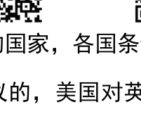

## 米联储见2050801——露暗烟浓草新(川普基本妥协对美关税)

你好，我是米糕。

最近其实事挺多的，但是各群聊最多的是武大那个破事，内蒙实死掉的6个大学生，一点消息都没有了，上海公安不作为导致19岁男孩自杀的消息也哑了，731悄撤档无声无息，终究还是武汉下了所有的互联网记忆。也好，闲着也是闲着，讨论没有没背景的小妖蛾子，总比给大家添诸强。

外面的变动较大，不光是美国，还有日本，中日关系肉可见的紧张起来，从官方层面民间层面，日本最近开始搞超量子计算机，而且直言无疑地意中国，要在高精尖技术领域和中国单挑的意思，川总在拿了一些关键国家的贸易协定后，昨天宣布向全球92个伙伴实施新关税，其中关税税率最高，高达50%。新公布的税率将适用于签署行政命令第7号，8月7之前装船且5月2日之前进入美国的商品，也无需缴纳新关税。

更新后的关税范围为10%至41%。该命令规定，除附件中列出的92国家的商品外，其他国家进口的商品均需缴税10%。巴塞尔，锐利41%，老比特和缅甸紧随其后为40%，瑞士是39%。任何被美国海关及边境保护局认定通过转运，逃避上述关税的物品，将被要求缴交额外40%关税。

加微jntg2，免费进资料群

这川重塑全球贸易的颠覆性计划，一直以来他都批评贸易模式不公平，并将其作为竞选总统的核心议题，可以说相比于其他当选后只默默默许捐赠商人商业利益的总统，川总一直是公开的，干事也都是公开的，且效率是真的是高，这才过去半年，关税战已经打到下半场了。在过去国家之间的贸易谈判都是按年算时间，而现在才6个月，该谈的都谈完了，谈不拢来的直接收钱，对于那些他认为存在贸易失衡、或在近期谈判中未对美国做出让步的国家，直接抬高关税，简单粗暴。

美国最大的贸易伙伴之一加拿大对出口商品的关税将从25%提高到35%，不过总统豁免了他在第一任期内与加拿大和墨西哥达成的协议框架交易的所有商品。维利亚、亚多尔岛、冰岛和尼利亚的关税率将被定为15%，斯里兰卡和台湾的出口商品将面临20%的关税。巴西最高，高达50%——这样的关税水平可能会创造其他国家的出口，增加美国消费者的成本。部分关税率反映了美国近周与少数贸易伙伴的初步贸易协议，这些伙伴包括英国、印度、印度尼西亚、菲律宾、日本、韩国和欧盟。这些国家通过承诺购买美国能源和飞机、投资美国工厂，降低了美国农产品和工业产品出口的壁垒，从达成协议的国家越30个左右，没达成协议的60多个。

加微信jntg2，免费进资料群的国家包括欧日这样的大型经济体，而没有达成协议的国家，除了中国继续推迟，印度和巴西都面临高额关税。已同意这些初步协议的国家将面临10%至20%的关税，低于最低威威胁的水平，但仍然高于历史水平。除了中国，还有一个国家获得了延长90天的实施办法，就是墨西哥的关税升级也暂停了10天。目前已经达成协议的主要贸易伙伴包括欧盟、英国、日本、韩国、菲律宾、印尼、越南，没有达成的主要伙伴包括加拿大、墨西哥、印度、泰国、柬埔寨、马来西亚、南非，巴西反制美国加50%关税；美国对华关税维持30%。

微信信号jtsg8

微信信号jtsg2
免费进资料群

对已经达成协议的国家，各国条件也有不同，英国是最早达成协议的，对英国商品加10%关税，豁免大部分工业与农业市场，提高准入。欧盟与英国类似，美国对欧盟加15%关税，豁免农产品、部分药物与化学制品，并在对欧增加7500亿美元投资。日本方面，日本将向美国开放市场，涵盖汽车、货车、大米及某些产品，关税由减至15%。韩国将向美国投资5000亿美元，其中5000亿美元用于造船业，并购买美国能源产品。这些盟友几乎都是为了美国钱出力。

加微jtsg2，免费进资料群

为了解决燃眉之急，仅仅获得不到10%的优惠，看着这一点你就说川普才厉害吧！至于发展中国，美国主要产地以外的国家，通过越南转运至美国的商品加40%关税，还将完全允许越南商品进入市场。此外，印尼的关税从32%至19%，涵盖所有行业，包括农产品和能源，越南挤出了近2000亿美元的订单，印尼等关税设置。川总不仅在新闻发布会上嘲讽印度，掉飞机，气得墨迪莫要公开抗议，还对印度加25%关税，还称从俄罗斯购买大量军事装备，威胁要印度额外罚款。几乎每个国家都有量身定做的贸易协议，其实只有接受或不接受的问题，谈判的主导权牢牢在美国手里。而最终目的是确保美国跟这些国家保持高度平等的贸易关系，好处都是美国的。川普仅仅靠着关税这一个工具，连枉子都没有获得收益，简直令人难以想象，这些国家对美国的恐惧程度令人为观止。

加微信jntg2，免费进资料群

民主阵营的媒体也不会为川上叫好，他们认为即将政策恐让美国本土工厂运成本提高2%至4.5%，对制造业造成资金压缩，最坏情况会导致停薪、裁员。美国劳工部数据显示，自4月宣布新一轮关税措施以来，制造业已面临资金流失超过1.4万个就业机会。奥鲁大学预测，关税导致的影响将使美国户均收入减少2400美元。制造业企业也吐槽进口钢材赖调价，使公司原料铜价格上涨5%至10%，一台来自德国进口的磨刀机因关税增加7.7美元，几乎等同一名员工的年薪。除了重工业以外，最直接受到关税政策影响的美国民生用品则是咖啡。全球最大的咖啡出口国就是巴西，美国咖啡高度依赖进口。美国劳工6月统计，烘焙咖啡价格年增12.7%、即溶咖啡涨幅更16.3%。除巴西以外，美国政府针对其他咖啡主产国越南（全球供应17%）、哥伦比亚（8%）、埃塞俄比亚与印度尼（6%）祭出等关税政策。但川普为了逼出最优利益最大化，已经接受忽视国内的通胀痛苦，而要把这种美国优先战略表现在面上。

另一方面，为了尽快脱离稀土脖子，川总也在着手全力解决问题。白宫上周与顶尖技术与回收公司高管会面，讨论如何快速提高铁产量。美国在与中方谈判结束后立刻着手提高稀土产量，足见稀土确实眼下中国为数不多。

加微信jntsg2，免费进资料群

筹码。以前可以拒绝美国的要求，但是仅仅是拒绝，要让美国利必须美国妥协，稀现在是为数不多中国可以让美国妥协的东西。川普的贸易顾问纳洛罗与高管会谈，政府正竭力推动美国的生产，为美国产商提供最低价格保障内的激励措施，美国必须紧紧寻找稀磁的来源。五角大楼已经向美国唯一的稀产商 MP Materials Corp投资4亿美元股权，其中包括美国政府担保的最低价格以及对这家公司的采购。纳洛罗在白宫7月31日发布的一份声明中：MP协议是关键原材料整体战略的重要组成部分，而稀只是其中的一部分。我们的目标是在整个关键领域，从矿山到最终产品，建立我们的供应链，参加这次会议的公司有潜力在这一努力中发挥重要作用。由此可见，美国正在全力修复全球化带来的安全性问题，逐渐从老大转向万事靠自己，不再相信美国。

台湾的特殊地位，加上中美谈判在关键时期，川普没有有过实台协议，就是指在望关键可以用台湾来制衡中国。此今，美台已进行三次谈判及六次线上磋商，进展有限。值得一提的是，除了半导体，台湾正在成为美国无人机产品的主要出口地，台湾无人机正在快速崛起，这正是台湾向美国交的一个投名状，在助美抗中这件事上，真的是心腹异，减少了对大陆市场的依赖。

加微信jnts2，免费进资料群
