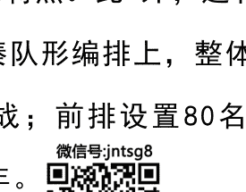

# 米联储闻250821——猛其风振沙哑
（大阅兵要来了）

你好，我是米糕

大阅兵要来了，这次阅兵相当高调，国务院专门举行新闻发布会，请两个少将介绍阅兵准备工作。从各方信息来看，这次阅兵不仅是纪念阅兵，也是十四五规划重要一部分，是过去十年改革强军成果的检验，是中国军事力量强军容在当下这个特殊的公开亮相，不是军事行动，胜此军事行动，是让各方知难而退的止战。整个阅兵活动按照阅兵式、分列式两步步骤进行，时长约70分钟，大量新装装备将首次公开亮相；部分海空战略武器、高超音速武器、无人装备，是第一次对外展示。这次阅兵训练坚持实战标准，依托战士指挥指挥阅兵行动，采取实战推演模式研讨方案计划。

这次阅兵设45个（梯）队。徒步队展现的是“老一新”：“老”就是抗战老部队，“新”是军事力量结构新布局，包括三结合的武装力量体系。装备方队按照实战联合编组，陆上作战战群、海上战群、防空军群、信息战群、无人战群、后勤保障群、战略远程打击群。空中飞机按照模块化、体系化编组，由先进的预警指挥机、击击机、轰炸机、运输机等组成，基本覆盖解放军现役战机，很多大家关注的明星装备是首次公开亮相。这次阅兵，受关注方将聚焦军和和部队亮相，这是解放军结构性新布局在阅兵中的首次集中展示。首次亮相的新型武器占比非常高，且大多是混合组编。阅兵动用万人，数百万武器装备精准协同，如同一准备一场战役。展示的所有装备都是国产现役武器。武器主要是以4代新型装备为主题，展示解放军体系作战能力。海空军智能新型武器，比如无人机、电子对抗系统等。信息化、智能化程度较高，展示解放军适应未来发展的特点。外，还有个小彩蛋，联合军团在受队队形中，整体设置14个面，寓意14年抗战；前排设置80名军号，寓意抗战胜利80周年。

从数据上看，2015年九三阅兵有84%的装备是首次亮相，2019年国庆阅兵有40%的装备首次亮相，今年是中国制造2025收官之际，新兵器亮相是主要看点，坊间消息是新兵器甚至亮相，几乎是全新装备，这个要具有体现阅兵再次实证了。此次阅兵，新战机是重点关注，空中梯队按照模块化、体系化编组，由先进的预警指挥机、击击机、轰炸机、运输机等组成，还有新型战力群，在编排设计上突出新质生产力，除了步兵方队的四支战略兵种本身代表新质新力量外，在装备方中还安排了无人、水下、网电等新型战力聚焦。

在俄乌冲突中，无人、水下、网电等新型战力的重要性颇为突出，其中无人智能、反无人装备和网电作战等新型力量，自然是一大看点。尤其是至少五种美国认为是忠诚伙伴的作战型无人机，让美国媒体惊叹的军工发展速度已将改写战争模式。此外，针对外媒说中国扩军备只能看不能用的装备，他们还真以为是中国印度，对此国防专门介绍，九三阅兵参赛的所有装备均为现役主战装备，但不全部都是真实的，而且都是现在，而不是研制中。言下之意，9月3日在我们在长安看到的装备都是随时可以入列的保国重器。

更令美军意外的是，其中部分新型号甚至连美军PPT里都没有对应型号，例如两款无尾翼设计、改进三角翼的无人机，其中一款机头细长，另一款机身更宽阔。从与运载卡车的尺寸对比来看，它们比FH-97更大，性能可能更强。另外两款新设计同样无尾结构，但具有变形三角翼。《华盛顿邮报》评论指出，这些设计显示出中国对忠诚伙伴的追求，未来可用于陆基作战或海军部署，进一步改写空战规则。文章分析，两相对照之下，美国的忠诚伙伴计划仍处于早期试验阶段，目前仅两款能执行有限任务。中国双座型-20S战机被认为是理想的空中控制平台，空警-500预警机及改进型-6轰炸机也可能成为未来机协同作战体系的一部分。

攻击-11隐形飞翼无人机及多型中长空将亮相，而一款新型垂直起降无人机更是焦点。其罕见的交叉双旋设计，与美国卡曼公司K-MAX直升机及CQ-24版本相似，被视为在中国航空领域领域突破。

从政治角度而言，这场阅兵是领导在天安门举行的第三次阅兵，也是1949年以来在中国天安门广场举行的第17次阅兵。盘点1949年以来历次阅兵方队变化：1949年10月1日的开国大典，中国进行首次阅兵，那时候的军队尚处于步步枪阶段，军事装备较为落后，山炮部队靠新组建不久，当时参阅的海军方队、空军、防空部队都十分弱小，根本不够用，现有飞机飞行两辆，有4架受阅飞机坦克战斗直升机，只能挂着实弹受阅。1950年的第二次阅兵，公安部队首次受阅，1900多匹战马组成的骑兵大队是一大看点。1951年的第三次阅兵，伞兵部队、防空部队、火箭炮部队首次受阅。1952年的第4次阅兵，仪仗部队首次受阅。1953年的第5次阅兵，黄色战马首次受阅。1954年的第6次阅兵，适逢建国周年，受阅部队从1949年首次阅兵时的基本装备变成了苏联式装备。1955年的第7次阅兵，是中国实行制后的首次阅兵，受阅部队指挥员穿55式飞机。1956年的第8次阅兵，受阅部队乘坐汽车是第一批出厂的国产汽车。1957年的第9次阅兵，受阅人数比往年少，有外宾等特殊观，国产伊尔-28喷气式战斗机、亚击机。1958年的第10次阅兵，适逢建国10周年，受阅装备国产化明显提升，国产五式坦克。1959年的第11次阅兵，适逢建国10周年，受阅的是红旗坦克。从1960年开始，中断。1984年国庆阅兵，经过35年改革开放、政治形势的变化，中国重新在天安门广场举行，这是文革后最长一次阅兵，其中90%以上装备都是自主设计的。1989年国庆阅兵，是建国40周年，受阅装备含量达到世界领先水平。1999年国庆阅兵，是建国50周年，改革开放以来成立的陆军、海军、空军、武警、预备役等部队首次受阅。2009年国庆是建国60周年，14次阅兵，受阅装备90%以上是新装备。2015年9月3阅兵是纪念抗战胜利70周年，这次阅兵在政治意义上重大，中国力量做出的作用，相比于其他国家，是抵御外敌的胜利。
