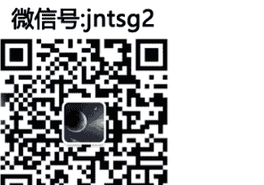

# 米联储惯见20250822——金慷拂雪挥鸣鞘

A股真是争气了，在轻松越过3700点后，今天暴涨50多点，站上3800点。从4月初的3096到今天的3820，不知不觉，A股大水塘已经涨了700点，轻松越过100万总市值门槛。今天的A股早已不是20年前的A股。上证指数的历史最高点是2007年10月16日创下的，当时站在6124点的历史高位，但是当天A股市值只有30亿元，所以今天虽然A股指数不到4000点，但是市值已经达到了100万亿。所以仅仅从A股指数来衡量A股是不客观的，现在的A股波澜不惊早已迈进全球金融的豪门俱乐部。这一周，A股以每天都超过2万亿的交易量冲击两个门槛，一周成功登上3728点，A股市值也创了历史首次突破100万亿人民币。这意味着从年初至今，上证指数已累计上涨超过14%。已有股民在喊今年拿下4200点，明年拿下5000点，三年登上6124点。

没想到从3700到3800，仅花了一周时间，这暴涨的节奏让很多老股民背发凉。解套清仓，落袋平安，各路炒家庄家更是疯狂杀进杀出，大喊牛市来了只想跟着冲。实际上去年917A股开始启动时，很多人还抱着半信半疑的态度。4月份关税大棒落地，最后一次倒车接人，A股已经没有给跳空者太多机会，有些股票没有踩着升浪的题材上几乎没有动，而新质生产力概念的股票不少翻倍甚至三到四倍了。从去年最低2690点位到今天3820，这一波超过1000点的大升浪是对坚信立场者的奖励。

近20年前的6124对很多老股民来说都不陌生，这是中国股市几乎疯狂的记忆。2005年5月，上证指数一度跌穿千点大关、探至998点，但短短一年多时间，A股大涨168%，到2006年底达到2675点。牛市疯狂的脚没有丝毫不停歇的意思，即便官方在2007年连续加息、甚至提高证券交易印花税，上证指数依然高歌猛进，在2007年10月冲上6124点的历史顶点。

当时的大背景是中国经济连续五年超过两位数的增长，中国外贸易总量不断创新高，加上中国城镇化运动推动中国房产市场的快速升温，大量热钱冲进中国。当时资本市场盘子小，水池浅，一点钱就能溅出巨大的浪花。被乐观情绪彻底点燃的大牛市中，中国股民赶后继进场，当时甚至有人豪言预测，中国处于5000年来最大盛世，股市至少涨到1万点。A股行情更是波澜壮阔，但是随着美国次贷危机开始露出端倪，A股在后的一年里推推拉拉，上证指数狂超过70%，不到一年打回原型，只有仍有不少人的股票站在当年的高位上下。到2008年奥运年前夕震跌到1664点，实现了史级的猛牛快速转弯，改写了许多人的财富命运，也成为中国股民最沉痛的一次投资教育洗礼。

所以，当中国股市面对面对十年一次的疯牛再现，心里也很慌，因为好久不见如此行情，真怕明天睡醒就是一场梦醒了，两手空空。每天都在想到底是真牛还是假牛，到底是慢牛还是疯牛。对于这一轮A股的上涨，很多机构和业内人士都把中国股市的上涨归于以DeepSeek为代表的中国科技行业崛起。人工智能、机器人、新能源汽车等高科技行业在中国迅猛发展，有人形容，中国在科技领域的发展已经到了斯普尼特时刻（Sputnik moment），通过了这个创新的关键点，迎来爆发期。

这一轮A股的上涨是对中国经济结构转型成果的奖励，传统经济驱动动力虽然放缓，但更多资金、精力放在了更有潜力的新兴产业，带来了整体竞争力的提升，企业的净资产收益很可能系统性提升。科技行业今年大放异彩，带动了增长预期，也吸引全球资金流入资本市场。此外，支撑这轮股市上涨也有政治因素的利好，包括即将举行的九三、秋天召开的四中全会和届时将召开的“十五五”规划（2026年至2030年），以及预期中的中美关系，这些重大事件在短期内继续发挥信心，推动市场下半年继续高位运行。

| 付费文章 | 付费社群 |
| :--- | :--- |
| 付费课程 | 行业报告 |
| 财经 | 股市 |

相比于外资的蚕食，中国股民被损害后要调整，要小心。从20年前中国A股跌下坡的脚刻骨铭心，实际上，不管是国家还是外资，都明白这一波真正的资金不是外资，也不是大户，而是中国股民。这些一直以来拿着钱不动的中年产们，他们手里的储蓄是全球巨头虎视眈的肥肉，意识到他们可能是别人嘴里的肉，这次更加谨慎。官媒也很克制，舆论上虽然讨论，但没有渲染行情，似乎有一种不煽动。官媒最近明确公告严禁资金用于炒股，让有能力的人去创业，长期投资而不是赚钱，才能推动中国资本市场真正走向慢牛。

在经历无数次大起大落后，追求一夜暴富的人变少了。说实话，从去年开始赌国运，到今天A股给予中国市场的一些正向回报，我还是要一句：中国经济成功转型很难，因为以前基础仍不牢，消费增长脆弱、行业内卷让价格具有不确定性，负面情绪依然存在。这轮股市的上涨行情会持续多久？冲上高位后能否企稳？还有诸多未知因素。而今天A股的大涨是对过去近十年中美博弈的一次奖励，这场奖励源于全球资本看懂了：美国不能把中国怎么样，起码现在美国手里的筹码和工具已经耗尽了，军事手段也无法上强度。中国资本市场竟然仍处于历史低位，市值被严重低估，这才是这一轮A股上涨的根本逻辑。对于这样的行情，我只能说人生须尽欢，参与才是硬道理，但是参与不是赌身家，更不是妄想一夜暴富，拿出一定的闲钱，跟着国家跑步前进，端正心态。

值得注意的是，截至8月15日，总市值最大的股票是腾讯控股，总市值达到694亿美元，在过去10年里增至4.3倍。就在此时，腾讯还拿出近10亿美元继续高位回购的股票，表现出对中国资本市场的支持力度。5月在香港进行二次上市的宁德时代总市值达到1803亿美元，跃居第十位。比亚迪总市值也跃居十七位，在最近10年里增至近7倍。10年前市值排名第一的国有通信企业中国移动退居第七位，总市值下降1%。国家意志之下推动新兴产业的决心非常大。宁德时代从2015年到2024年上半年累计获得超过169亿元的政府补贴。日本综合研究所长期观察研究中国上市企业，他们调查发现2015年至2023年的补贴金额中，大部分投入了高性能机床、机器人领域和半导体领域，补贴占营业收入的比例超过2%。采取的模式是资金重点投向增长初期阶段的产业，认为达到一定增长阶段后减少补贴，再转向其他产业。日本分析员认为中国政府正在战略性高效配置资金，以提高国家实力。而银行存款正在发生异变。中国人民银行（央行）8月中旬发布的7月份金融统计数据显示，新增银行贷款20年来首次下降，信托和证券等“非银行存款”急剧增加，对股票投资视匮如炬的资金大搬家已拉开幕。央行8月13日发布的金融统计数据显示，7月份中国银行存款减少约1万亿元，另一方面，非银行存款加2万亿。这被认为是非银行存款向股市转移的表现。
