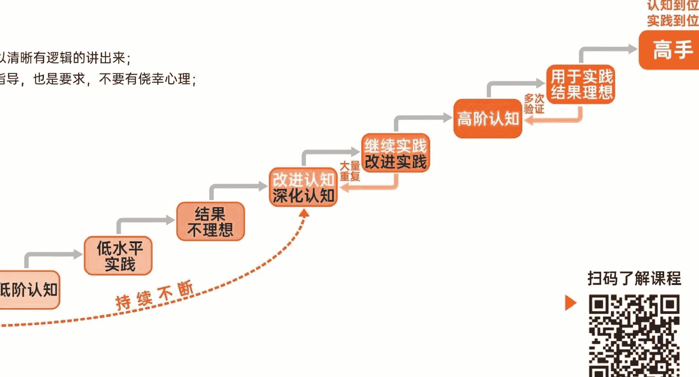

成长

# 第三章：从新手到高手
是否必须努力？

你好，我是小鱼。从新手到高手是否必须努力？很多人问我，答案是：天赋很重要，但努力更重要。

但是，从新手到高手是否真的必须努力？如果我没有天赋，那么我是否能成为高手？

新手到高手，我们需要一个学习的过程。从新手到高手的过程中，我们到底需要学习什么？

新手到高手，从新手到高手，是否真的必须努力呢？如果我没有天赋，那么我是否能成为高手？

## 新手到高手是否必须努力？

通过本章节，我会告诉你新手到高手需要学习什么。首先，第一章：新手需要目标：

# 第一章：新手需要目标

首先，新手需要目标。没有目标，你就不知道向哪里努力。

其次，新手需要计划。没有计划，你就不知道该如何努力。

第三，新手需要执行。没有执行，你就永远无法获得结果。

第四，新手需要反馈。没有反馈，你就不知道该如何改进。

第五，新手需要总结。没有总结，你就无法从经验中学习。

# 第二章：新手需要天赋

为什么新手需要天赋？因为如果你没有天赋，你可能无法成为高手。

但是，天赋并不重要。因为如果你没有努力，你可能无法成为高手。

所以，新手需要努力。因为如果你没有努力，你可能无法成为高手。

# 第三章：新手需要计划

为什么新手需要计划？因为没有计划，你就不知道该如何努力。

但是，计划并不重要。因为如果你没有努力，你可能无法成为高手。

所以，新手需要努力。因为如果你没有努力，你可能无法成为高手。

# 课程《通往高手之路》

任何领域从新手到高手的进阶路线

作者：骆左罗 2022.6.17

请保存好此神图

- 1. 请每个学员反复理解，直到可以清晰有逻辑的讲出来；
- 2. 此路线适用于“所有”领域，既是指导，也是要求，不要有侥幸心理；
- 3. 课程中有详细讲解帮助你理清。

认知到位
实战到位
高手
用于实践
结果理想
多次验证
高阶认知
继续实践
改进实战
改进认知
深化认知
结果
不理想
低水平
实战
低阶认知
持续不断
学习
新手
认知不到
实战不到

扫码了解课程

版权声明：传播、使用此路线图请注明作者+出处。感谢