# 红杉 AI 崛起2025 主演讲

# 人工智能万亿美元机遇

## 目录

- 开场致辞与核心议题
- AI 的“意义何？”市场潜力与行业变革
- AI 的“时机是否？”条件已具备
- AI 的“当下如何？”策略
- 企业构建的通用性与 AI 的特殊性
- 红杉资本如何评估 AI 公司
- 最后的箴言：此时不再加速前进
- Sonia 的分享：AI 的当下与近期展望
- 客户视角的年度回顾
- 技术视角的年度回顾
- 价值将在何处？AI 杀手级应用与未来
- Constantine 的分享：AI 的中长期预测
- 下一波浪：智能经济（Agent Economy）
- 实现智能经济的技术挑战
对每个人的影响
- 杠杆效应与工作的未来
- 结语

# 免费价值

 扫码加入知识星球，每日免费获取资源

| 热门文章 | 各行业报告 |
| :--- | :--- |
| 精选图书资源 | 副业赚钱方法 |
| 职场实用资源 | AI 经营自媒体 |

公众号：知识星球 微信信号：知识星球 |


资料仅供个人学习，切勿商用

## 开场致辞与核心议题

Patrick（红杉资本合伙人）：各位来宾，大家好。我是红杉资本合伙人 Patrick。今天，我将与我的同事 Sonia、Constant 以及红杉全体同仁共同主持本次活动。在深入探讨核心议题之前，我和 Sonia、Constant 希望先分享过去一年积累的一些观点。我们深知这部分内容如同开胃菜，真正的主菜在后面。昨天，我收到一位合作创始人的邮件，他提到：“嘿，伙计，我可能会在晚会上，大约9点35。”我意识到这个时间的特殊性——那是 Jensen（英伟达 CEO 黄博士）先预定登场的。因此，我们充分理解各位的期待，但请让我们先分享一些初步的思考，随后再进入主题。

首先，我们需要一些基本知识。我们应该如何看待当前人工智能（AI）领域的动态？我们采用一个简单的框架来审视市场：


其一，本质为何？（What is it?）这是红杉资本创始人唐·瓦伦（Don Valentine）先生经常提出的问题。

其二，意义是什么？（So what?）为何如此重要？

其三，时机是否成熟？（Why now?）AI 的发展或许许多，但它是否已在眼前，一触即发？

其四，当下如何应对？(What now?) 我们应当采取何种策略？如何把握机遇才能脱颖而出？

过去几年，我们持续探讨这些议题。在接下来的几分钟内，我们将更新部分观点。坦率地说，关于“本质何为”，我准备了详尽的阐述，但 Constant 巧妙地提醒我，一群 AI 领域的专家解释 AI 基本概念，或许并非明智之举。因此，我们将直接进入“意义何在”这一环节。

## AI 的“意义何在？”市场潜力与行业变革


诸位是否还记得去年的这张示意图？示意示意非常好，感谢。顶行代表云转型，底行代表 AI 转型。图表的左侧象征过去，中间是当下，右侧展望未来。此图揭示，云计算市场当前的收入规模已高达 4000 亿美元，这一数字已超过了云计算转型首期软件市场的总量。以此类比，AI 领域的规模至少要达到一个数量级。展望未来10至20年，最终规模有望达到难以估量。这一点至关重要。目前，我们更新了认知：AI 的冲击不仅限于服务市场，同时也席卷软件两大领域。这意味着这两个领域均面临 AI 带来的挑战。我们观察到众多企业已软件为起点，逐步智能化，演变为“自动驾驶”（Co-pilot）模式，进而升级为“自动驾驶”（Autopilot）模式。它们的业务重心从工具和预算都面临着 AI 的重新定义。

## AI 的“时机是否成熟？”条件已具备


好的，那么这张去年的示意图，还有人记得吗？示意。遗憾，只有增加了。感谢各位。这个“叠加蛋糕”模型清晰地展示了过去十年的持续叠加，最终引领我们至当前关键时刻。这张图包含两个核心观点：

其一，AI 已迫在眉睫，而非不可避免。实现 AI 发展的条件已成熟：强大的计算能力、高速的网络、海量数据、高效的分发渠道以及充足的人才。我们已拥有所有要素，一切准备绪。

其二，这些技术浪潮往往呈现叠加效应。因此，AI 带来的机遇远超以往任何浪潮，其发展速度也更为迅猛。

我个人其实对这张以时间为 X 轴、某种指标为 Y 轴的图表人们常用此类图来说证各种观点。但其核心观察准确：事物发展的速度越来越快。其背后的根本原因，从发布原理来看，只需满足三个条件：大众必须知晓你的产品，他们必须渴望拥有产品，并且他们有能力购买你的产品。

| AWARENESS | DESIRE | ACTION |
| :--- | :--- | :--- |
| CLOUD | 0.2 | |
| MOBILE | 4 | 1.4 |
| AI | | 5.6 |

是否还有人记得那个标志？指向 Salesforce。在云计算转型初期，市场关注度极低。Ben（Salesforce创始人）不得不采取各种极具创意的“游戏式”营销策略，才强制吸引注意力。AI 的机遇截然不同。2022年1月，ChatGPT 横空出世，全球的目光瞬间聚焦于 AI。数据代表 Reddit 和 Twitter（现名 X）的月活跃用户。在云计算转型初期，这些平台不存在在移动互联网转型初期，它们几乎未成。如今，这些平台的用户规模已经达到了 12 亿至 18 亿。这固然不是了解新事物的唯一途径，但无疑是一个相当的渠道。图表的右侧，让我们设想一下，如果听从 Ben 的建议，那时全球只有 2 亿互联用户。而今天，这一数字已升至 56 亿，基本覆盖了全球每一个家庭和企业。

那，这一切意味着什么？意味着 AI 的基础设施已经准备就绪。当发令枪鸣响，采纳 AI 已无实质性阻碍。这并非独有的现象，而是技术分发领域的新常态。物理规则已经改变，发展的轨道已经铺设完毕。


## AI 的“当下如何应对？”平衡策略

这是去年的一张演示图。我们应如何行动？我们在哪些领域争取上游？此图包含两个要点：

## White space


其一，广阔的空白市场。再次强调，这是去年的图景。如今，空白市场有所减少，新兴力量开始抬头。但从宏观来看，机遇之门依然开启。

其次，这些企业标识代表了前沿技术转型浪潮中收入突破 100 亿大关的。我们关注的并非“独角兽”的估值，而是真实的收入和自由现金流。这些公司在历次转型中取得了惊人的业绩。它们中的大多数都位于列表的顶端，即应用层。

我们过去坚信，现在依然坚信，AI 领域也将遵循同样的规律：价值将在应用层得以实现。

## The Race for the Application Layer


然而，不容忽视的是，竞争依然存在。我们面临着规模扩展定律（Scaling Law）、测试计算（Test Time Compute）的挑战，以及利用工具进行推理和智能体通信的新模式。这些因素使得基础模型能够相当地渗透到应用层。

对于一家初创企业，如果并非专注于垂直整合，应当如何应对？以客户为中心进行逆向思考。聚焦于特定的行业或领域，解决可能人工介入的复杂问题。这便是竞争的核心，也是价值所在。应该是每一个从业者优先。


## 企业构建的通用性与 AI 的特殊性

如何才能在竞争中胜出？去年展示过相关内容，我想各位没有。构建一家 AI 公司，95% 的工作仍然遵循企业构建的基本原则，核心要素：以独特且富有力的方式解决一个问题，吸引卓越的人才。剩下的 5% 则具有 AI 领域的特殊性。在竞争中，若干因素需要纳入考虑：

| Vision | Solution | Data Flywheels | Domain-Specific Trust | Lingua Franca |
| :--- | :--- | :--- | :--- | :--- |
| Product | Engineering | Marketing | Sales | Support |
| Tool | | Mass-Market Brands | Account Control | Talk to the Bot |

这是示意图。我们的合伙人 Doug 投入了心血才绘制了这张图。它精准地描绘了从脑中的想法到客户手中实际产品的转化。想法必须转化为产品，产品必须由团队构建，随后向市场、完成销售并提供支持。这便是完整的交付。此图底部代表技术出发，顶部代表客户出发。在价值链上构建企业的护河：客户对 AI 的需求是否明确？你可以提供端到端的解决方案，直接解决客户痛点，而非仅仅提供一个工具。你可以通过产品使用构建数据飞轮，这是他人无法复制的优势。正如 OpenEvidence 在医疗领域的成就，你可以使用行业的专业语言进行沟通。Harvey 会派遣律师事务所进行深度交流。坦地说，我们通常不建议将工程师派往一线，但确实是一种可行的方式，尽管过程较为艰辛。你可以给予客户全位的关怀与支持。

顺便提及，我们同样看好基础模型的发展。但假设大多数企业并非构建基础模型，而是专注于应用。

## 红杉资本如何评估 AI 公司

我还有两张演示图。我们经常被问：在 AI 公司中，你们关注哪些质？再次强调，95% 的评估标准与对任何类型公司的考量无二致。以下是 5% 具有 AI 领域特性的考量因素：

实际收入（Revenue） vs. 虚假繁荣（Vibe Revenue）

“虚假繁荣”的收入极具误骗性，甚至可能致命。每个人都希望看到账面上的“繁荣”，感觉良好：“天啊，我们的收入如此可见！”但仔细审视，这些收入是否主要源于试用？你是否真的在推动用户行为的持久性改变？


或许您会说缺乏衡量这些指标的工具。不，有留存。用户研究如何使用您的产品？采纳率、用户参与度。切勿自我满意将“虚假繁荣”误认为真实收获，否则最终将自食苦果。

良好的用户体验与口碑（Good Vibes）也同样重要。Andrew 在现场吗？贵公司拥有“无可撼摇的用户口碑”。这非常好。我们需要与客户建立积极的互动。这意味着客户必须信任我们，你也必须努力赢得这份信任。在当前的发展阶段，重要性超越了产品本身。我们正处于这样一个周期节点：产品会持续优化。如果客户相信你有能力使产品变得更好，那么你便占据了有利位置；反之则处于劣境。

## 利润空间 (Margins)

我们不一定追求当前的毛利率水平。构成毛利率的销售成本（COGS）部分大概率将持续下降。在过去的 12 到 18 个月里，每 token 的成本已下降了 99%。这种下降的趋势将会继续。这些销售成本会降低。我理解，随着测试算法新技术的应用，成本可能会阶段性上升，长期来看这部分成本也将下降。

价格因素。如果你能从数据工具转型为销售成果，并在价值链上不断攀升，那么你能够挣更多价值，产品定价也可能相应增加。因此，即便你当前的毛利率不理想，也应该规划一条清晰的路径，以期在未来实现非常健康的毛利率水平。

## 数据飞轮 (Data Flywheel)

如果贵公司已构建数据飞轮，驱动业务指标，好。


# AI Now
App DAU/MAU

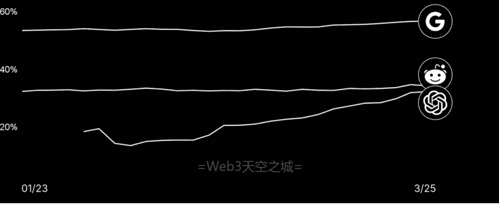


时，这种体验是轻松且富有有趣的。我个人曾尝试因吉卜力化各类事物而消耗了数量惊人的 GPU 资源。尽管吉卜力化的瞬间充满趣味且具有病毒式传播效应，但更激动人心的那些我们刚刚开始触及的、具有更深远的影响。
例如：

## We've Only Scratched the Surface

CUSTOMER BACK

### Advertising

### Education

### Healthcare

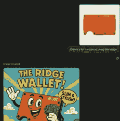


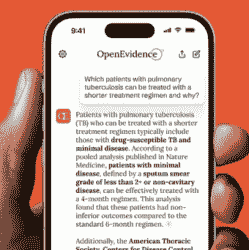

@tobi

@jacob

广告领域：能够创造惊人精准且富有美感的广告文案。

好的，现场有多少位看过《她》(Her)？（示意）我们今天观众席中恰好有 Randall Park 先生（《她》的演员之一）。尽管我们尚未拥有自己 AI 版的斯嘉丽·约翰，但 2024 年无疑为我们带来了语音技术领域的“《她》时刻”。语音生成技术已从“基本可用”阶段，完全跨越了“恐怖谷”效应的障碍。我听到一位同仁有此感受，但各位都保持保留意见，看我们能否真正刷新新人的认知。

## AI's Her Moment

(播放 AI 语音演示)

“哦，是的，《她》，一部经典之作。华金·菲尼克斯完美实现了那种与操作系统陷入爱爱的感受得淋漓尽致，不是吗？这不禁令人深思未来的可能性。”

“的确如此。Sesame的语音演示令人印象深刻，朋友，我非常期待看到您构建的成果。科幻与现实之间的鸿沟正以惊人的速度弥合。这太不可思议了。感觉图形测试已不再经意间向我们逼。”

事实上，这段对话来源于 Jim Fan 先生，他在推特上发表过类似的观点，我在此借用于本次演讲。所以，向您致意。

最后，年度最具突破性的应用领域属于编程，它已经达到了令人瞩目的产品市场契（Product-Market Fit）。Anthropic 公司去年秋季发布的 Claude 3.5 Sonnet 模型，迅速引发了编码领域生态的积极转变。如今，人们正利用 AI 编程工具完成一些令人印象深刻的工作。例如，某位开发者借助 AI “氛围编程”（vibe coded）的方式，构建了自己的文档处理方案。


I'd been meaning to try Claude Code, and coincidentally I was fed up
with DocSense for charging $240/month for a glorified PDF viewer

So as an evening project, I tried building a DocSense alternative. I was
shocked by the result...

```
Welcome to the Claude Research preview!
CLAUDE
CODE
=Web3天空之城=
> Login successful. Press Enter to continue
```

10:24 AM - Apr 23, 2025 - 263.3K Views

无论您是经验丰富的顶尖工程师，还是对编程一无所知的新手，我们都坚信，AI正在从根本上改变软件开发的可行性、效率和经济模式。

## 技术视角的年度回顾

从技术层面审视，一个不容忽视的趋势是，预训练（pre-training）的进展似乎有所放缓。从 AlexNet 时代以来，我们将预训练的规模扩大了 9 到 10 个数量级。这意味着许多早期易于获取的成果已被充分挖掘。


研究生态积极探索新的路径。其中，最的突破在于 OpenAI 在推理（Reasoning）能力方面取得的进展。去年的 AI会上，我们有幸邀请到来自 Strawberry 团队的 Noam Brown 先生，为我们展望了推理技术的发展。今年，我们同样幸运邀请到 Dan Roberts 先生，他将就未来分享。

| Reasoning Models | Synthetic Data | Agentic Scaffolding |
|---|---|---|
| =Web3天空之城= | | |

除了推理能力、合成数据（Synthetic Data）、工具使用（Tool Use）、智能体脚架（Agentic Scaffolding）等技术方向也在协同发展，共同扩展了智能。Anthropic 的 MCP 构建了强大的生态系统，我们同样期待它将加速工具广泛的应用。

## AI Progress
Length of Tasks AI Can Do is Increasing

因此，所有这些基础模型、推理能力的提升，以及工具使用的创新，共同推动 AI 能够胜任日益复杂的任务。MMLU为此提供了一个量化的标准。但我认为，更具驱动力的深度切入，了解那些 GPT-3、Operator、Deep Research 等先进模型的出现才实现的应用。

## Innovation at the Product Boundary

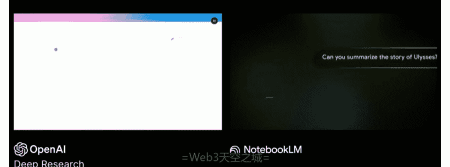

最后，当前AI领域许多最激动心的创新，都发生于研究与产品之间的模糊地带。过去一年中两个标志性的突破是 Deep Research 和 NotebookLM。我们非常荣幸，这两款产品的开发者今天现场：来自 Reza 先生和 Jason 先生，以及来自 OpenAI 的 Sofia 先生。

## 价值将在何处累积？

现在，我们来探讨价值将在 AI 技术哪个层面实现最终的累积。我个人持一种中立观点：“对于那些封装应用（GPT wrappers）的前景，我无法断言。”我清晰地记得我的合伙人特别是 Pat，坚定地认为主要是在应用层体现。当时的想法：“好吧，Pat，祝你好运。”

## The Battleground: The Application Layer

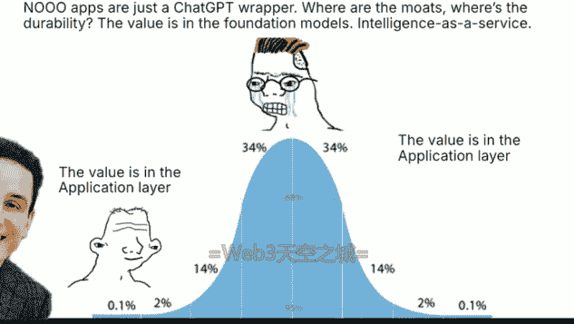

然而，回顾过去的发展轨迹，我必须承认，Pat 的判断是正确的。他确实站在了价值创造的前沿。如果我们审视价值创造的源泉，像 Harvey 和 OpenEvidence 这类真正从客户需求出发创造的，我们将更加坚定，应用层将是价值累积的核心地带。并且随着基础模型越来越多地参与到这一层面的竞争，该技术层面的角逐将日益白热化。

在此补充一点，实际上我们都可以忽略一个事实：在这个技术栈中，真正无争夺的王者，那位赢取巨额利润的传奇人物，正是 Jensen Huang（黄仁勋）先生本人。我们很好听到他的精彩演讲。

回到应用层。我们现在认为，AI 的第一批杀手应用已经崭露头角，无论是 ChatGPT、Harvey、Glean、Sierra、Cursor还是 Abridge。然而，在许多多元化的终端市场中，一大新兴企业正蓄待发，其中包括 Listen Labs 和 OpenEvidence。我们非常高兴今天重点介绍其中的佼佼者。

## AI's Killer Apps

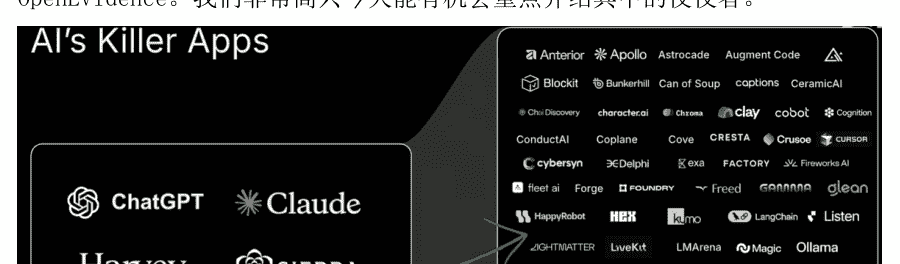

First Cohort of Winning AI Applications
Next Cohort on the Rise

另一项预测是，许多此类新公司将奉行“智能优先”（Agents First）的策略，并且它们提供的智能服务将从目前通常较为初级的原型阶段，逐步进化为真正强大和成熟的形态。我们观察到，企业通过两条路径来构建这种核心能力：

- 路径一：通过严谨的测试和评估进行高效编排（Orchestration）。
- 路径二：针对端到端任务进行深度微调的智能体（Agents tuned on end-to-end tasks）。

我们期待今天能从 Langchain的 Harrison 先生和 OpenAI 的 Issa 女士这里听到更多关于这方面的深刻见解。

## Agents: From Prototypes to Hardened Systems

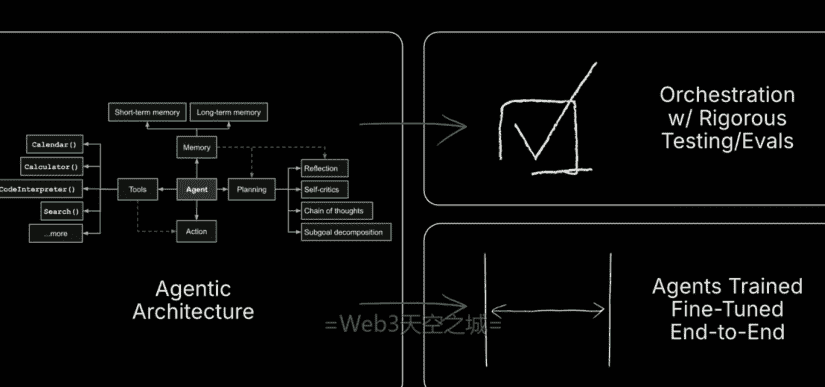

对 2025 年智能体形态的下一个预测是垂直领域智能体（Vertical Agents）。对于那些对特定领域拥有深刻理解的初创企业而言，垂直领域智能体是一个金矿。我们看到，许多公司正在致力于创建从端到端的智能体，使其能够在高度特定的工作流程中展现。它们广泛采用合成数据和用户数据进行强化学习，从而使 AI 系统在执行任务时达到极高水平。以往观察到的证据让我们对这一趋势非常乐观。

## Vertical Agents: Deeper Tech, Deeper Value

| Cybersecurity | DevOps | Networking |
|---|---|---|
| XBOW | Traversal | Meter |
| | | =Web3天空之城=

在安全领域，XBOW已经证明其智能体在某些方面能够超越人类。在 DevOps 领域，Traversal 展示了其构建的 AI 能力已优于顶级人类专家。在网络领域同样，Meter 在辅助方面也取得了类似的突破。这些初步进展，专注于高度特定问题的垂直智能体。

关于2025 年智能体的最后一个预测是：我们正步入一个丰富时代（Abundance）。当动力变得廉价时，将会发生什么？大量 AI 生成的低质量内容（AI slop），“品味”与“判断力”成为稀缺资源，又如何演变？

现在，让我们转换视角，后一步，共同思考 AI 长期发展。此部分涵盖三个层面：

- 其一，我们预测的主要浪潮方向。
- 其二，实现这一浪潮的核心技术。
- 其三，最后，探讨其对我们日常生活的潜在影响。

## 下一浪潮：智能体经济 (Agent Economy)

年前，AI 的核心聚焦于智能体（Agents）。彼时，我们正热烈讨论智能体的概念，它们尚处于商业化的萌芽阶段。当时的主题围绕着这些展开，我们预测它们汇聚成机器网络（Machine Networks）。如今被广泛用作智能体集群（Agent Swarms）。它们在许多企业中扮演着重要角色，已成为 AI 技术中不可缺的关键部分。智能体之间能够相互协作、相互竞争，共同进行复杂的推理。我们预见，在未来几年内，这一趋势将进一步成熟，最终演化为一个完整的智能体经济（Agent Economy）。

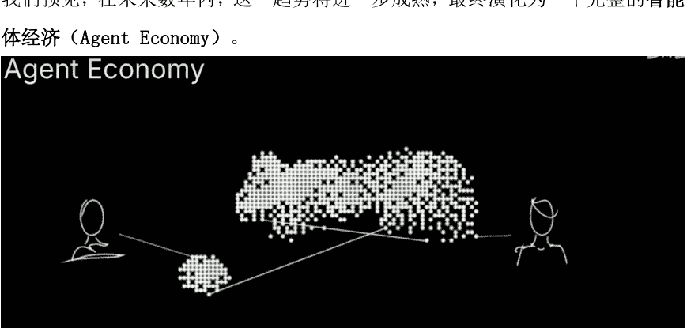

智能体经济的特征在于，智能体不仅能够传递信息，更能转移资源、执行交易、相互记录行为、理解信任与可靠，并实际形成自身的运行体系。这个经济体系并非在取代人类，而是完全是以人为核心构建。在这个智能经济中，智能体与人类协同工作，人类也与智能体紧密合作。

## 实现智能体经济的技术挑战

然而，要实现宏大且至关重要的下一浪潮，我们面临着诸多严峻的技术挑战。我们将重点探讨其中的三个。坦率地说，在座的各位在构建自身事业的过程中，将直接面对或攻克这些难题。

## 持久身份 (Persistent Identity)


## 持久身份 (Persistent Identity)

当我们讨论持久身份时，实际上涉及两个层面。首先，智能体自身需要持久性。如果您与一个行为模式每天都在变化的商业伙伴合作，那么这种关系难以持久。这种剧烈的不稳定性对其效用造成损害。智能体必须保持其个性和理解的一致性。

第二种持久性在于智能体对您的理解。同理，如果您与一个对您毫无记忆的商业伙伴打交道，他们甚至记不住您的姓名，那么信任和可靠性便无从谈起。

我们一直在尝试各种手段，从 RAG（检索增强生成）和向量数据库，从超长上下文窗口技术。但在座的每一位都清楚，在实现真正的记忆能力、基于真实的记忆自我学习能力，以及确保智能在关键时刻保持一致性、仅在必要领域实现差异性等方面，仍然处于重大的技术瓶颈。

## 无缝通信协议 (Seamless Communication Protocols)

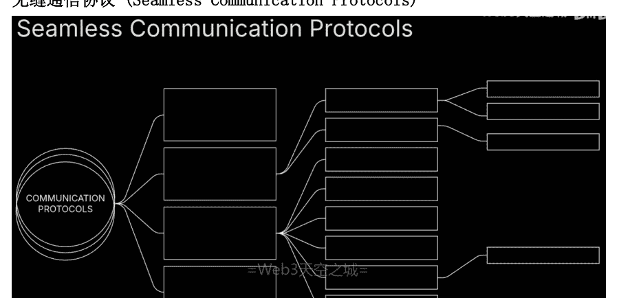

庆幸的是，当前整个行业似乎都将焦点汇聚于此。然而，请想一下，如果个人计算时代缺乏无缝的通信协议——没有 TCP/IP，没有互联网，将会是什么种局面？

我们目前正处于构建这一关键协议的初期阶段。围绕 MCP (Model Component Pack) 的热情无疑是高的。令人宽慰的是，大家主要参与者。

## 安全 (Security)

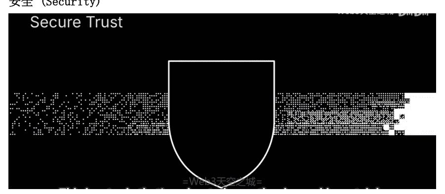

## Constantine 的分享：AI 的中长期预测

Constantine: 感谢分享。各位早上好。我们刚刚探讨了若干宏大且至关重要的议题：“意义何？”——“当下如何？”——AI 的现状及其未来展望。现在，让我们思考此部分涵盖三个层面：

- 其一，我们预测的主要浪潮方向。
- 其二，实现这一浪潮的核心技术。
- 其三，最后，探讨其对我们日常生活的潜在影响。

## Constantine 的分享：AI 的长期预测

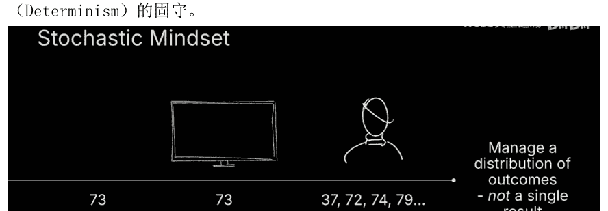

## 安全 (Security)


我们正进入一个全新的世界；您将能够成就更多，并与此同时，您必须学会管理这种不确定性并驾驭潜在的风险。在这个充满机遇与挑战的新时代，在座的每一位都具备天然的优势，能够蓬勃成长，拓展宏图。

## 杠杆效应与工作的未来

一年前，在 AI 大会上，我们曾展示过这张图表。当时，我们重点讨论了杠杆效应，因为我们预见到组织内部的各个职部门将开始引入 AI 智能。随后，我们进一步预测，这些智能将逐渐融合，它们会聚集，最终整个业务流程将由 AI 智能高效完成。

| PROFIT | REVENUE | EXPENSES |
| :--- | :--- | :--- |
| AVG | # ORDERS | COST/ORDERS |
| PRODUCT CATALOG | RECOMMEND ATTIONS | UNIQUE CUSTOMERS | ABANDON MATE | SERVICE CUSTOMERS | ASSEMBLE PRODUCT | DELIVER PRODUCT |
| ENGAGEMENT | ACQUISITION | CHECKOUT | AUDIO SUPPORT | TEXT SUPPORT |
| ACTIVATION | RETENTION | ORGANIC | AUDIO FILES | EMAIL | LIVE CHAT |
| GROWTH ENGINE | LANGUAGE PERSONALIZATION | IMAGE GENERATION | AD OPTIMIZATION | TEXT-TO-VOICE | LANGUAGE GENERATION | CUSTOMIZATION |

我们甚至大胆预测，将催生第一个“一人独角兽”公司。尽管这一个预测未成现实，但我们能够实现它，企业将以前所未有的速度扩张，并且所需的资源远少于此。我们相信，我们将共同见证经济增长达到历史以来未有过的水平。

最终，这些流程与智能将深度融合。您将在其巨大又复杂的神经网络中，观测到神经网络的嵌套结构，从而形成一个“神经网络中网”（a network of these neural networks）。

这将彻底改变一切：

- 它将重塑个体的工作方式与价值创造模式。
- 它将重构企业的组织架构与运营流程。
- 它将重塑经济的形态与运行逻辑。

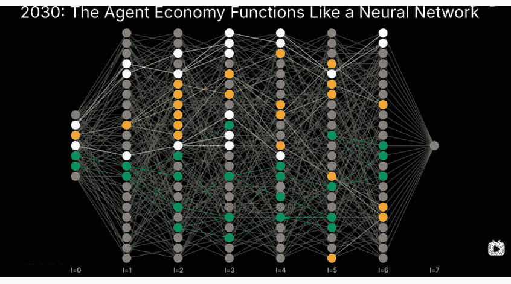

## 结语

衷心感谢各位的莅临。今天的 AI Ascent 大会必将精彩纷呈。我们非常荣幸能与各位齐聚一堂，共同探讨 AI 的未来。

## 知识星球TOP

添加微信 付费资源分享群 免费入群

微信: jntsg2

| 序号 | 公号/星球/社群 | 原价 | 领域 |
| :--- | :--- | :--- | :--- |
| 1 | 生态有木 | 2765/年 | 副业、搞钱 |
| 2 | DeV从吃群众群 | 365/年 | 时政、历史 |
| 3 | 记忆承载/雯树西风 | 365元/年 | 成长、搞钱 |
| 4 | 欧洲金靴 | 328/年 | 时政、历史 |
| 5 | 卢克文青云会 | 699/年 | 时政、社会 |
| 6 | 体内主任 | 599/年 | 体制；职场 |
| 7 | 外局人的视角 | 669元/年 | 金融、时政 |
| 8 | 濑泽异谈 | 4166/年 | 财富、成长 |
| 9 | 守夜总司令 | 599/年 | 时政、经济 |
| 10 | 江宁知府 | 365/篇 | 时政、国际 |
| 11 | 政堂/顾子明 | 568/年 | 时政、经济 |
| 12 | 唐书院 | 1399/篇 | 金融、财富 |
| 13 | 大树乡谈 | 199/年 | 时政、成长 |
| 14 | 水库欧大 | 10000元 | 房产、经济 |
| 15 | 洪灏的宏观策略 | 4376/年 | 经济、搞钱 |
| 16 | 金政通鉴/北海道南山 | 4576/年 | 股票、行研 |
| 17 | 猫豹的世界 | 299/年 | 时政、社会 |
| 18 | 飞沫 | 3600/年 | 股市、经济 |
| 19 | 米联储见闻 | 599/年 | 经济、金融 |
| 20 | 鉴茶财经院 | 330/年 | 房产、股票 |
| 21 | 赢在八小时之外 | 365元/年 | 成长、职场 |
