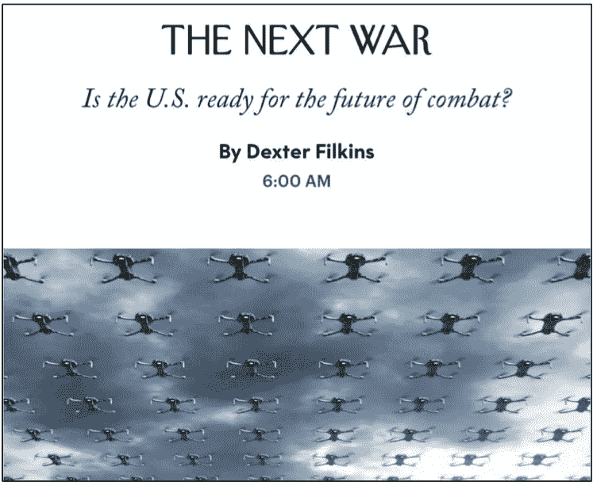

# 未来的战争

来源：纽约客

整理：公众号【知识星球 TOP】

微信信号：jntsg8

免费进资料群

微信信号：jntsg2

今年春天，我在基辅被蒙上双眼带上一辆车，前往乌克兰西部一家秘密工厂。工厂属于 TAF 无人机公司，三年前由年轻乌克兰商人奥列克桑德·雅科文科创立的，他希望帮助乌克兰抵御俄罗斯入侵。战争爆发时，雅科文科正忙于奥德萨经营一家物流公司，但国家需要一切可能的援助。乌克兰实力悬殊——要与一个强大更富有、军队更强、武器更精良的对手作战。

“政府对我说，‘我们需要你们制造无人机，’雅科文科告诉我。“于是我跟伙计说，‘你们有四个小时做决定。离开还是留下——如果留下，答我，你们会尽力帮助我们的军队。’”

雅科文科的任务是建立工厂，大规模生产无人机，旨在压制俄罗斯跨境运输的武器。我参观的工厂时，看到一百多名员工（其中很多是女性）正精力地工作，环境与其像军工厂，不像大学校园。背景音乐播放着电子音乐，她们操作着 3D 打印机，穿着碳纤维组件，进行飞行模拟，调试着摄像机无线发射器。“让人感觉很魔幻，”一位女士告诉我。

工厂是一系列设施的一部分，隐藏在地下室、仓库和旧工厂里，帮助乌克兰人和俄罗斯军队战成平局。我参观的工厂每天生产约一千架无人机，精密致命，最重要的是价格低廉，每架售价约五百元。有些用于监控，有些用于运送物资，但大多数无人机装载着炸药，由操作员通过视频屏幕操控，直接击目标。雅科文的一位经理带我看了一段模糊的黑白视频，拍摄于四月份，内容是一次敌后夜间行动。屏幕上，一架配备热成像仪的无人机冲向一台 TOS-1 火箭发射器，然后屏幕在一道白光中爆炸。俄罗斯每 TOS-1 火箭发射器的造价约 500 万美元。

“我们的无人机只是它摧毁目标的一小部分，”经理告诉我，“这就是我们的优势。”

当俄罗斯军队进入乌克兰时，他们的装备是针对早期的冲突的：一场由坦克和重型火炮发动的老式战术。作为回应，乌克兰设计了一种未来主义的“打了就跑”的游击战。现在，有一支俄罗斯部队试图推进，就会遭遇蜂群而至的炸弹攻击。俄罗斯在侵入乌克兰的尝试中已经造成了约 100 万伤亡。据研究员米哈伊洛·萨穆斯估计，从 2024 年初以来，乌克兰 80% 的人员和物资损失是由无人机造成的。

这种不对称方式最引人注目的一次应用发生在今年 6 月，当时有一支由一百多架乌克兰无人机组成的军队攻击了远至西西伯利亚的目标，摧毁或击伤了约 20 架俄罗斯战机。这是自二战以来对俄罗斯最有军事意义的攻袭。乌克兰人发布了一段带有嘲讽意味的视频，视频中无人机以第一人称视角面向飞机，并配上脉动的电子乐。这些视频被标记为“故障安全”，这是一个军事术语，表示对术免疫。

在乌克兰等地，战争的未来正在被重定义，而美国官员们却愈发担忧。

几十年来，美国武装部队一直依赖高度复杂的、极其昂贵的武器，例如核动力航空母舰和隐形战斗机，研发耗时多年，生产成本高达数十亿亿美元。（美国在伊拉克和阿富汗的失败并非源于技术实力）。自冷战结束以来，这些武器使美国几乎占据了陆、海、空军的绝对优势。但如今那些俄罗斯入侵乌克兰的技术革变，正威胁着美国在全球军事优势地位的权威。前五角大楼兰兰德公司国防分析师戴维·奥赫马内克告诉我，美国的战争方式已不再可行。“我们的行动速度不够快，”

纵观历史，技术优势有时会改变战争进程，有时甚至是突然的。十九世纪末，铁路取代了马匹，成为军队运输和补给的重要方式，普鲁士人利用铁路击败了法国对手。在第一次海湾战争中美国使用了精确制导弹，这种导弹可以从千里之外击中办公窗口。乌克兰人认为，他们代表了类似的技术先锋。“我们正在发明一种新的战争方式，”“第一接触”的创始人瓦列·博罗维维克告诉我，他的无人机对俄罗斯战斗机实施打击。“任何国家都像我们这样对付一个更大的国家。任何国家！”

在美国，最能与奥列克赛德·雅科文相提并论的是帕尔默·卢基，他在 2017 年参与创立了国防初创公司安杜托尔里。不久前，他在公司位于加州科斯塔·梅萨的总部与我见面，周围簇拥满了各种高科技武器：无人机、导弹、无人驾驶飞机。安杜托尔里坐落在一座巨大的建筑里，曾经是《洛杉矶时报》奥格兰治县办公室，褪色的标志仍然在外墙清晰可见。32 岁的卢基体现了傲慢自大、精锐科技大亨的刻板印象：短裤、夏衬衫、人字拖、马尾发型和灵魂补丁。我们谈话时，他吃了一袋巧克力。

他想炫耀自己的发明——他相信这些自主武器将颠覆美国军方许多珍视的战略和防御理念。他走向一架“潜水-XL”无人潜艇的模型，这艘潜艇可以航行千英里而不浮出水面，其设计速度堪比廉价沙发。“我几天就能造出一个，”他说。

美国军方习惯于与规模大、根深蒂固的巨头做生意：像洛克希·马丁和诺斯普·格鲁曼这样的公司雇佣了大量工程师和伍军人，他们的企业文化与五角大楼内部相比之下。卢基的早期职业始于电子游戏和虚拟现实。19 岁时，他在父亲家中工作，发明了一个名为 Oculus 的头戴设备，他承诺这项技术将带我们进入现实生活中无法体验的世界。”

卢基告诉我，他对 Oculus 的核心见解源于软件。与硬件不同，软件可以轻松复制并定期更新，从而快速迭代且成本低。几代以来，美国军方一直部署极其复杂的系统，而运行软件被硅谷视为低劣且价格过高。卢基设想的是廉价的武器，其主要价值在于操作系统的大脑而不是它们的体力。他开始致力于与人工智能结合。Luckey 与 Stephens 以及另外两位合伙人创立了 Anduril，种子资金来自 Founders Fund 和投资者，其中包括 J. D. Vance。一家风险投资公司，由亿富翁兼自由主义家 Thiel 曾参与 Palantir，该公司通过计算机操作并简化追踪和推演敌方等任务。Luckey 和 Stephens 正在寻找科技领域的突破性进展。Anduril 的名称取自《指环王》，象征着世界在对抗黑暗战斗中的复兴。卢基将工作视为文明的一部分。“把科技行业带出来，让他们从事国家工作，才是重要的。”在展厅里，卢基停在无人机面前，无人机设计目标是在将人类从重力加速度下飞行，让有人驾驶飞机进行空中战斗。各种方法让它能够找到落后位置，”卢基说。“很酷的是，它不是人类——对吧？”

Luckey 与 Founders Fund 负责人 Stephens 会面。几个月后，Luckey 以 20 亿美元的价格将 Oculus 卖给了 Facebook，但许多问题仍然存在。由于，创始人霍拉克·伯格解雇了他。Luckey 说，“我当时非常生气。”

俄罗斯在侵入乌克兰的尝试中已经造成了约 100 万伤亡。据研究员米哈伊洛·萨穆斯估计，从 2024 年初以来，乌克兰 80% 的人员和物资损失是由无人机造成的。

这种不对称方式最引人注目的一次应用发生在今年 6 月，当时有一支由一百多架乌克兰无人机组成的军队攻击了远至西西伯利亚的目标，摧毁或击伤了约 20 架俄罗斯战机。这是自二战以来对俄罗斯最有军事意义的攻袭。乌克兰人发布了一段带有嘲讽意味的视频，视频中无人机以第一人称视角面向飞机，并配上脉动的电子乐。这些视频被标记为“故障安全”，这是一个军事术语，表示对术免疫。

在乌克兰等地，战争的未来正在被重定义，而美国官员们却愈发担忧。

几十年来，美国武装部队一直依赖高度复杂的、极其昂贵的武器，例如核动力航空母舰和隐形战斗机，研发耗时多年，生产成本高达数十亿亿美元。（美国在伊拉克和阿富汗的失败并非源于技术实力）。自冷战结束以来，这些武器使美国几乎占据了陆、海、空军的绝对优势。但如今那些俄罗斯入侵乌克兰的技术革变，正威胁着美国在全球军事优势地位的权威。

纵观历史，技术优势有时会改变战争进程，有时甚至是突然的。十九世纪末，铁路取代了马匹，成为军队运输和补给的重要方式，普鲁士人利用铁路击败了法国对手。在第一次海湾战争中美国使用了精确制导弹，这种导弹可以从千里之外击中办公窗口。乌克兰人认为，他们代表了类似的技术先锋。“我们正在发明一种新的战争方式，”“第一接触”的创始人瓦列·博罗维维克告诉我，他的无人机对俄罗斯战斗机实施打击。“任何国家都像我们这样对付一个更大的国家。任何国家！”

在美国，最能与奥列克赛德·雅科文相提并论的是帕尔默·卢基，他在 2017 年参与创立了国防初创公司安杜托尔里。不久前，他在公司位于加州科斯塔·梅萨的总部与我见面，周围簇拥满了各种高科技武器：无人机、导弹、无人驾驶飞机。安杜托尔里坐落在一座巨大的建筑里，曾经是《洛杉矶时报》奥格兰治县办公室，褪色的标志仍然在外墙清晰可见。32 岁的卢基体现了傲慢自大、精锐科技大亨的刻板印象：短裤、夏衬衫、人字拖、马尾发型和灵魂补丁。我们谈话时，他吃了一袋巧克力。

他想炫耀自己的发明——他相信这些自主武器将颠覆美国军方许多珍视的战略和防御理念。他走向一架“潜水-XL”无人潜艇的模型，这艘潜艇可以航行千英里而不浮出水面，其设计速度堪比廉价沙发。“我几天就能造出一个，”他说。

美国军方习惯于与规模大、根深蒂固的巨头做生意：像洛克希·马丁和诺斯普·格鲁曼这样的公司雇佣了大量工程师和伍军人，他们的企业文化与五角大楼内部相比之下。卢基的早期职业始于电子游戏和虚拟现实。19 岁时，他在父亲家中工作，发明了一个名为 Oculus 的头戴设备，他承诺这项技术将带我们进入现实生活中无法体验的世界。”

卢基告诉我，他对 Oculus 的核心见解源于软件。与硬件不同，软件可以轻松复制并定期更新，从而快速迭代且成本低。几代以来，美国军方一直部署极其复杂的系统，而运行软件被硅谷视为低劣且价格过高。卢基设想的是廉价的武器，其主要价值在于操作系统的大脑而不是它们的体力。他开始致力于与人工智能结合。

Luckey 与 Stephens 以及另外两位合伙人创立了 Anduril，种子资金来自 Founders Fund 和投资者，其中包括 J. D. Vance。一个亿富翁兼自由主义家 Thiel 曾参与 Palantir，该公司通过计算机操作并简化追踪和推演敌方等任务。Luckey 和 Stephens 正在寻找科技领域的突破性进展。Anduril 的名称取自《指环王》，象征着世界在黑暗战斗中的复兴。卢基将工作视为文明的一部分。“把科技行业带出来，让他们从事国家工作，才是重要的。”在展厅里，卢基停在无人机面前，无人机设计目标是在将人类从重力加速度下飞行，让有人驾驶飞机进行空中战斗。各种方法让它能够找到落后位置，”卢基说。“很酷的是，它不是人类——对吧？”

Luckey 与 Founders Fund 负责人 Stephens 会面。几个月后，Luckey 以 20 亿美元的价格将 Oculus 卖给了 Facebook，但许多问题仍然存在。由于，创始人霍拉克·伯格解雇了他。Luckey 说，“我当时非常生气。”

卢基告诉我，他对 Oculus 的核心见解源于软件。与硬件不同，软件可以轻松复制并定期更新，从而快速迭代且成本低。几代以来，美国军方一直部署极其复杂的系统，而运行软件被硅谷视为低劣且价格过高。卢基设想的是廉价的武器，其主要价值在于操作系统的大脑而不是它们的体力。他开始致力于与人工智能结合。

依然存在，其中一个根本问题是，这类武器是否像卢基说那样有效。五角大楼投入大量资金进行实验，但大部分预算仍然流向了几十年的同类项目。过去，美国的对手可能是恐怖组织或军队规模小于我们的国家。现在，规划者必须面对不同的威胁。一方面，叛乱分子可能会部署无人机。另一方面，正在兴起——“势均敌”——从某些方面来说，其军事实力已经超越美国。我们无法保证拥有一方正确的物资，”卢基说。“我们就像一家没有库存的枪店。”

在第二次大战期间以及战后的几十年里，美国装备发明的技术远比私营部门任何领先。“军队创造了惊人的创新数量，”美国企业研究员、前参议院军事委员会工作人员亚比尔·格林沃特。“我们停止了创新，”格林沃尔特说。“我们在很大程度上也停止了生产。二战期间，美国不仅武装了本国军队，也武装了盟友。美国造船厂建造了大约六千艘舰船，其中包括一百五十艘航空母舰。汽车厂转而生产用飞机；通用汽车制造了谢尔曼坦克，福特制造了B-24“解放者”轰炸机。

末期，福特工厂每小时都能生产一架 B-24。

冷战结束后，美国的国防工业基础萎缩。由于五角大楼的持续需求，一些工厂倒闭，而另一些工厂生产的武器能够勉强维持运营。技术工人转向其他工作；那些存在的国防工业，例如造船业，却缺少少数万名员工。结果，美国造船厂现在每年只能建造一艘新潜艇。

1993 年7月，国防部长莱斯·阿斯平和他他的手下威廉·佩里在五角大楼。阿斯平和佩里，许多观察家认为这个想法法马行空。五年后……。

然而，随着时间的推移，这一过程变得更加规范和有章循。1960年，约翰·F·肯尼迪总统任命了罗伯特·麦克林纳新任国防部长，他在福特汽车公司成立组织纪律而声名大起。他在协助实施的体制下，武器的构思并非由工业界提出，而是由五角大楼规划人员通常遵循其他五角大楼规划人员制定的五年计划。设计一种新武器通常需要数几年——而且只有在规格达成一致后，五角大楼才会请求国防公司的意见，最终选择一家商进行生产。新的体制更加具有了，但也缺乏竞争力，也没有那么的活力。“我们停止了创新，”格林沃尔特说。“关于曼哈计划，需要记住的重要点是，通往成功的途径有很多，”格林沃尔特指出。“竞争异常激烈。”1949年，海军上将曼海·里科备受监督一项利用新开发的原子能为潜艇提供动力的计划——许多观察家认为这个想法法马行空。五年后，第一枚核潜艇服役。
