# 网络安全基础知识

2025年11月04日 R1.0版

# 知识星球TOP 资源分享社区

公众号: 知识星球TOP

汇聚全球高价值资源

打造一流资源分享群

添加微信进群

微信信号:top28688

- ◆ 付费文章
- ◆ 付费社群
- ◆ 时政&国际
- ◆ 副业&搞钱
- ◆ 财经&市场
- ◆ 行业&科技

时政·历史·职场·体制·自媒体
学习·军事·软件·影音·社会学

微信信号:top28388

# 目录
CONTENTS

- 01 网络安全的基本概念
- 02 网络安全的发展演进
- 03 网络安全的关键技术
- 04 网络安全的产业链
- 05 等级保护的基础知识
- 06 网络安全的未来趋势

# PART 01 网络安全的基本概念

## 网络安全的基本概念

### 网络安全、信息安全、数据安全的定义

网络安全 (Cybersecurity):
是指保护计算机系统及其组件（包括硬件、软件和数据）免受网络攻击、损害或未授权的访问的实践。

信息安全 (Information Security):
是指保护信息及其支持系统免受未授权的访问、使用、暴露、中断、修改或销毁的实践。

数据安全 (Data Security):
聚焦于“数据”这一特定资产的生命周期安全，包括数据的采集、存储、处理、传输、交换和销毁等环节。

## 网络安全的基本概念

### 网络安全、信息安全、数据安全的定义

信息安全是一个更泛的概念，而网络安全是其在数字世界中的一个关键集。

信息安全涵盖所有形式的信息载体，包括非数字化信息。网络安全专注于网络空间的安全。

信息安全是一个更大的“保护伞”，其包含网络安全、数据安全、物理安全、人员安全等多个方面。

网络安全是信息安全在网络这个特定领域的具体实践和重要组成部分。

信息安全以信息本身为核心，网络安全则更关注网络基础设施。

数据安全是信息安全和网络安全在数据层面的交叉和深化应用。

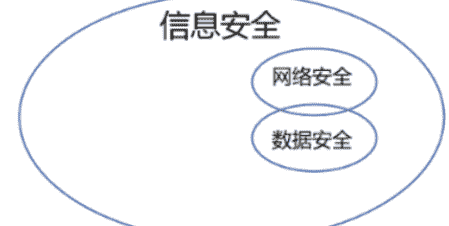

## 网络安全的基本概念

### 网络安全、信息安全、数据安全的定义

| 对比维度 | 信息安全 | 网络安全 |
| --- | --- | --- |
| 保护目标 | 确保信息的机密性、完整性和可用性 | 保护数据和系统的完整性、可用性和保密性 |
| 核心范围 | 保护所有形式的信息（纸质文件、口头交流、电子等等） | 保护网络空间中的系统、数据和操作，主要针对数字化环境 |
| 保护焦点 | 信息本身的机密性、完整性和可用性，无论其形态或存储方式 | 网络基础设施以及数据在网络中的传输安全，确保网络服务的连续性 |
| 属性侧重 | 除了基础的机密性、完整性、可用性，还涉及真实性、不可否认性、可控性等更广泛的属性 | 更侧重于保障系统的可用性和数据，在网络传输过程中的完整性、机密性 |
| 威胁类型 | 内部威胁、物理窃取、社交工程以及网络攻击等综合性威胁 | 黑客入侵、恶意软件、DDoS攻击、网络钓鱼等主要来自网络空间的威胁 |

## 网络安全的基本概念

### 网络安全的主要特点

- 是整体的，不是割立的：网络时代，安全关乎全局，紧密相关。
- 是动态的，不是静态的：高度关联、彼此依存。威胁手段多变，需动态防护。
- 是开放的，不是封闭的：唯有开放环境、交流、互动，才能提升安全水平。
- 是相对的，不是绝对的：没有绝对安全，要最小化风险、成本。
- 是共同的，不是孤立的：全社会共同参与，共筑安全防线。

## 网络安全的基本概念

### 网络安全基本属性

CIA三元组由美国国家标准研究院于77年首次提出，旨在通过技术和实践来保护信息：

- 机密性 (Confidentiality)：防止信息泄露给非授权的用户、实体。
- 完整性 (Integrity)：防止信息或系统未经授权的更改。
- 可用性 (Availability)：指合法的用户能够获取信息或服务。
- 抗抵赖性 (Non-Repudiation)：防止授权用户否认其行为。
- 可控性 (controllability)：管理者对系统具有有效管理和控制，符合运行目标。

## 网络安全的基本概念

### 网络安全基本属性（其它特性）

- 真实性：是指网络信息与实际空间、客观事实保持一致。
- 时效性：是指网络信息、服务及系统满足时间约束。
- 合规性：是指网络信息、服务及系统符合法律法规、标准等要求。
- 公平性：是指网络系统相关主体处于同等地位、优势。
- 可靠性：是指网络信息系统在规定时间内能够有效完成规定的功能的能力。
- 生存性：是指网络信息系统在受损的情形下，提供必要的服务继续运行。
- 隐私性：是指有关个人的敏感信息。

## 网络安全的基本概念

### CIA三元组——机密性 (Confidentiality)

定义：机密性是指确保信息只被授权的人员或系统访问，防止信息泄露给未授权的实体。

重要性：保护敏感信息不泄露，如个人隐私、商业秘密、政府机密等。

实现方法：
- 加密技术：使用加密算法对数据进行编码，只有拥有正确密钥的人解密。
- 访问控制：设置权限管理，确保只有经过身份验证和授权的用户才能访问。
- 物理安全：保护存储介质和设备，防止盗窃或非法访问。
- 安全协议：使用安全通信协议（如SSL/TLS）来保护数据在网络传输中的安全性。

## 网络安全的基本概念

### CIA三元组——完整性 (Integrity)

定义：完整性是指确保信息在传输、存储和处理过程中不被篡改或破坏，保持其原始状态。

重要性：保证数据的准确性和可靠性，防止恶意攻击者篡改数据导致错误的决策或操作。

实现方法：
- 校验码：使用哈希函数生成校验码（如MD5、SHA-256），接收方可以通过重新计算校验码验证数据是否被篡改。
- 数字签名：使用公钥加密技术对数据进行签名，接收方可以验证数据的完整性和发送者的身份。
- 审计日志：记录所有对数据的操作，以便追踪和审计任何异常活动。
- 备份和恢复：定期备份数据，并在数据受损时恢复到最近的备份版本。

## 网络安全的基本概念

### CIA三元组——可用性 (Availability)

定义：可用性是指授权用户在需要时能够及时访问和使用信息，不受干扰或中断。

重要性：保证业务连续性，避免因系统故障或攻击导致的服务中断。提高用户满意度和信任度。

方法：
- 冗余系统：建立备份服务器和网络设备，确保主系统故障时能够无缝切换到备用系统。
- 负载均衡：通过分布式负载优化资源利用，防止某个节点过载。
- 灾难恢复计划：制定详细的灾难恢复计划，包括数据备份、恢复流程和应急响应措施。
- 安全监控：实时监控系统状态，及时发现并处理潜在的安全威胁。

## 网络安全的基本概念

### 网络信息安全的管理要素

- 网络管理对象
- 网络威胁
- 网络脆弱性
- 网络风险
- 网络保护措施

## 网络安全的基本概念

网络信息安全的管理流程

- Step1: 确定网络信息安全管理对象；
- Step2: 评估网络信息安全管理对象的价值；
- Step3: 识别网络安全管理对象的威胁；
- Step4: 识别网络安全管理对象的脆弱性；
- Step5: 确定网络安全管理风险级别；
- Step6: 制定网络安全防范体系；
- Step7: 实施和落实网络安全管理防范措施；
- Step8: 运行/维护网络安全管理设备。

## 网络安全的基本概念

### 网络安全的风险来源

| 被动攻击 | 主动攻击 |
| --- | --- |
| 监听、非法登录 | 篡改、假冒、拒绝服务 |
| 截取、重放 | 病毒、破坏、火灾 |
| 故障、链路故障 | 编程错误、操作错误 |

## 网络安全的基本概念

### 网络安全管理的工作

具体包括：
- 物理安全：保护计算机系统等设备免受攻击。
- 访问控制：验证身份和使用权限，保证资源安全访问。
- 加密策略：保护传输的数据。
- 减少风险：安装安全软件包防止病毒攻击。
- 消除脆弱点：通过操作系统打补丁强化安全意识。
- 减少威胁：采取多条通信线路制定应急案。
- 风险监测：定期对网络系统中的安全状态进行分析。

## 网络安全的基本概念

### 网络信息安全策略

- 物理安全策略
- 访问控制策略
- 级安全控制
- 端口安全控制
- 加密策略
- 管理策略

## 网络安全的基本概念

### 网络信息安全的法律法规

随着国家网络安全等级标准的升级，以及《网络安全法》、《数据安全法》、《个人信息保护法》等法律法规的正式实施，网络安全防护理念从“静态防御”发展为“事前防御、动态防御”。

| 名称 | 日期 |
| --- | --- |
| 《中华人民共和国网络安全法》 | 2017年6月1日 |
| 《中华人民共和国数据安全法》 | 2021年9月1日 |
| 《中华人民共和国个人信息保护法》 | 2021年11月1日 |
| 《关键信息基础保护条例》 | 2021年9月1日 |
| 《反电信网络诈骗法》 | 2022年12月1日 |
| 《计算机信息网络安全管理办法》 | 1997年12月1日 |
| 《中华人民共和国计算机信息安全保护条例》 | 1994年2月18日 |

## 网络安全的基本概念

网络信息安全的法律法规

| 国家战略 | 网络空间国际战略 |
| --- | --- |
| 国家空间安全战略 | |
| 【十五】规划2035年远景目标 | |
| 网络安全 | 网络安全工作法 |
| 党委（党组）网络安全责任实施办法 | |
| 网络安全基础设施保护条例2.0系列 | |
| 关键信息基础设施保护条例 | |
| 移动互联网应用程序信息服务规定 | |
| 移动互联网应用基本功能必要规范 | |
| 国家网络安全事件应急预案（中央网信办） | |
| 密码法 | 商用密码条例 |
| 商用密码技术 | 密钥认证 |
| 信息安全技术 信息系统加密应用 | |
| 数据安全法 | 数据安全审查条例（征稿中） |
| 数据安全管理法（征求意见） | |
| 信息安全技术 重要数据识别指南 | |
| 个人信息和重要数据出境办法 数据安全能力评估法（征求意见） |
| 信息安全技术 数据交易业务安全要求 | |
| 信息安全技术 数据安全分类分级保护实施指南 | |
| 信息安全技术 个人信息安全保护框架 | |
| 个人信息保护法 | 网络安全 |
| 信息安全技术 个人信息保护指南 | |
| 信息安全技术 个人信息标识化指南 | |
| 信息安全技术 隐私保护规范 | |
| APP 违法收集个人信息行为认定办法 | |
| 个人金融信息保护技术规范 | |
| APP 收集个人信息基本规范（草案） | |
| 电子与互联网个人信息保护规定 | |

## 网络安全的基本概念

### 网络安全评估体系

- 等保测评：通过技术+管理综合评估保障系统安全。
- ISMS（信息安全管理体系认证）：基于风险管理保障信息机密性、完整性、可用性。
- SSE-CMM（系统安全工程能力成熟度模型）：通过组织、工程、过程评估系统安全能力。

## 网络安全的基本概念

### 网络安全的认证

| 认证名称 | 发证机构 | 核心定位与价值 | 适合人群 |
| --- | --- | --- | --- |
| CISP | 中国信息安全测评 | 国内权威的认证，尤其在关键安全领域。 | 信息从业人员 |
| CISP-PTE | 中国信息安全测评 | 国内唯一认可的渗透测试认证，高度偏实战。 | 渗透测试工程师、攻防专家 |
| CISSP | (ISC)² | 全球范围内认可的“黄金标准”，侧重安全管理。 | 安全经理、架构师、顾问 |
| CISA | ISACA | 信息系统领域的权威认证，强化风险控制。 | IT审计师 |
| OSCP | Offensive Security | 极具挑战性的渗透测试认证，通过独立考核。 | 渗透测试员、红队工程师 |
| Security+ | CompTIA | 广认可的入门认证，涵盖网络安全知识，是良好的起点。 | 初学者、学生 |
| CCSP | (ISC)² | 云安全领域的顶级认证，兼具战略和技术广度，应对企业需求。 | 云架构师、管理员 |

## 网络安全的基本概念

### 网络安全的岗位

| 岗位 | 工程师 | 工作内容 |
| --- | --- | --- |
| 安全测试 | 安全测试工程师 | 渗透测试、攻防 |
| 安全咨询 | 安全咨询专家 | 等级保护辅助、标准解读 |
| 安全合规 | 安全合规工程师 | 等级保护、差异分析、安全认证 |
| 安全运维 | 安全运维工程师 | 安全情报分析、日志分析、加固、告警处置 |
| 安全保障 | 安全保障专家 | 组织设计、防御能力评估、监控构建 |
| 基础设施专家 | 安全配置规范 | 网络架构设计、漏洞闭环管理 |
| 安全架构师 | 安全运维体系 | 攻击分析、入侵路径分析、攻击画像、突发事件 |
| 安全应急工程师 | 安全应急工程师 | 应急响应、威胁狩猎、应急演练 |
| 安全攻取与溯源专家 | 样本分析 | 攻击溯源、攻击攻取、威胁管理 |
| 安全开发工程师 | 安全组件开发、编码规范、代码审计 |
| 安全开发管控专家 | 安全开发管控、安全架构分析 |
| 安全架构师 | 安全架构管理、架构评审 |
| 数据安全工程师 | 数据需求分析、模型设计、数据体系设计、数据治理、领域安全评估、信息安全管理咨询 |

# PART 02 网络安全的发展演进

## 网络安全的发展演进

### 演进

- 战时通信安全：以军用国防为主，尚未出现民用市场。
- PC安全时代：围绕PC设备的病毒查杀。
- 信息安全时代：面对信息化办公的安全层防御走向纵深防御。
- 网络安全时代：基于整体业务场景的安全解决方案和服务被动防御走向主动防御。

1940-1994
1994-2004
2004-2013
2014-现在

## 网络安全的发展演进

### 发展演进——第一阶段

计算机病毒的理论原型：1949年，冯·诺伊曼在论文《复杂自动装置的理论及实施》中，首次提出了一种自我繁殖的程序存在的可能。冯·诺伊曼的观点，被视为计算机病毒最早的理论原型。

大脑病毒：公认的第一个流行计算机病毒，由一对巴巴斯坦德兄弟编写。1986年，因其公司出售的软件被任意非法复制，购买正版软件的人越来越多，兄弟二人便编写了大脑病毒来追踪和攻击非法用其软件的人。该病毒运行在DOS系统下，会在人们盗用软件时将硬盘的剩余空间“吃掉”。人类历史上第一个计算机病毒实际上认为是“正义”而编写的“错误”程序。

莫里斯坦虫：第一个通过互联网传播的病毒，由康奈尔大学的罗伯特·莫里斯坦编写。1988年，某国国防部的军事计算机网络遭受莫里斯坦虫攻击，致使网络中6000多台计算机感染，直接经济损失高达9000万美元。后来出现的各类病毒都是模仿莫里斯坦虫编写的。罗伯特·莫里斯坦编写该虫的初衷是向人们证明网络漏洞的存在，但病毒扩散的影响很快就超出了他的想象。为此，他被判处有期3年、万美元罚金和400小时社区服务。

## 网络安全的发展演进

### 发展演进——第二阶段

20世纪90年代后期至21世纪的最初十年，是计算机病毒大流行时代。随着桌面操作系统的全球普及以及互联网的高速发展，大量计算机病毒涌现。在利益的驱动之下，木马程序、挂马网页、钓鱼网站、流氓软件等攻击手法不断涌现，并呈现爆发性增长。网络诈骗也开始出现。此外，针对企业和机构的DDoS攻击、网页篡改和渗透等活动日益活跃。

## 网络安全的发展演进

### 发展演进——第三阶段

2010年后，随着免费安全软件的普及，普通个人计算机面临的直接网络威胁越来越小，动辄数百万台计算机被感染的事件几乎绝迹。但是，与传统的网络威胁逐渐消失相伴的是网络黑产的日益成熟。信息泄露、网络诈骗等形式的网络威胁开始迅速在大范围内流行。

- 数据泄露：国内网络泄露问题最早被关注是在2011年，因为国内知名的开发者社区CSDN发生大规模数据库泄露事件。此后，信息泄露问题在全球范围内持续高发。
- 网络诈骗：信息泄露的直接后果之一就是网络黑市、网络诈骗横行。2016年，山东临沂女学生徐某因被网络诈骗而死亡，引发了人们对信息泄露与网络诈骗的高度关注。网络购物退款诈骗、机票退改签诈骗、冒充公检法等多种精准、高危害的诈骗形式，让普通网民防不胜防。

### 发展演进——第四阶段

网络安全进入高级威胁时代。高级，是指攻击手法超高且隐藏，很难被发现，泛称这种网络威胁为高级威胁，如果这种高级威胁是持续不断的，那么就称其为高级持续性威胁（APT, Advanced Persistent Threat）。

- 震网（Stuxnet）：国内数据泄露问题最早被关注是在2011年，起因国内知名的开发者社区CSDN发生大规模数据库泄露事件。此后，信息泄露问题在全球范围内持续加高。
- 方程式组织（Equation Group）：是一个由卡巴斯实验室于2015年发现并暴露的顶级网络犯罪组织，该组织被视为世界上最顶端的网络组织之一。该组织实力雄厚，在漏洞方面具有绝对优势，并且拥有强大的武器库。
- 海莲花（OceanLotus）：攻击活动至少可追踪到2012年，长期针对中国及其他亚洲国家（地区）政府、科研机构、海运业务等领域进行攻击。其会对越南其他消费行业和酒店业中有益的外国企业进行了长时间的入侵与渗透，以及此以外外国政府和越南不同政治意向的人和媒体为主要目标。
- “永恒之蓝”：2017年的5月12日，一个利用了“永恒之蓝”工具的勒索病毒WannaCry开始在全球范围内大规模爆发，短短几个小时内，就有100多个国家报道遭到遭受了WannaCry的攻击，大量机构的设备陷入瘫痪。这是击波病毒之后，全球范围内最大规模的网络病毒爆发灾难。

# PART 03 网络安全的关键技术

## 网络安全的关键技术

### 网络安全的体系架构

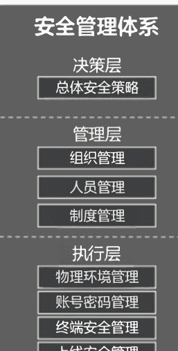
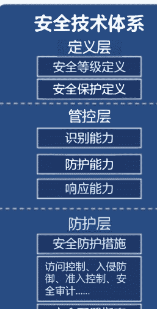
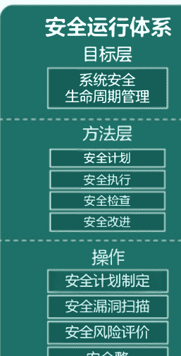

### 安全运营

### 重要时钟

### 安全管理

| 资产发现 | 安全产品运维 | 日常运营 | 应急响应 | 情报收集 |
| --- | --- | --- | --- | --- |
| 威胁识别 | 漏洞优化 | 网站安全检测 | 应急演练 | 应急处置 |
| 弱点识别 | 基线增强 | 安全漏洞报表 | 事件分析研判 | 实战演防 |
| 风险评估 | 补丁管理 | 代码安全检测 | 态势分析 | 专项安全检查 |
| | 渗透测试 | 运营成效评估 | 调查取证 | 通告管理 | |

### 安全平台

### 安全管理

| 威胁情报 | 态势感知 | 风险管理 | 威胁仿真 | 响应需求 | 知识管理 |
| --- | --- | --- | --- | --- | --- |

### 安全审计环境

### 云端审计

| 设备安全 | 应用业务安全 | 数据安全 | 虚拟机安全 | | |
| --- | --- | --- | --- | --- | --- |
| 设备身份认证 | 应用安全代理 | 数据安全防护 | 防毒 | 准入 | |
| 安全配置核查 | 安全评估 | 代码安全代理 | 数据库防火墙 | 基线 | |
| 服务器端监控 | 移动终端安全管理 | 应用安全测试 | 数据库审计 | 漏洞加固 | 安全审计 |
| 设备准入 | 漏网检测 | 应用流量检测 | 数据备份与恢复 | 虚拟入侵监控 | |
| 主机安全 | 运维安全管理 | 应用漏洞加固 | 数据加密 | 镜像安全 | |
| 上网行为审计 | 访问控制 | 业务安全审计 | 信息隔离 | 安全审计 | |

安全管理制度
安全管理机构
安全管理人员
安全建设管理
安全运行管理

安全合规管理
业务连续性管理
安全意识教育

### 安全区域边界

### 安全通信

| 访问控制 | 接入网络 | | |
| --- | --- | --- | --- |
| 入侵防护 | 非法检测 | 网络隔离 | | |
| 恶意代码 | APT 检测 | 网络访问控制 | 流量管理 | |
| 防病毒组件 | DDoS | 通信加密 | 链路加密 | |
| 无线边界防护 | 远程接入 | 网络扩展 | | |

### 移动互联网安全

| 物联网安全 | 控工安全 | | |
| --- | --- | --- | --- |
| 终端安全 | 知识防护 | | |
| 设备安全 | 病毒木盾 | | |
| 网络通信安全 | 操作防护 | 接入控制 | | |
| 漏洞扩散 | 危险防护 | 工控审计 | | |
| APP 加固 | 内部安全 | 公共 WiFi 控制 | |

### 安全基础环境

### 身份管理

### 授权管理

### 密钥管理

| 安全物理环境 | | | |
| --- | --- | --- | --- |
| 物理位置 | 物理访问隔离 | 防磁和破坏 | 防攻击 |
| 防火 | 防静电 | 湿度隔离 | |

## 网络安全的关键技术

### 网络安全的不同级

| 应用安全 | 业务权限 | 访问认证 | 资产识别 | APT威胁 |
| --- | --- | --- | --- | --- |
| 系统安全 | 基础架构 | 客户隔离 | 入侵检测 | Web安全 |
| 数据安全 | 分布式数据库 | 身份验证 | 数据加密 | 隐私保护 |
| 网络安全 | 接入认证 | DDoS 防护 | 边界防护 | 传输安全 |
| 数据传输 | 传输加密 | 备份与恢复 | 完整性保护 | 数据存储安全 |
| 终端安全 | 数据防 | | 密 复制 | 密钥管理 | 白名单 |
| 接入安全 | 入侵防护 | 异常分析 | 加密通信 | 可信验证 |
| 硬件安全 | 安全芯片 | 加密单元 | 设备防盗 | 设备干扰 |

### 垂直场景

### 新兴网络安全

- 移动安全：防护方向包括漏洞挖掘、应用逆向、漏洞加固、终端安全。
- 物联网安全：存在于系统中的安全进展，依托可视化管控、身份认证和安全策略，同步增长。
- 云安全：为用户提供实时、自动化、多维威胁防护，未来领域聚焦安全策略和事件处置。

### 网络安全体系

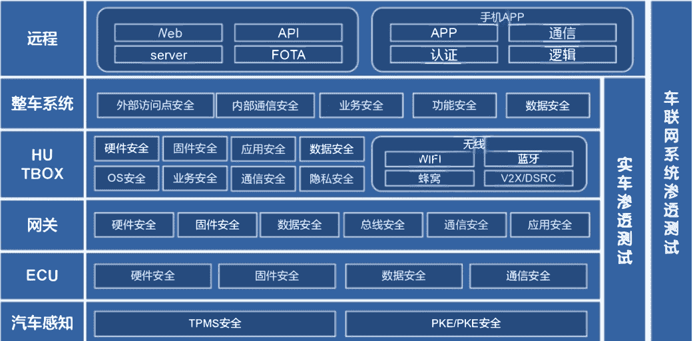

## 网络安全的关键技术

### 常见术语

- 加密技术：加密 (encryption)、解密 (decryption)、公钥 (public key)、私钥 (private key)、非对称加密 (asymmetric cryptographic algorithm)、对称加密算法 (symmetric cryptographic algorithm)等。
- 攻击技术：分布式拒绝服务 (Denied of Service)、网页篡改 (Website Distortion)、劫持 (Phishing)、域名劫持 (DNS Hijack)、路由劫持 (Routing Hijack)、垃圾邮件 (Spam)、恶意代码 (Malicious Code)、木马 (Trojan Horse)、蠕虫 (Network Worm)、网络 (BotNet)。
- 防护技术：访问控制 (Access Control)、防火墙 (Firewall)、入侵防御系统 (Intrusion Prevention System)等。
- 检测技术：入侵检测 (Intrusion Detection)、漏洞扫描 (Vulnerability Scanning)等。
- 恢复技术：应急响应 (Emergency Response)、灾难恢复 (Disaster Recovery)、备份 (Backup)等。
- 测评技术：黑盒测试 (Black Box Testing)、白盒测试 (White Box Testing)、灰盒测试 (Gray Box Testing)、渗透测试 (Penetration Testing)、模糊测试 (Fuzz Testing)。

### 常见术语解释

防火墙 (Firewall)：一种网络安全系统，用于监控和控制网络流量，根据预设的安全规则允许或阻止特定的网络连接。
加密 (Encryption)：将数据转换为密文的过程，以防止未授权的第三方读取或篡改数据。只有拥有正确密钥的人才能解密数据。
认证 (Authentication)：验证用户或系统的身份，确保访问资源的实体是其所称的身份。
授权 (Authorization)：是在认证后，确定用户或系统可以访问哪些资源和执行哪些操作的过程。
入侵检测系统 (Intrusion Detection System, IDS)：用于检测网络或系统异常活动的技术，可以识别潜在的安全威胁。

- 恶意软件 (Malware)：设计用于计算机系统造成损害或用户执行有害操作的软件。
- 病毒 (Virus)：一种自我复制的程序，通过感染其他文件传输。
- 蠕虫 (Worm)：一种自我复制的程序，通过网络传输，不需要宿主机。
- 木马 (Trojan)：伪装合法软件的恶意程序，诱骗用户安装。
- 勒索软件 (Ransomware)：一种恶意软件，会加密文档并要求支付赎金以恢复访问。
- 社会工程 (Social Engineering)：通过心理手段，诱骗他人泄露敏感信息或执行特定操作。
- 数据泄露 (Data Breach)：指敏感、受保护或保密的数据公开、丢失、盗用。
- 渗透：黑客入侵网站或计算机系统，获取控制权限的过程。
- 肉鸡：被非法者获得权限的机器，可能是个人电脑企业或政府单位的服务器。
- 后门：黑客为了对主机进行长期的控制，在机器上种植的一段程序或留下的一个入口。

- 黑客 (hacker)：对计算机技术非常擅长的人，窃取数据，破坏计算机系统。
- 脚本小子：刚入门安全防护，学习了一些技术，只会用现成的工具。
- 白帽子：目的是发现企业的漏洞并帮助其修复，白帽子的。
- 红黑客：利用技术对外的进行攻击，红黑客的。
- 0day漏洞：指的是尚未被发现的重大安全缺陷，0day漏洞。
- 1day漏洞：已经公开，但是很多人还来不及修复，这个1day漏洞。
- 2day漏洞：已经公开，但是很多人还来不及及修复，这个2day漏洞。
- 3day漏洞：已经公开，但是很多人还来不及修复，这个3day漏洞。
- 4day漏洞：已经公开，但是很多时候还没修复，这个4day漏洞。
- 钓鱼：钓鱼网站。
- 拖库：按照程序执行以后，黑客把全部的数据都拿到。
- 沙箱：是一种虚拟化环境，用于安全对抗对抗训练，沙箱。

### 网络攻击分类

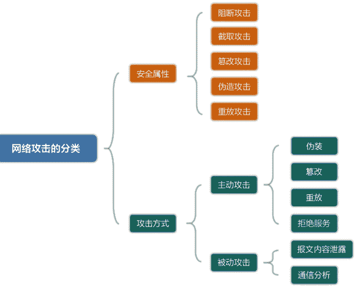

## 网络安全的关键技术

### 网络攻击与防御

- 攻击类：渗透测试框架，如Metasploit、Cobalt Strike、Sqlmap、Nmap。
- 防御类：防火墙、入侵检测/防御系统（IDS/IPS）、杀毒软件、Nessus、OpenVAS、SIEM、Splunk、Wazuh。
- 分析与监控类：网络流量分析，如Wireshark、Zeek、icata。

### 渗透测试

- 演练：通过模拟真实攻击来检验机构安全能力的实战化。
- 信息收集：主动/被动信息收集，包括域名、目录、后台、端口、指纹。
- Web信息收集技术：域名、目录、后台、端口、指纹。
- 漏洞扫描：借助工具、方法进行系统漏洞报告。

### 密码学

密码学是一门研究如何加密保护信息的学科，其核心功能是机密性、完整性、真实性和不可认性。

- 对称加密：使用同一密钥，常见的算法有AES、DES、SM4。
- 非对称加密：使用一对密钥（公钥和私钥），常见的算法有RSA、SM2、SM9。
- 散列函数：将任意长度的输入转换为固定长度的哈希值，其特点是单向性、抗碰撞和抗性。常见的算法有SHA系列、SM3。
- 数字签名：结合了非对称加密和散列函数的特性，用于验证信息的来源和完整性。

### 高级持续性威胁防护 (APT)

针对政府机构、企业核心资产而开展，攻击覆盖移动设备、服务器、邮件系统等。

持续性：结合前期准备、过程入侵、内网深度渗透，延长攻击时间线及渗透范围。
针对性：APT攻击模式更加专注于特定组织和系统。
隐蔽性：依托各类连续手段。

| 特征维度 | APT（高级持续性威胁） | 传统网络攻击（如勒索病毒） |
| --- | --- | --- |
| 攻击目标 | 特定组织或国家的核心数据/系统（如政府、能源、金融） | 目标泛化，追求攻击数量（如大量中小企业或个人用户） |
| 攻击者 | 专业团队（甚至具有国家背景的黑客组织） | 个体黑客、小型犯罪团伙 |
| 攻击周期 | 长期潜伏，可持续数月甚至数年 | 短期爆发，通常在几小时至几天内完成 |
| 技术手段 | 利用零日漏洞、定制化恶意软件、高度隐藏的通信通道 | 多利用公开漏洞、通用恶意软件、暴力破解等手段 |
| 攻击目的 | 窃取敏感信息、破坏关键设施、进行长期监控 | 直接获取经济利益（勒索金）或系统控制权 |

### 安全加固

安全加固是提升计算机系统和网络防御能力的关键过程，其核心目标是通过一系列技术和管理手段，消除或降低系统脆弱性，从而有效防范网络攻击和数据泄露。

主机加固：主要指网络加固与应用系统加固和优化，针对网络层、主机层、应用层等空间进行安全标记、建立访问控制等多种防护措施，具体形式包括优化安全配置、安全补丁安装、系统风险防范、系统功能测试、完整备份、重建机制等。

服务器加固：主要为了提高服务器安全性和攻击能力，通过操作系统安全加固减少漏洞，维稳业务系统。

# 网络安全的产业链

### 上游
### 中游
### 下游

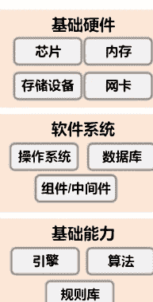
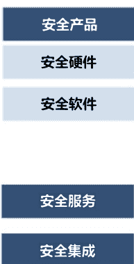
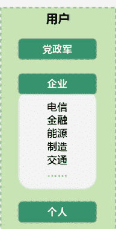

# 网络安全的产业链

- 网络安全产品

硬件类：
防火墙、VPN、入侵检测系统 (IDS) 等。

软件类：
漏洞管理、防病毒软件、安全审计软件等。

服务类：
安全咨询、风险评估、安全运维 (MSS)、应急响应等。

# 网络安全的产业链

- 网络安全领域的代表企业

综合型安全厂商：
奇安信、深信服、启明星辰、天融信、绿盟科技、安恒信息、华为、新华三等。

专业安全领域：
- 防火墙/VPN：天融信、山石网科等。
- 身份认证与密码技术：信安世纪、飞天诚信、格尔软件等。
- 安全软件与服务：安博通、360数字安全等。
- 工业互联网/云安全：宝信软件、移动云、腾讯安全、阿里云等。

# PART 05 等级保护的基础知识

## 等级保护的基础知识

- 什么是等级保护

等保称为网络安全等级保护，是指对国家重要信息、法人和其他组织及公民的专用信息，以及公开信息和存储、传输处理这些的信息系统，分等级执行的安全保护。

对信息系统中使用的信息安全产品实行按等级管理，对信息系统中发生的信息安全事件，分等级响应、处置。

等保的核心是“分类分级、精准防护”，旨在通过差异化的安全措施，优化安全资源配置，构建全面的网络安全防线。

《中华人民共和国网络安全法》第21条明确规定国家实行网络安全等级保护制度。

## 等级保护的基础知识

等级保护2.0

2019年5月10日，《信息安全技术-网络安全等级保护基本要求》正式公布，并于2019年12月1日开始实施。这标志着等级保护工作正式进入“等保2.0”阶段。

主要变化：

- 防护理念升级：从被动防御到主动防御。等保2.0不再满足于静态的、被动的防护，而是强调构建包含主动防御、动态感知、实时预警能力的综合防护体系。它要求网络具备安全监测、提前预警、应急处置和态势感知等能力，能够应对新型网络攻击。

- 测评更加严格：合格线提升。等测评的合格分数从1.0时代的60分提升至70分。测评周期明确，第三级及以上系统每年至少进行一次等级测评，四级系统每半年一次。

- 强调可信计算：将可信验证穿于安全通信网络、区域边界和计算环境，推动从系统启动到运行环节的可信。

## 等级保护的基础知识

### 等保等级对应关系

| 等级 | 对象 | 损害客体 | 损害程度 | 监管程度 |
| --- | --- | --- | --- | --- |
| 第一级 | | 公民、法人和其他组织合法权益 | 损害 | 自主保护 |
| 第二级 | 一般系统 | 公民、法人和其他组织合法权益 | 严重损害 | 指导 |
| | | 社会秩序和公共利益 | 损害 | |
| 第三级 | | 社会秩序和公共利益 | 严重损害 | 监督检查 |
| | | 国家安全 | 损害 | |
| 第四级 | 重要系统 | 社会秩序和公共利益 | 特别严重损害 | 强制监督检查 |
| | | 国家安全 | 严重损害 | |
| 第五级 | 极端重要系统 | 国家安全 | 特别严重损害 | 专门监督检查 |

## 等级保护的基础知识

- 信息系统安全的5个等级

第一级（自主保护级）：对公民、法人和其他组织的合法权益造成一般损害，不损害国家安全、社会秩序和公共利益。

第二级（指导保护级）：对公民、法人和其他组织的合法权益造成严重损害，或对社会秩序、公共利益造成一般损害。

第三级（监督保护级）：对社会秩序、公共利益造成严重损害，或对国家安全造成损害。

第四级（强制保护级）：对国家安全造成严重损害，或对社会秩序、公共利益造成特别严重损害。

第五级（专控保护级）：对国家安全造成特别严重损害。

## 等级保护的基础知识

信息系统安全的5个等级

| 受害的客体 | 对客体的侵害程度 | | | |
| --- | --- | --- | --- |
| | 一般损害 | 严重损害 | 特别损害 |
| 公民、法人和其他组织的合法权益 | 第一级 | 第二级 | 三级 |
| 社会秩序、公共利益 | 第二级 | 三级 | 第四级 |
| 国家安全 | 三级 | 第四级 | 第五级 |

## 等级保护的基础知识

- 等保等级实施流程

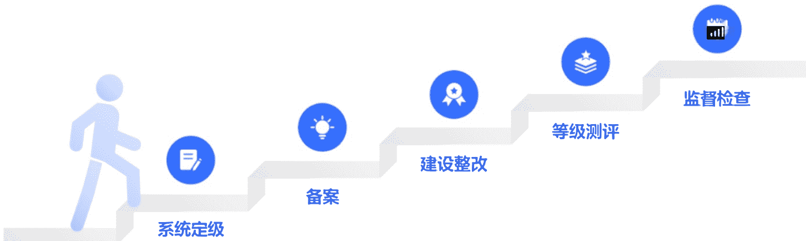

## 等级保护的基础知识

等级保护标准动作

## 等级保护的基础知识

### 等保实施流程

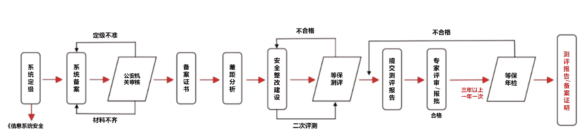

# PART 06 网络安全的未来趋势

# 网络安全的未来趋势

# 网络安全面临的风险与挑战

### 攻击手段多样化

挑战：
- 高级持续威胁 (APT)：长期、有组织的攻击，目标是政府、大型企业等。
- 勒索软件：通过加密数据，要求赎金。
- 分布式拒绝服务 (DDoS)：大量请求使目标无法运行。
- 漏洞攻击：利用尚未公开的漏洞。

应对策略：
- 多防御：采用防火墙、入侵检测系统 (IDS)、入侵防御系统 (IPS)等多层次防御。
- 备份和恢复计划：定期备份重要数据，制定详细恢复计划。
- 安全意识培训：提高员工的安全意识。

# 网络安全面临的风险与挑战

### 人员安全不足

挑战：
- 社会工程攻击：通过心理操纵用户泄露信息。
- 内部威胁：员工恶意行为或无意导致数据泄露。

应对措施：
- 安全培训：定期进行安全培训，提高员工对常见威胁的认知。
- 访问控制：实施最小权限原则，确保员工只能访问资源。
- 监控审计：定期监控审计内部活动，及时发现异常。

# 网络安全面临的风险与挑战

### 技术更新

挑战：
- 新兴技术：如物联网、云计算、人工智能等新技术带来的挑战。
- 旧系统的遗留问题：老旧系统难以适应新的要求，存在漏洞。

应对策略：
- 持续学习和适应：保持对新技术的了解，及时更新策略。
- 逐步淘汰旧系统：有计划地淘汰和替换旧系统，减少风险。
- 安全测试：对新系统进行全面的安全测试，确保安全性。

# 网络安全面临的风险与挑战

### 法规与标准的滞后

挑战：
- 法律法规滞后：技术发展迅速，法律法规往往跟不上变化，难以有效应对新威胁。
- 合规性要求：不同国家和地区有不同的法规和标准，要求多样。

应对策略：
- 积极参与标准制定：参与行业标准和法规的制定，确保其合理性和实用性。
- 合规性管理：建立合规性管理体系，确保遵守相关法规和标准。
- 定期审查：定期审查和更新安全政策，确保符合最新的法规要求。

# 网络安全面临的 供应链安全问题

挑战：
- 第三方风险：供应链中的第三方服务提供商可能成为攻击的入口点。
- 硬件和软件的可信性：确保采购的硬件和软件没有内置恶意组件。

应对措施：
- 供应商评估：对供应商进行严格的安全评估，确保符合安全标准。
- 合同条款：在合同中明确安全要求和责任，确保供应商遵守。
- 定期审计：对供应链中的每个环节进行安全审计，及时发现和解决问题。

# 网络安全面临的风险与挑战 无线网络安全风险

挑战：
- 未加密或低强度加密：无线网络缺乏有效的加密加密措施，容易被截获和篡改。
- 未授权接入点：未经授权的无线接入点(AP)可能为安全漏洞。

应对措施：
- 加密：使用强化加密标准(如WPA3)保护无线网络。
- 访问控制：实施严格的访问控制，确保只有授权用户可以连接到无线网络。
- 定期扫描：定期扫描网络，发现和移除未授权的接入点。

# 网络安全面临的风险与挑战 数据泄露

挑战：
- 内部数据泄露：员工或内部人员有意或无意泄露数据。
- 外部数据泄露：黑客通过各种手段获取敏感数据。

应对对策：
- 数据分类和标记：对数据进行分类和标记，确保敏感数据得到特别保护。
- 数据加密：对敏感数据进行加密，确保即使数据被窃取也无法读取。
- 数据泄露检测：使用数据泄露检测工具，及时发现和响应数据泄露事件。

# 网络安全的发展趋势

网络安全市场随着数字化转型的深入而持续扩张。合规政策、新兴技术风险以及日益复杂的网络威胁，共同驱动了网络安全市场的增长。

人工智能正从根本上改变网络攻防的格局。防御方利用AI和机器学习进行威胁检测、自动化响应，将防御御口从“小时级”压缩至“分钟级”。攻击方也可能利用AI发起更精准、自动化的攻击。从“人对抗”到“机对抗”。

# 参考

- 《中国网络安全产业白皮书》，中国信通院；
- 《中国网络安全产业研究报告》，中国信通院；
- 《中国网络安全行业白皮书(2022)》，亿渡数据；
- 《中国网络安全产业分析报告》，中国网络安全产业联盟；
- 《中国网络安全联盟》，华金证券；
- 《中国网络安全行业全景册》，FreeBuf咨询；
- 百度百科、维基百科、行业企业官网等；
