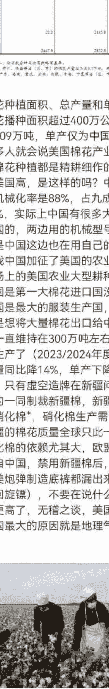
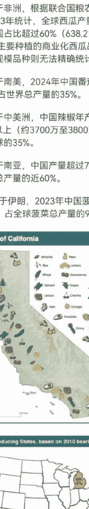
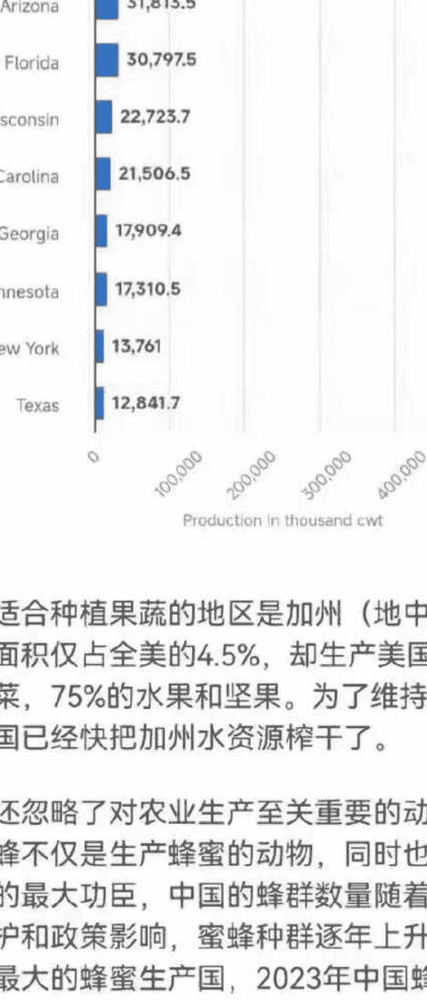

# 美国还是一个进口食物的国家吗？

很多人认为美国是农业大国，出口的粮食远超进口，但事实上美国还是一个进口食物的国家。美国虽然是农业大国，拥有广阔的土地和丰富的资源，其大豆、玉米、小麦、牛肉等农产品产量都位居世界前列。那么，既然美国是农业大国，为什么它还要进口大量食物呢？

虽然是农业大国，但美国对食物的需求量非常巨大。事实上，美国的人均肉类消费量位居全球前列，这导致了美国的肉类产量无法满足国内需求。因此，美国需要进口大量的牛肉、猪肉和禽肉。此外，美国还需要进口水果。

首先是美国的肉类需求。美国的人均肉类消费量非常高。事实上，美国的人均肉类消费量位居全球前列，这导致了美国的肉类产量无法满足国内需求...（此处内容略）

其次是美国的水的需求。美国虽然气候多样，但很多地区气候干旱，无法种植足够自己消费的蔬菜和水果。因此，美国需要进口大量的蔬菜和水果。

最后是美国的饲料需求。美国拥有庞大的养殖业，需要大量的动物饲料。虽然美国是饲料生产大国，但仍需要进口部分饲料。

那么，美国到底进口了哪些食物呢？让我们通过一组数据来看答案。

从数据显示，美国主要的进口食物是：肉类、水果、蔬菜、乳制品和谷物。
