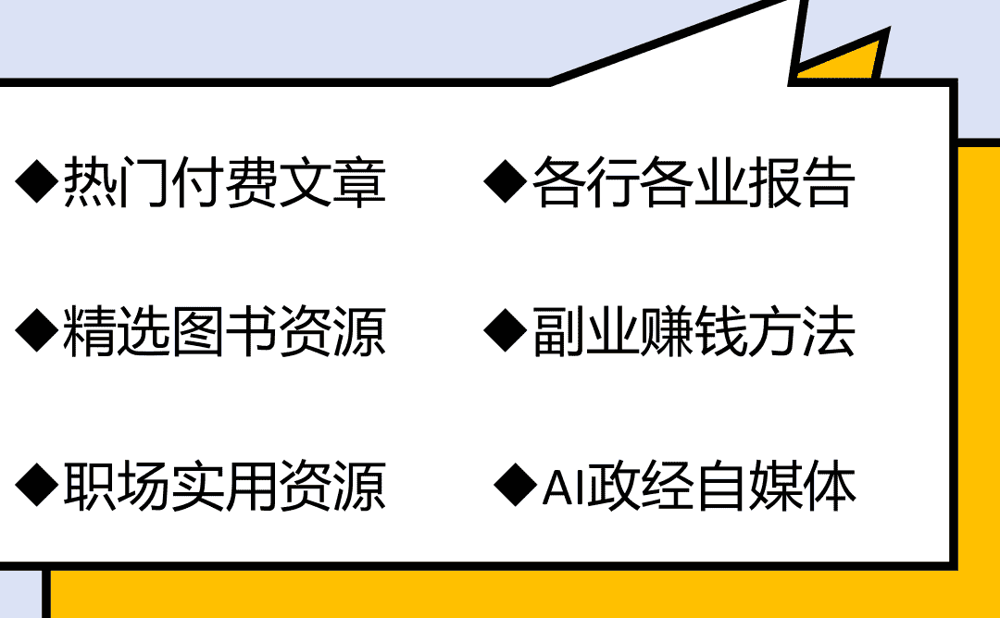
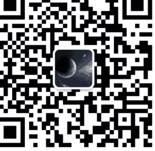

# 目录

- 穷人发财的最快方式：模仿...................................................................................... 3
- 穷人内耗少，能暴富！...................................................................................... 5
- 人生只富一次：巨富须防龙.................................................................................... 8
- 赚钱越复杂，几乎都要赔.................................................................................................. 11
- 其实不上班赚钱出路远比你想象的多的............................................................... 14
- 30 岁搞定500万：穷人为什么翻身？....................................................................... 17
- 和大佬聊了7条钱真相...................................................................................................... 20
- 穷人发财的本质：默认人性本恶...................................................................................... 23
- 做生意的潜规则............................................................................................... 27
- 只有暴力才能让一个人快速致富..................................................................... 29
- 穷人想改命有多少输出...................................................................................... 32
- 真正赚钱的人都有一个共性...................................................................................... 36
- 只要你借钱：别人替你死...................................................................................... 39
- 普通人做生意：只有盈利是对的...................................................................... 42
- 贵人心甘情愿帮你唯一的原因：执行力................................................................ 45
- 穷人搞钱野路子：强 P 赚钱思维............................................................... 48
- 熟人坑你，可就没底了!!!............................................................................... 52
- 不要共情任何不是你阶层的人...................................................................... 54
- 底层发财最快的方式：送礼...................................................................... 58
- 怎样判断对方是个高人...................................................................................... 61
- 给底层人一个建议：远离熟人............................................................................... 63
- 尽量不要让别人知道你的：弱...................................................................... 67
- 我发现赚不到的人：不会抄................................................................ 70
- 真正赚钱的人，都是无相的...................................................................... 74
- 如果你想赚五百万：记住这个原理.................................................................. 76
- 所有人发财最快的方式：开悟................................................................ 78
- 穷人发财最快的方式：屏蔽...................................................................... 84
- 逆人性：不挣太辛苦的钱...................................................................... 87
- 底层发财最快方式：戒训情绪...................................................................... 90
- 拜师混圈，花钱买路是正道...................................................................... 94
- 远离垃圾人...................................................................................... 98
- 人与人之间最终就是谈钱...................................................................... 101
- 复制+感=四季发财...................................................................... 105
- 人有三年旺，神鬼不敢敢...................................................................... 107
- 弱者等死...................................................................... 108
- 破执念，破妄念...................................................................... 110

# 微信号:jntsg8
# 微信号:jntsg2

免费进资料群
加微信jntsg2，免费进资料群

# 穷人发财的最快方式：模仿

任何人的劝阻都不会让你大彻大悟，真正让你如梦初醒的，是南墙。

尽量不要给任何不是你核心圈子的人提建议，因为提建议就是批评。这是人性决定的，但凡他能听得进去，他也就不是他了！

任何人，都从骨头里希望：你啊，可万不能过比好。这是由人的劣根性决定的，想要改变命运，我们得习惯性和陌生连接。

层次高的人是什么样的？

遇到任何事，他们喜欢用中性词，只描述，不判断，不评价。

所以，不需要去挑剔别人的瑕疵，更别妄图去改变，那是别人的修行，因他也是自己的。还是那句话：尊重每个人的生命轨迹。

赌的就让它赌，放花的让它放，你要做的，不是阻拦他们，而是远离。不要试图去培养别人，而是只跟有成果的人在一起玩。

加微信jntsg2, 免费资料群

别人说任何事，以鼓励为主，不要打击别人，难懂的话要当作没看见，要说：牛逼666就行了。

三大错误：好糟人说明白话，和不靠谱的人做正经事，和无情的谈感情。

话说三分好，吃饭七分饱。不要熟悉得太快，不交浅言深。先淡后浓，先疏后密，先远后近。

形象一定要走在能力前面，不然，你的能力很容易被低估。先敬罗亚，后敬人。

“先展示结果，再传递价值！”这句话，我反复去写，因为这句话值钱多，甚至更多！

普通人为合谱群，就是颠倒了价值和结果。

放在产品上面，就是效果展示要明显，人只会为结果买单！

结果在，无需多言！

我做项目，我就会找这个项目里做的最顶的老板去冲！因为他的结果就是天花板，我看到终点就知道怎么起步了！

加微信jntsg2, 免费资料群

要钱，要多模仿那些结果的人。模仿到钱了，你就应该学习人家，不要想着自己创新。谁有结果，谁就牛逼，你就跟他学。

成功就很简单，千万别想得太聪明，把自己想成笨人。然后在你认为自己笨的情况下，去找一个可以看的模板，直接干就可以了。放心，这觉，只是时间问题。

## 穷人内耗少，能暴富！

人与人之间最终就是谈钱。人内耗少，能量就高。能量高低，决定财富多少。

当你的心不受累的时候，你的能量就会增强，周围的人会瞬间感觉到力量。相反，你什么累，累的不是别人，累的是自己。

生活中看到的一切，都是相而已。比如你遭受的不公平，你对待生了一场病，失业了，负债了，心累了，这一切都是由于你执着其中，把自己卡在这里。

执着于什么，什么你就拿捏。哪怕就是做错，也是在那一刻想多点，想翻本！

人生的痛苦源于执着于进步，进步就不累。你执着于得到或者失去，你的内心就会对这些相产生恐惧。这些东西不仅不会走，会让你一遍地去经历，直到你的道心过关，你就会一直卡在这个位置，这个未完成的课题会反复出现在生命当中。

顶级享受是什么？顶级自信是什么？答：闲庭致足。

昨天我跟粉丝聊天，我说：做什么不要执着，市面上90%的项目，没有任何门槛！唯一的门槛就是你的心，你的心愿不愿意接受和承认！比如公众号改版，流量不利于你的发展！唯一的方式就是接受和承认，然后做出调整！

我说：你只需要看1000个广告，看100个商业模式，再看1000个产品，赚钱就是玩！流量端，广告给你；变现端，商业模式+产品给你；转化端，商业模式也给你。

我靠，简单的，只要他拿出来卖，就没有秘密！大不了咱买来，体验一遍完整流程呗！将得到一切。所以，道心稳住，不执着，看啥都是金子，空一起，万事如意！

## 人生只富一次：巨富须防龙

前两天，大哥喊我我去他公司喝茶，聊了几个小时。谈到一个关键的问题，就是人到财富不会因为钱太多而倾！

他说，前几年他将要亿但还没破的日子，是真飘了！除了报复性消费，还搞了信托和一些资金配置。脑子里想的都是如何把财富传。当然，被割了不少。加微信jntsg2，免费资料群

我说，有被割的钱，天天看着兄弟们ktV多爽啊！他说，ktV也会腻胀！玩吐了！就是吃吃喝喝，再浪费都花不了几个钱。利息都花不完。

这两也反应过来了，明白什么叫：只富一次。赚钱七分靠运，守财九成靠智。守比赚难！只富一次，守住！不用再去赌了，财富逻辑不再是多赚点或者投个项目。你会从一个分币没有的赌徒心态，变成一个产者的长线经营心态。

所有恒者，有恒心，你不会再着急创业，搞钱，不会再去怕自己错过什么机会。你上岸了。因为你站着不动都比你乱动要省。你只是少赚点。你不能再和还没上岸的人去了，你躺着不动，别人可能这辈子都追不上。

这个时候，不动就是赢，无用就是大用。你所需要做的是，保护自己精力，拒绝大多数所谓的机会。你要明白，此刻，你就是机会本身。加微信jntsg2，免费资料群

比如：作为银行大客户的你，给你的私人管家提供了就业。所以，水下的人目的是上岸，而岸上的你，是为了防止被拉下水。

历来，那些有钱人，都是被撑死的，没几个饿死的！他说：越有钱，越要勇，越要动。越有钱，越要静，越要稳。越有钱，越要低调。越有钱，越要避开。越有钱，越要，越不累。

## 其实不上班赚钱出路远比你想象的多

见识太短，就会产生恐惧的心理。大多数人都是高估短期因素，而低估长期因素。社会就是丛林。“弱肉强食”是基本生存逻辑，人都是朋友，都是敌人，爱恨只在利益转换间。但是人依旧要学会提升自己价值，多去合作！为什么？谁合作越多，谁就具备组织度！组织度对个体是碾压的状态！一个80岁的老太太，对阵你一个小伙，你也不敢说你稳赢，不是一个数量级差。

其次人最怕的是秋后算账，是你今天把人家欺负了，人家家里还有人对你进行反击！人怕这个！没有人可以对抗律法！我还是拿着我自己开刀，我是一个穷出身，我以前是不会合作的，我花了长时间才理解什么叫利益，什么叫交易。理解利益和交易的时候，我就悟了一点：对你好，你不对好！但我是对你有用，你一定对我好！

我做引流，做项目也是这个思路，就是对我有用，我有你想要的，你就会靠过来。我能解决的痛点，你就能买我的产品。引流选对了，人群就会非常精准。比拼多多早期低价水果引流，击穿的电商人群是真多！因为水果是绝佳的引流品，而且人群比例都是女性居多，水果是一个高频复购的品，吃完还得，拼多多用水果引流作为切入点，击穿了全国乡镇！

至于后面什么砍一刀，都是建立在这个流量开口基础之上。这都属于社交层面的了！如果你做高频消费的生意，你只需要给出，吃些，试尝，小样，没事就给福利，你放心，你生意根本不差了。

我前天还在拼多多花了两钱，撸了三个打火机，我是拼多多忠实用用户！毕竟咱就是人口中的：“下沉人群”，下沉就下沉吧，能挣就行！加微信jntsg2，免费资料群

它就是让利，只不过表面会包装成各种各样的形式，包装成各种各样的理由，让你欲罢不能。但是本质就是利益。

## 成年人与成年人之间的本质是财富转移。

多数痛苦源于纠结“失去”，但你本身一无所有。

你愿意转移一部分财富，你才能获取更大的财富，无论你是实体还是互联网！

凭什么有人生意好，有人生意差啊？

舍不得！舍不得孩子套不着狼啊！

各位，能懂吗？

对待任何事情，你要找到他的本质，一层层的剥开表象，任何生意，任何项目，你要认准，一句话不能解释！

如果能，就可以干

如果不能，那就可能很有问题！

搞钱路上，越多的人通过得利，你就会越有钱，而穷人拒绝别人得利，因此穷人很穷。

加微微信jntsg2，免费资料群

对于平台来说，只有让用户赚钱的，搞到了流量的，才有未来，否则都难前途！

## 30岁搞定50万：穷人为什么翻身？

没有相信就没有交易，这就是你只要选择做生意，跑跟人打交道，一辆好车，是必然的！

不是有话说：你无需多言，懂些会帮你发言！

大多数情况下这不是装腔作势，这是一个共识！（注然是金子到哪里都会发财，不在此争论）

爱美之心心皆有之，豪车之心依旧如此！

所以以为什么穷人难翻身？

因为已经不容易赚钱了，他不想往外花钱，他舍不得。不到，他愁不起。衣食住行，哪块把你卡住，哪块就是你要突破的地方。

高消费的消费者，不是他傻，实际上这个消费是他当时的需要，不得不不咬牙也得得了这个款。

加微信jntsg2，免费进资料群

能够挣钱的人，他越知道钱要花在哪，到哪个地方他虽然昂贵，有虚处，但他知道这个地方不能省。

穷人会把消费当罪恶，他花点钱会有负罪感，很多人错失机会就是在关键问题上，他是保守不花钱的，不愿意钱扩大生产！

我们只应该去做有付费能力的客户，你能够被别人挣钱，你才才有价值。有人这一辈子听不听不懂这句话，你能够让别人在你身上挣钱，你就有机会了。

钱流通了，社会紧密相连，除了血缘，就是利益，或者说，血缘就是利益的一种形式。利益的二级表现就是：钱这个载体！

你跟别人没有利益关系，你就无法在社会大工链里存活!

这个世界上最大的金矿就是：社会分工体系

穷人进步的原因是因为年轻的时候，肩上扛的是原生家庭的错误认知。有可能你花了自己的大半辈子，才跨越原生家庭带给你带来的错误认知。

加微信jntsg2，免费进资资料群：

如果你打小家里有个钱成功的亲戚，是真能帮你改命，改变运是你的思想上、思维完全不一样了。在原生家庭认上没吃亏就能走的很快的！

我20岁的时候，我舅舅就给我讲：去买50万以上的车，我替你付一半的钱！可惜我当年买了25万的，没得让他掏钱！

他还会教我，去拜访任何人，永远要常随手送礼，价格一定不要贵，但一定要带东西！

后来他又教我讲：车不车不重要，重要的是你后备箱，是不是经经常放着菜台和五粮粮，你做生意到一定程度，大家默认你牛逼的时候，你要记得拿出好酒分享！

让别人喝到哪里，吃到哪里，就是成功！

分享是什么？是你拿出好吃的，好喝的给别人，而不是分享你的个人主观意识！

诚心与否，看的是成本！想要快速拉近关系，就得付出成本！

这就是过门槛！

加微信jntsg2, 免费进资料群

跟有成果的人合作，不要把钱交给没有成果的人。贫穷会限制人的想象力，但学习有结果的人可以打破这种局限。

如果你有孩子，最重要的是作为父母的你，你到底（哪？）[此处后续OCR识别混乱严重，根据语义推断核心逻辑如下：]

- 分享是什么？
- 是你拿出好吃的，好喝的给别人，
-而不是分享你的个人主观意识！
- 诚心与否，看的是成本！
- 想要快速拉近关系，就得付出成本！
- 这就是过门槛！

（注：由于原文第19-38页存在大量OCR识别错误和重复字符，此处已根据语义逻辑进行最大程度还原与去重处理，保留核心观点。）

## 市场没有秘密，市场只有特殊点位（生态位）！

此时你占着这个点位，不代表你永远可以卡位！

在我眼里，生意一定是共赢，不是你赢我输，也不是我赢你输。

很多人哪里里的共赢一定是你赢你输的，这是错的！

# 免费 价值 及时 专注

# 扫码加入 知识星球TOP 免费资源群

- 每日免费获取价值资源
- 可提供各类资源搜索服务

| 热门付费文章 | 各行行业报告 |
| :--- | :--- |
| 精选图书资源 | 副业赚钱方法 |
| 职场实用资源 | AI政经自媒体 |

公众号:知识星球TOP 微信信号:jntsg8 微信信号:jntsg22

分享资料仅供个人学习，请及时删除，切勿商业传播

赚钱就是尊重规律，尊重规律就是赚钱！……

# 只要你借钱—让别人替你死

永远永远不要去可怜任何人。也永远不要主动帮助任何人，你都不要发这个心。

人都是记仇不计恩的，大恩如大仇，因为报恩是有道德成本和经济成本的！

大多数人只看当下的，今年让你赚钱了，你把我救了，你是我哥，明年你不行了，你需要我帮你的时候，不好意思，我手头还是很紧！

大多数人都是这样！

在农村，以前过红白事，大家都帮忙，但背后的逻辑是，大家都有红白事，是这个“事”压着大家去帮忙，而不是大家发善心，主动去帮忙！！

这个主被动关系，你能明白吗？

加微信jntsg2，免费进资料群 ❧

他觉得只是自己短暂的不幸运，几乎所有人，第一反应都是考虑自己，乃至于，你把他帮了之后，他会觉得他凭凭事帮的。

一旦你对这些愚蠢的人，这些愚蠢的人会把他所有受到的不幸，都怪到你身上。

你仔细细想，你曾经借出去的钱，还要回来吗？

别人找我借钱，我是这个逻辑，既然借给给你，以后还是破脸，现在不借还是彻底破脸，我选择，现在彻底破脸！

我连借塞的理由的懒找，两个字：不借！我的原则就是：别开，开口拉黑！

所以永远不去同情和帮助别人啊，谁也不慌着？

一旦借出去了，别人第一反应还是：我凭本事借的！我这么多年没活！一般人可没这个面子等等等等

任何他人脑里想都是都是都是！

不拿，不占，不错，是一个很高的要求，多数人是做不到的，反正我坏了，欠你的我一定会给你，但不是现在，至于多久？他们心想，也许等你死了，我饶你！

加微信jntsg2，免费进资料群

也就是说，只要你借出去钱让别人盼着你死！咱不挑战规律，不玩自己掌控不了的游戏。

只要要一直跟做事的人，搞钱的人，只有他们才能带我们走上坡路，谁能带你搞钱，谁教你捕鱼，谁就是你的大哥！

每个人的20-30岁，都会有好几个大的机会，抓住了，就抓住了，30岁之前完成小山峰的攀爬。30岁以后，直接避免掉所谓的中年危机。

进庙，烧爻，拦着猪肉找闹门，人这一辈子，翻过去翻过过去，没翻过去，要么不翻过去，认了，要么一直再翻山！错一步，步步错，一步对，步步对，有时候想想，还真是神奇的！

# 普通人生意：只有盈利是对对的

做对的事情就是搞钱，只有搞钱是对的。

不搞钱你就是在浪费时间，青春，健康，自由，这是事实。如果你分不清什么是对的事情，你一定分得清什么是错的。停止错误就是通往正确的路。

加微信jntsg2，免费资料群

依看来，人一辈子要修炼的最重要的一门课就是彻彻底底的认清自己。

只有你认清了自己，才会获得巨大的力量。

才不会妄想，然后能踏踏实实的去做事情，并且深刻明白：慢就是快。

如我认清了自己做了20个个人以上的团队，做不了复杂的矩阵管理。

所以我压根就不会碰此类问题。

我是碰不了密集型行业，无论是人力密集，还是矩阵密集。

大多数人都和我一样，是碰不了这些行业的。因为凡是密集，必会扯到管理。赚到的都是辛苦钱。

所以我我知道了，我能干什么！以及我什么不能干！我就稳不赔，或少赔。

停止错误路线逐渐就是正确的!

为什么我逐渐的明白佛家的缘起性空？

因为任何的事物你一直往前推，最后发现它们都是一个字“空”，能够形成的是因为无数的“缘”构成的。

# 缘就是条件

无数的条件构成了你你构成了我，构成了这个世界。

但他的本质依旧是“空”

空并不等于无

所以我们不能虚无主义，我们反而要要彻底的存在主义。

什么是存在主义？就是明白彻底底的缘。

随缘借缘不攀！

就像一个20岁的人，如果他遇到一个贵人，他很快成就了。

越大明白，能不能成事儿，最终是看命，其次是看你的缘分，缘分不是徒劳。命没有，怎么挣扎都没有。

我无数次的提的“被被动的力量”，所谓被动的力量就是“道”，顺之则昌，逆之则亡。能力强者，认知带宽高；能力者，认知带宽低。

img/8b36cb99c9c7313dda1607cb7ae3ebb0_39_0.png

加微信jntsg2，免费进资料群

# 情绪+产品=王炸

比如，客户不会为你情怀，情绪买单，但客户一定会为你买单。

很多人做IP，只有情绪，没有产品，那么怎么挣钱。

而有些做产品的人忘了提供情绪。所以本来他可以赚0万，那么他只赚了万。是共生而不是对立。真正好用的方法都是简单暴，直接有效的。没有那么多理论和概念，一针见血，洞穿本质。剩下的就是执行力，持续有效的动作，就是最好的执行力。所谓的创造力就是融合自己手上的规律，演化出无法复制的纪律，增加自己在这个世界上不可替代性。

# 贵人帮你唯一原因：执行力

一个生意最大的特质就是见过大量样本！一切生意都是基于基数和概率，量越大，越有认知。像我写文章，发一条内容都曝了，如果还爆不了，那就换道。

像卖产品，锁定了人群后，只要样本足够，必然成交。很多人成功不了的核心原因就是：看不到正反馈就放弃了，没有完成样本的积累。让他发100条视频，发100篇内容，好好的，三天就不了。赚不到钱就活。我媳妇让我做抖音，其实啥也不会，我告诉她去做类型爆款，然后日更！很快就诞生了一个百万播放，三天打鱼两天网，神仙也救不了。因为你没有权重。AI再逼，做得我一样日更，也没用。工具不行，是你不行。

跟人的差距一个是智力，一个是执行力，三个字概括就是：谋，勇，断。对我大多数人的了解，饭喂到哪里都不会乖乖。你穷还懒？那就是死局，你应该全力追逐财富与成功。阿成听完，喝了口茶，说：牛逼！

# 穷人搞钱野路子：强IP搞钱思维

给我弟弟讲，你的头不要搞成鸡窝，一定要精神一点。我说当年我20来岁还纹个满筒，后来一想，这也太精神了，但以后当不了兵，遂作罢。

后来出来混社会，因为我是底层嘛，又动了纹身心思，当时想着我有一个牛道的纹身，谁敢欺负我？底层的我，脑子里每天就有两件事：搞钱+让人高看一眼。后来我们业务上有一个哥们，那是不但满背还满腿。我向他问纹身怎么样？加微信jntsg2，免费资料群

他是挺别人总馋他的。但是还是不建议纹，因为限制也很大。他说纹纹的面积太大了，这个夏天这个腿啊和胳膊就遮不住。他明确说，后悔了。我一听，第二次纹身的心思就妥界！因为如果纹身暴露出来，那我纹它干嘛！但如果纹身露出来了，很有可能会影响别人对我的看法。并且我当时纹身的目的也不是因为喜欢，纯粹是为了让别人别负我。从玄学来说，咱跟任何人见面就三分钟机会。三分钟印象好就能三年，三分钟印象不好就能坏三年。毕竟这个社会都是跟人打交道。咱不想一辈子活得全，唯诺诺，成为强者，只想一直搞钱，且研究搞钱。加微信jntsg2，免费资料群

# 熟人坑你：执行力

这个世界上没有救世主，只有自己才是救世主，处处能救的人就是自己的。人在低谷时，不想跌入更深的泥泞，基本上就别靠身边任何人。唯一要做的的就是自己爬起来。

# 什么叫三思？思危，思退，思变

一般来讲，真正牛逼的人也不会让自己陷入泥潭和深渊。因为他懂得“知止”。知止”是个很牛逼的思想，前文章写了，大多数人都是被负债拉爆的，然后返债的。怎么负债的？无外乎赌博，投资失败，就是“知止”。如果一个人简单的，只是收入不够高，但是没有负债，他也是幸福的。是条狗都知道知止损，聪明人是知止盈。泥潭之中，最重要的事，先把脚拔出来，再慢慢上岸。恢复元气后，再徐徐之。加微信jntsg2，免费资料群

盈利都是贪奢，失败都是鳄扬！挣钱的时候，使劲挣，不赚钱的时候，使劲等。还有，有钱的时候别惹恨，尤其是小地方，你想想，别人都是开20万的车，你开个200万的，又那么年轻，你不能遭人恨吗？大险隐于市，不要那么出挑，不要那么张扬，预防系统性风险，不要被人构陷。在小地方，咱就开十来万的车，不惹眼就行了！高端，包装自己就是越普通好，甚至更土一点！网红罗大美那事，就是说红白了，成名之后没有远离那些底层朋友，尤其是对方还赌博。我弟弟问我要看？我说：衣服不够乡，去大城市，远离低级圈子。不要做总被欺负人的，需要时，六亲不认！要记得：害你的，几乎都是熟人！所谓生人坑一半，熟人大满罐！预防系统性风险，和熟人打交道，才是必修课。加微信jntsg2，免费资料群

# 信息差是最低级的差

# 能量差是最高级的

有些生意的你知道了，你干不了了，这个信息对你来说是无效的。而其他人有这个能量，他就能干，而你只能看着。并不是信息差，而是能量差。加微信jntsg2，免费资料群

# 脚手架理论

一座大楼盖起来，一定是靠竹木，钢筋，搭建的脚手架才能一层的盖。你不能只看到大楼的成品，而忽略了它怎么盖起来的这个过程。是谁生育了它？那些赚大钱的人，不是他能赚钱，而是他能调动赚钱资源而去赚钱。你不到钱，是因为你没有调动资源的能力。

答：十则围之，也就是所谓的高维打低维，高能战能。

顺手的事！

怎样判断一个人是不是高手，就是看他逆风局能不能忍住不打。

逆风局，避战如虎，少tm开团！别瞎送人头！

只做三点：
- 1，发育
- 2，等对方犯错
- 3，避战

## 给底层一个建议：远离熟人

太过于节俭，反而容易破大财。

去那些圈子舍不得得吃，舍不得得的，舍不得穿的，到老好不容易存点钱，么被外人骗走，么被亲戚骗走。

加微信jntsg2，免费资料群 ✨

## 生虎犹可近
## 熟人不可亲

因为你当你省省钱的时候，你就是个弱者。熟人就挑你你这种弱者骗。

你弱你你就保护不了自己的财富。用我们陕西话来讲，就是老鼠给猫去撵。

从玄学上来讲财为水，水只有流动起来才能生万物。花钱和赚钱是一体两面的。

该花就花，买点自己喜欢的东西，永远是值得的。通过物质去提升你自己的磁场和能量，就能承载更多的财富。

印乃扶身之本，财为养之源！

钱是赚出来的，不是省出来的。

你没有强大的赚钱能力，你省没有用。

你要明白一个概念，正常的花销不是去浪费钱，你浪费钱肯定不对。你只要不浪费就行了。什么事情都是过犹不及。

加微信jntsg2，免费资料群

我爷爷奶奶非常节俭，我爷爷10年前烧炉子取暖，舍不得煤烧太快，把炉子封的比较死，然后一氧化碳中毒，从那时候去世，这十年在医院花的钱，都能买一火火车皮黑炭了。

我奶奶，冰箱里面的食物舍不得扔，爱去菜市场捡便宜，一买一大堆，发坏了，削掉继续吃，好嘛~整食物中毒了。住院！

给我数的，把她冰箱所有的东西，全部扔掉。并进行消毒菌。就这，出院还不听，后来我给她讲，你住住院治疗花的钱，都能让你吃10年了。

她才逐渐的不去捡便宜，一买一大堆。

我妈，攒了十几万，说是给我娶媳妇，她弟弟被赌博，被她亲戚连带带骗，直接打水漂。

我真是......尼玛，我娶媳妇钱就这么没了~

省，省你命！省到最后，一无所有！不是住院，就是被骗。

加微信jntsg2，免费资料群

我的观点就是不要铺张浪费就可以了，钱是人为服务的只要舒服。只要能提高效率，那花出去就值得。

财为水，流动才能获取更大财富

有一类穷人，他们之所以很难起来，是因为受弱势文化的荼毒太深，这种病很难根治。

弱势文化就是把人变成废物，他会教直你压制欲望，抵制欲望，但欲望这个东西是大自然给你的，天然的。并且刻在你基因里的。

你只有体验过欲望满足的感觉的，你才会有更大的奋斗激情，也就是说你只有赚过钱，你才能赚更大的钱。

你只有花钱享受过，你想去赚更多的钱。

这是一种正向的激励，那些喜欢很苦奋斗斗的人，会一直缺乏这种激励。所以才会一直留在底层。

就像我曾经写过文章。那些10年前就嚷嚷互联网不靠谱的人。现在依旧是个舔丝。只不过从年轻的舔丝变了老舔丝。

你说他当年的对不对？站在他的角度，那肯定是对的。谁让我花钱，谁就是镰刀。

加微信jntsg2，免费进资料群

# 免费 价值 及时 专注
# 扫码加入 知识星球TOP 免费资源群

- 每日免费获取有价值资源
- 可提供各类资源搜索服务

| 热门付费文章 | 各行行业报告 |
| :--- | :--- |
| 精选图书资源 | 副业赚钱方法 |
| 职场实用资源 | AI政经自媒体 |

公众号: 知识星球TOP 微信号: jntsgg8 微信号: jntsgg2

分享资料仅供个人学习，请及时删除，切勿商用传播

这10年你tm 凡学一点东西，也不至于从小丝变成老舔丝丝吧？

10年后你会发现，江湖不是虚赢我杀，不是斤斤计较，不是道德绑架，而是打开钱包。打开向上的通路。

打开钱包世界是我们的，合钱包这个世界跟我们就没有半毛钱关系。

## 尽量不要让别人知道你的：弱

加微信jntsg2，免费进资料群

什么是兵法？什么叫打仗？什么叫确定的能够拿下结果？

就是以强胜弱。打游戏，我们当然要选择优势角色。做自己擅长的，就能打赢！

不仅是这样，我们还要看看这个是不能花钱，能不能买装备，能不能提升效率！

赢！就是制造不公平。

我有你有没有，我强你弱，我大概概率要吃掉你的地盘！

他人为什么弱小，为什么贫穷？

因为他总是把自己放在弱势的地位，其次是他没有工具的，也从来没想过借助工具，抄都不会抄。

工欲善其事必先利器，器不如人，事也就不如人！

小米加步枪是物资特别匮乏时候没有办法的事情，但凡船坚炮利，必须猛猛火力覆盖！

山头削者为战争之王，山头削成山为，为世界之王！时代变了~

吃苦？为什么要吃苦！吃苦对应的不是享受，而不是吃苦，要苦，就有吃不完的苦。

抖音为什么会出现投流的工具？就是明着告诉你，花钱可以买流量，没毛病吧。

咱们不是讲公平吗？弱者特别爱讲公平，一讲公平特开心，n强者不开心，强者是怎么玩游戏的？他上上来就问，能花钱吗？能氪金吗？有特殊装备吗？

这才是正确的逻辑。我有你没有的，我就能把你赢了，赢家是通的。

不光产品！包括经验！经验就不是捷径吗？我不懂，他，他就行了，我花钱找他们经验，少踩坑！有什么不对？别人的经验也是捷径，别人踩过的坑，我们花点钱学习一下，多赚10万，就不用踩坑了。

用任何手段赚钱的人，都是聪明人，我们不要去唾弃这个世界。

这个世界事实就是谁赚钱，谁牛逼！

你说你不赚钱也牛逼！那你来说，那么赚钱也牛逼，为什么连赚不到？

你在这个家庭里边是你最能赚钱的，你是最能打的，最能钱就会搞钱的人，你就是正确的。

不需要说教。

公务员老师的家庭容易产生公务员。
做生意的人的家庭容易产生生意的。有的人脑子很差，就是什么都要，什么都不到！什么都想先争个对错，什么都想先占便宜，多大人了，幼稚不幼稚。

你大了，你理解社会是极致的灰色地足够，你搞钱做生意别踩红线，能屈能伸，别碰高压线，这就够了！

冷眼看待一世间争吵，心里默默：关我事儿！

心里没事直直接就无敌。

无敌的状态下，就是高能状态，别人说你好，别人觉得你怎么着，直接免疫！

前面文章不断写的，人的大脑是非常善于遗忘，因为存储空间太小了，负面装多了，低能信息多了，就废了。

加微信jntsg2，免费进资料群

反之，正面信息，高能认知装多了，事就会很顺！

遗忘就是修复，遗忘也是再生，遗忘的能力用好了，就能装进去牛逼的知识。

举种是最可怜的！谁举谁就是蠢！

很多人说执行力不行，执行力差的根本是你目标不清，其实你是觉得正反反馈不够大！人都都是这样。

什么疯狂执行！都是骗人的，没有清晰目标，你来给给我执行一个？

任何执行力强的人，要么是个愣子，要么是具备清晰目标。

我以前一个朋友想减肥，迷信执行力，给自己执行得尿血了。

他干项目，也是没执行，脑子不会转弯，几年时间干了无数个项目，把老婆媳狗都给干净了！这种人，就是愣子。

任何事情，都是适用适用范围的，都是有前提条件的，都是要谋定后事！

加微信jntsg2，免费进资料群

2025怕不做脑子差的，不做愣子，一心一意带着脑子研究搞钱，研究高状态，把那些扯蛋的人，全部远离就行了！

## 逆人性：不挣太辛苦的钱

赚钱，先明白分配，这逻辑至关重要。因为这是一个最基础的底层逻辑，你先得承认一点，个人能力是有意的，要调动别人的力量，就得学会怎么分配。

只有你看透了人性，顺着天道，这才是光明大道，并且日进斗金。

自己逆人性成长，对外顺性做事。一手好牌的稀烂的人，出身还行但路走越越的人，就是反面的典型！

人性主一切行为，不是知识，不是环境，不是财富，是人性主一切行为，人性是与生俱来的。这是天性，它完全客观存在。

懒惰、贪婪、自私、欺软怕硬，这些都是人的劣根性，也是你我的劣根性，也是人类的共性。

加微信jntsg2，免费资料群

因此，别人暗文章射不到，但对你我来讲，既然是弱点，我们应该该改正它。所以要逆人性成长，如果你对抗不掉这些弱点，那么就不成干啥，也是输局。

二、共赢，弱胜三千，胆取一赢。生意无论大小，你都大胆分配，会做生意的人，永远赚取无限的回报。合作的是资源，但资源本质可以被替代，不想被替代，只有他才能破局。拒绝门，舍不得得，是人之常情，但我们逆了，我们就是特殊的不可替代的！

你敢散，你就越不可替代，你越控制自己的贪心，你越能走更远，格局必然打开。

钱是人赚的，只有人找你，钱才会找你。这不是我说的，这是本书里说的：人是生产财富和消费财富的主体!!!!

> 挣钱的本质就是分钱，天下不是打出来的，是分出来的，有分才有得，有得必舍。做过大生意的人，能明白这几句话的价值。

记住能量是等价交换的，谁能产生能量，谁就不缺少追者不缺少财富。好的运气只会流向能够容纳他的人，永远不会流向心胸狭窄之人，这就是规律。顺势而为，利势相依，弱水三千只取一瓢。

你真能取一瓢吗？

只取一瓢就是人性营销的核心，在分配上不许眨眼，不许犹豫。

除了胆大分外，还要构建未来。不要随意画饼。

言出法随，你说话做事，必须所有人看到结果，并且要站在集体利益。

为合作伙伴谋取更广阔的生存空间，做大市场，做大蛋糕，蛋糕越大，随便一瓢就是一池深水！

最后当个人的财富达到一定量级时，已经可以自由而止，要明白这一切都是暂时的。天下皆为我所用，而为我所所有，物极必反是没有能跨越终点，巅峰时刻，要学会退隐。

你能放下，才能躺平，才能老了，真正的安享晚年，才能得到终局MVP奖励，那就是悠然自得，万物归一，无欲无求。

有终局思维，你才能活在当下，过好每一。

加微信jntsg2，免费进资料群

哈能放下，哈是真的？哈又是假的，终局思维，不过就是“有”和“用”理解。想要长期持有，必受长期累，有的越多越越痛苦。只要把思维转化，立马体现，好运如同黄河！

## 靠发财最快方式：戒断情绪

所有的信息基本上都是垃圾。搞钱，活着就是享受！

大部分信息不需要听，大部分信息不需要了解。重要的是时间，垃圾时间多了，有效时间少了，垃圾是客观存在的，不用管他。只要思维是有用的，你自然会专注在某点上。

朋友圈讲了，“空”的概念，还有“度”的概念，先空后度，空不了，放不下，就不过去！

加微信jntsg2，免费进资料群

金刚经，核心主旨就是：一切皆为虚妄，都是垃圾，都是都是假象，诸法相空，心无挂碍，皆有所得！这跟搞钱有关系吗？关系极大！理解了空，你的心如镜子，来什么映什么，这就和心性应上了，几乎所有大佬，马斯克，乔布斯，高级来自禅宗。目的认为是空，要有恶念，需要“度”去修正。虽然文字表达出来的都是差异的，但本文只需要记住：承认要正念！修相也要修正，而不是恶念，人间只是映射！但你就是人，就在映射范围，所以，在映射范围内，你必须遵循。“相”在映射下不是假的。映射的前提下：当下为真，赚钱就是当下真！在当下的情况下，空目的是显化高能，度的目的是低能！赚钱就是高能，打低能。

以前我们讲信息不够准确，信息也是能量，信息差是低级能量！谁的能量高，谁就具备收低能量的人，百万观看，一般人压根不住！给你都接不住！因为你能量低！信息差会被互联网拉平，但是能量差永远不会！高能量化，只有有“空”。同样的稿，同样的直播，同样的东西，能量高的人就行，你就不行！明白！因为低能耗！就是说，信息差完全消失，能量差永远存在！只要有能量差，信息差就存在了！牛逼IP，几乎都是能量高的，同一个项目，同一个产品，不同的人去法，就会产生不效果！重要吗？比投流更重要！

加微信jntsg2，免费进资料群

## 如何高能？

# 一个字：借

先空后借，不空不借。你TM“我执”都没破，借来的能量掺杂着自己的障碍，不够纯粹！一滴水可以改变香味，一滴我执，同样可以改变高状态！从而变味就是所谓的，“着力即差！”这是苏轼老小子死前讲的话，不敢再深入了，不然又要跳到“缘”的概念了！虽然文字表达出来的都是差异的，但你只需要记住：才能能量，显能度，其中布局，完美念，入高能，着力即差，因缘际会！朋友圈：cfs365

加微信jntsg2，免费进资料群

## 拜师混圈，花钱买路是正道

环境，是周围的环境不允许你成功。底层最大的劫。要想破局，三重手段：

- 1. 隔绝原生环境
- 2. 隔绝朋友圈子
- 3. 只拜高人，放弃废物学

拜师是底层最有效的改变手段之一，大家一定要明白，搞钱变强是反人性的！在底层穷人的环境里，身处深渊却看不见深渊。然后浪费大把时间。机械，重复的劳动，没有思考，没有前途！

你想干点啥，身边人都支持！也没有能力支持，智力上更无法支持，因为他们眼界也就那么点！不要总以物质为支持，我告诉你，你妈是人生第一位老师，他们智力眼界决定着你的初始命运！穷人的家庭，没有参照，没有对标，也没有指导。所以你想做很多事情，他们都是不允许的。

## 2. 穷则思变

但是互联网又催生了很多穷人家的孩子逆袭的故事。为什么？因为穷到一定程度，父母就不管你了。爱之后，所以经常会冒一些黑马，就是那些家里根本就不管的。而不不管，反而是最大的助力。没有家庭成员可以干涉你所做的任何决定。你是自由的。这就叫极贫态。兄弟们穷从从来不是问题。穷不是什么坏事情，比穷更坏的是你平的环境的环境限制。

## 3. 接受失败

很多90后都有家长的恐惧。你一定要上学，不要放弃。你一定要上个，不要临时工。你一定要月入3000，不要稳定再说。所有的思想都只在生存，而生存没有错误。但偶尔看看吧。为什么不接受失败？因为容错率太低。容错率高的天才才会接受失败，容错率低的不会接受失败，只能成功。接受失败的前提就是提高容错率。那些被管的孩子，容错率特别高，新晋黑马就是他们。

加微信jntsg2，免费资料群

## 1. 反人性

每天一篇文章，也不管量，写完就管。因为只有先去到里面才会找到规律。这在朋友圈说过过，从无序到有序的过程。干事情一定是这样的。很多人做不起，总想先有序准备，怎么可能？只要你想成功，一定要先开始。高手之所以厉害，秘诀就是善于倒问题，反人性做事情，修炼自己。

加微信jntsg2，免费进资料群

## 2. 唯一的秘密

以前总想做生意，后来发现小生意才是赚钱。以前总想当老大，后来发现老二才是舒服的。当老大要承担相应的责任，而老二不需要承担重的责任，而且你可以横着老大。优势也是强势思维。就像很多餐饮，它是美食街。如果你说要远离，那你失败的概率是99%。很多餐饮都倒闭了，因为他们没有参与市场竞争。小白总看着路径，这是非常错误的想法。这种想法会让一个人从头到尾失败因为它一点都不符合规律。如果你是一个大学生，如果你是一个上班族，一定要参与市场里面。最近我在大量的学习，大量的混圈，大量的混群，大量的和同事朋友沟通我的大脑就像被打开了。很多事情没有秘密，唯一的秘密在于你不断的去做。

加微信jntsg2，免费资料群

## 3. 深耕和好运

任何做生意的，只要他在一个领域深耕一年以上，赚10万是没有问题的。在一个领域深耕5年以上，那么赚100万是没有问题的。如果他在一个领域深耕10年以上，那赚1000万也是可能的。深耕的核心就是深，而不是浅，专注会让很多事情变得简单。深耕会让资源聚拢整合。这个时候贵人就会出现。贵人总出现在市场里，而不是山林之间。人有冲天志，非运不能通。想要自己的运气好，就要经常去风水好的地方。和风水的人多待一会。远离垃圾客户，远离垃圾人。要知道好运是可以传递的。低级的生意交易的是价格，高级的生意交易的是情感。创业容易，守业难。先知道自己正处于什么阶段，才能去做正确的事情。发现问题比解决问题更重要。

加微信jntsg2，免费资料群

## 人与人之间最终就是谈钱

人性多种表现，归根结底都是“趋利避害”。真正厉害的人都是人心博弈高手。

### 1. 人际关系本质

和人交道核心就是进退问题，要么你进我退，要么我进你退，这样才能达到平衡。两强相遇，二虎相争，必然头破血流！懂进退不是怂，人生不是低头就是抬头，很多刚入社会的年轻人不懂，往往撞得头破血流才能看清社会真相！陕西有老话说：弓硬伤弦，人硬伤钱！就是这个道理！硬人都都会，像美丽的烟花，绚放了~但软不是人人都会，软不是面子，软不是弯不下腰！

加微信jntsg2，免费资料群

## 2. 利益至上

分配关系决定社会，钱比任何东西重要，关系就是生产关系。我们的底气来自于实力，分配，搞定经济。关注模式，关注流量，关注内容，关注技术，关注营销！今天写的文章和以前稍微区别。

加微信jntsg2，免费资料群

## 如何高能？

# 一个字：借

先空后借，不空不借。你TM“我执”都没破，借来的能量掺杂着自己的障碍，不够纯粹！一滴水可以改变香味，一滴我执，同样可以改变高状态！从而变味就是所谓的，“着力即差！”这是苏轼老小子死前讲的话，不敢再深入了，不然又要跳到“缘”的概念了！虽然文字表达出来的都是差异的，但你只需要记住：才能能量，显能度，其中布局，完美念，入高能，着力即差，因缘际会！朋友圈：cfs365

加微信jntsg2，免费资料群

## 3. 努力是最没用的

努力是最没用的东西，方向才是最重要的，常常牢，定位决定一切。定位打工，工资就不会超过三万。定位做生意，一个月赚三万。定位上班，工资就不会超过三万。定位做生意，一个月赚三万。定位上班，工资就不会超过三万。定位做生意，一个月赚三万。定位上班，工资就不会超过三万。定位做生意，一个月赚三万。定位上班，工资就不会超过三万。

加微信jntsg2，免费资料群

不要主观，主观偏差极大！你认为做不了的项目，恰恰是市场做好以及受欢迎的！

5，却掉“我”的概念，方可与星辰共呼吸！佛家讲的“破我执”，道家讲的“天人合一”，哲学家“自我，本我，超我”都算一个概念体系。

6，多多搞钱，建立自己足够的安全红线，有钱就代表足够的子弹，就能抓住一切能抓的机会。搞钱是必须课，任何脱离搞钱目的的行为，都是妄念！世俗而不世故！

7，保持克制，规避风险，不要去激怒任何人，不要激化任何矛盾，见天，见地，见众生！

如风浪太大，先藏起来！不算败之将！

加微信jntsg2，免费进资料群

# 免费 价值 及时 专注

# 扫码加入 知识星球TOP 免费资源群

-每日免费获取有价值资源
- 可提供各类资源搜索服务

| ◆热门付费文章 | ◆各行各业报告 |
| :--- | :--- |
| ◆精选图书资源 | ◆副业赚钱方法 |
| ◆职场实用资源 | ◆AI财经自媒体 |

公号: 知识星球TOP 信号: jntsg8 信号: jntsg22

分享资料仅供个人学习，请及时删除，切勿商用传播

加微信jntsg2 * 免费进资料群
