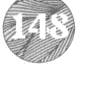
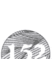
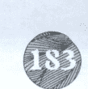
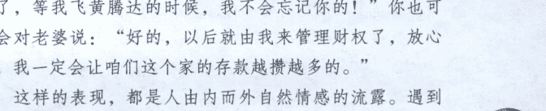

# 单位生存教科书
·老A著

## 知识星球TOP 资源分享群
汇聚全网付费资源让更多人获取高价值信息

◆ 付费文章 ◆付费社群
◆ 付费课程 ◆副业&搞钱
◆财经&股市 ◆ 行业报告

时政·历史·职场·体制·自媒体
学习·军事·软件·影音·社会学

公众号:知识星球TOP 微信信号:jntsg8 微信信号:jntsg2
添加微信 免费进群

## 目录

第1章 领导对我很不满意，我该怎么办？ 001
第2章 总是吃亏的老实人，在单位如何改命换运？ 004
第3章 在单位不要睁睁，这才是真正的工作智慧！ 008
第4章 在单位，说话总忍不住悦于人，没没病，但得掌握好度 011
第5章 在单位中重要的人关系，怎么实操？ 014
第6章 请人吃饭，要怎么请他才会出来？ 017
第7章 带你见识高手的话术，你就知道人外有人了！ 021
第8章 空降到下面领导，有哪些要的事项？ 023
第9章 在单位，如何让他觉得你是一个正派的人，厚道的人？ 026
第10章 领导骂你时，心里在想什么，你不能不知道！ 029
第11章 想去领导那坐，该怎么实操？ 032
第12章 在单位，做事的几条关键准则！ 034
第13章 单位里的女性和单位主要领导交往的禁忌 036
第14章 在单位和和同事竞争？不要怕，听我来演讲 038
第15章 关于永生的思考
第16章 你必须有反思能力，很多时候就是你的错！不要怪别人 044
第17章 在单位，我得让你感受到疼！
第18章 越重要的饭局，越要提前想到这些
第19章 想在单位有出息，多听听高人的话 049
第20章 在单位，一定要想办法去掉晦气和乖气 055
第21章 你已经是成年人，不能突然变得很聪明，对答如流，想说面话，你得背公式、背套路！ 057
第22章 若想成大事，哪怕是成事事，自律重要 061
第23章 请人物吃饭，饭局上的东西要提前备好 064
第24章 单位不会有什么太烦心的，很多事都是你没认清楚自己或没清楚现状导致的 067
第25章 去给领导汇报工作时，有哪些事情必须考虑？该说哪些话？ 070

第26章 请人物吃饭，饭局上让客人端酒杯的几个方法
第27章 详细了了解领导的几个小技巧
第28章 在单位，会哭的孩子有奶吃
第29章 领导提拔一个人，看哪两点?
第30章 在单位，写能力非常重要！
第31章 在单位想些进，不要叽嘘，请出真招，出实 087
第32章 想要和领导处好关系，你应该掌握这几点 089
第33章 临近年，你们打算对毕竟、恩人做些什么呢? 092
第34章 饭局上，该怎么提自己的诉求呢？我教你几招 095
第35章 单位的风水轮流转，你你不联系的人中有高人! 098
第36章 搅一个饭局，要请哪些来促成好事？千万别乱请! 101
第37章 工作交流、会议发言时，害怕讲不出、讲不好，要要聚学会用辩证法演讲! 105
第38章 不管在单位里生活还是生活中，总有一个神奇的小圈子！ 109
第39章 年轻人参加会议时，坐在台下听，在什么时候说什么什么场合才能抓住机会? 112

## 单位生存存教科书

第40章 领导怎么对待不听话的下属（一）
第41章 领导怎么对待不听话的下属（二）
第42章 谈谈饭局上避避喝酒最好的托词和做法 121
第43章 当你参加的会议你需要来发言时，你该如何做、如何说局面面，才能让领导心花怒放？ 125
第44章 谈谈调动工作的相关事宜，千万别搞错方向！ 128
第45章 小领导给你分配任务时的心思 131
第46章 在工作中和领导交流，像父母对孩子那样！你得掌握这一点 134
第47章 谈酒的基本术有几种，学会了受益终身 137
第48章 在工作中取悦领导，要说哪些话？最好再加上这些小动作 141
第49章 在单位不能没良心！
第50章 什么时候帮领导挡酒以及有哪些挡酒的托词？这是饭局你可能出彩的地方 147
第51章 求人办事，一定要在散席后抓住机会。抓什么？怎么抓？ 151
第52章 求人办事，找什么样的人来打招呼最合适？
第53章 在生活中让领导导高兴，各种场景下，该怎么说？该有什么进一步的动作？
第54章 领导汇总汇报工作的禁忌
第55章 三起三落的用人技巧，到底有什么意
第56章 怎么做人事，才能做得水漏？（一）
第57章 怎么做人事，才能做得水漏？（二）
第58章 那些坏事是怎么制造的的？
第59章 领导是单位所有资源的分配者，同事是竞争者！还是要合群
第60章 那个总事是这样捅我的脑，他真坏！
第61章 单位人，为什么要撒谎
第62章 领导一般是怎么敲打你的？
第63章 在单位，知道怎么让虚吗？
第64章 很多坏事就在你过去相信身边人！
第65章 别嘻温自己了！过来讲好
第66章 帮领导搜索一些用的信息（上）
第67章 帮领导搜索一些用的信息（下）
第68章 有时候，在办公室是非常必要的这是实操指南
第69章 在单位，学会闭嘴有一个好处
第70章 领导的话，即使错了也要听未必！
第71章 干工作老是抱怨，如果想抱怨，掌握这个技巧
第72章 在单位给你一个大机会，你中用啊！
第73章 竞争上岗是常态，如何脱颖而？（上）
第74章 竞争上岗是常态，如何脱颖而？（下）
第75章 两个领导老是斗，都拉找我，我怎么站
第76章 在单位里，真正走得明白人
第77章 新领导来了，你在第一时间做哪些事情？
第78章 在单位身处太难了，怎么办
第79章 每个人的精力都是有限的，做大事正事
第80章 单位不是黑即白、非对的世界！
第81章 到底是给单位干还是给领导？
第82章 我不喜欢厚黑学，但是李是个好人
第83章 在单位不要为了虚名而实惠，钓誉者废？

| 序号 | 公号/社群 | 原价 | 领域 |
| :--- | :--- | :--- | :--- |
| 1 | 生态有木 | 265/年 | 副业、搞钱 |
| 2 | 怂众吃瓜群 | 365/年 | 时政、历史 |
| 3 | 记忆/碧树 | 365/年 | 成长、搞钱 |
| 4 | 欧洲金靴 | 328/年 | 时政、历史 |
| 5 | 卢克文青 | 699/年 | 时政、社会 |
| 6 | 体制内主任 | 599/年 | 体制、职场 |
| 7 | 外局视角 | 669/年 | 金融、时政 |
| 8 | 濑泽异谈 | 166/年 | 财富、成长 |
| 9 | 守夜人司令 | 599/年 | 时政、经济 |
| 10 | 江宁府 | 365/年 | 时政、国际 |
| 11 | 政堂顾子明 | 568/年 | 时政、经济 |
| 12 | 唐书院 | 399/年 | 金融、财富 |
| 13 | 大树乡谈 | 199/年 | 时政、成长 |
| 14 | 水库欧大 | 1000/年 | 房产、经济 |
| 15 | 灏的宏观 | 376/年 | 经济、搞钱 |
| 16 | 金政通鉴北海道山 | 456/年 | 股票、行研 |
| 17 | 猫留的世界 | 299/年 | 时政、社会 |
| 18 | 飞浅云 | 600/年 | 股市、经济 |
| 19 | 米联储见闻 | 599/年 | 经济、金融 |
| 20 | 鉴茶院 | 330/年 | 房产、股票 |
| 21 | 赢在八小时 | 365/年 | 成长、职场 |

- 更多资源，不再列举
- 图书、课程等各类高价值资源
- 免费群每日分享数十份
- VIP群每日分享所有资源（日均20+）- 75/年

## 第1章 领导对我不满意，我该怎么办？

每个人都不是人民币，没办法做到让人都满意，即便是人民币，还有一些人如土！

所以，有人对我们是不正常的，不用大惊小怪。很多人知道对自己不满意了，赶紧去搜相关办法，那些办法千一遍地告诉你：不要急着解释，要等领导的火气过了再解释，一定要尽心力工作，领导会看在眼里；等等。

以上全部，从你开始在搜索上寻找答案就错了。本章，我只想告诉所有的读者，遇到一些难事，不要试图在网上找答案，最好不要立即就咨询你认为的“高手”，因为他们没办法站在你的角度给你一个客观的建议。因为每个人的情况千差万别，你请教他人时可能会忽略一个小细节，或许是问题的关键。

我开了知识星球（星球名字：桃花源，已有1万人加入），在星球里我回复了读者向我提问的2000多个各种单位难题，这些回答真的能帮他们解决问题吗？不能。我在答疑时，只能提供一些方向性的建议，具体是

还是靠读者自己去打算，我只能确保方向准确。因为，你在提问时，描述得未准确、翔实、无漏。比如，你想知道领导对你不满意时你该怎么办，我曾想：

- 是什么领导对你不满意？不同级别的领导对你不满意的解决原则是不同的。
- 领导因为什么对你不满意？是工作上的疏漏、主观上的对，还是对他人品感到厌恶？如果是工作疏漏，是什么工作？是重点工作还是一般工作？
- 领导对你不满意，你是如何感知的？他是如何表现出来的？他是不是你多错了？有可能是领导最近家里出事，你都是这个样子。

你想化解领导的不快，那我要问，你平时和领导的交情如何？私下里有没有来往？如果有，一些小问题其实不必刻意化解就能消除；如果没有，想办法化解误会，那你的领导是什么性格的人呢？是大大咧咧还是睡觉脾气？你想化解，是在办公室直截当地，还是两人独处时，比如外出开会时，择机顺便提一句好呢？
此类此类。

如果你继续下去，还可以提提十个小细节、小问题。这些细节和问题，真不是通过搜索就能找到答案的。所以网上的东西，只能适当用一下，借用一下，剩下的，还是靠自己去琢磨。包括我写的这本书，也仅供参考，它一定有更

## 单位生存书一定受用吗？看一看

单位的功效，看一看。好单位？单位的各种疑问问题20000多个，看一看就能处理好单位？当然不能。的一切，仅供参考！你们一定要灵活变通，千万不能死板，听别人建议什么，你就不能假索去做。傻孩子，你的状况务必适用！所以结合实际情况下，自己去琢磨，琢磨透再去实践的时候允许出错，这些错对于年轻人来说都是宝贵的经验，早犯错、早积累，比永远不敢迈第一步要得多！所以不要做儒夫，给大家讲过很多道理，如果你认同，建议你抓紧时间起来。

## 单位生存书

第1章 领导对我不满意，我该怎么办？

## 第2章 总是吃亏的老实人，在单位如何改命换运？

真正的老实人，无论是在什么单位，其实都是不得的。虽然每年奖状、升迁，这种好事，却是没他们插了。我的观点是要做表面上的老实人，但是不能真老实，起码要有数。在领导看来，下属主要有三种：

- 第一种是个人意识比较强的，在执行过程中喜欢讨价还价。这种意识比较差，领导是不喜欢的，甚至会将这些人当威胁、挑战自己权威的潜在敌人，领导一定会寻找机会，除掉之后留的。
- 第二种人，就是我们说的老实人，是单位中的黄牛，听话、踏实、有事事、没事事，这类人在眼里是不被重视的。是的，既不好，领导觉得他做的工作都是基本工作，他应该做的。
- 第三种人，他们在领导眼中，能够为领导出谋划策，主动解决问题，能够在生活中为领导做更多的事情，这样的人才是领导重视的核心。

你想化解领导的不快，那努力工作，怎么能成为红人？

所以，如果只是和领导建立单一的工作关系，被重视有意外的好处，那基本上是不可能的。我们说的单位的老人，就是这种种和领导建立，关系。老实人都是封闭的，在单位里，真正走得明白人，站队？

所以，有人对我们是不正常的，不用大惊小怪。很多人知道对自己不满意了，赶紧去搜相关办法，那些办法千一遍地告诉你：不要急着解释，要等领导的火气过了再解释，一定要尽心力工作，领导会看在眼里；等等。

以上全部，从你开始在搜索上寻找答案就错了。本章，我只想告诉所有的读者，遇到一些难事，不要试图在网上找答案，最好不要立即就咨询你认为的“高手”，因为他们没办法站在你的角度给你一个客观的建议。因为每个人的情况千差万别，你请教他人时可能会忽略一个小细节，或许是问题的关键。

我开了知识星球（星球名字：桃花源，已有1万人加入），在星球里我回复了读者向我提问的2000多个各种单位难题，这些回答真的能帮他们解决问题吗？不能。我在答疑时，只能提供一些方向性的建议，具体是

还是靠读者自己去打算，我只能确保方向准确。因为，你在提问时，描述得未准确、翔实、无漏。比如，你想知道领导对你不满意时你该怎么办，我曾想：

- 是什么领导对你不满意？不同级别的领导对你不满意的解决原则是不同的。
- 领导因为什么对你不满意？是工作上的疏漏、主观上的对，还是对他人品感到厌恶？如果是工作疏漏，是什么工作？是重点工作还是一般工作？
- 领导对你不满意，你是如何感知的？他是如何表现出来的？他是不是你多错了？有可能是领导最近家里出事，你对他都是这个样子。

你想化解领导的不快，那我要问，你平时和领导的交情如何？私下里有没有来往？如果有，一些小问题其实不必刻意化解就能消除；如果没有，想办法化解误会，那你的领导是什么性格的人呢？是大大咧咧还是睡觉脾气？你想化解，是在办公室直截当地，还是两人独处时，比如外出开会时，择机顺便提一句好呢？
此类此类。

如果你继续下去，还可以提提十个小细节、小问题。这些细节和问题，真不是通过搜索就能找到答案的。所以网上的东西，只能适当用一下，借用一下，剩下的，还是靠自己去琢磨。包括我写的这本书，也仅供参考，它一定有更

，，，，，，，，，，，，，，，，，，，，，，，，，，，，，，，，，，，，，，，，的。，，，，，，，，，，，，，，，，，，，，，，，，，，，，，，，，，，，，，，，，，，，，，，，，，，，，，，，，，，，，，，，，，，，，，，，，，，的。

机会迟升了，又怜惜地说道：“他还不是走了后门、靠了关系！”

其实，很多时候，被人提拔，想靠关系，你也得把手伸出来，把你追求上进的姿态展现出来。不然领导想提拔你一把，却始终未见你伸手，这种情况，提拔又何时说起呢？

又扯远了，其实本章的主旨只有一个：要经常在业余时间尝试解决让单位头疼的难事、让领导头疼的大事。一般来说，机会都藏在这里！

微信公众号:jntsg8
免费进资料群
微信公众号:jntsg2

## 第4章

在单位，说话时总忍不住取悦于人，没毛病，但得掌握好度。

很多人说话，总想着自己显不着，想说什么就说什么，丝毫不考虑别人的感受，哪怕是领导说话时也是这个德行，管你天王老子呢，我想怎么说就说就说什么。这种人，在单位，一定是没有出息的。即便你有才华，一定会怀才不遇。在我看来，活了！你玩游戏还有游戏规则守规则，在单位，也会有单位的规则和规矩，怎能你怎么样变就怎么样变。

如果你是这种人，尽量在说之前考虑下对方会怎么想、对听后是什么感受，再决定这话该不说。尤其是领导交谈时，更是每句话都要考虑一下。大的领导，你越是要认真做事，你会渐渐被淘汰、被边缘化，而且大率你企业就会冷落。不管你换到哪个岗位，不管你换哪个单位，不管单位换哪个领导，你都不会被领导喜欢。因为，你没有掌握在单位说话的基本规矩！

但，这得有个度。很多人，因为小时候被家里对待或被家里家庭其他因素影响，说任何话都忍不住对方喜欢的话，以被喜方的方式来说。在我看来，这个没有必要，这样会让自己很累。虽然一直这样做，在单位里人缘就会很好，这样做，极其容易流失自我，找不到存在感，渐渐就会变成一个没主见的人，只能做人云云云云的墙头，说话做事没什么魄力。这样做是不太好的。一个没有自我的人，注定难成器。

那该取悦于谁？

我给大家解答一下这两个问题，解答完毕，以后你再取悦他人时有用，就不会迷茫了，不会因为未取悦他人而懊恼，也不会取悦他人后发现自己是软骨头。

第一个问题：取悦于谁？为了自己发展需要，在单位，级别比你高的，你都有义务在说话时取悦他！不管他们是在交流中的事，还是交流生活中的杂事，你都有义务顺他的意思来说，你都有义务确保自己说出来的话让他听起来舒服。

很多人觉得对领导说话时，只要拍拍马屁，肯定是不错的。我不建议你们经常拍那种别出心的马屁，拍拍那种别人一听就是马屁的马屁。我建议在奉舔对方时放下脑子，马屁可以，但一定要抽出水平，拍得无形无色，拍得大家都出不来，或者大家都觉得，也不会觉得你是在拍拍，而是觉得你拍的水平高！当然，想出这种高境界的话，需要动脑子，需要多历练，我在后面给大家详细地讲解怎么奉舔，怎么历练才能达到这种境界。这一章，你只需要记住这句话：单位的任何领导，你都必须在说话时取悦于他。

那同事要不要取悦？要，但分情况。

第二个问题就来了：什么事取悦同事？什么事不取悦他？

一个原则就是：工作上的交流，建议实事是的；工作之外的生活上的闲聊，可以多听少说，说时尽量顺着他。因为这种闲聊本身没什么意义，只是顺水推舟，顺着他说就能获得他人对你的好，这是十分算的。

但是在工作中，就不要取悦他。工作上的利益，该争取争取，不要怕脸，不要怕气，不要害怕！如果这种争取，你就是老好，这次争取，下次还是争取，时间长了，在同事眼里你就是软弱的。所以，在工作中千万不要当“软脚”，不要当“捂耳朵”。只要同事触碰你的利益，一定得硬起来。

我对这两个问题的理解，只是原则性的讲，后面我会分场景、分情况、分人详细。

# 单位教科书

## 第5章

单位中重要的人际关系，怎么实操？

很多读者在我的公众号【老叔】留言不知道怎么搞关系，自己知道搞关系非常重要，但是不知道怎么去搞。

我的看法：搞关系，就像抽烟一样。抽烟得先点火，抽完了接上。搞关系也是一样的，得先接头，接上以后，一直等待下次机会。无论是哪个，知道了这个逻辑就会大悟。

不信，我举个例子。我有一个侄子，今年三十多岁了，为人厚道又活跃。他开了一个工作室，做室内装修。一开始他做普通装修，后来转行了，专门做别墅装修。我问他原因，他说普通百姓的装修，什么意思，再交往也没什么机遇。别墅区里的人富即贵，所以别墅的设计，可以办法和贵人上交。这就是我说的时机！

比如我侄子在给别墅做设计时，发现这些人可以给他一些机会。他靠这个人，就在设计的过程中尽量多花心思，尽量和家人产生连接。慢慢争取，慢慢从客户变成朋友，哪怕成了朋友，起码让关系更进一步。设计完成了，这段关系就完了了？不行！这个时候你得缘上！

什么叫缘上？走起来！比如逢过节的拜访，送点老家特产、水果等等，不是求他，只是为了关系维护，把关系搞起来。不能干涉，一定要边继续找机会，找和他发生关系的机会。比如你中秋去拜访，本没打算多留，打算把月饼放下走，结果看到老人实在忙了，你是不是该多问？问清楚状况后，你是不是该动用一下自己的关系，想办法安排个时间，给老人报个号，到时候把老人送过去？

朋友们，什么是机会？我刚才说的这些难题不是机会吗？很多人，一直说没机会，没有近手的机会，接触了也没办法更深入一步，真的是这样吗？你真的动脑子

真的往这方面考虑了吗？我看没有。

当然，在寻找这些机会时，也不必显得急功近利。所以我刚才说火候很重要，在这些关系时，一定不要显得很着急。比过中秋，我们就要让别人怎么对待。拜访，不多说，说两句吉祥话，水都不要喝一杯，放下东西就走。这就拜访，只要你有心，你都能发现很多机遇。比如，你看他家里摆设，你就知道家主人都喜欢啥。如果他一屋子全是风水摆件，那你下次带礼物就带这些相关的东西。下次你带这些东西去，他可能就愿意多和你聊两句。

你说对吗？这就叫有效的顺序渐进！

## 第6章

请吃饭，要怎么请他才会出来？

很多人，把问题想得很简单：饭局有什么难的呢？不就请人吃饭吗？他想，让他吃啥，他不，就请他吃最好的。

你气也太大了。求人吃饭，如果都像你想的那，那饭局也不能被视为一门学问了。这个年代，谁还差那口吃的？你认为饭局的意义真的在饭上吗？不，是在局上！

所以，饭局，你得安排。让别人才会心甘情愿地赴宴，设置在饭局中提出来，主动帮你达成愿望。

很多时候请吃饭，很多人因为吃了几次闭门羹，还是不知道反思。比如请领导，领导看着眼你就知道他想换岗位的事。请吃饭，领导看着眼你就知道他想换岗位的事。请吃饭，领导看着眼你就知道他想换岗位的事。请吃饭，领导看着眼你就知道他想换岗位的事。请吃饭，领导看着眼你就知道他想换岗位的事。请吃饭，领导看着眼你就知道他想换岗位的事。

这种干法，出来是不正常的。请吃饭，领导看着眼你就知道他想换岗位的事。请吃饭，领导看着眼你就知道他想换岗位的事。请吃饭，领导看着眼你就知道他想换岗位的事。请吃饭，领导看着眼你就知道他想换岗位的事。请吃饭，领导看着眼你就知道他想换岗位的事。请吃饭，领导看着眼你就知道他想换岗位的事。

请吃饭，领导吃饭，领导知道你，换领导的事。

，，，，，，，直接找我办公室吧。请吃饭，领导，，，，建议，总结。

，，，。，请吃饭，领导，领导，领导，想。

。。请吃饭，领导，领导，，。的饭局，很重要。

所以，求人办事的饭局，一定得由头，这个由头一定要是对方喜欢的由头，不然你根本请不出来。尤其在当前这个形势下，领导一般不愿意出来吃饭，贸然接吃饭很容易出问题，所以他能出来一定是给足了面子的。

再次强调：攒饭局要投其所好，只有这样别人才会出来，别人才会心甘情愿地赴宴，设置在饭局中提出来，主动帮你达成愿望。

## 第7章

带你见识高手的话术，你就知道人外有人了！

很多人觉得，交流时取悦人还不简单吗？对方一眼可见的优点，即便你有才华，也会怀才不遇。话术区别在哪里？

## 第8章

空降对面面对领导，有哪些要注意事项？

当然，这一并非针对基层副职，无论你在哪个岗位，只要你去履新，你都可以参考一下。

举例说明。比如你是市级部门的老科长，终于这样一个机会，下去当副县了，以后该怎么熟悉工作呢？选上后，你这个副县调研算是稳了。这个时候，你不要再去盲目地调研了，什么没用。先你安排好多去乡镇跑，可能是让下面的人熟悉一下你，别在选上的环节出现问题。

一旦选上，就要卸下身子来熟悉工作了。在办公室坐着，将会没错，你就把近三年政府的会议纪要拿出来。如果精力充足，就把所有的纪要都要一看，精力不足，那就只看自己管辖领域内的。你管的工作无非那么几个大头，就那几个部门，你熟悉工作看看纪要，熟悉相关人，可以在部门里找一个老中或职。如果他需要你靠靠，就把他叫过来，让他把纪要比较重要的事来说给你听。当然，都当领导了，不能让别人闲，在合适的时候适当当地交心，并且可以象征性地承诺一下。部门副职，大多是老同志，你这个副职的权威他是构不成什么威感的。

# 单位教科书

，嘴上象性的承诺，不能少。请注意，我说的是象性的，毕竟，真给，你也给不了什么。给，大概率你说了不算，即便你去一把搓手，一把搓手也不会同意。

看着这些规划，认真看，大概几个月的时间，因为你只能加班加点看，白天会有很多日程安排。

如果是涉及多个部门的事情，你不能把他们都叫到办公室，你可以在某个协调会上，就让大家都在，把正事都协商完后，把这个旧事扯出来，说：“昨天我在翻看会议记录时，对这个事不是太清楚，麻烦大家给我解释一下，可以吗？”

这就是熟悉工作。

除了熟悉，还要熟悉地方。当然，如果精力不足，也可以不熟悉。我建议你只熟悉一个地方，花了时间。

，，领导，领导，领导，领导，领导，领导，领导，领导，领导，领导，领导，领导，领导，领导，领导，领导，领导，领导，领导，领导，领导，领导，领导，领导，领导，领导，领导，领导，领导，领导，领导，领导，领导，领导，领导，领导，领导的领导的领导的领导的领导的领导的领导的领导的。

## 单位生存教科

要跳三尺高；分配任务，多一点事都要腰命……这些都是不行的。少去参与一些无谓的争论，少去参与一些蝇头小利的争夺，把胸放得开阔一点，让自己在外人眼中变得大度一些，那些别人的骨头让同事们去抢，自己另辟径或者闲然前进抢捡身边的五花。你觉得吗？

## 知识星球TOP 资源分享社群

让更多人获取高价值信息

添加微信 免费进群

账号：jntsg8

账号：jntsg2

| ◆付费文章 | ◆付费社群 |
| :--- | :--- |
| ◆付费课程 | ◆副业&搞钱 |
| ◆财经&股市 | ◆行业报告 |

时政·历史·职场·体制·自媒体体学习·军事·软件·影音·社会学

## 第10章 领导骂你时，他心里在想什么

你不能不知道！

我相信很多人人在单位，都遇到过这样的情况：领导平时对自己不错，好像还挺重自己的。但是，突然，领导当着很多人的面，对自己严厉批评，甚至破口大骂。你实在在想通到底是因为，那点小问题，也不至于让领导这样骂自己啊！你觉得委屈之极！你觉得这种喜怒无常的领导，根本不值得你追随，哪怕他对你再好（老A个人发信号：Q11T88或Q88L55或T2255或F55Y77或D44X66或D33X44或P55N66）

其实，你不知道，作为人的领导，一怒有深意。他破口大骂，绝对不是因为心情差，想找一个人宣泄口，更是故意小题大做，把你的小问题当成大错误机会修理。

领导骂你背后的心思，可能有以下这些：

- 1. 借你来映射他单位其实都是小圈子、小帮派的，领导还是可能团结一切可以团结的力量，减少不必要的矛盾摩擦。但是，有时候，对于某些单位的老同志、骨干人员，即使他们犯了，也不好对他们进行严厉的批评，那怎么办呢？领导只能指桑骂槐批评自己的人、自己的亲信，以此来

敲打那些老同志。所以如果领导是因为这种原因原因而骂你，你应当感到十分高兴，并且，领导骂你骂得越离害，说明领导越把你当身边人，那……

- 但，如果你觉得领导平时根本没把你当身边人，那就有点麻烦了！这说明，在领导眼里，你只是一个不起眼的、无足轻重的小卒，可以随时候把你包来揉捏、当杀崽儆猴中的鸡。这个时候，你必须紧抓时间功夫，变成单位不可或缺的，或者积极找靠山，改变领导觉得你弱得可以的。不然，领导会在需要的时候不把你抓出来当鸡杀一只，吓唬单位的那些猴子。

- 2. 不让你看着

在单位里，你渐渐成为领导身边的人，你觉得领导非常信任你，几乎就要领导穿一条裤子了。可是，突然，领导就很大地骂了你，你想通。这个时候，我觉得是领导的权力实在作祟了。他可能是在趁机打你：君就是君，臣就是臣，别没分寸！

领导，是一种孤独的动物。权力，只有在孤独中才能保证安全。所以，领导不希望自己的心所想被自己的心腹预料到、落到实处，更不喜欢自己的心腹和自己没有分地。如果你是领导的心腹，但是没有摆正位置，领导就可能在某个时刻给你泼一盆冷水，即便你没错！他只是让你摆正位置，让你感受到威严，让你感受到被驾驭，如君如伴，让你感到他的心思彻底透彻。

- 3. 为了帮助你

从单位，心高气傲，不可世。很多年轻人，想挣利后，没有处世能力，没有办事能力，只披着所谓天骄之子的外套，但领导在你身上发现一些闪光，觉得你可以培养和提携的好苗。你权衡利后，觉得还是算了，以后低调点就是了。从此，你夹着腰似的，对人不再是一副江山。你也以为认为领导是讨厌自己的，主动汇报工作，尽量避开和领导独处的机会。直到有一天，领导召你，说明自己的苦。对于新人，是要晾苗的越早被提拔，越成长快。

那些精明的领导，在骂人的背后，一般都是这些心思。当然，也有一些没有本事的领导，动不动就发火，动不动就对自己焦烂额，这些都不是成熟的领导，真的不用太把他当事。因为他们都属于前途有限领导。

# 单位教科书

## 第11章 想去领导坐，怎么实操？

年底，领导关怀你了，或者一直在提携你，你想着过年去坐，这是人之常情，不用有什么心理负担。或许领导确实不太方便家里接待你，在办公室也没有什么。但，时间要选好，春节再去，就有点不过去了。领导对于你的表示，要不要不是。要吧，你又尽心思来了。所以，元旦之前不要去了。元旦时发个祝福就够了。圣诞节没必要发祝福，当然，如果领导想潮流，也可以发。我觉得大部分年龄大的领导可能对圣诞节都没感觉。

什么时候去坐？我建议是1月中旬。这个时候不早也不太。你去，领导就知道你是提前拜年了。再晚一点的话，可能很多人都会在这个节点去坐，而且越近越见不到领导，因为年底事情太多。坐就是坐，不必纠结，不必做贼似的心虑，大大方方地去。没人时，进到领导办公室，打过招呼后，说：“领导，您比较，我现在提前给您拜早了，父亲从老家寄来一些特产，您也尝尝。”然后从背包里把特产拿出来，边拿边说：“感谢领导一直以来我的照顾，我这个人笨，也不知道怎么表达了，您先忙吧，领导，我就先回去做事了。”

一两分钟做这种事像憨似的，这连礼往都算不上，不要觉得顶多是逢年节看望长辈。你家里的远房亲戚，比如七大姑八大姨和你八侄子都不不着，过年时候要去看望，对于自己有知遇的贵人，更是没有不去的道理。

所以，你坦然一些，不必拘措。我们也只不过借着来表达我们的感谢之情和敬意之。

若去他的办公室拜访，一定要长长短，此地不宜久留，毕竟单位是个是非之地。

去看望时，我不建议在此刻向领导提什么要求。大过年的，你是来干什么的？你是来表达感情的！千万又张嘴说自己想进步，请领导有所事想着灵的话。去看望领导是加分项，但是如果你在此刻这些，无疑是减分的。

你说这些，领导是会皱眉的，他会觉得你是一个只知道索取的人，即便你此刻来看望，也不是感恩，而是进一步索取。

对于这种人，且不说领导不喜欢，我也非常讨厌。这就是典型的人情世故上肺不清的人，也注定是没前途的人。

## 单位生存教科

## 第12章 在单位，做事的几条准则！

很多人在单位付出了很多，但是却没有好结果，这是为什么呢？因为做事要有领！什么是做事的领呢？我觉得应该是稳妥，做事听话！做事要稳当。

在单位，事久为功，不要急着做，慢慢来！要把质量放在第一位，提高做事效率。如果你做小事都不出错，那么遇到关键时刻，领导就会把你踢出。

有些事情做得不错，如果领导没有表扬，你就应该自己看出来，心里就不要浮气起来。永远在单位不要表现出浮气的样子，永远要稳当，就像成功那样，走一步一步，走得准确，还让人安心。

年轻人容易热腾，尽量少说话、做事速度慢。走路要慢一点、稳一点！说话故意慢一点！做事一定要听唤！

但是该办的，谁催你都行。不要害怕别人，手头有事，做事等等这些事先完了。不然，在单位你做得越多，找上门来的就多。

- 一开始，不想得罪一个“芝麻”，到后来得罪一个“西瓜”！所以，如果安排你工作，累死那算活了！

- 另外，做事，千万不要油滑。油滑应该是内在的，而不是外外的。但凡表现出油滑的人，大多非真正聪明的人，只是看起来比实际聪明了。

- 做事要有眼力。有人说眼力是见风使舵，我认为眼力是年轻聪明的表现、有智慧的表现。开会时服务忙，给领导递文件，看到领导的水杯是空的，帮他倒水。注意到领导开车，下班时在楼梯处遇，说一句：“今天早看您开车，要不要送回家吧？”

- 当然，眼力最好在人后，不要在人面前，免得同事看到一些闲话溜马等。这些是弱者对强者的攻击，你不必放在心上。看到别人有眼力便背后攻击，这种人有什么出息呢？只能躲在暗处放冷箭，永远不会站在台前。而有眼力的，就可以！

# 单位教科书

## 第13章 单位里的女性和单位主要领导交往的禁忌

我该谈点看法：在体制内，女属最好不要和领导把关系拉得太近，真拉得太近，容易出问题。我们的目标是什么？晋升。不近关系就不能晋升？不是的。其他资源的交换，怎样能晋升。我举例说明。前几日吃饭，有一个88年的小姑娘，见识很浅，但是她是某科研单位主持的老板（副主持，博士毕业才5年）。后来听人告诉我小姑娘的老公、父母都是经理，天天开医院的。这个小姑娘得着一把拉近关系吗？她哪用这样！当然，绝大部分都是普通人，也可以把好用的用在刀刃上。聪明想要得到东西，一定要懂得交换。所以女子最好盘点下自己手里有哪些资源可以交换。比你老公的同学是省立医院的医生（你怕和你这个同学仅仅是认识，关系不是那么好），你有合适机会可以主动邀请并表示“若他去省医院，一定告知我，我有关系，我来安排”等等（即使是弱关系，怕不下你去跑腿，你在领导眼里也是有利用价值的）。

可能很多女孩认真盘点了下，觉得好像实在没有一张能打的牌，然后来说办法，那我也也没有办法。我也只能说在交往中慢慢寻找机会吧。

有些人，非常善于钻营。当然，善于钻营是贬义词，但是他们的一些做法，值得我们借鉴。

无论做人做事，只要你明白了交换的道理，你都不会混得太差。千万不要有乞丐思维，比如自己在单位稍微卖力干点工作，就要要求领导拔自己怎么可能呢？干好工作只是一个基础而已，我们怎么能帮工作就让领导提自己呢？你看，单位上大多数同事都在工作，所以你必须额外做事情，或者额外付出一些东西。同志是这样的，也该。

其实，并没有什么性别分，只是女和领导的关系有一点不同。我不鼓励女孩去做那些风险，因为确实还没有到份上。每个人手里都有很多牌，会破坏自己的家庭，甚至送掉前程。

所以，在单位和领导的关系要尽量留在公正上，如果你察觉到领导有些不好，也不要慌，大家都已经是成年人，可以不在乎或忽略他语言上的轻。但是如果打不好，那么在单位里，这种行为是不对的。的。的，辗转通过短信或微信提出自己的底线。

# 单位教科书

## 第14章 在单位里和同事一起争？不要怕，听我讲解

单位里有很多老人，就一副性格，走到哪里讨人，走到哪里都是好人。可是是在单位中，这种老人总有一种无力感，总觉得自己没错，却经常受。动不动就掉进坑里，被别的同事当傻，动不动就被领导批评一通。于是，每个夜晚辗转反侧，求思。其实，单位都有老人，但是仔细看那些老人，不是真的应了。古话“你好”，在单位里，起码意味着看着他们被边缘化，丢在办公室角，分内的事要做，外的事会被抽调。

年龄大了，仍然要做。因为掌握权的人，要求从不会考虑。所以，大家首先摒弃错误的想法，坚决不做单位的老人（但是也天天黑脸、帮别人结派）。做一个什么人？要做一个表面上的好人。很多人害怕办公室斗争，尤其是那些处于领导或者办公室强势的人们，他们不能被任意、肆意地驱使。怕是正常的，不过，要改变它。

我小时候身体多弱，个头不高，每天都有人打我。我记得每天放学时，我都是班上被欺负的对象，我就不能放学，因为我知道放学路上又有人打。对，我就是这样战过了我的少年时光。抱歉，我没有像美国那样出一次有效的反击，我是被动挨打日复一日，一年又一年。到了高中，这种做法就终止了。到了大学，几乎没人欺负我。我这才感受到巨大的愉悦，那些小时候受到的负好像变成了闲刺的一个对比：无论我做什么，哪怕是苦难的、挑战性大事，我都会记得，即便做得不好，即便再害怕，也不会像我小时候那样。起码没再害怕超过担心挨打的那种害怕！

参加工作以后，更是这样的。当我在基层工作，有一次，怒火上天，打了领导的脸。他会怎么样？我又不会挨打。我之所以拿这些举例，是想告诉大家：别怕！感觉某个同事做得过分，你该拍起来，就要勇敢地拍桌而起！该大声呵，就要勇敢地大声呵！谁也别把你想怎样，像我小时候那样天天挨打了！不要为了某个同事，就担心他找上门，随便来，他多也就是拍着桌子质问，你只需要坐在自己的椅子上，边做事边回复他：“我没有那样做，也不会那样做。”无论他说说什么，你都可这样回答。他不会打你，更像电影里那样绑架你的子女。所以，在单位，你无需害怕任何同事和领导，他们不能拿你怎么样。

所以，别怕。你在单位做的一切事情，包括在迫不已的一些破坏，不会使你遭遇什么毁灭性的、肉体上的打击，顶破天，也就是灵魂的煎熬，比如担心事态的走向，担心注定要来的语言上的冲突，等等，但也仅仅是这些。记住这句口头禅：人死不朝天。再说又死。所以，没有什么好怕的！

## 第15章 关于永生的思考

前段时间，头一直眩晕，稍微一动，就天旋旋转！我以为大限到了！后来去医院检查，发现只是耳石症。在众多疾病中，耳石症算是较小的、较容易医治的病种。

只要头部不动，基本上就不会犯病，且只要去医院复位，大概率会康复。

## 第16章：反思能力

> 必须得有反思能力，很多时候就是你的错！不要怪别人

在我的公众号【办公室守则】里，我经常提到：反思，是很重要的能力。越反思，说明你这个人越客观。你不会因为执拗而认为什么都是对的。往往在单位里走得越远的人，越客观，人只有客观才能看到事物的本质。

很多人，在工作中不懂反思，领导一批评，觉得自己的世界天翻地覆了，便觉得自己被领导瞧不上眼了；只要同事坐在一起窃窃私语，便觉得同事们是在排挤自己。人贵在反思能力。

我个人觉得，出了工作的批评，领导批评得再过都是应该的。他批评得是否过分，是否过于刻薄，暂且不论，只要他的批评确实有助于你下一次不要犯同样的错误，那应该是对的！不管你是否接受那些批评，只要下次不犯，就是你的进步！

同事看你不顺眼，似处处与你针锋相对，我们不要

立即就冒三丈：“妈的，看我不顺眼，那老子就要修理了你！”我们要先想想是不是自己哪里确实做得够格或者过分。

比如，吃饭的时候，你酒得有些醉，跑来敬领导酒，径走到领导身边，递了一堆肉沫，敬了领导的酒。但是你没看到旁边站着两个人，都是排队等着敬酒的同事。于是第二天单位或许就会有人传你晚敬领导时候，酒后的肉沫，你弄得自己脸脸结着领导的哈巴狗形象让众人熟悉。可是，你凭什么？你是错在先。

首先，仗着酒胆去敬领导，本来就容易说错、说过话，酒后很难把握好情绪的精准度，一众发着酒的热血涌上脑，满情的话说一堆，很任性！这哪里如你！其次，敬酒要排队，你没有特权插队，你又插队，又说了一块肉沫的，别人在办公室里看着你，该也无所谓了。换作是你遇到这一个傻帽，你也会觉得他是该的。

所以，不要如此。在单位里有反思的能力，是自己错了就是自己错了。

当然，更多时候，你想不出到底是哪里做错了，突然无疑被黑、被批评了。你先别着急去解释、报复或者来一个个人评价色彩去看对待某个人，要让自己冷静下来，是你认为的那些错枉从来没发生过。但是，心里像镜像似的，注意观察到到底是谁在害你，是谁在泼你胆，是让你的日子过不好。直到确定无疑了，才能采取下一步行动，不要想着当然觉得就是同事，然后对他冷眼相对，白眼翻去。你这样动不动就与人为敌，只能让你在单位的人缘越搞越，越被当作古怪人，进而被孤立了。

你说对吗？

## 第17章：单位的生存法则

在单位，我得让你感受到痛苦！

宅心仁厚的人是人好，但宅心仁厚未必是好事，得分对头。

我有一个宝贝女儿，我从小就这么教育她：对你好的人，你要加倍对他好；对你不好的人，你不要搭理他；伤害你的人，你想办法进行反击，让他感受到痛苦。当然如果实力悬殊，确实反击不了，或者反击后自己的情况会更糟糕，那就不要反击，你你要记心里。

我一直反复告诉女儿：不要轻易原谅别人，包括我和我的母亲。

我的爱人性格有些暴躁，我女儿小时候经常挨打。每次打完后，她又有些后悔，毕竟女儿还是个孩子。然后她第二天加倍对女儿好，女儿总是大度原谅她。

而我偶尔悄悄地告诉女儿：“不能原谅，她动手打了你，但你轻易原谅了她，她觉得打你没成本，下次还会这样。”

女儿问我：“正确的做法是什么？”

我说：“你应该对妈妈说：‘我不想原谅你，因为我已经懂事了，你把道理给我讲，我就会听话，即便我没听，也是因为我没把这个道理想明白。但你一上来就打我，我必须要打回来，才会原谅你。然后，你妈妈用什么打你，你就用什么打她，她多大力度打你，你就用多大力度打她。’”

虽然我经常这样教她，但是她的心其实比父母更柔软，即便我再总想着教她使劲，她还是会轻轻拍拍她妈妈，不会像父辈一样在情急之下下狠手。

所以，我说一句话外话：经常打女子的朋友，一定要停止这种愚蠢的行为。不要因为人生的失败、职场的窝囊，就把气撒在孩子身上。有些人因为天气热得受不了，便看天地都碍眼，孩子恰好犯错，是于搓过来，给了了两掌。这种性格的人，我想直言，职场的发展也好，人生的路也，一定会越走越远，越遇到暗礁！

这种性格的人，连自己脾气都控制不了，怎么能拥有顺畅的人生呢？在单位，一定要想办法褪掉脾气和差气。年轻人在单位，脾气未驯，却想被重用，那么可能呢？让孙子领导爷爷，领导得动吗？所以，年轻人在单位，要抓紧脱脾气。

摆脱脾气，首先从形象上摆脱，别再穿那些花花绿绿的衣服，尽量穿得老一些，不要像孩子那样。偶尔也要坐稳、站稳，不要乱说话。最重要的一点就是：闭嘴！这些，千万不要当成泛谈，回来后把说的记在本子上，反复琢磨。很多年轻人进入单位后，都是想办法敷衍，而不是给脸。不要在领导面前，捂脸。

这种方法是保护伞，这种成熟是唯一的路。所以，刚参加工作的年轻人，一定要在工作中紧紧把稚气和差气去除。很多参加工作多年的同事也没有完全去除稚气和差气，结果在单位里浑浑噩噩。

## 第18章：饭局中的细节

越重要的饭局，越要提前想到这些。有些人求人办事，要请吃饭，终于把重量级的人请出来了，既然请出来了，那就整到位！

可惜，你只成功了第一步，第二步就失败了。你可能会觉得小细节影响不了大局，但不一样，有的领导非常在意这些细节。毕竟他被人惯了，稍微一点不满意，就会觉得自己没有得到尊重。比如这位领导是湖南，你什么都没问，就整了一头猪脑，又劲地让领导多吃点，很滑稽。比如你请的重要贵客是北方，喜欢吃面食，你什么都没问，就安排了米饭。比起你请的人非常注重养，你却点了一堆一大堆大菜，他看了就倒胃口。

所以，这些细节，你不考虑，不然别人看到服务员上的那些菜，立即就没有食欲了。这些细节一招就可以应对：那就是在领导应赴宴时，多问一句，让领导看看菜品上有什么忌口。他说没有，你再追问是特色菜还是农家乐。想吃特色菜的，基本上都是安排的；想吃农家乐的，大多数是个安静，希望你不要安排在什么高调场所，最好是私密性的地方。而且，吃农家乐的，一般是喜清淡口味的。知道这些信息，基本上就差不多了。但是如果你追求完美，想在菜上安排天衣无缝，有资源的话，可以问问领导身边人，比如他的秘书或者司机，看领导日里有什么特别喜欢的，到时候围绕这道菜，多整几个口味。

我原来有个领导，是山东蒙山区的，那地方的人非常喜欢煎饼。有一个老板请吃饭，菜到第一道，服务员端出一盘热乎乎的煎饼，领导非常满意，一直夸赞：“你太贴了，你太贴心了！”这个老板在知道领导喜欢煎饼后，专门找办公室主任挨个问谁会弄煎饼，有一个在食堂的老板叫阿姨，老板就把老阿姨叫到酒店，提前在酒店准备弄煎饼的家伙，准备了大半天，就为了让领导吃一口刚出锅的煎饼。

天下的难事，就怕遇到没心人，事遇到有心人，大都会迎刃而解。

有一个女领导，人过五十依然风风绰绰。她有独特的养生经验，那就是多吃豆制品。有人请她吃饭，专门在菜市场请她做一个豆腐腐的汤，把他请到农家乐，又要煲要豆腐，豆渣用来炒菜，晚上的菜肴，基本上都能找到豆制品影子。女领导一看，会笑，这种细致是年轻人做不到的

## 第19章：向外求

在单位里有出息，多听高人的话。今天给大家讲两个字：听话。很多人非常有意见，对他人的建议总是持怀疑态度，对一切也是批判性的吸收。为什么要这样呢？因为他已经到了你还没有到的高度，见识了高处的风景。这些建议，大部分都是经历过的，他看得比我远，经历比我多。所以，各位读者，以后在大领导直接接触时，可以多请教他们。若他们能放下架子，稍微给你两句真心的建议，千万不要当成泛谈，回来后把说的记在本子上，反复琢磨。

很多读者觉得累，其实实现结果是残酷的，即便付出代价，最后也帮不了你。你觉得累，其实实现结果是残酷的，即便付出代价，最后也帮不了你。任何交往基础、感情基础，只有去求人，更是要花心思。不然别人怎么帮你？很多读者觉得累，其实实现结果是残酷的，即便付出代价，最后也帮不了你。很多读者觉得累，这些建议，只要你认真消化了，可能让你避开很多坑，甚至少走很多年的弯路。

大家都知道我实在给县委副书记当过秘书，至今有近二十年了，关系一直不错。对于我的建议，大概可能是全盘吸收，即便当前接受，我也会事后慎地思考。

我的读者中有几位给一把手当秘书，也有几位是省部级官员，这类读者在与一把手、官员接触时，对于他们的话，一定要多听，他们不会害你。对你个人发展的建议，是在单位工作很多年或许悟不了的真知。

所以，从这一点来说，这也是我们向上的原因！这不仅是请求，寻求他们给我们一个位置或好处。即便他们给我们好处，他们了一些建议，如果你领悟了也能少走弯路，起码不会出错！

四个字：向外求。有很多志气的人都能做到。这四个字让自己争气，求人不如己，强不如自强。所以这四个字没错，但最好再加上四个字：要向上！这样的最好的：既自强自立，又力争上游！

我们的精力有限，我们必须用有限的精力，结比我们的人，尤其是那些我们强得多的人。在这些高人面前，哪怕端水一下，他只对你说几句话，也比你和不如的人吹一整天收获！当然，我年纪长，近年来过得随性，闲居多半是老友，就有这种快乐。但你们不一样，你们要继续在人生道路上爬坡，要继续投入更多精力向上交往！

## 第21章：选择优质的内容

你已经是成年人，不可能突然变得机智答如流，想说场面话，得背公式、背套路！我们成年人必须学会取舍，必须学会优中优，不然把大量的时间都扔在没有用的书上。这是一本书、一个课程，你翻阅前30页，读前几章，如果觉得没有内容，全是空语，没有操作性，我建议赶紧把它们扔掉一边，比起你花费的钱，你的时间更重要。

我们怎么选优质的内容呢？给大家讲讲我的看法。比如，你想提高你在单位的段位，想提升一下口才，想变得八面玲珑一点。你去网上买了一本书，名字是《教你会场面话》，那本书我奉劝你赶紧扔掉，因为这种读物就是假空的读物。这种书在眼里理论时，没办法兼顾你的观点，让你从心底认同。它通篇都是路边话，针对问题的建议和方法都是虚假的建议，比如机智点、灵活等等，怎么机智？怎么才能灵活呢？它说不出所以。这些典型的垃圾读物！除了费耗的时间，没有任何用处。客观来说，如果你们足够机智，领导说什么你们都能答如，你还会这种书来提升口才吗？

我不会给各位讲这些空空的建议，讲这些没用。你们大家都是二十六岁或三十岁的人，性格内向了，你就是个木讷的人，怎么可能变得机智灵活呢？

## 单位

今天老同学要结婚了，我非常高兴，我祝你们新婚快乐！早生贵子！

这样发言，是不是紧扣那三个词：感谢、回顾、祝福？
所有临时发言，都可以用这个套路，所以你要死死记住这三个词。

我再举一个例子，单位新来了一手手，他要来你们处室调研，一把手讲完后，让大家都讲两句，大家面面相觑，没人想发第一个，一把手突然指着你说：“你先来吧。”

如果没有事先准备的话，大部分都会蒙了。讲什么呢？不要紧，想想三个词：感谢、回顾、祝福！

你可以顺着这么说：感谢领导给了我这个发言的机会，对于我来说这是一个学习的机会。这一年，我们在处领导的带领下，在局领导的指导指引下，各项工作都条条不紊地开展。我这边主要是负责某某工作、某某工作，取得了某某成绩。我们向领导保证，新的一年，我力争让负责的工作更上一个台阶。在这里，我也祝福领导您工作顺利、身体健康，我也坚信在您的带领下，一定会有更长远的发展，更有加目的成就！

这样发言，是不是也紧扣了感谢、回顾、祝福三个词？

当然，这种临时发言，根据不同场合、不同语言，会有其他的话术套路和公式，但是，我只给大家一个公式，因为多则则感，少则明，东西多了，你就记不住，公式也是一样的。

所以临时性发言，记住这一个就够了。

## 第22章 若想成大事，哪怕成些事，自律很重要

各位读者，你们下班后，都做些什么？
我观察到下班后人们是分化的：上进的极其上进，躺平的彻底躺平，当然还有人在挣扎，想上进，但又没有毅力，介于上进和躺平之间。

我建议所有的40岁以下的年轻人，要保持昂扬的上进姿态，充分利用下班的时间，让自己变得越来越优秀，而不是向下下滑。

我为什么是40岁为界限？因为40岁左右，你会对人生产生另外一种看法，你可能不再觉得有钱是必要的，你会觉得家人健康、平安快乐、个人兴趣爱好等比金钱和权力更值得追求。

所以，很多40岁以上的人开始选择躺平，但是他们的躺平是发现变化的躺平，而不是年轻人懒惰、没志气的躺平。这两者是有区别的。

所以，各位朋友，各位年轻的朋友，请你们不要躺平。

即便你不追求个人认知上的进步，可以晚上不看书，但你是不是可以去追求个体健康的进步？比如去跑步、打一下羽毛球。即便你不追求身体健康，那你是不是可以闲着下班时间追求一个个人仕途上的进步？比如去约饭局、饭局。

总之，你得向上的，做事情也得是有意义的。

回到家拿起抖音，一看就是两个小时，一看就像吃过毒醉一样昏睡去；又或者一帮酒肉朋友喝酒K，凌晨两三点才回到家里又是昏睡去；要不是一开开始追那些鲜鱼的剧，那些剧本看到第五集就知道大结局了，但是还是此不累，刷第一集，刷到凌晨二一点，然后又昏睡去。

如果你是这样的人，却还要有一个充满的人生，或者追求进步的仕途，那么我觉得除非靠大运，也得碰运气好，撞了大运，迈向领导岗，你还是有可能的。因为你没有一个向上的劲，输也不是那么好的。

当你在市里工作时，也跟过一个常委书记，那个领导很要学习，在他的常委宿舍里，全部都是书，不管是沙发上还是厕所里，都是书。他一张脸，满嘴的真知灼见，满嘴的高谈阔论。他是从省空降过去的，一开始就没什么基层工作经验，但是人家有那向上的劲头，不到两年就已经是家里人，把市一级的工作规则及相关行情都摸得透。

或谋划过什么接近领导，或者制造机会给领导一个人人情。如果你也不想应该奔波逐命，那你是不是可以多花点精力辅佐一下孩子？努力把孩子托得高高的，让他站在你的肩上看看更广阔的世界。

此类者。

如果你是这样的人，却还要有一个充满的人生，或者追求进步的仕途，那么我觉得除非靠大运，也得碰运气好，撞了大运，迈向领导岗，你还是有可能的。因为你没有一个向上的劲，输也不是那么好的。

即便你不追求个人认知上的进步，可以晚上不看书，但你是不是可以去追求个体健康的进步？比如去跑步、打一下羽毛球。即便你不追求身体健康，那你是不是可以闲着下班时间追求一个个人仕途上的进步？比如去约饭局、饭局。

如果你也不想应该奔波逐命，那你是不是可以多花点精力辅佐一下孩子？努力把孩子托得高高的，让他站在你的肩上看看更广阔的世界。

都自律一点。

## 第23章 请大人吃饭，饭局上让客人端起酒杯的几种方法

酒真的是一个好东西，你看东方文明，虽然有很多不同，但是每种文明都在进化的过程中发明了酒，并传承下来。它是世间情感的催化剂，合理地利用它，能起到意想不到的效果。

一般人办事的饭局，事能不能成，很多时候取决于你能不能让对方端起酒杯并且喝酒。如果不能，那他吃饭前正襟危坐，吃饭后依然正襟危坐，犹如没有防护的破损的堡垒，根本找不到一个入口到他柔软的心里。

怎么才能让领导起酒杯呢？

我建议所有的酒都要备好，尤其是白酒。酱香型、清型的都备点，啤酒、红酒。你可能觉得饭店里有啤酒，但饭局里的啤酒都是路。

如果你还想奔赴高位，希望各位年轻人都努力，哪怕每天自律一点。

求办事，有些心意是要提前表达的。所以，你懂得。

这些东西，你也提前准备好，即便饭局时他态度比较强硬，表示无能为力，你也得提前准备好。

很多事，是一波三折的，是需要多次协商的，是必须要反复进攻的，所以你要些意，即便饭局让你一次就把事办成，也成为你成事的一块基石。

说到这里，我不得给各位泼消冷水。我估计你们看完我的假专，一定有机会让你们实践我的饭局里的这些道道，你们千万不能指望一次饭局就能帮你解决问题，即便这个饭局安排得再完美。

为什么这么说呢？因为有好事、有利益，大家都会去争取。之所以你安排饭局，是因为你们还不熟，熟的关系根本不用通过饭局，一句话就搞定了。你安排饭局想成好事，是想在半路截胡，你可能会截胡成功，但大概率不，因为他对这个好事可能另有安排，或者已经有了确定的人。

但你也不用灰心，即便这次不成，下次不成，总会有一次。

## 第24章 单位不会有什么太烦心事，很多事都是你没清楚自己或没清楚现状导致的

我在公众号【大叔】里曾说：如果你现在有烦恼，那一定是认知到位带来的。

我已经多次给大家阐述了单位的本质、同事的本质、领导的本质。我不知道有多少人听到了，如果你还没有做出一些改变，原来是什么样子，现在还是什么样子，还是很可惜的。

比如我说，单位的本质其实就是实现个人发展的舞台。我们可以在单位表现得好，但是如果成就也实现不了，比如人太多，或者确实想晋升了，自己已经50岁了，光花了，那就没有必要了。

如此，同事就是竞争者，即便关系再好，碰到一个位子时，谁不会高风地把。

所以，很多人求办事，忽略了酒的作用，只在菜上下功夫，顶多只是对方吃顿。不是每个人都能当，当得好才是一个聪明人！

当然，只汇报听到的，在单位里，没有办法给领导留下意的印象。你觉得很积极，很有力，他是一个下属。

## 第25章 给领导汇报工作时，有哪些事情必须考虑？该说哪些话？

工作五六年，大家都逐渐明白一个道理，这个道理就是：有时做得好的不如汇报好的。

很多人也想去汇报工作，但是去了汇报什么？这你必须提前清楚，千万不要指望临场发挥。我在单位干了20多年了，今天去领导办公室汇报工作之前，还要细心地列个大纲，认真地想该怎么说。如果是给大领导汇报工作，我可能提前长时间想汇报内容、汇报技巧、汇报话术。如果是去组织部那边的领导汇报工作，我可能提前一个月就在思考、做铺垫。

各位朋友，我奉劝你们做事情千万不要着急，老话常说好事多事，确实如此。越重要的事情你越要把它放在脑子里盘算、打磨、钻研，等到万无一的时候，再去实践实践，这样你的人生才是无往不胜的。

很多人看到别人喜欢往领导办公室钻，自己也勇敢地钻。看到别人得到领导重视，自己和领导的关系还是原地踏步，觉得很委屈，觉得自己努力了但还是没效果。

你不要只看到别人吃肉，看不到别人衔接。只看到人家喜欢往领导办公室钻，你知道人家在钻领导办公室之前，做了多少准备工作吗？你知道人家竟然尽脑想了多少话术和汇报技巧？你知道人家悄悄在家里演练了多少次？

你不知道的这个世界相对来说是非常公平的，有时别人得到了，你没有得到，不要埋怨老天公，大概率是你的功夫不够，大概是你不如人家努力！

读者们，我问你，你给领导汇报工作是为了？不是为了让领导掌握更多信息和动态，不是为了去和领导胸口说几句话肺之的。汇报工作的终极目的，逐渐拉近和领导的私人关系。

你想汇报的内容之前的准备工作：首先，积累素材。这些素材是你平时听到的、看到的事，你必须对这些素材进行整理和总结，对价值的信息分类记在自己的本子上。一旦你发现了对领导有价值的信息，就要好好查证，确认无误后，就可以向领导汇报。请注意，为什么要汇报？因为汇报的情况不同的。有些事情对领导有价值，但是意义不是很大，那你就没必要跑到办公室。在闲路上、偶然遇到时，顺便提提事。千万不要抓到点有用的信息就狂赶到办公室。

不要觉得信息价值不大，但领导往往从基层底层的变化中，觉出来。你认为的小事，可能在领导眼里是大事。

很多人说：“我哪里知道领导关心什么事？也不知道领导面对的棘手问题是什么？”如果你连这个都不知道，说明你偏离了单位轨道，或者说没进单位的核心圈子里，一直徘徊在权力之外。秘书、办公室主任。

你知道后，就要替领导分忧，你要多思考多角度分析，多方面求证，搜集到比较完善的数据并做好良好证实，形成一个切实行的行的方案，就可以找机会给领导汇报工作。

这种情况下，你在汇报的时候可以用这样的话：“领导，上次您开会的时候提到我们单位要开展某个创新工作，希望我们都能提供意见。在会上您告诉我们思考的方向，我顺着您这个方向考虑了一个星期，我的思考维度可能不足，供领导您参考，考虑不足的地方，也期待领导指出。我就耽误领导时间了，我把方案放在您这儿，您什么时候有空您看吧。您呢？”

就是给领导汇报的相关术（老个人微信：Q11T88或Q88L55T22N55F55Y77D44X66D33X44P55NN6）。

其实，在给领导汇报工作过程中，术是其次，只要你在汇报时保持谦姿态，不把话说说完，一般不会出什么问题。汇报工作，最重要的是策划！一定要提前策划，深深策划。把汇报工作这件事策划得一点都不突兀，运作得好像一切看上去那么顺理成章，那你的目的就达到了，或者早达到了。

[PAGE 85]

说：“领导您看起来可真不像50多的人，我去做过器官年龄检测，我是40岁的年纪，60岁的身体，这几年不注意养生保养，身体就糟糟了。这一桌子的人就您气色好，我提议咱们一起领个杯吧，让领导给我们普及一下养生吧。”

当然，打开突破最好是提大家一起，这时候，人多力量大。毕竟你一个人的面子可能不值钱，但大家的面子加到一起，就值钱了。

很多人很喜欢一些社会上的套路，尤其是很多地方为了劝人喝酒，会叫一些美女作陪。我并不是觉得这种方法不合适，只是觉得很多美女很累，并不是很多美女的档次低，说出来很多酒的话，只能活跃气氛，不能攻坚。比如领导执意不喝的时候，美女说一些社会上的套话，会更加得其反。如果你要美女作陪，又得知领导概率不会喝酒时，一定要请素质高、有涵养、有经验的美女作陪，而不是那些只有套话经验的美女作陪。

因为我经历多次，那些高素质的美女前来敬酒，真不是一般人能抵得住的，倒不是因为美色，而是因为她的劝酒词往往往里尽心又蕴含真情。

[PAGE 86]

## 单位生存教程

## 第27章
### 详细地了解领导的几个小技巧

了解一个人，才能靠近一个人。怎么才能了解领导呢？

我来详细地讲一讲。

首先，要花时间和精力去摸摸，摸摸就是为了让领导开心，你只有把领导的思想摸好了，才能掌握领导的脉，进而，你才能获得你想要的位置。知己知彼，百战不殆。想要在单位生存，就需要对领导有深刻的了解，了解领导知道怎么做领导喜欢的人。那么该如何摸摸领导的想法呢？

想要摸摸，首先要收集信息，掌握了信息才能了解领导。摸摸要建立在领导信息的数据之上。我们要了解对对的态度和观点，要了解他的立场和喜恶，要了解他的性格和实力，其中最重要的是观察。

1. 观察领导的工作
在平时注意观察领导工作中的风格、用词、用人。他身边是什么人，对什么人比较亲近？如果他和他单位副业干得比较多的人走得很远，那说明领导倾向于和他有生意上的来往或合作。如果领导喜欢和单位里的马屁聚在一起，那说明领导是一个喜欢听好话的人。然后透过现象看本质，就是观察深层级的东西，不能只限于

[PAGE 87]

表面的观察总结。比如你观察到领导最近抽烟明显比原来，你不能简单理解领导最近抽烟多了，要深挖一下，多想一下。领导最近抽烟多了，一定是遇到了烦心的事。如果你能摸摸到领导为什么烦心，比如他的孩子要读书，想去个好学校，但是手头方便的资源，而恰好你的同学可以帮助你，你去帮领导把这个事办，领导会不喜欢你？又比如领导这段时间频繁和业务人员互动，这时，你就知道为什么会有现象，如果领导和财务人员不断出差或是业务要变革了。

2. 观察领导的私下
建立私密关系，就需要对他的生活进行观察，他的身体状况、作息习惯、嗜好、他的圈子，他爱吃什么、去哪里、什么样的情绪、他父母的情况、孩子的情况、夫妻之间的强弱，这些都是需要知道的。建议你最好弄一个本子，专门记录领导的生活，在单位听到关于领导的信息记录在笔记本上，虽然这个本子不能带到单位，被同事看到就会臭名了。没事的时候，翻翻本子，记得领导所有的生日、老婆、孩子和父母。

[PAGE 88]

## 单位生存教程

## 第28章
### 在单位，会哭的孩子有福

会哭的孩子，应该在“会哭”的前面再加一个词：偶尔哭有福。没人喜欢天天哭的孩子，如果不是会哭的孩子，真是天天哭闹，领导天天哭，那就得偿了。所以，我建议，除了升迁或者岗位调整之外，其他方面不要找领导哭，甚至可以多承受。从某方面来说，你在工作中的委屈或者忍，为了升迁而去领导诉求时，哭的资本更大一些。很多人在这个时候都会遇到软处理和假承诺。比如他说：“调整岗位的事，不要考虑太多，安心工作，如果有机会，我们会考虑你。”这就是软处理。如果你觉得你是单位的老板，每次后面都有你，但是提拔了那个时候就不能再味忍了，必须追领导一个说法。当然，领导也会用另一招：假承诺。比如可能会说：“这次确实考虑你，班子成员都觉得合适，明年一定考虑，好好干，表现好一点，明年提拔，阻力也会少一些。”

怎么办？感恩德？去的吧，老子年后，说不定你这个坏事的鬼，还想拿我使唤，让我好好干，明年一定考虑。

怎么办？趁机爆发！当然，这也要注意把握火候，不要养成进攻习惯，最好是事事慎重。不要想着威胁领导，比如说抓住领导的小辫。如果你还有发展的空间，强烈建议别这样做，如果你这样做了，基本在这个场就算坏了名声。这一招，只能在拼死搏的时候，毕竟这种奇杀敌一百自损两百的伤力更强一些！这一招用了，就也没有回头路了。所以在做这件事的时候，你一定得考虑非常清楚！慎重，慎重再慎重后再决定是否走这条华山路。

我经常给大家说，在单位里，一定要守正出奇，不要在单位当小人。但是很多人在单位里过老实，明明可以哭哭闹闹，就够把好处讨到自己怀里，但是老好人的思维又太保守了，总觉得不好意思。该哭就哭，只是哭一下而已，没什么大不了的。会哭的人不归小人的行列中，归聪明人的行列中！

[PAGE 89]

## 第29章
### 领导提拔一个人看两点

为什么你有能力，却不提拔你？你说你不会巴结，不会送礼。你的思维不能留在这个层次上。我有几个朋友，大学毕业两年提为中层，35岁就升为副总。他跟我说过一段话，我感觉太深刻了。其实领导提拔一个人，就看两点：第一点，个人能力。你赢得做些事儿，领导用你省心，最好缺了你不行，这不是决定因素。决定因素是第二点，忠心。一件事做的结果都不多。天赋并没有大家想象的那种，就像某老所说，抓住了风口都能飞起来。所以，领导不需要你能力多强，忠心耿耿，不背戈，不要低头害，让人得信知道你始终站在领导这边，这才是最重要的。吕布力强吧，曹操和刘备为他不要呢？地球人都知道他不忠。用他不放他，他今天宰了你，后皇后董改天再杀了我咋吧？领导有这个顾虑，能用他吗？有些人表示忠心：“王总，你是我的，你指哪我打。”忠心不是你说就有，是领导认为你有，你才有的。怎么才能让领导认为你有忠心呢？要学会给领导捧场，做领导的前车。对领导来说说什么最重要？说一是一，二是说的话能坚决执行。承认你能力很强，但是你不听话，总是对着领导，用你干吗？

## 单位生存教程

## 第30章
### 在单位，写作能力很重要

很多读者，在听完我的专栏的时候，都觉得文采真的是没点。你的感觉很准确。讲这些专栏，已经是尽力。有些读者觉得：“没文学养不够，怎么还敢给我们写呢？”我突然想到在《读者》上看到一个故事。一个农村太太20多岁，一个人拉扯大孩子，两个孩子都去世，但她现在74年了，仍然快乐地生活着……有一个老板，他只干了两件事，那就是开书、看书。他说他把书全完了，是行走在人间的“百科书”，他写了很多文章，心里有很多见解。可一天早上，他在书店里杀了。我想表达的是什么意思呢？我想：一个见解高深否，一个人对生活的领悟深浅和读过的书，文采可能有一点，但绝对不是必要的。别看没文采，但是我可能比那些有文采的人更能洞察世故，更能用手段，更灵活，不受制于人。

[PAGE 93]

打压有更豁达的态度和有效的措施，对个人的发展和利益，有更巧妙的世俗方式来争取（个人微信）。其实，我年轻的时候，文采还勉强算得一般，只是自从进了单位，经历过写稿子反复地锤炼，文采全部丢完了。公文手里，排除一部分人文采很好，但大多都处于中层偏下的水平。你看，全天下的公文都是秋风逸、丹桂飘香，难道就不能“时惟九月，序属秋”吗？其实是不可能的，因为领悟不同。他可能没有过这篇文言文，他怕不懂意思，更怕台下的人不懂这是意思。看到没？这遍你不能在公文里卖弄文采。老老实实、规规矩矩表达意思就可以了，来个大家熟悉的小成语、小绝句、诗，就差不多了。那些文采好的，他们好像很屑写公文，觉得都是玩一些文字游戏。在我看来，把文字游戏玩得好的人，能比把小说写好的人更有水平。其实，在我看来，发明“负增长”这个词的眼，真是一个人才。他戳漏了吗？没有。他说错了吗？没有。你把增长理解为还在增长，那是你个人的问题了。当然了，大多数人的公文水平，还没达到这种标准，也没有必要逐字逐句地去抠。大多是小敲大浅，去年是什么样子，今年略加改动，又用上了。但在关键时候，如果你没有重点，没有主次，没有先后，那领导一准对你不满意。平时你写得再多、再好，值关键时刻，你写出这一堆东西，他就会觉得你这个笔杆子靠不住。如果公文水平高，自己改也就罢了；如果公文水平不高，知道自己写得不好，但是不改，那你就等着挨淘汰吧。

[PAGE 94]

## 单位生存教程

## 第31章
### 在单位，进步不要啰喳

在单位，进步不要啰喳，不要哭，不要哭，诚实汇报。给大家讲个故事。很多年前，我的记忆还新鲜。很多时候为了年终汇报，我做了很多工作，想要学领导那样，把工作总结类如“托底”、“执行”。这些都是措辞，好像中层干部有了这种措辞，领导就喜欢。因为他们不是领导，不能站在领导的角度审视自己。继续说：不要分享这些虚话，领导大部分都不喜欢那些不听话的。我建议，在单位里，学会执行，执行，符合领导的八字字。年终汇报时，很多中层干部，也要代表科室进。

[PAGE 95]

## 单位

今天打算给你们提醒，不要弄些虚的。确实要用，不要乱总结、乱执行。你自己不想听，不想听。我经常给大家说，在单位的事很简单，不要难为。不要威胁领导，养成进攻习惯，最好是事事慎重，不要瞎比。话说之前、办事之前，最好是换位思考。如果你是领导，听到这些话，是否喜欢？如果你自己都不喜欢，干脆不要做了。因为领导也是正常人，其实你也差不多。不要觉得你完美，没有必要照葫芦画瓢。若你说的每一句话都是领导的，做的每一件事都是领导的心头，那无疑是有本事的人！

[PAGE 96]

## 单位生存教程

## 第32章
### 要想和领导相处好

怎么做才能和领导相处好呢？大原则就是：做一个听话的、让领导看到忠心的透明人。大家都清楚，领导是非常讨厌不听话的，无论什么事情，只要领导有指示，就要坚定执行。能不能成功并不重要，重要的是对领导布置的任务的态度。领导有任何指示，都要积极执行，有条件要迅速执行，也要无条件执行。永远跟领导说话，不打折扣、不减质量地完成领导交给你的每一件事情。一个人听话，意味着忠诚，意味着办事不设条件，意味着不以各种条件要挟。服从领导，深刻领会指示，这是对领导尊重的一种态度。对于这样的下属，领导才能放心使用。这也是赢得领导的先决条件。这就是大家说的，辛苦的人不如会干的人，干能的人不如巧干的人。在单位，很多人会做一些无关紧要，却忽略了领导交给你的工作，这是愚蠢的表现。单位的工作，该拖的拖，但是你要攀升的这个领导布置给你的工作，就算普通加班，也要完成。

[PAGE 97]

在和领导相处的过程中，最好不要表现得尽善尽美，千万不要表现得像一个完人。如果你表现得像一个完人，那你也完蛋了。尽量给领导留一些缺点，让领导清楚地知道你的软肋和短板，让领导清楚知道你是一个远不如他人。为什么要这样做呢？因为，只有有弱点的人，领导才能放心。完美的人在领导心里，要么极有野心，要么隐藏很深。面对一个不能被自己随时控制的下属，领导心里会充满不安安全感。所以，在和领导相处的过程中，不要像一个君子，既不贪财、不好色、不抽烟、不打牌、不说谎话，你越完美，领导越会在内心怀疑你、抗拒你、排斥你。所以，在现实中，一定要让他你是真正的人！你本来是年轻的年轻人，可是那些名言警句的毒害，相信有“喜怒不于色”“泰山崩于面而不变”“胸有雷而面平者可以将军”等等。你在领导面前也这样，学习古人，大错！领导是非常害怕这样的下属的，最忌是不太喜欢，因为领导看不透你、看不穿，领导不知道你静如平湖的表面底下，内心到底在想什么。你不清楚真实的想法，他就会觉得没有办法掌握你，没有办法控制你。所以，他就不会把你当作心腹。

古人常讲信先，意思是你要预先设定。

[PAGE 99]

所以，在单位，不要哭。

## 单位

大家觉得对不对？

所以，我喜欢大家都做一些挑战、有难度的事，只要你确定做了这件事，你自己有好处，那你就去做。越是有难度，越是有高度，那说明这个事门槛越高，能做到的人就越少，和你同台竞争的人就越少、越越少。

大家想想，是不是这个道理的？

## 第 34 章：饭局上，该怎么提自己的诉求呢？我教你几招

你求领导，可以在饭局上提的，但的时候不要大声说出来，附在他耳边悄悄提还是可以的。

领导，大多数都怀疑你机灵。如果你当着饭局上很多人的面提你的诉求，即便他喝酒了，他也有可能没有放松警惕，如果涉及原则，他一般不会把内心的想法表露出来。我举例说明：

比如，你想晋升，在饭局上，喝着喝着，觉得气氛差不多了，直接就说出来了：“领导，我在办公室里也好了多年，您看能不能提携一下？我想更进一步，到更高的平台上继续提供领导服务。”

你这些话说的时候，饭局上的人都听到了。你指望领导怎么说？也许，有些不拘事的领导会拍着胸脯：“好好好，小子早就该撤铺了。”这种拍着胸脯打包票的领导的话，我是太相信的。但更多的领导，会在这种情况下给你什么样的态度，他大概会说：“这种事情，人事部门会统一协调，你安心工作，不会是亏待老实人的。”我觉得在这种情况下说这种话的领导才是成熟的领导，不然就是不成熟的领导。为什么呢？

当这么多人的面，这种提拔的问题，如果他打了票，单位可不是了他的的一言堂？万一背后，饭桌上有些别有用的人把不合时宜的话说下来，搞一个小风波，不是要后悔吗？

比如，你请领导吃饭，想要领导把那个小工程交给你，你直接就说出来：“领导，那个工程，您看能不能交给我做可以吗？我做过很多这样的工程，有资源、有经验，您放心，绝对做得妥妥当当。”

领导心里肯定想：真是个二傻子。

这种事情在这种场合公开可以吗？如果领导大嘴巴一张：“好好，就交给你做吧。”那其他人会怎么想领导呢？

有古话说得非常好，“君不密失臣，臣不密失身。”大概的意思是要说让自己闭严一点。说话要合场合，秘密的事，就留密密地，不要公开。

办事也是一样的。很多事，都是违背原则的，怎么能当着一个人的面出来呢？尤其是带着一杯酒的面，这些时候酒后多言，回家就给老婆或朋友吐出来，领导岂不是自己给自己找麻烦？如果你欠考虑，当很多人的时候请求领导，领导也欠考虑就答应了，那种事情泄露出去，日后传到领导耳朵里，你觉得他会反悔吗？一定会！

所以这种事情的时候，一定要悄悄说。但我建议在饭局结束后说。

比如，饭局结束后，你总不能让领导自己回去吧？你要把他送回去吧？那么在回去的路上，你就可以向他提出你的请求。或者你不说，聪明的领导也会主动问你：“今天让你破费了，你一直没说，但是我知道你有事，你说说吧，能办的我就帮你办，不能帮的你也多理解。”

这个时候你就可以说出你的诉求。

诉求说完了，可以听下他的回复：

- 领导回复：“好，这事我帮你。”（这种领导多半过于耿直）
- 领导回复：“这事，我回去研究，后面再给你吧。”
- 领导回复：“这种事，我说了不算，我帮你一下。”（这种领导多半不会把话说太死）

其实无论把话说死都无所谓，你只需要确定他能办这个事，就足够了。因为饭局只能起到这种桥接的作用，剩下的要继续跟踪落实。

## 第 35 章：单位风水，你不联系的人中有高人

我们在【老经验录】中说：我们在生活中或者单位里，都不要露高傲神色，也不能在心里鄙视，即便他们再普通，也不能觉得一辈子不如你。

我建议你们每年年底提前给手机通讯录、微信通讯录里的旧同事，尤其是那些年轻人发信息，姿态低一点，顺便问问他们现在哪里。我建议你们每年也对自己的朋友进行联络，对自己的朋友心中有数。有些时候，在高平台的人不想联络，在基层的朋友，到省里、市里、县里、镇里的那些老同事，但是站在利益角度看，老同事或许可以不联系，但是那些年轻人还是每年联系一次。

你们应该知道其中的原因：老同志已经定型了，大概以后会在单位退休了，他的人生上肉眼可见。年轻人却是这样的，当年不是“不鸣则已，鸣则冲天”吗？年轻人的变量是非常大的，哪怕他暂时是一副不的样子，万一他明天突然爆发呢？多次给大家说，要结善缘。别人飞黄腾达的时候你再去结善缘就晚了。他们处于基层时，看他们一眼，这样就能轻易做善缘。用最小的成本结下一个缘，未来留下一个手（或后手），这是非常合算的。

当然，今天我说的和一句老话一样：“莫欺少年”。我希望你们也是这样的，不要觉得自己好了，你错了。现实大概是：在进步的时候，你也在进步，而且别人比你进步还要快。昨天他还在县头部，今天再联系一下，他可能就到北京去了。和那些年轻人保持好联络，尤其是对于那些五十岁的中年来说，因为你们或许是时代的中流柱，但未来注定是他们的。等我们垂老矣，年轻人又变成下时代的中流柱，到那时，咱们“七十老复何求”，但我们还有年轻人，年轻人怎么会不求人呢？

聪明的人，都应该长远，考虑长远才会有远见。我们每个人都走一步，看三步，不管你经商还是从政，这都是一个好习惯！所以，在单位里，那些总和年轻人过不去、欺生的领导，在我看来，都是愚蠢至极。

## 第 36 章：搞一个饭局，要请哪人来促好事？千万别乱请！

很多人求办事，在搞饭局的时候，想到了要围绕领导，请一些相关人士。但是对“相关人士”考虑不周全，却认为该请的其实是不该的，这对事情是起反作用的。

我在前面说过，要围绕领导的需求请他出来。如果他出来了，你只需要把那个和他喜好、需求相关的人请出来就可以了，多余的人就不需要了。

很多人自作聪明或者妄非天非，觉得自己的分量不够，找个同平级的或者上级的领导陪着。你仔细回想下，是不是你身边经常有这种人在做这种蠢事？为什么这么蠢呢？

因为你是求办事，这种事多半是没办法正常操作的事。这种事，知道的人越少越好，然而你却叫来的同级或者上级领导。他当着同级的，不能答应你，因为同级日后可能是他的对手，他不能露破底；当着上级领导，他更不能答应，除非领导力不够，或者领导想让你。如果领导只是笑眯眯地站台，他就不会回答，否则领导会觉得他没有原则。再说了，现在也不敢答应。

## 单位：何不趁领导亲自讲出，然后自己再接上？

所以，围绕领导的时候，不要乱请无关紧的人，一个都不请。确保任何一个人都能在事情上起到积极作用。这种吃饭求办事（当然是大事），大家都会抓住这种机会。

在单位中，最好认识这样的人：
- 聪明、俐落的
- 这种人在饭局上很善于这种机会
- 这种人在饭局上很会说话，能让领导觉得很有风度

- 这种活跃的：
- 幽默的
- 这种人在饭局上甘当活跃气氛的催化剂
- 比如在KTV里，都在酒精的刺激下跳跳闹闹，只有你静静地坐在座位上，这种人活跃了气氛，又让领导觉得很满意。
- 这种人在饭局上很有效。

- 这种：
- 圆滑的
- 这种人在饭局上很会把握分寸
- 这种人在饭局上很会做人
- 这种人在饭局上很会服务

- 这种人：
- 懂领导的
- 这种人在饭局上很会示好的
- 这种人在饭局上很会提供信息
- 这种人在饭局上很会配合

- 这种实的人：
- 这种人在饭局上很会尴尬
- 这种人在饭局上很会接话
- 这种人在饭局上很会缓解领导的尴尬子
- 这种人在饭局上很会提供梗

- 这种人：
- 胆大的人
- 这种人在饭局上很会充当小丑（扮演小丑的角色）
- 这种人在饭局上很会找话题的
- 这种人在饭局上很会帮领导解尴尬
- 这种人在饭局上很会下玩笑的

- 这种人：
- 这种、幽默的
- 这种人在饭局上很会活跃气氛
- 这种人在饭局上很会化解尴尬
- 这种人在饭局上很会提供支持

我觉得，你在饭局上下探得越深，对事情越有促进作用。饭局上也是一样的，不要规规矩矩地像君子，既然是君子，为什么还想走这种捷径请领导为你开灯？姿态低一点，自尊丢到一边去。在饭局上你觉得该充当小丑的角色就去扮演小丑；你觉得气氛很浓了，可以适当地再往下探，那就勇敢地站出来探。

## 第 37 章：工作交流、会议发言时，害怕讲不出、讲不久，要学会学会辩证法来演讲！

很多口才不好的人，一开会领导突然发言，就什么都讲不出来。其实就算是口才好的人，如果没有提前准备，在这种情况下也未必能好发挥。

这一章我就讲讲怎么应对这种场面。咱们不奢求在没有准备的前提下能够妙舌功夫，句句说到领导心里，要求领导让咱们讲两句，能讲几句面话，能把这件事应付过去，起码不能因为发言很差而给领导留下负面的印象。

我们有一个办法，只要你严格按照我说的，以后你不会在这种场景下丢分或者丢了人了。

我在《老经验录》里向大家推荐了一本书，这本书就是《辩证法随读》，是一个老引导的。这个老领导学历不高，什么文化，原来还当过木匠，却是人家一路走得非常稳健，辩证法学得非常好。辩证法学得好，看问题、分析问题就不会有的偏差。

你要把这本书通读一遍，我说的通，是大声朗读，不是光看不要，要像小时候背语课文一样，有一时间就大声朗读，即便非常枯燥也要坚持下去。

我建议你再把这本书读一遍，下次你对领导的临时提问，就会运用这种模式来回复。通过阅读，就会形成一种惯性思维。什么惯性思维呢？那就是什么事、什么工作都会从正反两方面分析：
- 优点
- 缺点（或者坏处）

这样听起来可能会觉得空洞，但其实有效。举个例子，有人来调研时，你问他这项可行性：“好的，我们结合实际情况，这个方案是可以的，这个方案，最好有一个配套方案，这个方案，或许就能让进来，也能落得效果。”

这种发言，你觉得精彩吗？这种发言，你觉得丢人吗？这是一个中规中矩的发言，其实没说，大家知道，但是挑不出问题。两个方面列出：
- 优点
- 缺点（或者问题）

这样你有了辩证思维，你就不会讲错。一旦你有了这种思维，正面讲一下，反面讲一下，三分钟就差不多了。

## 第 38 章：总有一个神奇的小圈子

不管在单位里还是生活中，总有一个神奇的小圈子！我有一个朋友，我和相交有20年了。与他初识时，他在我省最好的中学里是一个普通的老师，性格内敛，沉默寡言。曾经我女儿、侄子补课都是找他。时间久了，大家自然就是朋友了。至此，一年我去家里吃一次饭，他也会来我家客。成年人之间相互做客，已经算是难友谊了。

在他成为学校的招生主任后，他还是如常一样内敛，他的朋友圈却发生了飞跃。他就职的学校是全省最好的中学！日前，他已50岁了，他不敢大操办，但是弄个家宴总是可能的。为了家里宴，他们专门去二手家具市场买了三张大桌，花了5000元，一起招待最亲近的一群朋友。我到场后，发现满意的：有某厅的一员、有本地知名的政府工程的企业家、有教委的处长、有两个地级市的教主任。这就是他带来的朋友。很多人说这也不是相互利用罢了，但好吧，大家都是明白人，有人就是能在这种相互利用中结下友谊。

一个招生办主任其实级别并不高，对应过来顶多算是正科级，但是但是在生日日子天天来为他祝生日的人，却都是社会地位远高于他的。我不说其中的奥妙之处，你们大概也能猜得到。我先前讲：一个人手中如果掌握稀缺资源的话，他那里就有王牌。

比如那个做政府工程的企业家，若是某一方的孩子想读最好的高中却没路，企业家家里有这个门路，孩子的事儿是大事，帮一把解决了大事，你就会关照你。

这种思维、这种习惯，时间长，对你的生活、工作都有很好的作用。比如你想和老婆吵架，原来吵架时你一直盯着她的不足的地方使劲挖；而现在吵架就会先肯定她的合理的地方、做得好的地方，想到她的好，你就不会吵起来了。你觉得领导是针对你，还是针对你材料给你？

你们在单位辛辛苦苦一年，能直接和单位老大坐在一个屋里的机会会有几次？除了开会这次，我估计一次都都没有了吧。如果你连开会这种和他接触的机会都不抓住，都不要一步步向他靠近，让他认识你，让他熟悉，你还指望他提拔你？你做梦吧。

我一步步走来说，告诉你会在会上该怎么做才能最大化地抓住机会。

首先，你得学会在会上刷脸，越是有大领导的时候，越要振起精神来刷脸，你自己得清楚这个道理，那就是：刷脸刷好，比于工作十倍。现实也确实如此。那么刷脸呢？

会议开始了，你必须拿出笔记本和笔，这点很重要，你们务必学会这个习惯，以后无论领导开会什么，无论领导开会的时候你要去办公室，你都必须带着笔记本和笔。这是对领导的尊重，是对领导即将要做的指示和布置的工作重视重视。当然，开会时，手机就不要摆在桌面上了，一定要调成静音放在兜里。开会时，保证绝对不要摸手机来。

当领导侃叙的时候，你必须要要有肢体上的配合，比如不断地点头以表示他说的东西的高度认同，不断和大领导通过眼神的接触来表明你非常地在听他讲，当领导显得很激昂时，你可以带带拍鼓，表明你受到了他的鼓舞。当然，你做这些动作的时候，千万不要太做作，这样很假的，很多事都有一个度，做得足够自然了，会给人留下好感，做过头了或者做得不够，就不会有好的效果。如果掌握不好度，可以自己在镜子面前睁练习、

## 单位生存

纠正一下。
很多人在单位里没有认识你握手的机会，即便认识了也没有加强印象的机会。真的没有吗？是真没有还是你压根就从没想过创造这种机会？这种机会，随时随处都是，只要你愿意用脑子去想，用眼睛去发现。

比如，开会时，你在台下挥出手离开了，如果他起身离开时没拿手机，你这个时候就会想到，你也可以出去，如果是在上厕或者如厕了，你可以微笑着点头好：“领导您好”。

他也会抬头示意。这个时候，你就可以说一些面话了，比如，你可以把刚才才得很激烈的地方、新颖立异的观点在这个时候吹一下，我建议吹的时候要真心实意地吹吹，动不动说“我很受启发”“我很有感触”。我的观点是：如果你的吹捧不是出意的吹捧，那还不如不吹捧，因为这些惯用的吹捧性质的场合，我看来，没有太大的意义。

你可以这样讲面话。比如你的一手闲述的是王阳明的观点，你可以站在上厕旁边若无其事地说：“领导，我原来在王阳明的报告里读到您刚才提到的那个观点，但我当时没听到，您介绍实在这么一讲，我一下就领悟了。如果有一天你听到这些就好了了。各位朋友，听出这句话的玄机了吗？我来给大家说一说。吹捧，一定要吹到对方的心里去，一定要吹好他擅长的、他引以为傲的地方。比如，他在开会时，不动就“阳明先生”，不动就“格物致知”，那和他王阳明，他是是非常愁心圈子和你交流的。

这一章，我就讲这么多，读者朋友会认为自己没办法在短时间内组织起那么入耳的话，我有个建议，那就是，你不妨提前筹划。比如明天开会，你今晚上就把明天偶遇时要说的话想好，偶遇不到也没关系，下次开会再继续等待偶遇。

# 单位教科书

### 第40章 领导怎么对付不听话的下属（一）

有个词叫“才高傲物”，意思就是仗着自己有才华，把很多事情不放在眼里，总认为是自己才天下第一，看不起这个领导，看不上那个领导，看不上烦琐的工作程序，也看不上领导讲的那些浮夸或者没水平的大话，等等，总之，单位的一切，他都觉得不过如此！他不动就在单位指指点点，不动就放屁。这些人，要是真的有才华，就是从学校出来，还不懂社会规矩、单位规矩，还是一个不懂事的愣子。

领导对付不听话的下属呢？给我讲讲领导常用的方法。

第一种，捏你薄弱的地方。即便是天下有才华的人，也有相对不足的地方。比如你在学校里是非常强的组织能力，非常有好的口才，但是你在学校的时候，不用写公文吧？天天让你写稿子，天天让你在稿子上上面修改，一次让你反复改、反复改。如果你写得不好，基本上只要你写好了，领导想修改。

总之，你不擅长什么，我就让你做什么，不用太长时间，就能让你高傲着的头顺下来。听话是成功的，不听话，即使你是千里马，也会让你变成磨坊里的驴。如果你反抗拒绝安排，领导就会安排你觉得你是一个人才，只有这种方法才能快速成长。

第二方法，抓你的脖子放。即便你能力再强，考虑再周到，也会在工作上犯错，这是没办法避免的。错了就吸取教训，下次就不错了。但是，如果你不听话，不听指挥，领导就会把你的错误放大，并且不断提醒你曾经犯过的错。如果你不听话，领导就会对你的错误继续上，把它扩大到不可忽视、对单位造成严重损失，然后把你当成一只风筝，只要听话，就让你在天上飞；如果你不听话，就让你曾经犯过的错误牵着你的风筝收，即便你飞得再高，最后也只能落在地面上！

## 领导 领导怎么对付不听话的下属（二）

接上一章继续讲。

第三种方法，给你一个板凳让你坐。你想多做事情证明自己的才华！比如，有口才的人，想着单位举办活动自己可以主持，证明自己口才；擅长体育运动的人，想着领导有空一起运动，把自己的特长展现给领导看；在车间里的技术顶尖的人，每天都想着什么时候能向大家展示自己的技术等等。

如果你胆敢对领导不尊敬，不把领导放在眼里，那领导可能会给你一条小板凳让你休息一下。什么板凳呢？冷板凳！领导知道下属的长处在哪里，故意不用其长，而是把下属长处藏起来，什么事也不做，什么任务也不安排，让你在冷板凳上老老实实坐着，就是要让你知道这个地球离开谁都是那样的，单位有你都是一样的。你别觉得自己不起！领导可以让你英雄无用之地。一天长期你就会像泄了气的皮球，因为你在单位找不到存在感；你在单位像空气一样存在，因为你没事可做。这三个方法讲完了，大家有什么想法呢？大家理解透了吗？如果没有理解到位，那我再给大家讲一个例子，有人是非常善于精英高手！这个人是谁？他就是诸葛亮！大家知道关羽是一个孤独、清高、善战的人，而诸葛亮出庐的时候，只不过是个二十几岁的小伙子，关羽比诸葛亮年长很多，又是大哥兄弟，诸葛亮怎么收得了关羽呢？想让关羽听他的，简直是不可能。大家仔细听我讲讲诸葛亮是怎么收缴关羽并且关羽收得服服帖帖的：

首先，诸葛亮知道关羽参加赤壁之战效果会更好，但就是不让他参加，这就是诸藏的长处，让关羽先坐冷板凳，所有的将军在赤壁中他自己要完成的任务，却偏偏是不给关羽安排任务。

后来诸葛亮给关羽安排任务，却是让他去守华容道！诸葛亮明明知道关羽是讲气人的，明知曹操对待关羽不薄，明知关羽可能会因为义气而放曹操，但是诸葛亮就偏偏要这么安排。这就是捏伤关羽的短处！如果关羽不放曹操，那这一个关羽就会觉得终生有愧，所说的义气只是虚伪！如果关羽放了曹操，那就是违反军令！

诸葛亮利用关羽的短处，让他做他不擅长的事！而且诸葛亮明明知道关羽会放曹操，在之前让关羽立军令，如果事情没办成，这一招是领导要抓你的脖子！有了军令在手，就等于抓住了脖子，领导想怎么收缴关羽。大家都看过《三国演义》，都知道最后的结果。

# 单位教科书

### 第42章 谈谈饭局回避喝酒最好的托词和做法

我在公众号【老大叔】中曾说过：求人办事，你能喝也喝，不能喝也喝，这种饭局大家都坐在饭桌周围，相互寒暄，闲聊大事、本地趣闻，吃饱了就走人。这种饭局能办啥事？今天讲的是普通饭局回避喝酒的托词和正确做法。这章可能比较普通，稍微懂点规矩的估计都懂这些。年轻人在参加饭局（有领导或长辈在）时，一定要有年轻人的样子。什么是年轻人有的？端菜倒水你来做？转盘菜你来做？领导筷子掉地上你去捡？红酒醒酒分酒，这些都得你来做？当然，有部分读者觉得包间都有专门的服务员，喊他们来就行，毕竟给了服务费的。是的，他们做也许可以，但你把这个活揽过来，顺带说一句：“平时很少有机会给领导服务，今天我得抓住机会。”平时不是忙工作就是忙其他的，很少有时间孝长辈了，今天我得抓住机会。”你觉得这样做，这样说，是不是更好呢？

年轻人想要操练办事，我建议先从这种普通饭局入手，起码会说一些场话、应尽之类的；起码能及时发现饭局上他人的求诉；起码能面面俱到，主导饭局的节奏，控制好大家的酒量，既好又不至于喝多闹出问题吧？妥妥了。

还是回归主题——如何拒绝酒。一般的饭局，无关紧的饭局，比如同学、同乡、朋友的聚会，你想喝就点，实在不想喝，随便找个借口就能推过去。比如：今晚确实不能喝，在搞他人计划；今晚还要回去加班，领导要写一份讲稿；我开车的，黄豆这两天犯了，辣椒钠不能吃，更别说酒了；刚吃了饱；等等。当然，也有一些爱打“酒官司”的人会调你两句，甚至力劝你几句：“今天这场合，怎么也得喝一杯，总量控制一下，你就喝二两，不多了。”千万不要实诚地听信他的，只要让他倒了，就不是喝二两了，就得二两加二两喝了。

所以，态度一定要坚决，再强调：“今天不能喝，原来我来什么时候错过？今天特殊情况，下次我补上。”别这种蠢事：刚开始嚷着喝，听大家的意见，下次我补上。下次下次没错的。

# 单位生存教科书

### 第43章 当参加的会议你需要发言时，你该如何做、如何控场，才能让领导心花怒放

明天要开了，在小会议室而不是大会议室开。你得长个心眼了，在小会议室人不多，参会的每个人都有发言的可能性。如果在小会议室这个会，单位一把手要参加，那我建议你认真重地地准备一下，免得被临时指派发言时说不到点子上。当然，如果你参加的会议明确知道你要发言，那你就要更认真准备了，因为你不准备，人家都准备了，到时候大家都说得很糟，唯独你的发言没有水准，那怎么办？

怎么发言呢？你首先得了解会议的主题是什么，主要目的是什么。你得预估一下领导会让大家就什么问题发言或开展讨论；或者领导不会让大家发言，而是问大家还有什么问题的时候，你想通过提问展现自己的水平，你该提什么问题。这些都是你提前考虑的。第二天开会，领导在发言完毕，开始让大家也谈谈看法。这个时候，你就可以声量洪、自信满满展现自己的了。你上来来说谈的看法，你的看法是……这样的开场白是不行的，因为你忘记场面话了。在这种场合下场面话有一个技巧，年轻人特别容易忽略。这个技巧就是，你在开场白里，一定要记得复述或肯定领导在前面述的观点。

比如，你可以这样说：“领导，我来发个言吧。尊敬的某领导，我想喝的茶，实在不好意思。感谢！您抿一口就可以了，端着正态度，我把茶喝完。”总之，在饭局上，无关紧要的饭局，是否喝酒，你随意，那是你的自由，别听人唏嘴改变主意，连你都做主，不说事，估计小事都成不了。有领导的饭局，也可以不敬，但得用术和行动来弥足欠缺。毕竟在座的都是领导，以后得求人人家，你的身体是身体，人家的身体不是身体？所以在我们面前你不喝酒就是酒，得用其他来补。

    ，，，，，，，，，，，，，，，，，，，，，，，，，，，，，，，，，，，，，，，，，，，，，领导。
    ，，，，，，，，，，，，，，，，的。

| | |
| :--- | :--- |
| 知识星球TOP 资源 |
| 付费文章 | 付费社群 |
| 付费课程 | 副业&搞钱 |
| 财经&股市 | 行业报告 |
| 时政·历史·体制·自媒体 | 学习·军事·影音 |

微信号：jts8

添加微信-免费群

汇聚全网付费资源

让更多人获取信息

微信号：jts2

120

办法给你指出非常详尽的操作步骤，因为每个地方对人才的管理是不一样的，有的地方管理松散；有的地方管理严格，进出一个人都要长签字。

并且我也不知道你到底有什么关系，有的人说了自己有一个老房戚是某领导，但我还是不知道你的家庭和这个老房戚以前有没有过互动，人家会不会帮你办这件事。虽然有时候，他嘴上答应了，但是嘴上答应并开始行动还差十万千里，即便开始行动，可距离事情又差十万千里。所以，真的不好一而论。

所以，很多年专门问我：“老A，我认识某某领导，我和一起一起吃饭，我想让他让他帮我调一下工作。”

这种情况，我的回复是：“你可以试试。”

为什么这样回答？因为大概行不通。你一个年轻人，想通过搭桥路找关系调调工作，大概率是不通的。

所以，如果想要调动工作，我建议你们最好用家里的老关系，或者找一个老手来帮你操盘。不然，单凭你一个年轻人，大概率办不成事。调动工作这种事，在我看来，像是体制比较大的一台手术了，不仅需要深厚的人脉，还需要操刀的术艺有，你不能追得太快，你也不能够了以后就不问了，任凭他去办了。

火候非常重要，有时候真的是差之毫厘，谬之千里！
（老A个人微信：Q11T88或Q88L55或T22N55或F55Y77或D4466或D33X44或P55N66）

所以，各位朋友，如果你想跨市、跨县调动工作，如你家家里没人的、没关系的话，我觉得真不如往上走。比如你在某县，你老婆在另外一个县，那你们是不是都可以在往市里走呢？争取在市里团团聚。

我个人认为，住市里走，比跨县调动，相对来说要容易得多。这也算是曲线救国的一种方法。

并且，只要有一个先到了市里，解决另一个的问题也相对来说容易了，活络一点，多参加市级老乡饭局、校友饭局等等，多混混圈，看看哪个部门有借调信息，先借上来再想办法留。总之，只要有一个先上来，那离团聚的日子就不太远了。

并且，两个人都留在市里，那你们这个家庭的起点，肯定比在县里要高多。

## 第 45 章 小领导给你分配任务时的小贴士

你是普通职工，你的科室主任，其实算不上大领导，能均衡可算小领导。因为，他们既不能提拔你，也不能给你涨工资，更不能开除你或者处理，所以他们只是小领导。但是你千万不要觉得主任小就把他放在眼里，面子上还是过的。不，主任有办法收你，在单位中等个几年可能还会觉得主任手里好像什么都没有。其实你错了，主任并没有分配的权力。我来解析一下主任分配工作时的用心，你就知道主任其实也是可以收拾的。

对于科室的工作，主任一般只会一个人，因为主任不会让任何一个人成为科室不可缺的人。如果那样，他就失去了分配权，那那个不可缺的人就成了主任没有办法控制的。所以，主任不会让一个人独占核心岗位，而是让核心岗位永远都有替补，哪儿科室人手不够，主任就算是自己顶了，也不会把核心岗位完全交给个人。

对于临时性的工作，主任会将这种工作当成测试，用临时性工作对下属进行筛选。主任把这项工作安排下属，看看他是什么态度，看看对于自己安排的。

## 单位任务的执行程度，如果有下属不接受这种临时性工作，或者接受了不是积极作为，阳奉，主任会将把他列入不可培养的名单。

对于那些很容易出成绩的工作，耗费时间却基本上没有进展和功劳的工作，就交给不可培养的下属。比如一个单位办公室的工作，这种工作很不容易出成绩，干好了那才是你的职责所在，但如果你的工作出现问题少一点就会出来，这种差事，真的太消耗一个人了！

对于那些很容易出成绩的工作，交给自己的下属去做，交给听话的人，通过工作上的安排实现了奖惩，变相地告诉下属：“听我的话就有处，听我的话就没有！”渐渐地，整个科室都会任着，这个科室才是有战斗力的。这也很好地说明了，老人当科室，其实是没有战斗力的，是散的、各自为政的，只有懂权的人才有资格管理、带领团队，这才是人才。

还有一种工作，不但耗时间和精力，并且风险性极大，非常难搞不说，搞不定还会重大的过错。这种工作，主任会分配给平时反对自己的下属。

就是科室里的刺头。让她去做风险高的工作，如果他不接受分配，可以去领导那里告状，可以给领导说：“这么严峻的时刻，这些人都不听安排，我真的不知道该领导他了，请领导把他调离我们科室吧。我确实导不了他了。”如果刺头接受了任务，难免在工作中出现问题，等出现问题时，主任还可以去领导那里告诉他，参他一本，让她滚出实验室。只有弄掉刺头，其他的下属才能团结在主任周围。

好了，主任的心思我帮大家分析完了，大家应该也十分清楚，如果主任想收掉你，那么他会在分配工作中采取哪些手段了。

## 第 46 章 在工作中和领导交流，要像父母对孩子那样！你得掌握这一点

和领导沟通，要像爱父母那样，真的把他放在自己心里，他能爱父母，他才能感受到你的爱，进而在工作中照护你。在现实中，大多数人对父母并没有尽悉心，相反，对自己的却是尽心的。所以，我换了一种方法，那就是要像父母爱孩子一样爱护领导。这样爱他，是一个基础，目的是什么呢？是为了进步。你爱领导一两年了，你怎么想要进步的想法？直接提想法？我觉得太好了。就像你面对青春期的孩子一样，你给他道理，他听不去的；你把话说说了，他反而更加排斥了。

领导也是一样，你觉得对他好了这么长时间了，向你提出一点要求，比他想要当个中干，那应该不够吧。但他可能就不高兴了。因为，在领导交往的过程中，人家是主动方，我们是被动的，是咱们小胆翼翼地候人家，人家一个不高兴，其实是不接受你的闲候。今天这一章，我重点给大家讲讲，你像父母护孩子一样呵护领导，在关键节点上，该怎么做、怎么说才能达到

到自己的目的，比如达到升职或加薪的目的。

比如，孩子一直不懂，每天把你们老两口气比死，每天忙了念叨“我们都老了，你懂点事，听话没办法了”。但是突然有一天，他就改变了，你不知道是什么，其实没人会知道，只有自己知道，改变的原因或许是他在楼上看到你提一桶油，五六米就要休息一会儿。千万不要小觑，这种瞬间的感觉会让人做出巨大的改变，或者大大的决心，即便事情有阻力，他也会排除把事情完成。

比如你跟领导四了，从来没提过要求，只是闷做事，不管是领导交的工作，还是家里的事，你尽力去做。这次，领导又要搬家了，你赶紧起来来。

# 单位生存教科书

从楼把东西搬到货上。在电梯里，你和领导闲聊天，其实不知道领导在此刻看着老实交你，看着你头上的汗化成腾腾，看着你脸萌得像要饭的，再想想，你都。想想了，看着你衣服早就湿透了，想想你跟他三年了，此时他已经下了一个决定：无论如何得把你成中。一般来说，他都是要实现的。所以，因为你的知识，经常给读者的问题：如果你想够领导，你打算跟他一辈子，最好不要提要求，只管把他当成孩子一样来，总有一天，总有那么刻，他会因为你的爱而动，不用都会帮你安排好，甚至好过的预期。

很多人，在跟领导的时候，不知道怎么让领导让他，我的建议是尽量多做一点，尽量把事给他。还是拿例子吧，有人去给领导搬家，去了轻的，推拉小的，这样是不行的。你得这样干：别人拿一个，你就拿两个；别人搬一个篮子，你就挑最大的；别人两个人抬垫，你就一个人拉，拉不动，你就拖着走。你这样做，他就越早地被你的作为触动，进而要回馈你、提携你的感觉。这一章，别讲什么场话，只讲你怎么做。有时，在替领导做事的时候，做好做好。

## 第 47 章 敬酒的基本术有几种，学会了受益终身

很多读者，在敬酒时，是真的不会说话了。走到领导面前，就只会说一句：“领导我敬您一杯。”完了。这么短短的话，都要靠摆局拉近和领导的距离，机会创造出来了，但你得够胆大表态，这么生硬的、没有感情的一句话，能拉近距离奇怪怪！

今天读我家，全家人吃饭。敬话说，亲戚们每到节日，都会说是来看望我的父母，其实大家都知道，我在不高不低的位置，借机多走，万一以后求我办事，也好。今天也不例外，我老婆的大侄读大了三，敬我酒时，单手拿着杯子，站在椅子上，杯子得比我还高，然后又没力气地说：“站父，我敬你啊！”他抿了一口，就把杯子放了。我本教教辈初心，教育他说：“好好看着我是怎么敬爷爷的”。我站起来，双手捧杯，杯子让长辈的杯，长辈坐着，我站着，说：“老爷子，我敬您一杯，祝老爷子身体健康，事事顺心。”然后微微点一下。老爷子一饮而尽后，我又给老爷子满上。

我又让他按照我刚才的套路，重新敬了我杯，小伙子很聪明，只是平时没人教，他敬我时，把敬语改成了：祝姑父当更大的官。

各位读者，别以为只有大三的学生不懂酒桌上这些基本规矩，很多毕业的年轻人，也不熟悉基本的规矩。比如：

- 敬酒时，必须双手举杯。
- 杯子一定要长长辈或领导的杯子。
- 领导杯里无酒，你要顺势满上。
- 渴完酒，要等领导坐下，你再坐。
- 你敬领导，必须站起来敬，如果距离远，可以走近一点。
- 领导要站起来，你必须客套话：“领导，您坐。”
- 敬酒时，最好加一句：“领导，您随意。”抿一口。
- 动餐时，一定要等别人先夹菜的情况下，看到有人夹菜，一定要停止动，等他人完后再继续动。
- 饭局上，大家放下筷子，你也得放筷子。不要因为喜欢红烧肉，就抓一个放在自己盘里，要一次。别人来敬你时，最好站起来，哪怕是他的下属。饭局上，如果你是地位最低的，最好多说话，更不要喝酒就打算打断别人。

这种时候，没必要表现得过于激动或低四。

易让人皱，饭桌上要不要牢，饭局上的座位乱坐，如果你不知道坐在哪里，就站着，会有人根据情况安排座位。有些地方，领导可能完全不在乎，但是在乎的人也不少！这些都是基本的规矩，当然，还有很多规矩，暂时讲不了，因为本篇是打算敬酒的固定术是什么？我觉得最好用三种：

- 一是“领导，我敬一杯”，再加上祝福的话。比如，“领导，我敬一杯，希望领导万事顺心，身体健康、工作顺利！”
- 二是“领导，我敬一杯”，加称对方优点的话。比如，“领导，我敬一杯，您才关于经济形势的潮流，贯穿了我们大学里没学到的，今天晚上学到了吗？希望能我私下向领导请教。”
- 三是“领导，我敬一杯”，加感激的话。比如，“领导，我敬一杯，感谢您一直以来对我的照顾”；“领导，我敬一杯，非常感谢您在我最迷的时候给我指点，我一辈子不会忘”；“领导，我敬一杯，我非常荣幸在您手下干活，我学了太多心里还有话我非常幸运能在您手下干活，等等。

这个话术，我也建议大家多想、多用。有句俗话说，千穿万穿。只要你说得恰好处，能准确地切中领导的酥麻点，他就会很舒服。很多读者觉得：“哪里知道领导的酥麻点在哪里？”傻瓜，你多敬几次，多拍几次就行了吗？总有一次会拍得好的。

## 第 48 章 在工作中取悦领导，要说好话？

在单位，从你嘴里说出来的话，可能是帮助你晋升的云梯，也有可能是杀死你进步的绳索。所以，在单位，说话之前，最好是想清楚，该不该说，该怎么说？今天这一章，我给大家讲讲，在工作中想取悦领导，哪些话该说，哪些话不该说。

在单位，你想取悦个领导，那你首先要记住一点：无论在任何时候，都要说他的好话，不管是在人前，还是在人后。尤其是在人后，对于领导的优点、长处、工作的亮点，你主动挺起大喇的角色，主动到到处宣扬他的好。当然，你和同事聊天时，听到别人说领导的好时，你也可以用心记得，下次和领导独处时，说到这个点上，你可以拿同事专属领导的话夸美他。你可以这样说：“领导，上次有个同事，我忘了谁了，您说把中国历史上下五千年都装在脑子里了，当时还觉得是这个同事了才跟得上您的，今天您帮我边百度搜索，跟得上您的思路，您的学识真是太渊博了！”

领导听到你和其他同事都觉得他知识渊博，必然心里美滋滋。真的，读者朋友，你们千万不要忘记这个点。

持说同事的好话，一定会有人缘；坚持说领导的好话，渐渐就会传到领导耳朵，一定会有前程。在单位，还要给领导说哪些话呢？如果你听到领导前的重大谣言或比较大的谣言，我建议你找准机会给领导汇报。汇报时，一定要掌握好信息，两个人独处时才汇报。在汇报时，不要夸大，不要恶意捏造，不要倾向，一定要实事求是，一定要情感上的投入。在这个时候，你可以说：“领导，您忙吗？我想向您汇报一个情况。”你说吧。继续说：“这个事，我挂了一个晚上，应该来说是不对的。如果领导不在乎这些，就不需要你汇报。”

这些说了，领导对你满意，这些。在汇报时，不要添油加醋，这些事。不知道的，不要乱说。不清楚，如果你想了解这方面，那平时多留心。等发现情况，确定无误后，我再来汇报。

## 第 49 章 在单位不能没良心！

人在江湖，难免托求。你帮忙，欠你一个人情，以后你请忙时，我还会还给你。经常和大家说，小人物眼中天大的事，在大人看来，仅仅是一句话的事。虽然你大人物有交往，有互动，即便只是一句话的事，人家也不愿意为你开口。为什么？因为有求他的人实在太多了，他没有办法全部照顾。尤其是这些人物，一路走来，从小人物变成大人物，帮了不少人，肯定也得寒心。以前像个样子，事办成了，就是另外一份，好像没发生过一样。

这种人，不能说他是忘负人的，但他知道他不懂事，对社会的规则了解特别清楚。比如，有的人请远房亲戚办理工作，人家成功了，你使使咬牙买了两茅台给家里人，算是答谢，自己记得：“你我办了事，我也感谢你了，反正我不欠你。”远房亲戚请吃饭，可能都不止两瓶茅台，而且一顿饭可能还办不下，即便办下了，远房亲戚还欠着对方的人情。

不是图你回报多少东西、给多少钱，大概率人家也不缺这个。这样感谢，人家以后肯定不让你进家门了，对吧？你得让人看到你的真诚，不能太自私，对吧？家里确实没钱，来说点真心话，总可以吧？比如，你怀搂几瓶酒去远房亲戚，是不是可以说：“叔，我这么一个事，我也不知道怎么报答您，我刚参加工作手心里没钱，拿来给您喝酒了，我干了好意思向父母伸手要钱。叔，我用辈子还您这个情。”

接下来就好办了，因为已经和远房亲戚建立了联系，以后我们要做的就是表示感谢，但同时不打扰到别人就好。比如，我们等到过节去看看，看的时候，也别麻烦别人，聊两句就问家里有没有什么要干的，人家肯定没有。这时候要有眼力见，第一次可以说：“我把垃圾提下去吧，反正叔叔，家里有什么事，你叫我就，我从小力气大，在家里看着也是着的。”这样互动几次，循序渐进，但是不给对方增加麻烦，别人有了就会想到你来干。你千万不要小看着这个帮忙，这是一种权力，你可知有多少人想干都不到！一定要记住，你来干活，是报恩，不是再要要求让别人帮忙的。别人不要，你最好不要让别人帮忙的事。人心都是肉长的，如果你能隔三差五在他们面前回去，你的晋升对他而言，只是三言两语吃吃饭的事，你还怕。

## 单位

他不帮你操办？

很多人，看上去很精明，精于计算，付出一点，就非要立即拿到回报。立即拿到回报，这种人就是典型的大愚若智，就是电视剧里那种自己作死的典型。

（老A个人微信：Q11T88或Q88L55或T22N55或F55Y77或D44X66或D33X44或P55N66）

我建议大家不要做这种人。在我的知识星球里，有一个个人居然在半年时间里问了我500多个问题，他就是这种诡看似精明的人：反正我花钱了，我就每天使使劲。这种想法、行为，会蔓延到工作中、生活中。不仅是我觉得你精，你身边的人都会有这种感觉。没人会喜欢这种人的。

所以，我经常给大家说，什么样的年轻人或者单位有被领导垂青的特质呢？

那就是忠厚、质朴的人！若你是忠厚且质朴的人，而且又有一些工作能力和想法，那你很容易被聪明的领导赏识。

大愚若智的人，起很快，但他的路会越走越窄。而大智若愚的人，会越来越好。

我希望大家都做大智若愚的人。尤其在大人物打交道的时候，一定要学会吃苦吃亏，吃苦吃亏也不要说，时间长了，他们都会看眼里。他一定会给你找回来的。

## 第50章 什么时候领导帮挡酒以及有些挡酒的托词？这是饭局你能出彩的地方

不要以为这只是酒量的问题，没眼力见、情商的话，这个活，干不了了。

很多读者觉得：“挡酒？”用得着吗？领导不喝酒的话，直接说不喝就是了，难道还有谁逼着他吗？”

确实没人敢去。但是有人领导挡酒，会在无形中增添他的威严，也会让他每时每刻都有人出来替他挡弹的成就和满足感。

关于挡酒，我想到哪里就写哪里，其他没写到的，你们自己开展吧。

其实，不是所有场合都适合替领导挡酒。比如单位年聚餐（虽然在这种凝聚聚聚很少）或者单位小范围聚餐，在这种情况下，就不太适合替领导挡酒。为什么呢？因为大家都是领导的下属，只有你跳出来帮领导挡酒了，意味着你跳出来帮领导好了，其他都是傻子？这是明目张胆赢取股份的行为，引起其他人的背后非议。而大家，很乐意在这个时候保持一致，都鄙视你，因为你是另一类人，你做了他们没做也想做的事，那你就是公敌。所以这个时候不适合帮领导挡酒，除非是领导的秘书，不然，最好不要去凑这个热闹。

## 单位

哪种情况适合帮领导挡酒呢？

我觉得是在参加饭局的人彼此之间不是特别熟悉的情况下：

比如你们出差外地调研，当地肯定要留地主之意。一般来说，这种饭局，当地都是点到为止的，但是难免轮到对方有爱喝酒的领导，那，这种饭局可能就不是点到为止了。那得不得罪啊！

这种饭局，两边是不同的群体，互相不太熟悉，这时候的你就可以挡酒了。

但，不能乱扣。怎么酌呢？你可以找一个酒壶，站在领导身边，如果有人来敬酒，你就负责给领导倒酒，的时候稍微倒一点，旁边边说：“领导，我给大家倒点酒，大家喝酒只是表示下敬意，您你多少酒，大家都会在乎的，您明天还有重要接待，您就少点酒吧。”

如果领导点点头，那就算是婉拒了。你这样做，说明领导确实也不想喝了，只是盛情难却，得维持下去。

当然，你这样说，有些人会买账，但是有些人不会买账。如果对方不买账的，说：“那不行行，喝酒没有喝半杯的，一切精神，满身上。”

这时，你只需要出来挡酒了。

你说：“领导前些年啤酒是不劝的，但最近因为身体原因，医生是不让喝酒的。今天确实盛情难却，领导不得不喝，但是今天确实已经超了，再嗨，估计晚上又要吃药了。这样吧，我替领导干了这一杯。”

不用等他们再说什么，直接起来干干，干掉后，再补

一句：‘我干了，你随意吧。’

大部分人遇到这种情况，也不会说什么。

如果有傻子或者已经喝醉了的人，你最好不要也不要主动挡酒，你可以让他把这一杯干掉。然后再附在他耳边说：‘实在不好意思，领导因为身体原因不能再酌了，您多待会儿。’

但如果给领导挡酒，你就千万不要主动挡。这种酒，领导也不会让你挡，除了对方最高领导来，其他人你可以在饭局中推诿挡酒。

还有一种情况，最好不要帮领导挡酒。

比如，你的领导确实不能劝酒，但饭局上有单位最高领导，那么你最好不要去帮领导挡酒，毕竟领导看到你那样做，他心里不舒服。所以这时候不适合帮领导挡酒，除非是领导的秘书，不然，最好不要去凑这个热闹。

当然，如果你去帮领导挡酒，这种情况说明领导心情好，你这样做说明领导确实也不想喝了。你这时候，不要拦着领导，多注意他的酒杯。如果酒杯空了，就去给他倒满，倒的时候可以多一句：‘领导，您多点水。’或者，在倒水的时候，问一句：‘领导，要不要来一杯’

## 单位

总而言之，帮领导酒，就是要把饭局上损害领导的情况降到最少。如果你有限的时间，既能让领导满意，又能参加他的饭局，在一起的时间多了，那你就是那个圈子里的人。或者说，他是他的心腹。

| 类别 | 描述 |
| :--- | :--- |
| 付费文章 | 付费社群 |
| 付费课程 | 副业&搞钱 |
| 财经&股市 | 行业报告 |
| 时政 ·历史 · 职场 · 体制 · 自媒体学习 · 军事 · 软件 · 影音 · 社会学 |

求办事的饭局，一定要在散席后抓住机会。抓什么？怎么抓？

很多年轻人请人吃饭，吃完了干什么？回家，找妈妈吗？那是不行的。整个饭局最关键的，在我看来，就是饭后的独处机会。因为前期铺垫了那么久，饭后的独处就是把要求提出来的时候。很多人觉得饭局结束后大家都差不多了，领导也想休息了，就让领导回去休息，等到第二天再去领导办公室说，你可想错了！打铁要趁热。明天领导酒醒了，在办公室里没有酒精的刺激，一切又恢复如常，你把要求说出来，他要说研究研究，要说考虑考虑，大概率不会痛快地答应还是不行。

所以，当晚散席不行，一定要抓住时机。因为还要留。比如，你最好在九点左右结束饭局，因为还要留时间说正事。如果不小心闹到十二点，哪还有什么说正事的时间？

散席后，你扶着领导走出酒店，悄悄地给领导说：“旁边有个小茶馆，想再和领导喝几壶茶，正好有一个事情想给领导汇报一下。”

# 单位教科书

领导说：“不去了，有什么事你直接直说。”你要接话：“那好吧，那我们散步吧，就消化一下。”

这样的目的是，把正事的事情取得稍微长一些。虽然在领导送路上也可以说，但路上顶多只有二十分钟的时间，如果他回旋或者回头，你就没有进一步工作的时间了，而且你们都喝酒了，肯定是代驾或驾驶开车，稍微谨慎点的领导是不愿意在第三方面面对任何不利自己的事情表态的。你的事越大，越明白在规则之下就越困难，你就越需要他突破规则来帮你，你就越不会在第三方面表态的。所以，最好是在争取稍长的时间的前提下，放弃任何第三者。

对于他说，因为涉及具体的事情，言辞也不同的。你千万指望领导答应任何事，吃完你的，你又像傻子似的，又是苦了又是累的。如果领导态度坚决地拒绝你，没事，要大大的理解。你不理解也没办法，领导说：“这件事办不了的。”你可以接一句：“如果方便，一定想办法。”如果他还是说真没有办法，你就不用追着看了，领导肯定是有自己的难处，然后再聊其他的，让领导回去休息。

## 单位

如果你去帮领导挡酒，这种情况下，你再不能逼着挡酒。

如果给领导挡酒，你这种不能挡了，你就千万不要主动挡。这种酒，领导也不会让你挡。

如果你吃饭后提了诉求，他一口就答应了，这说明你做对了。这时候你反而应该高兴，而是应该警醒起来。你应该怀疑这个项目是不是有很多隐藏的困难，是不是不是一些利益难以满足。如果不是，那他答应得够快，大概率说明这是他看透了，熟悉内情的人不愿意来，恰好你透了。

另外，不管人家是否办事，我建议都准备一些“礼尚往来”的小礼品，至于有多少，你自己看着办吧。基本上这些这些。

## 单位生存教程

## 第52章 求人办事，找什么样的人来最合适？

很多人不知道，求人办事，有时候要有中间人。确实如此，很多事情，必须建立某种信任关系，别人才愿意帮你办。你要求办事的事，大部分是需要特殊照顾的，甚至是不道德或者违规的事。如果彼此之间没有信任，别人凭什么帮你办事？如果帮你办了这个事，别人得不到什么好处，那别人凭什么帮你办？

所以，我希望所有的朋友在想求领导的时候，先清楚这两个问题：

- 一、信任我吗？
- 二、他办了，有好处吗？

如果这两个回答都是否定的，那么即便你再鼓起勇气，脸去求别人，我也告诉你：没门！只不过多碰一次墙罢了。

我先讲第二点。别人帮你办事，他能得到什么好处？这一点，大家都明白，领导手里的东西可以给张三，也可以给李四，还可以给王五。换作是你领导，你给呢？给平时在单位表现最老实的那个人吗？不会的，大部分领导都会给你很贴近自己、很贴心的人，会综合工作和生活两方面都让你非常满意的人。

什么交换。大家都是成年人了，你总得奉献一点什么吧。这一点，我在前面给大家讲过了，不用多讲了。总而言之，我希望大家不要陷入每天干工作晋升的误区。功夫在诗外，功夫在工作之外。这是你们大部分人欠缺的认知！认知到位，实践就能到位。别说没机会，挖空心思去想，一定会找到机会。

我今天还想给大家讲讲第一个问题，那就是信任的问题。

如果你和领导之间没办法在短时间内建立信任，而你又在短时间内找他办一件事，怎么办？最好的方法就是找中间人！

很多人没办法找中间人，比如你的领导是市局一把手正处，然后你听省里的一位厅级的远房亲戚说和你们这一把手认识，就去找这个中间人。

如果你没有其他更好的人选，你可以这样做，但是这招大概成功率不高。为什么？因为他们仅仅是一种认识的关系，大家同“朝夕”会太多，彼此之间都没有建立信任，差别无几。但是，信任关系，也是可以建立的，厅级招招呼不定用，但是厅级招招呼非常有用。

## 单位生存教程

## 第53章 在生活中让领导高兴，各种场景下该怎么说？该有什么动作？

有的人是有这种事的。只要领导给他机会，就能让领导离开，或许工作上，但是生活中很难。这些人非常有眼力，说的局面都能。给你详细说说。

第一，想让领导在生活中离开，这就要求你平时多接触一些重要的人脉，比如省里医院、省里学校、甚至好的养老院等等。这些关系，你以后会用到，领导家也会用到。各位读者，在这个时候才能发挥它的效用，也就是等价交换的价值。所以，这就要求你平时多接触，并不是说是工作重要，也不是教大家和领导关系不要留底线。

第二，嘴巴一定要紧。你和领导的私交，不要给别人说，帮领导办那些事，更是不能说半句，甚至和自己的老婆都说。为什么呢？谁知道你老婆保不住你的秘密吗？关于领导的一切，你最好都不要暴露。私事该办的，但在单位不要为领导办了私事就和他搞得很近。我建议大家还是正常地，在人，该从下级的交往方式就严格遵循上级的交往方式，不要严格遵守，还要比别人显得更一些。因为领导是敏感的，一旦你认为你们关系较好，在表面上显得更近的时候，领导总会觉得你触碰了他的安全线，而且大多数领导都是这样的，敏感而多疑，你一定得小心服侍，不然，领导很容易翻脸。这样，你前面的心血就付诸东流了。

(老人微信：Q11T88或Q88L55或T22N55或F55Y77或D44X66或D33X44或P55N66)

第三，路线是很路线。有时候你没办法帮领导解决问题，但是帮你夫人解决了问题，基本上也就是帮领导解决了问题。大家都知道什么风不如风厉，枕风可以天天吹！再大的领导，也顶不住夫人天天嚷闹。那时候，你就要想想了，夫人喜欢什么？

人有什么事是不解决的？夫人家里什么都不缺，但有一个弟弟，在外面一直溜着他，高低就不有的，没有一份稳定的工作，你不能想办法把弟弟解决了呢？夫人不爱他，就喜欢这种进街，你是不是可以请你的老婆出马，创造一个认识的机会，然后经常带着一起去进街？时间长了，你还怕没有机会吗？其实啊，这个世界上，根本没有搞不定人的，领导可以搞定，领导夫人也可以搞定，一切关键人物都可以搞定，就怕你没有。

## 第 54 章
### 给领导汇报工作的禁忌

很多人会工作，但是不会汇报，往往工作干得很好，但是就输在了汇报上。

许多人工作之所以没去汇报工作，是因为心里打心眼里就没把汇报工作当回事。各位读者，你们一定得有这个认知：汇报工作的能力，比你的工作能力还要重要，尤其是和单位一把手汇报工作的能力。

在我看来，汇报工作，其实也是变相地向领导表忠心。

我举例说明。

如果你只是一个普通的士兵，按照工作汇报流程之前，在你想攀升的领导没有把你当成心腹之前，你不能频繁地越级向你领导的领导汇报，你不能因此不去汇报工作，只是不能太频繁，而是只要找准机会。比方你想攀升的领导是单位的副厂长，而你只是一处的普通办事员，你去找领导汇报工作的频率，顶多一个月一次，因为领导也忙。但是，不汇报不等于走不动，你总有很多机会。

比方有很多文件需要领导审阅，你去送文件的时候，可以看看领导的办公桌上是不是缺了东西，领导的茶杯里没水了，你可以顺便提醒领导把水添满。第一次添水，领导可能会说“不用不用”，但是只要第一次添了，以后去了就可以给领导添水，领导便就会觉得这孩子有眼力见。

其实，汇报只是一个形式，体现你眼中有的领导的形式，至于汇报的内容，说实话，并不是太重要。毕竟，领导的眼光，你能看到的东西，领导也能看到，你能发现问题的你，领导也能发现出来。只要是一定有这个心。

再就是，想请领导办公室汇报工作或者闲聊两句，你得找准时。我建议不要周一周二去，因为这时候领导很忙，有很多事情要处理，最好在周五之后，周五你们在摸鱼，汇报其实也在摸鱼。

去了以后，先说工作。你说的这个工作，要是重点工作，是他感兴趣的工作，不要什么芝麻绿绿的事拿过来说。读几句后，再读几句，就可以出去了。

大家千万不要想着一口吃个胖子，第一次汇报工作就要说个人的事，说个人发展、个人晋升的事，关系没有位，贸然说这些，就是没事事。

有人说把向领导汇报当成追女孩，我认为差不多。什么时候该说什么，是要讲火候的，火候还没到，你就急着表白，得到的就是拒绝，而且女孩对你有防备了，以后你再想接近，也不容易容易了。

所以，我喜欢两个字：把玩。我希望大家都记在心里。哪怕你是去给领导汇报工作，也一定要有这种玩的心态。这样，你就不会紧张。

每一次给大领导汇报工作，或者去办公室，都务必提前设定好话术和交流的内容，在他办公室里的时间不用太长，三五分钟就可以了。三五分钟一过，我们要自觉留留点，主动撤退，除非他留你，不然，我们把话说说完即走。

没事的时候，我希望大家都往一把手的办公室里多逛钻，至于钻进去以后说什么、怎么说，这些你别指望老实手把手教你。因为每个人在单位负责的业务都不一样，和一把手之前交谈的程度也也有所不同，一把手的性格特点也各不相同，不能一概而论。我只能给大家一些原则上的东西，其他的，还是要靠各位去想。

我说的想法，是让你们深刻思考，而不是一闪念，你们至少要拿出半个小时来钻办公室设计术语和汇报内容，请注意，我是说是至少半小时。

亲爱的读者们，请你们务必重视给大领导汇报工作，你们在单位辛苦一年，不容易。有点功夫，可能还能被处长抢了，甚至是副长在老大面前说你的话，在把手眼里，你全是负面的信息。其实你每天都是加班到凌晨的，但又有什么用呢？你不把和他的之间的红线接上，那他对你的印象，就是，别人怎么说你就怎么信。

读者们，谁学会接红线，谁愿意把精力拿出来思考这些，谁就进步快了！大家信老大，老实可以给你们白白的。干工作有什么用吗？有用。你干的，对于你而言，起到的作用概率是很小的，除非你做出了什么不起的亮点突出的工作，谁也压不住你耀眼的光。但大部分人是不做这样的工作成就的。所以我一直劝你们，拿出精力来，拿出时间来，去琢磨、思考怎么和一把手产生连接，该去汇报什么。

千万不要怕！怕就是苦命人，我不害怕。我第一次去汇报、第一次、第一次，都是经历过剧烈、反复的挣扎的。我第一次脱口演讲、第一次送礼、第一次管理几个人、第一次带队检查工作、第一次给领导汇报工作、第一次给别人下套然后焦急地掉进阶……那滋味都是不好受的。人生之路，没简单顺畅这一说，尤其是像我这种没有强大的家庭背景和资源可以依赖和依靠的人，只有自己变强大、变果敢、变坚毅！

## 第 55 章
### 三起三落的用人，到底有什么深意

这一章讲讲如何驭能人的办法。这个办法我们经常听到，那就是三起三落。汉武帝对能臣要求就是这样的。为什么要三起三落？闲得没事干吗？还是皇帝故意营造自己用人导向的秘密？

不是的。成熟的高手，每个动作都是用来大局服务的，更何况是事动形变引导用一个人，用完了又把他贬下去，过段时间又提拔重用，重用完了，又贬下去，这样反复几次、收获几十次，自然能驯化这个，达到完全为自己所用的目的。古代很多皇帝都采用这种方法来驯能，让他们感觉君威威测，不断让他们起落！

这样做能够达到效果吗？当然了！为什么不能呢？为大家解析一下。

首先，当一个人有功的时候，就赏赐他，不断立功就不断赏赐他，他会一直感激。但是一旦没有什么赏赐的时候，就削掉他给的东西，找机会削掉他拥有的一切，然后再找机会重新赏赐他，这样他才会一直感激。不然，一旦到了没什么赏赐的时候，就削掉什么东西，他不立功也没赏赐。

其次，通过不断让他起落，让他感觉到威严。

皇帝最怕的是呢？怕有能力的下属形成自己的圈子。怎么把圈子打掉呢？那就是让他起落，让他不断得宠、失宠。这样折腾几次，这个人就会觉得没落，以后等他被提拔的时候，就不会再依附了。并且，通过不断重用、打击他人，让他明白自己得到权力完全取决于皇帝。自己拥有的功劳，并不是自己的能力，而是靠着平台、皇帝的支持，否则什么都不成。这就是帝王驭人的招数，都是冷兼施、喜怒无常的。

## 第 56 章
### 怎么做人，才能做得滴水不漏（一）

这个问题比较麻烦，我分两章来讲。

成熟人的，就是坦荡的胸怀，别人问什么就说什么。有人在单位里，不知道该说什么不该，不知道该做什么不该，怕得罪别人，所以该说的都说了，该做的都做了。这两种人，都不是成熟的，都是稚嫩的，随时会被任何人拿住的。

怎么做呢？我认为，首先你要学会把自己的想法都藏在心里，不要让办公室那些同事看穿你对某一件事的态度，也不能一眼看穿你是高兴还是沮丧。坐在一起你不能说话，多听。如果有同事问你：“小，你觉得今天的任务是不是公平？”你不是把闲活、苦活全给我们，这样领导，早晚大家都不愿跟他干了，简直就是。

“坏蛋！”你怎么回答呢？如果你确实想不出高明的回答，既不想当这么多人的面说领导坏蛋，也不想拂同事的面子，那你嘿嘿一笑，微微点头。即便是内心深处有这样的想法，但是别让他们知道你对这件事到底是什么态度。总之，和人打交道，什么都要表态，别人说什么你都用，笑呵呵，微微点头，既赞同也不否定。你把内心深处的想法，所有的想法都藏起来，让他们不透你、猜不透你，这样他们就不再对你指使、拿你了。

再就是，社交圈逐渐互联网，很多人在现实中不说了，但在微信或者QQ上交流很多，不动得找活跃，不动在朋友圈更新动态点赞，就要在朋友圈互动留言。你可以利用社交网络扩大交际面，但是不要像年轻人那样无情。你已经是人士了，就不再用那些显得幼稚的头像。你看领导们的微信头像，不是一些大山大水吗？我建议你的微信信息转换成亮点的头像，什么蜡笔小、互联网热闹不用了，而是孩子们喜欢的东西。

还有一些更幼稚的，可能是因为在单位和同事发生了摩擦，当时没敢吵，晚上回到家想越气不过，干脆向朋友发一下此刻的心情，就当隔空喊话吧。反正你不让我舒服，我也要通过朋友恶心你，于是就发了一条：“不说了，贱人永远是贱人，以后我要离这种人远了！”

心里，我看到这种朋友圈动态的时候，这个年轻人拽出来好好问：“你到底长长脑子？”这种朋友圈动态的时候，你就没打算一下脑子我对这种年轻人的印象是：不仅成熟，而且可能脑子还不够！这种人是坚决不能用的，这种人太容易气用，每天都是不带脑子出门的，干脆流水线上的业务工作还可以，稍微给他加点担，或者给他安排稍微难一点的挑战性的工作，他一准干不了。太低了！所以，你应该知道怎么打造你的朋友圈了吗？朋友圈是展示你的平台，别真把它当成你的后园！要好好利用它。

## 第 57 章
### 做做人事，才能做得滴不不漏（二）

再来讲第二个方法。想要做人事滴水不漏，你还要渐渐学会改变。不破不，只有不断打破自己原有的圈子，才能不断成长，才能成为新的自己。如果你对现在的你十分满意，你要敢于破的勇气，然后才有资格。不值得改变不好的，没办法抱着过去的好的。在让自己显得有城道的道路上也是。你还不张口，同事就能听到你要说什么；对于一件事情，别人不问你就能看出你的态度；对于对接来的任务，你还没有干，别人就能看出你将会以什么方式来对待，能做到什么程度。如果是这样，你就必须改变，必须让自己让别人看不透。

比如，你的办公室要重新调整分工，因为年龄原因，不熟悉，那块工作要出来。领导想把老的工作都给你做，觉得你行，直接给你，不用提前提，直接在内部公布了。如果领导这样做，你就应该变。当然不是和领导在内部吵起来，也不是抛子，你干点不是的，你多干点是好事。

## 第 58 章
### 坏事是怎么制造矛盾的？

领导要宣布时，仔细想一下措词。当领导在会上宣布某项重点工作时，你可以顺着领导的意，说：“你做的这块工作，技术含量确实高，反正我是做不了那块工作的。我估计咱们单位做那块工作的人也不多。但是你是本科，有些学历高的，可能是觉得自己学学历高，什么工作都能做，什么只要拿给他，他就能立即上手。”

高手一样，同事就能主动地将你引入，因为单位里只有研究生。他心里想：“肯定是他。”但是高手没有说是他。挑拨离间，说到到底是还是我不建议大家平时使用。其实制造矛盾很容易，嘴巴胡说几句就能挑起两个人之间的矛盾，但是这种制造的方法太低了，是那些脑子没事的。

看着不顺眼，就起一个坏眼，挑拨离间。这种时候，你过几天告诉同事：“领导，我不是背后舌人的，我确实说过过。在同事的再追问下，告诉我到底是谁。于是同事气冲地找到了那个长舌妇跑去了。这种长舌妇在办公室是一种愚蠢的存在，很多时候是搬石头砸脚。

为什么挑拨离间是愚蠢的？因为挑拨离间这种事情，不能轻易用，这是歪门邪道。只有在巨大的利益时，才能走歪门。即便要走这道门，也要认真准备，不能随便走。而且一定要确保自己得到了，也能从歪门里出来。

那位长舌妇完全没有利益之争，只是平时一副气气的样子，很不好。背后乱挑拨离间，这是愚蠢的。高手挑拨离间，绝对是为了利益，比如争岗位，或者先进，或者争夺喜爱等等。高手挑拨离间，是要计算成本和代价的，毕竟制造矛盾是要花费成本和精力的。高手要在所得利益和这些成本做一个对比权衡，如果利益很大，值得去矛盾，那就果断去。高手挑拨离间，会先考虑风险。风险为，，很多事情挑起来以后，就没办法判断事情的走向和发展。尤其是制造双方矛盾，矛盾双方是要进行激烈的对抗，事情可能会朝着极端的方向发展，会完全失去控制，所以要先计算之后的风险。高手挑拨离间，是先把自身安全放在第一位的。哪怕不去争取那个利益，也不能搬石头砸自己的脚。高手挑拨离间，会挑拨于无形之中，让挑拨无处可寻，死无对证！比如如同挑拨某人的关系，高手不会直接说，而是会委婉地说。高手可能会这样对同事说：“领导，你做的这块工作，技术含量确实高，反正我是做不了那块工作的。我估计咱们单位做那块工作的人也不多。但是你是本科，有些学历高的，可能是觉得自己学学历高，什么工作都能做，什么只要拿给他，他就能立即上手。”

高手一样，同事就能主动地将你引入，因为单位里只有研究生。他心里想：“肯定是他。”但是高手没有说是他。挑拨离间，说到到底是我不建议大家平时使用。如果确实碰到巨大的利益之争，而挑拨离间又能让你的利益最大化，你就可以记住这几个原则，真要去策划挑拨离间的一套方案，然后去实施。如果不，你的挑拨离间被人识破了，并且当事人找门当面对质，请你一定要记住，不要免！一定要激动地拍着自己的胸脯大声说：“这是谁在造谣？谁在诽污我？我怎么可能说那种话？我怎么可能是那样的人？”

就这样说。打死也不承认！

## 第 59 章
### 领导是单位所有资源的分配者

领导是单位所有资源的分配者，是单位所有资源的分配者。领导是单位所有资源的分配者，是单位所有资源的分配者。领导是单位所有资源的分配者，是单位所有资源的分配者。领导是单位所有资源的分配者，是单位所有资源的分配者。

大部分人都有那么一丁儿社恐，就看你想不想突破自己、改变自己了。其实这种活动，大概率，去了之后会觉得很有意思。如果你长时间不去参加这种集体活动，那么大家觉得你这个人是不太合群的。

有些读者可能会说：“老A，你原来不是经常说和而不合群吗？为什么现在又让我们合群？”不管是和和不合群还是现在的合群，都是想让自己在单位的利益最大化而已。毕竟，你们以后竞争上岗也好，年底的评价先也要，或者投票晋级，等等，都是需要民意的，我们表面上的合群，用少精力来算计的合群，对我们来说都是十分划算的。

## 微信:jntsg8 
## 微信:jntsg2 

免费进资料群

## 第60章

那个同事总是拖我的后腿，他真坏！

在单位，升迁的空间是非常有限的，领导的宠爱也是很有限的，一个人成功的概率也是有限的。

所以，一旦有人捷足先登，那你基本上就没什么什么希望了，或者说，即便没有希望，也可能要等多年。

比如你和王鹏在一个办公室，你们都是同一一年进单位的，都是研究生毕业，现在办公室缺一个副主任。你们两个暗暗较劲！但是你能力确实不过王鹏，而且关系背景也不如王鹏强硬！单位要办一次大会，由你们办公室牵头来。领导把这个事情交给王鹏，让王鹏负责具体的事务，其他人员全力配合王鹏！

你该怎么办？

或许你可以找到一个好机会使劲劲拖王鹏的后腿！一定会让大家出现差错，并且这个杆子一定要打在王鹏身上，让领导对王鹏的工作能力产生怀疑，进而削弱王鹏竞争副主任的资本！

你会觉得这是小人举为。或许吧！但单位的位这么多，等王鹏当了主任，你又怎么办？一直被王鹏这样压着？等他老练成正主任，然后你接他的班成为副主任？要等多少年？不能等！一步落下，步步落下！

那么拖他的后腿呢？拖后腿的最有效办法就是让领导对他不满意。很多人拖后腿就是单纯地拖后腿，没有一点技术含量，为了别人拖后腿而拖别人后腿，最后不但没拖住别人后腿，反而因为自己失错，给领导留下了不好的印象，让领导觉得你是在天挪洋工！这是愚蠢的做法！

天下精明的人，都是会精明地盘算的！都是用心设计套路的！都是自己主动设好陷阱然后等着猎物往里钻的；都是在背后下手，而后转身离开，做得神不知鬼觉的！如果做不到，你的那些所用的厚黑手段简直是在自毁前程！

但这些打算，是一把双剑，用好了，事半功倍！不好，真的会割自己的脚！

我还是王奎筹备大赛的例子。筹备大会，看似简单，其实是非常考验人的！参会人员的吃喝拉撒、会上的材料准备和分发等等，方方面都要考虑到位。有哪里处不到，就容易出问题！这是拖后腿的办法！在水中不方便捞鱼啊！

比如王鹏安排你去接参会人员的手册，你可以做好一部分，容易挑选两个重要参会人，然后你请假，请张小暂时替替你来，你请回来后再继续，又做了一部分，你再找理由去做其他事情，然后让刘大兵又暂时接替你，等再回来，你就趁机说去做其他的，因为刘大兵已经在做工作了，你一定不要对接任何一项工作，这样即便出了问题，也不好查到底是谁做的。你一会儿这块工作，一会儿那块工作，在所有你接手的工作中都埋下伏笔！这些伏笔会在大会举办的前期、

## 单位

中、凯大会搞得一团乱！王鹏是抓总的，他根本没有精力考虑细节的东西，但是，这些细节的东西，会导致极大的后果，这些大的后果最后会导致领导的怒气，这些愤怒会冲着谁发呢？当然是王鹏，因为你是谁负责的？而王鹏自己也不知道到底是谁做好的工作，因为你把责任分打乱了，到底是谁出了差错，根本没办法法。

你这样背后拖王鹏后，王鹏还想被揉？不处分他就够意思了！所以，各位朋友，这不太聪明了。

即便如此，你们一定要知道！我也非大家都要做的这种人，但是，单位中这种大热心的坏人比！你不得防备！如果你是王鹏的角色，你能力比王鹏强，关系你比王鹏强，你很有可能先为副主任，领导让你准备这次会，如果王鹏利用拖后腿的招对付你呢？如果你察觉不到，你就钻进了王鹏设计的圈中了！

所以，我再强调一遍，这些招数、手段，即便你们不用，你们也要心知肚明！如果你知道了你的潜在的敌人王鹏可能会在这个时候出来捣乱，你还会给他分配任务吗？当然不会！因为你明白此刻最聪明的做法就是让王鹏参与筹备大会的事！因为狡难防，一定要把责任划分清楚！绝对不能出现问题后找不到负责人！把他框在笼子里，即便是你是领导子，也不敢在眼皮下搞鬼！因为出了问题，领导自然会找他的！这是在责任的上面。

## 第61章

## 单位中为什么要撒谎

单位中总会遇到一些领导或者同事，甚至是你认为是好的同事，时不时又撒谎。虽然在你看来是睁眼瞎话，这种撒谎的行为并不幼稚。请你别那么幼稚！你已经是单位人了，不像孩子，周围都是真实的。在单位里，谎言是必须存在的。当然，它是有理由存在的。所以以后单位中遇到谎言，请你不要厌恶，不要因为别人撒谎了，就没必要。凡事要求实话说的同事，倒是不成熟的。

首先，撒谎是为了掩盖真相。每个人都是自私的，但是单位又不欢迎自私的人，所以每个人必须把自己藏起来。怎么隐藏呢？当然是用谎言来隐藏！比如你是主任，你们办公室有五个人，到时候要评先进了，每个人都想要，因为近期要拔人，你想增加增加筹码！但是你是在办公室的时候可能会这样说：“今年块工作做得不错，我觉得大家都应该先进，但是只推荐一名，所以我也很难。”

## 单位生存教程

问大家的意见：“今年确实辛苦了，但是我没办法帮每个人争取，请大家不要因此影响了工作的积极性。先进，谁都想要机会，我也想要，今年让我吧，你们觉得合适吗？”此刻，稍微懂事的下属立刻说：“咱们块工作干得好，我觉得主任得当！”

只要有人站，其他同事会附和：“对主任确实辛苦，就选主任。”看吧，这就是掩盖自私的需要！

其次是出于管理的需求。每个单位都有复杂的关系，有无数明争暗。如果你是领导，你怎么用最有效的方式协调各势力呢？当然是谎言！总是悠下，给下属树立外部的想法，这些需要用谎言来约束。

所以，各位读者，你们明白了吗？越是有权力的人，他越需要；利益越复杂的单位，谎言越多；竞争越激烈的单位，越需要谎言。因为完全实话的人，在单位是做不成大事的。我们不能教孩子去撒谎，但是走进单位以后，才不会失去竞争力。现实往往如此残酷，美好的理想在单位中被击得粉碎；所以你们在单位中，一定要善于用谎来伪装自己。当然，我的意思不是让你处处谎，谎言也是对自己有利的情况下才用。如果这个谎言说出来对自己没好处，那就尽量不要！毕竟，撒谎仍然被认为是不好的习惯，能少用就尽量少用。

## 第62章 领导一般是这么打你的？

先举一个例子。

比如你如果是某单位副职，你在班里最年轻，前途也被大家看好，你就兢业地干工作，没有任何懈漏。单位上对你都称赞你有，觉得你的人格魅力比局长都大。有一天，单位主要领导把你叫到办公室，闲聊一会后，他拿着手机让你看一条信息，那条信息说是：“老大，刘副主任在您的底下拉下帮，现在全单位上下都对刘副主任非常冷服，真的很影响您的威严。”短信里的刘副主任就是你。你看了这条信息后，心里十分恐慌，这分明是领导在敲打你自己！这分明是领导对你在单位的表现很不满意了。你诚恳地对领导说：“老大，这短信明明是在挑拨我们的关系！我被拔为副主任后，生怕自己能力不够，拖了单位的工作，基本上把所有的精力都放在工作上，没想到居然还有人这样诱谤谣！”为了你的你的义愤慷，你还不挤出几滴泪来！

领导：“从工作上来说，是同事关系，领导与下属的关系，但是从私下来说，我们都是朋友。我对这条短信是不相信的，所以我才给你看，开诚布公嘛！你放心大胆地，我知道你，知道你务实上进，但是有时候也得考虑影响，毕竟他们都不是君子，”

## 单位

单位都有一些小人在暗中盯着。不用担心，不要包袱，有什么事情我给你顶着。各位朋友，任何一把，对于单位的人都是有心理的。既想用好的人让他把工作做好，但是又怕的人野心大，或者能力太强，拉派到最后难以撼动！王鹏是抓总的，他根本没有精力考虑细节的东西，但是，这些细节的东西，会导致极大的后果，这些大的后果最后会导致领导的怒气，这些愤怒会冲着谁发呢？当然是王鹏，因为你是谁负责的？而王鹏自己也不知道到底是谁做好的工作，因为你把责任分打乱了，到底是谁出了差错，根本没办法法。你这样背后拖王鹏后，王鹏还想被揉？不处分他就够意思了！所以，各位朋友，这不太聪明了。

即便如此，你们一定要知道！我也非大家都要做的这种人，但是，单位中这种大热心的坏人比！你不得防备！如果你是王鹏的角色，你能力比王鹏强，关系你比王鹏强，你很有可能先为副主任，领导让你准备这次会，如果王鹏利用拖后腿的招对付你呢？如果你察觉不到，你就钻进了王鹏设计的圈中了！

所以，我再强调一遍，这些招数、手段，即便你们不用，你们也要心知肚明！如果你知道了你的潜在的敌人王鹏可能会在这个时候出来捣乱，你还会给他分配任务吗？当然不会！因为你明白此刻最聪明的做法就是让王鹏参与筹备大会的事！因为狡难防，一定要把责任划分清楚！绝对不能出现问题后找不到负责人！把他框在笼子里，即便是你是领导子，也不敢在眼皮下搞鬼！因为出了问题，领导自然会找他的！这是在责任的上面。

## 第63章 人在单位，你知道怎么让吗？

工作中生活中经常遇到一些好事。比方，你刚来到陌生的城市，你可能没有落脚的地方，说：“我还有一个办公室，空着，你过去住吧。”再比如在家里你是老婆，所以家里财政权都是老婆拿着，但是她花大手，没有理财，你一起生活了两年，家里还是没什么存款，她突然有一天说：“既然你这么想，那我就交给你！”

遇到这种好事，你会表现什么呢？你可能会害忙感谢，感谢领导信任，并且保证自己在领导的带领下，在其中的位置上做出业绩！你可能会直接感谢，说：“兄弟，真感情！房子我就暂时住下了，等我飞黄腾达的时候，不会忘记你的！”也可能对老婆说：“好的，有空由我来理财，放心吧，一定会让咱们攒越多的。”

这样的表现，都是由内而外的自然流露。遇到

# 单位生存教科书

当你非常高兴，当你要对你好的人说一些甜的话，说一些感谢的话。但是，我不建议这样做。因为真正的处世高手，在这个时候会学会让一下！即便你再想要这个位置、再想住这个房子、再想管理家里财政，都必须让一下！

为什么要让呢？如果你不让一下，拒绝一切，你怎么知道是不是真的要给你？他说要给你东西，或许只是给你一个面子，并不是给你。但如果你真的了，心里可能会就会不舒服，即便现在给了你，心里的不舒服会在日后发酵，然后随便找一个理由把给你的东西回去。你在面对任何好处的时候，都尽量让一下，试探对方是不是真的想要的，也可以测试给他好处的意愿是否足够。

大家一定要明白一个道理，如果对方想成某件事情，他直接成就了，不用在成全之前，还来一个高调的告知。这就是成全的想法不够强烈、不够坚定！我拿领导承诺这个位置给你举例子。领导如果真的想让你当中，不会在酒上喝得高兴的时候悄悄，要是他是真的你可以上位，直接提拔你就是。但是偏没有，他就要先告诉你。这说明，这件事并不一定能。领导可能就是随口一说，他看饭局大家都夸你能力强、夸你非常不错，他觉得他也应该表示一下，就是随口给你说了——：“中的位置我给你留着呢。”

你先不要忙着高兴，你这个时候应该神情地对领导说：“感谢领导对我的信任。在单位，谁都想进步。但是我还是想保持现状，这样可以向您多学点东西。如果当了中干，可能每天都要付全局工作了，能向您学习的机会就少了。”

如果领导说：“你小子不用怕，我看行，你就行，到时候你放心干活儿！”那说明领导早就已经在观察了，并且想把你提到中干的位置，这次在局上给你点一下，是想让你在心里提前做准备。

如果领导在推推你之后，什么都不说，或者说一些膝胳肚的话，说明他提拔的意愿并不是很强烈。

（老A微信信号：Q1）

## 第64章 很多坏事都是从身边开始的

不要相信身边人！这个问题我已经多次讲过，当年我在政府的时候，从同事到朋友，再到亲密的朋友，再到关系很远，最后互相伤害、相互伤害！为什么身边总是靠不住？因为两个人走得越近，就会有多的利益交集，交集越多，利益划分就很明确。一旦利益划分不，就容易引起冲突，时间越长，越容易走向对立！长期矛盾的累积，必然会导致身边人在背后捅刀子！往往，身边人的出卖是最致命的。因为你了解弱点，一般的敌人会伤害你，但身边人非常了解。你你知道他的弱点，你已经设置了重重阻障，他靠近不了你，更没有办法付你。你以为对他已经好了，但是不知道他对某个利益点不满意，不知道他对你已经心存恨，你在明处，他在暗处，你没办法防备他的伤害。既然如此，我们在工作中、生活中，应该怎么做呢？尤其是你是在单位里一个不小的干部，你该怎么对待身边人呢？

不能把自己封闭起来，管理工作就是要别人团结在你的周围，团结越好。给你的建议是：

一、不要让身边人知道太多。不管他是谁，都不要让他知道太多。自己的秘密就要自己保守好！不要指望别人像你一样保守自己的秘密。嘴巴大，也是混社会的基本的操守。每天张开大嘴到处诉的人，都是不成熟的。有很多，连自己的老婆都不能说。大家在闹上可以看到，因为离婚而闹破皮，彼此互相爆料的夫妻太多了。所以，任何关系都是不稳定的，核心的秘密对谁不要说。

二、不要让自己人在身边太久。一个人在你身边待久了，即便再照顾他的利益和情绪，也难免有处理不的时候，无形之中就会增加许多矛盾。所以，不要让任何在你身边待太久，这也是为什么领导的秘书在身边待三年就会放出去，然后领导重新选秘书。

三、不要对身边人太软。如果某天，你觉得这个身边人不再适合身边待了，不再适合做朋友或者不再适合做秘书，那你一定要下手，矛盾已经存在了，你不动他也会动手。与其别人动手，不如你先动手。即便你不动手办他，也一定不要把他留在身边，因为这是自取灭亡！

对身边人，朋友也好，领导好，秘书也好，同事也好，都一定要多留几个心眼，学会见微知著。因为世界上最深的坑，都是自己给自己挖的，如果你不留心，就可能会落在身上。前些四川的领导，他倒是倒了身边身上。这个领导，博士毕业还可以，前途本来光明，但是因为身边人的出卖，导致了最终的落马。

常烂，组织上挺按你主要领导了，你在发票上签字同意列支、同意报销时，下属都会悄悄议论你的字体写得难看，你觉得必须好好练一下字了。

于是，你给自己订立了一个计划，每天必须200个字。

一开始，心血来潮，坚持很不错。但是，十天过了后，就有点松懈了。因为你是主要领导，主要领导都十分忙，有时加班到十二点，有时出去应酬到凌晨回来，有的时候忙活了整一天，回到家想睡觉。哪里还有时间40多分钟200个字？

于是，你的练字计划，坚持不到半个月，就是三天打鱼两个天网了。过了半年，你为专门买的新字帖和钢笔，早就扔到橱柜里，而且不想再看到它们。你看到字帖和钢笔，就会觉得很后悔，因为你没有坚持下来，因为你看到它们，就会觉得自己是一个没有毅力的人。

我年轻的时候，也是这样的，做事都急于求成，根不一天就搞定。因为急于求成，所以给自己制制的改进计划，也是极为不合理的，也是极为反人性的。

坚持每天200个字，其实就是反人性的，这绝大部分人都做不到的。我们不能这样制订计划，我们要徐徐，我们要循序渐进，我们要把人性懒惰的因素考虑在内。

那么怎么制订改进计划呢？

比如，我现在想把字练好，给我自己制制的训练计划是每天坚持5个字。

练5个字，是非常好完成的，多花一两分钟。这是

一个轻而易举就能完成的事情，如果你连5个字都坚持不下来，那说明你的惰惰性也太大了。

为什么要要把这个计划拟得这么容易完成呢？因为容易完成，才容易坚持下去。

你每天花两分钟，就能把事做完，你一定会坚持得很好。原本你刻的计划——每天要写200字，唐尔堡坚持不了，就会有挫败感，就会觉得自己非常失败。

我们的计划是每天坚持5个字，在现实中我们真的只会写5个字就不写了吗？不会的，如果心情好、今天不忙，你可能会写500个字；如果奖励很晚才回家，写5个字也不是太麻烦。但是大多数时间，你都会写比5个字多得多。

对吧？

(老个人微信信号：Q11T88或Q88L55或T22N55或F55Y77或D44X66或D33X44或P55N66)

所以，各位朋友，如果你真想做一件事，或者改变自己的一个坏习惯，我希望你们采取的这个办法，允许自己的惰性出现，给自己一点时间，不要急于求成，不要把自己逼太狠，把目标定低一点，把时间线拉长一点。只有这样，你才会觉得坚持事情其实并不难，而且极其容易做到，也容易坚持到底。

## 第66章 领导需要搜集一些有用的信息（上）

一个单位，有几十个人，甚至几百人。这些人，形形色，他们到底在想什么，到底是谁帮派，到底对领导的工作是完全支持还是表面背后中伤，这些信息，聪明的领导都需要搜集，以防不测。

如果你幸被领导选为耳目，你一定要记得，不要听到一些风声就着急去给领导报告，这样是不成熟的，你必须对信息加以判断，要让你报告领导的信息引起推敲，并且，确保这些信息的真实性。当然，“真实性”里你可以掺点自己的色彩，比如你探到的死对头的不好的信息，在给领导报告时，可以适当夸大其词或者用词渲染来大事情的严重性。

如果不对信息进行筛选、甄别，要把无用的信息都给领导打打报告，久而又久，领导就会对你的信息不感感兴趣了，因为你的信息太杂、不精准，听不听都无所谓。

很多人，为了走捷径，听到一些重要的信息就去给领导打小报告。不管之前是否和领导密切接触，不管领导是否在心里认可你，反正就这么急着地去去了。到领导办公室，坐坐下后，支吾吾地说出自己采听到的一些信息，结果好像领导并不怎么领情，当然，更没有达到自己预期的效果。而且，你觉得可能画蛇添足了，领导对这样打小报告好像并不“感谢”，而且还有一些反感。

然后，你回过来问我：“老A，你不是说领导都需要打小报告的吗？我去给领导打小报告，小报告的内容也都是比较核心的，都是对领导有利的，为什么领导会有这些反感？”

我告诉你为什么。不是每个人都适合打小报告的。你能直接去给领导打小报告，建立在领导对你有一定的熟知或者欣赏之上的。

在这些事情之前，你必须和领导接触。怎么算接触上手呢？我举个例子。

比如你在单位只是一个普通的小兵，平时没有机会接触一把手，领导对你根本没有任何立体的印象，只知道单位有你号，但是一把手清楚。这个时候你必须想办法创造，创造一个和领导单独处的机会，然后通过做事，通过交流，通过你自己设定好的技巧，让领导知道你样的人。

怎么创造这种机会？我在之前的课程中讲过，我相信，结合你的工作实际，只要你肯脑筋，一定想到很多创造办法。

## 第67章 领导搜集一些有用的信息（下）

接着上一章继续讲，为了避免读者没有方向，创造和领导单独处的机会，再次给你几个方向：

- 争取和领导的机会
- 多多从身边人入手，能帮你忙的
- 引荐中间人，一定是一手的领导或者最好是一手的朋友、同学等等

只要这种独特的机会出来了，领导对你有一个立体的印象，你就不能对不起。

## 第68章 在办公室收人心是非常重要的！

很多人觉得收人心是领导应该掌握的技巧，其实小兵掌握收人心的技巧也是很有必要的。你在单位，每年都要搞意愿吧？很多地方招人都要搞意见吧？这些情况你需要你有意愿啊。

再说了，有一个好的意愿，大家提到你就竖大拇指，这些好意愿汇流成大浪，把你的好面源源不断地送到领导耳朵里。虽然这些对你的提拔重用都是辅助性的，但辅助性的东西在某些情况下，却起到关键的作用。

首先，性格要温和。你可以有很多，但在单位，你最好大部分时间都保持温和的一面，即便不能做到和任何事都自熟，起码也能得到别人打交道总是微笑迎。这是最低的让自己变成得人的手段。对于女同事，就夸夸她，看到她换了发型，就夸一句：“换新发型，更娇妩人了。”看到她换了新衣服，就说：“刘姐，你真会搭配，今天一看，确实啊！”只要你想办法，又丑的女同事，你也能找到可以夸赞的地方。

实在找不到，你就找她的孩子啊！总之，要有夺便宜人的这种意识，涨让他喜欢，自己也能收获他人的好感，可乐而不为？

其次，要能吃亏？我说能吃亏的，不像傻子那样，哼哧都咽下去。我的吃亏的是，吃小亏、吃明亏。至于大亏、小亏、决不吃，谁是谁傻子？比办公室里，你最年轻，打扫卫生的你，你承包了，这就叫吃小亏，这也是一样的。很多人会怕：“老A，如果我每天都做，他们都会习惯成自然，怎么办呢？”你每天都做，他们就会习惯成自然，这是人的本性。所以，这个亏，你可以主动吃，但是也要等吃。你也可以不吃。

比如，你已经连续打了两个月的卫生了，然后突然打了，领导可能撞你了：“小张，这几天怎么没打？”领导肯定对你的信息感兴趣，这对了，有什么事情你再及时汇报，不要心理负担。单位不是一个人的，只有大家都关心单位的发展，才有希望。以后有什么想法，不管是好的坏的，希望你能向汇报。

总之，只要你用心，就能掌握领导的主动权。通过打小报告，你有点收获：

- 一是通过小报告，可以越来越接近领导，逐渐成为领导的心腹。
- 二是通过小报告，你可以利用领导去打击你的对手，可以把自己的利夹在小报告中，实现自己的利。

当然，打小报告是需要技巧的，这些技巧你需要不断实践、不断总结、不断判断、不断预演、不断盘算。尽量把这种行为做得衣无缝，尽量让自己像领导的影子，甚至把领导当成傀儡。很多高手这样的本事。当然，打小报告这种事不能不用，毕竟大部分都是害人的。害利的事，我建议还是做得越越好，最好是不害利的事。

## 第69章 在单位学会闭嘴有一个好处

年龄越大，我的话就越少。有些话，你仔细想想，说了真的点用处都没有，不仅没用，可能还会损害自己的利益。哪怕只会损害一点点，但随着你无休止地一直说，这个损失还是能让你觉察得到的。昨天有人在交流群里说疫情的事情，关于共存还是清零，两人展开了激烈讨论，双方都想说服对方，言辞越来的激烈，以至于互相攻击。

虽说有天亡自有留，就是我们自己而言，浪费一个上午在交流群里讨论这些，你能够得到什么呢？你只是东拼西凑，把你认同的新闻和见解做了搬运而已。我一直

我有一个表弟，四十左右年纪，是做房中介的。我觉得这个兄弟是一个聪明人，是典型的“知之知，不知为不知”的人，我偶尔会问他当下行情，房价是不是又暴涨了或者是不是要跌了？他每次都是诚恳地告诉我：“哥，我给你说实话，我真的不知道，你看，咱们国内的这些专家都分成两派了，有人看涨，有人看跌。专家迷雾的事，我确实没办法做预判。”这个回答，给我满意。因为他回答得太客观了！不知道

## 第70章 领导的话，即使是错也要听？

拒绝领导的命令都会，直接说不干就行了。这样粗暴地拒绝，是有遗症的。前途不要了。所以，拒绝领导的命令，得技巧拒绝。

比如，领导带着你们去考察的时候，看到别人的业务很有亮点，脑子一一热，说：“回去也这样来！”然后回头问你有没有信心。手上的工作本来就没有这块业务，你估计以后都要加班加点了。即便你像别人这样干，也不会像人家那样成为亮点，毕竟人家是第一个吃螃蟹的，人家这样干，能成为亮点，你们看着这样干，只能叫模仿。虽然你心里有很多不满，但是领导发话了，并且是当着众人的，你得有信心！不能，领导会下来的。等回到单位，别着急地跑到办公室陈述这件事不能干的理由。先等一。说不定，领导只是当时的场景下说说而已，说不定他早就把那事处理到九霄外去了。所以，只要你不提，你就不要说，也不做。不然，你就是给他提了醒。

如果领导确实想来真的，而你确实不想接盘。那你要这么干：

- 一、要指出难点是在哪里。很多人在面对领导的命令时，直接说领导的方案不行，如果只这样说，领导会觉得你在质疑他的领导能力。所以，你不要说领导的方案不行，说实现目标有哪些难点。这些难点，一定要放在格局下，不要说自己的难处或者本室的难处，要从单位的高度来析难点。
- 二、有备选的方案。如果只是提出难点，而不提出解决办法，那无疑是没有诚意的，这就要求你一套解决问题的备选方案，这才是你是否的前提。当然，这个备选方案，肯定是简化了很多，起码操作起来会比较简单，不能增加自己的工作量或者引起后续性的问题。
- 三、明确自己的态度。一定要表明自己不是为了私利，而是为了整体的利益。一定要让领导知道，你反对的是方案本身，而不是领导的权力。要让方案和领导的权力，有一个划分。方案难点多，执行起来很麻烦，我不想，但是我是听话的。

# 单位生存教科书

你不惯这个单位，习惯不了这个单位，那你换个单位，也照样适应了的。这不是你的问题，也不是同事的问题，也不是领导的问题，有的地方，都是这样的。无论是在贫困的农村，还是在更高的平台上，都少了这些计算……

所以，好人，是绝对不能当的，即便便是，也只是表面的好人。

纯粹的好人，只能被单纯地利用了，所以，不抱怨是不可能的。真的做到被同事、领导欺压到牙齿都落了，还和血一起咽下，是不可能的。

但，抱怨和反抗都是有技巧的，动不动就“反他娘的”，动不动就“去他的妈”，最终也只能得个上升空间越来越越小的结局。要掌握技巧!!要掌握把握!!

那应该怎么抱怨呢？

我就不总结了，举例说明吧。

你办公室有三个人，都是年龄差不多的年轻人，但是你的工作量可是他们两个的两倍，你天天加班，还完不成工作，他们两个一天时间有半天是在玩游戏或者刷抖音，你忍不忍？

当然的工资，凭什么？

那直接去找领理论？说自己的工作量大太大，他们俩天天玩，自己天天加班；那无疑，你把那两个事都算罪了，而且领导一句话就能扣回来：“不要老看着别人，你多想想自己该怎么做工作好！”

正确的抱怨应该是这样的。你想打破在他们闲死

而你忙死的现状，你知道科室内员的分工，是科长说了算，那你你应该去找科长抱愁，而不是非去找分管领导。抱愁的对象不能错，谁能解决问题，你就找谁抱愁。

你应该在某个周末，请出来吃饭，或者和科长一家出去游玩，或者亲自登门拜访，手里拿着东西，什么东西，你自己想！总不能空着手去吧？

说东说完后，科长会问你工作是否吃力。看吧，机会来了，终于可以抱愁了！

你抱愁：“领导，真的太累了。年初分工，真的太不合理了，每天办公室只有我自己加班，几乎每天都加班，而他们两个几乎每天都在手机上。我真的快崩涨了……”

这样抱愁，我不认为。因为在他看来，你抱愁的这个情况，是他造成的，他心里不会不痛的。你是在质疑他的明英决定吗？你是在怀疑的领导可能吗？

你，一定记住：你抱愁的事情，和领导没有关系，即便有关系，你也得把领导的直接或间接关系撇开；即便不能开，也要先给他戴高帽子，然后提出来。

你这样抱愁：“领导，我也不知道自己做得好不好，反正我每天做事都抱着一个原则，那就是尽量不让操心这块的。但是，领导，既然你交到我工作的问题了，我就就抬头说一个我目前面临的问题。我手头上，目前有某工作、某工作、某工作、某工作等等，我知道当初分工时给我担子，也是想培养我，我也不怕吃苦，但是，各块工作太多了，我每天想的都是忙着完成，n实在是没有时间保证质量了。我现在每天加班两三个小时时，但还是勉强按时完成，而不是保质完成。”

好了，点到为止。

科长可能不会做什么表面，你也不用着急。你玲东东西登门拜访所提到的事情，他一定会记在心里，他一定会在日后后仔细观察你们三个的工作量是否如你所说的你忙死他们闲死。即便今年不能立即调整分工，年底评先进，他也是第一个想着推荐你。

## 第72章 在单位给你一个机会，你也不用用他们！

大家都知道反诈民警老陈，我借助抖音火了几个月。前几天有几个小伙伴在我的交流群里谈论老陈为什么辞职了，很多人是因为网络暴力。

若是因为这个原因，我觉得非常可惜，毕竟一个体制内的正能量红红非常少见，他的综合影响力，远不是普通公安局的局长能比拟的。如果他能继续在体制待着，没犯什么错误，大概表彰、荣誉、晋升都会延续至来。毕竟，老陈是好事，他凭一己之力宣传反诈骗，让许多龄大的、刚接触互联网的老同事免遭被骗，功德无量。

但，现实中很多人对暴富、暴是接不住的，就像很多人不能迅速升迁。三年前他还只是小兵，遭遇突击提拔，进班成班，很多人都是坐不住的。比如老陈的暴富，暴富以后，肯定会面对以前没遇到的事，无论你做什么，都有人骂，就算你呼吸一下，都有人开气！当然，更多的人是喜欢。这是再正常不过的事，有一句话叫事越大，压力越大，其实没有的人，平时没被骂过，突然被

## 单位

这么多人骂，他看不到那些键盘，只盯着那些键盘侠的骂，心里崩溃了，尤其是自己做的这些事都是好事。

大家都知道反诈民警老陈，我借助抖音火了几个月。前几天有几个小伙伴在我的交流群里谈论老陈为什么辞职了，很多人是因为网络暴力。

若是因为这个原因，我觉得非常可惜，毕竟一个体制内的正能量红红非常见。在单位里，你是在质疑他的明英决定吗？你是在怀疑的领导可能吗？

是的，在这方面我比老陈境界高。

单位，，，：，，，，，没有，，，。，，，，领导，

。你，最好是设计，全盘设计。你懂得设计来运营自己，你就已经成为一个“谋”的人了。

单位，要素，，，。，，，，，，老了才后悔了。

今天给大家分享这些，就是不要太在意这些话，不仅在网络上，在单位也是一样的。很多同事在背后偷偷说坏话，大概是因为你混得比他们好，你比他们更能得到领导的宠爱。 

## 第73章 上岗是常态，如何脱颖而出

在单位，一个位置空出来了，不管是否有竞争优势，一般人内心都是蠢动的。毕竟时我不待闹！过了，大家都八仙过海——注重和同事的关系，以前有过节，也开始想办法化解。万事皆有规律可循，你在日常工作中把握好三点，你在竞争中有足够的优势。

首先，进攻，攻击。我多次强调，这个上，不特指你的科长，也不特指你的管辖领导，我们还是说，谁给你这个位置，谁就是上。

由于我做不到所谓的杀伐果断、斩草除根。冥冥之中，我还是信一些天道的，我总觉得坏事，做了，是会报应的。

在单位里，如此如此，不管行政单位还是事业单位、国企，提拔、调动谁都是一把手的一个念头，一句话就可以解决的。但是，他凭什么提拔？他的出发点，主要是在他自己得到什么好处。如果他自己得到不到任何好

他凭什么提拔你？所以，我在这里说的上，就是让他得到好处。很多读者一听好处，就觉得是金钱财物，不一定。领导大多数人比你有钱多，你送的那点东西，别人不一定就能看上。这里的好处是泛指的。大家可以想象比如，一把手也想和上级领导或同级官员互动吧，你可以找到一把手的上级领导或同级官员，让他们帮你打个招呼？在这个过程中，一把手得到了好处，上级领导或同级官员可以帮别人一个人情。在中国，还好，人情难变，你求别人帮忙，别人帮了，别人来求你帮忙，你能不能帮？即便这个对你来说，确实很麻烦。

所以，一把手得到了好处。上面的上，你最核心的是：给一把手送他们无法拒绝的好处。对于你想到的烟圈之类的，人家不缺！动脑子，他们想当前缺的是！

其次，除例。我这里的除例，就是除掉你的竞争对手。很多人都不喜欢做人，改码不喜欢做小人，都想着：“别害别人，我也不伤害别人”。我认同样的观点，毕竟人活一天，不能为了位子、票子，把所有的底线丢掉，那样，就不能称为人为。我工作20多年了，一直承担这个底线：不害我，我不害人。或许是因为你的错错，心，我的仕途，其实并不出色，也放弃了很多机会。但是，我心里堵榜啊，我早就知道我绝对做不了领导，我的心太软，我做不到所谓的杀伐果断、斩草除根。冥冥之中，我还是信一些天道的，我总觉得坏事，做了，是会报应的。

## 单位

所以，别去害人，除非你觉得足够，以至于，，，，，，，，，，，，，，，，，，，，，，，，，，，，，，，，，，，，，，，，，，，，，，，，，，，，，，，，，，，，，，，，，，，，，，，，，，，，，，，，，，，，，，，，，，，，，，，，，，，，，，，，，，，，，，，，，，，，，，，，，，，，，，，，，，，，，。

在单位上，，，，，，，，，，，，，，，，，，，，，，，，，，，，，，，，，，，，，，，，。

在单位里，，，，，，，，，，，，，，，，，，，，，，，，，，，，，，，，，，，利用，，看了一遍《教父》，一、二、三。

在单位里，，，，，，，，，，，，，，，，，，，，，，，，，，，，，，，，，，，，，，，，，，，，，，，，，，，，。

不可否认，站队是有技巧的，也是随机性的。很多人，虽然站队站对了，但并不是因为他懂得技巧，而是因为他运气好，随机的好事让他对了。而一些深的站队技巧的高手，却因为运气不好，即便运气算尽，也总是人算不如天，选择站队失败后，籍籍无名于野或被对方彻底杀灭。不信，各位翻一翻历史书，那些天奇异事的明朝当官，他们都是老狐狸，他们运各相同。在站队斗争的过程中，他们有的身异常，有的成了三元老。所以，对于站队，掌握好其中技巧的东西后，就一切随缘吧。时也，命也，冥冥之中，每个人的运数，有可能已经注定了。

## 第75章 两个领导斗，都拉拽我该怎么站队？

在单位，如果你是一个无足轻重的小兵，你根本没资本站队，所以，埋干你的工作，学好你的本事，站队这种事情，不是你刚毕业两年的小小子该考虑的事情。但，总不能一直新人自居，总得见公婆。人在单位，早就会遇到站队这种事情。或者，这是单位的必然事件。你想躲开？不好意思，你真躲不开。

在，，，，，，，，，，，，，，，，，，，，，，，，，，，，，，，，。

在单位上，，，，，，，，，，，，，，，，，，，，，，，，，，，。，让你自己产生不可替代的。比如你是毕业的，恰恰你在某个场合，得知，，，，，，机会。

在单位里，，，，，，，，，，，，，，，，，，，，，，，，，，，，，，，，。

在单位里，，，，，，，，，，，，，，，，，，，，，，，，，，，，，，，，，。

所以，，，，，，，，，，了。

## 单位

在，，，，，，，，，，，，，，，，，，，，，，，，，，，，，，，，，，了。

单位中的第一要素就是要善睡。通过不断善睡，提升自己的段位。当然，提升不仅是单位。

有些读者觉得自己没什么才能，你没有吗？即便没有，你花钱去一个人可以吗？总之，世上没有不下的堡垒，只有爱动脑子的蛋。基本上就是这个样子。升迁，概如，都是我们看着——领导、同事、自己——做文章的，我也是简单讲了一面，其他的，还大家想想。

在单位上，，，。

指望领导顺你？就会让领导对你看一眼了？去给领导汇报工作，单位的很多人都在做，这是想进步的人基础动作而已，汇报工作也只是侧面向领导表示你想进步的意愿而已。

拿两条烟两瓶酒给领导，他收下了，你就指望他重用你？你不要把你出资的上限，也当成领导的上限，你以为用咬牙吞一个月工资买的这些东西，领导看到会喜欢，其实这些东西在他看来，概率就如同你今天早饭吃了一个包，只是日常，他心里还不会起什么涟漪，更不会有什么波澜。

你不要因为领导没给你办事，就说领导胃大之类的话，他是胃口大，而是你的付出和要求太不等了。难道你想的那个东西两瓶酒两条烟？

当然，我不是说要去搞那些的东西，这个奉献和输也可以是其他的东西。我原来讲过的，你当权力输送的是自己的服务，你当核心业务处的负责人，帮领导顶了半边天，你让领导给一把手打招，一把手买账了，你输的就是高端的人脉。

(老A个人微信：Q11T88或Q88L55或T22N55或F55Y77或D44Y66或D33X44或P55N66)

总之，一切领导需要的东西，不管是虚假的、不可见的，都可以被量化为人情往来的筹码。

而我们，不管是普通职工，还是已经政一方，做的就是，当想要某样东西的时候，必须清楚地知道要为这个东西送多少筹码。

## 单位

## 第77章 新领导来了，你在第一时间做哪些事情？

自古铁打的下属，流水的领导。

所以，每个人的职业生涯中，都会遇到很多次更换新领导的情况。

新领导一来，最难受的应该是前朝老，最应该高兴的是前前朝老和不被上一任领导喜欢的人。

前朝老为什么难受呢？这个，大家都能想到，因为所谓的前朝老，都是上一任领导的心腹，新领导一般是不会重用的，除非的岗位是技术性岗位，不得不用你，不一定会面临逐渐被边缘化的环境。即便在面上没有动你的岗位，但是，新领导在心里也不会把你纳入自己的阵营中，谁知道你和上一任领导到底是什么程度。万一其中有利关联，还是一条辫子了，再怎么宽爱提拔你，你还是上一任领导的，所以，当心是不可能的。这些前朝老，在这个时候，一定要低调调再低调，别灰心丧哀，也不要不顺顺，因为你的不顺或者不听话很容易让新领导对你产生极度的反感，遇到好斗的领导，他可能不会留余力地收拾你。

前朝老为什么又会高兴呢？

因为，这些前前朝老，经过了上一任领导在任的蛰伏期，终于来了这一刻。他们在上一任领导那里不受侍见，

所以新领导一来，他们会努力当开门迎主的先锋，这些这些人，新领导是很乐意纳入下的，毕竟，他们是前朝的孤儿，受冷落了这么长时间，稍微给点甜头，他们就会效犬马之劳。对于领导来说，这是投入产出比较高的群体。

不管是什么遗老，还是普通职工，新领导来了，具体该怎么做呢？

首先，别等着领导主动过来找你谈话，你应该在得知某人要来单位当一把的第一时间就想办法和领导联系上，这其中，无非是我一些能和新领导接上的人，让他引荐你。总之，你是提前和新领导联系上，你在新领导那里的印象就越越好。当然，如果你的引荐人能把新领导叫出来吃饭，那就再不好了。在席间你可以主动交底，这个交底，应该是实事求是底，千万不要说谁谁的是的是非，是完全在工作的立场上给领导交底。

其次，如果你确实有这个面的朋友，找不到和新领导等级相对的人当你的引荐人，也不要强自己所难，不能随便找一个仅仅是认识的人做引荐人。可能这个引荐人，新领导或许也仅仅是认识，根本不把你当事，你可以找要新领导的联系方式，然后发一个信息简单介绍下自己。等新领导履职后，你再拨到新领导办公室，汇报工作时不必拘措，大方自我介绍：“领导好，我是前几天给您发信息的某某，如果您现在忙，我想给您汇报下工作......”没有什么可担心的，这些都是加分，即便你做得够好，仍然是加分。我在前面给大家介绍过的，一定要破除这个心理障碍，对领导指挥

## 单位

## 第78章 在单位处境太难受了，怎么办

无论是领导还是职工，在单位总会遇到一些让自己非常难受的事情，并且这种难受一时半会还会不了，思考后，除了直接难受地站在，没有更好的选择了。于是只能难受地站在那里，接受折磨。

这时，是龙是鼠，就见高低了。很多人受不了了，于是选择结束这种痛苦，结束这种压力，虽然知道这样做无法让自己最大化，但是就是忍不了。这就是所谓的抗压能力太弱，这就证明了我的话：“年轻人在单位里太顺，人生大不幸。”因为没在事上磨练，所以遇到一些烦心事就不会从大局的角度出发，暂时委曲求全。

没在事上磨练的年轻人，是没有大局的，只会让自己舒坦起来，而不会基于自身利益，该忍的忍下来，该出去去。这种人，注定难成大事。

在单位里，遇到这种反复折磨，百思不得的事，我们该怎么办呢？

若你志在千里，若你对自己要求高，请仔细细听我的建议，我的建议如下：

首先，你珍惜这种事上磨练的机会，毕竟大部分

单位的事真的不是什么大事，你觉得非常折磨你，那是因为你在顺境中等待的时间太长了，鞋子里有一颗极小的沙粒，你都觉得难以忍受。其实单位里那些让你非常难受的事，你仔细想想，它们都是极小的事，你做得再不好，也不会少你半毛钱的工资，也不会有一记大拳头打过来，它们只能让你的心灵有些焦躁起来。如果你能正视它，或在战略上藐视它，那它几乎对你没有任何杀伤力。

所以，遇到这种问题，不要首先就想各种方法尽快结束这种难受的局面，而是先把难受和委屈承受下来，承受下来，再想办法，想出那个最优解，想出那个可以让自己利益最大化的答案，哪怕怕这个答案可能会让你难受的状态持续很长时间，我也建议你选择这个答案。

因为这个过程就是成长的过程，就是进阶的过程。

## 单位 每个人的精力都是有限的，做点大事和正事

你身边或单位里有些能人，他们几乎在各方面都碾压你，相貌比你你好，谈吐比你得体，又会讨异性喜欢，去篮球场打得好，唱歌。但是这种人的高度却不及你，为什么呢？我认为精力分配和方向上出了问题。如果选择出错，那再努力也是南辕北辙。

所以，小时候老师教育我们：要有志气，有志向的人不会选错，也不会把精力消耗在无聊的事之上，尽量做一些正事和大事。当然，我不是说不能做灰色的事，有时候灰色地带有更多的机会。有些人的冒险是穷的。所以，40岁以下，如果连个志向都没有，建议你抓紧时间一下。超过40岁的，不管你是已经走上岗还是普通职工，我也建议你抓紧时间写下这辈子想做的事，因为从现在就开始写，以后心脏身体好，时间也不够了。

## 单位

## 第79章 到底是给单位干还是给领导干？

## 第80章 单位不是黑即白、非对错的世界！

很多智商非常高的人，在单位里却是郁郁不得志。为什么呢？因为当初的高智商，学习好、解题快，答案就一个，只要你解出来，你就是满分，解不出来就不得分。所以他们从进了单位以后，觉得单位里应该是这样的，是一个非对错或黑即白的世界。其实不是。在单位里混得比较好的人，很多都是善于灰色地带走路的人。当然，我不是建议大家过多灰色地带，我只是给大家提个醒，很多灰色地带不是不能走。如果我们想有一个前途，很多不符合规定的或者有风险的事情，我们都是做的。

尤其是在领导交办的一些事情上，我们不能只推诿和拒绝，甚至要主动承担。试想，如果你什么事都不承担一下，请问领导为什么要提拔你？

在单位里，有一些事情可以做但是可以说；有些事领导不能做，或者不方便做，但是你可以做。领导是需要这样的人。在单位里你干再多的日常工作，在领导眼里也不能算是工作优秀，真正能干会的人善于做这些让单位都疼的事。

体制内的很多都是僵化的，如果做事的人也墨守成规、不知道一点通的话，那这个事情就推不动了，落实不下去。领导需要一些能干的下属，在给领导添麻烦的前提下，能够达成想要的目标，这些人才是领导眼里干活的人。

举个例子。几天又要开一个全市的现场，按照单位要求，你需要采购很多东西，如果按照采购流程走，肯定是来不及的。遇到不会办事的，就会给领导说：“领导，这事儿买了，采购来不及走流程了”。你这样，领导一定会很烦，这么一事还得给你想办法。

遇到办事的，他会怎么办呢？他会直接让供应商垫资，后面慢慢走流程，再报销就行了。很多人说这不是单位的财务规矩，确实是守流程和规矩，你说这个有问题吗？没有问题。

在单位里，很多事情你要学会变通，学会抬头看路，这就是绑定的领导。你必须用一些介于黑白之间的手段，在紧急情况下这点变通是不行的。

## 单位 生存教科

允许，那真的是典型的教条主义了。当然，我们在做这些事情之前，一定要心中有数，为了领导做。毕竟这些事情是不符合流程的，算是冒风险。如果领导值这些，我不建议你主动做。

(老A个人微信：Q11T88或Q88L55或T22N55或F55Y77或D44Y66或D33X44或P55N66)

总之，一切领导需要的东西，不管是虚假的、不可见的，都可以被量化为人情往来的筹码。

而我们，不管是普通职工，还是已经政一方，做的就是，当想要某样东西的时候，必须清楚地知道要为这个东西送多少筹码。

[content]
单位中干的位置，再往上走，就非常吃力了。你不要小瞧了他们组织人事的，他们大体上还是能分辨出来善恶。

小人之所以所走的路不远，是因为他们太在乎眼前利益，而忽略长远利益，但凡小人稍微看得长远一些，他就就不会有那些小人的行径。

李宗吾写的《厚黑学》这本书，讲的都是正确的大道，真不是大家做小人的。你们有可以好好看一看这本书，虽然我不建议你，那么决绝不去做小人的这书里写的那些事，但是你是真的做了，就一定会让自己的利益最大化，而小人的所作为是无法让他的利益最大化的。

有时候，在单位里，讲道德，讲规矩，是没有意义的。

很多事，你必须变通，才能做得下去。你这样做的方法，在于黑白之间！不变，这件事就不通。很多单位的事情，在紧急情况下仍然不允许变通的，那就是典型的教条主义之一！

当然，我们总会遇到一些有所原则的同事站在道德高地上对我们这种想法进行批判，但这种墨守成规的同事，在单位里也只能辛辛苦地点做好常规性的业务工作，让他们攻坚攻，我们一准做不了了。他们大概率也无法成为领导的左右臂，因为他们根本没琢磨上办事的门道，他们也只能在单位里计着吃饭罢了。

真正能的人，既能够把事办成，又能把握好其中的分寸；事办得漂亮，又不给领导带来丝毫不负面的影响。这才是领导喜欢的下属，是领导能够倚重的下属。

在单位，也要学着成为这样的下属。

## 单位

## 第83章 在单位不要为了虚名而不要实惠，沽名钓者废！

老读者们都知道，相对于，我其实算是一个厚道的利己主义者，我不坑人、不害人，但是遇到属于我的利益时，能够超越他人所不能忍，去追逐！我不在什么颜面、尊严。如果对于短期或长期都有利益可言，我绝不会占据地走上路前去说：“我来干！”

我在40岁之前，只想好好奔仕途，只想赶紧抢占一方，实现自己虚妄的抱负。于是我在单位里悄占营营，变着法子一把把办公室里占，往他身上凑。单位里不管换谁来当老板，我都是最早跑到前人的，我丝毫不在同事们在背后说我。他们常说：“老大太舔了，整个单位就往领导办办公室跑最勤，我刚才去找老大签字，我又看到他在老大办公室坐着，脸皮真厚，天天围着领导转。”

他们爱怎么说就说什么，在我看来，那只是失败者背后的狼骚，他们也想像一样，但是他们不会执行，不动就行。

毫无疑问，我这样做，是能够得到实惠的。单位有什么好事，主要领导都会先想到我，先下我不要，他再给别人。比如当年借调，单位老大是不愿意让我去北京的，

但我之前给他透露过我其实还是想去北京发展，他在心里了。至于后来我因为家庭原因没留在北京又回到原单位，都是后话了。

40岁之后，我追求的重心发生了改变。我觉得一清二白追求仕真不是追求多金多银，但是我向来胆小，偶尔帮别人协调一些事情，人赐予一些烟酒或伴手礼，我推推之后才会勉收下，如果给现金，我大概率是不要的。我知道这件事没事，不要别人在背后或许还会说我假清假，我还是不要。我爷爷告诉他就教导他的孙子们：不要拿任何属于自己的东西，拿了就是偷，时候闹偷，长大了输了。

这么朴素的道理，确实如此。
[/content]
