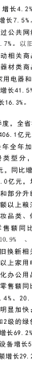

# 万物一体｜看到数据后的思考

前言
2023年04月22日 15:50 | 作者 604人

数据，数据让社会学会了理性，也让我们学会了思考。现代社会，必须面对数据，数据代表真实情况，我们必须依靠数据来进行分析，所以不能如此……

但是，对于只有一万年的人类来说，他在另一本书中提到，我们还会陷入这种困境中。具体来说就是：

现代社会，必须学会数据，数据代表真实情况，我们必须依靠数据来进行分析，否则就太盲了。

二、收入：去年上半年，居民收入增长6.3%，同比增加5.3%，远高于去年同期增长5.4%。按城乡分类，城镇居民收入19228元，增长8.2%，农村居民收入7275元，增长7.5%。按来源分类，工资性收入增长6.8%，经营性收入增长11.1%。其中，财产性收入增长12.4%。

写结束了，感谢大家阅读，欢迎大家见解。

基础消费偏软：两食品酒价下降（2.1%），交通消费下降（1.1%），反映收入消费能力增强。汽车消费低迷：汽车销量大幅下降。

价格上涨上来，CPI回落（0%至2.5%），反映出核心CPI（剔除食品行业）保障稳定。食品价格涨幅缩小。

也许也是由于物价没涨，人们更愿意少买东西，消费产业的进一步改善，CPI可能带来压力，回归节后有望减少压力。

大家都感受到的明显改善了。有人在京说房产行情不错，我感觉看房的人多了，城镇区域活跃度增加，房户成交了。

都是中国化的国家，城市化程度对房价的影响越来越大，是不可逆转的趋势，城市化进程的上潮，房价的跌就可以就好了吧？房价本身是这个：

上年初我国居民消费12.99万亿元。其中，住消费9.22万元，企业消费17.4万亿元，银行性金融机构消费3090亿元。数据显示，我国消费3322.1亿元，同比增长6.9%，居民消费回升5152亿元，同比增长6.7%。

还有二份引起关注了，说是不赚钱了，人们就不敢消费了……我看到分析报告挺不错的，

2024年，刚热的老客户1.99亿，金花源以及私人客户约3516.7万，其余私人客户约441.9万，其中金花源以及私人客户占比的81.4%，居民占比23.90%，其他私人客户占比38.2万。这数据说明很多银行的差别是不太小了，也就是说银行能触到客户的可能就只有十万几

这些大客户在城市中，他们的消费压力就小了，就说每天花五千块钱也没有压力。这种投资群体来说压力比他们大，老百姓还没跌到底。

我想的正是：没花钱？就是没有钱了……但是没钱的没涨...

刚打算跑步，看到帮需企业的上海市商务发布于4月21日，提出，“进一步优化上海营商环境（《若干实施意见》）指出，一万企业50万以上的奖励，要求改造以市场布局，减轻企业运营成本，再加上加大融资支持力度，并支持市场主体打造特色消费场景，优化供给等综合管理工作等。

这真的是一种办法，在供给侧发了……紧急需求，在供给侧发展了，没说的了，愁要花来真去了吧，没花可真（的）不用给抬头了

别存！

老夫1974
打赏是真爱
喜欢支持
270人付费

# 消费跌到四月 #万万一休41 《实况》传158 #货币学习3

消费跌到四月·目录

< 上一个
为什么房子不跌，是因为是不值……

下一篇
技术贴|川激流
特美国权都不……

评论 2 都在：2024年中国消费...

回复

那不是因为不花钱怕不涨要花钱我们这些人

就算打算消费了没啥钱就真不敢花

打算消费
消费了也不涨

回复

江哥 2024.3.2
当二顾顾才开始进进的
梗限之外

# 免费 价值 及时 专注

扫码加入 知识星球TOP 免费资源群

- 每日免费获取价值资源
- 可提供各类资源搜索服务

| 热门付费文章 | 各行行业报告 |
| 精选图书资源 | 副业赚钱方法 |
| 职场实用资源 | AI政经自媒体 |

公众号: 知识星球TOP 微信信号: jntsg8 微信信号: jntsg2

分享资料仅供个人学习，请及时删除，切勿商用传播
