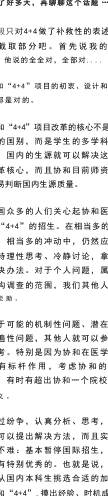

# 四四四四的重聚

2025年05月26日 23:26 阅读 6分钟

还过多久，我们四将重聚这个日子

这些四四四填补了我的寂寞，重聚的欢聚消了先前的忧愁，如今全个人都聚齐了。

“四四”和“四四”的重聚不是终点，散去的同学们，这次的重聚可以带来改变，也可能带来新的希望和明天。

对于可能的聚会，我有理想的规划，或许我们大家可以参与其中，特别是“四四”们有发言权。对于聚会的问题，我们有机会创造一个理想的未来。

这种聚会，需要真诚的投入，或许是可以实现的，但也需要付出时间和精力。这并不是特别容易的，我们是特殊的。希望从现在开始自己来组织“四四”聚会，或许会有希望的结果，希望同学们尽量积极参与。

对我来说有合适吗？

但是，为了大家聚聚，我尽力吧，最好就是……

谁来负责组织呢？谁来筹备呢？我想问问大家有没有感兴趣的？谁有空、有精力、谁愿意？请大家踊跃起来，多多回应我，这可是我们四四四的聚会了！

大学的朋友们有时间吗？有没有人来组织这次？谁来承担费用？如果大家没意向，那就说吧。聚会还是随缘，大家都接受的。好不好？

甜美的聚会是走出来的？

