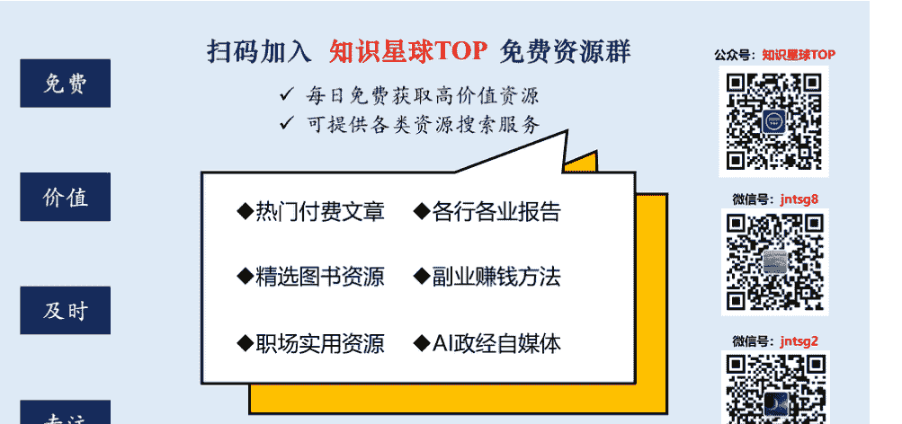

# 权力的滋味

250425 老秘书书

为什么你总是被欺负？因为你不懂人性，过分善良就是一种纵容；

为什么你总是成为棋子炮灰？因为你不懂人性，这个社会会有两套规则，一套是显性的，一套是隐性的。

直面人性，才能认清真相；直面人性，才能合作赢；直面人性，才能成为强者；直面人性，才能改变命运。

今天分享的主题叫做：权力的滋味，从人性的角度讲讲，为什么很多人会追求权力？人生追求有三个阶段？人生的意义到底是什么？什么是真正的幸福？

## 01 体制内到底要不要追求升迁？

很多的人很困惑，他说：“老秘书，我看到我的直接领导，比如如我的科长、主任、处长，整天忙忙碌过去的，累得跟狗一样。当个中层干部，也没手底下管着三五个人，工资比我高不了多少，幸福感也不高，那体制内到底要不要追求升迁呢？”

实际上这个问题，我在以前的课程里是讲过的，我讲过一个系列课，就是电视剧《浮世》的解读，跟大家详细地讲过这个问题。

总体来说，我的观点是：在商场言，在官场言，只要你进了体制这个门，最好有一个官半职好一些。

就像我们读书的时候一样，阅读期间衡量我们是不是一个好学生的唯一标准，就是你的学习成绩。你说你劳动好，你说我爱干净、讲卫生，你说我乐于帮助同学，那都不在衡量标准的内。

同样的，体制内衡量你个人成就感的唯一标准，就是你能不能当官，你能当多大的官，升迁是对你个人价值的最大肯定。

人啊，都是比较之心的。如果你是在一个大家族里，家族里有很多人都是体制内的。人到中年，这个人已经当上副总经理了，另一个亲戚已经当上上行的了，另外一个经理了，大家都过年聚在一起，你还是一个普通的小利、大头兵，你多少心里是会有点磕应的。

人是没办法完全免俗的，你说我完全不拘比，完全不在乎别人的评价，那是不可能的。因为你生活在一个群体里，你生活在一个社会评价体系里。你会发现，当一个人当上领导以后，他走路腰杆挺得更直了，说话声音都更大了。得不说，权力是一剂春药，会让人着迷，让人上瘾。

有的人说：“老秘书，我不追求升官，我业余时间搞副业，运气好的话，也能挣一些钱。”有炒股赚钱的，有在外面跟人合伙生意的，有做自媒体的，有做微信，有炒房的，有开店的，有朋友卖燕窝、鱼胶、滋补品的，总之三百六十行，各行各业都有赚钱的门道，实际上拿工资只是被很多人接受的一种赚钱方式而已。

确实，我们不否认，赚钱可以给你带来成就感，也可以改善你的生活。但是人的观念是会变的，人在人生的不同阶段，追求的东西是不一样的，这也就是我接下来要讲到的第二点：人生追求的三个阶段。

## 02 人生追求的三个阶段

人生追求我认为三个阶段，哪三个阶段呢？

（以下约 6000 字深度长文）

第一个阶段是求利，第二个阶段是求名，第三阶段叫做求静。

我们都听说过一个成语叫做“追名逐利”，但实际上我认为“逐利”是排在“追名”的前面的。人都是先求利，再求名。

### Ⅰ 人生的第一个阶段：求利

第一个阶段为什么是求利呢？因为对我们每一个人来说，生存都是第一原则。

我们活在这个世界上，不管你是博士毕业，你是作家，你是教授，你是多大的领导，作为人的话，你的首要任务都是先活下去。我首先都要追求物质的东西，让我们能够吃饱暖，然后你才能谈其他的精神方面的东西。

我们年轻的时候，在单位拿的工资是最少的。因为你级别最低，工龄最短。但是那个时候又是我们最需要钱的时候，吃饭需要花钱，买房、买车需要花钱，结婚需要花钱，养小孩需要花钱……

你会发现，人生中大头的支出都会发生在我们 35 岁之前。35 岁之前，大部分人都要完成买房、买车、结婚、生小孩的任务。

如果我们不是什么官二富二富代的话，大多数人，35 岁之前，大多数人，事业上其实并没有什么成就，也没有太多的钱。尤其是平民阶家庭的孩子，哪怕这个个人非常优秀，你是 985 高校的硕士、博士，你非常聪明，你非常勤奋努力，但是你的人生真正的、真正的辉煌，都是发生在 35 岁以后。

为什么呢？因为 35 岁之前你都在积累，在蓄蓄，在成长成熟，在这个过程中你还会摔跤、碰壁、吃亏，然后，你才开始有所成就。

如果你来自一个普通家庭，在 35 岁之前没有什么大的成就，其实你也不要着急，因为大多数人都是这样的。

人啊，都是比较之心的。如果你是在一个大家族里，家族里有很多人都是体制内的。人到中年，这个人已经当上副总经理了……（此处省略部分重复描述，保持原文逻辑贯）……得不说，权力是一剂春药，会让人着迷，让人上瘾。

有的人说：“老秘书，我不追求升官，我业余时间搞副业，运气好的话，也能挣一些钱。”……（此处省略部分重复描述）……

确实，我们不否认，赚钱可以给你带来成就感，也可以改善你的生活。但是人的观念是会变的，人在人生的不同阶段，追求的东西是不一样的，这也就是我接下来要讲到的第二点：人生追求的三个阶段。

### Ⅱ 人生的第二个阶段：求名

（此处根据原文逻辑合并后文关于求名、权力、地位的内容……）

### Ⅲ 人生的第三个阶段：求静

（此处根据原文逻辑合并后文关于求静、放下的内容……）
