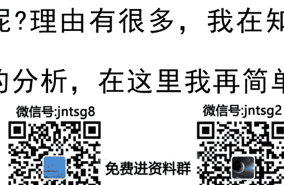
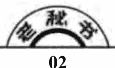

加微信公众号jntsg2，免费进资源群

# X

## (8000字深度长文)面对谣言、诋和抹黑，如何应对？已位渺

原创老秘书 2028-08-08 07:38 发表于甘肃

收录于合集 #复杂的世界里，如何做个通透的人 6个

今天更新专辑的第五篇文章，我们来聊一聊：面对谣言、诬和抹黑，该如何应对？

这个问题，不少人在职场中都会遇到，感觉很难应对，我会从五个方面来深度剖析这个问题：

## 为什么不要造别人的谣
不要抹黑别人？

在讲怎么应对造谣、抹黑之前，我先说一个问题，在职场中，我们为什么不要主动去造别人的谣、告别人的状、打别人的小报告？

经常有人问，老秘书，总人在我有好事的时候，比如评优评价、晋升提拔这种关键时候，就会告我的状，那下次他有评优评价、晋升提拔机会的时候，我要不要也去告他的黑状呢？要不要去坏他的事？

我的回答基本上都是，不要这么做。

## 为什么呢？理由有很多，我在知识星球里进行详细的分析，在这里我再简单跟大家分析一下

第一，做人最重要的是格局。这个格局不是虚的，不是口号的，格局就体现在关键时候，体现在有矛盾、有利益冲突的时候。如男女朋友相处，什么时候最见格局啊？就是分手的时候。

有一个词叫好聚好散，不管他（她）做错了什么，不管他（她）曾经多少对不起你，既然都决定分手了，好聚好散，起码他（她）曾跟你在一起过，他（她）的青春陪着你度了好几年。

至于中间产生了什么误会，发生了什么不愉快的事，都过去了，不要再去说什么伤人的话，也不要去去做什么伤害对方的事情。

分手最见人品，发生矛盾的时候，发生利益冲突的时候，最能看清一个人。

大家记住，做人还是要有格局。这个格局听起来很虚，其实无处不在，我就不多举些例子了。

第二，大多数领导，对下属都会有自己的判断的。

我们承认有一些领导是糊涂领导、小人领导，但一个领导之所以能够走到领导岗位，他必然还是有过人之处的，对他是有自己的判断。比如，如果有人跑到我这里来诉状，抹黑别人，我是不会单方面地听他说什么的，我会结合了我了解到的情况，会结合我自己的观察、思想和掌握的信息，我有自己的判断。

如果你是诬告的，那我对你的印象也会大打折扣，我始终相信一句话：言是非者，必须是非人。

一个人整天把心思用在造谣，打小报告上，这个人肯定也不是什么好人，说明他靠正当的手无法取胜，说明他的心思整天都放在怎么整别的别人，这样的人，我自己也会多提一点。

第三，职场就是江湖，在江湖上混，尽量求利不树敌，或者说尽量树敌。在关键时刻坏别人的事，别人会恨你一辈子，有机会他一定会报复你的。

我刚才说了要有格局，但并不是每个人都会以德报怨，而且我刚才说的格局，其实也是有利的考虑在里面，倒不是说我们就是活雷锋，我们就是圣人。

我们都不是圣人，但在报复的时候，你要选准报复的时机，选择合适的方式，最好是采取降维打击的方式，危害最小。

## 什么叫降维打击？

微信号：jntsg8 免费资料群

比如你跟领导关系走得近，他跟领导关系疏远，领导会无条件提你。

比如你是科长，他是个科员；你在核心部门，他在边缘部门；你掌握关键资源和权力，他需要要求着你，这都叫降维打击。

为什么有一句话叫做君子报仇，十年不晚？为什么要等十年，不马上就报仇？因为你实力不济，马上报仇，上去就是送人头。

一个国家的发展策略也是八个字，叫做：韬光养梅，积蓄实力，不要整天头脑一冲动，就喊打杀。

深挖洞，广积粮，缓称王，是我们每一个人需要牢记的发展策略。

不要提前暴露野心，不要提前暴露目标，有朝一日你有实力了，一鸣惊人就好了。千万不要树敌。单位里多一个支持的人，比多一个反对的人，好得多。

## 如何应对别人造谣、告状和抹黑

人在江湖，哪能不惹？很多时候你不惹别人，别人会来惹你。就像在马路上开车，你规规矩矩，遵守交通规则，但是有很多不规矩的车会撞你。

面对这种情况我们该怎么办？一味地讲格局，一味地忍让，只会让对方变厉。

下面我将进行深入分析并给出应对策略：

1. 为什么提升实力是第一位的？
2. 如何澄清，打好舆论主动？
3. 如何指桑槐地敲打？
4. 如何正确地开撕？
5. 如何打造统一战线？
6. 如何正确预防，破解招黑？

以下为约600字深度长文：置之不理，专注自己的发展。有人说老秘书，这也叫办法吗？不是缩龟。大家记住，大道至简，越简单的办法越有效。

其实很多时候，所谓的谣言只是少数人在传播，或者说你没什么影响，你太敏感了。有的人传你，跟领导有关系，明明是自己来的，有人偏要说是你动的关系，这种谣言你可以不去理，而且别人传你，背景低估你。

总体来说，还是要好一些。我们对谣言要有一个心态呢？记住两句话：第一句话，不要低估谣言的影响；第二句话，不要过分投入。

处理人际关系是非常累的，哪怕你是一个人际高手，是一个情绪管理高手，处理人际关系仍然会让你累。

因为世界最复杂的是什么？最复杂的就是人心。本来一件事情非常简单，但是有人忍不住就胡思乱想，喜欢造谣事事，喜欢挑拨离间，这些想法做法真的会让你感觉累。

会有这样的人呢？不把心思花在做事情上，不把心思放在正常的人际关系上，不把心思放在好好生活上，搞这么多蛾子。

现实世界就是这样，会有一些人极其奇怪，心思特别重，说白了情商不高，格局不大。真正格局大、情商高的人，不会对事情随意曲解，他们总是能够透过现象看到本质的能力，总是能够抓住重点，对事情会有独立的判断。不管任何时候，我们都要记住：把自己的事业发展好，不要跟那些烂人烂事纠缠。纠缠只会拖累你的时间精力，消耗你的情绪，让你忽略更重要的事情。那些小人有时间，有精力，而且他们脸皮比你厚，你简直防不胜。所以，有一句话是万能的，叫做要么忍，要么狠，要么滚。

这个忍，怎么理解呢？并不是一味的忍耐，而是心态要好，不要被外界的因素打扰，不要太敏感，太在意别人的看法和议论。

狠，怎么狠？两方面：一方面对自己狠，狠下心来积累实力，专注自己的发展；另一方面是对别人狠，打得一拳开避免百穿之。

滚，怎么理解？滚不是自己灰溜溜了，而是离开这个污浊的环境，离开这个臭水沟，到更大的、更广阔的舞台去发挥你的才能。比如说单位有一个同事调走了，你就接替了这个同事的岗位，这个岗位是一个核心岗位，单位里就有人造谣，说是你动用了个人关系背景，把这个同事撵走了自己上位。这种事你不需要解释，你把工作干好，你在岗位上展现出来的能力是跟岗位匹配的，心态不要崩。

大家记住，一个人可以在某时间段蒙蔽一些人，但是无法在所有时间段蒙蔽所有人。任凭风吹雨打，我自然不动。只有我们内心恐惧、不自信，才会特别在乎别人的谣言。

内心强大的人，有时候要有这样一种心态：就是大多数人其实都是傻X。这句话虽然不太好听，但是内心强大的人多少都有这种心态。你会在一个傻X的意见吗？不会，对不对？我走好自己的路就行了，我专注自己的发展就行了。

## 澄清打好舆论主动

有的时候，如果这个谣言严重影响了你在单位的声誉，你千万不能一味地相信什么心正不怕影子斜、不做亏心事不怕鬼敲门。也千万不要相信群众的眼睛都是雪亮的，群众很多时候也会被蒙蔽，群众其实是最容易被蒙蔽的。

我刚才说过了，其实大多数人都是乌合之众，有一句话叫做“谣言重复100遍就成了真理”。所以澄清的时候，就要打好舆论主动。打个比方，就像现代战争一样，光有武器是不够的，还需要信息战和舆论战。

舆论战就要先行，你不占领，别人就会占领；你不主动，别人就会被动，谣言就会发酵出出面。那么怎么澄清呢？最好是找权威的人，比如领导。你利用私下的时间，找领导反映一下，拿着你平时收集的报纸、文件、这些乱七八糟的资料整理一下，在办公室里跟领导汇报，这种方法比较得体。

## 指桑槐地敲打

如果你不确定是某人造的，或者没有掌握确切证据，都可以用“指桑槐”的方式。为什么要敲打呢？因为如果一个人对你做了一件事，他内心是比较忐忑的，他担心你会报复。如果他发现做了坏事没有成本，没有任何惩罚，连警告都没有，他就会肆无忌惮。所以我们必须进行敲打，让他知道我们的态度，我们必须有所作为，这样他才会有忌惮。

举个例子吧，比如你准备提拔了，结果公示期间某人举报了，说你在管理期间存在经济问题，回扣（此处OCR应为“构诬”）。不知道哪个王八蛋干的，后来纪检部门去调查了，证明了你的清白，并没有影响你的提拔。但是你不能不管，如果你确定是某人举报的，你就要进行指桑槐地敲打。这种方法不需要证据。

比如你有机会和同事A、B吃饭，或者在大家一起聚餐的时候，只要他能听到你说话，周围还有其他人。我现场演练一下：假如B是举报你的人，你就可以对A说（注意是对A说）：“哎跟你说个事儿，我上次提拔的时候好倒霉，被人举报了，不知道哪个王八蛋干的。后来纪检部门去调查了，证明了我的清白。虽然对我没什么影响，我也听说是是谁举报的我。有人啊就是见不得别人好，我上不去轮得别人吧？他进单位十年了还不个科员吗？他以为把我拉下水自己就可以往上去了。哎，这种人我是不想跟他们计较，无所谓，反正也没影响到我。不过这种小人真是让人唾弃。”当然具体的语气、用词的轻重你可以自己把握，我就不骂得那么难听了，骂人功夫在这里只展示两成。虽然你没指名道姓，但是你说进单位十年了还是科员，他大概就知道是说他。而且这种人暗地里打别人小报告的人，他内心是很虚的，他不敢跳出来对质，跳出来他从道义上就输了。他肯定憋得脸青脸紫的，就是要达到这种效果，憋死他，对不对？

如果是在饭局上，那就更有意思了，说完你还可以拿起酒杯去给他敬酒，还可以问他：“哎，你说我刚才说的那个个人是不是很可怜？哎不像你，格局这么大，来陪哥俩干一杯，我知道你肯定不会干这种事。”他这个时候肯定更尴尬极了。杀人就要诛心，人心配猪心，味道最好。这就是第三种方法：指桑槐地敲打。

## 如何正确地开撕？

如果对方指名道姓了，或者你掌握了确切证据，就是某人在传你的谣言，这时候就得开脸。比如你有机会在食堂同一张桌子上吃饭，或者邻桌吃饭，有机会一群在一起聚餐。如果只有你跟他，那就不叫指桑槐了，那叫针对性的点打击。刚才说了，只要他能听见你说话，而且周围还有人在。

这种不需要撕脸，因为以后还要共事。纠缠烂人烂事，只会拖累你的时间精力，消耗你的情绪，让你忽略更重要的事情。那些小人有时间，有精力，而且他们脸皮比你厚，你简直防不胜。

所以，有一句话是万能的，叫做要么忍，要么狠，要么滚。

这个忍，怎么理解呢？并不是一味的忍耐，而是心态要好，不要被外界的因素打扰，不要太敏感，太在意别人的看法和议论。

狠，怎么狠？两方面：一方面对自己狠，狠下心来积累实力，专注自己的发展；另一方面是对别人狠，打得一拳开避免百穿之。

滚，怎么理解？滚不是自己灰溜溜了，而是离开这个污浊的环境，离开这个臭水沟，到更大的、更广阔的舞台去发挥你的才能。
