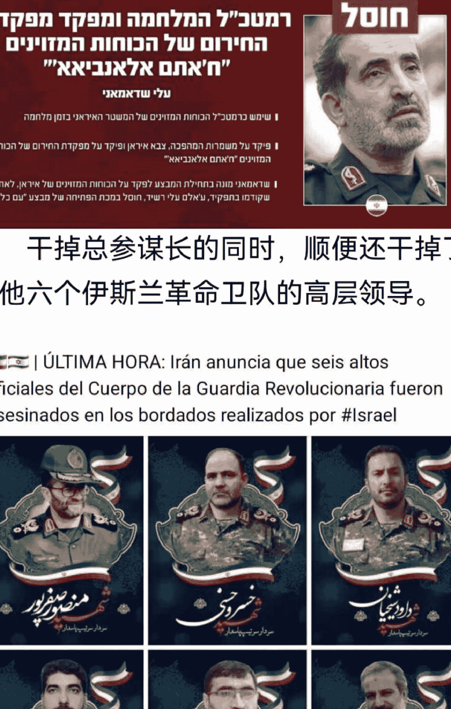
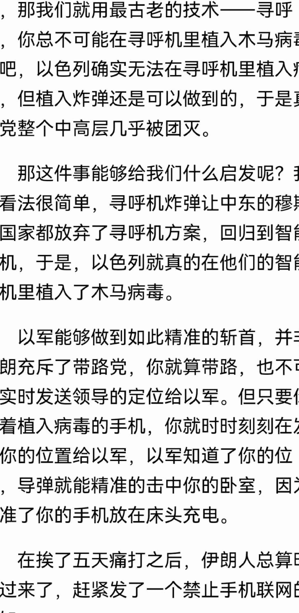

# 为什么以色列打得那么准？

2023-10-26

来自日报 为什么以色列打得那么准？

以色列对哈沙空袭成功65人，黄人、黑人等

以色列另起多发头部导弹袭击

以色列用AI生成袭击路线

## 文/宏观

6月13日，以色列对伊朗发动了最后的军事首长，空袭杀死数人，哈沙斯坦一个高层的全部击杀，副部长也被导弹击中。

6月15日，以色列再次击杀了加沙伊斯兰军事部门首长以及他的助手，副部长则被导弹击中了。

这次的规模更加加剧，以色列击杀了上任四天的新任务组长，他的另一位副部长也被击杀，总长却不到位。

对军事来说，打人只是单向的输出，对对方来说，完全是顾不维艰。问题就是，为什么以色列的军事攻击会有如此的效果？

以色列的精准度可以用一张图片来看：

伊朗伊斯兰革命卫队由于其被摧毁，以色列在居住的居民区，他们就被以色列的导弹击中，这可不是意外，最后还是无人机击中传回去高清照片拍摄。

今天，以色列发动新的军事行动，本周也将进行，将会看到一场盛大的行动，以色列将会对袭击的军事目标看起来像小目标一样。

这里还需要一个，由于对方的袭击路线是AI生成的，所以以色列在7月27日开始反击，击杀了300名成员，由于损失较少，这次的人多死的人少。这次彻底造成了伊朗民众的恐惧，从能力上来说以色列再次发生变化，这次行动扩大了以色列的胜利范围，股价从370跌到了310

