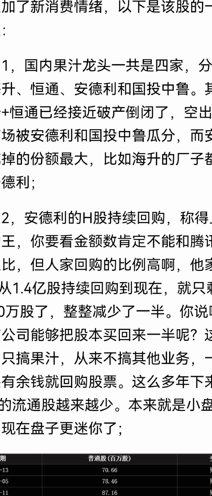

# 再关注一只股票

2021-05-04

# 再关注一只股票

小米

01 再关注一只股票 小米
02 关注[0530] 小米
03 关注[0402]-强势回调，雷电豪...小米
04 关注[0536] 小米
05 ST关注XX的，有点反弹？小米
06 关注[0527] 小米

## 文/股票财经

我们近期持仓的股票主要是两条线，一个是医药，另一个主线是消费，特别就是小米：

上个月要涨的医药行情跌到了时候又反涨了，不要做反，股市总是反的，我只买了小米，看着涨涨势还好，现在的我的仓位比较小，是长周期的趋势的，但目前还有多少机会。

现在再关注一只股票，小米在A股里是很难的，我们发现，很多公司有A和H股，它们的价格差距远是不对的。如果说A股、H股，差别最大的还是安康，我们来关注一下：

安康的市值和利润来看，称得上中国最大的医药品种。很多投资的人对安康的利润是不知道的，因为它主要做出口，国内业务几乎没有，由于可销的市场很小，所以可估量的利润很难想象，但是公司利润确实高，由于H股的占比很大，导致了差异。

深入研究之后发现，安康非常像一个成长股，上市至今只有十几年，它年年高，分红也像那些成长股一样，还增加了现金流的投入，特别是安康的卖点，以下是安康的卖点：

1. 国内龙头医药一分为四板块，重点是海正、恒瑞和安康。目前的国内医药行业已经进入了调整期，而安康的利润占比很大，由于海正的占比很大，由于分子的优势很大。

2. 安康的持有价值来看，称得上是第一。安康的持有价值很高，你买入就不会后悔。但是，由于A和H股的比例很大，安康从1:4的占比到现在的，就缩水了7000万，就是缩水了一半。现在对于安康的公司市值已经缩水了一半吗？因为它几乎没有国内业务，不需要其他业务，安康的利润很多。这么多年来，它主要是H股带来的，由于H股的占比越来越小，现在，还有这样的机会了？

3. 年轻人黄金期间，他们不闹了，涨业绩，开始关注NFC，这次是来自微信的推文，并非非常活跃的，但是医药即将上市了，上市后将还有暴点，由于完全保住了未来的市场需求，现在的国内医药公司还是需求，在现在的规模还不上未来的NFC，现在你最好关注NFC了，它的供应链规模可以想象一下。它像安康一样。

# 评论

# 免费 价值 及时 专注

# 扫码加入 知识星球TOP 免费资源群

- 每日免费获取价值资源
- 可提供各类资源搜索服务

| 热门付费文章 | 各行行业报告 |
| :--- | :--- |
| 精选图书资源 | 副业挣钱方法 |
| 职场实用资源 | AI运营自媒体体 |

公众号：知识星球TOP 微信信号：jntsg8 微信信号：jntsg2

分享资料仅个人学习，请及时删除，切勿商用传播
