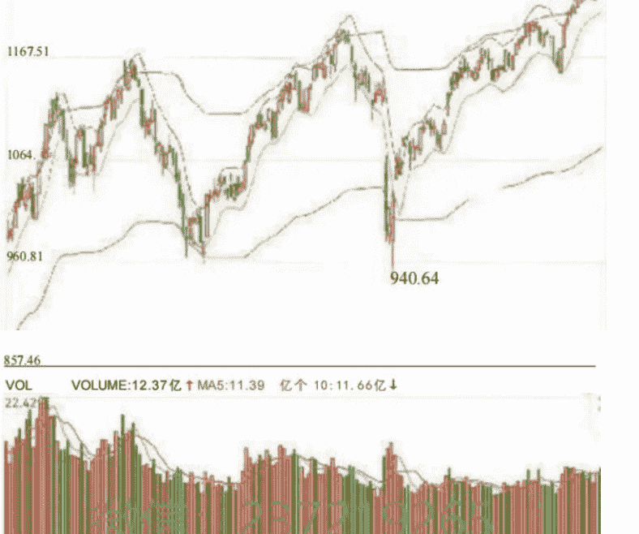

# 3500点，又是互兜戏的一天

20250709 宏斌

今天虽然盘中破了3500点，但由于不是一鼓作气强突突破，所以收盘竟然又跌回了3490点，两个股市表现一般，3300下下跌，蓝筹股略强于小盘股，那是因为此前小盘股的太猛了，而蓝筹的表现太差，现在属于高位低换手。

3500点这个关口，从去年到今天一共冲了6次，今天虽然盘中站上了3500，但由于太多人选择获利套现，所以尾盘失守，此时此刻可以用一句话来概括：有人星夜赶场，有人群袭归里。我很理解他们的想法，毕竟之前那么多次都是骗炮，这次为什么就是真的呢？如果还是骗炮，那我就有机会在3200点再买入。

我的观点非常明确，此前5次都失败了，但这次大概率会成功，所以我不打算卖出。换股是可以的，但仓位不降低，目前我已经满仓操作了。如果震荡上行，反而更好。需要说明的是，3500点只是指，如果你看的是全A等权指数，早就创新历史高了，见下图：

| 全A等权 | 880008 | 61%换手 | 1.74% |
| :--- | :--- | :--- | :--- |
| 1247.05 | 最高 | 1254.04上涨 | 1856总量 12.37亿 |
| -1.95%/-0.16% | 最低 | 1243.89下跌 | 3327总额 1.53亿 |

分时 多日 日K 月K 周期
XS2*[102.7] 通道:1263.1 通道:2213.57 通道:3233.5 通道:46:1076.42↑
1270.86

VOL:12.37亿 MA:11.39亿 10:11.64↓
MACD(12,26,9)DIF:19.94 DEA:17.59;MACD:4.72↓

目前两市的成交还可以，市场活跃度尚可，现在的情况是大盘到了一个阶段高位，大家的判断出现了一些分歧，这很正常，犹豫中的上涨就说明市场距离顶端还早呢。肯定会有人说经济数据这么差，为什么股市会牛牛？正因为经济数据差，你才能预期会有更多政策刺激出台，如果股市真的牛牛了，赚钱效应带来的乐观情绪会倒逼让经济数据变好，，到那时你会发现各种数据都在变好，但那时再买就是高位了。

最近市场上多了一根主线，那就是“反内卷”行情，我认为这属于供给侧改革2.0加强版，我记得当初的供给侧改革让钢铁、水泥、煤炭之类的周期股都走出了大行情。这些东西的本质就是减少产能，因为内卷的唯一原因就是供给过剩，那我把供给量降下来，带动价格上涨，是不是大家的日子就会变得好过呢？

我觉得反内卷行情走1-2年是没问题的，等到真的形势好了，大家又会疯狂产能，到时候又要重新走一遍老路，中国的事情就是循环往复，所谓管死，一放就乱，每次都是这样。

这波市场短期调整之后，还会继续上，带动上攻的是三条线：一是反内卷概念，二是金融板块，三是低位补涨股。

# 知识星球TOP

添加微信 付费资源分享群 免费入群

微信: jntsg2

| 序号 | 公号/星球/社群 | 原价 | 领域 |
| --- | --- | --- | --- |
| 1 | 生财有木 | 2765/年 | 副业，搞钱 |
| 2 | 怂众从吃群众群 | 365/年 | 时政，历史 |
| 3 | 记忆承载/雯树西风 | 365元/年 | 成长，搞钱 |
| 4 | 欧洲金靴 | 328元/年 | 时政，历史 |
| 5 | 卢克文青会 | 699/年 | 时政，社会 |
| 6 | 体制内主任 | 599/年 | 体制；职 |
| 7 | 外局人的视角 | 669元/年 | 金融，时政 |
| 8 | 濑泽异谈 | 4166/年 | 财富，成长 |
| 9 | 守护者总令 | 599/年 | 时政，经济 |
| 10 | 江宁知府 | 365/篇 | 时政，国际 |
| 11 | 政堂/顾子明 | 568/年 | 时政，经济 |
| 12 | 唐书院 | 1399/篇 | 金融，财富 |
| 13 | 大树乡谈 | 199/年 | 时政，成长 |
| 14 | 水库欧大 | 10000元 | 房产，经济 |
| 15 | 洪灏的宏观策略 | 4376/年 | 经济，搞钱 |
| 16 | 金政通鉴/北海道南山 | 4576/年 | 股票，行研 |
| 17 | 猫留的世界 | 299/年 | 时政，社会 |
| 18 | 飞沫 | 3600/年 | 股市，经济 |
| 19 | 米联储见闻 | 599/年 | 经济，金融 |
| 20 | 鉴茶财经院 | 330/年 | 房产，股票 |
| 21 | 赢在八小时之外 | 365元/年 | 成长，职 |
| ... | ... | ... | 更多资源，不再列举 |
