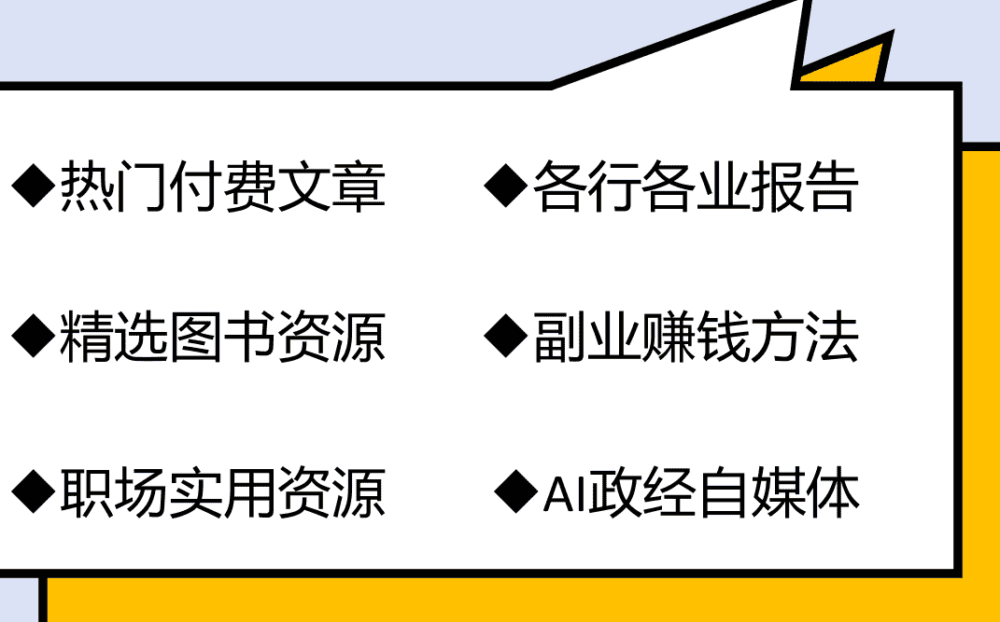

# 2023.03.16 不喜欢自己的工作该怎么办？

在我每天收到的圈子提问中，有相当大部分比例问的都是工作，比如：

不喜欢喜欢自己的工作怎么办？
感觉无法从工作中获得成就感怎么办？
想要离开现在的单位，又担心找不到相同收入的职位，怎么办？
发现能力不如自己的人都升职了，而自己还困在原来的岗位，感觉永远没有出路了，怎么办？

我就跟你说吧，其实大部分人都是这个状态，即不喜欢自己的工作，从工作中无法得到成就和满足感，对多数人来说，工作仅仅是一个养家糊口的手段了，想要成就感和满足感，那是少数才能享到的待遇，很多人都无关。

由于这个问题非常具有普遍性，想要解决几乎是不可能的，但我们可以换一个角度来看观察它。为什么很多人玩游戏会上瘾？赌博会上瘾？有多少人沉迷于手机游戏，或者沉迷于赌钱，这是为什么？

应该说沉迷的人应该是沉迷游戏的人才对呀，起码工作会给你发工资发奖金，而打游戏是要花很多的钱的。腾讯靠一个“王者荣耀”赚了无数个盈满桶，那都是玩家的血钱啊。

加微信ints52，免费进资料分享群

道理其实非常简单。人类作为一种动物，和其他动物没什么区别，只要给他建立一个简单的奖罚机制，他就会乐此不疲地沉迷于此。在游戏中，你做的任何一件事，马上就会获得即时反馈，你是杀了别人得了分数，还是被人杀了得了分，这一切都在几分钟里完成了。虽然在旁观者眼中，这多一分少一分毫无意义，但在玩家眼中，这就是一切啊。

再来说游戏里的那些虚拟道具，对于一个不玩游戏的老太来说，这东西一钱不值，但是就有玩家愿意花很多钱去买这些道具。老太和玩家有什么区别呢？区别就在于玩家的脑子里已经建立了这套游戏奖罚机制，而在这老大脑子里就没有，所以同样的虚拟道具对他们两人意义完全不同。

一件东西有没有价值，其实是非常主观的判断，你觉得它值钱就值钱，你觉得它不值钱它就不值钱。

说了游戏再来来说工作。为什么你不可能沉迷于工作？

因为工作无法给你建立这套奖罚机制。在工作上做的那些琐碎的事，没办法立刻给你就奖励。在大多数情况下，不仅没有奖励，就只有惩罚。比如，一件事你做好了，没人表扬你，也不会马上给你发工资，

加微信jntsg2，免费资料分享群

如果你没有做好，领导马上就会责骂你，说不定还要扣你工资。在这种情况下下，工作还有什么乐趣？对于绝大多数人来说，仅仅是为了养家糊口去工作，而不是因为兴趣爱好，或者纯粹是喜欢这件事而去工作。

既然人都仅仅是为了为了吃饭上班，那么少数人狂又是是怎么回事呢？其实吧，人狂就跟那些学霸刷题是一个道理，他们都从工作或者学习中建立了奖惩机制，那些学霸刷考试的排名，跟你刷游戏的排名根本就是一回事儿。

在所有工作中，最像游戏的工作，就是送外卖。外卖单就有单，你可以通过手机 APP就知道赚了多少钱，如果没有按时送达，钱包马上就会通知你的。以前有一篇很火的文章叫《在系统的外卖骑手》说的这件事，因为这套系统做得非常像游戏，所以外卖员冒闯红灯撞死的风险，还要给你送餐。

现在的年轻人，宁可去送外卖，也不愿意去工厂拧螺，就因为工厂拧螺采用的是月薪制，加班再给你加费，这是按照时间结算的，如果换成计件工，搞不好积极性就增强了。

如果你在办公室里，为自己的工作没有成就感和获得感而烦，那你想想，那些外卖员是为了给你送餐，宁可拼命在马路上直冲横撞，他们能从中体会到什么成就呢？

加微信jnts5，免费资料分享

下面要说到我自己了。我喜不喜欢我做的事情？我的回答是喜欢。对我来说，我最大的乐趣，就是把我研究出来的新鲜玩意儿告诉你，当我听到别人说：“原来这件事是对的” 的时候，我就特别高兴，因为我觉得这是在帮助别人。这跟钱没有关系，因为我对花钱没有兴趣，我不抽烟，不喝酒，不赌博，赚的钱都花不掉。

在早年的博客时代，写博客是赚不到一分钱的，我坚持写了十几年博客，如果是为了钱，我连一个月都无法坚持。所以我的建议是，找到你真正喜欢的、有兴趣的东西，坚持做下去。你要办法给自己建立一套奖励机制，让你时时时刻刻都能从中体验到乐趣，这样你才会觉得自己是在做一件有的事情。

加微信jnts2，免费进资料分享群

# 免费 价值 及时 专注
# 扫码加入 知识星球TOP 免费资源群

- 每日免费获取价值资源
- 可提供各类资源搜索服务

| 热门付费文章 | 各行行业报告 |
| :--- | :--- |
| 精选图书资源 | 副业赚钱方法 |
| 职场实用资源 | AI政策自媒体体 |

公众号:知识星球TOP 微信号:jntsg8 微信号:jntsg2

分享资料仅供个人学习，请及时删除，切勿商用传播
