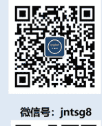
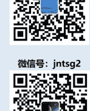
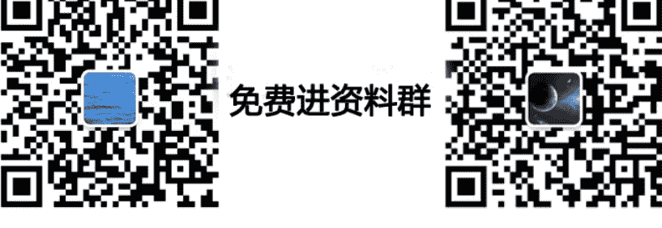
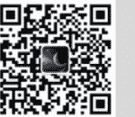

# 《职场加分好习惯·精选400条》

## 知识星球TOP 资源分享社区
公众号：如知识星球TOP

- 付费文章
- 付费社群
- 付费课程
- 副业&搞钱
- 财经&股市
- 行业报告

时政·历史·职场·体制·自媒体学习·军事·软件·影音·社会学

微信信号：jntsg8

微信信号：jntsg2

添加微信免费进群，让更多人获取高价值信息，汇聚全网付费资源，来源互联网大神汇总。

1. 文档使用类（32）
2. 向上汇报类（21）
3. 向下管理类（4）
4. 沟通达（47）
5. 职场写作类（25）
6. 效率提升类（47）
7. 时间管理类（28）
8. 阅读提升类（16）
9. 心态转变类（20）
10. 知识管理类（12）
11. 学习成长类（26）
12. 工作精进类（37）
13. 职业转型类（10）
14. 仪细节类（26）
15. 自我保护类（29）
16. 微信沟通类（20）

都是来自工作的具体实践，亲测有效。希望对你有所帮助。

## （一）文档使用类

1. 做表格时，加上序号，他人能马上看到对应字段的数量。
2. 发送给人的 Excel，最好已经设置好打印区域，利他不利。
3. 提供给他的 Excel 表，如果行数太多，记得冻结标题行。如果预感对方要打印，那可以设置好打印区域。
4. 发给他 Excel 表时，在最后注明有几个 sheets，有助于对方查阅，不会被遗漏。
5. 打印 Excel 时，如果超过一页，标题记得重复；Word 的表格也是。
6. Word 一定要有页码，这样别人有修改意见，方便来说“第一页的第三段要修改”。
7. Word 这篇如果太大，可以考虑加上一个目录。如果你有余力，还可以加上一个摘要，说明清楚背景、解决什么问题、大概步骤有哪些。
8. 给 Word 页码时，最好采用 X/X 格式，方便对方判断阅读时长。
9. 务必校稿。很多人不会为你做多少字校对，因为会有错别字觉得你不真诚。最好是找一个没有参与这份材料的朋友校稿，因为你自己已经太熟悉，很容易忽略细节。
10. 务必排版。排版不是一定美得出的，至少要保证的“正式版”。比如 Word 里首行缩进，标题字体与正文字号不同。即使是内部，也建议排版，它传递的信息是“你的态度决定”。
11. 通过社交发送 Word 或 PPT，也同步一个 PDF 版。一方面方便阅读，因为文件一般小；另一方面不容易乱码，方便直接打开后就可以看到成品。
12. 提供给人的文件，不要取名“修改稿”“新建文件”“111”，至少要把主题起上，例如“2021年年终总结”。
13. 发送给人的材料里，删除掉他人无用的信息。比如你之前的备注，之前用来分析数据的数据表格。把它当作一个交付，每个信息都对他有用。
14. 如果发给别人的是修改后的版本，最好注明修改了几处，这样对方也可以看着这些内容。
15. 引用外部数据时，一定要加上来源。既保证了数据的严谨性，也方便日后更新版本。
16. 打印出来的文稿，可以在页面处贴上便利签，交给他人，这样对方知道哪里是重点。
17. 给别人 PPT 时，用高清的就不方便找一个画质优劣的，马赛克的感觉真的是好差。
18. 平时积累一些好的图片、免费字体，在需要制作 PPT 时可以更快速。推荐一个搜高清清晰的网站：unsplash.com。
19. 做汇报的 PPT 时，最好有一个说明，来说清楚核心观点。一般来说，不要希望由他人来帮你总结，别人没时间。
20. 重要的 PPT 演示前，一定要提前到现场测试。有的地方可能不支持你的电脑，而官方的电脑可能没有你的字体、不能播放你的视频，甚至不能放你的 PPT（可能是太大）。这样你可以找到解决方案，比如 PPT 存为 PDF 放映。
21. 重要的纸质文件一定要扫描保存。
22. 重要的电子文件记得。如果不泄密，可以考虑放在云端；如果涉密，就发一份到自己的邮箱。否则邮箱被窃或硬盘出现故障，损失就无法估量。
23. 推荐一个免费的搜索插件，叫做 Everything。安装后，搜索文件就是几秒钟的事，前提是文件的标题清晰、内容清晰。
24. 文件标题容易被检查。比起一年终总结，可以改成“2020年-年终总结-定稿-重要”，这样，你就可以通过多个维度定位它。
25. 每次开会时，尽量拿到会议文档，或者提前了解了会议内容，并准备好一些发言思路。时候被叫起来，也可以说出点看法。
26. 帮他人送文件，只要不是机密，便要熟悉内容。因为收到文件的人大概会问：这是什么？我要关注吗？
27. 写笔记，记得加上日期和标签，方便后期查找。
28. 想法来了马上写下来，否则一会就会忘记。
29. 包里永远有笔和本子，记录想法，或者领导突然来的任务。
30. 有任务的时候，马上写下来，否则你会因为担心忘记而焦虑。
31. 将通用的信息（例如地址、证件照）存到微信的“收藏”里，之后找起来很方便。

## （二）向上汇报
微信：jntsg8
微信：jntsg2
免费资料群

1. 做汇报时，多准备一个 Plan B，他人不用做答题，而是做选择题。
2. 每周给领导汇报，说明完成了什么，下周要做什么，让老板心中有数。
3. 向领导汇报前，一定要问自己三件事：
   ① 为了什么做这件事（项目）；
   ② 这件事情对部门有什么好处；
   ③ 有没有 Plan B。
4. 让领导做决策前，要有结论和理由，比如“我觉得可以……”，否则你只是工具。
5. 接到任务后，建议带上时间，比如“好的，我什么时候交付”。
6. 汇报之前，准备两个方案，一个是完整版，另一个是简略版。
7. 重要的汇报，提前准备。
   - 第一次汇报：拿着稿子，逐句练；
   - 第二次汇报：对着 PPT 练；
   - 三次汇报：对着镜子练；
   - 第四次汇报：演示时，设想别人怎么问，然后回答。
8. 汇报重点是什么。
9. 谈话陷入僵局时，就趁机中断，否则大家就一直拖耗，相互难为情。
10. 开会/上课如果想要分享，可以说：“让别人印象深刻/意外觉得最有价值的是……接下来我要准备这三件事。”

## （三）向下管理类

1. 不要用命令去要求他人，用驱动他人。对待下属，目标是成长、金钱或者好的工作，主动性才能起来。
2. 下属不舒服的地方，一定要说出来。一方面，沉默传递的是默认；另一方面，只会影响你们，未来可能变成“算账”。
3. 沟通时，少说“你”，多说“我们”，距离拉近了。
4. 资源总是有限的，需要区别对待不同的人。没有绝对公平，只有合理的分配。

## （四）沟通表达
1. 主动自我介绍。常备一个简单的介绍：我是谁+我的姓名+在哪里工作。例如：“你好，大家可以记住我XX”。
2. 加好友时，记得说明我是谁（XX公司），或者与人的关系（XX介绍），否则对方怎么知道你。加好友后，建议再简单介绍一下，比如：“XX部门的XXX”。
3. 语音时不要说“在吗”，直奔主题。对方忙自然会回复，以免忙碌。
4. 说自己专业，有很多有名词或英文缩写，很惹人讨厌。
5. 在他人建议前，先对对方确定问题是什么。有时候你以为的问题是工作少，其实问题是被忽略了。
6. 建议时，加一个“前提”，没有什么建议没有立场。表达严谨，可以加一个“大概率”，避免陷入极端争论。
7. 拒绝他人时，分两步走：
   - 第一步：对不起；
   - 第二步：你可以。
   比如：“对不起，今天事情太忙，我给你一个网站，你可以在那里找到解决方案。”。“对不起”强调客观观点，“可以”是指方向。
8. 谈判时，底牌不要一开始就出来，因为对方可能还会有筹码，你就彻底输了。
9. 当你指别人的错误时候，一定要记得“分事不责”原则。他不可能错，而是流程上的部分错误。千万不要说“你不行”，而是指出哪里不行。
10. 别人在提“需求”时，把它换成“落差”就理解本质了。比如我的需求是我工作，核心是我现在的工作与我期望的距离。
11. 别人第一次进入你熟悉的圈子，主动问好，带着他去认识你的朋友。无论多么自信，这种时候也会感到不安。
12. 请教他人时，说一句“大概占用X分钟”，并且严格控制时间。尊重人的时间就是最大的尊重。
13. 当对方觉得压力时，马上找到一个中台阶。比对方觉得这个忙要占用太多时间，赶紧提出一个折中方案。
14. 讨论事情要说事，不要出现“你这样”“你总是”。这是讨论，不是讨价。
15. 指出他人问问题时，不要一就开始说“你做错了”，对方会有反抗情绪。先说事实，再说，有理有据，才能让人信服。
16. 安慰他人时，就跟着一起找糟糕。理性的这个时候可以进进小黑屋。
17. 要给对方介绍一个新概念，一定要从他熟悉的领域切入。很多地方，可以说“……”。
18. 沟通时，提到以后，会有主动权。
19. 每天看一看，发现问题。
20. 汇报时，记录下他的习惯。
21. 每天看，反馈一下。
22. 沟通后，建立连接。
23. 意见一起吃餐。
24. 总结工作，给出具体的路径。
25. 想要让别人感谢，主动说。
26. 汇报时，大家认可。
27. 赞美要，大家认可。
28. 汇报时，具体的计划。

## （五）职场写作类
1. 写通知时，日期后面跟上一个“星期X”，因为我们更有时间感。
2. 准备一篇讲稿/文章时，最好离开电脑，利用纸笔写提纲，写作会刺激思想。
3. 如果用微信发信息，信息很长，建议加标题，比如“关于周三的讨论”。
4. 引导的话术保存下来，特别是年度和年终的，可以把握，学习他们的表达。
5. 找到竞争企业的内刊，里面有很多可参考的方案，比经常看。
6. 写完材料以后让其他人检查一下，因为自己很难找到问题所在。
7. 发送信息给他人，不论是微信还是邮件，先说明对方的关系，然后再说明背景。比如：“你可以发我一下（年度计划）背景：本月计划，需要参考一下。”
8. 如果内容很多，就使用编号，一条条开展。比如：“今天下午合作访问：
   - ①访问人：
   - ②访问时间：
   - ③注意事项：

9. 用对方理解的语言来写。比如下周发一个人 IDP 存在理解难题，因为对方不知道什么是 IDP。所以加上备注，即 IDP（个人发展指南），这样他人更容易理解。
10. 写计划时，最好先看看周末和部门的计划，保证方向不跑偏。
11. 如果你的内容超过5页，务必加一个简短的摘要。
12. 如果你的内容超过20页，除了摘要，还可以增加一个目录。
13. 先写草稿，再润色。不要想着一次性完成，这很难。
14. 写草稿的时候不建议在 Word 完成，它的页面会引导你去排版，耽误时间。推荐用“笔记”“飞书”（Ulysses）等软件写草稿。
15. 日常积累某些素材，比如行业发展趋势、公司现在的挑战、专业线的发展方向，可以帮助提升写作的高度。
16. 日常保存别人的优秀文稿，如经理发言报告、同行其他管理层的发言报告，可以帮助找到写作思路。
17. 主动参加一些行业会议，一边记录一边拍照，他们的内容成为以后的“表达材料”。
18. 做好每日、每周、每月的总结。
19. 汇报时，记录下他的习惯。
20. 汇报时，记录下观点。
21. 汇报时，记录下。
22. 汇报时，记录下。
23. 汇报时，总结一下。
24. 汇报时，具体的路径。
25. 汇报时，让他发现。
26. 汇报时，具体的意见。
27. 汇报时，大家认可。
28. 汇报时，具体的计划。
29. 汇报时，意见的意见。
30. 汇报时，不要让。
31. 汇报时，分享都有价值。
32. 汇报时，给出标准。
33. 汇报时，什么是差。
34. 汇报时，具体的路径。
35. 汇报时，确认一下。
36. 汇报时，总结一下。
37. 给领导发，尽量不要超过。
38. 汇报期间，减少发言。
39. 沟通时，不要靠上。
40. 汇报时，然后再引入正文。

## 《外包》一些麻烦又要学习的工作，比买个模板，比自己花时间设计一个愚蠢的画面更省心。

35. 当今天要完成的事，当一天一定完成。

36. 学习一些常用软件技能，比如 Excel 的“数据透视表”，PPT 的“母版”，Word 的“样式”。

37. 储备一些互联网神器，帮助我们更快捷地解决日常难题。如果不知道，可以这样搜索：“XX+神器”。

38. 不要一直做重复性高又难度低的事，人会变笨。

39. 把“我不会”变成“我愿意学”。

40. 领导在群里给别人的回复是可以收起来了，这是他在意的点，也是自己以后关注的。

41. 情绪大的时候不要直接发微信或语音，要把说的话写到 Word 里，然后再复制到微信。多一个步骤，少一点情绪。

42. 准备做事情时，想一下，如果是XX（上级/优秀的同级），他们会怎么做。

43. 做错事后，马上道歉，并且附上解决方案。

44. 汇报重要的工作前，写下字稿，它可以帮你理清逻辑。

45. 进入了工作状态时，做一下想。可以下载一个 App“潮汐”，里面有声音引导，操作捷。

46. 做了一项专项工作后，找一个相关课程听听，有了感性认识，再接受系统性的知识，效果更好。

47. 每天 5 分钟关注行业新闻，把握行业趋势，个人推荐在“公众号”和“喜马拉拉雅FM”上搜索信息源。

## （七）时间管理

做好事前计划，否则就会成为他人的计划。

2. 给自己画一张时间表，大概每月要做哪些事情，特别是重要的任务在什么时候，然后提前为它准备。

3. 时间不要排得太满，留一点空闲时间，它可以用来应对临时事务，也可以用来自自我复盘。

4. 假期上可以安排一张类似于工作日的时间表，这样能充分利用好闲时间。

5. 会员可以什么的，不超过两级的价钱就买，省下的时间可以做更多有价值的事。

6. 周末提前准备好要穿的衣服，熨衬衫，擦好鞋子，工作日早上早到位，穿好上上班。

7. 周五下班时整理一下桌面，周一回到办公室后马上就能进入状态。

8. 买一个手表或手环，它会让你对时间更有掌控感。

9. 微信收到消息，如果不是特别紧急，设置一个提醒，晚点再回复。

10. 每将要做的工作梳理标准流程，之后的操作就不用再思考，省出时间给有挑战性的任务。

11. 如果一天工作内容特别，那遇到难的就先处理，保证完成大部分内容。这类任务看似复杂，先做简单的，把基础分拿到，再来挑高分。

12. 找到高效的时间段，并在这个时间段内集中做最重要的事。以我为例，比较较高的时间段一般是上午10点到12点，下午4点到6点，晚上10点到12点。

13. 计划虽然赶不上变化，但一定要计划。一旦写下日常要做的事，人的精神状态就会被调起来。

14. 不要把时间排得太满，留一点空隙。比如何工作间隙接水的机会，休息一下，之后反而效率更高。

15. 列一个碎片化的清单，比如这一“得到”的课程、看两页书、写一则日记，在碎片时间内完成。

16. 给工作设定一个有挑战性的截止时间。比要写一篇文章，我会倒计时30分钟，接下来完成它。在这个过程中，大脑的运转会比平时更快。

17. 拒绝纯双线工作，特别是两个不相关的工作。因为大脑在切换工作时，会有注意的损耗。

18. 给自己一点纯粹休息的时间。比如选择每天晚上休息15分钟，使用的App是“潮汐”。在教练的引导下，关注自己的状态，在呼吸中找回平静。

19. 每次拿起手机前，问自己三个问题：①你为什么要打开手机？②你要看多长时间？③你还能做什么？去控制手机，而非被手机控制。

20. 如果一件很重要，就写在便利签上，贴在眼睛看得见的地方。它会促使你过去，去就是环境的作用。

21. 周末没时间可以打开“B站”，搜索“自习室”，然后跟着直播一起学习。他们一般按照学校课表排学习节奏，你就跟着学，休息时会有时间提示。

22. 如果一段时间没做什么，也不要太急。可以学习一下未来的计划和准备。不要让自己处于迷茫的状态，可以更快速地应对各种挑战。

23. 日常提前积累一些工作的素材，等到了时候就马上用上。比年初预计要开一场大型活动，那么就可以提前找找其他公司的方案，制作一份“大型活动锦赛”。

24. 难的工作一定要切碎，切到可行的层面。比要完成一本书很难，但切到“写第一章目录”、“写第二章目录”……“写案例一”、“写案例二”……这样就容易执行了。

25. 找到可以外包的工作，并用好的供应商。比如PPT不用自己重新设计，可以在“Slide”上找模板和素材。

26. 根据他的期待调整自己的节奏。比领导交代一份工作，如果需要当天完成，那么材料就可以做好；如果期限是一周，那么材料就要完整，甚至排版也要精致。

27. 删除大部分订阅的公众号、微博，这些都是浪费时间。

买几个好点的电脑，卡顿不仅浪费时间，还会影响心情，最后让效率降低。

## （八）阅读提升类

知识星球
公众号：知识星球
让更多人获取高价值
信号：jtsg

信号：jtsg

| 付费文章 | 付费社群 |
| --- | --- |
| 付费课程 | 副业&搞钱 |
| 财经&股市 | 行业报告 |
| 时政·历史·职场·体制·自媒体 | 军事·影音·社会学 |

1. 一个月要看人文科学书籍，否则会陷入功利的深渊。好书的来源一般有：人文科学、大牛推荐的。

2. 买了一本书，当天就开始阅读，否则大概率会在书架上吃灰。好书的来源一般有：教科书、大牛推荐的。

3. 慎重选书，时间是最宝贵的财富，看一本堆的书是浪费生命。好书的来源一般三类：教科书、大牛推荐的、领域。

4. 多看经典著作，经典的处在于构建了一套体系，接下来的内容都可以附在身上。比如看了那么多营销的文章，还是不如《消费者行为》，道理都在里面。

5. 好读五遍。每次离开一段时间，这样会有新发现。因为成长，你的理解会升级。

6. 看书不要贪多。不要为了完成100本书，就选择容易读的书。

7. 看书先看目录，了解书的整体框架，就像拿到一张地图，接下来就是。

8. 纸质书时，手上最好有一支笔，遇到重点要记笔记，错后，可以擦掉。

9. 每一个章节前，可以试着思考如果是自己来，会如何构思内容，这可以训练自己的逻辑能力。

10. 看完这本书，画一张思维图，重点清晰，一目了然。

11. 问自己一个问题：这可以用在工作中的什么地方？一旦迁移了场景，就完成了一次知识链接。

12. 做主题阅读，集中精力，阅读《影响力》，可以帮助我们建立一个体系。

13. 阅读结束后，关上书，然后用自己的话把重点讲一遍。如果能清楚，基本上理解到位。

14. 如果不知道怎么选书，可以问问值得信赖的人，推荐书时还是很谨慎。

15. 跟别人约集合的地方在书店，这样提早到达，就可以看新书。

16. 看书时设置一个倒计时，比如30 分钟，这样注意力会集中，效率更高。

## （九）心态转变

1. 压抑久了，一定要释放，可以选择大醉，可以是放松的旅行，可以是嘶吼的K歌。

2. 心情不好的时候，去逛菜市场吧，烟火气总会带来温暖和温柔。

不开心的事说出来，是跟老朋友，苦闷久了，真的会得病。

4. 不开心的时候，不要暴饮暴食。

5. 走不出困扰，拉长时间来看。经历过的，留下的，都让我们成为我们。

6. 感觉烦恼的时候，换个角度重新解读。比下班地铁坐坐，搜一下附近好吃的，可能有新发现。

7. 桌面整洁可以让一天的心情变好。

8. 布置一下的工作台，可以只是简单地加一盆绿植，每天坐下都心情愉悦。

9. 每个月去一次书店，你会发现还有人在努力学习，你的动力有了盟友。

10. 和一个月非本行的朋友吃饭，你会发现世界其实很大。

11. 每周留一段时间给自己的小爱好，它会让你感觉自己不是社畜。

12. 看综艺、电视剧，把自己代入角色，思考如果是自己，会怎么处理/反应。你有了更多人生体验。

13. 每天找一个期待。比起换家点外卖，换一条路回家，追一个漫画，每天一个期待，让日子有点彩色。

14. 如果一件很重要，就写在便利签上，贴在眼睛看得见的地方。它会促使你过去，去就是环境的作用。

15. 完成一项任务后，一定要庆祝，这是提升士气的时刻。

16. 面对自己，想一下：市场是争取的，你已经了。

17. 存一些特别的，比如有特色的。

18. 以前不做代表应该这样做。

19. 将抱怨改成“我可以怎样”，心态就会不同，积极乐观。

20. 准备一个购物清单，当取得一个成就。

## （十）知识管理

1. 形成一个自己的，等到需要时，马上记录。

2. 一定有一个灵感，可以是笔记，也可以本子/便签，有灵感的时候，可能是破解的钥匙。

3. 把控信息源，不要随便选择。不要只看微博、知乎，里面充斥太多情绪，只会波动。

4. 对学习的内容保持克制，重要的一定，有用的不一定。目标匹配，比如你要带团队，这种有用。

5. 拒绝“这就是……”。别人的内容可能陌生，这让你骄傲，这种的想法，很多时候是错的。

6. 管理好收集。内容肯定想要保存，就像好的东西，收集之后就把它们拿出来，放入厨房中。

7. 管理和方法都要。背后是逻辑，让你知道方向。方法背后是行动，让你走每一步，找到差距。

8. 经验只听。听听，然后系统性地看，才能得到答案。

9. 做好记录。遇到的内容，一定要记录，它们会成为你的素材。

10. 为优质付费。在经济允许的情况下，在“得到”上买课程，在“财新”上看新闻，保障。

11. 增加审美。审美是人之间一道鸿沟，很多时候丑不可怕，可怕的是以为。在unsplash.com看摄影师的作品，去站酷看优秀的设计。

12. 少就是多。在信息泛滥的时代，质量大于数量。所以不要让自己全方位了解，找到三个渠道即可。

## （十一）学习成长

1. 明确学习目标。学习是为了，最好是一个有利的目标，比如升职准备，工作有价值。

2. 设定学习任务。今天要学多少，必须完成。有压力才有动力。

3. 任务不能太。一开始不要要求自己每天锻炼一小时，还是从每天10分钟开始。

4. 试试按主题学习。围绕一个主题展开，系统性地学习相关知识，让你更专业。

5. 固定的时间段学习。每天设置一个固定时间段，比如11点到12点。在这个时候快速进入状态。

6. 创造舒适的学习环境。核心原则有两个：第一，尽量离床远；第二，布置得舒服一点。

7. 放一轻音乐。在网云上搜索“学习歌单”，轻的音乐可以让人安静下来。

8. 学习也可以分段。类似于读书的分段，每节之间有课间休息。自学也可以如此，30分钟休息10分钟听首歌，再学30分钟。

9. 每周有一天不学习。好的学习可以持续，而不是一鼓作气，留点时间玩耍，反而让自己更新。准备考试时就会刻意每周五晚上休息，看美剧，修图。

10. 手机关或设置为勿扰模式。集中注意力，可以突然想要要做事情时，马上记录下来。

11. 身边准备一张便利。听书、看书、看视频，每个人都有自己的偏好，只要输入的目标，媒介无所谓。

12. 找到适合的学习习惯。

13. 做好笔记。笔记可以让人投入，因为刺激了视觉，还多了手的触觉。

14. 找个地方打卡。学习结束给自己打个卡，可以在App里，最近很火的Mindkit，或者一些学习群。

15. 不要直接输入，也要考虑输出，留下几个缓冲。可以是画出来，可以写几句话，还可以画一张思维导图。

16. 试前预习、复习的学习模式。打工人花很多时间在交通工具上，在家的时间有限。可以考虑在公交车上听书，了解大致内容，回到后再以2倍速回顾，同时做好笔记，效果更好。很多时候就满足了，但其实只听不回概率大了。

17. 学习要有交付。优质内容是不错的价值交换。比如在“得到”上买课程，在“财新”上看新闻，有人帮你审核，质量更有保障。

18. 另外，它还有一个好处：付费的内容更认真去。

19. 这种方法，通过这种方法。

20. 这种方法，这种方法。

21. 这种方法，这种方法。

22. 这种方法，这种方法。

23. 这种方法，这种方法。

24. 这种方法，这种方法。

25. 这种方法，这种方法。

26. 这种方法，这种方法。

27. 这种方法，这种方法。

28. 这种方法，这种方法。

29. 这种方法，这种方法。

30. 这种方法，这种方法。

和他人合作时，一个质量高的模板，得到好的结果；给一个一般的模板，得到差的结果。

## (十三) 职业转型类

1. 提前尝试。明确了转型目标后，先不要马上转换，而是以副业的形式体验，进行职场过渡。例如要转型新媒体运营，就自己先开个号，做一段时间，了解它的基本运转逻辑。这样的好处有两个点：
   - 第一，知道是不是真的适合。毕竟，很多时候只是觉得“我愿意”“我我可以”，但真正体验以后才知道是不是真的合适的。
   - 第二，提前储备经验。有了初步尝试，了解基本步骤后，再转岗或转型，就能更快上手。

2. 经验迁移。在转型后，试着将过去的经验迁移，让自己能够站稳。比如刚生阶段从统计转向营销，自己将统计的知识与营销的结合，这样就能更好地建立比较优势。又比如他从品牌转型到其他部门后，维护品牌的逻辑，做好新部门的宣传，也是一样的。

3. 全面体验。在转型时，尽量把新岗位的所有模块体验一遍。这样的好处是，自己心里有底，以后做决策就会胸有成竹。

4. 进入圈层。转型之要主动去找到新的圈层，因为他们有丰富的案例、做法，可以帮助你少走弯路。传统的做法是靠老朋友介绍，但我有一个更好的方法：参加行业的聚会。大多行业或职能有自己的协会或内部培训，参加就可以入群，然后快速熟悉大量的圈内人才。

5. 对标目标。最好找到这个领域厉害的人，然后以后作为标杆，去研究他的经历，学习他的做法，并持续跟随他的行动。这类类似于企业在新进入一个新赛道后，对标一个优秀对，进行模仿和创新。

6. 首战必胜。在新的岗位的第一项目一定要取胜，因为这是建立信任的基础：同事觉得你行，领导觉得你靠谱，自己也对自己有信心。

7. 找到关键。任何岗位都有它的关键因素，或者关键技能。找到它并重点关注，调节精力，进行聚焦。毕竟，这是产生业绩的重要突破口。

8. 深度学习。知道了重点后，接下来就是要深度学习。学习四个方法，第一是自学（比如看书），第二是上课（比如网课），第三是交流（比如跟同行交流），第四是经历（在过程中体会和总结）。

9. 炼复盘。每完成一个新的挑战后，马上复盘整个过程。找到好的，整理为；找到不足，整理出“错题集”。

10. 形成指南。在转岗一年后，形成一套指南，可以是制度，可以是操作手册。这样便可以交付其他人，自己也可以将重心转移更重要的模块。

## (十四) 仪态礼节

- 1. 仪容要整洁。他人对你的评价，永远是从外在开始。这不是肤浅，这是人性的。
- 2. 别人打电话时，自己说话小声一点。
- 3. 如果对方打电话时，突然变小声，主动离开。
- 4. 见面记得问好，而不是假装看着手机。
- 5. 邀请他人时，一封正式的邀请函会让人感受到被重视。
- 6. 记住别人的名字。如果你跟我一样也是认人困难，可以找到一张合影，备注上每个人的名字，打印出来，放在家里，每天练习一遍。也可以考虑多结交朋友，多见几次容易忘记。
- 7. 点菜多问一句：有没有忌口？
- 8. 点菜时，搭配要均匀，即使对方是四川人，也要点一些不辣的菜。
- 9. 他坐出租车离开，主动帮打开车门的话，或者是个某个共同点。
- 10. 敬酒时，找一句理由，或者是一句感谢的话，或者是个某个共同点。
- 11. 敬酒时，自己的杯子在对方下方。
- 12. 不要用酒精劝。强迫对方喝酒才不会交友情，只会让对方拒绝下次聚会。
- 13. 借了东西一定还要还，不要觉得这东西对别人来说没什么，什么也不是你的。
- 14. 他在演讲结束后后的第一个时间，表达欣赏、感谢、赞美之。
- 15. 多说谢意。没有大师，老师都是谦涵的。
- 16. 知道他要来拜访时，回复一个当地的天气，和推荐的穿搭。虽然有天气预报，但远比不上当地真实的建议。
- 17. 去接别人，车上准备一瓶水，到达后给送到对方，非常体贴。如果对方是男性，准备一个火机。
- 18. 在做完一件事后，把过程整理成流程，如果突然有事，可以马上交给其他人。
- 19. 在公司的时候多微笑，愁眉苦脸的人都不想靠近。
- 20. 向朋友借过1万以上的钱，还时记得加上利息。
- 21. 常备一盒口糖或口气清新。
- 22. 手机里存他人姓名，领导的名字最好加个“总”。
- 23. 毕竟于手之事的，一定要帮助他人。
- 24. 不了解他人的过去，就要轻易评价他人，每个人都有自己的苦衷。
- 25. 准备一些礼物。可以是一本书，可以是小店里到的好物。遇到新同事了，朋友有重要的，送出合适，收获喜悦。
- 26. 在获得他人帮助后，一定要感谢，即使只是上一奶茶。

## (十五) 自我保护类

 知识星球TOP
付费资源分享群

添加微信
免费入群
微信: jntsg2

| 序号 | 公号/星球/社群 | 原价 | 领域 |
|---|---|---|---|
| 1 | 生财术 | 2765/年 | 副业, 搞钱 |
| 2 | 众宗众吃群众 | 365/年 | 时政, 历史 |
| 3 | 记忆论/碧树西风 | 365/年 | 成长 |
| 4 | 欧洲金驼 | 328/年 | 时政, 历史 |
| 5 | 虎文青会 | 699/年 | 时政, 社会 |
| 6 | 体制内主任 | 599/年 | 体制, 职场 |
| 7 | 外局人的视角 | 669/年 | 金融 |
| 8 | 激湃异语 | 4166/年 | 财富, 成长 |
| 9 | 守护人命令 | 599/年 | 时政, 经济 |
| 10 | 江宁知府 | 365/篇 | 时政, 国际 |
| 11 | 政堂/顾子明 | 568/年 | 时政, 经济 |
| 12 | 唐书院 | 1399/篇 | 金融, 财富 |
| 13 | 大树许多 | 199/年 | 时政, 成长 |
| 14 | 水库大联 | 10000 | 房产, 经济 |
| 15 | 某某 | 436/年 | 副业, 搞钱 |
| 16 | 某某 | 576/年 | 时政, 经济 |
| 17 | 某某 | 299/年 | 时政, 社会 |
| 18 | 某某 | 360/年 | 金融 |
| 19 | 某某 | 599/年 | 时政, 经济 |
| 20 | 某某 | 365/年 | 房产, 股票 |
