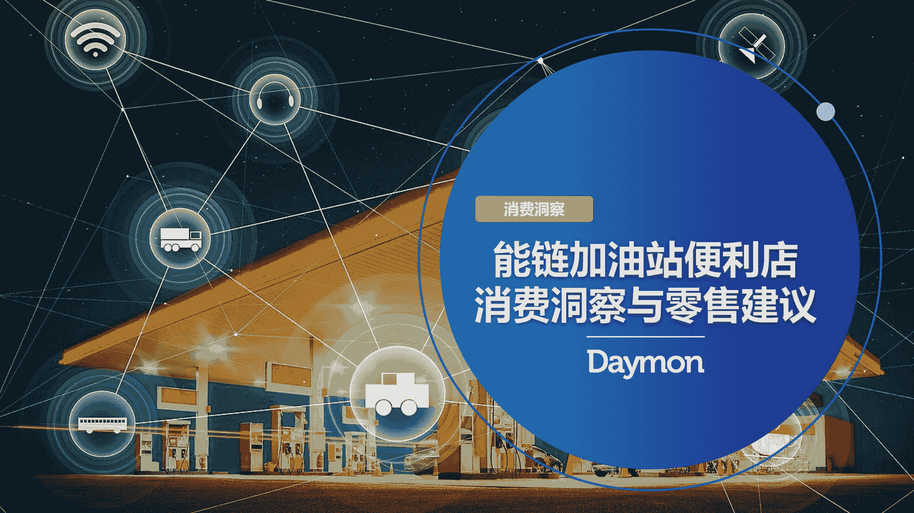

# 消费洞察

## 能链加油站便利店

## 消费洞察与零售建议

Daymon

# 知识星球TOP 资源分享社群
公众号：知识星球TOP
让更多人获取高价值信息
汇聚网付费资源

微信信号：jntsg8
添加微信免费进
- ◆ 付费文章
- ◆ 付费社群
- ◆ 付费课程
- ◆ 副业&搞钱
- ◆ 财经&股市
- ◆ 行业报告

微信信号：jntsg2
时政·历史·职场·体制·自媒体 学习·军事·软件·影音·社会学

## 疫情背景下全球范围内油业务更容易受价格波动影响

- 疫情背景下，企业和工厂中货物服务人和人员流动受到限制，市场对石油的需求下降，同时全球原油供应过剩价格战，共同导致2020年上半年石油价格下跌；
- 中国20年上半年同样经历价格变动，油品业务相对利润空间更不稳定，需要其他非油业务类型配合抵御不确定性；

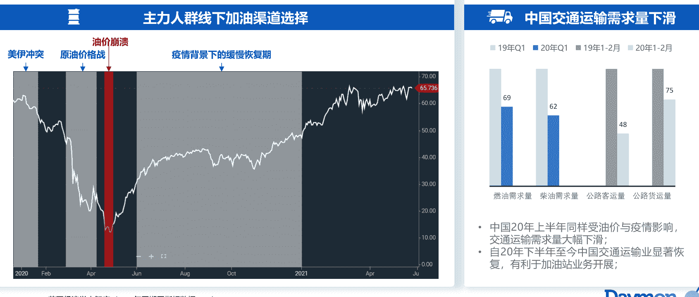

- 中国20年上半年同样受油与疫情影响，交通运输需求大幅下降；
2020年下半年至今中国交通运输需求显著恢复，有利于加油站业务恢复；

WTI Futures，英国经济学智能智库（2020年同期指标数据=100）

## 对比海外中国非油业务尚未完全开发，增长空间巨大

- 中国目前领先的两大加油站便利零售非油业务占比仍不足1%，相比欧美头部零售商仍较大差距，增长空间巨大；
- 中国加油站便利店行业参与者较少，Circle & 7-Eleven等加油站便利店主要品牌布局中国加油站市场；

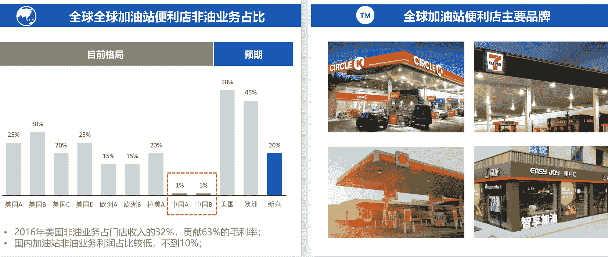

- 2016年美国非油业务门店收入占比的32%，贡献了63%的毛利率；
- 国内加油站非油业务利润占较低，不到10%；

Arthur D. Little Analysis

## 便利店整体体量大，头部优势明显，初步布局自有品牌

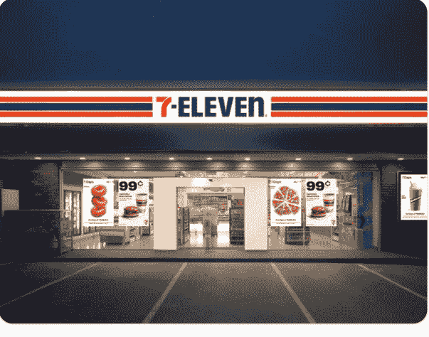

1300亿 (+12%) 20年零售总额

| 中国便利店门店数及零售额(亿元) |
| :--- | :--- |
| 门店数 | 零售额(不含税) |

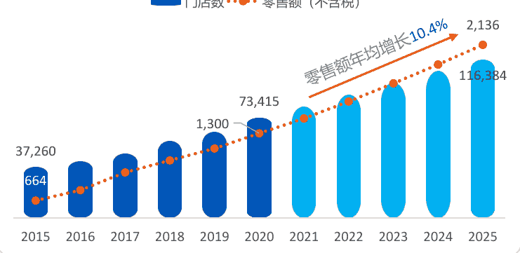

7.3万家 (+16%) 20年门店总数

| 便利店主主要品牌top10 | |
| :--- | :--- |
| CR5=48% | |
| 美宜 | GREEN | 全家FamilyMart | LAWSON |
| 17.8 | 10.6 | 6.5 | 6.5 | 6.3 |

| 门店类型 | 社区店 | 地铁站 | 商业区 |
| :--- | :--- | :--- | :--- |
| 自有品牌占比 | 中国 低于5% | 日本 约30% | |
| 主要消费类 | 现制饮品 | 即食餐 |
| 饮料 | 乳制品 |

Euromonitor, Nielsen, 亿智库

## 加油站便利店整体增长迅速，“两桶油”占据市场为主

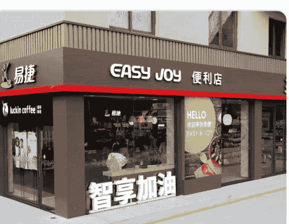

## 808亿 (+12%) 20年零售总额

## 6.2万家 (+2%) 20年门店总数

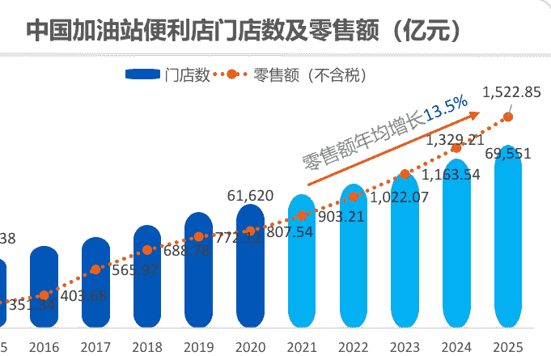

## 加油站便利店主要品牌

## 行业主要参与者表现

## 主要消费类

| 销售额（亿元） | 日均零售额（亿元） | 自有品牌零售额（亿元） | 自有品牌零售占比 |
| :--- | :--- | :--- | :--- |
| 易捷 | 570 | 1.56 | 29 | 5.1% |
| 昆仑好客 | 138 | 0.38 | 7.5 | 5.4% |
| 整体统计 | 808 | 2.19 | — | — |

- 水
- 烟
- 饮料
- 汽车用品

Euromonitor 2020年，中国机动车保有量达3.72亿，驾驶达4.56亿

## 油品和非油业务“双轮驱动”潜力巨大

## 加油站便利店城市化、本地化和品类机会

## 近场零售人均GDP增长增大，便利店业态增长持续领先

中国的人均GDP增长与基建提升，带动汽车消费增长。随着汽车渗透率上升，城镇化驱动便利店业态与消费者产生更多联系。疫情影响下的健康与便利需求，消费者更倾向于接受无接触服务，因此加油站将迎来便利、多元服务的一站式体验。长期以来对便利性、产品等品类的需求，满足生活节奏快与精明的消费者需求，同时在自有品牌的潮流下帮助商家实现差异化。

- 美佳便利门店突破15000家
- 7-Eleven深耕便利店门店突破10000家
- 电商巨头入局便利店人均GDP增长

020年自有品牌SKU数-1000
- 现制饮料品牌SKU数-1000

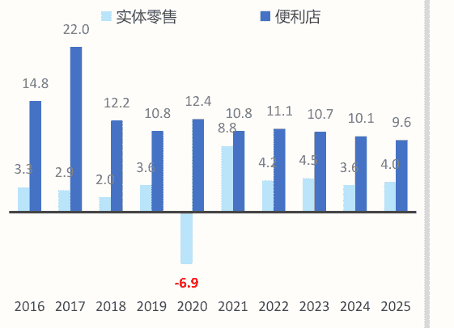

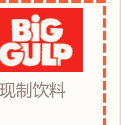

## 2021-2022年全球趋势影响加油站便利店消费趋势

| 1 | 2 | 3 | 4 | 5 | 6 |
| :--- | :--- | :--- | :--- | :--- | :--- |
| 人口多元化 | 健康生活 | 实时在线 | 全球互联 | 愉悦体验 | 价值以上 |
| 随着人口结构压力、技术水平的变化以及大众对于群体差异程度的提升，市场正处于界限演变。全新的群体出现和相似，不同的群体衍生出了各式各样的需求，对产品和零售也提出了新的要求，形成了新的购买行为。 | 健康已不再小众需求，消费者对健康的关注正日益扩大并多样化，消费者在期待能够跨越极限，而是将健康理想成为具体的生活方式，满足健康需求的整体解决方案应运而生。 | 随着全球化趋向无边界的界限不断模糊，技术的进步让人们对技术的使用更加频繁，连接的建立在“随时随地满足”的追求，将期待零售的演化和创新 | 前所未有的移动和技术进步让全球与互联互通，人们对全球环境的行为的变化，重视和跨界的需求日益活跃，对个人的行为影响着整个世界，也会受到世界的影响。 | 面对日益不安的世界，消费者在日常生活中寻找快乐感和幸福感，通过产品、消费和服务、互动，获取更深参与、简单的简单的，以及控制感 | 人们对价值的看法正在发生变化，对价值的定义正在多元化。基于自我需求，综合产品质量、信息透明度、便利性等方面评估产品的价值，越来越能够满足所需的产品由于购物者在消费变得更加快捷和精准，如何应对和满足这些需求变得至关重要。 |

| iIdentity | B-Well | Always On | One World | JOYment | Value Matters |

# 2021达全球趋势：解读加油站便利店市场趋势

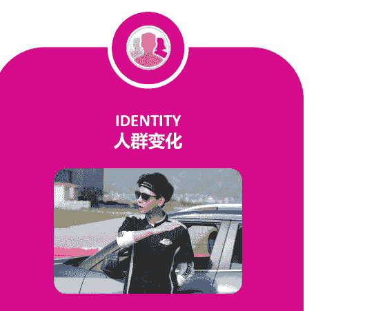
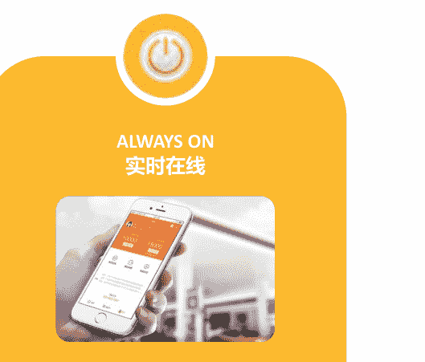
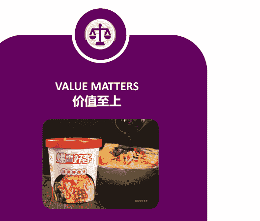

- 2010年以来，全国总里程不断增加，持续扩大驾车出行范围，同时90后首次超过85后成为购车主力；
- 随着年轻消费者来到，个性化需求和体验需要更多的定制化解决方案；
- 小型家庭、单身经济背景下的消费者需要满足自身群体的产品与服务；
- 消费者在加油站的支出将从燃油转向零售服务，支付技术和疫情对触点的限制持续影响购物习惯，更多转向移动购买和支付，以满足“多快好省”和“简单安全”的消费心理；
- 消费者在加油站便利店的停留正在逐渐下降，因此更便捷的解决方案成为显著需求；
- 在客户对便利需求的推动下，加油站的产品和服务不断发展——燃油的贡献将继续下降，非油零售产品将获得突出；
- 除了加大产品组合和范围，加油站便利店还专注于新的服务，以满足客户多种需求。

## 通过多元店型与定制产品为消费者提供个性化体验

## 人群变化

咖喱牛肉蛋糕饭美国Wawa儿童套餐及IP玩具通过玩具开发儿童好感度，满足小型家庭消费需求

- 2010年以来，全国总里程不再增加，持续扩大驾车出行范围，同时90后首次超过85后成为购车主力；
- 随着年轻消费者来到，个性化需求和体验需要更多的定制化解决方案；
- 小型家庭、单身经济背景下的消费者需要满足自身群体的产品与服务；

全家“上学套餐”专为学生推出的平价上学早餐套餐
- 全家“宝可梦”系列联名名品包括潮流即食和饮料、玩具等品类
- Z世代年轻人群与女性群体，建立社交传播

## 移动体验和产品上线快速变化的消费者需求

ALWAYS ON 实时在线

- 消费者在加油站的支出将从燃油转向便捷零售服务，支付技术和疫情对触点的限制导致持续性购物习惯，更多向移动购买与支付，以满足“多快好省”和“简单安全”的消费心理；
- 消费者在加油站便利店的停留正在逐渐下降，因此更便捷的解决方案成为显著需求；
- 全年期间推出新品，节假日、时令推出新品，鼓励消费者打卡与分享；
- 整合营销主题，与即时零售饮品结合，吸引潜在群体。

## 通过营销通路使自有品牌与全方位服务触达消费者

VALUE MATTERS 价值至上

POLAR POP CUP FOR LIFE SWEEPSTAKES
Show us how you stay cool with a Polar Pop cup and you could win a lifetime supply of icy cold cups!
PLUS 10 DAILY WINNERS FREE FOR A YEAR

- 在客户对便利性需求的推动下，加油站的产品和服务不断发展，优质燃油的贡献将继续下沉，而非燃油零售产品将获得突破；
- 除了扩大产品组合和范围之外，加油站便利店还需专注于新的创新的服务，以满足客户多种需求。

Circle K全球领先自有品牌物料与线上营销通过社交媒体与KOL进行品牌扩张，门店内通过组合促销、会员积分等形式围战。

Wawa联名鸡与特色烘焙与知名品牌深度联名和口味创新，打造消费者对加油站便利店的固有印象，提升复购率。

## 考量业态组合，提供快捷便利、高性价比的产品与服务

## 消费趋势

- 人群变化
随着年轻消费群体比例增长，年轻人带来更多的产品与服务需求，如店铺、定制产品、配套设施等，同时对食品饮料、加油站等餐饮服务的需求。

- 实时在线
加油站消费群体对快捷便利的需求高于普通消费者，通过优化移动端和支付体验，为消费者提供更多休息时间。

- 价值至上
加油站消费群体具备应急需求与价值考量，重产品本身价值，拥有零售商差异化消费者忠诚的发展空间。

## 市场机会

- 新业态组合、餐饮服务
通过市场调研，以消费者为导向来了解市场真实需求，进而制造满足需求的产品和服务，视联动名、视产品等需求。

- 优化消费、支付环节
通过移动端优化，减少服务痛点为消费者提供更多便利、优化服务环节。

- 开发自有品牌，扩展服务范围
专注提升产品价值，以满足降低消费者试用门槛，同时通过营销引导消费者感知和产品服务的便利与优惠。

## 01 行业参与者概况

## 加油站便利店与便利店直接竞争，“两桶油”外体量有限

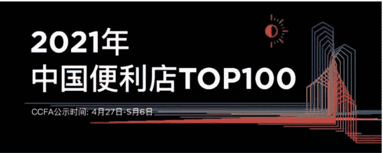

便利店

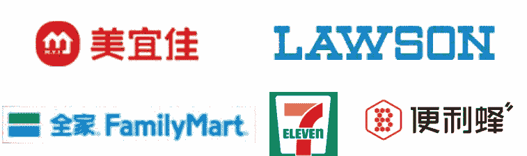

| 序号 | 公司名称 | 便利店品牌 | 门店(个) | 备注 |
|---|---|---|---|---|
| 1 | 中石化连锁销售有限公司 | 易捷 | 27600 | ★ |
| 2 | 东东绿酒集团美佳便利店有限公司 | 美优佳 | 22394 | ★ |
| 3 | 中石油合客商业集团有限公司 | 吉好客 | 20212 | ★ |
| 4 | 广东天远连锁商业有限公司 | 天福 | 5808 | ★ |
| 5 | 罗森(中国)投资有限公司 | 罗森 | 3256 | ★ |
| 6 | 中国大陆超市有限公司 | 全家 | 2967 | ★ |
| 7 | 7-11中国大陆 | 7-ELEVEN | 2387 | ★ |
| 8 | 浙江大本超市有限公司 | 十足、之上 | 2358 | ★ |
| 9 | 雇门见联连锁管理有限公司 | 贝瑞 | 2021 | ★ |
| 10 | 北京京莱丰连锁商业有限公司 | 便利驿 | 2000 | ★ |

加油站便利店

- 中国连锁经营

## 竞争者覆盖区域集中在华东沿海地区

| 零售商 | 所属企业 | 20年零售额 (亿元) | 门店总数 (家) | 单店贡献 (元) |
|---|---|---|---|---|
| 易捷 | 中国石化 | 570 | 27848 | |
| 昆仑好客 | 中国石油 | 138.17 | 20224 | |
| 石 | | 29 | 618 | |
| 美宜佳 | 东润 | 230.71 | 2911 | |
| 红旗 | 成都红旗 | 137.49 | 3326 | |
| 7-Eleven | Seven Ill | 84.94 | 2517 | |
| 全家 | 全家 | 83.96 | 2950 | |
| 罗森 | 罗森 | 81.64 | 2946 | |

## 各零售商竞争优势，便利店产品领先

| 类别 | 罗森 | 全家 | 7-Eleven | 便利蜂 | 易捷 | 昆仑好客 | 便利品牌 |
|---|---|---|---|---|---|---|---|
| 覆盖区域 | 华东、华北主要 | 华东、南方一线城市 | 华东、西南、华北、华南一线城市 | 北华长三角深度发展 | 全覆盖 | 全覆盖 | 华东、华北大部分城市与河南、南部 |
| 主要消费人群 | 20-35岁为主 | 14-40岁为主，70%以上，女性20% | 16%-90%，女性60% | 20-39岁为主，12-29岁为目标 | 20-35岁为主，性别平均分布 | 26-45岁为主，75%后男性超过八成 | 30-55岁男性为主 | 25-45岁男性为主 |
| 门店类型 | 常规+主题IP（针对特殊群体，如世代/后浪男性等） | 常规+主题IP | 常规+主题IP | 常规+主题IP | 常规+门店（易捷咖啡） | 常规+无零售店 | 常规+优选体验 |
| 明星单品 | 自品牌口碑，早餐、晚餐零售 | 自品牌即食餐、休闲零售、甜点直营 | 自品牌口碑、即食餐 | 自品牌即食餐、包装烘 | 自品牌特产、饮料食品、制品 | 自品牌包装、汽车用品、制品 | 自品牌汽车用品 |
| 门店体系 | 自品牌多点，灵活更快捷 | 上新速度、零食新品 | 官方APP+社交媒体内容+拓展本地生活 | 拓展本地生活，短期增加移动流量 | 官方APP+社交媒体内容+拓展本地生活+小社区增加移动流量 | 官方APP+O2O+直播业务、试点本地生活 | 官方APP+电商渗透 |
| 营销 | 主推明星产品+IP主题会员体系 | 快速上线网红+低促销+会员体系 | 布局网红单+主活动+低促销+会员体系 | 布局网红单+主活动+低促销+会员体系 | 推荐商品+直播货+会员体系 | 主推车辆用品+会员体系 | 仅积累体系 |

## 便利店以年轻女性为主，主张美好生活；加油站便利店以中青年男性为主，强调驾车兼养体验

| FamilyMart | LAWSON | 7-ELEVEN | 便利犀 |
|---|---|---|---|
| 全家就是你 | 随时随地的美味与安心 | 7-Eleven真好 | 城市幸福生活从这里开始 |
| 上新速度快，每年70%的商品更新率，会员体系完善 | 专注产品差异化，打造品牌/本地美食，主题便利店 | 商品丰富，关注品质而非价 | 互联网+便利店，休闲零食多，有热Mobil |

| 易捷 | Smile | |
|---|---|---|
| 更好的“生活”，瓶装水及纸巾销量最高 | 灵活选择，区域自选品牌汽车用品丰富 | 你的纯粹之选，主推加油主打 |

* 年轻时尚
* 二次元少女
* 潮酷
* 网络世代
* 专业司机
* 中产家庭

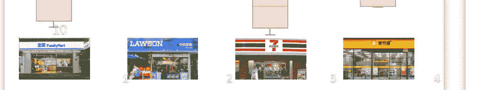
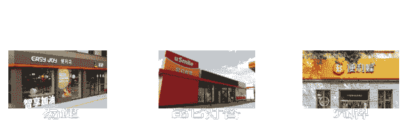

## 便利店消费者：年轻时尚，热爱尝鲜的单身女性

## 加油站便利店消费者：成熟务实男性及其中产家庭

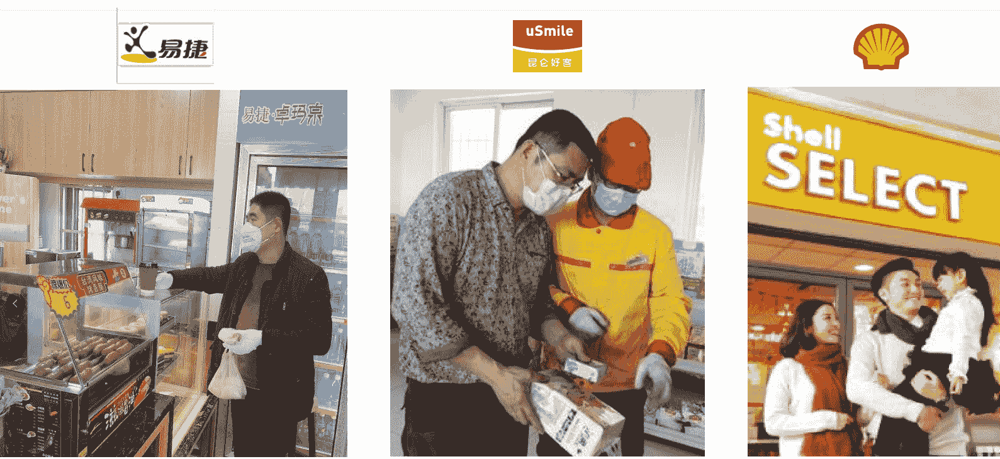

## 门店类型：不同形态目标族群

| | 罗森 | 全家 | 7-Eleven | 便利蜂 | 易捷 | 昆仑好客 | 卖牌 |
|---|---|---|---|---|---|---|---|
| 常规店 |  |  |  |  |  |  |
| 概念体验店 | | 多业态店Big 7 | 未来体验店 | 无人零售店 | 优选体验店 | | |
| 品类店 | | | 烘焙店 | 咖啡店 | 咖啡店 | | |
| 联名店 | Hello Kitty | 萌小娘 | 东方 | | | | |
| 主题店 | 自有IP | 夜店 | ONER主题店 | | | |

## 罗森联名IP店：瞄准次元少女

- 泰迪熊
- 奥特曼
- 可口可乐

- Hello Kitty
- 名侦探柯南
- 轻松熊
- Bilibili

## 7-Eleven主题店：潮流打卡地

### 集装箱主题
龙跃门市@苗栗
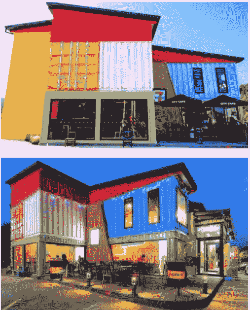

### 樱花铁道主题
腾达门市@新竹
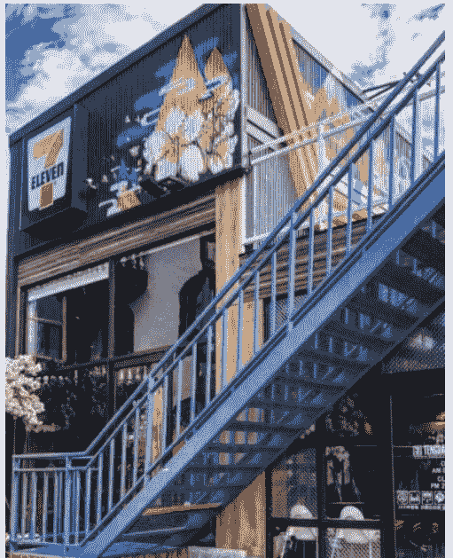

### 糖果屋主题
后糖门市@台中
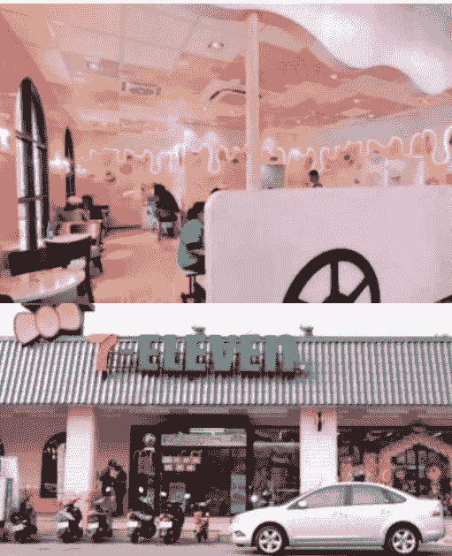

## 便利蜂：明星·国漫，跟话题最懂世代

- 明星主题店
- 国漫主题店
- 少女主题店
- 热点主题店
- 闲闲主题店
- 快手主题店
- 春主题店
- RISE主题店
- 时日月主题店
- 樱花季主题店

## 壳牌优选：精致生活，美好旅程

## 品类分布便利店

| | 全家 | 罗森 | 7-Eleven | 便利蜂 | 易捷 | 昆仑好客 | 卖牌 |
|---|---|---|---|---|---|---|---|
| 饮品 | 茶饮料果汁 | | | | | | |
| 冲饮料 | | | | | | | |
| 酸饮料 | | | | | | | |
| 牛奶制品 | | | | | | | |
| 运动饮料 | | | | | | | |
| 咖啡 | | | | | | | |
| 能量饮料 | | | | | | | |
| 冷冻即食 | | | | | | | |
| 酒类 | | | | | | | |
| 酒及餐 | | | | | | | |
| 休闲小食 | | | | | | | |
| 鸭肉 | | | | | | | |
| 其他零食 | | | | | | | |
| 口糕/饼糕 | | | | | | | |
| 冷藏食品 | | | | | | | |
| 制热食品 | | | | | | | |
| 即食食品 | | | | | | | |
| 特产食品 | | | | | | | |
| 速食代 | | | | | | | | |
| 佐餐主食 | | | | | | | | |
| 早餐及主食 | | | | | | | | |
| 蔬菜 | | | | | | | | |
| 液体奶 | | | | | | | | |
| 酸味奶 | | | | | | | | |
| 汽车用品 | | | | | | | | |
| 机油类 | | | | | | | | |
| 食油类 | | | | | | | | |
| 其他类 | | | | | | | | |
| 美妆个护 | | | | | | | | |
| 低价用品 | | | | | | | | |

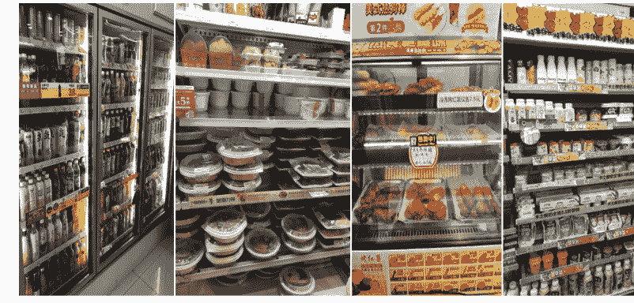
饮品、冷藏即食、即食食品、乳制品
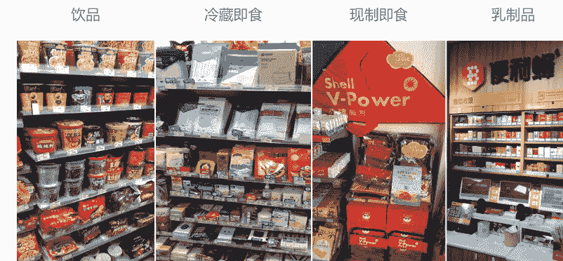
速食代餐、日用百货、汽车用品、烟

## 品类角色

| | 便利店 | | | | 加油站便利店 | | |
|---|---|---|---|---|---|---|---|
| | 7-Eleven | 便利蜂 | 罗森 | 全家 | 壳牌 | 昆仑好客 | 易捷 |
| 构建客流 | 冰蛋糕 | 盒饭 | 泡子 | 咖啡 | 饮料 | 泡子 | 饭团 |
| 生成利润 | 自品牌零食 | 自有品牌 | 自品牌 | 自品牌 | 汽车用品 | 自品牌 |
| 领先 | | | | | | | | |
| | | | | | | | | | |
| | | | | | | | | | |
| | | | | | | | | | |
| | | | | | | | | | |
| | | | | | | | | | | |
| | | | | | | | | | | |
| | | | | | | | | | | |
| | | | | | | | | | | |
| | | | | | | | | | | |
| | | | | | | | | | | |
| | | | | | | | | | | |
| | | | | | | | | | | |
| | | | | | | | | | | |
| | | | | | | | | | | |
| | | | | | | | | | | |
| | | | | | | | | | | |
| | | | | | | | | | | |
| | | | | | | | | | | |
| | | | | | | | | | | |
| | | | | | | | | | | |
| | | | | | | | | | | |
| | | | | | | | | | | |
| | | | | | | | | | | |
| | | | | | | | |

## 自有品牌架构

- 现制即食
- 酒水饮料
- 休闲零食
- 日用百货

## 自有品牌定位分布

| Value | NBE | Lifestyle | Premium |
| --- | --- | --- | --- |
| | uSmile, LAWSON, 7-ELEVEN, 全家 FamilyMart | | |

全品类

品类特有

| 日用百货 OLUU ME&MOI 电视KU 味味醋优特 碧龙 | 休闲零食 好富源品 饮料 纯日六六 易健滋滋 | | 酒 酿醉 现制饮品 T-COFFEE Par Cafe 不厌 L-cafe |
| Daymon

## 明星产品

| 罗森 | 全家 | 7-Eleven | 便利蜂 | 易捷 | 昆仑好客 | 卖牌 |
| --- | --- | --- | --- | --- | --- | --- |
| 现制饮品 | | 抹茶拿铁[10RMB] | 30元任选饮品系列 52元 | | | |
| 现制热食 | 脆骨猪|5.5RMB | | 关东 | 车饺 | 烤烧牛肉 卤汁豆腐|6.5RMB | | |
| 烘焙 | 冰皮月亮蛋糕[10RMB] | 半块芝士蛋糕[9.8RMB] | 草莓干脆[12.9RMB] | 俏恰山蛋糕|7.9RMB | | |
| 便当饭三明治 | 恶魔的饭团|8RMB | 蛋咖喱猪排饭|16.9RMB | 黄果玲饭团|6.9RMB | 乌雅蛋土拼三明治|6.9RMB | | |
| 酒水饮料 | | | 海河牛奶|3.5RMB | 纯享东方玛露 | | |
| 非食品 | | | 酱油抽海葵咸油 | 昆仑之星碳酸水|8RMB | 喜力花生油|8RMB | 小红书；近期最喜爱的便利店美食话题

便利店明星产品集中甜食点心、即食现制餐饮类，解决“一日餐+下午茶”

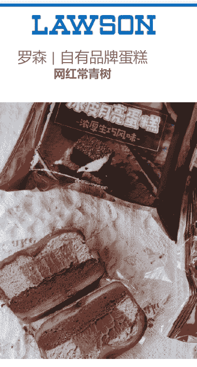
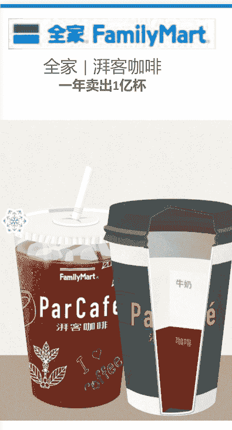
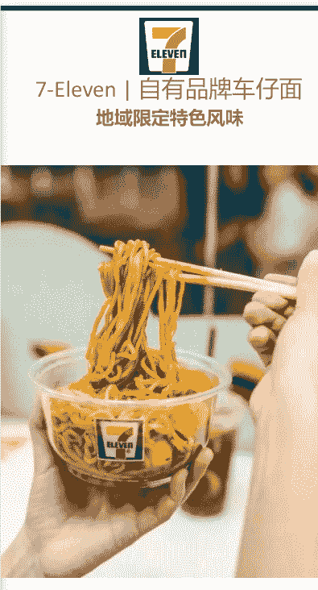
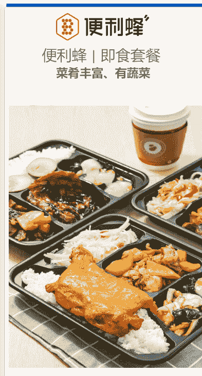

加油站便利店明星产品集中刚需产品和汽车用品

易捷·卓玛泉西藏天然水

易捷 | 欧露纸品系列天然竹浆纸

昆仑好客 | 昆仑之玻璃水军工品质

壳牌 | 润滑油壳牌天然机技术

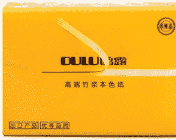
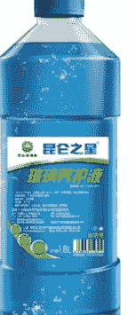
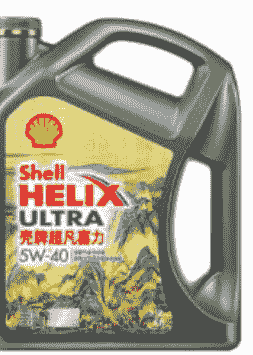

## 明星单品-全家便利店源客咖啡

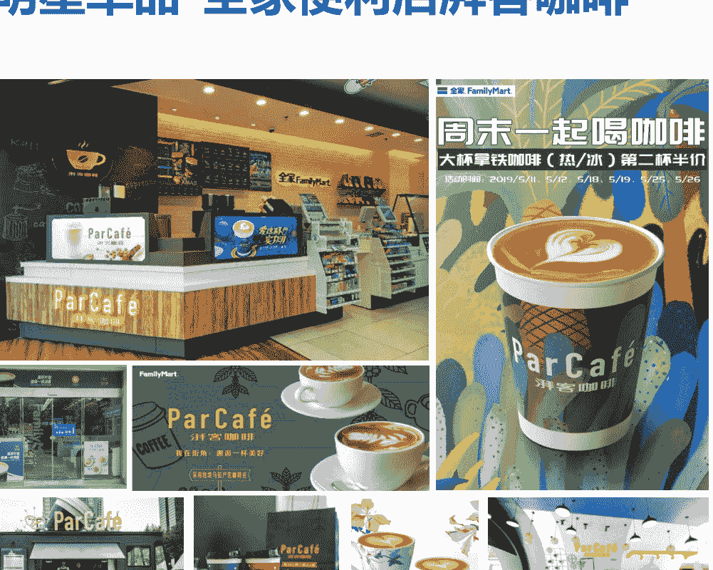

FamilyMart Par Café

卖咖啡是全家便利店力打造的独特品牌，目前已覆盖超过85%的全家便利门店，2014年上市以来，每年销售咖啡亿杯，2019年全年售出咖啡亿杯，在门店主、招募新员工、会员分析、业绩计划中，都起到关键作用。在很大的全家便利店内，通过咖啡橱窗、咖啡标识、视频推广等形式，让咖啡通过社交媒体传播，是全家便利店的Top1的明星单品代表。

现咖啡价为10-15元，主要消费者为20-30岁的女性群体，这也是全家便利店中极具实力和传播力的品牌，咖啡沟通在全街、享受一杯咖啡，通过咖啡与顾客建立情感上的链接，在品牌群体中树立起全家便利店的精致、美好和时尚的形象。

全家通过Key Line线下门店，发布《咖啡精品指南》推荐方式，将咖啡打造成时尚、新鲜、有味的生活方式，也延伸了全家与消费者的接触终端。

现咖啡作为明星单品，能够提升店铺形象，营造更轻松惬意的氛围，也能有效地吸引顾客，带动联动业务销售，培养顾客忠诚度。当前中国市场的咖啡渗透率仍有待提升，便利店咖啡在市场中的份额尚较高，我们发现现代零售商业中，符合消费者心理需求的关键单品，集中火力，将以线上营销进行高效的传达。

- 负责人：中国全家明年要卖亿杯，还要开设“咖啡馆”

## 明星单品-易捷卓泉天然水

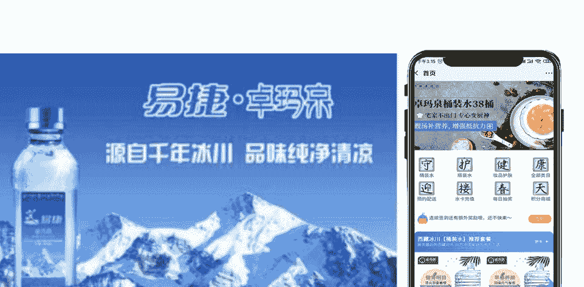
2014年，卓泉由中石化合作推出卓泉，单价2元/瓶，定位为高端饮用水，销量达1.5亿。在易捷便利店之外，还进入了Fairprice超市、京东等渠道，抢占市场，列前三。

目前，卓泉在易捷便利店外的流量增长，源于门店内的热量、线下互动、网红推广，赞助中国赛事，赢得夺冠。

## 竞争零售商优势

| 产品差异 | 销售渠道 | 排列指导 | 主题活动 | 会员体系 | 官方媒体 | 互动营销 | 购物方式 | 本地生活 | 广告 | 人员服务 | 自助服务 | 总计 |
| --- | --- | --- | --- | --- | --- | --- | --- | --- | --- | --- | --- | --- |
| 罗森 | 2 | 2 | 店内海报标题、自然流量大 | 集成活动积极性高 | 积分、会员体系较为完善 | 2 | 2 | 接入么 | | 2 | 0 | 28 |
| 全家 | 全天候、即取咖啡 | 2 | 2 | 店内标题、外卖推款 | 活动丰富 | 会员体系调整、灵活 | 入驻微信公众号内容 | 全家社群功能增强 | 接入么 | 非常靠谱TVC、店内销售 | 2 | 1 | 0 | 35 |
| 7-Eleven | 2 | 2 | 1 | | 2 | 2 | | 2 | 接入美国 | | 2 | | 0 | 24 |
| 便利蜂 | 2 | 2 | 分时折扣拉新优惠 | 入驻抖音内容营销热点 | | | 2 | 接入么 | 蓝牙电台店内推广 | 1 | 2 | 共享单 | 30 |
| 易捷 | 自有品牌饮水、低价 | 开天天猫旗舰店 | 区域陈列特色化 | 直播带货潮流感 | | | 1 | 1 | 2 | 1 | | 移动支付 | 27 |
| 昆仑好客 | 自有品牌汽车车辆 | 开天天猫旗舰店 | | 2 | 1 | 1 | | 0 | 2 | 0 | 1 | | 移动支付 | 19 |
| 卖牌 | 2 | 2 | 1 | | 1 | 1 | | 0 | 0 | 1 | 2 | | 移动支付 | 17 |

- 达达便利店/加油站便利客调研

## 对比其他便利利/加油站便利利SWOT分析

### 机会Opportunities

- (b) 随BD进程而提升的流量增长
- (c) 便利利更适合男性消费者诉求，产品服务诉求仍未被完全满足
- (d) 车主尽可能能向购物者转化的机会

### 威胁Threats

- (b) KA加盟模式松散，管理力度参差
- (c) 便利利更适合消费者首选替代渠道，消费目的性强，从产品到卖具有标准化优势
- (d) 消费者对便利店消费观念单一

### 外部因素

### 内部因素

### 优势Strengths

- (a) KA合作关系稳定，油站数量稳定
- (b) 线上流量目前可见，且领先竞争零售商
- (c) 在部分区域具有确定性便利价格优势，作为品类解决方案可替代性强

### SO策略

- 通过油业务带动非油业务，获得更大曝光
- 以带面区域旗舰店带动发展
- 通过周边社区，主要目标群体进行推广，挖掘消费者诉求

### ST策略

- 通过优质参与者，满足消费者对环境、价格的基础需求
- 通过特色品牌占领市场差异化

### 劣势Weaknesses

- (a) 缺乏零售领域经验
- (b) 门店规模不够
- (c) 品类未有效管理
- (d) 非油业务有限，受限于
- (e) 消费者缺乏目的性

### WO策略

- 对零售业务进行标准化规划，聚焦灵活性、兼容性
- 将油业务与终端流量结合，提升服务水平，挖掘潜在客户

### WT策略

- 避免在区域内普通便利店同质化，重点品类差异化
- 引导消费者从线上与线下互动，建立更多触点

## 消费者行为研究

中青年消费者主导且加油频次较高，中国汽车量最大的城市：北京、成都、上海
78%的消费者每月至少加油一次，其中39%的消费者每周至少一次，52%的男性车主愿意加油后进店购物。
年轻一代中35-49岁的消费者中有50%的人进店购物，饮料(42%)和休闲零食(37%)是目前最多购买的品类，具有较高的忠诚度，如可口乐、红牛。传统的饮食习惯对食物（如豆浆、面点等）的需求旺盛，加油站便利店购物者，N=181

## 私家车主与专业司机为加油站便利店大部分

### 私家车主

- 84%的消费能力较高
- 自由时间较多，更多停留
- 消费习惯相对固定，与社区高度关联
- 辐射范围在2km内

### 专业司机

- 16%的消费能力为有限
- 工作时间可支配
- 油卡、发票、洗车为刚需
- 满足紧急需求，需要直接明确的信息

### 生活方式

- 关注健康养生、有机营养、重视个人品质/生活实践者
- 关注即食、有机营养、生活成本高/消费理性/ 依赖手机娱乐、社交媒体体验

## 消费场景

- 工作通勤：路线相对固定、时间相对紧张
- 旅行出行：预算较多、需求分散、时间充足
- 日常路线：路线取决于消费需求低、时间最为紧张
- 紧急需求：消费需求而定、倾向低价商品

## 加油站便利店消费路径

进站
- 加油 (95%)
- 洗车 (14%)
- 充值发票 (13%)
- 积分兑换 (9%)

到店
- 开具发票
- 临时需求
- 空余时间

购买
- 方便顺路 (60%)
- 上厕所 (22%)
- 价格合适 (16%)
- 积分兑换 (15%)

复购与推荐
- 口头传播
- 会员福利
- 加油激励

加油洗车无需发票的车主选择不进而在流失
66%消费者“没有买的商品”而流失
60%消费者购物出于便利考量需要引导消费者快速发现产品

加油站便利店购物调研，N=181，来自加油站便利店购物调研，北京、青岛、成都，N=507

## 通过就近和低价转化消费者，驱动更多线下加油场景

- 将“两桶油”通过较高的门店覆盖率，获取到对相对多数的消费者，但消费者对线下加油站忠诚度十分有限
- 以距离和油价为导向的消费者仍然寻找就近、低价的加油方案，不拘泥于某一条道路
- 在全国范围内的加油APP中，团的认知度和首选占比仅次于中石同类

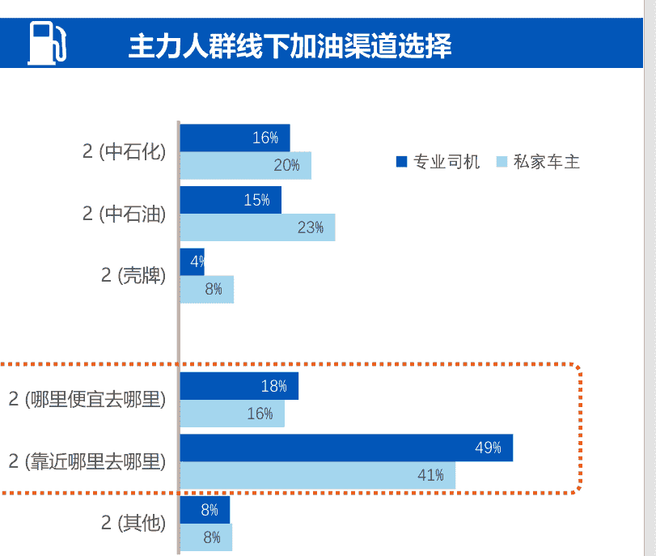
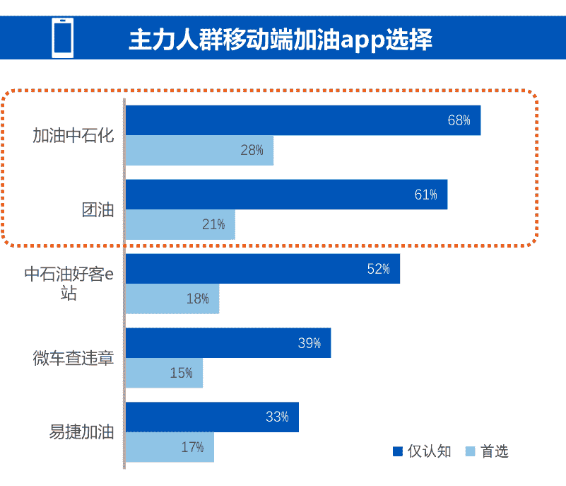

达美加油站便利购物调研，北京、青岛、成都，N=507，团购广告效果评估与未来投放汇报

## 解决发票、临时急需和补给为主，把握司机在店的黄金两分钟

- 消费者非购物需求主要以开发票、临时急需和休息水补给为主，各加油站均配备饮用水机。
- 少数消费者购物需求因时间不足而流失，可通过店员和店内指引，减少店内选购时间

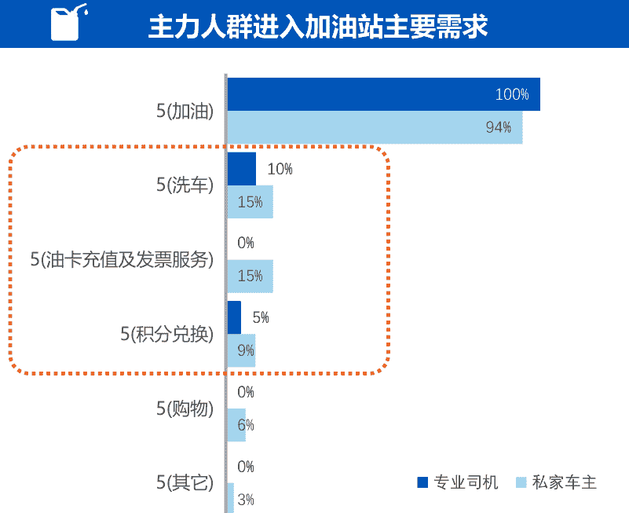
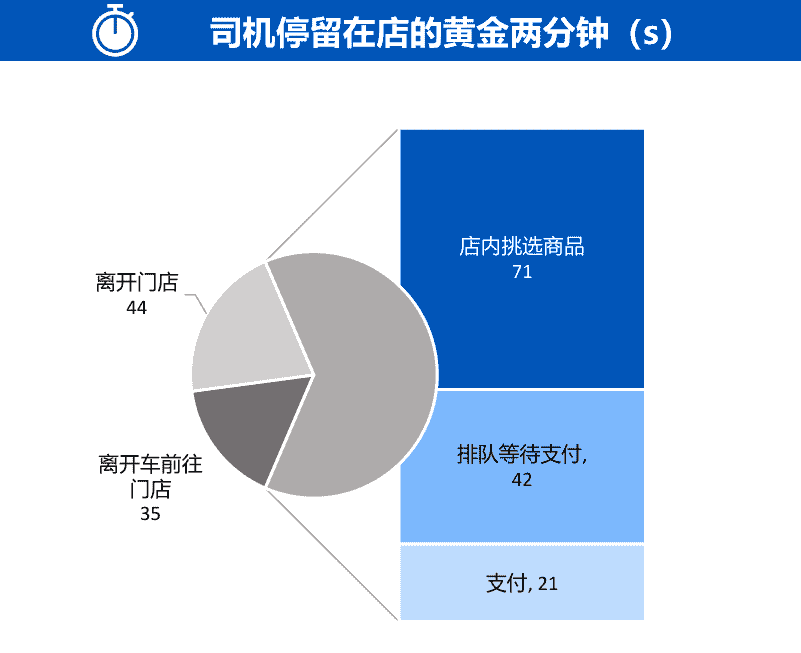

# 长途旅行和客运/货运为主人群进店主要场景

- 通勤路上和油卡开票服务成为司机最集中的进店场景
- 私家车主经常长短途旅行，专业司机在客运/货运途中产生更多需求

## 主力人群进入加油站门店主要场景

| 场景 | 专业司机 | 私家车主 |
| :--- | :--- | :--- |
| (等待油卡及开发票时) | 35% | 40% |
| (上下班路上) | 29% | 26% |
| (假期长途游) | 16% | 24% |
| (等候车) | 23% | 6% |
| (客运/货运) | 18% | 3% |
| (周末短途游) | 4% | 18% |
| (上厕所) | 15% | 14% |
| (其它) | 8% | |

私家车主在长短途有更多出行用品、食品饮料等需求能够在出行前的加油场景进行补充

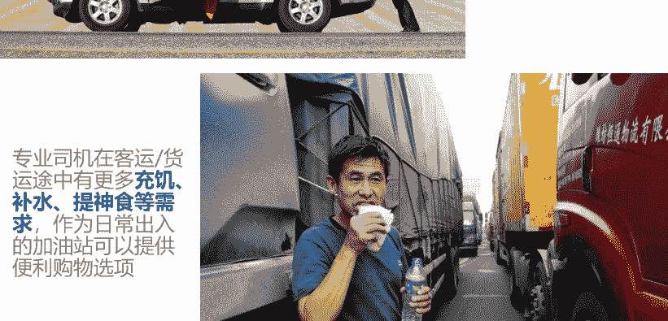

专业司机在客运/货运途中有更多充电、补水、提神等需求，作为日常出行的加油站可以提供便利物资选项

- 达达加油站便利购物者调研，北京、青岛、成都，N=507

# 通过指引与推荐能够吸引时间省时的消费者购物

- 方便顺路依然是进店购买的主要因素，通过适当的推荐与消费者沟通产品优势，能够有效打动消费者；
- 对对手的需求是司机进店的重要因素，同时专业司机对价格合适和休息空间就餐更为看重；

| 主力人群加油门店购物主要因素 | 专业司机 | 私家车主 |
| :--- | :--- | :--- |
| (方便顺路) | 52% | 67% |
| (上所需) | 22% | 22% |
| (积分兑换) | 16% | 16% |
| (价格合适) | 18% | 14% |
| (休息吃饭) | 20% | 12% |
| (促销活动以及店员推荐) | 6% | 9% |
| (产品较为齐全) | 9% | 6% |
| (其它(请填空)) | 7% | |

■ 专业司机 | 私家车主

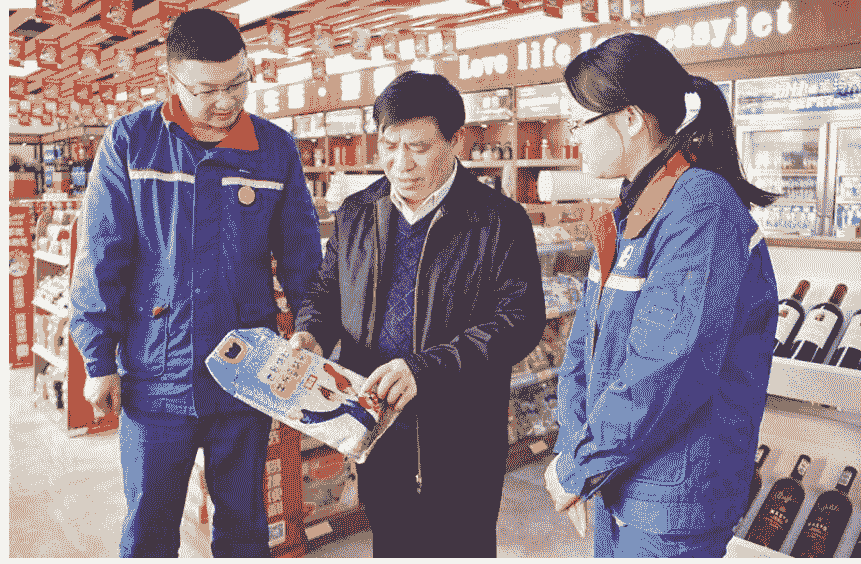

- 达达加油站便利购物者调研II，北京、青岛、成都，N=507

Daymon

# 水、饮料和烟满足主要需求，合理配置各级品类最大化零售表现

- 私家车主购买主要类集中于水、其他饮料、烟和休闲零食等，而专业车主对烟和纸制品的需求比私家车主更高
- 根据消费者目标品类需求，可集中以下三类：通过频繁购买类（如水和饮料）抓住主要客流，通过较大供给供给不足的品类（如休闲零食和现制食品）填补车主空白同时培养车主习惯，通过不稳定的

## 私家车主人群目标品类

| 品类 | Tier 1 | Tier 2 | Tier 3 |
| :--- | :--- | :--- | :--- |
| 饮用水 | 84% | 26% | 12% |
| 饮料 | 65% | 28% | 21% |
| 烟 | 45% | 19% | 32% |
| 休闲零食 | 39% | 32% | 31% |
| 方便食品 | 29% | 22% | 31% |
| 纸制品 | 26% | 22% | 36% |
| 现制食品 | 22% | 30% | 39% |
| 现制饮品 | 18% | 23% | 40% |
| 汽车用品 | 17% | | |
| 应急食品 | 13% | 24% | 40% |
| 粮油调味 | 10% | 19% | 49% |
| 酒 | 10% | 18% | 49% |
| 其他 | 12% | 45% | |

## 专业司机目标品类

| 品类 | Tier 1 | Tier 2 | Tier 3 |
| :--- | :--- | :--- | :--- |
| 饮用水 | 78% | 25% | 10% |
| 烟 | 61% | 25% | 24% |
| 饮料 | 58% | 31% | 19% |
| 休闲零食 | 44% | 30% | 26% |
| 纸制品 | 37% | 23% | 21% |
| 方便食品 | 32% | 23% | 29% |
| 现制食品 | 29% | 34% | 31% |
| 汽车用品 | 22% | 18% | 38% |
| 现制饮品 | 22% | 34% | 34% |
| 应急食品 | 17% | 23% | 34% |
| 酒 | 17% | 16% | 45% |
| 粮油调味 | 12% | 45% | |
| 其他 | 24% | 16% | 34% |

- Tier 1 购买人数多、频繁购买
- Tier 2 需求较大、供给不足
- Tier 3 消费不稳定、观念未形成
- 买过
- 想买

- 没买过也不买

达美加油站便利购物者调研；北京、青岛、成都，N=507

# 即食和饮品填补消费者的空白

- 私家车主认为即食和饮品、汽车用品和应急用品等未满足、专业司机认为即食和饮品、应急用品和酒等也有待；
- 即食和饮品中品类众多、能够满足私家车主对热食、肉、解渴的需求

| 私家车主人群目标类 | Tier 1 | Tier 2 | Tier 3 |
| :--- | :--- | :--- | :--- |
| 饮用水 | 84% | 26% | 12% |
| 饮料 | 65% | 28% | 21% |
| 烟 | 45% | 19% | 32% |
| 休闲零食 | 39% | 32% | 31% |
| 方便食品 | 29% | 22% | 31% |
| 纸制品 | 26% | 22% | 36% |
| 现制食品 | 22% | 30% | 39% |
| 现制饮品 | 18% | 23% | 40% |
| 汽车用品 | 17% | 30% | 40% |
| 应急食品 | 13% | 24% | 40% |

| 专业司机人群目标类 | Tier 1 | Tier 2 | Tier 3 |
| :--- | :--- | :--- | :--- |
| 饮用水 | 78% | 25% | 10% |
| 烟 | 61% | 25% | 24% |
| 饮料 | 58% | 31% | 19% |
| 休闲零食 | 44% | 30% | 26% |
| 纸制品 | 37% | 23% | 21% |
| 方便食品 | 32% | 23% | 29% |
| 现制食品 | 29% | 34% | 31% |
| 汽车用品 | 22% | 18% | 38% |
| 现制饮品 | 22% | 34% | 34% |
| 应急用品 | 17% | 23% | 34% |

- 买过
- 想买
- 没买过也不买

| 品类 | Tier 1 | Tier 2 | Tier 3 |
| :--- | :--- | :--- | :--- |
| 粮油调味 | 10% | 19% | 49% |
| 酒 | 10% | 18% | 49% |
| 其他 | 18% | 45% | |

- 买过
- 想买
- 没买过也不买

| 品类 | Tier 1 | Tier 2 | Tier 3 |
| :--- | :--- | :--- | :--- |
| 粮油调味 | 12% | 21% | 45% |
| 其他 | 24% | 16% | 34% |

达美加州绝对购物调研；北京、上海、青岛、成都，N=507

# 以饮料零食转化满足潜在需求

- 专业司机相比私家车主有更多想买的东西，同时对商品、环境整洁也未达到预期
- 表示没有想买的司机中超过1/4都对即食、休闲零食和汽车用品开放

- 达达加油站便利购物者调研，北京、青岛、成都，N=507

# 消除障碍：优化产品组合、缩短等候时间、展现

- 主力人群中有一半将“想买的东西”作为购物的主要因素，但因时间、价格等原因未满足
- 从看出专业司机满意度高，而私家车主关注于产品、时间几个维度；

- 没有想买的产品
> “从来没买，不知道什么”
> “时间太忙，增加方便食品”——青年

- 购物的主要障碍
> “时间太忙了，没空仔细看商品”
> “时间排队，没时间去买”——老年

- 价格有点高
> “方便为主，价格优惠还要多”
> “感觉价格稍，就不会买”——专业司机

- 达达加油站便利购物调研II，北京、青岛、成都，N=507

# 扩大用户基数和线下终端数量，将油业务与非油业务进一步关联

- 目前app作为最大的流量入口，比其他民营竞争者更具优势，而线下终端数量需要在主要区域内覆盖，提高消费者的触达性并降低门槛
- 关联油品和非油业务，将引导消费者对非油业务进一步转化，解决消费者信任层面的后顾之忧，鼓励刚性消费和随机购买

# 立足便利性，丰富产品组合，通过自有品牌满足细分需求

- 加油站便利对消费者而言，需满足消费者对便利的高度需求，同时向一站式购物、买即得提供快速通道发展
- 在水和烟的基础上，丰富产品品牌组合，通过自有品牌提供更多个性化商品选项，关注饮料习惯下即食和热食的需求，以价格、休息空间和产品品质培养认知

# 线下同步，从消费路径的每一个节点对消费者进行教育和沟通

- 消费者对头部推荐、店员引导等形式持开放态度，此关联消费者与商品的营销让消费者更快速地了解加油站服务的优势，提高门店的形象与专业度
- 消费者从加油前场景到加油、进店到离开的全过程，拥有众多可接触的节点如店员推荐、店内物料、APP广告等形式，均可用为消费者的媒介

# 03 品类策略

## 消费场景

- 烟
- 粮油调味
- 兑换
- 提神
- 饮料
- 解渴
- 解馋
- 休闲零食
- 现制饮料
- 应急用品
- 现制即食
- 饮用水
- 玩具
- 应急
- 方便食品
- 汽车用品
- 酒
- 充卡
- 便利
- 礼赠
- 纸制品

## NL品类架构

| 兑换礼物 | 解渴解馋 | 充肌 | 解渴提神充肌 | 解渴提神 | 便利应急 | 充肌解渴畅 | 礼赠提神 | 便利 | 汽车百货 |
| :--- | :--- | :--- | :--- | :--- | :--- | :--- | :--- | :--- | :--- |
| 粮油干杂 | 乳制品 | 充肌 | 速食代餐 | 休闲零食 | 饮料 | 家居百货 | 现餐饮 | 烟酒 | |
| 包装米 | 液体奶 | 代食品 | 饼干糕点 | 冲调饮料 | 纺织品 | 现食品 | 酒 | 汽车清洁保养 |
| 调味品类 | 酸味奶 | 方便食品 | 巧克力甜点 | 即饮饮料 | 家用清洁 | 现食品 | 香烟及配套 | 机油 |
| 食用油类 | 佐餐食品 | 冷冻冰品 | | 美妆护 | 动机保养 | 车内配件 | | | |
| 特产礼盒 | | 休闲小食 | 医疗保健品 | 一次性用品 | 纸类 | 应急/其他 | | |

## 品类策略

| 饮品 | 休闲零食 | 日用百货 | 速食代餐 | 粮油调味 | 乳制品 | 汽车百货 | 烟酒 |
| :--- | :--- | :--- | :--- | :--- | :--- | :--- | :--- |
| 构建客流 | 天然水 | 烤肠 | 热饮 | | | | |
| 生成利润 | 矿泉水 | 饭 | 巧克力 | 湿巾 卫生巾 | 乳酸饮料 | | |
| 增加交易 | 箱装 | 小饼干 | 薯片 | 辣椒 | 粮油调味 | 液体奶 | |
| 强化形象 | 果汁 | 饮料 | | | | 海绵/洗车巾 | |
| 制造差异 | 气泡新品 | 时令糕点 | 月饼 | 坚果礼盒 | | | |

## NL类规划

## 类目

## 价格

## Placement

## Promotion

## Famous 明星品类

满足相关品类的需求，成为消费者在购买品类时的第一选择

## Leading 引领品类

满足消费者大部分需求

| 购物 饮料 | 肉零食 | |
| :--- | :--- | :--- |
| 提供完整的商品组合，覆盖市场趋势，新品每月更新，趋势差异化陈列，已验证的明星产品，量 | | |
| 中高价格带，单品丰富陈列，最具竞争力的定价 | | |
| 店内外黄金陈列，位置灵活新品陈列。在收货台，利用动线陈列和重点销售 | | |
| 全线矩阵品类进行营销活动和联动，多种陈列及POSM；产品和该品类进行视觉陈列，推广活动渗透及焦点 | | |

## Competitive 竞争品类

满足消费者对特定品类的需求，提供与竞争对手相当的价格

| 家用品 | 护理 | 乳品 | 烘焙 |
| :--- | :--- | :--- | :--- |
| 提供基础的商品组合，每个细分品类一个主流全国品牌，提供小规模便利携 | | | |
| 与竞争对手持平的价格 | | | |
| 维持品类店内位置，有限的货架面积，不负责重置陈列，面积较小的商品仅做挂挂及陈列 | | | |
| 一般进行品类销，增加加购和CRM项目 | | | |
| 汽车用品 | 个人护理 | 酒 | 其他 |

## 选品规则

- 1 根据消费者在各品类下的决策顺序，充分考虑功能/口味/口/感的需求，绘制品类树
- 5 小规格为主；优选便携包装
- 2 根据不同品类的品牌集中度，规划全国性品牌和PB的组合
- 4 结合市场数据，选择热销单词
- 3 结合达曼趋势轮，选择趋势性单词

## 饮品决策树

- 饮品
- 解渴
- 提神
- 饮料
- 饮用水
- 咖啡
- 能量饮料
- 功能添加
- 休闲饮料
- 类型
- 品牌
- 品牌
- 运动饮料
- 维生素饮料
- 果汁
- 茶饮料
- 碳酸饮料
- 品牌
- 类型
- 品牌
- 品牌
- 果汁含量
- 口味
- 可乐/非可乐
- 口味
- 口味
- 冷藏/常温
- 品牌
- 品牌
- 口味
- 口味

## 品类架构-饮品

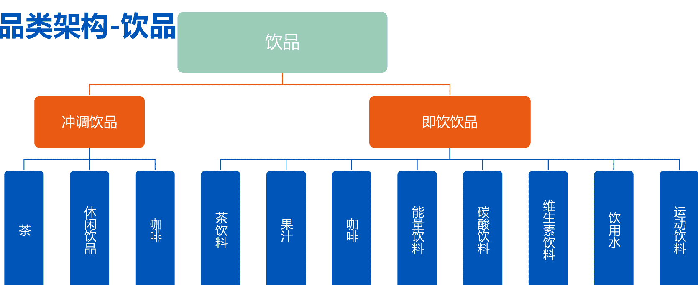

## 休闲零食树

- 休闲零食
- 解馋
- 糖果
- 巧克力
- 种类
- 类型
- 类型
- 类型
- 类型
- 口味
- 品牌
- 品牌
- 口
- 口

## 品类架构-休闲零食

- 休闲零食
- 饼干糕点
- 巧克力

- 方便纸巾
- 其他零食
- 食品

- 提供基础的商品组合，方便的陈列包装，每周更新一次新品，每半年更新一次，灵活规格
- 中低品类，中等价格为主，具有竞争力的定价
- 主通道周边，黄金陈列充足，分区域陈列新品陈列，按季节进行灵活陈列，配合动线的陈列联动
- 与基础明星品类进行视觉联动，推广/新款，季节性活动进行主推活动

## 品类开发优先

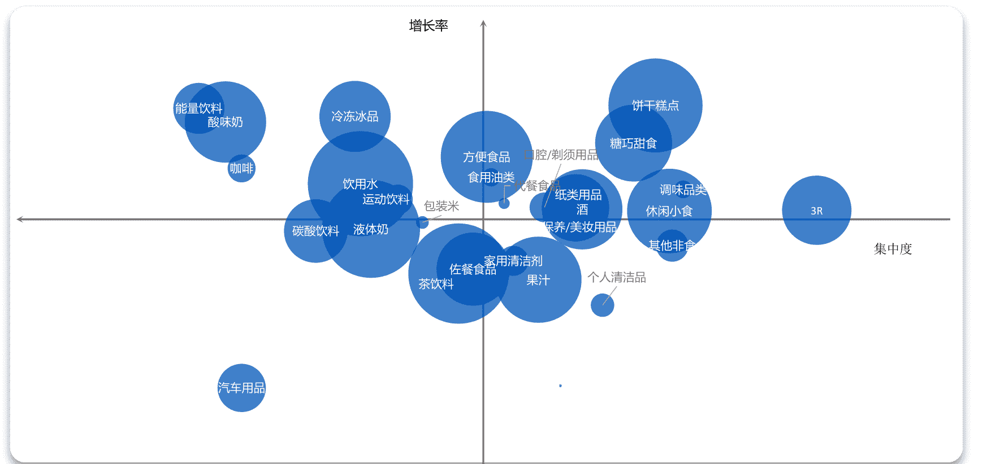

## 自有品牌品类开发优先级分析

### 01. 品类特征分析（计分卡的5大要素）

01
02
03
04
05

#### 市场规模
总计25分
便利店及加油站便利店渠道品类市场容量

#### 趋势潜力
总计10分
品类增速

#### 品牌敏感度
总计20分
品类Top3品牌销售占比（分数越高，品牌集中度越低）

#### 竞争对手开发频率
总计25分
竞争对手是否对品类进行开发

#### 开发效率
总计20分
技术壁垒、损耗、供应链水平

#### 综合评价
总分100分
由低到高评分，得分高的品类优先开发

- Euromonitor, 市场调研数据

## PB开发分发三阶段，逐步扩大版图

| 品类 | 市场规模 | 趋势效力 | 品牌敏感度 | 开发频率 | 开发效率 | 战略重要性 | 总分 | 开发顺序 |
| :--- | :--- | :--- | :--- | :--- | :--- | :--- | :--- | :--- |
| 饼干糕点 | ★★★ | ★★★ | ★★★★ | ★★ | | ★★★★ | ★★★★ | 第1阶段 |
| 休闲小食 | ★★ | ★★★ | ★★★★ | ★★★★ | | ★ | | 第1阶段 |
| 糖调甜茶 | ★★★ | ★★★★ | ★★★★ | ★ | | | | 第1阶段 |
| 冷藏饮料 | ★★★★ | ★★★ | ★★ | ★ | | ★★ | | 第2阶段 |
| 饮用水 | ★★★★ | ★★ | ★★ | ★★★★ | ★★★ | ★★★ | | 第1阶段 |
| 功能饮料 | ★★ | ★★ | ★★ | ★★★★ | ★★★ | ★★★ | | 第1阶段 |
| 碳酸饮料 | ★★★★ | ★★ | ★★ | ★ | | ★★★ | | 第3阶段 |
| 茶饮 | ★★★★ | ★ | ★ | ★ | | ★★★ | | 第2阶段 |
| 果汁 | ★★★★ | ★★★★ | ★★★★ | ★ | ★★★ | | | 第3阶段 |
| 咖啡 | ★★★★ | ★★ | ★ | ★ | ★★★ | | | 第3阶段 |
| 液体奶粉 | ★★ | ★★★★ | ★ | ★ | | ★ | | 第3阶段 |
| 酸味剂 | ★★★★ | ★★ | ★ | ★ | | | | 第3阶段 |
| 调味品类 | ★ | ★★★★ | ★★★★ | ★★ | | | | 第3阶段 |
| 食用油类 | ★★★★ | ★★★★ | ★★★★ | ★★ | | | | 第3阶段 |
| 方便食品 | ★★★★ | ★★★★ | ★★★★ | ★ | | ★★★★ | | 第2阶段 |
| 佐餐食品 | ★★★★ | ★★★ | ★★★ | ★ | | | | 第3阶段 |
| 代替食品 | ★★★★ | ★★★ | ★★★ | ★★★★ | | | | 第3阶段 |
| 酒 | ★★ | ★★★★ | ★★★★★ | ★★★★★ | | | | 第2阶段 |
| 纸类用品 | ★★★★ | ★★★★ | ★★★★ | ★ | | ★★★★ | | 第3阶段 |
| 个人清洁品 | ★★★★ | ★★★ | ★ | ★ | | | | 第3阶段 |
| 家用清洁剂 | ★★★★ | ★★★ | ★ | ★ | | | | 第3阶段 |
| 口腔/洗护用品 | ★★★★ | ★★★★ | ★★★★ | ★ | | | | 第3阶段 |
| 保护/美妆类 | ★★ | ★★★★★ | ★★★★★ | | | ★★★★ | | 第1阶段 |
| 3R | ★★★ | | | | | | ★★★★ | 第3阶段 |
| 包装纸 | ★★★★ | ★★★★ | ★★★★ | ★ | ★ | ★ | | 第3阶段 |
| 冲调饮品 | ★★★★ | ★★★★ | ★★★★ | ★ | | ★ | | 第3阶段 |
| 汽车用品 | ★★ | ★★★★ | ★★★★ | ★★★★ | | ★★ | | 第3阶段 |
| 其他非食 | ★★★★ | ★★★★ | ★★★★ | ★★★★ | | ★★★★ | | 第2阶段 |

## PB类开发阶段

### 2021年：渗透阶段
- 目标：SKU 100+
- 重点：饮用水、方便食品、纸类用品

### 2022年：发展阶段
- 目标：SKU 200+
- 重点：烤物、休闲食品、功能饮料

### 2023年：爆发阶段
- 目标：SKU 300+
- 重点：肉类、汽车用品、其他非食

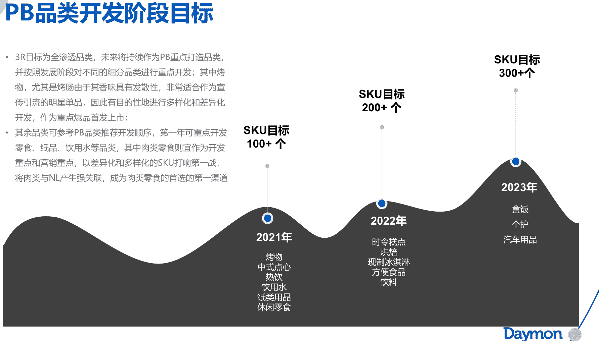

## 切入重点

### 餐饮
- **PB分类**：烤物、中式点心、热食
- **PB原因**：市场容量大、品牌集中度低，符合中国便利店消费习惯。
- **PB策略**：针对主流客群消费需求，通过创新和差异化建立优势，逐步拓展品类。

### 休闲零食
- **PB分类**：肉类、干饼糕点、海产食
- **PB原因**：市场容量大、品牌集中度低，品类细分空间广阔。
- **PB策略**：便利店客群并非休闲零食的首要选择，需通过差异化使其成为代表性产品。

### 即刻饮品
- **PB分类**：饮用水、能量饮料、茶饮料、碳酸饮料
- **PB原因**：市场容量大、品牌集中度低、需求均衡，同质化程度高，竞争激烈。
- **PB策略**：便利店主客群对“提神”需求强烈，开发特殊口味及特殊功能的饮品是更好的突破。

## 肉类明星单品：招牌冷泡杯
- **特点**：网红口味、好吃不腻、去骨去爪、方便粘手。
- **研发**：专为肉食主义者研发，特制冷泡杯便于携带，随时过瘾。
- **规格**：40gQ弹肉多，36种香料秘制卤汁，鲜香沁骨、辣而不燥，回味无穷。

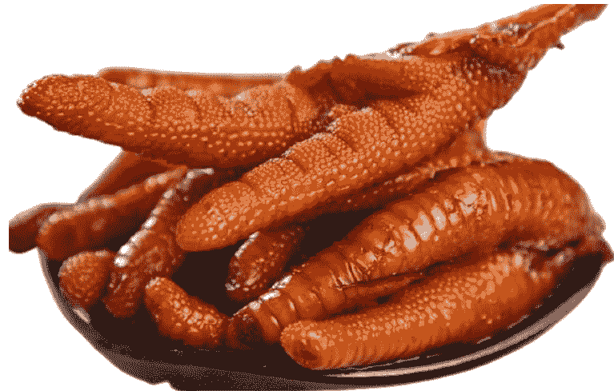

## 肉类产品系列：一口超满足
- **禽肉系列**：无骨鸭掌/凤爪
- **牛肉系列**：牛肚/牛板筋
- **招牌冷泡杯**：冰醉酿小虾凤爪
- **海鲜系列**：虾夷扇贝/圈鱼仔

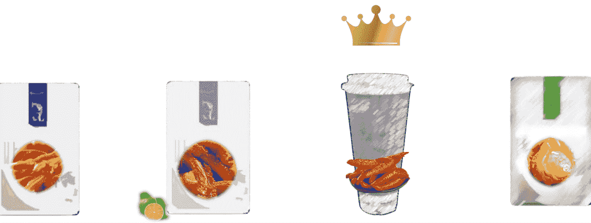

## 烤物系列明星単品：黑金脆骨肠
- **特点**：劲弹脆骨、丰富肉感、高猪肉含量、纯正肉感、现制烤肠、暖心肠、添加墨鱼汁、脆嫩口感。
- **描述**：懒人最爱的暖心烤物，现场定制，肉香四溢，解腻又充足；实实在的大块黑猪肉，黄金肥瘦比例，口口满足。
- **营养**：添加鲍鱼汁和胶骨，口感丰富、酥脆多汁，美味营养不误。

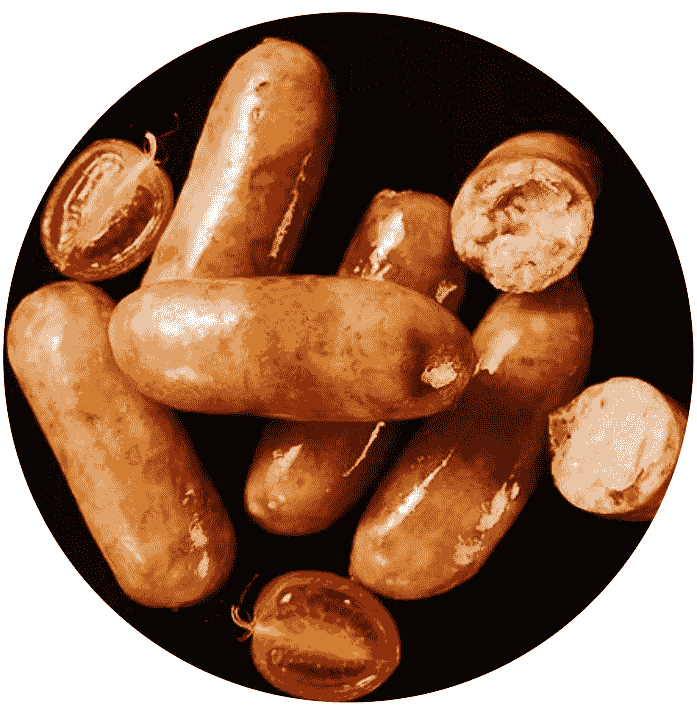

## 烤物系列：三黑烤肠

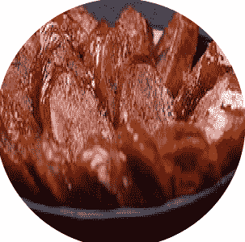
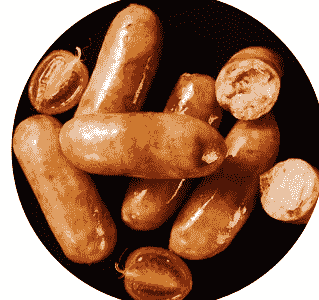

黑猪肠、黑金脆骨肠、黑糯肠

## 功能饮料明星单品：8合1宝
- **特点**：高强度、快速补充能量、含维生素、氨基酸、叶黄素，缓解压力、提升精力。
- **描述**：专为长途驾驶人士研发，有效缓解自由基、视觉疲劳，增加肌肉弹性、健康长寿。

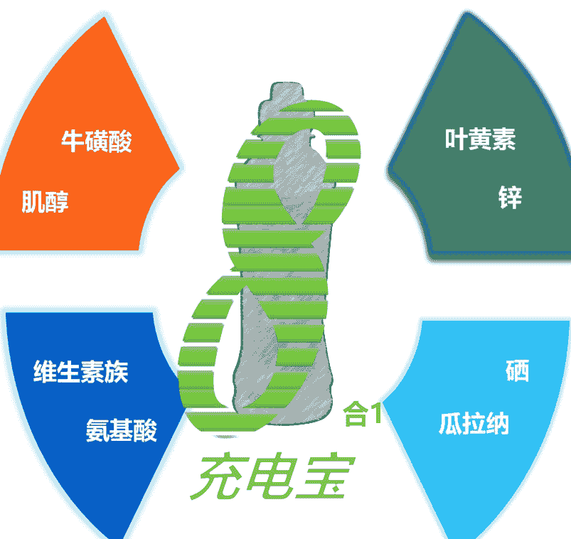

## 功能饮料产品线
- **特点**：强劲气泡、8倍能量、浓味乌龙、强劲清爽。
- **口味**：姜盐味、青柠味、薄荷茶。

## 瓶装水明星单品：无极水
- **特点**：调节激素、平衡代谢、增强体体质。
- **描述**：针对工作紧凑、饮食不规律的人士，及时补充人体所需的微量元素。
- **成分**：富含钙、镁、硅、钾等天然矿物质。

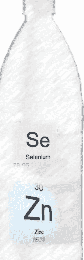

## NL PB 品清单

| 商品名称 | 开发优先级 | 商品名称 | 开发优先级 | 商品名称 | 开发优先级 |
| :--- | :--- | :--- | :--- | :--- | :--- |
| 饮用水 | 包装纯净水550ml | *** | 软纸M120抽 | 口服清洁液 (牙膏旅行套装) | *** |
| 饮用水 | 云南矿泉水550ml | *** | 软纸M120抽*3 | *** | 口服清洁液 (牙膏50支装) | *** |
| 饮用水 | 云南矿泉水350ml | *** | 卷纸 | *** | 口服清洁液 (牙膏50支装) | *** |
| 能量饮料 | *** | 洗衣液(900ml) | *** | 毛巾 | *** | 牙膏50支装 | *** |
| 碳酸饮料 | *** | 乳糖奶油饼干(香草) | *** | 毛巾 | *** | 晾衣袋单件装 | *** |
| 碳酸饮料 | *** | 乳糖奶油饼干(巧克力) | *** | 发胶 | *** | 晾衣袋多件装 | *** |
| 饮料 | *** | 饼干(包装:180天) | *** | 洁厕液 | *** | 防晒霜100ml | *** |
| 饮料 | *** | 糕点 | *** | 玻璃清洁剂 | *** | 防晒霜25ml | *** |
| 家用 | *** | 糕点 | *** | 防护喷水 | *** | 多功能洁厕剂 | *** |
| 肉肉类 | *** | 散点//点 | *** | 海/洗海/洗车 | *** | 清洁护肤 | *** |
| 肉肉类 | *** | 避孕//避孕 | *** | 海/洗海/洗车 | *** | 清洁护肤 | *** |
| 肉肉类 | *** | 避孕 | *** | 医用用品 | *** | 医用口罩100只 | *** |
| 肉肉类 | *** | 避孕 | *** | 医用用品 | *** | 防护口罩95只 | *** |

# 05 渠道策略

## 消费者根据预算和停留时间选择快速服务渠道

- 有意花费更多：社区店

- 更利便：LAWSON

- 追求便捷 (害怕麻烦)：国道店，计划/目的更强
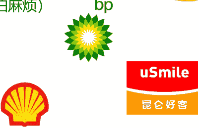
- 有意停留更久：高速公路店

## 根据位置、主要人群及竞争态势分为三大类型

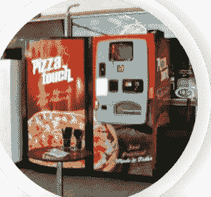
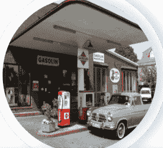

| 地理位置 | 社区店 | 国道店 | 高速公路店 |
| :--- | :--- | :--- | :--- |
| 地理位置 | 城区 | 省道/国道/县道 | 高速公路大型服务区 |
| 有效零售面积 | 20㎡ | 50~70㎡ | >70㎡ |
| 竞争者 | 其他便利店/夫妻店/小型超市 | 其他便利店/夫妻店/小型超市 | 易捷/昆仑好客 |
| 主要人群 | 私家车主/专业司机 | 私家车主/专业司机 | 以旅游为目的的私家车主占绝对多数 |
| 品类需求 | 饮品、熟即食、烟、休闲零食、速食代餐、粮油调味 | 饮品、熟即食、休闲零食、烟酒乳制品、汽车用品、日用百货 | 饮品、熟即食、休闲零食、速食代餐酒精、特产礼物、汽车用品、日用百货 |

- 时间紧迫，快进快出 | 停留时间中等 | 可以慢慢逛

## 渠道策略

| 社区店 | 国道店 | 高速公路店 |
| :--- | :--- | :--- |
| 重点类别 | 饮品、现制即食、烟、速食代餐、休闲零食 | 饮品、现制即食、烟、汽车用品、日用百货、乳饮、饮品、现制即食、休闲零食、特产赠、烟酒、制品、休闲零食、汽车用品、日用百货、速食代餐 |
| 陈列规划 | 热食柜、品柜、常规货架 | 热食柜、品柜、常规货架、主题墙、主题端架 | 热食柜、品柜、风柜、常规货架、咖啡机、休息区 |
| 促销 | 三餐套餐；会员积分 | 早餐套餐；第二件半价；季节性促销；会员满减；买三送一；旅游景点/酒店业合作；会员积分 | |
| 消费者沟通 | 统一的店招、统一的贴纸/海报/爆发贴等促销工具 | 统一的店铺设计及促销物料；以运动（酷款）赛事为主的主题门店 | 统一的店招+具有地域特征的设计 |

全品类商城

门店推荐

促销信息

会员积分

## 团购APP
## Daymon

## 分销策略

| 大类 | 中类 | 社区店 | 国道店 | 高速周边 |
| :--- | :--- | :--- | :--- | :--- |
| 家居百 | 纺织品 | | | v |
| 家居百 | 家用清洁用品 | ○ | v | |
| 家居百 | 美妆护肤 | | | v |
| 家居百 | 卫生医用保健品 | | | v |
| 家居百 | 一次性用品 | | | v |
| 家居百 | 应急/其他 | | | v |
| 家居百 | 纸类用品 | ○ | | v |
| 食油干货 | 包装米 | | v | |
| 食油干货 | 调味品 | | v | |
| 食油干货 | 食用油 | | v | |
| 食油干货 | 特产礼盒 | | | v |
| 汽车百货 | 车配件 | | | v |
| 汽车百货 | 发动机保养 | | | v |
| 汽车百货 | 机油 | | v | |
| 汽车百货 | 汽车清洁 | | | v |
| 乳制品 | 酸奶 | | | v |
| 乳制品 | 淡奶 | | | v |
| 速食大餐 | 代餐食品 | | | v |
| 速食大餐 | 方便食品 | ○ | v |
| 速食大餐 | 熟食食品 | ○ | v |
| 休闲零食 | 干饼食品 | | | v |
| 休闲零食 | 冷冻冰品 | | | v |
| 休闲零食 | 巧克力甜点 | | | v |
| 休闲零食 | 小零食 | | | v |
| 酒类 | 香醋 | | | v |
| 酒类 | 酒 | | | v |
| 饮料 | 冲饮饮料 | ○ | v |
| 饮料 | 即饮饮料 | | | v |
| 现场饮食 | 现制食品 | | | v |
| 现场饮食 | 现制食品 | | | |

# 06 购物体验

## 以“快速购买”为核心，合理规划店内体验

尽量想买的东西因时间、价格等原因未满足购物需求的消费者，则通过店内布局、动线设置、宣传物料进行曝光、推荐单品降低消费者购物障碍。

- 没有想买的东西：5%
- 时间不够：15%
- 有想买的东西：41%
- 找不到：9%
- 环境脏乱：5%

- 1. 冲动优先：重点展示食品、饮品等冲动购买的品类，提示并刺激购买。
- 2. 无缝动线：聚焦快速购物的门店布局，围绕核心品动线设置，打造流畅的购物体验。
- 3. 亮点强化：自有专区传递差异化，创造需求。
- 4. 氛围制造：结合节日、赛事等营销节点，通过主题活动营造购物氛围。

- 冲动优先：突出展示食品、零食、饮品等冲动购买的品类之外，在黄金位置、收银台周围进行重复陈列。
- 无缝动线：聚焦快速购物的门店布局，围绕核心品进行动线设置，打造流畅的购物体验。
- 亮点强化：自有品牌专区传递差异化，创造需求。

| 蜜戈 | 坚果 |
| :--- | :--- |
| 消费者视线层 | 牛肉、鸡肉 |
| 饼干糕点 | 膨化食品 |

- 氛围制造：合节日/体育赛事等营销节点，进行主题和卖点沟通，营造购物氛围。

# THANK YOU

# 05 附录

## 品类架构-粮油干杂

## 品类架构-乳制品

## 品类架构-速食代餐

## 品类架构-家居百货
- 家居百货
- 纺织品
- 家庭清洁用品
- 美个护
- 卫生医用保健用品
- 一次性用品
- 纸类用品
- 应急/其他
  - 毛巾
  - 内裤
  - 袜子
  - 洗衣剂
  - 地板清洁剂
  - 垃圾袋
  - 护肤美妆用品
  - 个人洁洁用品
  - 口腔清洁用品
  - 制须用品
  - 洁生用品
  - 医护用品
  - 一次性配件
  - 一次性杯
  - 一次性免洗脸/脸盒
  - 纸巾
  - 卫生纸
  - 女性卫生用品
  - 笔
  - 手机配件
  - 电池
  - 雨伞/雨具
  - 玩具
  - 蚊虫防治

## 品类架构-汽车百货

