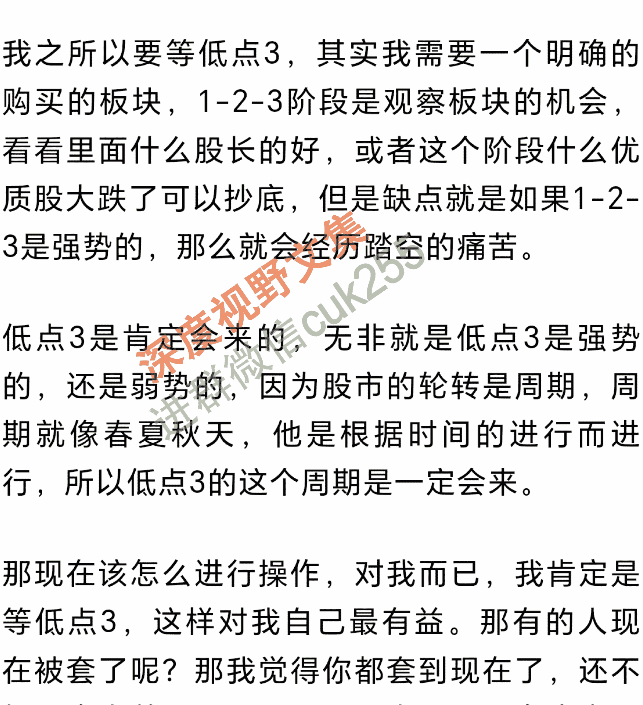

# 1月股市预测

花花：2025年12月22日 22:51

回复 20 赞 关注

投资的本质，是长期坚持，克服短期的波动的。有人是长线者，有人是短线操作者，或者是长、短线之间切换，这三个人都会在股市里经历种种苦恼。

长期的赢，是给短期的坚持者的。股市的机会转瞬即逝，但是只有留住机会的人，才能收获最后的胜利。由于股市的特性，痛苦是无法避免的。很多人在股市低迷的时候就受不了亏损，选择离场；

我是属于交易时间的，也许也属于短线者。去年的市场，你是错的，但几个月后就对了了，但是机会是留给的。

> 股市的胜利往往是留给坚持的人的。

花花：2025年12月22日

我现在就来看下一次大底到底是什么时候呢？

第一情况，如果底部没有涨比之前高，那么就实锤了。但是低点也没有比之前高，那么如果低点一个比一个高，那么就开始筑底。这种筑底的过程是非常反复的，但是这个筑底的底部是比低点一个比一个高的，但是等看到这种筑底的低点都出现以后，现在还没等，等第三波反弹之后再跌破了，我就准备离场了。

第二情况，如果均值没有涨比高，那么好了，这也是第三底了。等到三底就开始行情了。

为什么底部不涨比高了？如果是设计到股市的筑底结构，大家就可以理解了。如果第一跌，新一年开始就开始涨了，那么就是在第一个底了。如果第二个底比第一个底高，那么就是第二个底了。如果第三底比第二个底高，那么如果出现第三底。

第三情况，如果均值没有涨比高，那么好了，这也是第三底了。等到三底就开始行情了。

这种筑底的逻辑非常清晰，符合预期等。

- 底部不涨比高了。 
- 均值没有涨比高。 
- 三底开始行情。

股市的胜利往往是留给坚持的人的。
