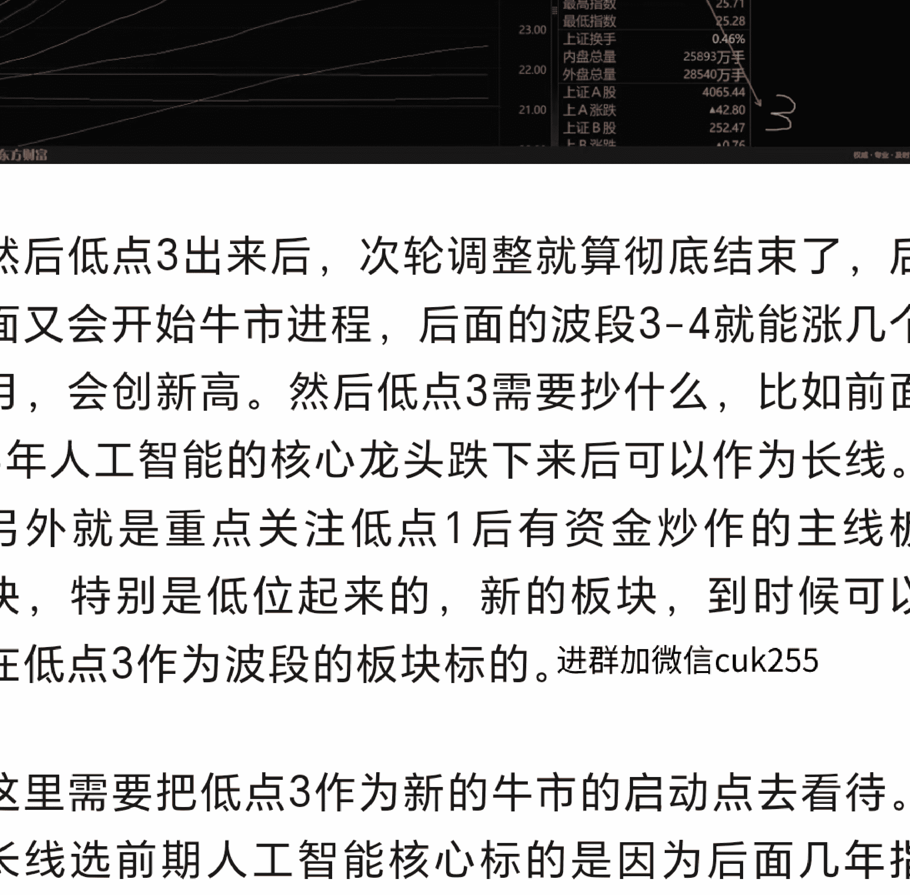

# 12个月周趋势 已费

最近的股市暴涨后，走势很不断，我想大家在现在想的就是到底需要多少才能够底，现在我基本可以确定最后的底了，以及底面的底，以及底部还能涨多少，以及底后怎么调整这些问题今天可以详细说。进群加ku255

经历了两个大涨，A股强势，说明了第一阶段的下跌调整主要是资金回，第一阶段结束后，跌到低3，由于A股强势，所以第一阶段调整就会结束，大概在21底部附近。所以底的位置在接下来一段时间内就是在横里震荡，然后最后第二波下跌到低3，这种调整就彻底结束了。低3点的时间大约在1月或2月左右。

后低3点出来后，然后调整就彻底结束了，后面又开始上涨进程，后波段的3-4就能涨几个月，创新高。然后就需要需要什么，比如前3年人工智能的核心头部会有多久可以作为长度。另外就是重点关注低1点以后有涨的作为主线块，特别是新的块，到时候就可以了，特别是在低3波段的块，进群加ku255

还需要把低3作为新的主线的起点去看。长期线前1年人工智能的核心逻辑就是我们后年后以后会高，所以这些跌掉来的后期基本上也会高。波段的跌点低1后启动的新主线块，波段吸纳，买不卖，在低点3之前好观即可。

另外大指数里的高2，红色横线，有的玩家可以做短线，红内的走势有无数种走法，比如可以先跌破低点后反弹一下，他也可以继续跌破低1后再次反弹一下，这样的话都是可以的，没问题，这些交给自己自己即可。

我现在是猜不出来的，只能每天跟看着，看作自己已经在横内套了，但是不是蛮意看，最终横内震荡后都是低点3，这让我调整做一个最后的底。

总之，横内震荡难度是比较大的。

所以了解了这些后，我想大家对于未来的走势，就都有一个非常清晰的感受了。

1384 付费

深度视VIP 人工智能50+天 进群加微信：ku255 chp5538

评论 45

作者已设置关注后留言

Mr 广东 13 分钟前

回复 5

# 深度视野优质集团（链接优质社群，助你成功）

全部包含以下内容：限时年费188/年 加微信cuk255

- ① 吃群众倍帝文档加时群对话（原价 365 元/年）
- ② 子明私享汇（含）内部文章（原价 568 元/年）
- ③ 政事室（顾子明）付费内容加送顺子明群聊
- ④ 米联储寂美【作者米榛】原价 599 元/年）
- ⑤ 欧洲金雀会员专属文章（原价 328 元/年）
- ⑥ 砖瓦斥内部文档（原价 400 元/年）
- ⑦ 卢克文青读书会专属文章（原价 699 元/年）
- ⑧ 鉴茶财经知识星球（原价 3310 元/年）
- ⑨ 猫哥的视界知识星球星球文章（原价 299 元/年）
- ⑩ 财新周刊【独家新闻】原价 1498 元/年）
- ⑪ 杨世光在金钱树（原价 2200 元/年）
- ⑫ 森森财经知识星球（原价 1600 元/年）
- ⑬ 激源异译付费文章（持续更新）
- ⑭ 司马林解读谋选全套音频和全套书籍版权无损减（原价 2.3 万）
- ⑮ 虚三三曲[民国梦、帝国争亡、不被理解的 MAO]（原价 599 元优）
- ⑯ 卢克知识星球文章（原价 268 元/年）
- ⑰ 额外再送：卢户源新浪微博付费专辑、三村丰老王、三花九树文集

不定内容：————（更多资源不写下了……）

- ① 守夜人知识星球、接换魔王知识星球、成财富知识星球
- ② 创始精英星球、达叔谈论星球、成就财富圈、雪雪花甲老头等
- ③ A 视野、大树乡谈、江初后、泮咩说、上海海家学等付费文集
- ④ 西风付费文章、老端、赢在小时之时、局外人的视界、升值权、体制等等其它大 V 付费文章（每月低于 600 元的付费文章）

深度视野文集
进群微信cuk255
深度视野（付费文集）

限时年费188/年 低成本链接全网V优质内容
