# 边缘 AI 驱动， 助力新质生产力

英特尔®工业人工智能白皮书 2025 年版
Intel® Industrial AI Playbook 2025 Edition

# 免费 价值 及时 专注

# 扫码加入 知识星球TOP 免费资源群

- 每日免费获取价值资源
- 可提供各类资源搜索服务

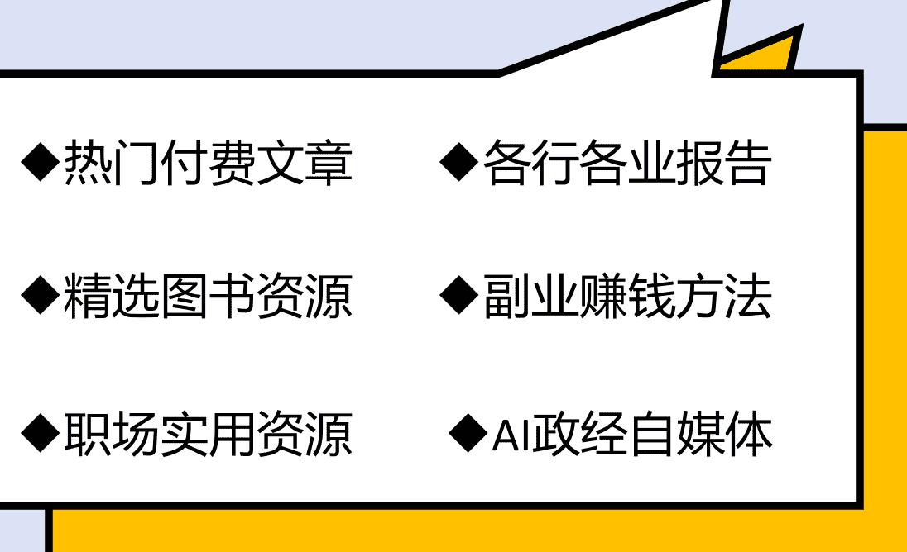

| 热门付费文章 | 各行行业报告 |
| 精选图书资源 | 副业挣钱方法 |
| 职场实用资源 | AI政经自媒体 |

公众号:知识星球TOP 微信公众号:jntsg8 微信公众号:jntsg2

分享资料仅供个人学习，请及时删除，切勿商用传播

# 编委会:

主编: 刘俊、马龙、朱永佳
编委: 万辛月、高翰、高杨帆、胡杨、刘、刘波、吕晓嵘、邵丽颖、单娜、张、恒、张心宇

* 脚注按拼字母顺序

# 前言

人工智能（AI）技术的快速发展引起了新一轮工业革命潮流，通用大模型的出现AI 技术从专用领域走向通用化。AI 技术正在工业领域的各行各业，帮助企业从劳动密集型向数据密集型转型，向技术密集型、知识密集型的高化、智能化、绿色化转型，打造依托于人工智能、大数据、云计算等现代信息技术的新质生产。

AI 和大模型的应用，已经通过连接工业生产的产品设计、企业流程规划、智能化、设备预测性维护、供应链优化、创新服务、制造等多个环节。它通过处理和分析工业数据，帮助企业在每一个环节中做出最优的智能化决策，从而在多个环节实现质、降效、增强竞争力。

在日益激烈的市场竞争中，寻求新技术来提升竞争力，是企业的生存之道。引领工业革命的 AI 技术和大模型，是企业从多维度重塑自身方式、实现新质生产力。

通过这份白皮书，工业领域的合作伙伴可以系统地、更深入地了解 AI 技术是如何为制造的每一个环节提升智能性的，以及与英特尔在帮助企业部署 AI 技术方面提供的产品、平台和系统性支持与服务以及成功案例。

白皮书包含了 AI 和工业大模型的概念介绍，当前的市场规模与增长趋势，以及工业大模型如何为汽车、云计算、能源、半导体制造等重点领域行业带来的赋能新机会，以及以前大模型在工业领域面临的困难，针对 AI 技术和英特尔在工业领域的落地经验，从硬件到软件，整体的技术框架。

英特尔希望通过本白皮书，促进 AI 技术的推广，并与合作伙伴共同探讨和制定 AI 的标准化流程和最佳实践，通过共同构建、协同的 AI 生态系统，推动工业向智能制造转型升级，赋能新质生产力。

> — 张华博士
英特尔在中国西部深耕与边界业务部技术术

# 目录

## 01 工业人工智能 (AI) 行业观察......................................................01
- 1.1 工业 AI—市场规模与增长潜力..................................................................02
- 1.2 工业 AI 的应用场景......................................................................................03
- 1.3 工业大模型................................................................................................05
- 1.3.1 大模型......................................................................................................05
- 1.3.2 工业大模型..............................................................................................06
- 1.3.3 工业大模型的应用场景......................................................................................06
- 1.4 行业应用......................................................................................................07
- 1.4.1 汽车行业......................................................................................................07
- 1.4.2 消费电子行业......................................................................................08
- 1.4.3 新能源储电行业..............................................................................08
- 1.4.4 半导体行业......................................................................................09
- 1.5 AI 与工业大模型落地应用面临的挑战......................................................10

## 02 英特尔™ 技术方案...............................................................................12
- 2.1 硬件......................................................................................................13
- 2.1.1 第12 代英特尔™酷睿™移动处理器..............................................13
- 2.1.2 英特尔™酷睿™ Ultra 处理器................................................16
- 2.1.3 英特尔™至睿™ Max 系列及英特尔™至强™6 处理器................20
- 2.1.4 英特尔锐锐™ 显卡......................................................................26
- 2.2 软件......................................................................................29
- 2.2.1 英特尔™oneAPI 工具包—跨架构性能加速................................29
- 2.2.2 OpenVINO™ 工具套件..............................................................32
- 2.2.3 英特尔™Geti™平台................................................................35
- 2.2.4 英特尔™CV（工业视觉优化）.........................................................36
- 2.3 创新技术方案...............................................................................38
- 2.3.1 大语言模型................................................................................38
- 2.3.2 基于视觉大模型的少样本异常检测...............................................40
- 2.3.3 RAG 检索增强型模型..................................................................42
- 2.3.4 人形机器人................................................................................44

## 03 成功案例...............................................................................46
- 3.1 特英尔:智能视觉检测......................................................................47
- 3.2 美楼宇:节能解决方案................................................................49
- 3.3 利佑:晶态同步检测......................................................................51
- 3.4 诺优:基于 AI 的在线视觉跟随...............................................53
- 3.5 新松:智能巡检...............................................................................55
- 3.6 华泰:智能化管家......................................................................57
- 3.7 联想:基于 AI 的设备维护...............................................................58
- 4.1 AI 硬件推荐......................................................................61
- 4.2 PIPC 电脑优选项目................................................................64
- 4.3 PIPC 视觉推荐................................................................69

# 01 工业人工智能 (AI) 行业观察

## 1.1 工业 AI—市场规模与增长潜力
工业 AI 是 AI 在工业领域的应用，它通过机器学习、深度学习、计算机视觉等先进方法，实现生产过程的优化和智能化，最终帮助企业提高生产效率、降低成本。

根据 Gartner 报告指出，AI 市场规模预计从2022 年开始以复合高速增长。相比于发达国家，中国制造业的 AI 使用率相对较低，到2027 年复合增长率上升。随着技术的不断进步和应用场景的拓展，我们认为 AI 有望推动工业4.0和智能制造发展的关键力量。

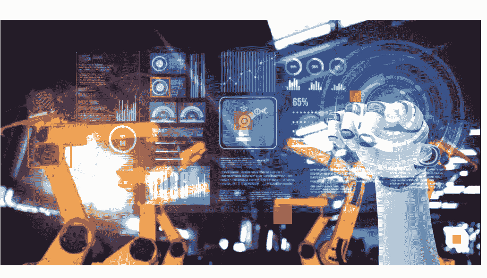

### 1.2 工业 AI的应用范围
AI 技术在工业领域的应用，已经贯穿设计、生产、管理、服务等多个场合，主要通过各种方式收集海量数据，然后利用机器学习和统计模型对数据进行分析，依据分析结果辅助决策，帮助企业优化资源配置。具体来说，AI 技术在工业领域的应用主要在以下方面：

- 需求分析与预测：基于历史数据和机器学习算法，构建预测模型，通过分析用户数据和市场趋势，洞察市场需求，预测未来趋势，确定产品设计。
- 研发流程管理：基于当前状态和历史数据建立模型，预测任务完成时间，有助于提前发现潜在风险，让团队合理分配时间和资源，确保项目按时完成。
- 自动化代码编写与优化：AI 编程助手利用深度学习算法和大量代码训练模型，通过分析代码的结构和模式，根据开发者的需要自动生成函数、类、模块等，从而减少重复劳动。
- 优化产品结构与应用：通过标识技术将产品及特征转化为数据，辅助设计师不断迭代。利用收集到的数据构建数字模型，模拟产品的实际应用场景，如正常操作、潜在故障等，预测性能表现，一步指导改进。

## 生产过程管控

在生产过程管理中，AI技术的应用主要集中在提高生产效率、优化资源配置、增强质量监控和实现生产过程的自动化与智能化。具体包括：

- 设备管理：在设备接入管理中，AI通过深度学习识别设备的条形码、二维码或设备特征，自动识别设备信息如序列号、型号等。AI的自然语言处理能力可以自动提取维护手册或标签上的文字、设备状态、性能指标等参数，显著提升设备运行的效率和可靠性。
- 质量管理：质量管理通过监控产品质量进行检测，对于光电产品、薄膜产品的划痕、破裂、凹坑、污染等外观的检测，可以通过传统视觉方法实现，但基于深度学习等视觉识别模型，使得自动检测缺陷的技术精度得到了极大提升。质量管理是目前AI在工业领域应用程度较高，成为一个成功的案例。
- 生产管理：在生产计划和排程方面，AI算法可以优化生产计划和排程，最大程度减少产线空闲时间，提高产品交付。在生产分配方面，通过深度学习和大数据分析，AI系统能够根据预测数据，自动调整生产计划、合理配置人员、物流，优化生产状态，提高生产效率。
- 生产过程优化和强化方面：AI算法通过分析生产线上的各种运行状态数据和信息，能够预测及及时发现异常，并自动调整参数，优化运行。
- 安全管理：通过视频监控技术从生产现场的场景中行为识别与违规监控。自动识别员工是否佩戴护具、是否进入危险区域，并立即报警。在安全重点区域部署视觉分析系统，实时检测烟雾、火灾等异常，快速发现报警。

此外，AI在生产过程管控方面还可以用于调度与优化、物资与物流管理、运输和排放管理环节，推动制造作业更加高效、智能的方向发展。

## 经营管理优化

- 库存管理：利用深度学习和大数据分析，实现库存优化。
- 物流与运输：通过AI技术优化物流路径和效率。
- 财务管理：利用AI模型进行财务预测和分析。
- 销售营销：通过AI模型分析市场行为，预测客户需求。

## 1.4 行业应用

### 1.4.1 汽车行业

汽车制造作为工业之皇的明珠，也是 AI 技术落地应用的重要领域。目前，AI 技术已渗透到汽车制造中许多复杂的流程中，从汽车零部件的质量检测、到生产运输、装配生产线的自动化、到整车质量检测等多个环节，AI 技术的使用都显著提升了生产效率和产品质量。

| 模块 | 详细描述 |
| :--- | :--- |
| 车身表面质量检测 | 车表面的质量是整车质量的重点之一，它不仅关乎车辆的视觉，更关乎车辆的防腐性、耐久性等问题。漆面环境复杂，容易出现颗粒、划痕、崩点、油污等各类缺陷，直接影响车外外观界面的质量。传统的智能漆面质量检测，受检测人员自身状态和长时间工序波动等多种因素的影响，质量标准难以满足现代车生产的需求。在 AI 赋能下，3D 扫描技术与机器人手臂协作，能够在采集车身数据后进行对比与处理，实现车身缺陷的检测与定位，视精度可达 0.15mm，检出率高达 85%，误判准确率>85%，能够实现每秒 60 台的检测。还能支持多种车型、多车型检测，支持超过 20 种车型实现在线检测，AI 的赋能，提升了车身缺陷检测的效率和检出率，满足生产线的需求。 |

### 1.4.2 消费电子行业

以智能手机、电脑、笔记本电脑为主的消费电子产品以及生产，也是 AI 技术和工业模型落地应用的一个重要行业领域。

| 模块 | 详细描述 |
| :--- | :--- |
| 精准检测 | 消费电子产品对质量要求极高，指标精度高、检测线速度快。传统产品种类繁杂、组件小、分值低、检测效率低，无法满足大量生产和高速流水线的节奏要求，AI 技术与机器视觉检测提供有效的解决方案。 |

以机器视觉代替人工，手机组装过程可能会出现转错、偏离、崩角、划痕、手指、水渍等微小细节容易被忽略，产品种类繁多可能达 30 种，必须精准、高效地检测这些才能保证产品质量，精度至少要到位 10μm，检测范围尺寸大小在 6秒内/1秒之间，甚至更高。

传统的检测方法无法满足消费电子产品的质量要求，且人工容易出错、存在效率低。检测等高等级，无法满足生产和流水线的节奏要求，通过学习算法与高精度成像系统，更快速识别产品图像中的缺陷和种类，满足对检测质量和精度的要求。

| 模块 | 详细描述 |
| :--- | :--- |
| 智能功能增强 | 增加智能化、功能强大的手机、PC 等消费电子产品，是驱动消费电子产品更新和手机迭代的关键因素。 |
| 加速产品的更新 | 消费电子产品的特征之一是快速迭代，新款上市产品抢占市场份额。 |

在新的设计方面，基于 AI 的需求预测模型分析需求趋势，辅助设计/软件基于历史数据和观测数据进行设计，优化生产流程，快速上市。

### 1.4.3 新能源电池行业

AI 技术的计算和分析能力，已经为电子行业带来了巨大变革，从材料制造、器件和优化生产质量方面，帮助企业寻求突破，提升检测效率，控制成本。

| 模块 | 详细描述 |
| :--- | :--- |
| 电池质量检测 | 电池的质量直接决定电动汽车的安全，因此对检测要求高。电池生产过程中的检测异常，包括生产前的检测、表面检测、涂覆检测、电芯绕检测、组装后的检测、后工序中的检测。目前检测的主要痛点在于：如何接近 100%的检出率并精准检测多种种类；同时检测速度接近生产周期，以保证生产安全。 |
| 电芯检测 | 以电芯检测为主，在卷芯过程中内部结构出现异物、划痕、孔洞、断裂等缺陷，导致焊接、短路等风险。用 AI 技术与 3D 成像相结合，利用海量数据训练神经网络模型，通过针对微小缺陷的识别能力，提升了检测效率和效率，实现检测无漏检，降低人工成本。 |
| 快速筛选 | 电池未来的竞争力在于材料的快速筛选，就是掌握效率。大模型通过海量数据构建、建模和筛选等步骤，从百万材料中快速筛选出高效材料，缩短研发周期。 |
| 电池质量 | 电池的质量直接决定研发表现、能量密度、使用寿命、安全性和成本等指标。企业在快速筛选以及研发方面探索 AI 技术的接入。 |
| 加速设计 | 在电池设计方面，利用 AI 高效模型，可以在原子、颗粒、电极等多个维度进行仿真，让人员深入理解电池的作用，在此基础上优化材料和结构，缩短设计时长。 |

### 1.4.4 半导体行业

半导体制造是一个高度复杂、技术密集的行业，如何实现快速迭代、确保生产过程效率和成本，是半导体行业的核心痛点。

| 模块 | 详细描述 |
| :--- | :--- |
| 加速设计 | 随着集成工艺的提升，电路复杂度不断增加，传统 EDA 设计在延迟、散热管理、信号完整性等方面面临一系列挑战。将 AI 与 EDA 工具结合，在电路设计中实现自动化优化，通过深度学习模型预测不同布局性能（如面积），提供方案。这种方法大大减少人工调试的时间，加速迭代周期。 |
| 芯片设计 | 优化布局是电路设计中最关键的一步，涉及数十万个元件的位置和连线。通过强化学习方法，自动优化的布局，解决可靠性、热管理等关键问题。 |
| 晶圆缺陷检测 | 半导体制造过程极其复杂，任何微小缺陷都影响晶圆性能。晶圆常见的缺陷包括表面划痕、裂纹、污染物、点等，这些缺陷会导致良率下降。通常需要微米级别的检测精度，人工检测效率低下。采用机器学习机器视觉技术，首先用视觉模型对数据集进行标注训练，优化模型，检测速度大幅提升，满足大规模生产的需求。 |

## 1.5 AI 与工业大模型落地应用面临的挑战

可以说，AI 技术的应用正为工业领域带来了所未有的变革。而且，工业领域对于 AI 的部署，正在随着技术的发展和复杂性的增加，从 AI 向大模型跨越。

传统 AI 技术主要基于规则和知识驱动工作，通常使用神经网络结构，通过大量数据训练来获得更好的性能。在特定场景下具有实时性，能够在解决特定问题时做出响应。但是对于更加复杂的应用场景，比如需要处理文本、图像、音频等多维度数据，传统 AI 的落地还是有些困难；而大模型更强的学习能力和泛化能力，以及与具体数据的结合优势明显。

大模型的出现，将 AI 在工业领域的应用推向了新的发展。它以大模型为底座，融合工业各行业的数据和知识，形成行业大模型。工业大模型相对于基础模型具有参数少、专业度高、数据性等优势，可以为工业领域的技术突破、新品研发、生产变革提供低成本解决方案。

传统 AI 模型在解决各种工业问题时，从原理上存在许多局限，但是现在 AI 技术和大模型正落地应用，仍有很多挑战性的问题等待。

### 第一、数据问题

无论是传统 AI 技术，还是工业大模型的落地应用，数据都是首要问题。首先是数据的量级，如何在应用现场收集大量的数据进行训练或建模，是模型具备智能化和决策能力的基础。然而往往在很多时候应用现场的数据量还远远低。其次是数据的质量以及数据的纯净性，许多来自工业现场的数据都是不可用的，需要对数据进行清洗。如何在实际应用场景集中收集或生成具有价值的数据，是 AI 及工业大模型落地应用的挑战。再次是数据的标注和处理，即便有了足够的数据，对于这些数据进行标注的难度和工作方面面临巨大压力。最后是数据安全和隐私问题，数据在传输、训练、处理过程中保护用户安全性和防泄露，也是 AI 工业大模型落地应用的挑战之一。

### 第二，算力动力

无论是训练 AI 算法还是各种工业模型，都需要巨大的算力支持。工业模型参数规模通常在十亿、百亿甚至千亿级，需要巨大的计算资源进行训练。这种过程涉及海量的数据处理，对 CPU、GPU 或 NPU 等计算硬件性能提出了更高的要求。

### 第四、模型应用与准确性问题

工业模型在实际应用中的准确性问题。目前工业模型在检索问答、文档生成、数据分析等领域良好，但在实际环境中的代码能力仍有很大提升空间。尤其对于实用算法，由于真实场景生成数据的困难，准确的准确性仍然待提升。

### 第三，实时响应问题

在工厂检测、智能眼镜等应用中，我们需要模型实时处理输入数据并做出响应。但是，海量数据传输会带来瓶颈，边缘计算的实时能力提出了挑战。

### 第五，成本和技术

AI 技术尤其是工业模型的部署，往往面对高昂的成本，不仅需要大量的资金投入，还需要专业人才的投入。在技术落地方面，如何提升检测效率并降低成本，是落地的实现。

## 第 12 代英特尔酷睿™ 移动处理器

12 代英特尔酷睿™ 移动处理器创造更多价值，采用全新混合架构，大幅提升单线程和多线程性能。该设计专注于 P-core（性能）与 E-core（效能）相结合，通过 Thread Director 调度器匹配合适的工作负载。

- 7 制程工艺。
- 多达 14 个核心和 20 个线程，具有混合架构。
- 高达 24 MB 智能缓存。
- 拥有 96 个执行单元 (EU)，用于视觉识别、测量等高度并行的应用。
- 包含 VNN 指令，支持 AI 加速。
- 使用 Intel OpenVINO 工具链，加速 AI 工作负载。

| 处理器名称 (型号) | 核心数 | P-core | E-core | 线程 | 基础频率 (GHz) | 最大睿频频率 (GHz) | 最大睿频频率 (GHz) | 缓存 (MB) | 图形 | 制造商 | 目标市场 | 核显 | PCIe 版本 | 最大数据速率 | 最大功率 (W) |
| :--- | :---: | :---: | :---: | :---: | :---: | :---: | :---: | :---: | :---: | :---: | :---: | :---: | :---: | :---: | :---: |
| i712800H 处理器 | 14 | 6 | 8 | 20 | 2.4 | 4.8 (0.35GHz) | 1.8 | 24 | - | 企业 | 消费者 | Intel Xe | 4.0 | - | 45W (基础) |
| i512600H 处理器 | 12 | 4 | 8 | 16 | 2.5 | 4.8 (0.35GHz) | 1.8 | 18 | - | 企业 | 消费者 | Intel Xe | 4.0 | - | 35W (基础) |
| i312300H 处理器 | 8 | 4 | 4 | 12 | 1.8 | 4.4 (0.33GHz) | 1.5 | 12 | - | - | - | - | - | - |

### 确定性实时 管理与安全

- 利用英尔® TCC 进行实时计算，支持时间敏感型任务，按需动态频率。
- 工业级 SKU 支持宽温运行。
- 处理器基础功率范围为 15W 至 45W，低功耗无风扇设计。
- Linux 内核裁剪，支持物联网功能。
- 支持 Ubuntu, Red Hat Enterprise, Wind River Linux 和 Wind River Platform。

### 主要特性

### 性能
- 基于 EUV 光刻技术的英特尔4制程工艺
- 采用英特尔®睿处理器的高性能混合架构，配备英特尔®睿内核级调度器
- 多达16个内核和22条线程
- 多达24 MB 的英特尔®高速缓存范围
- 15 W 至 45 W 的处理器基础功能功耗

### 内存和 I/O
- 高达 LPDDR5-6400、LPDDR5x-7467（Type 4 速率）、以及 DDR5-5600
- 8 条 PCIe 5.0 通道
- 多达20 条 PCIe 4.0 通道

### 高效部署与长期支持
- 焊式（soldered-down）BGA封装
- 长达10 年的长期供货保证

### 加速

### 安全与可管理
- 单个 SoC 内置加速引擎 P-core（性能内核）、E-core（效能内核）、英特尔睿锐 GPU 以及英特尔®睿核 Boost⁴
- 优化的英特尔® Gaussian & Neural Accelerator（英特尔® GPU）3.5
- 英特尔®深度学习加速技术（Intel® Deep Boost、英特尔® DL Boost）
- 支持 OpenVINO 工具套全面支持
- Intel Security Engine (ESE)
- NIST 800-193 支持

### 效能

### 连接
- 2 个低功耗嵌入式 DisplayPort 接口
- 内置英特尔睿锐 GPU，提供多达8 个内核（多达并行单元）
- 硬件 AV1 编码
- 集成的 DisplayPort 2.1 (USB-C) 和 HDMI 2.1
- 图形渲染控制器
- Windows 窗口同步频率和 EDID 管理
- 多达50 个同步 HEVC 1080p 视频流
- 多达4 个 4K 显示器或 2 个 8K 显示器
- 集成的英特尔®处理器单元
- 基于 SR-IOV 的虚拟化
- USB4/英特尔®雷电
- 增强 Wi-Fi 7（Wi-Fi 7 BE200、AX210）
- 蓝牙 5.4

### 软件和操作系统
- OpenVINO™ 工具套、英特尔®oneAPI 工具套、英特尔®oneAPI Video Library
- Windows 10 IoT Enterprise LTSC 和 Windows 11 IoT Enterprise LTSC
- Ubuntu, Red Hat Enterprise, Wind River Linux
- Azure IoT、基于 Linux 内核的虚拟机
- UEFI/BIOS 和英特尔®固件以及英特尔®Slim Bootloader

img/db2f74888d869abd67e5b37f3b5187a4_23.png

# 英特®酷睿™ Ultra 处理器规格

| 标识 | 处理器名称 | P-core 核心 | E-core 核心 | LPE 核心 | 制程工艺 (nm) | 核心数 (总) | 睿频率 (GHz) | 速率频率 (GHz) | 最大频率 (GHz) | 缓存大小 (MB) | 显示通道 (EU) | PCIe 通道 | 最大内存 | TCC/电压 | 完整性 | 基础功耗 (W) |
| :--- | :--- | :--- | :--- | :--- | :--- | :--- | :--- | :--- | :--- | :--- | :--- | :--- | :--- | :--- | :--- |
| 英特®酷睿™ Ultra 165H | 16 | 6 | 8 | 2 | 24 MB | 5.0 | 3.8 | 1.4 (@28W) | 0.9 | 2.3 | 128 | 2 | DDR5-5600 | 64 GB | | | 65 (最大基础功能) |
| 英特®酷睿™ Ultra 155H | 16 | 6 | 8 | 2 | 24 MB | 4.8 | 3.8 | 1.4 (@28W) | 0.9 | 2.2 | 128 | 8 (CPU), 4 (PCIe 5.0) | LPDDR5-6400 | 64 GB | | | 60 (最大基础功能) |
| 英特®酷睿™ Ultra 135H | 16 | 4 | 8 | 2 | 18 MB | 4.6 | 3.6 | 1.7 (@28W) | 1.2 | 2.2 | 112 | 20 (PCIe 4.0) | LPDDR5-7467 | | | | 45 (最大基础功能) |
| 英特®酷睿™ Ultra 125H | 16 | 4 | 8 | 2 | 18 MB | 4.5 | 3.6 | | 0.7 | | | | | | | |

# 英特尔酷睿 Ultra处理器 (U 系列，15W)

| 处理器名称 | 核心数 | P-core | E-core | 线程数 | L3缓存 | 最大频率 (GHz) | 最大处理频率 (GHz) | 最大睿频 (GHz) | 图形核心 | PCIe | 内存支持 | 最大内存 | TCC 支持 | 基础功耗 (W) |
| :--- | :--- | :--- | :--- | :--- | :--- | :--- | :--- | :--- | :--- | :--- | :--- | :--- | :--- |
| 英特尔®酷睿® Ultra 7-155U | 12 | 2 | 8 | 14 | 12 MB | 4.8 | 1.7 | 64 | 4 | 20 | LPDDR5-5600 | 64 GB | - | 15W (最大睿频 28W) |
| 英特尔®酷睿® Ultra 7-150U | 12 | 2 | 8 | 14 | 12 MB | 4.8 | 1.7 | 64 | 4 | 20 | LPDDR5-6400 | 64 GB | - | 15W (最大睿频 28W) |
| 英特尔®酷睿® Ultra 5-135U | 12 | 2 | 8 | 14 | 12 MB | 4.3 | 1.6 | 1.1 | 64 | 20 | LPDDR5-4867 | 64 GB | - | 12W (最大睿频 28W) |

img/db2f74888d869abd67e5b37f3b5187a4_25.png

# 英特尔®至强 Max 系列处理器

作为唯一基于 x86 的高带宽内存（HBM）处理器，英特®至强 Max 系列极大提高了带宽。英特®至强 Max 系列在架构设计上大幅增强了HBM，相比竞品，其对工作负载的性能提升了4.8 倍，建模、人工智能、深度学习、高性能计算（HPC）和数据分析。

img/db2f74888d869abd67e5b37f3b5187a4_26.png

## 最大限度带宽
英特®至强 Max 系列处理器在加速过程中满足紧迫的工作负载，实现了：
- 提升高达5倍与前几代产品相比，内存容量提升。¹
- 提升高达8.6倍采用HBM时，与其他CPU比较实现的速度提升。³

## 通过提高带宽最大化性能
英特®至强 Max 系列处理器采用了新架构，支持丰富的平台增强功能，包括更多的核心数量、先进的I/O和内存子系统以及内置加速器：
- 多达56个性能：英特®至强 Max处理器通过四个核心组件多达56个高性能的强大加速器，通过至强的嵌入式多芯片互联（EMIB）在350瓦及封装中相互连接。
- 64 GB高带宽内存：英特®至强 Max处理器通过4个HBM堆栈，64 GB高带宽内存每核超过1 GB，最大限度提升性能。
- 节省成本和时间：对于64 GB容量每个核心仅需1-2 GB的工作负载的应用，使用该系列处理器无需DDR和特定的代码修改，实现了成本节省。

# 适用于不同AI工作负载的灵活性
英特®至强 Max 系列处理器提供了不同的内存模式，可根据工作负载的需求灵活配置：

| HBM模式 | 说明 |
| :--- | :--- |
| HBM模式 | 支持在64 GB 容量内的工作负载，并且能够按核心1-2 GB的内存进行扩展，在系统启动时，HBM模式不需要任何代码更改且不需要 DDR。 |
| HBM平滑模式 | 为大内存容量的应用程序提供了灵活性，HBM平滑模式提供了一个包含HBM和DRAM的平滑内存区域，可用于每核心>2 GB内存的工作负载。该模式可能需要代码更改。 |
| HBM缓存模式 | 在提高64 GB容量或每核心>2 GB内存负载的性能。该模式无需代码更改。 |

# 跨架构加速AI应用程序
整个英特®至强 Max系列通过英特尔®oneAPI统一，一个通用的、开放的、基于标准的编程模型，释放生产力和性能。开发者可以使用英特尔®oneAPI基础和高性能计算工具，更容易构建、分析、优化和扩展应用场景，高性能计算及AI应用，跨越多种类型的架构，并包括向量化、多节并行和内存内化方面的最新技术。

# 英特尔®至强 Max 系列处理器产品

| 处理器名称 | 核心数/线程 | 内存带宽 (GHz) | 内存频率 | 最高频率 (GHz) | 高速缓存 (MB) | TDP (W) | 可扩展性 | DDR内存容量 | 英特®至强 Max系列最大尺寸 (每个核心) |
| :--- | :--- | :--- | :--- | :--- | :--- | :--- | :--- | :--- | :--- |
| 英特®至强 CPU 9480 | 56 | 1.9 | 2.6 | 3.5 | 112.5 | 350 | 254800 | 512 GB |
| 英特®至强 CPU 9470 | 52 | 2 | 2.7 | 3.5 | 105 | 350 | 254800 | 512 GB |
| 英特®至强 CPU 9468 | 48 | 2.1 | 2.6 | 3.5 | 105 | 350 | 254800 | 512 GB |
| 英特®至强 CPU 9460 | 40 | 2.2 | 2.7 | 3.5 | 97.5 | 350 | 254800 | 512 GB |
| 英特®至强 CPU 9462 | 32 | 2.7 | 3.1 | 3.5 | 75 | 350 | 254800 | 512 GB |

img/db2f74888d869abd67e5b37f3b5187a4_28.png

## 英特®至强6性能处理器

## 为扩展的性能实现领先
采用英特第6代处理器，每个核心灵活扩展到128核内，12通道内存和96个PCI通道，帮助企业满足应用的需求。对于希望扩展内存带宽的IT团队来说，创新的多通道直插内存组（MRDIMM）提供高达800 GB/s的传输速度，通过快速完成任务降低整体硬件开销。内置加速器为目标负载提供额外的提升，实现更高效的领先性能。

## 利用CPU的强大AI性能
英特第6代处理器支持许多严苛要求的AIp-核心（性能内核），通过英特尔®Advanced Extensions（AMX）以及加速功能，BF16和FP16数据类型。性能核心可以满足GenAI多种模型处理的服务级别（SLA），同时提供高效、高性能AI加速，并根据需要支持其他类别。由于配备了强大的缓存、更大的内存带宽和强大的引擎，英特第6代处理器提供了充足的资源，支持在小规模模型上运行人工智能模型。此外，TensorFlow®和PyTorch®对英特尔处理器的优化已集成到这些深度学习框架的主流版本。

## 优化工作负载的性能
英特第6代处理器在工作负载上表现非常出色，其主系列产品拥有8到86个核内，在基于双CPU的系统中，网络和外接扩展拥有106个PCIe通道，而基于CPU的系统，单一产品拥有136个PCI通道。所有第6代处理器都能带来服务器部署效率的增加并提供可扩展的能效，在整个线线上提供接近线性的功能、低能耗。

## 英特®至强6性能处理器
- 通用计算高达2倍
- AI：高达2.3倍（GenAI性能，采用BF16数据类型）
- 科学计算：高达2.3倍（科学计算性能，基于行业标准HPC基准测试）

### 亮点技术

### 数据

### AI 计算能力

- 基于BF16和FP16的模型，英特尔®AMX的灵活累加(MAC)运算速度快于英特尔®高级矢量扩展512 (Intel® Advanced Vector Extensions 512)提升16倍，AI性能显著增强。
- 英特尔®AVX-512包含特定的指令，每个内核有两个512位单元(FMA)，大幅提升了AI、科学计算数据处理工作负载能力。
- 英特尔®AVX-512包含特定的指令，每个内核有两个512位单元。
- 英特尔®数据压缩与加速技术 (Intel® QuickAssist Technology，英特尔®QAT)支持批量加速和压缩，以加速访问和存储。
- 英特尔®数据流加速器 (Intel® Data Streaming Accelerator，英特尔®DSA 2.0能够加速数据传输和网络操作，如移动、填充、块、循环冗余校验(CRC)、数据完整性(DIF)、扩展和刷新。
- 英特尔®内存分析加速器 (In-Memory Analytics Accelerator，英特尔®IAA)能够对数据存储和解压、维、扫描和过滤功能以及循环冗余校验。
- 英特尔®动态负载均衡 (Intel® Dynamic Load Balancer，英特尔®DLB)支持动态分配数据和卸载拓扑操作。

### 内存

- 与标准DDR5内存兼容，英特尔®内存提供了超过37%的内存带宽，可支持AI和科学计算的带宽需求。
- 多达12层内存通道，进一步支持更高的内存带宽。
- 当使用低成本内存(支持CXL 2.0的DDR4)时，“Flat”模式可以帮助扩展系统并优化TCO。
- 英特尔®超级互联 (Intel® Ultra Path Interconnect, 英特尔®UPI)2.0的跨槽带宽速度高达24 GT/s，与上一代产品相比提升高达20%。
- 双路服务器拥有多达76条 PCIe Gen5和支持的I/O附加组件，包括器侧多达136条，可以支持加速器、网络控制器、存储和存储。
- 多达64条 Express Link (CXL) 2.0通道，每通道的数据传输速率高达32 GT/s，支持CXL功能，包括扩展和共享（包括 Type 3 设备）。
- 英特尔®On Demand 服务提供商可以启用部分CPU的性能和功能。它通过两种模式提供服务：基于一次性许可功能，以及按需量付费。
- 英特尔®TDX 使用AES-256和2048位加密密钥进行了升级，加密能力进一步增强，能够更好地保护企业数据安全。

### 英特尔®至强®6性能处理器概览

### 英特尔® 至强®6 性能处理器

| 英特尔® 至强®6900 系列处理器 | 旗舰级 | |
| :--- | :--- | :--- |
| | | 每个 CPU 拥有最多 128 个核心（256 个线程） |
| | 采用全新的英特尔®服务器平台级设计，非常适合云计算、AI、科学计算、软件服务（SaaS）和基础设施服务（IaaS）工作负载。 | 每个 CPU 高达 500W |
| | | 单路或双路服务器 |
| | | 12 条内存通道 |
| | | 高达 6,400 MT/s DDR5 |
| | | 8,800 MT/s MCR DIMM |
| | | 多达 96 条 PCIe 5.0 通道 |
| | | 6 条英特® UPI 2.0 链路 |

| 英特尔® 至强®6500 系列 / 6700 系列处理器 | 高级 | |
| :--- | :--- | :--- |
| | | 每个 CPU 拥有最多 128 个核心（172 个线程） |
| | 对现有的英特尔®服务器进行了大幅升级。云服务提供商和企业 IT、科学计算的主流数据库同步服务。非常适合 AI、科学计算、基础结构和架构、数据服务、基础设施和存储、Web、以及视频服务等工作负载。 | 每个 CPU 高达 350 W |
| | | 单路、双路、四路或八路服务器 |
| | | 8 条内存通道 |
| | | 高达 6,400 MT/s DDR5 |
| | | 8,800 MT/s MCR DIMM |
| | | 多达 88 条 PCIe 5.0 通道，其中单路设计可达 136 条 |
| | | 4 条英特® UPI 2.0 链路 |

了解更多英特尔® 至强®6 性能处理器的信息，请访问：https://www.intel.com/content/www/cn/zh/products/processors/xeon-6.html

1. 仔细阅读以下标识：intel.com/processor-claims（英特尔®至强® 处理器）。结果可能不同。
2. 仔细阅读以下标识：intel.com/processor-claims（英特尔®至强6 处理器）。结果可能不同。
3. 仔细阅读以下标识：intel.com/processor-claims（英特尔®至强6 处理器）。结果可能不同。
文中涉及的指标和标准取决于所有配置。

## 1.4 英特尔®至强™显卡

英特尔®至强™显卡是英特尔®至强™显卡的独立显卡产品，适用于人工智能和物联网应用。其中，高级英特尔™ 7 系列包含了不同系列，拥有最高 28 个核心和 16 GB GDDR6 内存，为高性能 AI 工作负载提供了通用支持；中端英特尔™ 5 系列拥有最高 24 个核心和 16 GB GDDR6 内存，完美满足 AI 推理能力、性能以及需求；低端英特尔™ 3 系列拥有最高 8 个核心，适用于低频率和小型尺寸，满足 AI 推理的需求。

英特尔™-X-HPG 架构采用了英特尔™-X-HPG 架构，凭借灵活的 X 内核，满足 AI 工作负载的需求。X内核是英特尔™ GPU 产品中的高效矩阵架构，每个 X 引擎利用英特尔™ 扩展技术，加速 AI 应用。与传统的 GPU 矢量单元相比，XMX AI 引擎实现 AI 推理的计算能力是 16 倍，大幅提升 AI 应用。

英特尔™提供了 OpenVINO 工具箱，为 AI 工作负载提供了加速和优化。同时，OpenVINO 可定制化和跨硬件平台的 AI 推理架构，让开发者轻松地在 GPU 和其他硬件加速器上运行 AI。英特尔通过强大的 GPU 提供多种形态、效率和性能水平，构建 AI 应用。

### 主要特性

- 每颗 X 核心配备了 16 个矩阵引擎和 16 个矢量单元（最高 28 个核心搭载 A750）。
- GDDR6 显（最高 16 GB，连接 A580E 和 A750）。
- 最多 448 个执行单元
- 容量支持 HDR、VP9、H264/AVC、H265/HEVC 和 AVI
- HDMI 2.0b 和 DisplayPort 1.4、2.0 接口，支持 2x 8k HDR、4x 4k120 HDR、1080p30 或 1440p30 分辨率 AI 推理
- 搭载 XMX AI 引擎，加速 AI 工作负载
- 在离线使用 OpenVINO 工具内置的 AI
- 提高 AI 推理的性能和效率
- 兼容多种硬件架构以及最流行的 AI 框架，包括 TensorFlow 和 PyTorch
- 使用先进的 LLM 权重压缩，降低内存消耗，简化生成式应用

### 专为边缘设计

### 视觉计算和图形处理

- 英特尔 ODM 合作伙伴生态系统的广泛产品，覆盖不同的形态和性能需求
- 满足极致低功耗 (25-75W) 和小尺寸形态需求的 SKU
- 五期产品供应和软件支持
- 多种操作系统支持，包括 Linux、Windows client、Windows 10 LTS
- 转为插式嵌入式设计的 SKU 满足更高的可靠性需求
- 定期、稳定的驱动程序发布
- 支持 PCIe 4.0，适用于 PCIe 和 MxM
- 提供带有现代用户界面的控制软件
- 高性能选项（功率 195W~225W）可提供最高 Intel INT8 236 TOPS 算力 (A750E)
- 支持高达 8K 分率，4 个显示信道
- 支持 DirectX、OpenGL 和 Vulkan
- 支持虚拟环境和数字标记软件功能；用于增强扩展显示的 Genlock/spinlock、EDID 管理、色域补偿及多 GPU 大屏处理能力
- 支持上一一代 AV1 标准的硬件加速编码

### 媒体处理

- 英特尔® 提供对专用硬件的高级访问权限，以及支持 GPU 的编码、解码和视频处理功能
- 媒体引擎支持大多数现代编码解码器，高带宽 8K HDR 工作流程执行和多 GPU同步

### 英特尔锐炫™显卡示意图

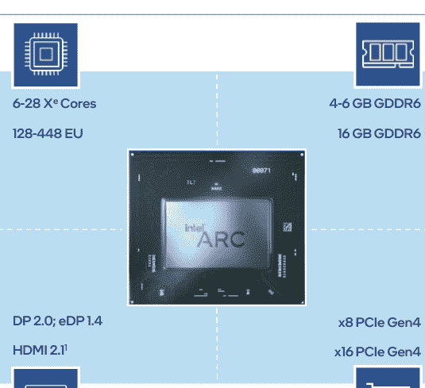

## 英特尔®技术方案

## 英特尔™ 显卡产品

| 型号 | 架构 | X-core | 频率 | 性能 (INT8) | 内存 | 接口 | 带宽 | 市场级 |
| :--- | :--- | :--- | :--- | :--- | :--- | :--- | :--- | :--- |
| 英特尔™ A310 显卡 | 6 | 2000 MHz | 96 | 4 GB | GDDR6 | 64 bit | 124 GB/s (15.5 Gb/s) | 2 |
| 英特尔™ A380 显卡 | 128 | 2000 MHz | 66 | 6 GB | GDDR6 | 96 bit | 186 GB/s (15.5 Gb/s) | 2 |
| 英特尔™ A580 显卡 | 384 | 1700 MHz | | 16 GB | GDDR6 | 256 bit | 512 GB/s (16 Gbps) | 2 |
| 英特尔™ A750 显卡 | 488 | 2050 MHz | 229 | 8 GB | GDDR6 | 256 bit | 512 GB/s (16 Gbps) | 2 |
| 英特尔™ A770 显卡 (8 GB) | 512 | 2100 MHz | 262 | 8 GB | GDDR6 | 256 bit | 512 GB/s (16 Gbps) | 2 |
| 英特尔™ A770 显卡 (16 GB) | 512 | 2100 MHz | 262 | 16 GB | GDDR6 | 256 bit | 560 GB/s (17.5 Gbps) | 2 |
| 英特尔™ A310 显卡 | 96 | 2000 MHz | 96 | 4 GB | GDDR6 | 64 bit | 124 GB/s (15.5 Gb/s) | 2 |
| 英特尔™ A350E 显卡 | 96 | 1150 MHz | 28 | | GDDR6 | 64 bit | 112 GB/s (14 Gbps) | 2 |
| 英特尔™ A380E 显卡 | 128 | 1550 MHz | 38 | 4 GB | GDDR6 | 64 bit | 112 GB/s (14 Gbps) | 2 |
| 英特尔™ A380E 显卡 | 128 | 2000 MHz | 66 | 6 GB | GDDR6 | 96 bit | 186 GB/s (15.5 Gb/s) | 2 |

了解更多关于英特尔™ 显卡的信息，请访问：https://www.intel.com/content/www/zh/architecture-and-technology/visual-technology/arc-discrete-graphics.html

## 2.2 软件

### 2.2.1 英特尔®oneAPI 工具包跨架构性能加速

oneAPI是一种跨行业、开放、基于标准的统一编程模型。它定义了一个广泛的应用、统一和开放的多架构和多供应商平台，确保在不同硬件供应商和加速器技术之间的功能接口移植性和移动性，oneAPI的核心语言是SYCL，它可以被用于加速器和多种处理器，SYCL允许开发者在不同的平台（CPU, GPU, FPGA 和其他加速器）之间编写代码，为特定架构进行优化。基于 SYCL，oneAPI定义了一套广泛的规范和 API，以满足行业和计算以及 AI 使用示例的领域需求。此外，oneAPI 提供一个开发者社区和开放论坛，以推动统一的 API，为统一的行业领先多架构软件开发平台，并鼓励生态系统合作。

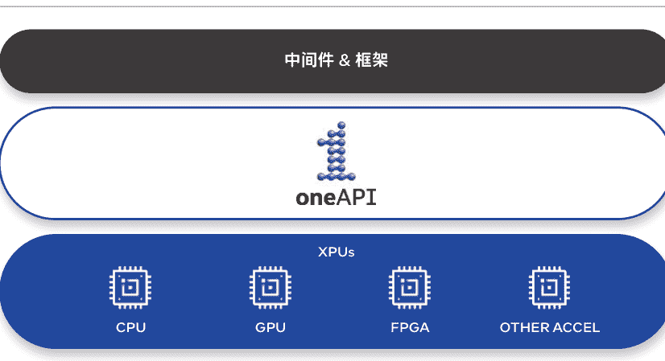

图：oneAPI 图（来源：https://www.oneapi.io/ ）

英特尔指导委员会的重要成员，英特尔®AI 提出了英特尔®AI 工具，旨在帮助开发者使用英特尔®优化的编译器、性能、框架以及训练和调试工具，分析并优化在 CPU 和 XPU 上的高性能架构应用程序。在英特尔®AI 工具的帮助下，开发者可以选择策略来解决他们面临的问题，无需为新的框架和平台而重写软件。对于不同领域的开发者，英特尔®AI 工具提供了许多帮助开发者满足各种需求的工具。

### 英特尔®AI 基础工具

针对各种开发者，英特尔®AI 基础工具是一套工具，帮助开发者满足各种需求。英特尔®AI 工具提供了许多工具。英特尔®基础工具：

- 英特尔®Fortran 编译器
- 英特尔®C++ 
- 英特尔®数学内核 (oneMKL)
- 英特尔®多线程 (oneTBB)
- 英特尔®集合 (oneCCL)
- 英特尔®数据分析 (oneDAL)
- 英特尔®神经网络 (oneDNN)
- 英特尔®集成 (IPP)
- 英特尔®VTune™性能分析器
- 英特尔®Advisor
- 英特尔®GDB

### 英特尔®高性能计算

英特尔®高性能计算是一套工具，针对特定架构进行了优化。英特尔®基础工具是强大的，包含了以下工具：

- 英特尔®Fortran 编译器
- 英特尔®C++ 
- 英特尔®数学内核 (oneMKL)
- 英特尔®多线程 (oneTBB)
- 英特尔®集合 (oneCCL)
- 英特尔®数据分析 (oneDAL)
- 英特尔®神经网络 (oneDNN)
- 英特尔®集成 (IPP)
- 英特尔®VTune™性能分析器
- 英特尔®Advisor
- 英特尔®GDB
- 英特尔®光线追踪 (Embree)
- 英特尔®去噪 (Open Denoise)
- 英特尔®OSPRay

英特尔®光线追踪是一套强大的工具，用于 AI 应用。利用英特尔®CPU和GPU，实现强大的渲染。

### 2.2.2 OpenVINO™ 工具组件

OpenVINO™ 是一个工具套件，用于优化和部署从云到边缘的深度学习模型。它加速了在各种应用中使用的深度学习推理，例如语言模型、生成式AI、视频、音频和语音处理等。OpenVINO™ 支持 PyTorch、TensorFlow、ONNX 等流程框架构建的模型，开发者在使用他们喜爱的框架构建深度学习模型时，OpenVINO™ 提供了一系列模型优化和转换工具，帮助开发者优化他们构建的模型性能，例如提高推理速度、降低运行内存等。最后，OpenVINO™ 支持模型部署在各种环境中，无论是云端、边缘还是本地设备，英特尔®或第三方硬件、CPU、GPU、NPU 或 FPGA。

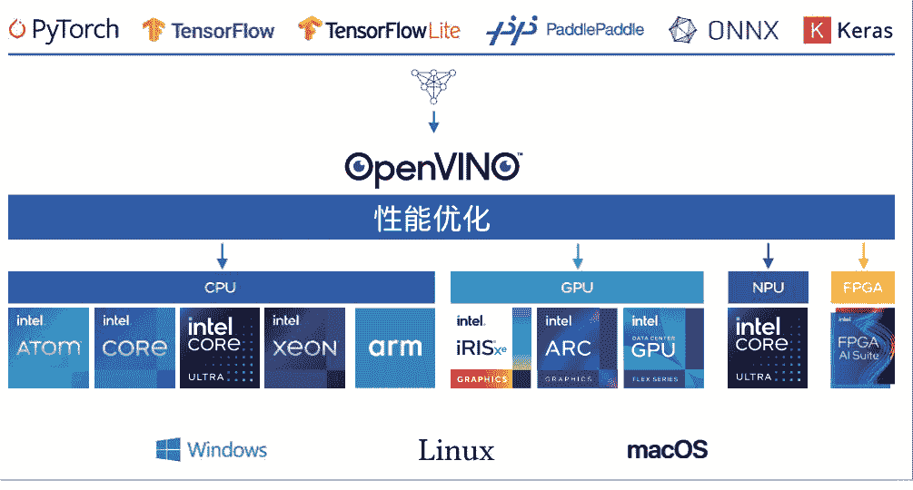

图：OpenVINO™图示 (来源：https://docs.openvino.ai/2024/index.html)

### 模型构建

OpenVINO™ 支持多种模型框架，包括 PyTorch、TensorFlow、TensorFlow Lite、ONNX 和 PaddlePaddle，这种方式允许用户使用熟悉的框架构建 AI 模型。同时，OpenVINO™ 还支持用户使用 Kaggle、Hugging Face* 或 Torchvision models* 模型中的预训练模型。当开发者构建好模型后，可以选择直接用原始格式在 OpenVINO™ 上运行这些模型，这种情况下，OpenVINO™ 会自动对这些模型进行转换优化。如果开发者需要更好的性能和高级化，推荐的方法是将他们构建的模型转换为 OpenVINO™ IR 格式。OpenVINO™ 提供了模型转换工具，将前面提到的支持格式的模型，通过 Python API 或命令行工具转换 OpenVINO™ IR 格式。

### 模型量化

OpenVINO™ 支持多种量化方法来压缩模型的大小和推理的性能，在 OpenVINO™ 神经网络压缩器 (NNC) 中，提供了三种量化路径：

- 训练后量化：通过应用训练后的 8 位整数量化来深度学习模型的推理。这种量化方法不需要重新训练模型或微调。
- 训练时量化：这是一套在 PyTorch 和 TensorFlow 2.x 中的深度学习框架内进行训练优化的高级方法，支持感知量化训练、结构量化等方法。
- 权重压缩：这是一种用于减少 AI 模型大小并加速推理的方法。

### 模型部署

使用 OpenVINO™ 运行模型或在 OpenVINO 运行时，一套带有 C 和 Python 绑定的 C++ 库提供了一个通用的 API，在开发者选择的平台上部署和运行，无须是 CPU、GPU、NPU 还是 FPGA。OpenVINO™ 运行时通过插件架构实现跨平台的部署，其包含了在各种特定硬件平台上运行模型所需的软件。每个插件实现了一种统一的 API，并提供了配置硬件的额外特定 API。

通过 OpenVINO™，开发者可以将模型部署在本地，同时 OpenVINO™ 提供了模型服务器。模型服务器通过 RPC 和标准接口使得它们能够被客户端访问：客户端向模型服务器发送请求，模型服务器执行模型推理并将响应客户端。模型服务器具有许多功能，轻量级 AI 只需要执行特定的 API 用的必要功能，通过后训练用于推理；而模型服务器可以基于服务的应用程序和在环境中的理想模型，通过水平和推理实现高效的资源利用。此外，通过模型服务器的部署方式，模型的结构和权重不会暴露给客户端应用程序，这使得对模型的访问变得更加容易。

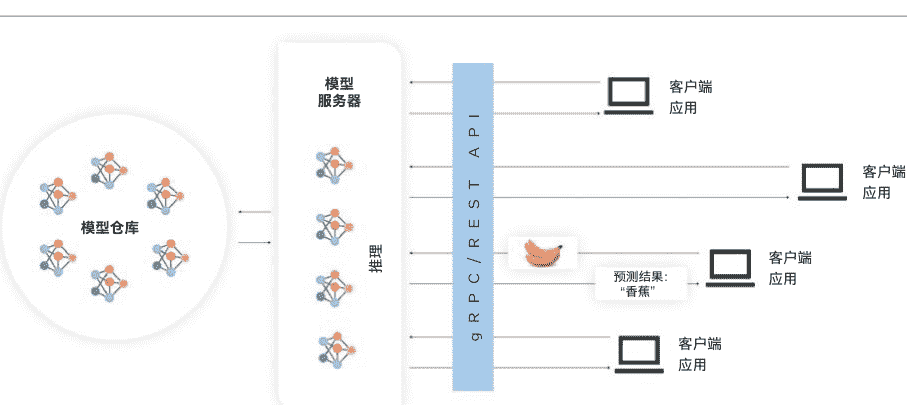

图：OpenVINO™模型服务器显示 (来源：docs.openvino.ai/2024/ovms_what_is_openvino_model_server.html)

### OpenVINO™ 与 AI 大模型

在最新版本的 2024.3 中，OpenVINO™ 增加了针对 AI 大模型的功能，包括：

- 扩大了对生成式 AI 和大模型框架的覆盖和支持，并在 Hugging Face 上提供 OpenVINO 预优化模型，帮助开发者容易地使用这些模型。
- 支持更广泛的模型扩展，通过添加动态量化、多头注意力（MHA）和 OneDNN 增强，提升了在英特尔®集成和独立显卡上的模型性能。
- 提高模型的可迁移性和性能，并在 OpenVINO™ 模型服务器中支持 vLLM 和连续批处理，帮助开发者更好地在边缘、云端或本地运行大模型。
- 基于这些新特性，OpenVINO™ 可以提供一套优化和部署模型到最终用户设备中的领先解决方案。开发者可以使用 OpenVINO 来压缩模型，将它们集成到 AI 应用中，以最大化性能部署到边缘或云端。

图：使用 OpenVINO 优化和部署流程

OpenVINO 为部署提供了一个高效的运行环境。其优势包括部署大小、速度、灵活性以及在多种硬件上运行：

- 模型简化：由于 OpenVINO 是一个独立的软件，相比 Hugging Face、PyTorch 和其他机器学习框架，它的依赖更少。因此使用 OpenVINO 运行和部署模型时，其大小和内存占用减少了对硬件和存储的需求。
- 运行速度：许多大模型运行时依赖 Python 解释器，而 OpenVINO 是一个为优化的生产环境设计的运行时库，提供 C/C++ API。当然，OpenVINO 也提供了 Python API，允许开发者方便在 Python 中完成开发，然后使用 C++ 进行优化。了解更多有关 OpenVINO 工具的信息，请访问：https://www.intel.com/content/www/en/developer/tools/openvino-toolkit/overview.html

### 2.2.3 Intel OpenVINO 平台

企业团队能够快速构建计算机视觉 AI 模型。通过先进的图形界面，用户可以添加图像或视频数据、进行标注、训练、以及 AI 模型刻部署。配备了领先的技术，如主动学习、任务调度和智能标注，Intel OpenVINO 平台减少了许多体力工作，实现了模型开发并加快了模型创建。

Intel OpenVINO 平台提供的功能包括：

- 定制计算机视觉任务：Intel OpenVINO 平台加速 AI 任务创建，如分类、目标检测、语义分割。
- 直观的任务界面：Intel OpenVINO 平台提供了便捷的图形界面和交互功能（如标注），允许几乎没有 AI 经验的团队协助计算机视觉模型。
- 任务调度：使用 Intel OpenVINO 平台，用户可以通过连接两个或更多任务来训练模型，无需额外的代码，从数据到部署。
- 智能标注：Intel OpenVINO 平台提供了便捷的标注工具和 OpenCV GrabCut 等功能，加速数据标注和图像处理，提供高准确率。
- 超参数优化：Intel OpenVINO 平台内置了优化的训练模型，通过方法让算法工作更加容易，精细模型学习过程中的参数。
- 生成就绪的模型：Intel OpenVINO 平台输出的深度学习模型可以是 TensorFlow 或 PyTorch 格式。平台还可以输出为 OpenVINO 化的模型，在 Intel 架构的 CPU、GPU 和 VPU 上运行。

### Intel OpenVINO 平台的优势

- 节省时间：Intel OpenVINO 平台通过提供通用工具，帮助缩短开发 AI 计算机视觉模型的时间，加速通常需要长时间训练的自定义 AI 模型创建工作流。
- 节省成本：Intel OpenVINO 平台有助于降低进入 AI 领域的屏障（如培训或专业服务费用），使计算机视觉 AI 模型对于各种组织变得更容易和经济高效，特别是对于较小的公司。降低人员培训成本增加了整体价值。
- 灵活部署：Intel OpenVINO 平台可以在本地或通过云端服务器部署，为需要这两种设施之一或两者的组织提供了灵活性。

Intel OpenVINO 平台的使用流程示例

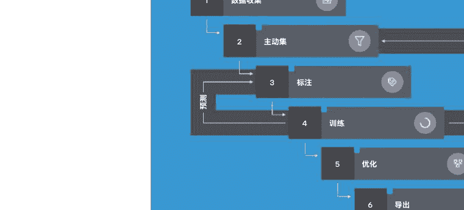

### 技术方案

1. 数据收集：首先，您需要收集数据用于训练模型的数据。Intel OpenVINO™ 平台提供了一个方便的方法，在上传多媒体数据（图像或视频）后，平台会存储所有数据。
2. 主动收集：这个功能允许您选择多媒体数据来优化您的训练过程。
3. 标注：这是开始标注前的起点。Intel OpenVINO™ 平台提供了一套工具来促进标注工作。UI 中使用的标注工具会根据您的选择提供不同的标签。由于标注数据花费时间最长，平台确保了简化的流程，并在选择标注格式上给予了一定的定义。
4. 训练：在标注了定义的多媒体数据后，Intel OpenVINO™ 平台会自动对这些标注数据进行训练。完成一次训练后，平台将自动对标记的数据数据进行预测。
5. 优化：Intel OpenVINO™ 平台使用 OpenVINO™ 工具来优化模型，并通过 Intel® 硬件上“一次编译，随处部署”的方法提高性能。您可以随时使用新参数训练模型。
6. 导出：您可以导出模型并将其集成到您的应用程序中。

了解更多关于 OpenVINO 平台的信息，请访问：https://www.intel.com/content/www/us/en/developer/tools/openvino

### 2.2.4 Intel CVOI | 计算机视觉优化

Intel® Computer Vision Optimization Implementation（CVOI）是一个一站式资源库，包含了最佳实践（BKMs）、指南和示例代码，为优化 Intel 平台上的计算机视觉性能。该平台涵盖了 Intel 的软件技术，包括 API 等，支持客户在平台上部署机器视觉。

典型的机器视觉 Pipeline

| 数据接收 | 图像处理 | 图像后处理 | 输出 |
| :--- | :--- | :--- | :--- |
| Camera SDK | Template | Point Cloud | Pixel to detail |
| GStreamer | Window | Object Classification | Denoise |
| Filter | Object Detection | Composite and blur |
| Resize | Segmentation | SSD on SSD |
| GPU 的工作 | CPU 的工作 | CVOI 包含的优化方法 | |
| 部署 | | | |

图：典型的机器视觉 Pipeline

典型的视觉 Pipeline 包含若干组件，如图像读取、图像处理、图像分析（传统的视觉分析）、后期处理以及输出（像素裁剪）。在这些组件中，图像处理、视觉分析和后期处理在 CPU 上运行。另一方面，深度学习、图像编码和解码可以适配 GPU 加速。

CVOI 的优势在于提供了一套全面的指南和说明，优化 平台上的计算机视觉算法和整体性能。CVOI 是一个强大的工具，可以提高视觉执行效率，释放全部精力。Intel CVOI 包含：

- 适用于 Intel 第13 代及以后的性能最佳实践（BKMs）。客户可以参考这些优化方法和算法。
- 在 2D 领域，包括各种优化配置的 OpenCV 算子示例。
- 在 3D 领域，集成 PCL 和 FLANN 库中的点云算法示例。
- 基于实际使用场景的计算机视觉示例，例如 PCB 缺陷检测。
- 针对混合架构的最佳实践（BKMs）。

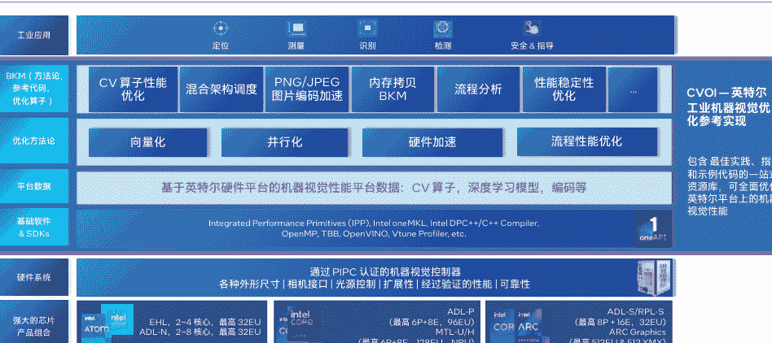

图：CVOI架构

## 2.3 创新技术方案

### 2.3.1 语言模型赋能工业机械臂

语言模型调控机械臂的解决方案架构所示：

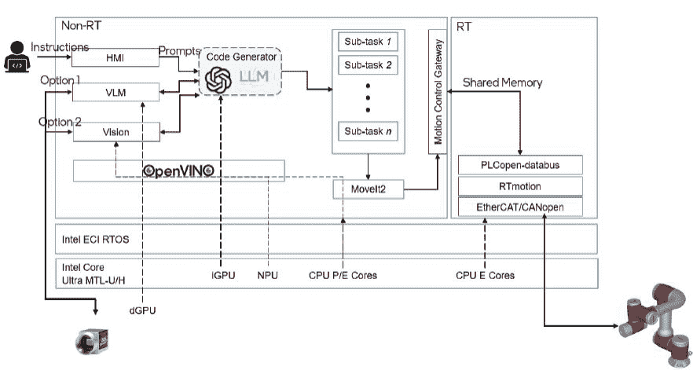

#### 第一阶段：外部数据收集

#### 第二阶段：理解和分解

这一阶段主要接收人类输入和摄像头的图像/视频信息、语音输入。通过视觉分析模型将预设的提示词（prompts）、视频和图像信息直接投接到下一阶段。

有了第一阶段的提示词，模型（如 Qwen 和 Phi3）将其拆解为一系列子任务。子序列和视觉信息结合就成了更加准确的执行逻辑，例如：“任务：移动到颜色物体上方”。通过视觉信息找到红色篮子，算出坐标信息，经过解释器标记分割，之后就可以给 MoveIt2 队列调度到某一个节点。

有了后续的信息，通过共享内存，系统将会得到像素，通过 Rotation 运动控制功能，机械臂执行加速控制，完成整体调整，从而实现自然语言对机械臂的控制。

#### 第三阶段：执行阶段

从系统的角度，这个架构中中间的软件扮演着非常重要的角色：

##### 硬件层

##### 软件层面

基于 MTL H 的算力，其 NPU 和 GPU 在任务解析和图像/视频处理上起到了关键作用。CPU 部分能够高效用于计算非实时部分的负载，而部分能够被简单隔离出来执行实时任务，配合专门的 Intel 卡运行 EtherCAT 或 CANopen 总线协议，满足机械臂运动稳定性的要求。

工业级软件平台（ECI）无疑充当了整个系统的底层，实时运动控制部分在 PreemptRT 环境下，而非实时部分通过加载 OpenVINO™ 对大语言模型的推理提供了加速，其中 FastSAM 负责分割作用，CLIP 满足了足够的识别，同时系统也对视频和图像处理提供了效率上的提升。

目前主流的模型相对于传统机械臂方案有两个点：

1. 任务解规划能力：sub task 体现出相对于传统机械臂任务解析运动步骤的优势。
2. 视觉模型均为 Zero Shot：不需要巨大的 ground truth 数据集，泛化能力更强。

### 2.3.2 基于视觉模型的零样本或少样本异常检测

工业异常检测任务是制造业中的一项关键技术，通过计算机视觉识别和定位工业产品中的异常。这对于确保生产的质量至关重要。

### 2.3.3 RAG 检索增强模型实现

大语言模型（Large Language Models, LLMs）在自然语言处理领域取得了显著的进展，但它们在实际应用中准确性、知识更新速度以及透明度上存在局限。

为了解决这些，检索增强生成（Retrieval-Augmented Generation, RAG）技术应运而生。RAG在优化LLM方面，相比于其他方法具有更高的优势【Shuster et al., 2021; Yasunaga et al., 2022; Wang et al., 2023; Borgeaud et al., 2022】。

RAG作为一种有效的方法，通过连接模型的能力和外部知识的丰富性，提升了大语言模型在各种任务上的表现，尤其是在最新信息和专业知识领域，可以有效减少语言模型中产生的虚假信息。RAG具备高度的定制化能力，通过引用特定领域的文本语库，RAG能够为不同领域提供特定的知识支持；通过引用信息，用户可以核实答案的准确性，增强了他们对模型输出结果的信任，使得回答更加可靠。随着技术的不断发展，RAG将不断提升大语言模型的应用场景。

RAG 适配的场景：

- 1. 知识密集型：如客服、医疗、法律等特定领域。
- 2. 动态生成：需要实时或频繁更新内容的内容生成。
- 3. 文档辅助的任务，如合同审阅、法律检索、科学文献分析等。
- 4. 减少模型的幻觉问题，因为模型生成的内容是基于真实的信息。
- 5. 相对微调来说，不需要训练模型，更经济高效。

英特尔® Open Platform for AI (OPEA)是一个开放平台项目，通过整个解决方案生态系统的多个合作伙伴组件，实现可组合和可配置的生成式AI云原生生成解决方案。

OPEA具有以下特性：

- 高效：利用现有的基础设施、AI 加速器或其他硬件，提供高性能。
- 无缝：与企业级软件集成，支持系统和网络的异构性，提供稳定性。
- 开放：汇集了最佳创新的成果，并且免受专有供应商范围的限制。
- 无处不在：通过云、数据中心、边缘和PC构建的灵活架构，实现无处不在的运行。
- 可扩展：具有安全的企业级流程和工具，支持责任、透明度和可追溯性。
- 灵活：提供灵活的合作伙伴生态系统，帮助构建和扩展您的解决方案。

OPEA为客户提供了RAG pipeline，其架构如图所示。

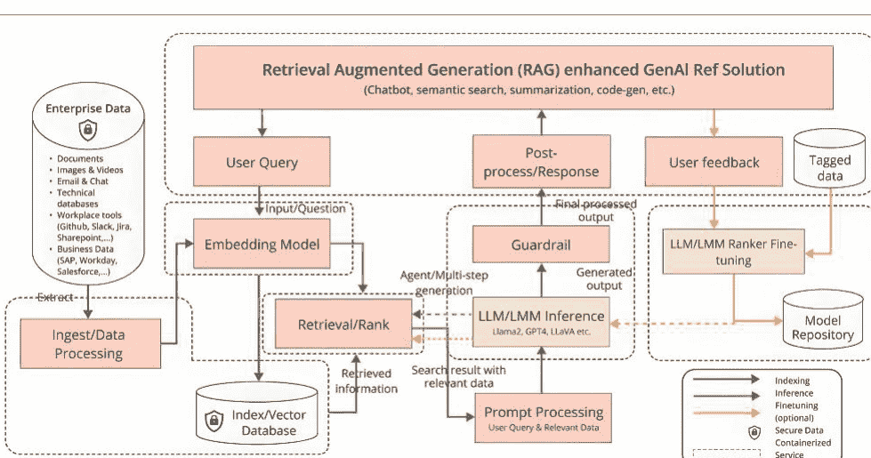

OPEA 使用微服务来创建高质量的GenAI应用程序，简化生产环境中的扩展和部署。这些服务利用企业的服务组将它们组合成一个巨大的平台，从创建真实世界的人工智能应用程序。OPEA为客户提供了RAG参考pipeline，其架构如图所示。该参考架构通过高效的检索和AI技术，提高企业数据处理的效率和准确性，确保数据的安全性和可靠性。该架构可以组合微服务模式的方式包含数据缓存、提示引导、检索优化器以及LLM等构建RAG服务的核心功能。图中展示了建立索引、答案推理、RAG微调的流程。在基础架构的基础上，英特尔还对RAG进行了全链路的优化，包括数据增强、分块化、embedding微调、向量数据库优化、查询优化、重排序以及内容压缩，帮助用户降低成本提升效率。

## 2.3 人形机器人

在工业领域，人形机器人的出现标志着自动化技术的一次飞跃。这些机器人集成了先进的传感器、控制系统和人工智能算法，使其能够在复杂的工业环境中精密作业，提高生产效率，同时降低成本。通过模拟类人的动作和决策过程，人形机器人能够进入人类的工作流程，执行从组装、焊接到质量检验等多种任务。随着机器人学习和认知技术的进步，人形机器人正在变得更加智能和适应。它们能够实时处理环境数据，优化执行策略，甚至在面对未知时进行自主学习和决策。这种技术变革不仅提升了工业生产的灵活性和响应速度，也为未来工厂的智能化和数字化转型奠定了基础。

以满足需求的运行能力为核心，任务相对固定，以传统运控算法为主。

倡导强化学习增强执行能力，本地及云端大模型实现现场需求的感知泛化能力与任务生成能力。

在智能性层面增强，在技术路线通过端到端模型替代分类决策模型，整体负载可能收敛至 AI 主。

在人形机器人内部，CPU、GPU 和 NPU（神经处理单元）各自承担不同的任务，它们的设计和优化针对不同类型的计算需求。以下是它们各自的特点和优势差异：

### CPU 负责小脑：

- 负载：实时控制、规划算法、状态算法、实时控制。
- CPU 是通用处理器，设计用于处理各种类型的计算。具有较少的核心，每个核心的计算能力较高，适合执行顺序性强的复杂任务。
- CPU 通常负责机器人的高级逻辑、任务规划、运动规划、传感器数据的融合处理。
- CPU 也负责协调其他处理器的工作，如分配任务 GPU 或 NPU。

### GPU/NPU 负责：

- 负载：VSLAM、环境感知、任务编排、自主规划、模拟学习、强化学习。
- 在人形机器人中，GPU 用于视觉任务，如图像识别、视频分析、3D 建模和环境渲染。
- 随着深度学习的发展，GPU也被广泛用于加速神经网络的训练和推理过程。
- NPU是专为神经计算和机器学习任务设计的处理器。通常用于人形机器人的感知任务，如物体识别、语音识别、自然语言理解等。

在实际应用中，这种处理器会协同工作，各自处理它们擅长的任务。例如，CPU可以处理传感器数据融合和决策逻辑，GPU负责处理深度学习模型的计算，而NPU专注于高效执行神经网络。这种分工可以使机器人在更加高效和智能。在选择处理器时，机器人开发者需要考虑机器人的任务类型、实时性要求、耗能限制、散热能力、成本等因素。利用英特尔处理器优势。在单个SOC中，P-core（性能）、E-core（效能）、英特尔GPU、英特尔NPU以及Intel AI Boost等协同加速AI。GPU支持2D视觉、大规模运算、2D/3D视觉并行计算，CPU支持VSLAM。AVX2、核数/线程提升、增强的GPU、Intel Kernel Library优化CPU。以上功能在SOC实现减少对独立加速器的需求，帮助系统复杂性和成本。

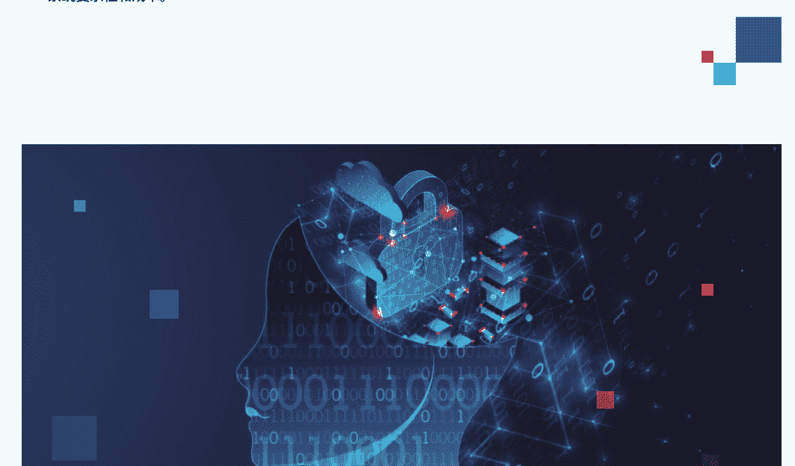

# 03 成功案例

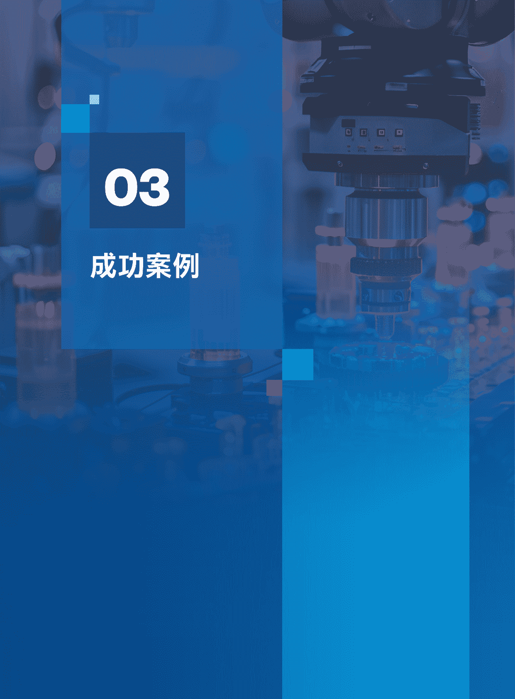

### 31 英特尔：晶圆级检测

### 背景与挑战

传统的质量检测是在某些侧进行“离线”的，通常是在两个更多步骤完成后。例如在晶圆磨光和膜沉积后进行检查。尽管如此，离线检测带来了几个挑战：

- 高风险检和漏检：对一个晶圆批次进行检查时，可能已经处理了多个以上的批次，或者过程错误引入了缺陷。
- 检测漏：由于离线检查发生在许多过程之后，直接检查晶圆表面几乎是不可能的。例如在检查晶圆背面，阻止了磨光过程错误的检测。
- 过程过于依赖人工：检查员使用显微镜手动检查晶圆。随着晶圆变得更小，微米级缺陷变得困难。例如直径300毫米晶圆，缺陷可能只有5毫米长，找到它就像...
- 必须在有限的内部空间不干扰磨光工具；能够与磨光工具通信（例如停止操作）。在保证质量的同时，随着规模扩大，晶圆检测将需要大量的工程资源；即使仍然无法解决生产的问题。此外，在高封装转换，单个晶圆可能会导致损失。

### 解决方案

通过卷积模型每秒扫描多张图像，同时对磨光工具进行清洗保护。收集到的图像由机器学习模型进行实时处理。如果检测到缺陷，解决方案可以发出警报并停止运行。该解决方案包括英特尔晶圆i9检测器、英特尔ARC770处理器和ARC770加速器，就在晶圆制造和测试工厂。

### 方案组件

基于第12代英特尔晶圆i9线视觉控制器和ARC770加速器以数据加速处理。数据传输速度约为200 Gbit/s。该系统可以存储40 TB（相当于三个周）的原始图像和检查结果。

### Machine-Learning Lifecycle

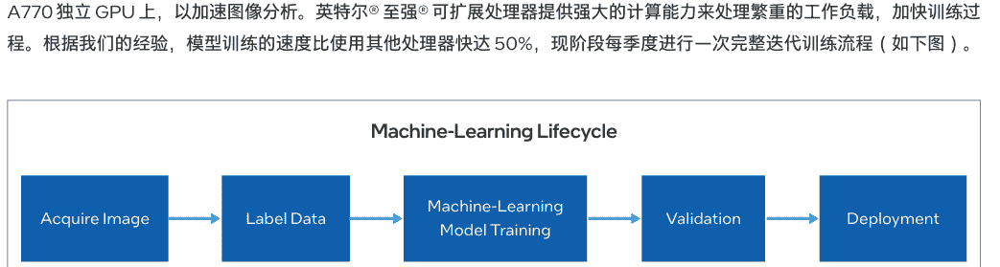

> Figure. Our solution shows the entire machine-learning lifecycle, from raw data acquisition and labeling to training and validation to deployment.

收集的图像由包含50个核心算法的机器学习模型，包括多种基于ResNet50的检查、语义分割（以实现像素级的识别）以及识别和测量（自动识别图像中的类型和自动测量距离）等功能。模型经过英特尔OpenVINO™工具优化，提高了在平台上的运行效率，工业视觉控制软件能够密集审查和模拟，所有功能以模块形式集成，便于扩展，支持底层代码操作。

### 方案优势

标准化设计实现了快速部署且易于扩展到新的应用。该解决方案能够准确识别晶圆磨过程中的多种缺陷，包括划痕、各种大小的细粒、污点、裂纹、气泡、晶圆偏移和安装缺陷。与离线检查相比，使用在线检查可以更早检测到多达50%的晶圆磨问题。当警报响起时，可以对晶圆进行加工，这避免了下游过程中的整片晶圆浪费。更重要的是，该解决方案超越了离线所实现的：在问题发生时及时检测，检测缺陷并迅速关工，实现了检查清洁度和完善的环境能力。

帮助客户实现业务效益：

- 避免浪费，每年为工厂节省200万美元。
- 降低了业务风险。
- 更高的产品质量。
- 使工程师免于频繁的手抽检。

## 3.2 美的楼宇科技：AI功能解决方案

### 背景与挑战

随着全球对可持续发展的呼声日益高涨，建筑行业正面面临前所未有的转型挑战。《2023中国与城市建筑基础设施排放报告》显示，建筑运行阶段占据了全国排放总量的XX%，其中空调系统占据了近一半。暖空调运行中，基于数据监测，冷房运行高达60%。目前常规的节能改造包括更换高效设备如水泵、空调、冷却塔，通过升级和优化系统，进一步提高运行效率。尽管已配备自动控制系统，节能潜力巨大，但这主要是由于目前的系统基于简单的逻辑，难以适应空调系统的动态和线性特性，导致系统无法持续运行。在保持舒适和稳定性的前提下，实现空调系统的最优运行。为了更加智能化的技术，不仅优化空调运行，还要为终端用户带来更高价值，实现绿色与环保。

### 解决方案

针对许多问题，美的楼宇科技给出了通用空调系统的智能控制——Smart Control。该系统利用“数据+模型”技术构建高精度模型，通过仿真引导全局实时调整参数。Smart Control的部署能力让用户感知且投入成本低、风险小、运营费用低。作为主机，采用边缘硬件搭载了英特尔处理器，能够快速处理海量数据。这种硬件使得Smart Control算法更加高效地进行数据驱动计算，精准策略适应不同环境条件。通过这种模型和软件的结合，美的楼宇显著提升了运行效率，大幅降低能耗和排放，为建筑改造提供了一种经济高效解决方案。

### Smart Control

| 名称 | 描述 |
| :--- | :--- |
| 操作系统 | 支持 Windows/Ubuntu |
| CPU | Intel Core i7-1255U |
| 内存 | DDR4 16G |
| 硬盘 | 2T SATA |
| 电源要求 | DC12-28V, 过流保护, 过压保护 |
| 网口 | 2*Intel i210 千兆 |
| 尺寸 (L*W*H) | 228.5*160*75 |

### 方案优势

深圳某办公楼典型案例展示了美的科技在机房节能方面的成功。该项目针对深圳市南山区某机房建设11年后的自控系统，美的科技进行了升级，首先将自控系统升级为Smart Control并利用AI算法优化运行参数，实现了BA（Building Automation）模式和AI模式的无缝切换。通过这次改造，机房的节能效率超过30%，在最热月份运行平均效率达到XX%，其中Smart Control的AI控制系统相比BA系统额外提供了XX%的节能效果。Smart Control方案具有三大核心能力——故障预测、实时优化以及健康诊断——空调系统带来了更智能化的管理能力。Smart Control方案的快捷特性允许客户无需改造在不干扰现有运营的前提下轻松部署，同时提供了灵活的模式切换功能，以适应不同的运行需求。基于边缘的服务进一步强化了方案的执行效率，英特尔的技术支持使得数据处理和分析更加快速准确。方案规模小而精，专注于机房服务，实施起来既简单就能满足客户需求，投入成本低。意味着Smart Control在资金投入、项目风险和运营费用上远小于传统项目，为客户提供了一套高效。

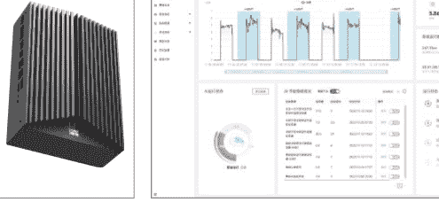

图：Smart Control 软件界面

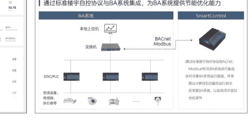

图：Smart Control 系统架构图

美的科技

## 3.3 艾柏：晶硅电池隐裂检测产品

### 背景与挑战

可见光波段的AOI技术已经在各行业的诸多工厂中得以广泛应用。以光伏行业为例，最初的终品分选检测，拓展色分和丝网印刷检测，直到当前AOI技术在华蓝、英冉、石墨等设备中的普及，利用可见光成像技术已日益成为光伏行业保障品质与提升生产流程的趋势。然而，可见光技术在应用上存在一个固有的局限性，这一局限性构成了光伏行业电池工厂实现全流程质量控制的关键环节——隐裂检测。

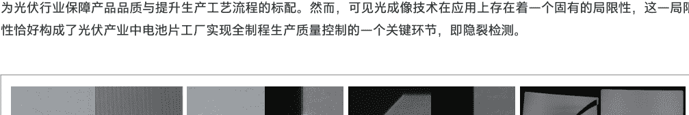

图: SC系列产品能够检测细微隐裂外观

隐裂（Micro Crack）即肉眼直接在膜物体表面观察到的细微裂纹。在光伏行业中，由于电池尺寸XX，缺陷可能只有XX长，找到它就像...

## NP-612X 系列控制器第 12 代英赛尔

影睿™I3/15/17 高性能模块级 CPU，小体积，大算力，通过集成 CPU 与 IO 控制、串口、DIO 等多种功能，与传统 IO 接口卡相比，不仅体积小，更精巧的结构设计，确保了系统的连接可靠性，高效的接口适用于多种应用场景。通过配合 CodeSys 软 PLC 环境，极大了 CPU 的多功能性能和运动控制能力，软硬件结合的完整性，通过直接在内存内实现功能组件之间的交互，通过大数据交换的响应快速，通过 EtherCAT 总线 IO 或者其他执行单元，不仅对设备安装，并在后期的维护和升级中带来了更多的灵活性。控制系统 UPS 守护数据安全，断电无忧。

OpenVINO™ 提供性能优化工具，如模型优化、推理引擎。支持 OpenCV 库，方便图像处理和显示。

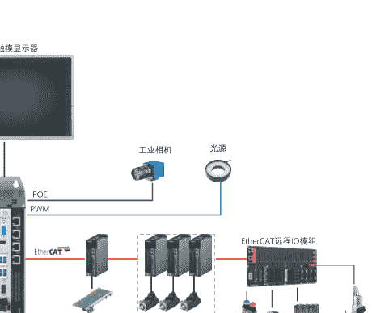

### 成功案例

### 方案优势

NP-612X-H 是一款高性能的工业级控制器或嵌入式系统，对于需要实时高效和高数据处理的应用场景，其主要特点包括：

- 高性能图像处理：通过集成 OpenVINO™ 加速学习模型在各种平台上的推理速度，AI 视觉控制机器人能够快速、高效地图像识别、物体检测、人脸等多种机器视觉任务，适用于工业检测、自动化引导车辆（AGV）、智能防等等。

- 实时控制能力：CODESYS 是一个国际领先的跨平台开发框架，支持 IEC 61131-3 编程标准，允许开发者用高级语言（如 Structured Text, Ladder Diagram 等）进行程序编写，实现对机械设备的精准控制。结合 NP-6122-H 的高性能控制器，可以确保控制命令的实时性，满足自动化过程中直观控制的需求。

- 硬件的扩展：NP-612X 通常拥有丰富的 I/O 接口（如 Ethernet, USB, 串口等），用于连接各种传感器、执行器、相机等设备，为 AI 视觉系统提供充足的硬件支持，使得系统能够采集化的输入信息，并根据 AI 分析结果进行输出。

- 支持多种点工艺控制：如支持点、直线、不规则线、弧形、圆图等，能够满足不同产品的特定需求。操作简便，可以与各种自动化设备进行连接和控制，进一步提高生产效率和产品质量。

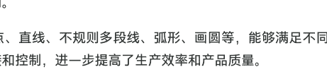

## 3.5 新：智能移动机器人

### 背景与挑战

移动人在效率、场景适应性、经济性等方面的优势，已经日趋广泛应用于工业巡检、安防巡运、园区服务等诸多场景中，并展现出了巨大的发展潜力。作为机器人的关键模块，移动机器人控制器承担着数据采集、数据处理、控制等重要负担，需要在算法、算力、稳定性、易用性等方面克服重重挑战，以加速移动机器人在不同场景的落地应用。

加速移动机器人的落地，满足用户对于移动机器人日益增长的需求，机器人产品与产品供应商需要在算力、稳定性、经济性等方面投入，化解如下挑战：

1. 复杂的传感器带来极高的算法要求：为了满足复杂、更广的场景应用，实现更高的任务精度、智能性，移动机器人正在强化 3D 点云+多传感器融合、深度学习等技术的应用，应对负载带来了极高的算法要求。

2. 技术硬件要求高产品昂贵：移动机器人作为一种复杂的机器人，搬运、物料操作等场景对控制实时性要求较高，在实际实现上，远超机器人、平台融合等方面，就带来了极高的技术挑战。

3. 模块的复杂与集成带来挑战，可靠性、调试等多重挑战：在移动机器人的开发过程中，各种场景、外设需求导致多种且多样，不同部分的集成会导致机器人调试面临极复杂的挑战。

### 解决方案

该控制器不仅具备硬件组件，还集成了驱动、调试算法等软件，能够在处理器中处理人机交互、充电能、控制逻辑、环境感知、无线通信等负荷，应对负载的运行，让满足移动机器人在稳定性、扩展性等方面的要求。该控制器已应用于智能移动机器人、电力无人机器人、安防巡逻机器人、园区内无人机器人、轮式无人机器人等多种种类，并满足不同场景的应用。

成功案例集

### 方案优势

新移动机器人控制器在硬件层面上，支持英特尔® Xeon 处理器，提供了卓越的扩展性和灵活性。这款处理器采用了革命性的片上系统架构，通过英特尔封装实现高效连接，配备了强大的英特尔® GPU 和首次集成的神经网络单元（NPU），专门 AI 加速设计，满足了机器人的推理需求。未来的英特尔®酷睿™处理器将进一步提升 AI 计算能力，保持现有平台的兼容性。

在软件及算法层面上，机器人控制器支持先进的 3D 点云和多传感器融合技术，以及激光避障技术，确保了安全防护。新移动机器人采用英特尔®酷睿™ SDK，加速了应用程序开发。英特尔® Robotics SDK 提供了丰富的库和工具，支持多个硬件配置，加速了客户应用，构建了从设备到边缘的完整解决方案。

## 3.6 睿软件：智能化设计

### 背景与挑战

在数字化浪潮中，工业领域中的计算机辅助设计（CAD）软件对设计效率提升起决定性作用。面对市场的快速变化，企业需要适应迅速的设计需求，传统的设计方法难以满足高质量的，企业急需新的支持来增强竞争力。

### 解决方案

睿软件利用 Max 和英特尔酷睿™ 处理器的强大计算能力，开发了智能化设计产品，通过自然语言和大模型进行交互，理解管理者的需求，并通过 CAD 指令完成绘制。产品集成了 CAD 数据学习、自然语言解析、高清绘图等核心技术，利用 DL Boost、AI Boost 和 OpenVINO™ 技术框架，提升设计质量。

智能化设计通过自然语言技术让设计师能够从历史数据中学习特征，为设计师提供建议。通过 CAD 直接生成，自动布局解决了线条的问题，使得设计更有组织、易于理解。此外，产品以插件形式嵌入，实现了原有导入，极大缩短了时间，让设计师专注于核心工作。

### 方案优势

在实际工作中，智能化设计与英特尔新一代处理器的深度优化，展现了显著提升企业竞争力。硬件方面，产品能够迅速响应，执行任务周期短，实现 24 小时不断运行，且电耗更低，效率更高；传输方面，支持设计转换和再利用，将复杂的设计转化为业务数据。此外，即便是初级设计师也能快速适配复杂设计任务，同时满足工程设计的需求，快速获取业务数据，确保可靠。原本需要 3 至 5 天完成的工作，现在能够在半小时内完成，极大缩短了时间和人力成本。

## 3.7 联想：基于 AI 的设备维护解决方案

在现代工业运营中，企业面临着多方面的设备维护管理挑战。首先，设备运行状况无法实时掌握，这导致无法及时响应维护需求，增加了设备故障的风险。其次，缺乏数据支持的运维和服务使得决策难以精准高效，难以实现资源的最优配置。此外，随着技术的发展设备的复杂性增加，运维成本不断攀升，给企业带来了压力。最后，被动的响应模式导致运维经验积累，无法满足客户对于高质量服务的期望。对于这些痛点，企业迫切需要一种能够预测潜在问题并进行预防维护的智能解决方案，以提高设备的可靠性和生产效率，降低维护成本。

### 背景与挑战

### 解决方案

联想基于 IoT 的设备预防维护解决方案，通过在边缘计算乃至 AI 算法，实现高效的数据本地处理和决策。该方案提供了本地化的边缘计算产品，支持主流工业协议，还能接入多种类型的设备，满足不同行业和领域的需求。以物联网的广泛连接为基础，该方案构建了一个统一的平台，实现了设备数据的集中管理和分析，从而提高了运维效率和服务质量。

此外，解决方案中的高效数据通道支持算法进行智能诊断，使得设备的运行状况可以实时监控，故障可以快速预测和诊断。这种智能化的维护方式不仅提高了设备的可靠性，降低了运维成本，提升了服务体验。通过这些先进的技术和方法，联想的解决方案能够帮助企业实现设备维护智能化和自动化，在激烈的市场竞争中保持领先。

# 设备智能运维平台

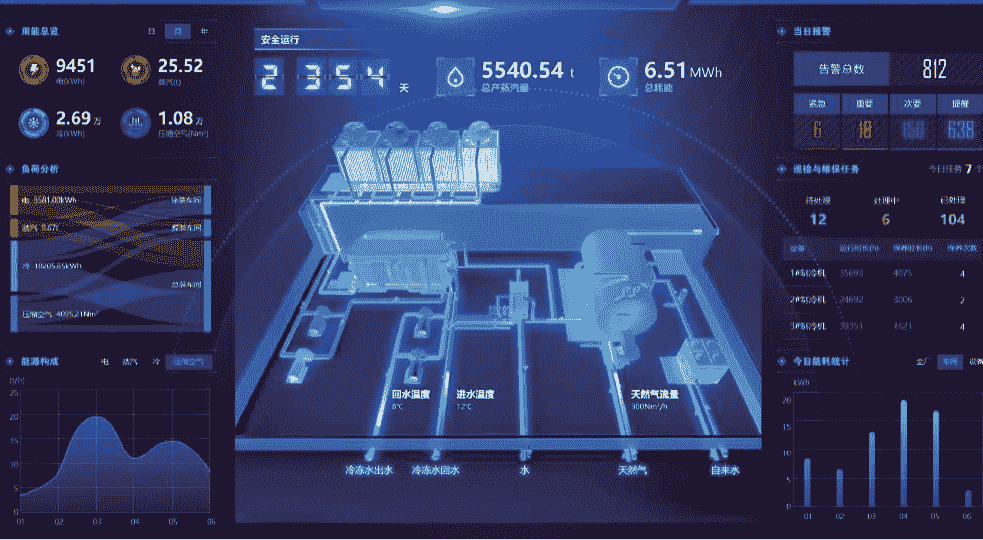

## 成功优势

AI IoT 设备预防性维护解决方案在硬件方面采用了英特尔的先进 CPU，确保了高性能和可靠性。边缘工作机搭载了英特尔的 Alder Lake–S 系列 CPU，边缘侧使用了英特尔的 Elkhart Lake。这些硬件的选择提供了强大的计算力，且保证了系统的兼容性和易集成到各种工业环境中。解决方案的优势体现在能够打通系统数据接入，这种无缝整合为企业提供了一个面向多个场景的统一平台，使得设备管理更加高效。此外，该解决方案包含了丰富的 AI 算法，提前采取预防措施，减少了意外停机的风险并延长了设备寿命。通过智能化的数据分析和故障预测，企业更加主动优化资源配置，提升整体运营。

## 合作伙伴及产品推荐

深圳市卓信创技术有限公司专注于工业控制、机器视觉、自动化领域的国家级领先企业。以市场需求为导向，以创新技术为基础，定制化解决方案为核心，聚焦嵌入式设备的研发、生产和销售，致力于数字化和智能化，为客户提供稳定、灵活的硬件产品。

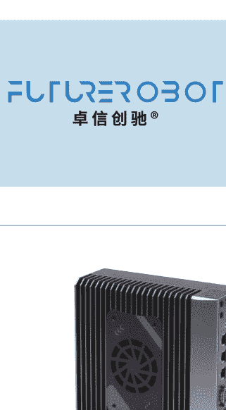

### 产品特性：

- 英特尔®酷睿™ 处理器（Meteor Lake），高达 14C
- Intel® 图形显示，高达 28 EU
- 支持 MXM 模块，旨在进行图像处理和 AI 推理
- 双通道 DDR5 5600MT/s，高达 96 GB
- 丰富 I/O 扩展：GbE LAN, 5x USB3.0, PCIe
- 可扩展多种接口，支持 Wi-Fi 6, 5G 无线通讯
- 高可靠性工业设计

E500-M 是其搭载英特尔®酷睿™ 处理器的计算机。使用英特尔®酷睿™ 处理器（Meteor Lake），支持 MXM 模块，旨在进行图像处理和 AI 推理。可扩展多种接口，可靠工业设计。

深圳信信科技有限公司专注工控主板研发和创新 32 年，屡获荣誉：中国大陆第一家研发 x86 主板，第一家把质量标准提高万级。目前信信推出 1000 余主板，涵盖 AI、机器人、边缘计算、智慧医疗、智能零售等领域，是全球最大的工控主板 ODM 产品。

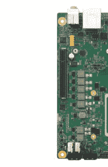

McL Island 是其推出的一款采用 Intel 最新一代 CPU，搭载 NPU 提供充足算力，高速 DDR5 内存，用于运动控制、机器人等各种高性能大数据处理的工业主板设计。

### 产品特性：

- 采用 Intel Core™ 处理器（Meteor Lake-U/H）
- 支持 DDR5 内存，1* SO-DIMM，最大 32 GB
- 提供 1* 千兆网，4* USB 3.2, 6* USB 2.0
- 3* M.2，支持 NVMe SSD，WiFi+BT
- 2* HDMI, 1* eDP/LVDS, 1* VGA
- Mini-ITX，DC 12V 供电

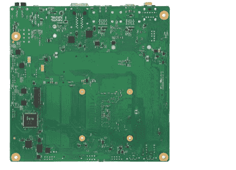

## ZRT 智通

深圳智通科技有限公司成立于2014 年，是一集研发、生产、销售于一体的国家级新技术企业，是英特尔物联网解决方案会员及国内多家 AI 芯片头部部件的生态合作伙伴。产品以 AI 加速和工业显示技术为核心，重点关注医疗 AI 分析、信息化终端和高端的机器人视觉等解决方案。产品涵盖 AI 加速、显示器、AI 终端等硬件产品。

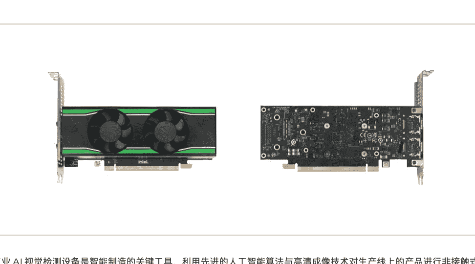

AI 视觉检测设备是智能制造的关键工具，利用人工智能算法与高清图像技术对产品流水线进行非接触式、高速的表面检测。精准识别表面的划痕、污渍等问题，确保产品质量。

智通英特尔®Arc™ A380 GD6 搭载了强大的英特尔®Arc™ A380 芯片和 6 GB GDDR6 显存，192bit 宽带宽提供了充足的数据处理速度，确保在多个场景中高效。英特尔®酷睿™ 处理器（Meteor Lake），支持 MXM 模块，旨在进行图像处理和 AI 推理。可扩展多种接口，成为可靠工业设计。

## 4.2.4 联系方式

如果您对本项目的内容感兴趣或想进一步了解，欢迎您与您公司所对应的英特尔客户经理联系。

若您对项目申请条件、流程有任何疑问、意见或建议，您可以联系下方项目联系人。

英特尔®工业电脑优选项目—

- 邱颖 Alice Chiu alice.l.chiu@intel.com

英特尔智能制造
扫码下载年度精选案例手册!
机器视觉/运动控制/机器人/新能源专区

## 4.3 PIPC 机器视觉产品推荐

* 按照公司英文首字母排序

# 阿普晋

阿普晋成立于2009年，总部位于苏州，专注于IPC边缘计算领域。阿普晋提供多种 IPC 产品，包括传统工业电脑、一体机、显示器和主控控制器。阿普晋移动 IPC 助手和 IPC 各软件插件，领先制造 E-Smart IPC。这些创新广泛应用于视频、机器人、控制和视觉领域，为边缘智能计算带来了灵活的解决方案。

阿普晋在苏州、成都和深圳设有三大研发基地，在华东、华南、华北和华西四个销售中心，并拥有 34 个上游渠道，公司在全国多个地点设有公司和办事处，增强品牌和客户服务能力。阿普晋为 100 多个客户提供定制化解决方案，累计出货超过 60 万台。

## 工业电脑选购

## 工业电视选购

## E7DS-Q670

阿普晋嵌入式工业机 E7DS 系列 Q670 平台是一种功能强大的嵌入式工业机，支持 Intel®12/13 Gen / Pentium / Celeron-S 处理器，提供2个网络接口（1GbE &2.5GbE），确保高速的数据连接，支持3路显示输出，最高支持 60Hz 刷新，提供丰富的 USB、串口扩展接口和 M.2 扩展接口，可以根据用户需求进行灵活选择，满足各种环境的工业自动化需求，采用无风扇散热设计，确保在各种环境下。

- 支持 Q670/H610 芯片set
- 支持 Intel Alder Lake-S/ Raptor Lake-S 系列处理器
- 2*DDR4 SO-DIMM 插槽，最大支持64GB
- 1*M.2 Key-M (PCIe4.0, x4) 硬盘接口
- 1*Intel® 2.5GbE+1*Intel® 1GbE
- 8*USB
- 支持 WiFi/4G 无线扩展
- 支持 DC18-36V 宽压电压输入
- 可选扩展PCI/PCIII扩展

特性：

## AK6215A2-2AI6

阿普晋嵌入式智能控制机 AK6 系列是机器视觉和边缘计算应用，适用于新型工业计算机，搭载新款 ADL-U/RPL-P 系列显示屏，搭载双控卡、6个 USB 接口，支持容量 DDR5 内存，可支持 PCIe 扩展，确保高效的各种任务处理，提供强大的计算能力，可以自由选择、更换高速扩展的主界面或 I/O 扩展，满足按需定制需求，适应各种行业需求。

特性：

- Intel Alder Lake-U/ Raptor-P 系列处理器
- 1*DDR5 SO-DIMM 插槽，最大支持32GB
- 1*M.2 Key-M（PCIe4.0, 2280）硬盘接口
- 2*Intel® 千网口
- 支持 WiFi/4G 无线扩展
- 支持 DC12-28V 宽压输入
- 可以根据具体情况增加、更换高速扩展的主界面或 I/O 扩展

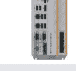

## 康达达

## CSTIPC
 康达科技

快速联系康达科技
深圳市康达科技有限公司成立于2009 年，一直致力于工业电脑、工业主板、智能系统的研发、设计、销售，是一家国家级企业。为客户提供个性化硬件，包括 CPU 控制、视觉、AI 加速、底层驱动、SDK 和 APP 开发。康达始终以“智能”发展，立足于创新、自主研发，所有产品拥有自主知识产权，应用于工业控制、机器视觉、机器人、边缘计算等领域。

## 工业电脑优

## 工业电脑选购

## R6AM-V

## U12MV-BA

产品基于 Intel Core 12 代处理器 Alder P 设计，采用 Core i3-1215U/1335U-1270P 处理器，支持 Windows 操作系统。整机尺寸为 200(mm) × 150(mm) × 72.2(mm)，产品具有散热性能的铝制主体，表面采用黑色极氧化工艺，外壳采用铝材质，产品结构紧凑，外形精美，采用 Alder P 系列作为高性能处理器，具备丰富的 IO 扩展，是机器视觉、工控等应用设计的工业电脑方案。

产品基于 Intel Core 12 代处理器 Alder P 设计，采用 Core i3-1215U/1335U-1270P 处理器，支持 Windows 操作系统。整机尺寸为 200(mm) × 150(mm) × 72.2(mm)，产品具有散热性能的铝制主体，表面采用黑色极氧化工艺，外壳采用铝材质，产品结构紧凑，外形精美，采用 Alder P 系列作为高性能处理器，具备丰富的 IO 扩展，是机器视觉、工控等应用场景设计的工业电脑。

特性：

- 32GB DDR4-3200MHz/SODDIMM
- 128GB SATA3.0 (M.2 2280 Key B)
- 2*SATA3.0/2.5 硬盘接口
- 6*RJ45转口-内置LAN 支持 PoE 802.3AF
- 1*DP、HDMI2.0、6*USB3.0
- 复合IO接口 (8DI&8DO、4路光源输出、4路数字外围输入)
- 1*M.2 3042/B-Key (支持4G模块扩展)、1*M.22230-E (支持Wi-Fi/蓝牙)、2*PCIe x4扩展

- 2*DDR5-4800MT/S 笔记本内存，Max 64GB
- 标准SATA接口，1*M.22280 M-Key 槽，可扩展NVMe
- 1*HDMI接口，1*Mini-PCIE接口，支持4G/WiFi
- 4*USB3.0接口，5*RJ45转网口
- 2*COM接口，16DI&16DO
- 9-36V输入，运行温度：-20°C~60°C

## 卓信创驰

## FUTURE ROBOT

## 卓信创驰®

快速联系卓信创驰
深圳市卓信创技术有限公司是一家专注于工业控制、机器视觉、自动化等领域的国家级高新技术企业。坚持市场需求为导向，以创新技术为基础，以快速定制化解决方案为核心，聚焦于嵌入式计算设备的研发、生产和销售，致力于工业领域的自动化、数字化智能化，为客户提供全面、稳定可靠、灵活便捷及系统解决方案。

## 工业电脑

## E223

E223通过工业级测试，是针对机器视觉打造的工业计算机，搭载 Intel Atom®平台 Alder Lake-N 系列处理器，支持 DI/DO、Encoder、2LED、Trigger 和 RS-232/RS422/485 等接口，采用无风扇流式结构设计，小型尺寸，低功耗，性能均衡，满足负载整合的市场需求。

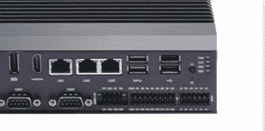

特性：

- Intel Alder Lake-N 系列处理器
- 单通道 DDR5-4800，最高 16 GB 内存
- DP 和 HDMI1 独立双屏
- 3 LAN（2 x Intel i210 支持 PoE，1 x Realtek RTL8111H ）
- RS-232/RS422/485
- 3*USB3.0，2*USB2.0
- 复合接口 (8DI&8DO、4路光源输出、4路数字外围输入)
- 1*M.2 3042/B-Key (支持4G模块扩展)、1*M.2230-E (支持Wi-Fi/蓝牙)、2*PCIe x4扩展
- 9-36V，支持UPS模块
- 172 x 125 x 62.5mm (LxWxH)，支持壁挂安装
- 模块化设计，CE/Class B认证
- Windows 10/Ubuntu

## 诺达达

快速联系诺达达
诺达达 (NODKA) 创立于201年，致力于工业PC和HMI系统的研发，为自动化、通讯等领域提供全面的产品解决方案。产品线涵盖X86/ARM架构、嵌入式计算机、工业显示器、工业级硬件等。具有低温、湿度、防震、ESD等完善，建立组装、SMT、精密加工、铸造和极氧化处理等全流程，质量符合ISO9001、ISO14001认证，兼具OEM/ODM定制能力。产品广泛应用于自动化、交通、电力、新能源、环保、医疗及各类自动化行业。

## NP-6113

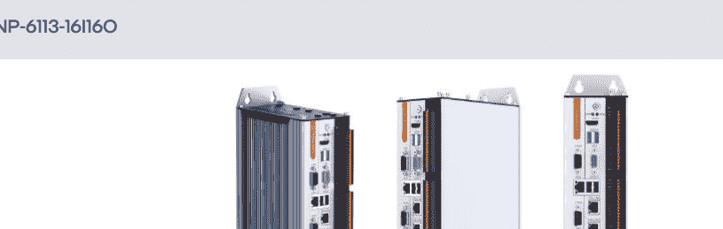

NP-6113是诺达达自动化系列中的一款低功耗无风扇机，高性价比、流畅的外形和无线设计，机壳采用高强度铝合金材料，采用大面积鳍片作为散热器，紧凑结构、小巧可靠且无风扇设计，全封闭结构防止尘进入，保障产品的可靠性和使用寿命。

特性：

- 2*Intel® PoE接口
- 1*RTL811H 千兆口
- 2*USB3.0接口、2*USB2.0接口，板内1个USB口连接蓝牙
- 1*RS232/RS485，支持自动流控
- 支持VGA和HDMI双显示接口
- 1*miniPCIe扩展槽，可扩展WiFi/4G模块
- 16 x隔离DI，16 x隔离DO
- 支持mSATA固态硬盘

## 信步科技

信步科技，自1992年起，专注包括x86在内的多个平台的工控主板研发和创新，并获殊荣：中国大陆第一家研发x86主板，第一家把品质标准提高到最高万分之一，第一家按高性能参考设计……至今，信步科技拥有全球范围内领先的研发团队，推出900多款产品，服务全球十多个行业的100多家公司，销量领先，是中国大陆最大的工控主板和ODM供应商，致力于成为“把机器变成智能”——这一时代的关键力量！

## 工业电脑览

## NAV-700

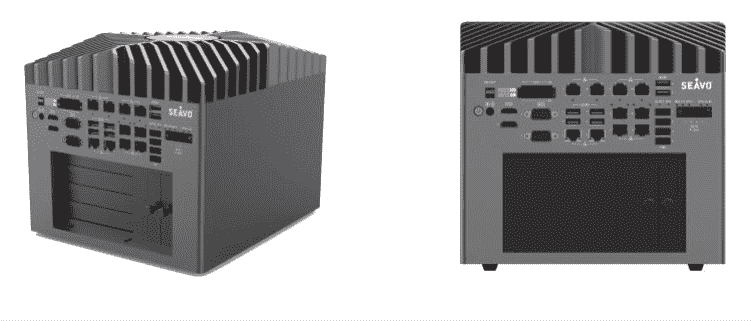

特性：

基于工业计算机的高可靠性需求与挑战，信步科技推出全新的设计的工业计算机。整体采用无风扇散热设计，提供 4个扩展槽，通过多项可靠设计测试，性能增强，算力充足，可应用于机器视觉、运动控制、边缘计算领域。

- 采用第12代Intel®Core™处理器，支持高性能显卡
- 2 DDR4, 4 SATA, 10 GbE, 10* USB, 2* HDMI
- 1*PCIe x6, 1*PCIe4, 2*PCI
- 全机一体式无风扇散热设计
- 20多项抗干扰可靠性设计，MTBF 5万小时
- 9-36DC 供电
- 232*274*212mm

英特尔致力于尊重人权，决不参与或策划任何损害人权的行为。参见英特尔的《全球人权原则》。英特尔的产品和软件仅限于不会造成或有助于反种歧视影响人权的应用。

性能可能受使用情况、配置和其他因素的差异影响。更多信息请见 www.Intel.com/PerformanceIndex
