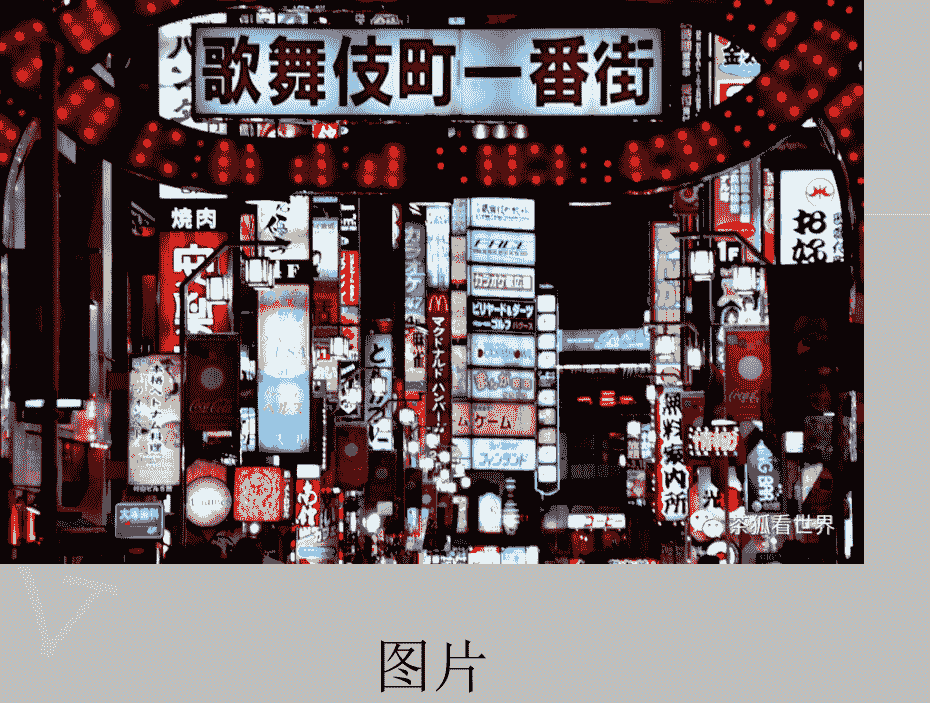
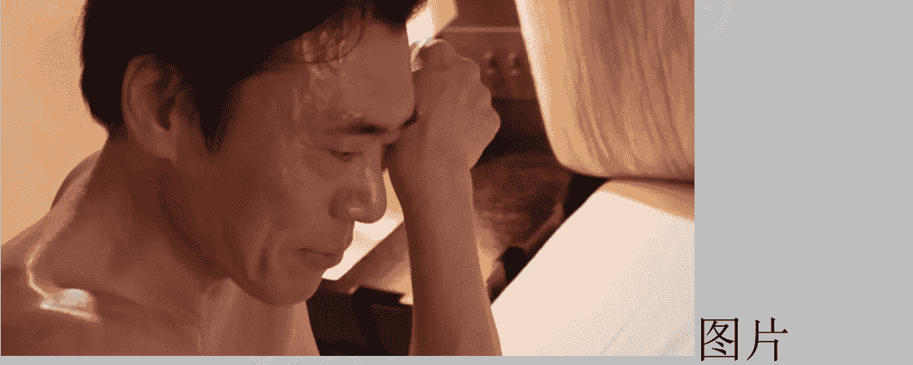
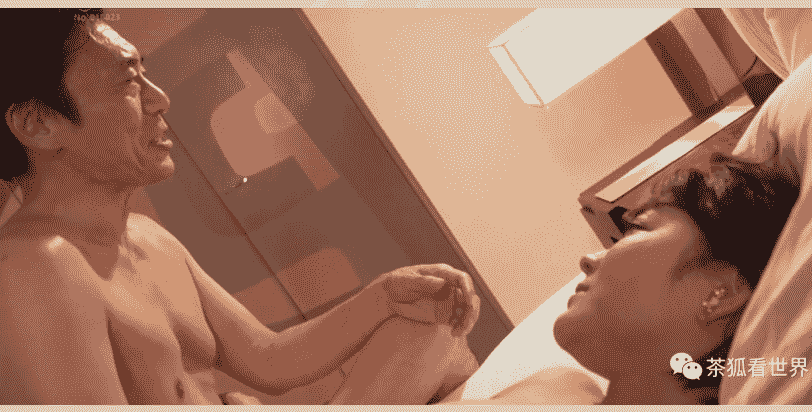
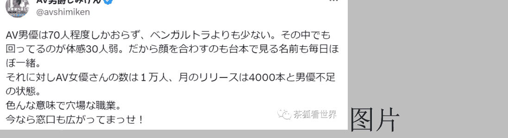

# 一部日本动画片，震碎了我的三观

时间：230814
作者：茶狐看世界
整理：公众号胖虎玩软件

这是一篇长文，4700字，如今的红线很多，也不确定到底在哪里，保险起见，还是加定个小门槛吧。

看了几十年的日剧，万万没想到，今天，一部老艺术家的「引退」，震碎了我的三观。管中窥豹，日本暗黑界几十年的发展，也折射出人类社会的剧变。现在回头看，这二三十十年，是人类几千年文明史中的一小段，却是发展最快的一段，不仅全球化加速演进，经济快速发展，社会观念也彻底颠覆。过去几十年，人类不一切地快速奔跑，如今回回头张望，猛然发现，身边的一切是如此陌生，这就是我们要的世界吗？

言归正传，这名老艺术家是——西野翔，在暗黑界里面摸爬滚打 16 年，有着国民妻子之雅号。她出生于1985年，是业界祖母级别的资深艺术家，她还拥有着多重身份：电视偶像、歌唱艺、DJ，而且每一方面都表现不俗。她的搭档——田渊正浩，也是德艺双馨的老艺术家，有国民义父的美称。生于1967年，1990年入行，从业 33 年，依然活跃在第一线，从事高强度的体力作业，这一点，属实令人佩服。相信很多人，只要在下文中看到他的照片，就能勾起青春回忆。也许，你那布满灰尘的硬盘里，还保存着他的作品。

女主三十几岁，男主五十几岁，以暗黑界最平庸的年龄，演绎了最经典的作品。简单粗，这里就不多说了。田渊桑完工之后，西野小姐深情地凝望着他，亲自替田渊桑清理干净，过了许久，才恋恋不舍地放手，然后，田渊桑用纸巾温柔地擦拭她的嘴角。

西野老师娇羞地夸奖：「不愧为行业翘楚，还是那么久、那么多！」

田渊桑不好意思地微微一笑，没说话。
西野老师接着问：「你刚才做的时候，在想什么呢？」

没想到，被她这么一问，田渊桑就破防了，躲开她的视线，背过身，不争气的眼泪破堤而出，他忙用手背拭泪，然后转眼看着西野，含情脉脉地说：「我从业 30 多年，阅人无数，唯独和你做最多。很开心和你一起工作，突然到了分手的这一天，毫无思想准备，感到很寂寞。一想到以后再不能跟你搭档了，就忍不住眼泪。”

西野老师接过：“刚入行的时候，我啥都不懂，心只想为观众奉献好的作品，但不知道从何做起，是你耐心地引导我，让我成为一名优秀的演员，一直以来，你都是我心里的依靠。只要在片场看到田渊桑，我就踏实了，每次和合合作，都是我最安心的日子。没想到时间过得这么快，一眨眼就 16 年了，谢谢田渊桑这 16 年对我的照顾……”

说着说着，西野的泪珠夺眶而出，两人含泪对视，无语凝啧。

看到这里，我不禁唏嘘，这到底是动作片，还是文艺片？说是动作片吧，男女主角含情脉脉，泪眼婆娑，对白深情，台词感人；说是文艺片吧，还真没见过如此省布料的场景。

日本黑暗界的引退作，我看过很多，但这种大段对白，是第一次见。而且我竟然不快进，都看完了。这是导演喊之后的花絮，无心插柳，成为一段经典。

## 震碎三观

震碎我观的是：通常被视为最底情的暗黑界，却可能有最纯粹的男女之情。虽然日本暗黑界工作也辛苦，但至少他们在艺生活中还能找到一个知己，惺惺相合，而现实生活中夫妻却相看厌。西野小姐和和田渊桑的关系，没有责任的牵绊，欢愉过后，彼此留下最美的回忆。一想到以后曲终之时，也许还相互关心。与此同时，现实生活的状况却令唏嘘。对夫妻来说，16 年后，不要说已经是幸运了。

中国的离婚率，高得令人吃惊。

| 省份 | 结婚登记 | 离婚人数 |
| :--- | :--- | :--- |
| 全国 | 947万对 | 415万对 |
| 平均离婚率 | 44% | |
| 稳居前三 | | |
| 吉林 | | 72% |
| 黑龙江 | | 67% |
| 辽宁 | | 66% |

离或不离，最后都是白头偕，堪称人间奇迹。很多夫妻都是室友，勉强搭伙过日子，一个礼拜都不说话，同在一张床，背对背，各自刷手机。把同床异梦这个词，释到极致。

## 「性萧条」

不仅是中年人，如今的年轻人也出现了严重的性冷淡趋势：根据美国疾病控制与预防中心（CDC）的数据，2002 年，15 至 24 岁美国人的处女比例为 22%。2017 年，这一比例上升到 30%。这一趋势在男女中都一样，2002 年，15 至 24 岁男性的处男比例为 20%，2017 年上升到 33%。

2018 年，日本 18 至 34 岁的人群中，处男比例为 42%。处女比例为 40%。这不仅是美国和日本的问题。在澳大利亚，年轻一代多年也一直处于“性衰退”之中。2020 年的数据显示，18-24 岁年龄段的人中有 40%从未有过性经验。

# The Sex Recession

Young people are having sex less often and having sex less frequently than any previous generation at their age. What's turning Americans off physical intimacy—and does it mean for our happiness?

By Kate Julian

去年 12 月，《大西洋刊》有一篇关于千禧一代“性萧条”（the sex recession）的深度报道引起了广泛共鸣。该报道称，在一个平等、性自由和健康的时代，年轻人却不过生活了。Kate Julian 写道：当下本该是黄金时代，美国人认为单身人士，新增性行为无可接受。

## 经济发展的必然结果

说一些年龄的事儿。我们可能是第一代，有了手机后，想到的第一件事，就是看那。一旦虚拟的快感，现实的接触就没那么切了，结婚变少了，同居变少了，恋爱变少了，甚至约炮的数量也一年了。

按照历史的轨迹，人类的文明史，大约 5000 年，而网络普及的历史也不过 30 年。前面的 70 年，仿佛只是积累能量，后面 30 年集中爆发，一不留神，世界就变了。前面的 70 年，仿佛只是积累能量。

网络普及的历史也不过 30 年，前面的 70 年，仿佛只是积累能量，后面 30 年集中爆发，一不留神，世界就变了。

亚当·斯密在《国富论》说：劳动分工促进社会生产力的提高，使社会富裕。反过来来说，社会的富裕又催生新的需求，产生更多的分工。最终的结果就是，社会分工无限细化，任何事情都专业化。

男女爱本来属于个人私事，如今却发展为一个庞大的产业。日本的动漫看起来漫不经心，其实是一个工业化产品，背后有严格的产业分工。暗黑界的男神们，不仅是百里挑一，更是万里挑一。以田渊老师为例，截至2022 年，他从三十年前粗略算起来，已出演超过1.5 万部作品，与超过万名女演员合作过。平均一部作品要进行 2 次高强度体力活动，那么 1.5 万部作品就是总计 3 万。23 年一共也就是 8400 天，平均每天要完成 3.6 次，田渊的战绩十分惊人。

日本艺人不仅对体力要求高，对技术也很高，我一次看日本艺人的访谈，其中一段话让我印象深刻，大意如下：「取猪肉一斤，割一小口，置入硬币一枚，肉放在墙角一周后，用舌头将硬币取出，且面不改色不厌吐。」对日本暗黑界的男神们来说，这是一种最起码的基本功而已。无论是身体素质，还是专业技术，日本动作片行业对男艺人的要求非常高。

AV男優しみけん @avshimiken
AV男優は70人しかおらず、ペベンガルトラよりも少ない。その中でも戻っているのが体感30人ほど。だから顔を合わせるもこの本で見ると名前も毎日
