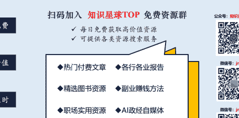

# 惊魂一跌，扰动会加剧吗？

20250602 董小姐解读财经

今日解读要点：

- 一、港股为何大跌？会继续恶化吗？
- 二、杀敌一千，自伤一千，美元资产或许更危险

每天10分钟拆解新闻背后的逻辑。大家好，今天是2025年的6月2号星期一，我是董小姐。

## 一、港股为何大跌？会继续恶化吗？

今天中国境内市场没有开盘，但香港市场正常交易，并且出现了惊魂大跌。上午，恒生指数一度跌幅接近3%，恒生科技指数跌幅超过3%。是什么事件触发了这一轮大幅回调？回调的深度体会不会步步加深？我们一起来一看。

首先说一下结论：最新出现的扰动或岸上看都是雷声大雨小。这两天市场焦躁不安的触发因素中，离不开特朗普。特朗普在过去一两天里，针对

税务问题，尤其是针对中国关税豁免的问题释放了很多危险的信息。其中包括美国财政部长在接受采访时谈到中美贸易谈判有点停滞。这个用词其实已经比较客气了——谈判并没有推进。背后的焦点是什么呢？为什么大家卡在这个地方？据美国媒体报道，是因为一些关键的矿产资源向上的谈判出了问题。

回顾5月12日内瓦会议的共识，中国对稀土这一战略资源的出口管制做了一些让步，换来了美国关税豁免一段时间。但后来美国方面认为中国在解除稀土出口限制方面的推进力度和速度不够。特朗普也在这个议题上表达了不满。美国方面表态，市场立场变得非常紧张。悲观者认为，中美之间好不容易达成内瓦共识很可能会毁于一旦。如今中国方面的立场比较强硬。商务部提到，摩擦是由美国单方面挑起的，中国国际一直按照内瓦共识暂停了针对美国国的对等关税，之前提到的很多承诺也在积极落实。而美国最近这段时间的动作，反倒表现出一些挑衅行为，包括禁止中国芯片设计的销售，撤销中国留学生的签证。中国方面表示，如果对方继续损害中美利益，中国将采取有力措施。现在双方针对麦芒（此处应为摩擦），这让市场感觉更加紧张。之前稍放一点的情绪，不到一个月就垂直直下，被这些坏消息冲散了。

个人认为，这一波最新事件可能雷大点小。原因还是要追本溯源，一看美国决策的一些根本性影响因素。在过去的几个月里，美国决策体表现了一种“高高举起，轻轻放下”的习惯。比如针对于其他国家普遍加关税，后面在美国金融市场波动之后，迅速给出了90天的免期。对于中国的关税大棒也是类似的，迅速给出了大约100天的豁免。这并不是美国主动为之，而是不得不这样做，因为美国资本市场的不稳定其实是一个巨大的牵制。我们回到美国资本市场找线索。这两天大家看到，美国市场其实还是不稳定，没有远离警报。首先，美国股票市场虽然经历了三周的大反弹，现在为止收复了2025年所有下跌的跌幅，但也让自己处于一个比较高而且比较危险的位置。重心较高，所以很容易被击袭，一旦发生一些根本性的坏消息，它首先会“卧倒”。除了股市市场，美国国债也迟迟没有恢复。如今消息出去，美国债市场再次出现下跌。美国未恢复时，再次经历二次扰动，很容易产生深度回踩。所以，美债市场的危机并没有真正过去，甚至还处于一个比较危险的状态。

要知道，6月和7月对美债市场来说，面临着巨大的借新还旧压力。大批美债在这个时间段到期，需要发行新国债去继续。但发行新国债，要面对市场到底会给多高的利率。如果此时美债下跌，把利率推上去，那么美债就会面临压力。

（注：原文后续部分存在大量重复及OCR乱码，已根据指令进行语义逻辑梳理，此处保留核心逻辑内容）
