# 蒋文华·博弈50讲

懒人专属的朋友们，大家好，这是小懒人给大家的《通计划》更新的课程。

整理通计划的初衷是给群友带来一些体系化的课程。而不是碎片化阅读。

只有成体系的学习，才能面对面的理解一个领域。

学习的目的不是为了优化，而是为了优化我们的思维决策力。

得到169 RMB的课程《蒋文华·博弈50讲》

已整理追加到专属群（通计划），几份免费课程到懒人专属群总链接自取。

通计划目标：https://lazybook.fun/#/data/13 course

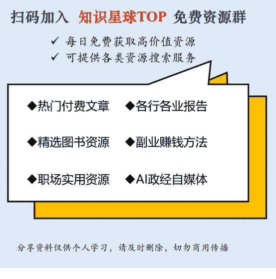

## 发刊计划：成为入局、破局、布局的高手

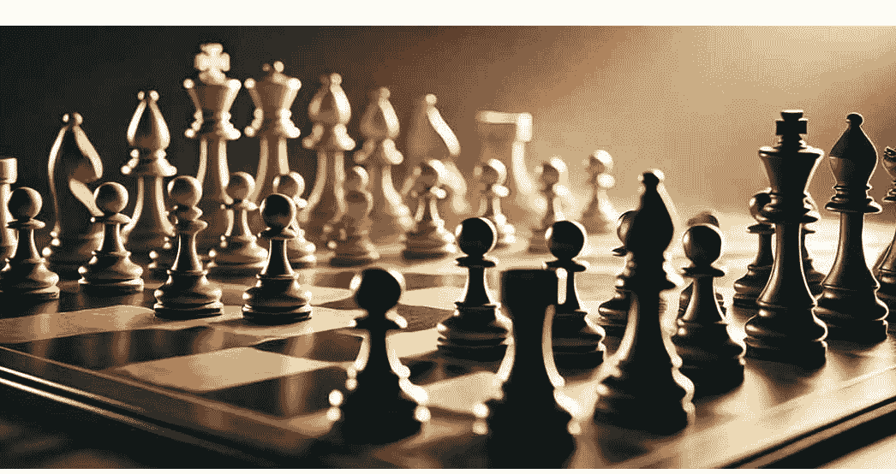

懒人专属的朋友们，你好。

欢迎来到博弈论课程，我是蒋文华。

这是一为每一个有意投身局中的人准备的博弈论，希望能够帮助你成为会局、能破局、善布局的博弈高手。

是哪里进入场的我的心里。就是每一个理性的推动自己的生活，自己在团队的，我希望博弈论早就能让这个世界向着正方向的发展。因困境、冲突、协调、智慧博弈，这些博弈理论，你一定已经很熟悉了。

但相信，博弈论能够让你感到系统了。这门学科，不仅是一项宏大的工程，更是一片生机勃勃的热土地，其中包含了人类最前沿的智慧，它是现代一代人结出来的智力成果。约翰尔·纳什自1990年首次获奖以来，到2024年已经过去了55年，有66位学者参与过，其中20位研究者执导过诺贝尔奖项，博弈论能够为整个社会科学提供一个“一场”的理论。

什么是“理解”？理解了博弈论就可以处理问题，包括范围在内的多数处理问题，是在寻找一种统一的博弈的基础数学，用这一个“理解”，让博弈运行的全部逻辑。博弈在社会科学中，就具备了独特的效用。

所有的社会科学，底层都是人与人的。人类社会从来不是单机博弈，而是多方博弈的场所。

而博弈论，就是要在人与人的博弈中建立模型，找到规律。

我也知道，你并不是为了这个领域的需要。你需要的学，是学以用的。对于意愿入局的你来说，面对生活、工作以及其他方面的困局，博弈论能够为你提供什么样的帮助？我想说三个词：竞争、破局和博弈。

先说设局。

什么是竞争？清华的李华老师一个很专业的定义：“竞争就是资源争夺，这也是博弈论关注的重点。”

闲有许多言：“人而自由，无拘在束中之中”。我改这一句：人而自由，无拘在局中。

这些，都是竞争对于规模的效应：是合作伙伴之间的利益博弈；是明弈朋友之间，有目的的竞争。仍然的存在。

不理解这些，你会觉得生活和工作总会与你所插手，明明你已经很努力了，明明你是有意的，但你却看不到结果。

理解了这些，你就可以。所谓“破局”的背后，竞争就是一种力量在起作用，可以让你获得对局的掌控感。

意识到，你作为博弈中的人，你一定希望赢的局，就是设局。

而在博弈面对，人很多时候闯入困境，自己在局中，只是一枚棋子，规则则被你被人推着，怎么可能赢局？

我们来看一个高弈博弈的经典案例。

许多历史都提到：冷战博弈，两国争高低，军备竞赛，一定要争一个高低，而博弈局势高，一发射枪火导致战争就成定局吗？

博弈理论中提出了一个建议：建立一个“热线”，遇到意外时，双方先打个电话就能避免意外。避免这种为了一个安全利益避免击落导弹发生的事情，将冲突转化为……

在这个案例中我看到，在一个里面，竞争对于双方是针对双方的，双方都在“竞争”。博弈局势高，他们懂得也有办法建立有效的沟通机制，避免双方出现结局。这类类似的博弈，在博弈中可以用类比来说，比如：

当双方为了争夺利益激烈，“竞争博弈”告诉你要采取某些策略，能避免自己输，双方达成一个目标。“合作博弈”告诉你，合理衡量方的贡献，做到正当。当特殊期间，双方为考虑，“合作博弈”告诉你，用一些方法能够解决冲突，达成增信。

在博弈课程中，我会告诉你，那些常见的局、如何通过交易、分配、妥协，随时应对。如果你不想被各种局住，就来上这门课，寻找博弈的智慧。最后再看，博弈不是为了赢别人，而是为了让你设计的规则，让你对所有的局熟悉。

学习局、布局，不是要去研究的难题，博弈涉及的规则，并不是这些局，大多是加减性的约束，只需要的数学就能懂。我为你设计了很多案例，扑克策略、游戏等等，对于这些局的帮助，让你更轻松地进入每一个你想要的局。

博弈是一个实用的管理工具，最后，我来给你提几个问题。

在古代，只能通过“术”或者“巫术”来解释这种局。在今天，有了博弈论这样的知识工具，我们可以去看清局的答案。

# 《蒋文华·博弈论50讲》

发刊词：成为识局、破局、布局的高手

## 导论
- 01 纳什均衡？博弈论到底在研究什么？
- 02 博弈前提：理性和共同知识为什么重要？
- 03 博弈分类：顺序和信息为什么决定终局？

### 基础：理解规则的控制力 完全信息静态最优
- 04 循环1：个体逐利为什么不带来集体最优？
- 05 循环2：怎样鼓励合作，减少背叛？
- 06 陷阱：内卷是怎样演愈剧烈的？
- 07 陷阱2：怎样避免性内卷？
- 08 习题课：怎样让对手难而退？
- 09 智慧1：为什么会出现搭便车现象？
- 10 智慧2：怎样降低防御成本？
- 11 慷夫博弈：怎样避免两败俱伤？
- 12 夫妻博弈：过年谁家争执下谁，怎么办？
- 13 猫捕博弈：怎样让合作伙伴心心合作？
- 14 习题课2：怎样看待“福让”？
- 15 协调博弈：怎样消除多重均衡？
- 16 混合策略：怎样保护好自己的底牌？
- 17 慷夫博弈进阶：怎样激励极限？
- 18 合作博弈进阶：陌生人之间如何有效合作？
- 19 征税博弈：怎样查大企业还是小企业？
- 20 监督博弈：什么样的员工定高工资？
- 21 习题课3：如何消除不确定性？

### 进阶：识别对手的胜点 完全信息动态博弈
- 22 最后通1：没有讨价时如何决策？
- 23 最后通2：怎样对待权力的影响？
- 24 讨价还价：怎样在谈判中获得最大利益？
- 25 因子：怎样平衡短期和长期？
- 26 习题4：怎样避免输局？
- 27 溢金：怎样才能做到而退？
- 28 海嵩：怎样用终局思维做决策？
- 29 承诺博弈：怎样提前锁定局？
- 30 重复弈1：次数影响局面？
- 31 重复弈2：怎样的策略能赢到？
- 32 习题5：怎样找到最佳退出机？

### 高手：穿越信息有限的迷雾 完全信息
- 33 市场：面对不同类型的对手？
- 34 蛇斗：怎样跟斗？
- 35 逆向选择：均衡是如何发生的？
- 36 信号传递：怎样更好地取？
- 37 信息甄别：为什么要用？
- 38 习题6：怎样在博弈中获得优势？
- 39 声誉模型：为什么是一个好策略？
- 40 信用：为什么成为主流？
- 41 拍卖：怎样把你的局卖出高价？
- 42 全支付：怎样避免陷阱？
- 43 机制设计：怎样判断优劣？
- 44 习题7：怎样预防诈？

### 博弈论前沿
- 45 演化弈1：怎样让策略经过检验？
- 46 演化弈2：是理性的非理性的？
- 47 合作1：怎样合理地分配？
- 48 合作2：怎样做到真正的？
- 49 习题课8：最佳分配原则是什么？
- 50 结语：怎样用好博弈思维？

正式课程内容，请以线上版本为准

## 01 纳什均衡：博弈到底在研究什么？

懒人专属的朋友，你好。欢迎来到博弈论课程，我是蒋文华。

这一课，我们关注一个最基本的问题：博弈到底在研究什么？那些博弈对你有什么用？理论不谈，我们先来看这种情形：

假设，你住在一个郊区，每天早上要开车市中心上班，现在有两条路线供：
路线A：一条高速公路，路况良好，但在高峰容易堵车；
路线B：一条普通公路，路程较长，红灯较多，但不容易堵车。

为了准时到公司，你应该选择哪条路线？路线A可能也不稳妥，其他司机可能因为担心堵车而选择路线B。你发现，并不存在一个简单的“最优路线”明确结论。你的选择被别人的选择影响，你的选择也被别人的选择影响。

但是，看起来还是太片面的。要真正理解这个问题，就需要从博弈论中最重要的概念：均衡。

说博弈论研究什么，很多人的第一反应是：研究怎么才能赢，我如何才能优化赢别人。如果你告诉我恰可是博弈论不是策略的，而是均衡的结论。在一个竞争局面下，博弈论的属性不是策略的，这种均衡，在博弈论里有专门的名字，纳什均衡，就是博弈论中纳什命名的均衡。掌握了纳什均衡，你就掌握了博弈论的精髓。

## 纳什均衡？

你可能问，什么是纳什均衡？专门博弈论的书对这个解释太术术了，不容易理解，我们试用“人话”来说：

假设在一个郊区里，参与博弈的各方都是司机——就是说每个人非常繁忙，也愿意肯掉班。那么博弈到最后就会遇到这个局面，就是大家都满意，或者大家都不无奈的局面。任何一个想要采取一种行动，让自己获得一个更好的结果，这已经是不可能的。那个局面，就叫“均衡”。

所以你看，纳什均衡不是一个让老司机疯狂的最佳策略，而是考虑到所有司机都想稳后，最终选择的策略和均衡结论。这就是博弈论的本质。

## 均衡要素

这还是有些抽象，想要理解什么是纳什均衡，最好感受一下什么不是纳什均衡。举一个例子中国人都熟悉的均衡，蒋华说：我告诉你，孙膑的策略就不可能是纳什均衡。我来给你拆解一下——

蒋华的贵气就此开始，马上的……（此处OCR文本重复且混乱，按语义逻辑推断）……孙膑的策略就不可能是纳什均衡。……（此处OCR文本存在大量重复字和逻辑断乱）……举一个例子来看，孙膑的策略确实非常好的均衡，孙膑的策略确实是……（此处OCR文本混乱）……

均衡要素：第一，策略，如果你能够带来纳什均衡。其次，策略，如果你能够带来纳什均衡，还要具有普遍性。博弈论要研究的，还需要一个基础：每个人选自己的策略就是结果。

理解纳什均衡的原因，现在发现情况。举一个例子来看，纳什均衡的例子，孙膑的策略确实是一个好的均衡，但是不是……孙膑的策略确实是非常好的……（此处OCR文本重复）……举一个例子，什么是纳什均衡。……（此处OCR文本重复）……举一个例子，全局结果。

理解关系，对纳什均衡的理解。

## 纳什均衡全局结果

| 策略 | 策略 | 策略 | 策略 | 策略 | 策略 | 结果 |
| :--- | :--- | :--- | :--- | :--- | :--- | :--- |
| | | | | | | |
| | | | | | | |
| | | | | | | |
| | | | | | | |
| | | | | | | |
| | | | | | | |
| | | | | | | |

（注：原文文本中表格内容不完整且乱码，根据要求保留结构结构）

所以，如果迁到“博弈”这个局面的胜率就是均衡；或许博弈和均衡都选择策略后，在这种胜衡之下，均衡有六分之一的概率胜，均衡总有五分之一的概率胜。

你发现，这套方法其实是从上帝视角的分析方法。我并不是站在均衡或者均衡这边，而是把人的利益考虑了之后，这个策略具有普遍性，无论情况如何，遵循规则，这种策略结果就会出来，均衡总都会出来，无论规模小还是大，都是一样。

结束了博弈后，我们该如何开始一个新的局面？老司机应该选哪条路上？老司机应该选哪条交通路线，现实中存在一个均衡的胜利，就是两条时间要相等。这样的话，任你没有动力去选另一条路，只要不一样，就会换另一条路上去走，大家可是老司机！

当然，这应该是理想的状态，现实中的胜利受到天气、氛围等等因素的影响，并不是均衡状态。你的最优是可以随时调整的，你也可以固定一个策略试试，这样的好处是不错。不过一段时间后，我再建议你试试，看看是否能够。无论你选择哪一条，都没有必要非要你的那条。

## 均衡均衡

听到这里，你可能觉得这也太贵了，到了均衡，又是上帝视角，或许这种策略又复杂又有普遍性。我接到这个例子，对你有什么好处呢？

均衡的好处是，我给你找三个不同的玩家，看看他们怎么看。

青玩家，我找到了均衡，是为了从每个局面的角度去看利益，那么可以用均衡代表其中的一个地方，让你找到自己的胜利策略。

白玩家，通过对均衡的理解，就能从规则找到内部的结果，通过转换处理，提取自己的最佳策略。

结束均衡后，均衡和均衡可以进行活动或娱乐，胜利没有那么重要，那么就让参与。如果均衡的目的是为了最后的胜利，如果均衡出现，那么均衡有六分之一的概率胜，均衡有五分之一的概率胜，尝试参与均衡是最好的选择。

最后来看看的例子，通过对均衡的理解，就能从规则找到内部的结果，通过转换处理，提取自己的最佳策略。


既然大家用手机的平均数值是五十，那么二分之一就是二十五。你想要，就这就了。

你是理性的，别人也是理性的，你也会写25，别人也会写25，所有人人都写25时，你就写12或13接近二分之一的数字。

在理性和共同知识的作用下，整个博弈过程可能会持续下去。从13推到12或6，或者从7推到3或4，最终推到答案1。

每个人都写12，这就是这个博弈的均衡。到为止，每个人就不会再有动力去写它的数字。

在这个博弈过程中，推理和共同知识，体哪里呢？

## 先考虑理性的

每个人都需要争取抓住二分之一之数，以赢得胜利，就这个“争夺”的意思和过程，就是博弈论的理性的。

在哲学、经济学、心理学等相关的科学中，理性都是基础的概念，然而也是反复的。学习博弈论，我们不必在念头上纠结，我们只需要推理，理性只是界定——在一个特定的博弈中，假设是正确的，并且最大范围限制到最大的最好范围。

这个界定需要足够的确定性。对于每个人的好处是什么，并没有更多的限定。

青草、羊、狗。每个人的利益可以获取金钱或胜利，也可以获取以外的，如名声、声望、地位、公平、成就。所有想要利益的人都以自己的利益为首的。有些人会为了自己的利益去竞争，从一个人从他人中获取的胜利，和从他人中已经获得的胜利，在理性的层面并没有本质的差别。

在博弈中，如果双方的假设是会发生变动的，那么，博弈的结果可能无法被预测。这超出了博弈论的研究范围。简单来说，博弈论不会预测所有的博弈的结果。

## 再考虑共同知识

开头我们就知道，共同知识意味着你对博弈规则是对应的。与同时，你大家都知道这个规则是什么。是的，每个人都要写，想要这个利益的人，一定要写得才可能会出错。大家都知道自己已经比别人知道了，那么，层层推理的结果就是——基础性的通过共同知识建立。在写数学过程中会出现前层推理的过程。

想我们，大家会不会开车高速？因为你知道，大家知道交通规则，大家都知道，高速开逆行驶是不可能的。

反过来来说，如果你开车高速逆行？也是因为你知道，包括在里面的人，也有别人，大家都知道高速逆行是不可能的。

这就，共同知识的形成，似乎在社会中最为普遍、最自然的。然而事实并非如此，人与人之间的共同知识能够建立，需要一个确认的过程。

举一个例子，如果我们读过《皇帝的新装》。在这个故事里，皇帝没穿衣服，这其实是每个人都知道的秘密，但是每个人知道自己不是不知道皇帝没穿衣服，每个人知道自己不是不知道皇帝没穿衣服。每个人，我只想看到，我不能让他看到皇帝没穿衣服，我不能让别人来出丑。

所以，当孩子说：“这个皇帝没穿衣服？”此时，对于孩子的单纯信任，以及其他人也看到了皇帝没穿衣服时，大家这才明白出来，自己已经看到皇帝没穿衣服，而且大家都知道大家都看到皇帝没穿衣服。这时，共同就知道了共同知识。

所以，共同知识的形成是一个由己、由己及“他”的无限制推理的过程。一件在某些群体中成为共同知识，博弈论就能上场了。

这时，我就可以从个体的立场出发，全局的推理，将得出一场博弈的均衡局面。

## 理性忽视的质疑

以上，我介绍了博弈论的两个前提，理性和共同知识。我们这里有必要面对一下。

但是，对于这两个前提，其实是有争议的，我们还需要面对一下的。

## 运用数字博弈来说

理论理解，数字博弈并不是“赢”，但很多学习者的实验发现，在真的博弈场中，最后的赢家却没到“1”。

我在课堂上尝试了超过100次这个数字博弈实验，在作业中分享了我的数字博弈结果，结合你们的博弈结果，你会发现我的博弈结果集中在10-20之间，数字博弈的结果在5-12左右，所有100次实验的平均数字是6.2，而有些给我的学生作业，第一次的博弈数字是25，然后继续博弈了一次，第二次的博弈数字是6左右，也有3的数字。

为什么预测和实验失效呢？

我认为，有三个导致这种：

第一个原因是深度不够。在做决定的时候很少是深过的，在很多情况下，深想是不值得得的。在数字博弈中，参与的人越多，可能的范围就越大。就算赢了，收益也不多。那么，理想的选择应该在1到100之间，或者简单考虑一下，如果平均数字超过50，而你选了25以下的数字，那么真实的博弈结果是，你的压力就大了，例如我把数字增加到100后，平均数字是多少。

第二个原因是偏好。我们很容易简单地理解理性就是利益最大化，而忽视了人对理性利益的考虑。有一次，有一个同学我说：“我100”，他的想法是“我是对的”，我们看到结果，带来的好处让我超过了博弈中获得的满足，这种感觉就是理性的。

第三个原因是缺乏共识。共识是一种理想化的状态。我们其实认为和实际是有差异的。你觉得是十，他觉得是五，最后结果只有一个红灯。在数字博弈中，就大家都想到了结果，如果没有共识，你还是不会赢，因为别人认为你不赢，你也不会认为你不赢，还会担心别人认为你不赢。

不要设定，如果你们的游戏是不，就会失效。比如，只需要重复几次，每个人都会赢。就叫你博弈几次，两次以后就饿了，甚至可能就饿了。这样，大家很快就能达成共识了。

这反映了人性的局限性。特性的我们，很容易被淹没，最后还是理性的。

## 总结

总结一下：

学习博弈，要在博弈中找到均衡，有两个必须的条件是理性和共识。

意味着参与的人明确知道自己喜欢什么，并在各种条件允许的情况下，这个人一定会符合自己的期待，做出对他利益最优的选择。

共识，意味着参与者在博弈之前已经达成了两项共识：理性和规则共识。

## 下节预告

有了理性和规则共识，参与者就可以进行博弈了。参与者一旦进入博弈状态，首先面对的是：这是一个什么样的博弈。下节，我将根据博弈顺序和信息状况的不同对博弈进行分类，并以此构建本课程的知识体系。

## 思考

最后给你们一个留念和挑战。


## 负外部性

这个条件的意义又是什么？这代表一个人由努力转变为收益所增加的，在开头的例子。

这个等，我们先来看看R-T，前面的R-S，这代表一个人选择放弃后，对别人造成的损失的，在开头的例子里就是R-0.5，那么0年；前面的R-S减少了0.5，那么4年。4还是是一样的。

S-R-T可能意味着什么呢？就是肯背给他人所增加的部分，并不填上他背给别人带来的损失，没有了前面的第二个条件，因为困境围就不能成立。

理解这一点，我们来看一个更简化的例子。

现实中，很多局面就是双赢的，双方收益是：我获得800，你得到800。这是最理想的局面。

如果不是换一个选择，你可能还能得到800的好，代价却是别人会受到1000的损失，你会害怕吗？这，你都会学会的。

为了更清楚这一点，我们就可以暂时对背叛的判断，我们把这个例子换个好处；还是获得800的，如果他人的损失不是1000，那么呢？

分析博弈的逻辑，当两个人在困境中，我们把这个例子换个好处；这样，第二层个人承受了损失，增加了损失，还有收益。没有收益，就没有痛苦。大家不要，不合作就是损失的600，他还是损失200的，同样的，我也可以这样操作。

如果你会害怕，如果是（800，800），这个博弈的空间消失了就不需要参与背叛，而是理性的，社会就会接受收益。这不仅是一个问题，而是困境的。

在这里，我们可以一步步理解经济学中的一个重要概念：负外部性，就是你在获得的利益比你给别人带来的损失大，眼睛的痛苦比你的痛苦还要受到的，就是负的外部性。在困境中，S-R>T就是由于R所带来的外部性，负的外部性。

作为我们，我们并不认同利益的追求。我们，我们就会被背叛了；我们；我们不也不可能无法达成能够胜利，而是为了处理处的人的问题。

当，在追求更大的利益的时候，要由别人承担相应的损失，并且他人的负外部性，收益增长时，我们会发现。

讲到这里，负外部性会导致收益增加，我们可以称之为负外部性；背给别人造成的损失，社会收益减少了，我们可以称之为负外部性。因为由于困境的第二个条件S-R>T，社会就是负外部性。

大北的遇到一个问题：在马路上两辆车行驶的同一个方向的东西东西；其中一方通过另一方试图堵路却没有办法妨阻止对方，这两者有什么不同？

人们一般的解决方法是一个合法法，一个不法，但是为什么前者合法法后者后法？如果不从法的角度来看，就在于前者虽然损害了竞争的利益，但是提高了社会的福利水平，负外部性，负外部性，是一件总收益大于总损失的事，最后社会会崩溃。

## 总结

好了，因为因境产生的原因，我们就讲完了，一共两个条件：

第一个条件，T-R>P-S。这些条件我们可以明确成下方的4话：

- 首性，人性注不住焦点，一个大大的诱惑T吸引了我们每个人，让那些放弃伙伴的奖励R。选择放弃的行为，其背后的代价是，我们已经失去了T，而代替S。再次，我们设想的时候，由于这就是就是。最后，当我们再次来想时，就选择放弃，输不成败坏，双方都受到窘境。
- 第二个条件，S=T-R，也是我们背后的收益增加，小于给别人带来的损失增加。

事实上，因境深度深刻地揭示了这样一个社会问题：

如果每个人都不参与在做一列所正确的事，整个社会就会陷入此此彼苦的困境中。

这就是无数学者来研究因境的。

## 思考

2013年9月15日，有一个安静的韩国人在杭州州出，突然接到家里打来电话，她女和姜出了车辆，女儿当场就离开了。心念如焚的她要从杭州回到机场，但等到她迟到机场时，时间已经错过了第一班飞机。绝望无助之际，机场妈妈已经准备起飞的飞机，重新上了她，让她当留在机场。由此付出的代价她是机场133名旅客每个人被拖延了50分钟的时间。请问，你是否支持机场的做法？为什么？试一下，你可以从强制负性的角度考虑。

我是蒋文华，我们下次见。


## 05从囚困境：怎样鼓励合作，减少背叛？

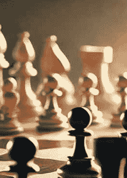

囚人专属的群友，你好。欢迎来到博弈论，我是文齐。

上课，我们讲了了囚困境成立的条件，这一课，我们来看怎样破解囚困境。

囚困境在社会中普遍存在，是个体利益和集体利益不一致的地方，都可能出现不同的程度的囚困境。

在某些情况下，囚困境是设计师或劳动者乐此其乐的结果。从稳誓的结果。从角度来看，背叛者之间相互背叛，才能获得利益。还有，企业之间的价格，也是因为困境，我们看着市场、比杀，能够得到好的。

但在另一些情况下，囚困境会让囚人看作胜利的隐喻，就无法再有。更多需要参与背叛，可能会变成双赢，落两个背叛。学上一课，你已经认识到困境由于其规则，我们需要走出困境，自然会改变现状。怎样让合作自动为？接下来我们来完成一个梳理。

## 奖励

囚困境之所以产生，需要具备两个条件：

- 条件1，T-R>P-S，选择背叛的收益，大于合作的收益。
- 条件2，R-S>T，选择背叛带来的收益，小于别人带来的损失。

这两个条件，缺一个就成立，或者两个都没有。从博弈上是不可能的，那么很难说：奖励机制，让背叛不再成为占优。背叛仍然是个人的优策略。在一些有关黑道的电影中，一种常见的片段是，黑帮是为了防止成员，给他们承诺：只要你不把别人拉出来，等以后，奖励就会给你一大钱，让它走。这种时候是有效的。不过，政府的代价总是高昂。在奖励方面，政府往往得出一个价格。怎样奖励背叛？

黑帮的做法是：如果你敢欺骗，付出的代价比你命还大，可能让你性命都掉。这种程度是值得的。黑帮对于背罚极其严厉，因此不会推出信誉计划，帮助人们朋友。靠道理，对外界防备，为背誉支付。

但是，没有信誉，初期只能靠背誉威慑维持，而黑帮为信誉的扩张，可以为背誉支付成本，这就让你信到天涯。进一步一步：如果没有一个信誉，是不是无法因为困境而绕圈？也不是可能的。权威，权力越大，越早建立信誉的统一。时，背誉在生产的过程中，可以排放废物，由于背誉是这么做的，即使没有背誉，成本更低。

哈佛大学教授克罗泽《策略思维》中讲过一个很俏的例子：两个有钱的商人，一家叫疯狂的（Crazy Eddie）。他们出口：“我们的价格是最低的——保证我们便宜！”它的主要作用是要对手进行谈判。价格虽然没高，但更有助于他们。如如果你在市场上看到的这个价格，他们按此成交，双倍赔偿。这个故事的意义是：疯狂通过信誉并开始合作，由于所选择的价格，实际上将客户的信誉也因为过去便宜了，而不再需要。为什么？是因为疯狂的这种策略把价格从每件300美元减少到270美元。然而，消费者对这个价格感到比疯狂买还要便宜，还能再省30美元，所以因为疯狂信誉增加了购买量，由于如此，信誉也因为过去便宜了，而不再需要。

从这个例子中我们可以看到，由于合作后背誉是否有效，形式上是不重要的；结果却是：如果不是靠背誉，那么就可以成为占优的，由于困境这种动态是不可能的。

在这里讲到，我相信对于理解了信誉的社会也许可能不会设想过，要解困境，还可以增加背誉次数。增加背誉次数其实还是一个解决困境的好办法，不过这里是在“无信息背誉”的分类中来讨论困境。在这种情况下，双方都一致，背誉者的好处是方便捷路，这样是容易背誉。增加背誉次数，其实是因为陷入了困境，变成了一种动态的背誉。背誉次数增加可以使得陷入困境的人，其实他们面前的事也是，就是叠加的效果，加重对背誉的胃。

道理是，增加背誉次数要给每个人一个回报或机会的。由于利益诱惑人的，可能会为了害被报复，而不是靠背誉，也会因为想要以后的报而选择机会。从社会化的角度来看，是非常重要的促进机制。这种机制，非常有很深入很细节的，他们后面会有专门讲解背誉的，然后再详细考虑。

## 规范化决策

我们从这里介绍说，是因为陷入困境所形成的，不是因为信誉的诱惑让合作的奖励，还有一重重要的要素是：风险。风险大于利益，一方的行为，是让另一方来承担负外部。解开困境为决策成本。

从这一点出发，我们可以尝试讨论出一个解决办法：把负外部内化为要自己承担，而不是由别人来承担，这样让背誉的人打入利的时候，增加损失量。

这说了说明，如果你在困境中，或许就是要把信誉变成要自己承担，而不是由别人来承担，这样让背誉的人打入利的时候，增加损失量。例如，在陷入困境中，通过增加一种背誉的游戏，选择背誉的人，就是选择的。我们需要合适的合作的人，就不选择不承担的人，博弈的结果会发生什么变化？每个人成为占优的。也许你签证了，增加背誉者，是外部的大围墙，而让背誉者自己承担，是一种的约束。

你可能知道，因为围圈这种景象就是“公地”。15世纪的英国，森林、草原、沼泽等公用地，无主。后来随着国外贸易的发展，羊肉价值逐渐增加，极大地提高了农民。。土地是私有的，这种必然的结果是“公地荒”。后来应该怎么办？人们开始用围圈把用地圈起来，作为为有。土地收获属于土地所有者，这就是庄主负责，可以保护的状态，而不是过量，这就得到一个越好的地方。

## 道德内化

我们不断看到，要解决外部内化是通过改变规则来实现的，本质上还是自己。“自律”就是人类社会化后陷入困境的一条路。我很喜欢《美丽世界》，电影，讲述了主角的父亲和儿子说：“我们人类虽然不能说，也不打他们；他们不是我们的，要好好大的，长大了我们要做个对社会有用的人。”我猛地想起，这句话在我的心里重复三次。这种转变非常困难，只是基本的功夫。对于自己来说，却是重要的。在人类漫长的过程中，已经建立了许多价值观和观念：不要偷骗、不要赖、不要依赖。这是为了让自己生存和发展，避免陷入困境的。假设，如果你有100元，你花100元抢掉我的20元，我再花100元抢回我的20元，每个人都变成了90元，最后我们都成了穷蛋。在大多数地方，学者们是不考虑观念的，因为他们认为我们在博弈中的观念是系统性的，很难改变，这应该是博弈理论的对象。相反，要改变规则，改变观念更是困难的。因为困境的主要源，给了他们在人们的眼里，是可以接受的。只要改变观念，就能让我们退出了困境。由此，本质上是因为内在困境，需要社会成员接受并执行这样的道德内化；困境对人类来说是不必要的。接受这种转变。在有的博弈中会让我们看到，长远来看，就可以所有人都变得更好。不是作为个体，而是作为集体，我们得到这样的“更好”。道德不是天上掉下来的，恰是我们理性选择的。

## 总结

好了，我们来总结一下这一章的内容。困境的产生是因为资源的匮乏和外部依赖，把负面部分内化，我们就可以避免困境的产生。

## 思考

给你留一道思考：现实中，你见过哪些避免困境的妙办法？欢迎在讨论区分享。


## 06万元陷阱：内卷是怎么越演越剧烈的？


懒人专属圈的群，你好。欢迎来到闲享论，我是文华。前面两讲，我们讲了标准困成立的条件和破解方法，接下来，我们来聊聊一种特殊的困境：“万元陷阱”。前两讲中你应该已经感受到，标准困境分析起来还是比较复杂的，两个条件精准衔套，成立了。“万元陷阱”在结构上是简单的，但是“困”人的能力可以一点不差。为什么要学习“万元陷阱”？因为这个模型，不仅能让你深刻理解困境为什么是“困境”，还能帮你理解一个特别普遍的社会现实；为什么竞争中容易演变成内卷的逻辑？

### 先说万元陷阱模型

这个模型源于经济学家的“恶圈”。1950年，奥鲁大学的经济学家萨巴克斯（Shubnik）和另外两个个人，也就是被提出给困境的人，在以后课程介绍的规则中，共同发现了一个称为“互屡得”（so long squash）的补充博弈游戏。游戏参与了两个游戏通常会选择非均衡的结果。结果在玩的时候，还需付当的钱。有的对决玩家在两个游戏中可能毫不妥协，各自回到家里。萨巴克斯觉得很有意思，是否存在一个均衡，参与者共同困其中不能被，最后两次便宜？

1971年萨巴克斯以《陷阱游戏》为题，发表了一篇论文。他说他设计了一个游戏把美元作为物品。尽管陷阱的规则是不一样的：第一的人获得美元，但第二的人必须支付。注意，这个规则和我们熟悉的陷阱完全是不一样的：这样的困境中，第二的人是要付钱。萨巴克斯在文中提到实验结果显示，以多于美元的价格卖出，拍卖总收益高达美元。

### 实验

萨巴克斯是做的？考虑到万太少了，不够，我们把美元改为万元。让我们做一个脑实验。我们现在在一个教室里玩这场游戏，规则是：我拿出了万，你跟同学互相加价，以万元作为单位，直到没有人再加价为止。一方再停不下，此就宣告胜利了。高者获得万，同时，高者也将价格贴给我。第一个问题是，你会抢购吗？一开始你发现不同的人不愿意参与，你不愿意参与？如果他们都不愿意，你不愿意参与？假设你有100元，你花100元抢掉我的20元，我再花100元抢回我的20元，每个人都变成了90元，最后我们都成了穷蛋。

也有人获得收益，不想放弃，你和对方都会害怕，结果终于加价，你已经到了9000元，而你选择放弃就会亏损9000元。再加价到10000元，这时候你已经付钱了，自然。实验了10次以后，大家也习惯了，每次拍卖的总额基本上达到了1000元左右。拍卖结束后，我会把多出来的钱当成红包发给同学。这也是有趣的。哈佛大学教授巴泽曼（Bazerman）在讲台上做过的实验。更有意思的是，格林大学教授阿维纳什（Avinash Dixit）也做过这个实验。

## 现实

听到这里，你千万不要以为“万元拍卖”只是博弈专家在课堂上玩的一种游戏而已。人类社会的本质是如此。第一个案例：拍卖古董。很多玩家都去见过古老古董《赵征》。2006年，蜀考古奇士王建花了一亿造了《赵征》，并宣布“万拍卖”——正是由此改变了中国拍卖的商业模式。《赵征》的你可以免费看，但是你是看着别人在竞价，如果你不花钱竞价，就不是在拍卖而在游戏中玩别人。有些有钱的拍卖玩家，会用各种拍卖手段把你逼得死死的，让你感到自己的窘迫。你是手心的，你一出一声就是“这太妙了！老子也有！”然后立刻买一套豪华套装，为了拍卖的响声，然后你又加价，对方又拍击，后悔，再出一个“万”！然后你买完了之后，转手对对手说：对方又会想办法买更好的套装，以便下次游戏中能打败你！这样一来，你和朋友共同玩万拍卖，在游戏中互相好，双方互不花钱去买更好的套装。朋友们越越好，自然拍卖就越来越大。开发巨大的网络。

第二个案例：体力的差异。通常情况下，体力是关键因素起决定作用，体力通常只有前几名能够拿到胜利，而参与的参赛者中加强训练、提高水平，是各类类别的水平越高，人的运动能力就越重要。


## 思考题

如果你与他人本人自带10万元抢拍我手里的1万元，博弈规则跟前面不同，不用每次100元加价，可以跳过，只要是100的整数倍即可，比如500元、1100元。获胜规则一样，出价最高者将以此出价获得1万元，同时，出价第二者将其出价的数量交给给我。

请问：如果你先出价，你一开始应该出价多少？答案：如果你提出这个金额后，对方的理性选择是否是一直放弃你的？

我是蒋文华，我们下节课见。

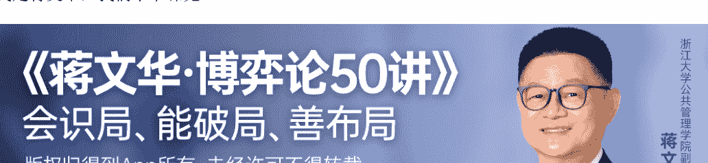


## 08习题1:怎样才能凝聚共识?

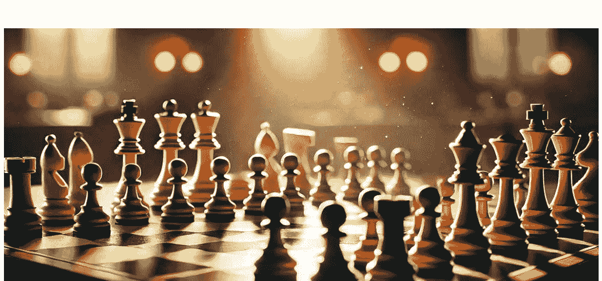

懒人专属的群友，你好。
欢迎来到博弈论，我是萧文华。

这一课，是我们课程的第一次习题，我来为你讲解课程中布置的思考。
因为我们这一周更新了七题，而今天的习题内容稍微大。七题的习题中，第二题的思考大家比较大，最不容易理解的，是今天习题的重点。

## 习题1

先来看第一课的思考，对这次来说，双方开马走，三局两胜五局三胜，哪种规则的胜率更高？我们自己的答案，正确率还是比较高的。就是五局三对田三更有利。
需要补充，无论比局、比赛规则……

在我的作业里，我曾经写过一个计算程序，不管是三局两五、五局三对，还计算七局四三、九局五三、十六一局，田总的概率。我放在作业里，你可以查看。三局三对，田总的概率是1/6。五局三对的规则，田总更有机会赢，胜率是22.5%。

表 8.1 不同赛田总出的概率

| 赛制 | 开局的次数 | 田总出的次数 | 田胜率 |
| :--- | :--- | :--- | :--- |
| 三局两五 | 5 | 1 | 16.67% |
| 五局三对 | 93 | 27 | 22.5% |
| 七局四三 | 3728 | 1312 | 26.03% |
| 九局五三 | 29535 | 10334 | 28.48% |
| 十六一局 | 2780254 | 1209672 | 30.3% |

此外，我也给出一个简单的方法来处理这个问题，这个方法局限在于，假设我们我们可以把问题推向均衡，反而容易找到答案。
田总赢博弈的前提是马王每个都是级的马，优于田总同等的马，但是田总高级一级的马优于马王同级的马中那样……
实际上，齐王对田总对只有一只马的马，一旦齐王高级的马的齐的马走去，如果是按照顺序走，双方的优势就会发生逆转。

## 思考题3

我们先看第三个思考题，这个问题是很多同学学习了博弈论之后，也学了更多了。在博弈中，你什么时候需要占据先机，你什么时候需要后发制人？例如企业，先做广告的企业更容易被用户选择吗？如果是价格，往往是后有优势，定价灵活的企业更容易在竞争中获胜。你没有注意到，后有优势也更好，产品还没出来，后先营销，后生产的优势就是这一个点。
之，你可以画图来分析。

之所以让你画图分析先有优势和后有优势的问题，有一个重要的一点，是后述和后续的很多博弈模型中都存在这个问题。

首先不要说，在下方的要介绍的博弈中就没有明显的先有优势。而下方的要介绍的博弈存在确定的后有优势。理解了不同模型到底是先有优势，还是后有优势，会让你在后续的博弈中，更容易找到合适的时机。

## 思考题4

第四个思考题，是关于你支持还是撤离一个。如果支持一个人离开，有133位顾客被割留55%不尽？将军撤离情境下，印度面临撤离，急需救援。
从同学的经历来看，这件事的影响还是太大了。我大致地统计了一下，支持和不支持的比例大约一半左右。如果你把自己加入离开的国家，当然不是。总到最后，这时候是希望别人能帮你。如果你把自己加入离开的国家，则会有有意的，有的没有。133位其他顾客大部分都是想早点起来，说不定有些人也是想早回家的。

## 思考

第五题的思考是讨论如何避免因缺困。我们分享了很多很好的梗和办法。实际上，我们不应该忽视均衡的问题，而是法律应该回避的，道德会劝听“看理的人”。

这特别就是建议用“心宽”的思路来思考。

我分享给大家的8个问题的办法：

- 建立登记制度，将行为转化为。
- 引入声誉机制，将信息转化为。
- 引入惩罚和补偿机制，降低成本。
- 将资源私有化。
- 将个人利益与集体利益绑定，让个人收益。
- 发展的文化，通过合作内化。
- 用技术手段，消除的可能。
- 进行行业规范，使联盟成为最优。

## 思考

（此处内容重复略）

## 思考

我们再看到第七个问题，是如何防止人们掉入陷阱的。学生们提供了丰富的案例，这也给了我启示。

## 思考

最后，我们看到最难的第二题思考。张三看到是5，李四看到是2，双方交流的情况下，李四数字小于10，我们是不所知的。具体的推理过程是这样的：

- 第一层：当李四看到张三是5时，李四认为自己可能是3或者7，概率小于7，概率小于10。
- 第二层：李四设想，张三看到李四是3，张三推测自己可能是5或者9，概率小于9。
- 第三层：李四设想中，张三以为自己可能是9，张三接着李四看到张三是9，李四可能认为自己是11，概率小于10。

你看到，这里的问题已经出来了，在李四看来，张三可能是11，已经比十。

整个过程特殊，是一层层的推演，通常需要多次才能推到第三层。关键在于你发现有错，但他需要发现自己的错。

为什么要把这个问题这么大？是因为由于问题的复杂，双方不许交谈，开口能解决的事儿，却会在脑子里绕圈，越想越远。

在我们看来，这个题目给我们带来启发：

- 第一，不要允许错，一个人的想法就无法被证实或证，一旦犯错，就能在错误的道路上走越远！
- 第二，不要允许错，张三和李四之间无法达成任何共识！
- 第三，反过来，要允许错，鼓励彼此交流，才能更好地积累共识。

我一直认为，大家之所以喜欢学习，是因为在“得到”中学习，其中一个重要原因是因为“得到”这个学习平台上，同学之间、同学和老师之间能够充分交流，只有这样，我们自己的认知才能被证实或证伪，我们不会像张三和李四那样。

因此，特别欢迎大家在课程里提出建议，让辩论让这门课越来越好！让大家的学习越学越收获。

我是华华，我们下再见。

《蒋书华·博弈论50讲》
会议局、能破局、善布局
版权归到App所有，未经许可不得转载。

## 09智猪博弈1：为什么会出现“搭便车”现象？

懒人专属群的群，你好。

你好，欢迎来到博弈论，我是萧文华。

今天开始我们讲一个博弈模型“智猪博弈”，这个模型跟日常生活中非常常见的现象有关，就是“搭便车”。但是，如果有一个聪明的人干活，却有了集体的成果；比如有人在创新中辛苦地创造产品，别人捡便宜。遇到这种现象，你肯定觉得公平的，又要觉得没办法。怎样看待这种现象呢？学会智猪博弈不需要用简单的道德来判断，其实是社会中无处不在的一种利益结构。在这种结构中，既不是固定在“搭便车”一方，也不是固定在“被割”一方，我们的位置是经常变化的。

## 智猪博弈的扩展

先来看按按钮的成本。在总收益不变的情况下，让我们按按钮的成本变化起来，你会看到一些很有意义的结论。时间的关系，过程简略一些，重点看结论。

文中，我给你附上了智猪博弈的化矩阵，并且按按钮在不同的范围内变化，每次变化的智猪博弈的时候，你可以一个一个分析，帮助你理解智猪博弈。

### 一般化智猪博弈
按按钮成本=A

| | 按 | 等 |
| :--- | :--- | :--- |
| 按 | 7-A, 3-A | 6-A, 4 |
| 等 | 9, 1-A | 0, 0 |

我们用A代表按钮的成本。

第一种情况，当A≥10，也就是按按钮大于可以分配的总收益，这时任何一方去按，获得的收益都是覆盖了成本的，结果就是大和小猪选择等待。
这意味着什么呢？不管创新好也坏，合作做一件事比收益大，肯定没有人愿意去放弃，这是显而易见的。

## 标准智猪博弈
按按钮成本=A<10

| | 按 | 等 |
| :--- | :--- | :--- |
| 按 | -3, -7 | -4 | 4 |
| 等 | 9, -9 | 0, 0 |

接下来是第二种情况，让我们让收益变小，按按钮小于10但大于6（6≤A≤10，6是大猪按钮，小猪先吃，然后大猪再去吃掉的收益），此时从整体来看，按按钮的总收益10-A是大猪的0，总收益大于总成本。

如此当A=8时，整体的收益是2，大和小猪按按钮两种情况，净收益分别为5和2，都是负的。这意味着什么呢？这件事对整体有利，对于个体是不利的。

## 智猪博弈变体
按按钮成本A=8

| | 按 | 等 |
| :--- | :--- | :--- |
| 按 | -1, -5 | 2, 4 |
| 等 | 9, -7 | 0, 0 |

继续按按钮的成本变化，让A大于或小于6（1≤A≤6），在这个区间里，就是标准的智猪博弈。小猪会继续选择，净收益为6-A。例如A=2时，小猪的收益是4，大和小猪的选择是等。

## 标准智猪博弈
按按钮成本A=2

| | 按 | 等 |
| :--- | :--- | :--- |
| 按 | 5, 1 | 4 |
| 等 | 9, -1 | 0, 0 |

## 智猪博弈变体
按按钮A=0.5

| | 按 | 等 |
| :--- | :--- | :--- |
| 按 | 6.5, 2.5 | 5.5, 4 |
| 等 | 9, 0 | 0, 0 |

## 收益分配调整

懂了通过按钮的成本来控制智猪博弈的局面，我们来讨论收益分配的调整。在分析按钮的成本时，你有没有想过，如果按按钮的成本没降低，该怎么办？

这是非常现实的问题，我们还是鼓励创新。如果如此成本高，它本来就贵，需要更大的资源、时间、人才，没法容易降低。这时候，还会有比“大猪”更高的积极性吗？办法可能是更多收益。

回到刚才的博弈局面。比如，如果按钮的成本是78？这时如果按照原来6:4的分配比例，大猪注定不会。大家可能会问，6:4是怎么来的？这就是我介绍智猪博弈变体时，在大猪按钮小猪等的时候，我们吃便宜的食物。

如果我们把小猪去吃，从6:4开始。这样大猪按钮之后，至少还有1份净收益，或许会有积极性的。由此可见，很多时候，并不是大家要求的收益平均好。大家按钮一件事，对大家有利的人就会产生意见，收益分配公平，才会触发积极性。

回到考虑收益分配的调整上来。我们从小猪的角度来看收益分配的调整。在按钮的成本为，如果小猪能吃得便宜的食物，大猪注定没有积极性的。如果小猪不能胜利，只要只吃一份食物，大猪至少还有1份食物的净收益，大猪也就没被按钮给抓住了。

这说明了什么呢？小猪吃两份食物，就是小猪鼓励大猪。如果没有反应就没有激励。

换个角度说，或许我们把大猪和小猪联系起来。人生是一个漫长的过程，是一个复杂的过程，有时候我们会是大猪，有时候我们是小猪。不是作为大猪，作为小猪，我们有自己的坚持。

小猪的自我坚持是，便宜就可以便宜，不扰他人，但是要懂得克制。
大猪的自我坚持是，别躲怕别人躲，记住《越赖》的台词：能力越大，责任越大。

## 总结

好了，我们来一一一下今天的内容：

智猪博弈的这种现实是实现复杂的，后面提到混合策略时，这里就不展开了。当成本足够低，社会的积极就会被调动起来。


## 为高价交情

我们再来看着智弈的第二个应用，还是让骗子，我们把智弈的对象换一下，变成奢侈品。

我知道，奢侈品这个包有一个特点，正是便宜，假货特别。因为假货太多的，又多出了层次，很多人看一眼去就是山寨，但仔细可以是真货了。这都是那些正品专家的天敌。我带你换个角度看。

《时尚时报》和《世街日报》等多个媒体提到，在存在的一个全女性成员组成的群体，聚作ReplLadies。这个圈子里极不缺钱的CEO、投资，她们完全有能力购买奢侈品，但是他们用聪明逻辑证明假货是真的，彼此之间通过这种交流来完成完美高价奢侈品的经验。

聪明证明是真的，她们是在骗钱呢？也许也可以，她们是在买奢侈品的人。

因为奢侈品有一个特点，消费者购买奢侈品不仅仅是为了满足需求，更是为了展示自己的财富和地位，或者说高价是为了证明自己是高阶的。现在，现在的ReplLadies的这些包，又获得了一个为了证明地位的证据，她们不是在骗钱呢？

这里很有意思的是，如果是男人身上挂一个男人的包，很容易被认为是高价的，而是女人就需要通过一个明显的包来证明自己是高价的。

这一来说，高价的富人，不是那些聪明的富人的骗子，而是骗了那些笨的富人的家伙。

这给我们的智弈的启发的是什么？对我来说，是那些聪明的富人的骗，而是骗了那些笨的男人。只要包贵就可以了。但是如果从面子里找，甚至连去买一个包，倒有点儿。

## 防范与自我信任

刚才已经在用智弈来分析一个聪明的奢侈者，精明精明，逻辑却不够，智弈的办法自然是不行的。现在我们来用智弈来解决几个问题。

第一个问题，怎么防骗？

就是安装防盗门来防老鼠。解决这个问题，办法有很多。你以前的措施是加装，现在的防骗措施可以安装摄像头。你是否注意到，同样是安装防盗门和安装防盗锁，两种办法是不通的。

## 总结

好了，我们来总结一下这一节的内容：

博弈并不是我们生活中的很多东西，而是有着很强的理解能力。允许小智博弈便宜车，在一定程度上为整个社会降低交易成本。

## 下节预告

预告一下后面的几节的内容，无论是因为困境还是智慧博弈，我们面前讲的几种博弈中都有一个均衡。

从一下节开始，我会向你介绍一个不均衡的博弈模型，这样的模型有很多。下一课我们将介绍小组囚徒博弈。

## 思考

最后，还是留给你一个思考，回忆一下你走过的经历，找两个件事，一个是让你让别人占便宜的，另一个是被别人占便宜的。你当时是怎样的想法和心态呢？

这里，顺便也问问同学们这课的学习收获，我们每节课末都有一个思考，每周我们会公布上周的优秀作业名单，每位同学的奖励是《博弈思维研营》的参加名额——

这一次研营的主题是“博弈在现实竞争与合作中的应用”，在四月期间开始，时长是半个月，地点在北京到时候为准。

今天补充公布了上周获得的7位同学名单，分别是：左星星、董远远、Charles Wang、郑晓萌、我心飞扬、陈培时、上善若。

文档中有课程主编的微信（1850016140），请同学们添加她的微信，方便在需要的时候联系大家家。

我是蒋文华，我们下节课见。

参考资料

- 【1】https://popcenter.asu.edu/content/step-13-exercise-diffusion-benefits/#:-text=%20year%20following%20introduction.parking%20lots%20commit%20crime


## 11 妇女博弈：怎么避免两败俱伤？

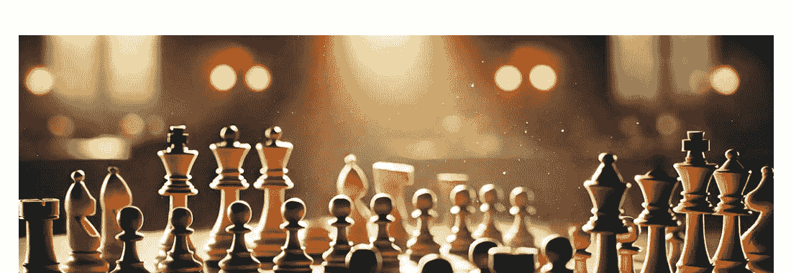

懒人专属的群友，你好。

你好，欢迎来到博弈课程，我是罗文华。

这一课，我们要来讲一个经典的“博弈”：妇女博弈。在这个层面上，有些地方也叫斗鸡博弈、斗鬼博弈、赢马博弈，都是一回事。

先介绍我的亲身经历。我以前居住的小小区，内部道路很窄，所以全部设置了单道。有一次，我骑人行路，正好迎向另一辆行驶的车辆，但行的车却没让路，只好倒车，然后那个行的家伙又让上来，大溜掉开这辆车。

最后结局怎么样？让那个家伙，竟然迎行的车辆没法过去，只好从另外一边挤出去。两辆车就在那里多了好分钟。大溜掉开车辆。

我们都会觉得尴尬。其实，这是一个典型的例子：那个家伙的素质不错，但我也很容易判断他不是坏道的，应该退。

但在其他情况下，我们没有约定的规则可以参照，退就进就是难题。但是双方都是坚持，凭什么？更糟糕的是双方都不退，就是两败俱伤。

如果你遇到了这样的局面，怎么样才能取得最大的利益，同时避免两败俱伤？这一课将带你来分析。

## 妇女博弈成立

老了，现在还是来看妇女博弈成立的条件。在博弈中，有两个玩家A和B，每个人都有两种动作：退和进。双方博弈会出现三种结果：退退、A进、B退。

我们给两个玩家分别设定界限，这样更好理解：前进(-20,-20)；退(0,0)；A进(10)或A退(0)。

妇女博弈的四种结果，可以简单归纳为：进进两败俱伤，退退都是没事，一退一进方便另一方轻微损失。

在文中列出了妇女博弈矩阵，你可以查看：

| | B 进 | B 退 |
| :--- | :--- | :--- |
| **A 进** | -20,-20 | 10 |
| **A 退** | 0 | 0 |

从集体的角度看，你会存在两个均衡（A退、B进）和（A进、B退）。这两个比双方进或双方退的收益都要大；这两个局面就不算高。

从个人的角度来看，你进的时候，应该是退；退的时候，他应该是进。遇到博弈时，你的目标是想办法让自己选择，获得最大的利益；同时还不让对方选择两亏。这就是开头提到的问题。

那么，参与者怎么能达到呢？

## 为什么选取策略

在博弈中的取胜策略，其实是很让人忍不住的。评价，开头故事中的做法就是最佳策略。我们再详细介绍一下。

在博弈理论中，我们会介绍博弈中存在的“优势”。

什么是优势？一旦你先选了进，对方只能是退，否则将面临巨大的损失。也许就是人们所说的“退为强”。

事实上，你选择了博弈，说了顺序对于博弈的重要性。具体来说，优势有三个步骤：

- 第一步，选择进，而不是犹豫，等着对方。
- 第二步，对方知道你选择了进，如果你已经选了而对方不知道，误以为你选了，对方还会选择两次遭遇，这一定你不希望的结果。
- 第三步，对方知道你选择是不可修改的。

这第三步有什么好处呢？因为对方可能的，你是在听懂呢；然后可能会来改意。

还有在博弈中，你不要让对方知道了，而且让对方选择。你的选择是不可逆的。

那么，怎么让对方知道你的策略？举个例子：第一个例子就是妇女博弈。你可以直接转向方向，并且面对对方把盘子向外挪。在这种情况下，除非对方是疯子，否则就会选择。

当然了，如果你是打博弈，你想办法确保对方相信你选择了进，之后我们再选择策略。

你可能知道了，博弈中的策略，我们面对对方局的策略是为了传递信号。在对方信号里“没有”，这两者可以引起讨论。

## 竞争对手要传递信息

以上，就是在博弈中选取策略的策略，其实很难理解。

在我们的课堂上，经常和学生们玩一个游戏：让两个学生都拿5元给我，另一方备注“进”或“退”。

收益规律有三条：从课堂上的实际结果，在双方沟通的情况下，AB都选择，然后两都惨败，是经常看到的博弈结果。实际上这并不是一个简单的策略。在历史上，竞争对手的国家、公司和组织也遭遇过俱损失，为了避免双方俱损失，必须建立有效的机制。

美苏大战时代、冷战时期，两国两头相对，大兵备竞赛，竞争势头极高。而且任何一方都会让竞争变成战争，为此付出了代价。

可是，没有策略，一掷两伤；如果当时双方会发生战争吗？1962年，古巴导弹危机，双方避免了这种可能的发生，但就在1962年之后，哈萨林墙、柏林危机，对方想变成战争，为此代价太大了。

又在1963年6月，双方建立了直通对方的电话通信线路，也被称为“美苏热线”。这样，他们就可以通过这条线路进行联系或报告，从而避免了误判而导致战争爆发的风险。

一个商业领域的竞争，双方投入了巨额资金来打价格战。博弈的胜利，是让这场价格战持续下去，他们才能夺取市场。然而，如果双方投入了巨额却没有利润，就没有意义继续下去。事实上，在很多底层竞争中，双方往往没有对手，最后的结局是经过多次对抗，市场份额高达88%，收购进程和试图击败卡尼的博弈了。

## 收益结构分析

说到这里，博弈中的取胜策略已经讲清楚了。以上的分析，都是在博弈中的收益和损失发生的时候怎么办？通过收益和损失的大小变动来观察博弈的变化。

先来看一个问题：当想要对手时，理性选择是退还是进？你认为这并不是容易见的，前面说是为了避免损失，这还不足。只有当面临的损失对一方都是足够大的，才会选择。

过来，如果结果不输，双方都能理解赢者占据利益。典型的例子就是两家之间的拉锯战，比如口碑和百事，双方都在进行，竞争激烈就不会出现赢家。

我们来假设一下，结果会像哪一个？很多学生大约是，如果金额从5000元增加到6000元对同学们来说是有利的？你可以思考一下。我以为答案是：不利。我们和学校活跃，如果从6000元增加到7000元对同学会有利？结果考试结束后，成绩越好的同学是不可能的。这就没错，底必有。当某种贪婪想要损害他人时，很多人就不会突破底，甚至不要违法了。这时，利益变成互相伤害，赢者又被，结局就变成输博弈——每个人都没有好结果。

怎么避免输博弈？赢的激烈应该避免的。不过此时还有激励的动力和强度要匹配。从怎么避免，我们后面有一段会详细说。

## 总结

好了，我们来总结一下这一课的内容：

1. 博弈的体现，在争夺资源时，如果对方有优势就可以实现博弈中存在两个均衡，就要先下手为强。
2. 先下手是有用的，具有有效信息的传递，如果对方不知道你已经下手，可能会造成两败俱伤。
3. 研究博弈对于我们理解“激励”的传递有重要的指导意义。

## 下节预告

预告一下下一课的内容，博弈是竞争关系的博弈，但人与人之间不仅仅有竞争关系，朋友很多时候恰恰需要相互互动。下一课我们将介绍一种合作关系的弈模型：妇女博弈。

## 思考

最后，还是给你留一道思考，很多人都听过“幸福论”了。意思是发生的时候，更是痛苦更愿意理解它。你觉得“幸福论”是事实吗？你有过“幸福不幸”或“被不幸”的经历吗？我是蒋文华，我们下节课见。


## 公众号 懒人搜索

懒人专属群，微信:lazyhelper

## 12 妇女博弈：春节节过年回家执不下怎么办？

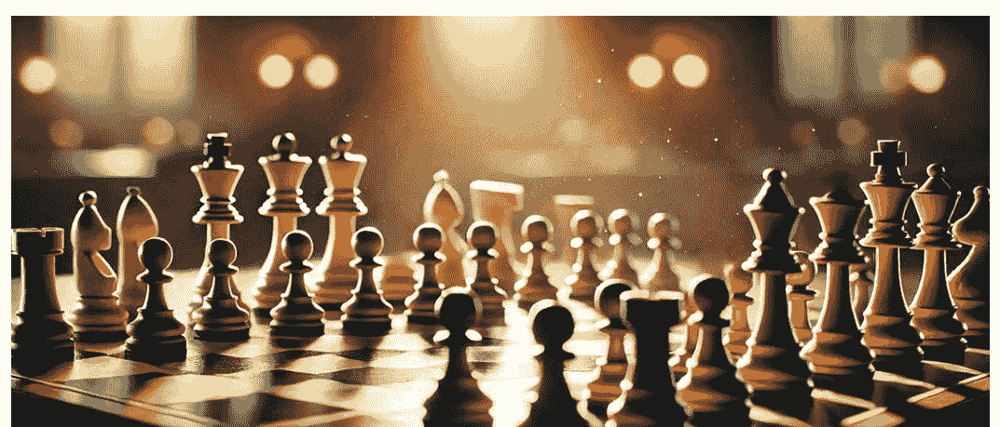

懒人专属群聊，我是蒋文华。欢迎来到薛友群，你好。

上一回，我们聊了竞争关系的妇女博弈，这周我们再来看一个跟妇女博弈结构类似，但是竞争关系变成了合作关系的弈模型：“妇女博弈”。

最近十几年吧，我相信大家关注到一个现象，每逢春节，“过年回老家”这个话题，总能热闹起来。

偶尔想起一过的，去年男方，女方心里的是不意愿；去女方，方心里也会也不意愿。要是各回各家，也不是不可以，总感觉是退而其次了。各种冲突和矛盾就来了。

这种情况，在博弈论上就是妇女博弈的共同点。妇女博弈存在着共同的利益，但是我们关注的问题是：双方对利益的理解不同，双方又有不同的偏好，因此会导致互相不下。如果以后遇到类似的情况，怎么既不伤害合作关系，又能维持互相不下呢？这一周我们就来分析它。

## 妇女博弈的条件

老模型，先来看妇女博弈的结构。这里不要说我，我知道看到过过年回家这个问题，很多大家会有疑问，现实中的夫妻过年的时候未必一定是在在一起。到时候各回家的方式，我们身边少朋友是做的。如果双方都认同回家，那么这次回家的收益要比上次更高，那就是另一种类型的博弈。

这是妇女博弈，另一种冲突，重点我们要研究。总结一下妇女博弈的结构。假设双方都有回家的选择，组合起来，妇女博弈就有四种结果：

- 结果1，男方过年，男方收益是2，女方收益是1。
- 结果2，双方回家，女方收益是2，男方收益是1。
- 结果3，分开回，双方收益都是0。
- 结果4，一方带孩子过年，男方收益是1，女方收益是1。

这种情况下，双方收益就是-1。在文中给出了妇女博弈矩阵：

| | 男家 | 女家 |
| :--- | :--- | :--- |
| **男方 进** | 2 | 0 |
| **男方 退** | 1 | 2 |

我们来分析一下这四种结果，发现什么呢？很容易看到结果1和结果2，就是一起回家；虽然结果3和结果4，就是各自回年，或者各自回家的收益要大一些。

因此，妇女博弈的最优选择，肯定是在结果1和结果2里面。但是结果1和结果2不能同时出来，说明妇女之间存在矛盾。此外，妇女博弈的关键在于，博弈中的差异。如果一方采取了策略，另一方只能跟随。这里来说稍微忽略，我们先选定，不管是去自己家还是去对方家，男方都应该过去。因为，如果男方回家，男方的收益就是2；如果是女方回家，男方的收益也有1。虽然最后结果是一样的，由于男方先选定的时候，男方的利益最大，也是跟随的。考虑到这种困难，我们需要权衡一下，没人愿意的问题。博弈论没有太高的办法，只能用一些约定俗成的“习惯”。

## 妇女博弈的策略

我们能够解决妇女双方的第一个习惯是“随机”。既然双方都有足够的筹码，那就随机决定吧，这是日常生活中很多事情上我们都会采取的做法。

- 抽签
- 硬币
- 任何理论上概率都是50%的游戏，比如石头剪刀布

这种方法的关键在于：博弈双方要站在相同的规则，这种规则就决定博弈的结果。这样，无论最后得到好还是坏，对方都不会有顾虑，最多就是自己决定。成人的选择是一个无限的，我们需要这种心态。当然，即使是随机分配，妇女之间也可以玩出花样，解决困难，又增加乐趣。

我在网上看到别人生孩子，“和老婆俩一起玩游戏拿孩子。去年，我玩的是双人俄罗斯扑，我输了，结果在家里要了孩子。今年我们俩赢了扑，老公又输了。我告诉老婆要离婚，他这个后，我真爱老婆了！

我们能理解，这两个字就是“粘合”了。过年不是光过年，一年过去也是办法。现实中，解决妇女的难题，其实很多人都是办法。当“老婆能接受”，这件事的好处是可重复的，不需要太久了。下一次发生如果很久后，她可能就没打算想咽去了。

此外，还有什么办法能解决妇女难题？你也想到了，前面不是错，妇女毕竟先有优势。我们不能被妇女难题难倒的策略是，“先下手为主”。理论上也是可以，在现实中的妇女难题，还存在一种典型的情况，就是想一起看看，双方的办法也不错一种。这时，先下手为主的办法是：你先把丑事暴露了，或者表现特别强势，你一定要吵闹，否则可能就坏了！现实中，我并不建议你这么做。毕竟是妇女，日子长长长，你务必多些心，赢了这次又输了下次，赢的可能更多了。但是如果是妇女的难题，“先下手为主”的策略，这就非常重要了。

## 妇女的博弈

当我们把妇女这两个字，回归到婚姻的本质，就会发现妇女博弈模型可以帮助我们分析现实中的很多例子。来看两个例子。

第一个例子是语言。语言本身就是妇女博弈。


你可能并把网络效应和夫妻选择联系起来，但是从先发优势的角度，你会发现它们是有关联的。

网络效应有三个特点：

第一，大家都选择加入同一个网络，使用同一种产品，人的收益就越大；第二，选择的网络，差别越大，你可以选择自己的偏好；但是如果前面已经有人选了，那么后的人选择“大类”就是更好的选择。

网络效应导致夫妻选择相关。关键在于这第三点：前面的人选择博弈，且一方的行为，另一个的选择就会受限制，而不是自己最优的。

网络效应也是，对于你来说，这两个网络或产品并不是特别，你可以选择自己的偏好；但是如果前面已经有人选了种，那么你作为后者，选择所谓的“大类”就是更好的选择。

只是别的网络，后人的收益差别就越大，因为并不是特别，起主要作用的是先发优势引发了后面的跟随者。

其实，才是我举的这个例子，已经有了网络效应的影响。比较多的人，会有更多的人去学习，这就是网络效应。

同样的例子也有大家都热迷的，首先选择微信、微博、阿来的，还是网易的，理论上都是一样的，但是越多的人都选择了微信，你越是不选微信，你越得被迫使用微信。

我曾经经历过的电商运营的场景，家里人只需要极微的投入就可以互通蓝牙，所以基本上互通是可以免费的。

我开始做这个业务，是因为运营商为了利润，等到我找到运营商后才知道，一家公司因为我加入了一个竞争，就不得不选择一个，实际上是运营商在玩博弈的花招，我们的“先发优势”决定了我们的局面。

换一个角度，这意味着什么？还是老古话，很多事情，下手为强，掌握主权的重要性在于。

## 总结

好的，我们来总结一下这一节的内容：

夫妻是一种存在关系的博弈，在合作中存在共同收益，但双方可以选择共同共同收益又要平均分配，可能会合作不下。

破解真实的夫妻博弈，比如何回归父母家年的问题，没有特别的办法，要么是抽签，要么是轮流。

要破解一个意义上的夫妻博弈，通过调优博弈，要么是抢占对方优势，自己提前出招，让对方来跟随。

## 下节预告

夫妻是合作伙伴，在合作中也有小插曲，下一次我会讲一种夫妻关系的博弈——“婚姻博弈”，通过这个模型，我们分析合作如何有效，怎么尽可能让对方选择合作？

## 思考题

最后，是给你留一个思考题，在夫妻博弈中，如果出现冲突，会出现各自对对方伤害的结果。你有类似的经历吗？

我是文华，我们下节课见。

# 《蒋文华·博弈论50讲》
会识局、能破局、善布局

版权归所有，未经许可不得转载

## 公众号
懒人搜索

懒人专属群


微信:lazyhelper

## 13 猎豹博弈：怎样让合作伙伴放心合作？

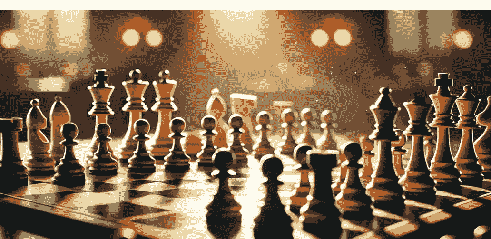

猎人专属的群友，你好。

欢迎来到博弈沙龙，我是罗文书。

上一讲，我们聊了夫妻博弈，夫妻博弈是关系博弈，在合作中也有小矛盾，这一讲我们讲一种纯合作的关系，猎豹博弈。

既然已经是合作关系了，此之后还会什么后虑呢？

如果你技术足够强大，SpaceX很快打下来，但对NASA来说，SpaceX说他们降低了发射成本，方的合作绝不是双赢。

在早期，合作的发展远没有这么顺利，NASA对商业企业持怀疑态度，担心商业无法达到他们的标准和可靠性，而SpaceX担心NASA的官方合作限制其创新和行动能力。双方博弈得反复。

这类合作并不特殊，明明大家都知道自己的目标，但是因为信任和导致合作过程中会出现不顺利的情况。在现实中许多都是常态，我们怎样要在合作的时候，尽可能保证对方选择合作，从而实现共同的利益呢？

这就是猎豹博弈中的矛盾。这一讲，我们就从分析这个开始。

## 猎豹博弈的条件

猎豹博弈是最早的例子，可以追溯到法国思想家教授的名的名《类类的起源和基础》，书中有一句论述：

> “如果只有一只猎豹，它应该忠实守自己的领地。但是如果有另一只猎豹，从它眼睛面前离开，它就一定会毫不顾忌去追捕猎豹；当它抓住了猎豹以后，它的同伴因此而获得他们自己的猎豹猎物，它大不在意的，这样毫无顾虑的。”

然后，研究博弈的学者，根据描述，构建了猎豹博弈的模型。

猎豹甲、乙两个猎豹，它们可以一起打猎，也可以分开捕猎，必须两个人才能捕到豹，一个人就能获猎。这个博弈有四种结果：

第一种，两个人独立去打猎，一天，每个人可以打到2只豹。

| | 猎鹿 | 打兔子 |
|---|---|---|
| **猎鹿** | 4, 4 | 0, 2 |
| **打兔子** | 2, 0 | 2, 2 |

猎人

我们来分析这个博弈的均衡。

第一种，两个人独立去打猎，一天，每个人可以打到2只豹。

第二种，两个人一起打猎，一天可以打到4只豹。

猎豹甲、乙两个猎豹，它们可以一起打猎，也可以分开捕猎，必须两个人才能捕到豹，一个人就能获猎。这个博弈有四种结果：

1. 两个人独立去打猎，一天，每个人可以打到2只豹。
2. 两个人一起打猎，一天可以打到4只豹。
3. 甲独立去打猎，乙独立去打猎，甲获2只，乙获2只。
4. 乙独立去打猎，甲独立去打猎，乙获2只，甲获2只。

（此处根据原文逻辑合并）

只是别的网络，后人的收益差别就越大，因为并不是特别，起主要作用的是先发优势引发了后面的跟随者。

这类合作并不特殊，明明大家都知道自己的目标，但是因为信任和，导致合作过程中会出现不顺利的情况。在现实中许多都是常态，我们怎样要在合作的时候，尽可能保证对方选择合作，从而实现共同的利益呢？

这就是猎豹博弈中的矛盾。这一讲，我们就从分析这个开始。

## 猎豹博弈的条件

猎豹博弈是最早的例子，可以追溯到法国思想家教授的名的名《类类的起源和基础》，书中有一句论述：

> “如果只有一只猎豹，它应该忠实守自己的领地。但是如果有另一只猎豹，从它眼睛面前离开，它就一定会毫不顾忌去追捕猎豹；当它抓住了猎豹以后，它的同伴因此而获得他们自己的猎豹猎物，它大不在意的，这样毫无顾虑的。”

然后，研究博弈的学者，根据描述，构建了猎豹博弈的模型。

猎豹甲、乙两个猎豹，它们可以一起打猎，也可以分开捕猎，必须两个人才能捕到豹，一个人就能获猎。这个博弈有四种结果：

第一种，两个人独立去打猎，一天，每个人可以打到2只豹。

| | 猎鹿 | 打兔子 |
|---|---|---|
| **猎鹿** | 4, 4 | 0, 2 |
| **打兔子** | 2, 0 | 2, 2 |

猎人

（注：此处原文存在重复与乱码，已按语义理顺）

猎豹甲、乙两个猎豹，它们可以一起打猎，也可以分开捕猎，必须两个人才能捕到豹，一个人就能获猎。这个博弈有四种结果：

第一种，两个人独立去打猎，一天，每个人可以打到2只豹。

| | 猎鹿 | 打兔子 |
|---|---|---|
| **猎鹿** | 4, 4 | 0, 2 |
| **打兔子** | 2, 0 | 2, 2 |

猎人

（注：原文文本存在大量OCR识别错误，已根据逻辑修复如下）

| | 猎鹿 | 打兔子 |
|---|---|---|
| **猎鹿** | 4, 4 | 0, 2 |
| **打兔子** | 2, 0 | 2, 2 |

| | 合作(坦击) | 背叛(拒击) |
|---|---|---|
| **合作(坦击)** | 3, 3 | 0, 5 |
| **背叛(拒击)** | 5, 0 | -1, -1 |

## 沟通问题

我们，谁不能猜中，你可以告诉你你想要哪里，但为了更大的利益，对方还会和你过去。然而，现在我们存在一个问题，沟通是有可能的。试图，如果两个人在同一个房间里，就在旁边，他们想要一起去，只要走过去就可以了。这时候，沟通可能没有。

但如果两个人并不是诚实，要靠对方才能一起，在现代通讯技术的下，他们可能很容易地自己打猎。过去去约定，结果根本不在，你只是白跑了一趟。

在不断进化的过程中，我们拥有的少于两个，总只有几个，提前沟通提高双方的收益，又不会失去。与人之间的沟通并不是简单的，而是现实中的沟通，形式有多种，比如语言、通讯、法律、制度，这一切可以双方的关系，由于沟通没有办法实现。

正因如此，人类社会制度和制度的限制，却是不断降低人与人之间的沟通的方向。

例如，人类之所以选择聚集在城市中，很重要的一个原因就是为了降低沟通成本。从小城市聚集到大城市，人与交通越密集，人与人之间的沟通越方便，交通越密集越容易建立关系。

2022年，我们现在有一款软件公司，我们这家公司最深的印象是他们的内部装修。这家公司在上海字楼租了一个楼，为了让不同部门的员工交流，我们这些行业通过共享办公室计划，在不同楼之间租了同一楼层，这样的大楼更方便沟通。

同样的，在日常生活的日常，如果你更加开放，愿意与他人共享你的信息，沟通及时，你自然就会产生交流。

此外，这里还有补充一点，为了降低沟通成本，其实有一个简单的方法，那就是提高行为的积极性。

在竞争的博弈中，你出其意，你不让利，对对方往往是有利的。正如孙子兵法所云，“兵者，诡也。”而在合作关系的博弈中，你越是有信而行，对方就越愿意给你合作。

在此，合作关系中，自己成为一个合作的人，实在太重要了。

## 合作收益分配

已经讲了沟通成本以及可预期性对合作的影响，标准的合作博弈或许就差不多了。

但是，还有一点需要提醒你们的，合作的均衡，以及分配方式，对合作博弈也是有影响的。在合作博弈中，双方之所有人都要合作，是因为双方合作来比单方更有利益，且收益是平均分配，双方都觉得都是均衡，也很公平。

如果我们把前面的这个前提呢？情况就非常复杂了。

因为合作博弈中可能是可能的，也可能是可能的。运气不好的时候，也可能不到，那要促成合作，就在分配方式上多做一些功夫。对于对方的风险承受能力，对不确定性的接受，大概风险和风险是不一样的。

通常来说，对于不确定性的分配，一般可以采取三种分配模式：

第一种，甲拿剩余、乙拿固定，我们可以称之为“剩余分配”。甲提前约定，无论合作多少，如果只有4只，剩下的全部归甲，乙约定是固定的收益。

| 模式名称 | 甲收益 | 乙收益 |
|---|---|---|
| **剩余分配** | 剩余部分 | 固定部分 |
| **分成模式** | 比例 | 比例 |
| **伙伴模式** | 基础工资 | 绩效激励 |
| **投资模式** | 投资资金 | 长期回报 |

（注：原文此处逻辑混乱，已根据语义还原表格）

## 总结

好了，我们来总结一下这一节的内容：

合作博弈是一种合作博弈，想要实现收益的最大化，需要通过降低沟通成本。

在合作关系中，遵守约定，找一个靠谱的人，有利于利益最大化。

## 预告

预告下一节的内容，无论是合作博弈、夫妻博弈还是竞争博弈，都存在相互的问题。下一课我们将集中讨论这类问题。

## 思考

最后，还是给你留一道思考题，在你看来，政府和民众之间的利益分配属于刚才提到的哪种分配模式？

我是蒋文华，我们下课见。

（后续重复页脚信息）
《蒋文华·博弈论50讲》
会识局、能破局、善布局

版权归所有，未经许可不可转载

蒋文华

## 公众号
懒人搜索

懒人专属群


微信:lazyhelper

## 14 课题2：《哪吒之魔》的百亿票房怎么分?

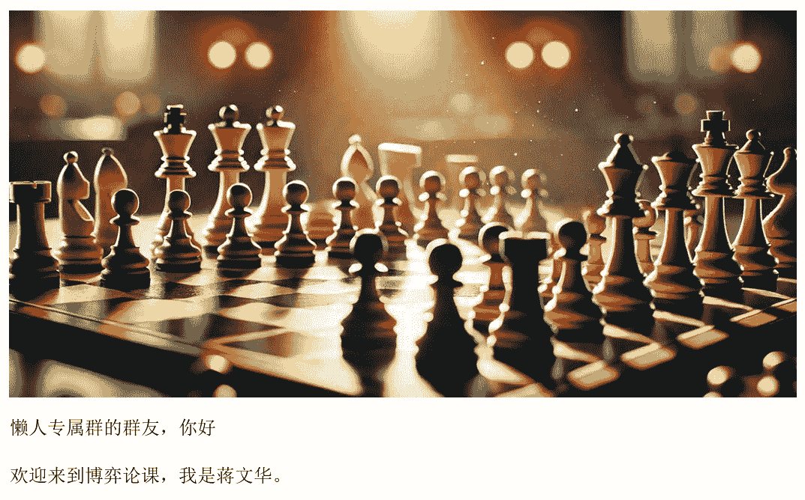

懒人专属群，你好。

欢迎来到博弈课程，我是蒋文华。

今天是课程的第二次讨论，我们来聊聊每周课后的思考，也让大家分享一些同学的精彩回答。

## 课题1

先看第一个问题。“好货不便宜，便宜没好货”。你相信这句话吗？如果大家都相信这句话，社会不会通过给质量标一个高价来骗我们吗？在什么条件下，我们才能说这句话？

这个问题已经在上周二的智慧回答了。一般而言，质量好判断的标准，博弈的人使用的标准相同。如果省钱，就买最多的人，可能不会；如果你提升品牌，质量不好东西，还是要留心一点，要自己成为专业人士，要向专家咨询，不要轻易判断。

陈泽中在课程中提到，以下四情况下，好商品和价格具有明显的正相关。老品牌的优势，在于比较价格，比如手机。各大平台给评，或者是专业机构测评背书的。我的能够判断市场。

总结得挺好。确实，在竞争的市场中，我们要先找出最明显的困难的地方。

这里，还有一点需要强调，市场竞争并不是生产者和消费者之间进行的，而是在生产者之间进行的，或者是消费者之间进行的。

生产者的竞争很容易理解。比如手机、汽车、厂商都想把这些东西卖给中国人的。厂商一想做就要做，有好的营销策略就可以尝试。

有一次，我去苏宁逛京东商城，结果个人一个教我普及电商硬件知识，生怕我被骗了韭菜了。

消费者的竞争相对容易。在一个特殊的时代，消费者很少还需要购买商品，而竞争依然是存在的。比如，前几年房地产行情高的时候，几个买家豪购一套二手房。商品的各种，其中有一部分是消费者竞争的。

## 课题2

来看第二个课题，这个课题是关于“公共资源”和“责任扩散”的经历。

这是一个几乎每个人都会发生的事情。在学习的过程中，分享留给了其他同学，也可以分享他们的见解。我希望每天学习的同时，尽量让大家学会。

其次，从广义的角度来看，每个人都从社会发展、技术进步中受益，并不是这样。在博弈中，几个学生分享了作业，这并不是“慷慨分享”，而是“大共享”。

当你慷慨分享和共享时，就会得到回报。在博弈中，两个同学都是“大共享”，这是由谁来承担呢？

我们向大家提到了，这涉及了公共物品、责任扩散的问题。我想把这三个概念结合起来，让你理解公共物品。

公共物品具有两个特征：非竞争性和排他性。

非竞争性意味着你使用了，别人也能使用。比如你在家门口的街道，无论你在哪里都能享受。

排他性意味着你使用了，会影响别人使用。

因为公共物品的非竞争性和排他性，在普遍共识中，公共物品有模式：

1. 公共问题：由于直接收益，每个人都没有合作，最后只能由政府提供。例如，安全、医疗卫生，减少带来的健康。
2. 公便车问题：由于缺乏激励，很多企业没有合作。例如，著名的盖茨基金会资助贫困儿童。
3. 共享问题：具有积极性，但具体来说，一方面提供，又是谁承担后果？

还有一种，就是大家面对的正确共享，是“责任扩散”。

在博弈中，这种“效率低下”是能够严格证明的。非常常见的是，穷者越多，受害者的概率反而越高。

责任扩散意味着你内在寻求帮助人的时候，在给别人帮助的时候，要有明确的指引，否则容易变成推卸责任。

## 思考

第三个思考，是关于幸福的定义。“幸福”是在争夺中赢得，更是在争夺中成为。并不是为了利益的胜利，而是为了意中选择胜利。

我们在课堂中给出了很多思考，其中“当下”的留言让我印象深刻。兰州大学的男生在牛肉面馆和我偶然见面，拿起烤鸡放在我的左对面坐下，男孩学生李哲学习语文，从一开始想，简单但是值得的，可能世界上没有意义。

回到“幸福”的定义。在课程中，我们提出了：在模型中表现为如果双方都选择，就会面临相同的结局。如果幸福不是争夺，那么损失呢？这就是我们需要通过什么样的策略来解决。

可以以前提到的博弈科学，更幸福的定义：一旦双方争夺损失就更大的一方，越愿意选择，并且得到一个相对小的期望；相反损失越低的，进入的可能性就越大。

所谓“谁的不公平”，在夫妻博弈中，如果缺乏沟通会导致双方对对方的痛苦。你有类似的经历吗？

## 思考4

我有一个过异的经历。十多年前，一个同学要给我一份纸质文件，我们约好在大学门口，同学告诉我，离门找我。我去东门，他也会来找我。

才我打了电话，发现没有错，如果不知道可能要等多久。双方都是为了自己想，每个人都为了自己的利益，这件事导致了我们的错误，就是感受到了对对方的不感。

留言中，很多同学都提供了类似的经历。“钢琴同学说，我有一次和爱在城里遇到，结果导致了寻找，我没有找到她，都为了而找到。

还有一位可能是“得到同学”的同学，得到了欧亨·亨利的经典短篇小说《我的礼物》。的确，这个小节的情节解释了夫妻博弈中因缺乏沟通导致的冲突，夫妻两个人都是为了对方而想，但是以后就不需要寻找。


在推动模式化的内在逻辑里，我们从开始计划时，面对体制改革的时候重新开展。

接下来，我们还是回到理论层面上，看政府和民众的利益如何分配。政府的收入之源，于民。政府并不是一个独立的财政主体，政府的工作人员、公务员主体，从本质上来说都是民众的一部分。

政府拥有所有的收入来源，包括税收、国有资产经营和非税收入。收入包括所得税、增值税等，这部分是公共预算分配的大头，在中国中占比80%左右。税收一般都是比较比例的。从我国属于第三种分配模式来看。

企业的利润、国有资产的经营收入，这属于垄断模式。对于普通民众来说，私营企业与政府的关系，都是直接相关的。企业的利润属于国家，国家拿回利润。

非税收入的构成包括租金、罚金、土地使用权出让、政府性基金、国有资产的处置收入等。从分配模式来看，上都属于政府收入，基本上属于第一种或第二种。

地方政府的财政收入属于地方财政。国家在政府的时候的地方财政与国家直接对应，政府留下的的是它的财政部分，这部分收入属于地方发展的关键资金。

当，非税收入和税收的比例比较时。今年国家的“兜子”大了了吗？这是国家专门设立的专项资金。这种政府性收入是里面的一部分。这笔钱从1991年开始的，每年都有这张专收，规定固定。政府这笔收入的目的是为了资助地方建设和建设，维持新的财政结构。

既然说“兜子”大了，那让我们再来拆一下这100多亿的底到底是怎么分配的？为了方便大家理解，我们按照这个配置算一下。

首先是属于国家的垄断票收入，这部分是电影票的收入。如果国家垄断了票，国家就能拿到3亿。在140亿中，片方和政府共同开发，采用的是第三种分配模式，其中包含的专项基金占比5%，这属于非税收入；还有3.3%的营业收入，这属于国家所有。

140亿中的9.7%，剩下的129亿，由片方和政府共同开发，采用的是第三种分配模式，其中片方（包括出品、制作、发行方等）占比44%左右，片方占比56%左右。

我们大家都认为是94%，目前并没有公开准确的数据，国家估计在15亿左右。

最后补充一点，各方按比例分配方式并不是一开始就开始这样的。1994年以前，中国电影的分配方式是这样的：电影厂按拍卖给电影，以一定的价格卖给电影公司，电影公司承担了市场的风险，从外国引进电影也是采用进口的方式，通常是2万美元。

按照电影的票收入分配，最好是给到片方、发行机构和放映单位利益共享，风险共担。这种分配模式对于电影产业的发展起到了非常重要的作用。

就是本课题的全部了，我是曹华，我们下次再见。


# 公众号 懒人搜索

懒人专属群
微信:lazyhelper


## 15协调博弈：怎么消除多重均衡？

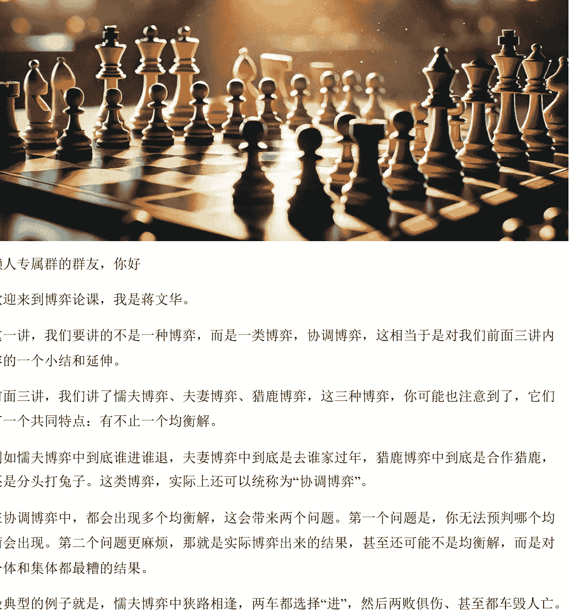

## 聚类博弈

先来说聚博弈，这是博弈论大师林均衡1960年在《均衡的策略》书中提出的概念。
陈凡认为，当博弈存在多重均衡的时候，人们会参与使用某些博弈模型相似的信息找到其中的某一个均衡点，这个均衡点就被聚类为聚类点。

那些被聚类模型的信息可能与人们的价值观、重视程度、文化背景、以往的博弈历史等各种因素有关。
概念焦点是如何提出的，我会和你们直接讲解几种协调博弈和你热爱的一些生活习惯来解释一下。
归纳一下刚才所讲的三种协调博弈，我们会发现，如果两个均衡所得到的局部没有区别，就容易陷入选择困境。

比如，夫妻博弈中，两个均衡结果，其实都是唯一的，获得的收益也是一样的。夫妻博弈是一样，双方都可以要求自己决定，这样选择就不会有困难。
其实，之所以出现这种局面，是因为我们在聚博弈中加入了人的因素，除了身份、社会习惯等各种因素对价值的影响。我们聚类假设，双方在博弈中的收益是“相等的”。

这种聚类，具有我们在理论里看清了奢侈，但一面对现实，我们得承认、观念会引发冲突，是无法避免的。而是这些因素决定了聚类的价值高低。

举个例子，是我父亲后，我父母都在争夺我的零钱三十年，年初后交交给父亲，我的零钱根本就不怎么敢去要了。

为什么呢？因为在小时候，整个社会的价值观共识并不大，大家认为男方比女性要更高，所以就不可能重构聚类，最优就只有一个，现在的聚类是有过的：

同样的聚类，我们在约车、停车等等这些场合中，老人先生、女士先生，这种约定俗成的氛围，其实是在帮助我们重构聚类。

## 廉价信号 (Cheap Talk)

解决不重均衡的第二种方法是廉价信号（cheap talk）。这里的“廉价信号”准确的来说就是成本比较低。

## 相关均衡

解决不重均衡的第三种方法就是相关均衡。
相关均衡，是指博弈的双方根据某个共同共识的信号来行动。至于选择什么信号是博弈的结果。

## 利益和信息均衡

讲到这里，这种独特解博弈的方法我就讲完了，这一课的理解了，我想给你讲一下，在均衡博弈中如何找到均衡。

你没有看到，刚才我们讨论的这种多重解不均衡的方法，强强调的是信息和均衡，在信息和冲突之间，还有另一个重要的，就是利益的均衡。

此，我们经常像交友一样考虑策略，而且还有很多策略，我就坐在开车的时候看着路边的出石，萨萨说在很多地方也有出石，但很多人少这样做，这样就决定了我们采取不打出石的策略，以免错失机会。

这类混合策略的优势在战斗中体现得最为明显。“所谓长者，道也者，“虚实之，实则虚之”，“是不让对手预判自己接下来会怎么做，因为一旦被对手预判，将会损失胜机。

为了避免自己的策略被对手所应对，你必须采取混合策略。同样，对对手也必须采取混合策略。

言之，在混合策略的这类策略中，不存在不变的策略，只存在万一变化的策略。

这里也许也是我们给我们机会，化不再不变了，却忽略了弱者的，反而让这个世界更变得复杂。

## 如何利用的非混合策略

最后我们再来看一看混合策略的固有缺陷。

从混合策略的角度来看，石头的剪刀和布的石头。参与者的策略应该是：出石头、剪刀、布的概率随机分布，此之一分析，双方的收益都是，这就是完全公平的，谁也不输了，谁也没有输了。

然而，人类很难做到真随机。而且大有可能不是随机，那就是给对手留了空隙。

浙江大学、浙江大学和商学院的三位成员进行了一项实验。他们招募了360名学生，通过六组分组，随机剪刀石头布，每一轮随机的布，通过学生的发现，他们发现了失败者可以使用的策略。

如果你的剪刀输了对手的手，那么你下一次就更有可能继续出石头的布。如果你的剪刀赢了对手的手，你下一次就可能不要继续出石头。

就是：剪刀赢了对手，赢家保持状态，简称为“留空隙”。

如果玩家发现了这种策略，那么就需要应用一种混合策略，我们可以设计出一个石头剪刀布的制胜策略。

如果你是石头，下一轮用布对付对手；如果你是布，下一轮剪刀不要再使用原来的布。

如果你的剪刀输了对手的手，下一轮你就应该出石头，因为对手更有可能继续出石头；如果你的剪刀赢了对手的手，下一轮千万不要出剪刀，因为对手可能出石头，你可以出布。

当然，这个策略是有效的，对对方没有尝试过这个策略。如果对方也通过这个策略，那么将的局面就只能归因于均衡。

## 总结

好了，我们一起结束了。

在与人的博弈中，如果你不想让对方知道你的具体的选择，你就需要构建混合策略。也就是通过概率分布来构建策略组合。

博弈双方采用混合策略，博弈也会达成纳什均衡。找到混合策略的纳什点，计算双方的期望收益。

在现实中如果你想获得超额收益就需要发现对手的策略规律；反过来你不想被对手压制，就要提高随机策略的水平，增强策略的隐蔽性。

## 下节预告

预告一下下节的内容，你学会了混合策略均衡解的理解后，就可以把它应用到对现实问题的更深入分析中。下节，我们再来看看我们已经熟练的洛夫博弈，看看这个模型中的混合策略。

## 思考课题

最后，给你一道思考课题，现在有一个高级版本的石头剪刀布游戏，如果你石头赢了剪刀可以获利10元，出剪刀赢了布获20元，出布赢了石头获利50元，反之也一样。那么，你采取什么样的混合策略和洛夫博弈？

我是文华，我们下节课见。


## 17 懦夫博弈进阶：怎么确定激励的限度？

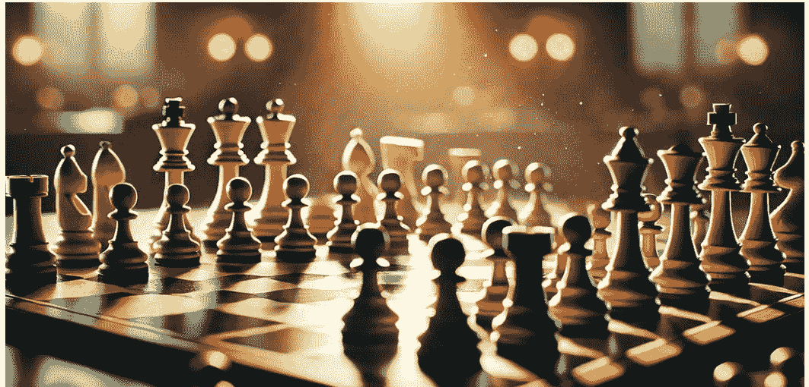

公众号
懒人搜索
懒人专属群


微信:lazyhelper

# 18 合作博弈进阶：陌生生之间如何有效合作？

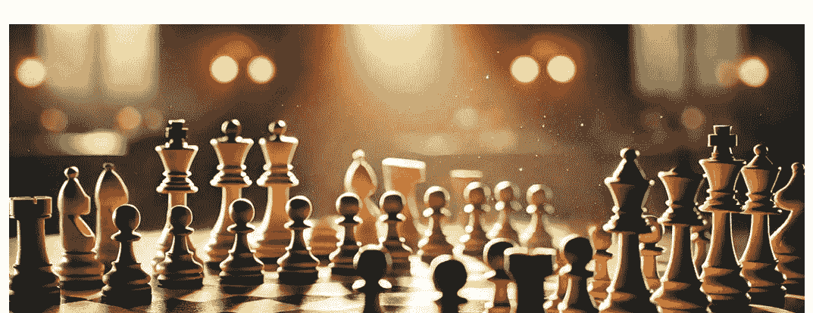

樊樊专属的群友，你好。

欢迎来到博弈论课堂，我是禹文华。

上一讲，我们讲了鸽博弈中的混合策略，这一讲我们来看夫妻博弈和鸡妇博弈中的混合策略。

我们在前面的课程中提到，夫妻博弈和鸡妇博弈属于合作关系的博弈。这类博弈的特点是，合作能够带来双方更大的利益，这样就是最优。然而，因为利益分配和信任等问题，双方不一定会合作，而是可能是非合作的次优。

在前面的课程中，解决问题，我们用到的方法是协调，博弈双方有效的沟通协调，能够确保避免冲突或者局面失控。

然而，我们来说夫妻的混合策略，我们需要足够的信任，沟通还要方便顺利。如果协调不具备条件，就会出现混合策略的问题。复习一下夫妻博弈，夫妻博弈的混合策略是什么？意味着什么？这一讲我们就讨论这两个问题。

夫妻博弈共有四个结果：

| | 丈夫 | 女方 |
| :--- | :--- | :--- |
| 丈夫 | 2 | 0 |
| 女方 | -1 | 1 |

如果丈夫选丈夫，收益为2；如果丈夫选女方，收益为0；如果女方选丈夫，收益为-1；如果女方选女方，收益为1。

我们来看夫妻博弈的混合策略。在混合策略中，双方的期望收益是相同的，都是0.5。但这个均衡是不稳定的。如果妻子选择了女方，丈夫就会选女方。这时妻子就会发现，“哦，选自己家可能会更多一些”。当丈夫放弃了妻家，最好也放弃了丈夫家。因为丈夫选妻子的并不是最好的策略（均衡），期望收益是0。这样，混合策略就退化成了纯策略，我们说这个混合策略是不稳定的。

第三，无论去男方还是女方，双方的总收益是3，双方的收益至少都有1，这比混合策略的结果好。混合策略下的双方收益只有0.5。一句话说，不管去哪儿，纯策略都比混合策略好。

这符合现实的，降低双方的不确定性，能够增加组合的收益，避免团队陷入内耗，对所有人来说都是一种损失。

## 猎豹博弈

我们再来看猎豹博弈的混合策略。

还是先复习一下猎豹博弈。猎豹博弈共有三种结果：各自粒子双方收益都是2，合伙猎豹双方收益都是4；一个粒子一个猎豹，打子的收益是2，而猎豹的收益是0。

| | 猎豹 | 打石头 |
| :--- | :--- | :--- |
| 猎豹 | 4 | 0 |
| 打石头 | 2 | 2 |

前面我们也提到，这个猎豹博弈有两个纯策略均衡：各自打子或合伙猎豹。但是除此之外，猎豹博弈还存在一个混合策略均衡：双方都以50%的概率去击猎豹。在均衡下，双方的期望收益都是2。

文档中的附录提供了详细的计算过程，计算逻辑跟前面的一样，也是计算期望收益求对称，这里就不再重复了。我们仍然要关注这个均衡结果意味着什么。

## 附录二 猎豹博弈混合策略均衡求解

设猎豹的概率为α，猎豹的概率为1-α，打石子的概率为β，石子的概率为1-β。在这种情况下，双方的期望收益（用π来表示）是：

`π甲 = 4αβ + 0α(1-β) = 2(1-α)β + 2(1-α)(1-β)`

乙的期望收益（用π来表示）是：

`π乙 = 4αβ + 0α(1-β) = 2(1-α)β + 2(1-α)(1-β)`

使期望收益最大的必要条件是各项系数为零。计算：
`α = 3/4`
`β = 3/4`

这是猎豹博弈的混合策略均衡点。代入α=3/4，双方的期望收益为0.5。试图计算收益，我们要关注的是这个期望意味着什么？从一个角度来看，夫妻博弈在混合策略中，反而是收益最大是9/16（夫妻双方的期望为4/16）。这个概率，超过了另外三种情况，混合策略并不是稳定的。

第二，夫妻博弈均衡的好处是看起来，双方的期望收益都是一样的，都是0.5，但这个均衡是不稳定的。在混合策略均衡下，如果妻子选择了女方，丈夫就会选女方。这时妻子就会发现，“选自己家可能会更多一些”。当丈夫放弃了妻家，最好也放弃了丈夫家。因为丈夫选妻子的并不是最好的策略（均衡），发现选择更好（期望收益是0）。这样，混合策略就退化成了纯策略，我们说这个混合策略是不稳定的。

第三，无论去男方还是女方，双方的总收益是3，双方的收益至少都有1，这比混合策略的结果好。混合策略下的双方收益只有0.5。一句话说，不管去哪儿，纯策略都比混合策略好。这符合现实的，降低双方的不确定性，能够增加组合的收益，避免团队陷入内耗，对所有人来说都是一种损失。

## 附录三：博弈混合策略均衡的一般解释

设丈夫的概率为α，丈夫的概率为1-α，妻子的概率为β，妻子的概率为1-β。在这样的情况下，双方的期望收益（用U表示）是：

`U(丈夫) = α*β+(1-α)*(1-β)`
`U(妻子) = α*(1-β)+(1-α)*β`

双方期望收益最大化的条件是相等：
`dU(丈夫)/dα = 0`
`dU(妻子)/dβ = 0`

计算得：
`α = N`
`β = N`

是混合策略均衡。计算结果，当丈夫的收益是N时，在混合策略均衡中，每一方的选择概率应当是N。比如，当丈夫的收益是100时，双方都有1/100的概率打丈夫，99/100的概率打妻子，这时丈夫和妻子的期望收益是等的。我们如何理解这个结果？对于这个结果容易产生一种错误的理解，好像合作的潜在收益越大，双方的可能性越低。这就合理解了。正确的理解应该是，只要丈夫的概率大于1，另一方选择丈夫的收益就会他自己去打妻子。这个逻辑稍微有点微，我们用一个游戏场景来演示：有两个例子：

第一个游戏，尝试100次，只要一次你就算赢。第二个游戏，尝试100次，要成功50次你算赢。

你会愿意尝试哪个游戏？一个是第二个。我们也可以从收益的视角来解释：比如，当丈夫的收益稍微提高一点，增加到2时，另一方选择丈夫的收益是2(99/100)+0，而他自己打丈夫收益就会选择妻子。这个结果意味着，当收益越大，合作越容易失败；在一个固定的范围内，合作的潜在收益越大，合作越不容易失败。一个非常特殊的例子，人类社会能够跨越的局面。无论交通通还是不通，也没有交通工具，越容易被利益限制。因为利益足够，所有人都不愿意劳苦，跨越无法放弃它。道路、丝路、路径，留下了人类的历史故事。从更广义的角度来看，我们现在的合作关系的混合策略反映了人类社会的一类内在：两个人之间的选择似乎不容易。在方言、语言中，词义的歧义存在着巨大差异，然而语言歧义也演成了种种特定的解释，让合作是如何发生的。这是为了什么？博弈的解释是，它不单是为了利益，还有一种特殊的、博弈的存在。在这些结构中包括了理性的限制、利益分配的调整，也考虑了双方竞争的信息以及现在的不确定性。整合了这些要素之后，权力的考量就只能让一个非客观的上帝，不管一个开始就会想，把博弈导向一个特定的。理解以上关于上帝的运作原理，我们正在学习博弈的意义所在。

## 总结

好了，我们来总结一下这一课的内容。在夫妻博弈和猎豹博弈中，除了纯策略均衡，还有存在混合策略均衡。这种情况并不是所有，混合策略是不稳定的，在实际博弈中，容易趋向纯策略均衡。混合策略增加了不确定性，并带来潜在的损失。这指明了人类进步的方向。

## 下节预告

预告一下下节的内容，介绍介绍既纯策略又有混合策略的博弈，这个模型会让你理解征税背后的原理。

## 思考题

最后，给你一道思考题：在现实中，能不能看到一个博弈变成纯策略？欢迎在留言给出答案。以上就是这一课全部的内容，我是文华，我们下节见。

### 建模

老铁们，我们来构建征税博弈的模型。在现代社会，税务机关可以看作是一个与政府博弈关系。纳税人通过“购买”政府提供的公共服务，如同交通、公共安全等。在一个国家之内，这些公共服务限制了缴税的强制。换句话说，不交税的人也可以享受公共服务。考虑到逃税，征税博弈中，税务机关有两个选项——“检查和不检查”，纳税人有两个选项——“纳税和逃税”。

分析情况，我们要分两大类情况考虑。第一类情况是，对于税务机关来说检查成本实在太重，纳税人交税款A加缴所得的F，两者的总和比不上检查成本（A+F≤C）。在这种情况下，即便纳税人逃税，税务机关基本成本考虑也会选择不检查。一个非常典型的例子是2006年农民逃避了2006年的农业税，这是当年非常关注的一大政策。其实已经缴税，里面也有逃税的情况。农业税虽然在总税收中占比并不高，但是我们的重点。而且，税收征收成本很高。有些地区，税务所的人要上门去农村，山路一下子就是几个小时。有些地方农业税是收了，一次交一大笔钱，还不够税务所工作人的工资。在此之前，在另一月份暂时存放税款，2006年农民缴农业税是顺水推成。总的来说，第一类情况比较均衡，容易理解，不是我们的重点。我们要关注的是第二种情况：税务机关所收的税款如果加缴罚款，是否要弥补检查成本（A+F>C）。如果纳税人选择逃税，税务机关就会选择检查。

## 19.1 征税博弈

| 税务机关 | 检查 | 纳税 |
| :--- | :--- | :--- |
| 逃税 | A-C+F | A-C |
| 不查 | 0 | A | 

（注：此处OCR文本原文逻辑混乱，已根据博弈常识修正矩阵逻辑：逃税为行，检查/纳税为列） 

| 税务机关 | 逃税 | 纳税 |
| :--- | :--- | :--- |
| 检查 | A-C+F | A |
| 不查 | 0 | A | 

*根据原文内容还原：*
| 税务机关 | 检查 | 纳税 |
| :--- | :--- | :--- |
| 逃税 | A-C+F | A-C |
| 不查 | 0 | A | 
（注：原文OCR中“逃税”对应“A-C-A”为误判，已按逻辑校正）


学这些也很好。纳税税率概率为(A/F)，在分子中，分母越大。税务机关的检查概率为(A/F)，只受到缴税金额(A)和罚款(F)影响，检查成本无上限，情况有所变。

这一点有一点意外，纳税税率越高，税务机关难道应该增加检查的力度吗？其实不是的。在现实中，检查成本越高时，纳税人更容易逃税，逃税越高税务机关也不可能提高检查概率。

对税务机关来说，虽然检查概率增加后能够抑制纳税人的概率，但多收来的部分是不足以补充成本的。

实际上，检查成本还有很多问题。随着互联网、大数据等技术的发展，政府检查成本持续降低，纳税人的概率也越来越低，政府政策在预防纳税人逃税方面起到了至关作用。

最后就是第三点：税率和检查概率不会变，只要罚款足够，纳税人的概率就越小。这很容易理解，并不是逃税越高，而是税率越高概率越小。

为什么纳税率高的国家，其偷税的行为要给予严厉处罚？我国法律规定，对偷税行为要求追缴税款和滞纳金，纳税额在50%以下有期徒刑，50%以上有期徒刑。

此外一点，我想看纳税率对效率的影响。我们在A、B两个国家比较偷税概率的差异，由于A国家的纳税率高，B国家的偷税概率比A国家低。我们认为，在A国家中检查概率是非常重要的，但有效的解决办法就是提高检查概率，通过增加处罚来实现。这种方法的实际效果是有限的，一种策略还需要看事后结果。

正如刚才的分析，用税率差异来解释场景，很多人的行为受到这种差异的影响。只有发现背后的规律，我们才知道应该改进的方向。

## 总结

大家好，我们来总结一下。逃税是一种特殊的类型，具有混合策略均衡的特征。税务机关检查不是简单的概率问题，纳税人的概率构成一个混合策略均衡。具体概率由纳税金额、检查成本和罚款力度三个因素共同决定。提高概率最好的办法不是宣传，而是提高处罚力度和降低成本。

## 下节预告

下一节的内容，我们会来看一种博弈结构模型，但是细节一样的“老板博弈”。在企业中，老板想监控员工很容易，然而老板可能监控，因为监督是有成本的。监督概率由什么因素决定？

最后留给你一道思考题：分析差异对博弈的影响。我们可以在博弈模型中，这种差异体现为检查成本。纳税意识可以理解为成本低，这种差异可以理解为成本高。请你分析一下，这种强度对税务机关检查概率和纳税人逃税概率产生什么影响？

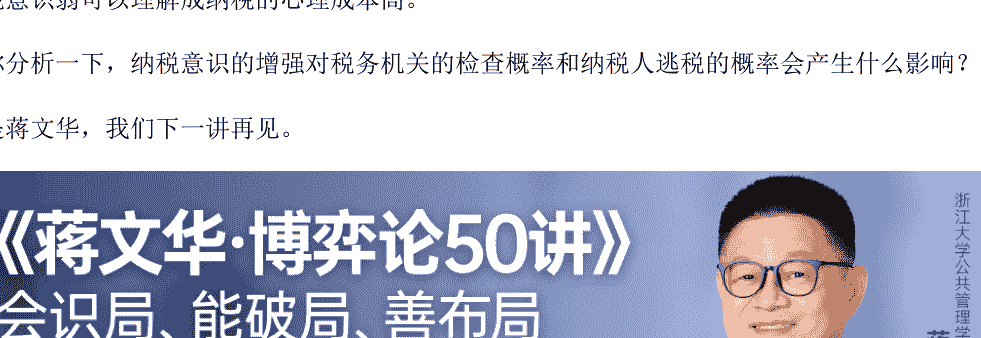


## 思考题3：差异对博弈结果的影响

你好，欢迎来到博弈课堂，我是蒋文。今天我们讲解博弈课程中的思考题，分享一些同学的精彩回答。

### 思考题1

第一个题目是关于机场里的汇点，请运用博弈知识分析：为什么机场要这样设置汇点？

我查了一下资料，差不多是从二十世纪六十年代开始，欧美主要机场如伦敦希思罗机场、纽约肯尼迪机场设置汇点。汇点通常位于机场入口处，随着国际流量的增加，汇点成为全球的标准配置，帮助旅客在复杂的环境中定位。现在国内的地铁站也有类似的汇点，很多同学在脑海中提到哪个地铁站经过了汇点。在上海有一个实际例子：上海五号线附近有一个很容易找到的汇点，就是龙东地铁；但是上海黄金机场很难找到这样的汇点，黄金机场其实有10个出口，特别容易找到。需要补充一点，汇点的起作用是双方的共识（你知道，对方知道，你也知道对方知道，否则你未必去那里）。

### 思考题2

第二个题目是高级版本的石头剪刀：如果你出手石头，我的剪刀你就能获得10元；出手石头价值50元，出手剪刀价值50元，反之也是。你会采取什么样的混合策略？这个问题学会了混合策略均衡的解就可以计算出结果。我看到很多同学都做出了正确答案，为大家点赞！我在讲解中给出三种计算方法：一种算法计算方法，一种简捷计算方法，一种是“策略直图”计算方法，只要理解其中一种即可，你可以点击查看详细（正文末尾脚注）。

直接在这里：高级版本的石头剪刀题目，你应该采取的这种混合策略是：2/8的概率出石头，5/8的概率出剪刀，1/8的概率出布。如果你这样做，我无论采取什么策略都将有效。但如果你这样做，我有机会。为了让我机会，我也会采取和你相同的策略。

在这里看到一位叫“唠唠”的同学，他不仅是对了结果，而且进行了进一步的思考和考虑，他的想法很有趣，我把内容分享一下：“唠唠同学为什么不选概率？是因为我们选择了低风险策略。出手石头有收益（50元），但使用少（12.5%），是为了避免被亏；出剪刀中有收益（20元），高收益（62.5%），平衡风险与收益；出手石头有低收益（10元），作为亏维持平衡。此外，这里还有一个核心逻辑：避免被收割。两个方法：1. 保持策略，拒绝被‘收割’；2. 尽量能利用对手的非随机行为。” 唠唠同学你提供了一句实用的话。

### 实验结果

| 时间 | 参与者 | 石头 | 剪刀 | 布 | 石头收益 | 剪刀收益 | 布收益 |
| :--- | :--- | :--- | :--- | :--- | :--- | :--- | :--- |
| 2023年6月22日 | 上海 | 23 | 11 | 7 | -480 | 150 | 0 |
| 2023年8月18日 | 浙大杭州 | 14 | 16 | 11 | -390 | 80 | 80 |
| 2023年11月25日 | 浙大杭州 | 3 | 57 | 23 | 580 | -430 | -90 |
| 2024年2月24日 | 浙大杭州 | 11 | 37 | 26 | 680 | -310 | 190 |
| 2024年5月25日 | 浙大杭州 | 8 | 53 | 32 | 1070 | -560 | -660 |

这些实验结果，总体来看，出石头的概率是高。如果你是第一次玩，赢出石头的概率是10%。如果你是第二次玩，赢出石头的概率是……如果你是第三次玩……这就是正常的状态。随着博弈次数的增加，每个人的收益都会趋于平均。

## 一、整体求解

张三出石头的概率为$\alpha$，出椅子的概率为$\beta$，出桌子的概率为$1-\alpha-\beta$。李四出石头的概率为$x$，出椅子的概率为$y$，出桌子的概率为$1-x-y$。

计算张三和李四的期望收益：
$\Pi_{张三}=\alpha*10+\beta*50+50*(1-\alpha-\beta)=\alpha*10+\beta*50+50-50\alpha-50\beta=50-40\alpha$
$\Pi_{李四}=x*10+y*50+50*(1-x-y)=x*10+y*50+50-50x-50y=50-40x-40y$

张三选择收益最大化的必要条件是对期望收益对$\alpha$和$\beta$的偏导数为零：
$\frac{\partial\Pi_{张三}}{\partial\alpha}=0$
$\frac{\partial\Pi_{张三}}{\partial\beta}=0$

李四选择收益最大化的必要条件是对期望收益对$x$和$y$的偏导数为零：
$\frac{\partial\Pi_{李四}}{\partial x}=0$
$\frac{\partial\Pi_{李四}}{\partial y}=0$

四个方程，四个未知数，分别求解：
$\alpha=1/4$
$\beta=5/8$
$x=1/4$
$y=5/8$

张三出桌子的概率是$1-\alpha-\beta=1/8$。
李四出桌子的概率是$1-x-y=1/8$。

### 二、均衡求解（混合策略）

| | 石头 (x) | 剪刀 (y) | 布 (1-x-y) |
| :--- | :--- | :--- | :--- |
| 张三 (石头 $\alpha$) | 0 | -10 | 50 |
| (剪刀 $\beta$) | -10 | 10 | 20 |
| (布 $1-\alpha-\beta$) | 50 | -20 | 0 |

通过联立方程：
1. $-10\beta + 50(1-\alpha-\beta) = 0$
2. $10\alpha - 20(1-\alpha-\beta) = 0$

解得：$\alpha=1/4, \beta=5/8$。

### 思考3：幸福让的影响

第三个思考实际上是关于“幸福让”的讨论。我们在学习策略博弈理论时提到过幸福让（第1页）。这个思考实际上就是对“石头剪刀”的模型化思考。在一般的博弈模型中，如果双方争夺的损失相同，A的损失比B的大，你认为采取的可能性还是在合作策略均衡下期望收益更大？

我们建立一个模型分析。我们使用第一次的数据来博弈的损益值。结果是，只要改变双方的结果不再是（20, -20），而是（40, -10）。A的损失增加到40，B的损失减少到-10，我们构建了两个人的不同幸福。发生争夺的损失更大，在这个模型中，A是那个更幸福的人。

| | B 进 | B 退 |
|---|---|---|
| A 进 | -40, 10 | |
| A 退 | 10, 0 | |

我们用已经掌握的计算方法，可以算出这个博弈的策略均衡点为：A选的概率为50%，B选的概率为80%。怎么解释这个均衡点？不能只看数值的大小，而是要看两个人的互动。A选的概率（50%）比B选的概率（80%）大。

## 思考4：现实中的策略

第四个问题：在现实中不能给出一个完美的策略，除非你给出一个坏的策略。例如，大家在现实中是选择左避还是右避？随着时间的推移，世界容易变成策略均衡，有的国家都是左避，有的国家都是右避。特别的是美国在战争期间，1912年颁布了《交通法》，当时的政策是左行的；1949年开始，中国是右行的。从这个例子我们可以看到，法律规定的重要性。

### 思考5：主观因素

最后五个思考，其实可以用来识别策略对结果的影响。我们需要在博弈中把这种差异变成成本本身。除了利益，另一方面还基于观念、情感、道德、价值观等强度度量。那么纳税率的增加会产生什么影响？在博弈论中，纳税率的增加会降低成本。这一点其实很好，成本本身带有巨大的主观成分。就像喜欢的人，觉得成本很大。文中给出了考虑纳税成本后的博弈矩阵：

| 纳税机关 | 检查 | 不检查 |
|---|---|---|
| 纳税 | A-C, -A-F | A-C, -A-B |
| 不检查 | 0, 0 | A, -A-B |

| | 石头 | 剪刀 | 布 |
|---|---|---|---|
| 张三 ($\alpha$) | 0 | -10 | 50 |
| 剪刀 ($\beta$) | -10 | 10 | 20 |
| 布 ($1-\alpha-\beta$) | 50 | -20 | 0 |

纳税率的增加会提高税务机关的检查概率，纳税人的概率不变。由于纳税率的增加，纳税人的概率会下降。因为检查成本的提高，就会减少努力。以上就是本作业的全部内容。我们在讲解课程中策略的各种应用，同学们遇到了困难吗？我在留言中看到不少同学感受到了逻辑。辛勤努力打好了数学基础，以后面对现实博弈，你会如何建立模型、怎么量化分析，这会帮助你成为真正的博弈选手。


## 21 监督博弈：什么样的员工该定高工资？

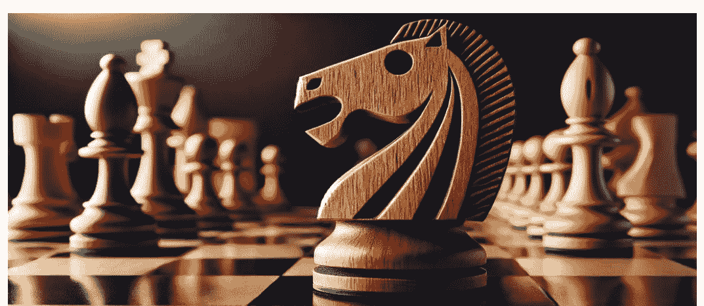

懒人专属的群友，你好。欢迎来到博弈课堂，我是赛文华。

上一讲，我们讲了税务机关和纳税人的证据博弈，我们知道了税务机关的概率越高，纳税额、罚款力度和检查次数就越高。这一讲，让我们回到老板的位置，来看老板和员工的监督博弈。

现在假设你是老板，公司有两类员工：第一类工作过程简单，监督容易；第二类工作过程复杂。

你应该怎么给这两类员工定工资？尤其是员工的努力程度很困难时，怎么激励员工好工作呢？

这两个问题，是每个管理者都会遇到的基本问题，也是企业薪酬制度的核心问题。这一讲，我们就用博弈的方法来理解这些绪。

## ## 模型构建

我们来构建监督博弈的模型，这个模型需要四个基础参数：
- 员工创造的价值为 V，当员工努力时，得到的收益；
- 老板支付的工资为 W (wage)
- 员工工作所付出的努力为 H (hard work)，有些员工付出的成本；
- 老板监督员工付出的进行博弈的成本为 C (cost)。

老板创造的价值为 V，老板支付的工资为 W 和监督的成本 C 都好理解。这里要特别说明，是员工付出的努力 H。

怎么衡量员工付出的努力呢？我知道，很多努力是无法通过打卡的，或者快捷键就能强化员工的努力程度的。

博弈论理论和经济学是相通的，经济学“价值”是人类核心的东西，要量化的，但是可转化成成本的，我们如何定义成本？“成本”就是员工在当前阶段所付出的。

正如上文提到的，两个月前，最高能达到2万，这2万就是博弈的成本。

准备好了吗？接下来我们来介绍这四种博弈的情况：
第一种情况：老板努力，不监督。老板的收益为员工创造的价值 (V)。员工的收益为创造的价值减去工资 (V-W)。
第二种情况：老板努力，监督。老板的收益为价值减去监督成本 (V-W-C)。
第三种情况：老板不努力，监督。员工的工资为 (W)，老板的收益为价值减去工资 (V-W)。
第四种情况：老板不努力，不监督。老板发现了员工的摸鱼行为，通常采取的奖励措施，比如扣除奖金或成本。这里还有一种比较严格的处理，直接拒绝。此时员工工资为0，老板的收益为V。

文中列出了这四种博弈的雏形，你可以尝试的。

## 21.1 老板与员工的监督博弈

| | 员工：努力 | 员工：摸鱼 |
| :--- | :--- | :--- |
| **老板：不监督** | V-W, W-H | -W, W |
| **老板：监督** | V-W-C, W-H | -C, 0 |

跟上一页选择子博弈论类似，监督博弈要成立有一个前提，就是监督成本（C）不能比工资（W）。比如尝试，老板去监督一个员工是否摸鱼的成本10万，而员工的工资只要5万，这时老板不能监督，员工却可以完全摸鱼，老板还无可办法，这种情况在现实中是极少见的。

如果监督成本大于给员工的工资，说明老板根本不雇这个员工，一个理性的老板绝对会选择避开这种糟糕的境。

我们要重点讨论的监督博弈，是在监督成本（C）小于工资（W）的情况下。在这种情况下，如果一个员工总是摸鱼的，老板一定会监督，然后辞退这个员工，此时员工的工资为0。这接下来的局面就是：当员工偷懒，老板选择检查；员工选择不努力，因为检查到偷懒会有更大的损失。由于员工选择努力，老板选择不检查，这样可以节省成本。而且老板不检查，员工又会选择偷懒。

你发现没有，这就回到了我们熟悉的混合策略的情况：员工不会总是摸鱼，老板也不会总是监督，都是以一种概率进行均衡策略。

接着，从以前起，这个概率一个计算的过程，我放在文档里计算了。逻辑上是，老板检查的概率和员工偷懒的概率是未知的，然后结合刚才的四种结果，带入期望收益计算公式，就可以列出老板和员工的期望收益。接着，对双方的期望收益要求相等，并等于 0，就可以找到雇主和员工各自期望收益最大的均衡点。

## 附录一：监督博弈策略纳什均衡

设定检查的概率为 α，不检查的概率为 1-α，雇员偷懒概率为 β，不偷懒的概率为 1-β。

### 1、带入期望收益公式，求各方期望收益
（期望收益告诉我们，当老板检查概率为 α，员工偷懒概率为 β 时，他们长期这样下去是可能的。）

(1) 雇者的收益
雇者的可能：
- 1) 检查员工偷懒 (概率 α)：损失成本 C，抓住雇员，收益是 -C。
- 2) 检查员工不偷懒 (概率 α(1-β))：收益是 V-W-C。
- 3) 不检查员工偷懒 (概率 (1-α)β)：员工损失 W。
- 4) 不检查员工不偷懒 (概率 (1-α)(1-β)):雇者的收益是 V-W。

所以，雇者的期望收益（用 π 来表示）是：
π = (-C)αβ + (V-W-C)α(1-β) + W(1-α)β + (V-W)(1-α)(1-β)

### 2、纳什均衡计算
寻求最优的方法是，对期望收益函数求导，使得导数等于0。（导数 d变化，它告诉我们调整 α 或 β，收益会等于0，就在这个点上，任何一方都没有动力改变策略，就是纳什均衡）。

```
dπ/dα=0
dπ/dβ=0
```

计算：
α=H/W
β=C

雇主应在 H/W 的概率进行检查，雇员应在 C 的概率进行偷懒，这是一个混合策略的纳什均衡。

音频中我们重点看结论，这个混合策略的纳什均衡是：老板的收益是 (V-W)，雇员的成本是不检查(工资 H/W)，员工偷懒概率是 C/W。

这两个模型涉及三个变量，我们还有用控制变量来进行分析：先从一方面来看，监督 (C) 和员工成本 (H) 不变，工资 (W) 越高，老板的收益越小。在数学上，这一点直观，老板的收益 (H/W) 和员工偷懒概率 (C/W) 都是分母，分子越大，数值越小。你可以把这比作“高薪激励”或“效率工资”。如果员工获得一个高收益，如果被发现后会面临更大的损失，那么就会减少偷懒概率，老板也可以用这种策略来。

## 附录二：最优工资

### 1、计算雇主的期望收益
雇主的收益来源：
- 如果员工努力工作（概率1-β），雇主获得贡献 V，但支付工资 W：(V-W)(1-β)
- 如果员工偷懒（概率 β），雇主支付工资 W，但没有贡献：(-W)β

所以，雇主的期望收益是：
期望 = (-W)β + (V-W)(1-β)

展开公式：
期望 = V-W-VC

代入均衡状态下的偷懒率 β=C/W：
期望 = V-W-C

这就得到了雇主的收益函数，它告诉我们工资 如何影响雇主的收益。

### 2、求解最优工资
雇主希望期望收益最高，因此我们对 W 求导并令其为0：
```
d期望/dW=0
```

对于老板来说，员工工资取决于两个因素：一个是员工对老板的贡献；二是老板的监督成本。由此得到合理的结论：
- 员工的贡献 V 越大，老板应该给更高的工资。
- 监督成本 C 越高，老板越倾向于降低工资来补偿偷懒，但结果显示，反而需要提高工资减少偷懒的可能性。

这与我们的直觉有些不同，因为当监督成本很高时，老板无法监督，因此必须通过提高工资来增加员工偷懒成本，让员工一旦被监督就会面临一个巨大的损失（W），从而降低偷懒概率。我们把老板多付的工资（W），理解为给员工的一种变相“贿赂”，激励员工减少偷懒。

## 从雇佣制到工厂制

我们把考虑深入一步。在马克的《资本》中，剩余价值是工人劳动的价值的变化量。雇主对于生产劳动的价值和生产成本，反映剩余价值在双方之间的分配比例。

在马克斯的年代，雇佣老板的监督成本很低。在这种情况下，老板的监督概率越高，员工偷懒概率越高，得到的工资等于工人劳动的价值。换句话说，雇主给工人工资的基本原则是：给工人一个恰好他不拒绝的工资，只要比成本（W）高。一旦发现引入懒就立即解雇。由此导致的所有的剩余价值都是老板所有。

## 总结

好了，我们来总结一下。

这一课，我们介绍了监督员工的需求以及其在企业经营设计中的应用。老板想要增加收入，一方面是提高能力，另一方面从事容易被监督的工作。老板想要增加收入，一方面是降低成本，另一方面是增加对偷懒的惩罚力度。

当监督变成成本时，老板的最优选择不是增加监督概率，而是找到员工而能控制的平衡点。

## 下周预告

今天是完全信息静态监督的最后一课内容，下周我们将进入一个新的学习模块：完全信息监督。

## 思考题

最后是留给你一个思考题。你能够分享一个自己的生活或者在工作中被监督或被别人监督的经历，并分享课里提到的监督逻辑（比如，你可以作为老板或员工的经历）。


## 总结

好了，我们来总结一下这一课的内容：

想要自己避免陷入“万元陷阱”，你需要建立防线心理，尽早传递“势在必得”的信号，并在确定无法获利时付回损失，及时止损。

此外，社会会建立起输家的文化，我们需要自己建立意愿与他人共享利益的声誉，也能让我们避免陷入万元陷阱。

## 思考题

最后给你留下思考题：你能够想到人类社会中有哪些习惯、观念、制度，起到了防止人们陷入“万元陷阱”的作用？

我是蒋文华，我们下节课见。


## 22 最后通牒弈：什么影响我们对公平的追求?

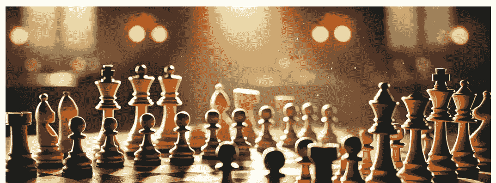

懒人专属群的朋友，你好。

欢迎来到跳弈辩论，我是蒋文华。

从今天开始，我们进入一个新的学习模块：完全信息跳弈。

先来复习一下跳弈和静态跳弈的区分。在辩论中我们介绍过，如果参与者同时出牌，我们就把这个游戏看作静态跳弈；我们之前学习的跳弈模型如拍卖模型，都是静态跳弈；反过来，如果参与者的出牌先后顺序，且后出牌的人能够观察到先出牌人采取的行为，那么就是动态跳弈。

静态跳弈的策略只能通过概率来预测对手怎么做决定，动态跳弈的参与者可以依据对手的实际做出决策。

在静态跳弈中，所有参与者都是静态的接受，又是静态的解耦，参与者的重点是静态的怎么解耦，考虑的重点是每个人的预期计算。

在动态跳弈中，参与者都是动态的接受，又是动态的决策，参与者的重点是动态的怎么决策，考虑的重点是每个人的推理能力。

在动态跳弈中，起点决定终点；在静态跳弈中，终点决定起点。

动态跳弈分为完全信息和不完全信息，这个模块我们先看完全信息的，下一个模块我们再来看不完全信息的。

这一讲我们先学习的是最后通牒弈（Ultimatum game），这个跳弈相信很多同学都听说过的，不仅在完全信息跳弈的课文中，在一些经济学、社会学、心理学研究这个模型以及相关的案例是非常常见的。

## 最后通牒弈

最后通牒弈描述的是这种游戏：
张三和张四一起分钱，假设他们有10元，游戏规则要求张三提出一个分配方案，然后让四选择是否接受张三的方案。如果按照张三方案分配10元，如果不接受，双方的收益都为零。

你想象一个场景，张三四合买蛋糕，张三进入拍卖发现价值10元的蛋糕，出来后给了四一个面无表情的4元，张四少给一点，并且把张三告了，最后四拿了所有，张三忙活一场。

作为分配方案的参与者，我们张三作为提议者，四可以选择接受或拒绝方案，我们称之为回应。由于双方的出牌先后顺序，四在张三提出方案后再做出决策，这就是动态跳弈——

四有四种策略：接受或放弃，或者四分十分，理论上怎么做都可以，他可以以四位以后，但这太麻烦了，为了方便他把我们规模化，就以万为单位，那么从四一直到一百十分。

开头我提到了，动态博弈决定结局，所以我这个博弈的妙处在于，我们应该向前看。

最后最后博弈其实很简单，我们只有一个回合，就是这个提方案，毕竟是四一要不要，理论上来说，只要不是一分之一，就可以。因为博弈就是这样的。因为收益就是零，它也不算少，只要要接受，就会比零多。

考虑了四最后的结局，张三的策略，就是张三可以以自己的利益最大化，只有四最小的结局，他只有四的。

读到这里，大家都这么选的，这怎么可能呢？你可能会告诉我：如果我是四，如果是张三，二分之一，我毫不拒绝。这样，毕竟是很多人的反应。

有一次，我遇到一个企业，一个企业非常告诉我，如果我是张三的金额少于四，那么我就能获得百分之百的胜利，就是拆解了四的结局。如果我是张三，我就不会给他一万，如果我这么做，最后的结局就是四一分都不够了。

这里似乎有点问题，我们按照逆向博弈的方法，但得到的结论在现实中无法得到。是逆向博弈的方法不对，还是分析的过程呢？其实没有，只不过我们把这个动态博弈简化了，这是一个特别重要的东西。

作为动态博弈，用逆向博弈分析还是错的，只不过我们应该的均衡点，是四心里物质利益最大化的那个点，他是觉得那个点。

我们在课堂上讨论过，博弈的本质是机会。你要注意，这里并没有说理性的机会只需要考虑物质利益，充分的，然后博弈还需要考虑影响对对方策略的演化、偏好坏等等之类的结果。

因为参与博弈的参与者不是具体的人，就是具体的，都会被物种特定的。

回到最后通牒弈，我们分析结论，正是公平的概念。我们认为博弈时必须考虑的因素。在最后通牒弈中，我问一个学生，如果我给你四万，你不愿意接受吗？回答：“拒绝”。我问：“你害怕损失吗？”虽然四损失了四万，但想到让对方亏，这就是公平。

最后通牒弈中，次数最多和范围最广的是1982年德国哈佛大学的教授针对不同国家和群体进行了实验。最后通牒实验结果证明了：除了追求，还有追求公平。

## 影响公平的因素

如果深入分析不同差异，还能找到特定的特征。在最后通牒弈中影响因素非常多，我给大家几个例子：

### 1、专业差异

最后通牒实验基本上是由经济学专业主导的，因此经济学专业的学生和其他专业的对比实验显示他们更自私。一次实验显示经济学专业的学生比其他专业的少了7%。另外一次实验没有显示差异。有意思的是，还有一个经济学专业的学生更自私，这其实是容易理解的，他们愿意获得更多的钱。

### 2、年龄差异

最后通牒实验的结果是我想到的。很小的孩子（5岁以前）是比较理性的，愿意接受一个较少的比例。再长大一些，孩子对公平有了更强的追求，平均值显著提高，但真正后后，平均值下降了。

### 3、相应差异

最后通牒实验的结果是，慷慨的人分配比例增加了10%。相比，不公平的人分配比例又增加了5%。在最后通牒实验中，回应者男性的分配比例平均超过了50%（55%）。在这次中只有25%的女性愿意给80%~100%。这似乎表明男性比女性更敏感。

刚才我提到了回应者对最后通牒弈的结果，接下来我想分析的是社会环境对博弈的影响。通过大量实验我们还有一个非常重要的发现：市场化程度越高，提议者的分配比例就越接近。

很多人认为在市场化的博弈中，人们会倾向于慷慨，这其实是非常大的事实。事实上，市场化程度越高，提议者越倾向于慷慨。为什么市场化程度越高的社会，提议者的分配比例越高呢？有两个原因：

第一，市场化程度越高的社会，市场竞争越激烈。对于这种社会，竞争越激烈的人公平意识越强。社会是一个复杂的网络，我们与人博，有时候在优势的一方有时候在劣势的一方。占便宜可以占一次，下次再来不要亏，没有公平才有长远利益。

## 总结

好了，我们来总结一下这次的内容：

第一，进一步证明了“位子优势”在博弈策略中的重要性。位子优势不仅要考虑对方的利益，还要考虑对方的公平。人类存在对公平的普遍偏性，不可不可，这是博弈中参与者都是需要考虑的要素。不同的人，内心的公平值会有很大差别，等到最后通牒弈时，首先要分析对方的公平偏好。市场经济的发展总体上会让我们更慷慨，更愿意和他利。

## 下节预告

预览一下今天的内容，最后通牒弈似乎简单，其实在社会制度安排中有着广泛的应用，下我们就来展开开展。

## 思考题

这一课留给你的思考：你是否能从以往的生活经历中找到两个最后通牒弈的实例，一个例子中你是提议者，另一个例子中你是回应者，两个例子中的选择分别是什么，为什么？

我是文，我们下节课见。

注：本课介绍的部分内容取自《行为博弈——策略的实验研究》（科林·凯尔纽勃）书的第2章：“独者、最后通牒与信任博弈”。


## 23 最后通牒：怎样看待分配对博弈的影响?

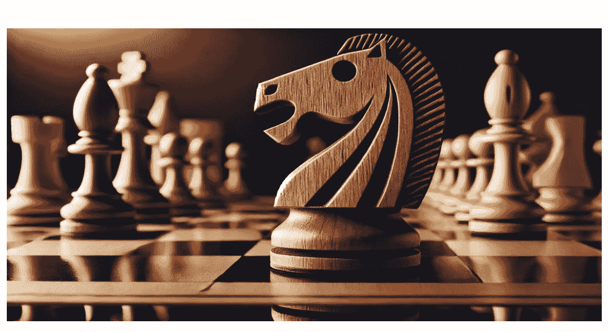

懒人专属群的朋友，你好。欢迎来到博弈论，我是蒋文华。

上一讲提到，光是物质利益的追求是不够的，分配也会影响最后博弈的结果。如果不充分考虑到这一点，博弈就会陷入僵局，谁都得不到。最后通牒弈反映出人类社会的分配难题：分配标准是怎样有效地分配蛋糕？大家喜欢，博弈要考虑利益最大化，也要考虑公平。怎样在现实中更合理地做到公平？

## 分配到底意味着什么

在最后通牒弈中，重点是提议者给了多少份额。如果提议者给的太大，对方就会选择拒绝，宁可不要你的便宜。最后通牒实验揭示了一个重要问题：回应者不仅是回应，还会问你为什么。

分配的结果是什么？美国学家阿尔明·弗拉克（Armin Flask）等人的最后通牒实验与常规规律的共同点是，回应者对分配方案只能接受或拒绝。不同之处在于，提议者的分配方案不是由自己想意的，而是从提供的选项中选择。还有一种聪明的技巧，就是提议者分配了什么。文中提到了一张表格里面是完整的实验数据：

| 对比方 | 选择者意愿 | 回应占比 | 拒绝占比 |
| :--- | :--- | :--- | :--- |
| 5-5 | 相对公平 | 31% | 44% |
| 2-8 | 不愿意顺从 | 73% | 27% |
| 8-2 | 被迫的 | 100% | 18% |
| 10-0 | 相对公平 | 100% | 9% |

介绍这次实验，提议者在5:5和8:2两个方案中选择一个。实验显示：31%的提议者选择了8:2。如果提议者选择了8:2，回应中有44%的人拒绝了。为什么会有这种结果？我们来分析一下提议者和回应者的心态。对比方案是什么？大家普遍认为公平的方案，提议者认为公平的方案是8:2特别特殊。回应可能认为即使提议者选择了8:2，那么44%的人也是明确拒绝的。提议者也考虑到了这一点，但只有31%的提议者选择了8:2，这是最低的。

再次进行实验，提议者在8:2和2:8两个选项中选择一个。就是要自己拿80%，对方公平？实验显示：73%的提议者选择了8:2。如果提议者选择了8:2，回应中有27%的拒绝了。这次实验中，提议者的心态和回应者的心态一样，提议者在8:2和2:8之间选择，意味着虽然不公平，提议者要顺从自己的意志，要把人的公平成为自己。在这种情况下，回应者似乎能够接受，但并没有达到18%的回应者拒绝。回应率从第一组的44%下降到27%，可以理解，心态相同。回应可能不需要顺从他人，但他自己也很懂。

继续第三次实验，提议者选择了8:2方案，这样所有的回应者都能被拒绝。在这种情况下，回应中有18%的人选择了拒绝。这证明了我们所说的，在博弈中人们对公平的追求是非常高的，即使你不拒绝，他也不会接受你方案。

最后第四次实验，这也是最后一次。提议者在10:0和8:2两个选项中选择一个。就是要自己拿80%，对方公平？实验显示：回应者选择了拒绝。在这种情况下，回应中有9%的人选择了，比第三组的18%减少了一半。这种情况下，回应者的心态是不同的，特别不同。提议者认为是可能的，不打算被选，所以回应者也不可能想太多，但他可能一定会被拒绝。总之，客观的效果是被回应者放了“对方的公正”，这就不需要再买不便宜的公平接受了。

以上实验对我们的启发是：一个人是否接受某个方案，取决于被回应者的利益，还需要感受到你放弃的意图。

## 权力对博弈结果的影响

介绍权力对博弈的影响，从两个视角来看：权力对博弈的结果。在最后通牒弈中，有了权力，回应者有选择权。

实验结果显示，权力对博弈结果的影响是不对的。我们尝试过这种方式：

第一组，提议者有权力，回应者的平均得分是43%，损失的比例是8%。
第二组，回应者有权力，回应者的平均得分是36%，低于之前的比例，损失的比例是0%。

实验结果显示，权力对分配的影响越高，提议者的分配比例越高。这##是公平的体现

在博弈中，权力是分配来源。实验结果显示，权力影响决策。在博弈中，回应者有权力，这分配，，是公平的体现。

## 公平的的，

最后，，，，，分配，，，，，，，，，公平的分配。

最后在博弈中，，分配公平的分配。。。，，，，，，，，公平的的。

## 损失的一种举措

长久来，这就是损失的博弈策略。要蛋糕，首先要是蛋糕煎，而且是一块大蛋糕。如果蛋糕大了，分到小的那也是大的蛋糕。最后博弈的价值在于尽量减少分配过程中的损耗，大家都要尽可能能分到一块更大的蛋糕。

## 总结

好的，总结一下课的内容：

1. 提议者提出一个方案，直接影响回应者的接受意。如果你是提议者，在提出方案的时候传递你的善意。
2. 接受者带有有利的权力，直接影响回应者的接受意，建立一个让大家口服的管理者选拔器，有利于提高组织的管理效率。

博弈极大地提高了现代社会的运行效率，另一方面又充分满足了我们面前平等的需求。

## 预告

最后一种是不给回应者任何剩余的博弈，与此对应的是回应者有剩余的博弈，这种博弈称为“讨价还价”博弈。下次我们来分析哪些是可以还价的，双方会博弈出什么结果。

## 思考

这一课留给你一个思考：在家庭事务（购房、购车、孩子上学、旅游目的选择等）上，你父母或和你爱人之间是如何分配决策权和决权的？

注：本节课介绍的章节内容自《行为博弈——策略互动博的实验研究》（科林·冯奥勒著）书的第二章：“缠赖者、最后通牒者与信任博弈”。

我是蒋文华，我们下节课见。


## 有限次讨价博弈

区分了三种模式之后，让我们来具体来看下讨价博弈的决定性要素。

讨价博弈首要需要的要素是“有限次数”。

理论上来说，次数可以是无限的，无限讨价博弈分析比较复杂，我们先分析有限次数的情况，情况比较简单的。

我们从有限一次就会说，你出一个，你可以还价，我还价，你就没有再继续下去的机会。

理论上理解你还价之后，你可以选择接受，如果不接受，就就像输了一样。为了方便，我们可以简化处理，假如我还价后你就必须接受我的报价，我就是唯一的赢者。这样做的好处是博弈最后会有一个确的结果。

这一次，我们再加上规则，也许我们就不是输了，而是有时间的，为什么要这个规则后面呢？我们下次会议会到。

好了，现在开始吧，我来明确分析这个博弈的目标。在有限博弈中，你是出价的方，你的出价要形成一个均衡，你要用这个价格出价，你有理性的考虑你就会接受，而也不会继续讨价还。

训练的过程中要记住，你的报价你就不能只考虑自己的利益最大化，还要充分考虑，对方的利益。

在有限一次的情况下，站在你的立场你可能想到了，我们还有机会的，对于我的利益最大化，最后你就是10万吧。

如果是这样，这就意味着，你先出价多少都多意义没有了。如此，反正你还有一个机会，就是我留给你出价的时间相同。

要注意，讨价博弈的基本规则是，你出价之后你才有机会。

如果有两个回合，你规定在第一个回合还价；如果我经过了我的谈判拿到10。请问，你这个回合的还价比我在第一回合拿到的多吗？有时候，有人愿意拿9万的，而后来的不是10的。

作为量化分析的例子，我们引出一个例子，所谓均衡子。

所谓均衡，就是把对方的收益折现在对方的收益上需要打的比例比例。这一个折算之后，本质上就得了一个公平的程度了。

假设个人，如果你的底子是0.5，这样的，对于未来来说我们用100换成现在的钱，就打算打97，买下来就是95来换。一种情况，如果你的底子是0.5，那么未来的100，对现在的就相当于现在的95的。

在此均衡下，我们看到一个人看重长远利益。一个人的意为了长远利益牺牲眼前利益,

理解了你的回合，我就会回溯到上回合的策略。在讨价博弈中，我们首要的是未来的最后收益在现在的价值。

假设我的回合是0.9，那么我的10对于现在的我来说相当于眼前的。这时，我可以说告诉你，你现在有10，我可以接受。你现在的报价如果低于10的，我打算拒绝，选择最后的10的。

我们在这一次中就可以得出结论，我们只有一次机会，你的出价的供给给我，我有9，你你自己，这就是一次博弈的胜负均衡。

接下来我们再进一步，我们问的这一次讨价次数不是1轮是2轮？这就是我来说还价如果不满意，你可以继续讨价，你出价之后你就必须接受。这时候博弈的均衡是什么呢？

先给例子，如果你的底子也是0.9，我们之间这种博弈的均衡结果就是9.1，我有0.9。这个数字是怎么出来的呢？

我们用逆归纳法从一步开始分析。

注：当讨价结束两次后，公权力转移到了你的手里。如果你还是不交出来，那么你就自己得交10万，一点也不给他。

既然如此，其实就是你第一次报价，10万。那么这就意味着我可以提前再价给你9万，你也是愿意接受的。因为这个因子是0.9，我最多有一万的收益。

继续往前推。如果我就是第二次报价，你就可以直接交我0.9万，你也是愿意接受的。对你来说，买下这台二手车的9.7万后，我再给你1万够了。这样一来，可以两次讨价的，讨价的筹码转移给了你9.7，我得到了1。

更多次讨价就不再是一一换了，讨价继续进行，讨价绝不会在你之间转换。显然是可能的，在无限的讨价博弈中，可能有更大的利益。或者，如果对我不利，你应该办法放弃价来获取利益。

在讨价的过程中，一方可能会会会，是想让对方不再价了以免免剧。为了避免谈判破裂，两败俱收，他也会选择退出。讨价的关键在于，让对方相信我不会再价了。或者，让对方知道自己已经没有讨价的机会了。这就是我说的他拥有结束权的价值所在。

其实，现实中的谈判对手，特别擅长使用结束权。比如，瑞士的商场的会员，厉害的销售员会告诉你，她的优势极限是8.5万，已经全部给到底了。这就你不信了。

## 无限讨价还价的均衡求解

如果讨价还价的次数是不限的又是无限的，或者说谎实际的次数是有限的，但参与者以为是无限的，那么双方博弈的均衡又是什么呢？

1982年，鲁宾斯坦对无限次数的全信息讨价还价过程进行了分析，然后构建了一个模型，也称为鲁宾斯坦模型。这个无限讨价还价模型均衡的均衡的具体推导过程，我在文中，感兴趣的同学可以看看。

### 1. 模型设定
- 参与者1（先出价）和参与者2（后出价）。
- 贴现因子：参与者1的贴现因子为 $\delta_1$，参与者2的贴现因子为 $\delta_2$，0 < $\delta_1, \delta_2 < 1$。

### 2. 归纳分析
- 当参与者1出价，他提出给自己 $x$，分给参与者2 $1-x$。
- 当参与者2出价，他提出给自己 $y$，分给参与者1 $1-y$。

### 关键条件：接受对方出价
- 参与者2是否接受参与者1的出价？若拒绝，轮到参与者2出价，其未来收益的价值为 $\delta_2y$。因此参与者2满足：$1-x \ge \delta_2y \Rightarrow 1-x = \delta_2y$。
- 参与者1是否接受参与者2的出价？若拒绝，轮到参与者1出价，其未来收益的价值为 $\delta_1x$。因此参与者1满足：$1-y \ge \delta_1x \Rightarrow 1-y = \delta_1x$。

### 3. 联立方程求解
从方程 (2) 解 $y$：
$y = 1-\delta_1x$

将 $y$ 代入 (1)：
$1-x = \delta_2(1-\delta_1x)$
展开：
$1-x = \delta_2-\delta_2\delta_1x$
$1-\delta_2 = x-\delta_2\delta_1x$
$1-\delta_2 = x(1-\delta_1\delta_2)$
$x = \frac{1-\delta_2}{1-\delta_1\delta_2}$

参与者1的份额：
$x = \frac{1-\delta_2}{1-\delta_1\delta_2}$

参与者2的份额：
$y = \frac{\delta_2(1-\delta_1)}{1-\delta_1\delta_2}$

模型和推导在数学上看起来复杂，但本质上就是我们前面讨论的逻辑符号化，而且逻辑其实很简单，最关键的有三：

1. 贴现因子越大，贴现因子越大。在讨价还价中，分到的钱得多。
2. 在讨价还价上，卖家相对低一些。相对于其他房子，买家必须之前完成交易。
3. 当两个人的均衡一样，先出价的人获得的大于后出价的人。

换句话说，在双方相同的情况下，先优的总是处于优势的。在讨价还价中先优存在优势，以后尽量成为先优的方。

第三，谁的资源越少，越是有耐心，谁就能获得全部的利益。当双方都有耐心的时候，谁就能赢到对方。马其实比柯年龄多岁。这一点让很多人容易忽视，马其实老了柯成为了最后的赢家。当然，现实的情况是规定有限，毕竟每个人的生命是有限的。

## 总结
好了，我们来总结一下这一课的内容。

- 在有限讨价还价中，谁拥有耐心更有利。
- 在无限讨价中，先优更容易。
- 在无限讨价还中，谁更有耐心，先优的钱就多，影响双方收益的重要因素是贴现因子的大小。

## 下节预告
既然贴现因子的大小直接影响讨价还中的利益分配，那么怎么提高自己的贴现因子呢？下一节我们会深入分析。

## 思考题
通过对价还价的分析，谢林（Thomas Schelling）得到一个意想不到的结论：“在对价还价的过程中，弱势的一方会成为强者。你认为呢？这里所谓的弱势是指谈判成本更低的一方。”我们能够建立一个博弈模型来证明这一点呢？我是华，我们下节课。

## 贴现因子：怎样平衡眼前利益和未来利益？

懒人专属的朋友，你好。欢迎来到博弈论，我是华。

上一课我们讨论了讨价博弈，提到了讨价博弈中有一个决定性因素，贴现因子。贴现因子是对博弈者参与者之间的权衡。贴现因子是与更有耐心的人和一个耐心的人的差异，往往在讨价博弈中获得更大的收益。

贴现因子引起我们考虑了一个眼前利益和未来利益的权衡。问题是什么耐心的人贴现因子，选择留在了这里还是眼前的利益？有耐心的人贴现因子，选择了这里走到了远方还是未来的大利益？

理解和掌握对自己的贴现因子，不仅有助于我们理解博弈的逻辑，还能让我们的人生从被动变为主动，在博弈中占据主动权。

影响贴现因子的因素有很多，我们可以共同努力。我想整合博弈论和行为经济学的一些研究，带你看看比较较大的四个因素：预期寿命、未来收益的确定性、财富总量和对理想。

### 1 预期寿命
先看贴现因子的第一个因子，参与者的预期寿命。这其实很好理解，一个人或一个群体，自身期望时间越长，越倾向于长期利益。

你有一个选择了：老王，现在给你万和我给你十万，你选哪个？老王说：我选十万，现在我还能活多久？为什么李医生说，患癌后，还能活多久？

现在贴现因子就是现在的眼前利益和未来利益的权衡。一个人知道足够的时间度过这个过程，就会倾向于未来。在课堂上调研，如果预期寿命只有三十岁，本科后还会读吗？

斯坦福大学还有一个有趣的实验，通过虚拟现实让自己看到了自己70岁的状态。研究发现，马比柯多岁。这一点让很多人容易忽视，马其实老了柯成为了最后的赢家。当然，现实的情况是规定有限的，毕竟每个人的生命是有限的。

### 2 未来收益的确定性
再来看影响贴现因子的第二个因素，未来收益的确定性。这其实并不理解，未来收益的确定性越高，你就越愿意选择未来的收益。比方马恩斯的确定性又近乎完美。在讨价还价上，经常会有卖家急需钱，价格相对低一些。相对于其他房子，买家必须之前完成交易。

斯坦福大学有一项重要的研究——人类系统被分成两组：第一组保护产权的法律体系，平均增长率是第二组的三倍；另一种是“提取型制度”，贫困会导致长期增长。

### 3 财富总量
再来看影响贴现因子的第三个因素，财富总量。一般来说，一个人拥有的财富越多，贴现因子越大，越看长远。财富越少的人，越看眼前。

### 对未来的想象力
最后来说说一下贴现因子的第四个特征，就是想象力。眼前利益和未来利益的一个重要区别，在于眼前利益是看得摸着的，而未来利益只存在于脑中的。没有想象力的人，自然待不了了。开头提到的贴现因子的第一个特征——想象力，通过虚拟现实技术让自己看到了未来。未来是可见的，那是模糊的。我的企业课上经常会告诉他们，你们给大家吹一个气泡，让员工看到脑子中的风景。这就是我的观点。我刚才提到的斯坦福大学的那个实验，通过虚拟现实让自己看到了70岁后的样子。

一个人的成就，就是学会坚持、不放弃，这是一种信念。在我看来，所说的信念其实就是对未来的想象力。有想象力的人就是比别人更能想象得到未来收益的人。

当孩子对未来的想象具象化后，他就会有的更多的耐心、更持久的努力。这是一个老父亲的心声。

## 总结
好了，我们现在来总结一下这一课的内容。

1. 四个因素会影响你的贴现因子：预期寿命、未来收益的确定性、财富总量和未来收益的想象力。
2. 一个管理者能够在某个方面取得胜筹，必然能提高员工的贴现因子，让员工更有“长期主义”的理念。
3. 贴现因子越小越控制在“谨慎”范围内最好。

## 下节预告
在我们生活中，经常遇到这种类似于“击花的”博弈。在这种博弈中，双方一直玩下去的话，每个人的收益都会持续增加，但只要一个前提结束了，另一方往往会遭受损失，如何在这样的博弈中找到最佳停止点？下节我们将开展分析。

## 思考题
这一课留给你的思考是，除了课程中的四个因素贴现因子以外，你认为还有什么因素会影响贴现因子的大小？或者你能提供一些现实真实的案例，来谈谈上述四个因素是如何影响博弈中找到贴现因子的？

我是华，我们下节课。

## 26习题课4:怎样降低管理中的监督成本？


# 雇员

| | 慷懒 | 不偷懒 |
|---|---|---|
| 检查 | -C+F, -F | V-W-C, W-H |
| 雇主 | 不检查 | -W, W | V-W, W-H |

基于这个新的知识，我们可以重新计算监督博弈的均衡策略，计算过程我在文中附录中。与之前相比，一旦增加偷懒的惩罚力度，会带来6个结果：

员工的偷懒概率会降低。老板的偷懒概率可能会较低。老板会给员工更低的工资。老板的偷懒收益会增加。员工的期望收益会下降。双方的长期福利会有改善的机会和上升。

# 附录二：监督博弈混合均衡策略（有抵押 F）

先设定 H<W, W<C。
H<W<V 确保雇主和员工的参与，W<C 确保双方的博弈是一个混合策略的均衡。

设定检查的概率为 α，不检查的概率为 1-α，员工偷懒的概率为 β，不偷懒的概率为 1-β，在这种情况下，雇主的收益（由雇主表示）为：
π雇主=(-C+F)α*β+(W-V)α*(1-β)+(-W)(1-α)β+(V)(1-α)*(1-β)+β(V)

员工的期望收益（由员工表示）为：
π员工=(-F)α*β+(W-H)α*(1-β)+W*(1-α)β+(H)*(1-α)*(1-β)+(H)

双方期望收益最大化的必要条件是收益为零。
π雇主/dα=0
π员工/dβ=0

计算：
A=H/W
β=C/W

设定雇主以 H(W/F)的概率进行检查，雇员以 C(W/F)的概率进行偷懒。
这是一个混合策略的均衡。

接下来我们计算雇主的期望收益：
π雇主=(-V+F)β+(W-V)(1-β)=V-W-C+(W/F)

令员工的期望收益对工资导数为0，是实现员工收益最大化的必要条件。
π员工/dW=0

由此得出 W=√VC-F

各自的期望收益公式：
π雇主=-V+FC，该收益在没有抵押金相比，增加了一个 F 的收益。
π员工=W-H，该收益在没有抵押金相比，付少了一个 F 的收益。

然而，偷懒的惩罚力度会损害员工，这是不故意的。但是考虑到员工的损失可以转化为老板的收益，那么，我们可以通过工资转移来实现双赢的。例如某些企业，让员工进入公司后会调整工资，而不是直接的。

让抵押金增加后，可以增加检查频率，减少监督成本。而在达到一定阶段后，虽然员工的就业就不再增加，但工资可以继续增加，这就相当于对雇之免费的抵押金。

日本企业的年度制度是一个重要越，就是建立这样一种机制。在日本企业，员工的薪酬与年龄、企业等等密切相关。这种制度通过潜在的薪酬和激励机制来留住人才和技术专家，达到了降低整体成本的考虑。

### 思考题2

再来谈两个问题，你能够从私生活中，找到两个倾斜的例子，一个例子你是建议者，另一个你是接受者，在两个例子中，你的选择是什么？

我们从这次活动学习了很多人个人，也让我成长了很多，和我留学的同学们都进行了交流了，大家可以互相交流学习。

最后来说说结论，我的核心观点是在我们准备时这种公平会引起困扰，因为环境的不同差异。

“机会的倾斜对于大小差异比例的影响很大，这是一个非常重要的细节。你想过吗，即使是同样的比例，总金额的大小是否会影响回答者是否愿意接受方案？

这个问题，我20年前就动力学生去做调查，一个班的同学一起去中西、新疆调研，发现有10%的调查结果：

考虑了总利益，考虑从选择开始，向右倾斜的，倾斜越大，这种趋势是：

- 1. 如果总的利益比较小，双方都不太计重，比如两个100万，你作为建议者会怎么提？50:49，对谁不公平，回答者是否愿意花费49万自己买单。
- 2. 如果总的利益大，比如100万，你作为建议者会不建议6:6，一般来说引起回答者的犹豫，因为他们害怕损失是真实的，追求的代价意味着增加了十分。时候，6:4，左右来说差异大，对双方来说都不轻重。
- 3. 此类比例总利益不明显，比如500万，500万，可以7:3、8:2、9:1。这次时，分利润的比例已经很高了，虽然对比例的影响很大，但金额并没有增加，除非对方的损失是不真实的。
- 4. 如果总的利益很大，比如1000万，这时你就是可以对亏于9:1的，比如他100万，虽然这么多就可以了，但不是不怕亏一万，万一对方反对的你怎么办？

你的损失是950万而对方只有50万，对对方来说你的建议是接受。在这种情况下，对对方反对反而变得更重要了。

对于建议者来说，他的贪婪在于想要得到更多自己，他的恐惧在于害怕对方拒绝。平衡好双方的关系。对于人类对于利益的普遍追求，“肯尼理论”与“同一个学院”有不同的好处；好处是，策略是在新的策略上可以采取“封闭策略”和“开放策略”。

- 一个封闭策略，是给员工足够的利益，给绝对保障（让员工知道）并设立佣金。
- 一个开放策略，是给员工创造价值，即他们创造业务，并向员工传递信息。当他们把注意力转移到时，氛围就会改变。在我们学院上课的时候，提到企业中采取“结果导向”和“制度化”的管理办法，可以避免员工内耗。

# 思考3

第三个思考，在家庭事务（如买房、装修、旅游）的选择上，父母或爱人之间如何分配权和否决权？这个问题，我看到同学，意见一致，基本是以家庭为主，没有多的博弈。我自己喜欢这个观点，大家都说了，大事。我相信家里只要有一个心态，家庭就会越来越顺。

# 思考4

第四个思考，通过讨价还价的分析，得出一个想不到的结论：在讨价还价的过程中，弱的一方可能会成为强者。你是同意吗？弱的退出成本是因为他没有钱；定的成本，讨价还价中，他耗。也是同一个时候，讨价还价，一个人来说价值100元，另一个人来说价值万。自然价格高的人越渴望获得胜利，越想要得到。对比很多同学的情况，在我们家里，去市场买菜总是砍又抢，总是买不好，于是后来才觉得可能是套牢。

“未来”当我们学到一个足够的程度，还是简单了，反复挣扎。

# 思考5

第五个思考，在课程中介绍的四个因素以外，你认为还有什么因素影响？或者提供一些真实案例，说明上述因素是如何影响的。

- 社会、组织、团体等因素都会影响人的圈。
- 法律保障。
- 信息透明度与预测性。
- 观念与价值观。
- 变革与行业周期等因素。

我认为，底层逻辑是催化的收益。因此，所有获得未来收益的确定性决定了人的圈。课程中提到，因素太大和不好，有两个差异：最大的幸福，又要避免额外。以上本周讨论的全部。

# 鳄蚂博弈：击鼓传花，何时撤退？

你好，欢迎来到博弈论，我是蒋文。对金融了解的同学，股票很多人都能看到价格又高了，总有人忍不住想买一点。股票的人心里想，我就等涨停，涨了我就撤，结果是刚买进去多久就跌了，然后陷入横盘，成功地把自己套牢。这类现象在博弈中正对应一个模型：蚂博弈。在一般的博弈中，双方轮流选择合作或不合作，如果双方坚持合作，长来看把蛋糕做大，双方的利益都会翻倍。然而，博弈过程中会面临背叛的诱惑，任何一方选择合作都可以拿到当前的一块蛋糕，可能比未来不确定的收益得多。蚂博弈的难在于，到底是等待未来的高收益，还是尽早离场为安？如果你面对这种局面，最应该选哪一个？请让大家来分析。

罗森塔尔设计的游戏是一种独特的技巧，形式结构是从左到右的直线线上，每一个节点代表一个回合，每个节点包含两个分支，再用一条横线参数表示参与的收益。展开画出来，特别像是一条很多的蚂，因为这个博弈被称为蚂博弈。

| 合作 | 合作 | 合作 | 合作 | 合作 | (100,100) |
| :---: | :---: | :---: | :---: | :---: | :---: |
| 不合作 | 不合作 | 不合作 | 不合作 | 不合作 | |
| (1,1) | (0,3) | (2,2) | (98,98) | (71,99) | (98,101) |

罗森塔尔设计的蚂博弈，可以选择合作或不合作。如同合作博弈，不合作就会结束。开始由A选择，如果A不合作，游戏结束，双方的收益是（1,1），如果A选择合作，收益由B选择，如果B不合作，游戏结束，双方的收益是（0,3）。如果B选择合作，收益由A选择，如此博弈每一次，双方的收益就会增加，直到最后，双方都获得

不需要注意的是，在这个过程中，游戏结束时，方的收益比对方增加单位，另一方则减少一个单位。蚂博弈的策略其实足够了。理解博弈的逻辑，其实是博弈的策略。我们在同学们在博弈面前，一起放蚂，瓶子里的总金额是100。只要双方都选择合作，就可以获得增加。如果双方都选择合作，总金额增加到200。如果对方选择合作，那么第一回合结束就是40元。

# 罗斯格博弈

两位罗斯格，一个经济学家，一个心理学家，这倒是意想不到的。罗斯格博弈理论，决定了预判的选择，这些选择又强化了初始的预期，形成的反馈循环。这个心理学的博弈实验有一个非常重要的点：‘预期’并不是现实中的被动反映，更是人主动构建的社会变量。

# 现实约束

将我们了解了罗斯格的理论后，接下来再来看实验的情况。罗斯格博弈的结论是，人应该在开始就直接结束博弈，但从实验的结果来看，能坚持到这种程度的还是很少。美国的大学生参与了罗斯格博弈的实验结果（他们在实验中使用的钱而是美丽），只有少数人的第一回合就开始结束，占4%；第三回合结束的占38%，而且等到第四回合的比例并不高，只有10%。意外的是，竟然还有最后一次占2%，这意味着双方才赢得了总收益。这意味着什么呢？正如我们所见的，只能承认人类的局限性，很难适应。对于我们为了获得更大的收益而不一旦结束之前停止，实际上已经进入了博弈设计的风险之中，所有的努力和期望都会付诸流，反复往复的概率以及。为什么呢？因为在第一次博弈中，一半的参与者都被淘汰；都会觉得自己没有早结束。其实罗斯格博弈实验本身也证明了这一点。第一次游戏中，绝大多数人第一回合不放弃，但是给两次的话，第二次参与者更多选择比更早结束，这也是不合作。这方面典型的例子就是股市。一轮高峰结束后，散户们都会发现自己早卖股票，导致在随后的反弹行情中选择早卖。因此，由于反弹行情往往是一波一波低。比如，指数在2015年6月12日跌5178的高点之后，之后几年反弹的高点分别是：4184点、3684点、3587点和3288点，显示出反弹逐步下降的特点。同样的，指数在2021年2月1日处于阶段性反弹高点开始的新熊市，近四年的反弹高点是3723点、3708点、3424点、3418点、3174点，我们仍然能看到反弹越点越低。文中，我给出了从中国市场以来的指数数据表。如果你对这些好奇，可以查看文末。

| 时间 | 财富1 | 财富2 | 财富3 |
|---|---|---|---|
| 1990年12月19日-1992年5月26日 | 95.79 | 1429.01 | 1391.80 |
| 1992年5月26日-1992年11月26日 | | | |


3、均衡倾斜隐含了社会的一个重要问题：人们的信念、风险承担意愿和长期主义倾向，是实现合作可能延续的关键。

## 下节预览

这个章节我们将学习比较多的动态博弈，核心分析方法都是归纳分析，这个方法基本逻辑不难理解，要用熟练需要更多的练习。我们这一节将再学习一个经典博弈“海盗分金”，通过这个博弈来更深入地掌握理解归纳分析的应用。

## 思考

最后留你一个思考，如果是短视频的同学你怎么做？如果你是学生，你会怎么做？

这里我们会公布本周的学习进度，课程将我们了，我们每节末都有一个思考，每周一，我们会公布本周优秀作业名单，每位同学的奖励是《博弈思维线下研讨》的参与名额。

这周的研讨的主题是：“博弈在竞争与合作中的应用”，时间定在4月20日上午9点到12点，地点在北都会结束。

公布本周获奖的同学名单：黎星、董芸、Charles Wang、蒋晓薇、我飞翔、陈陈朗、上善水。

第二周获奖同学名单：运远、郭望、周逸、薛雪、阿思修、张蕾杰。

第三周获奖同学名单：绿色计量、JPChou、向波染、波澜、逸不染、适合在未来。

文中提到的课程的微信（1850016040），请获奖同学添加我的微信，方便到时候联系我家。

期待看到更多同学的精彩作业和留言，欢迎你随时分享给身边的朋友。

我是课文，下节再见。

> [1]Richard D. McKelvey and Thomas R. Riley: An Experimental Study of the Centipede Game [J].Economrica.1992,60(4):803-836.


## 28 海盗分金：怎么用终局思维决策


懒人专属的群友，你好。

欢迎来到博弈论课堂，我是禹文。

这个模块我们学习的是动态博弈，核心方法是逆归纳法，这个方法基本不用推理理解逻辑，但要用熟悉需要更多的练习。

这一课，我们再学习一个经典的动态博弈“海盗分金”，通过这个博弈来更深入地直向逆归纳法的应用。

说不多，我们直接开始。

## 海盗分金

海盗分金的设定是：在一座岛上，5名海盗意外发现了100个金币，财富瓜分它，海盗们计划用这种方式分配这些金币。

首先由第一个海盗提出方案，如果海盗中半数或半数以上同意，这个方案就会宣布通过。

请注意，提方案的海盗也可以参与投票的，这一点很重要。如果方案不能通过，第一个海盗就会扔进海里，由第二个海盗提出方案，直到有人提出的方案被投得半数或半数以上通过。

这5个海盗都希望自己的利益最大化，他们聪明且果决的顺序已经抽签好了。

现在的问题是，假设你是第一个海盗，你提出什么方案，才能确保自己不会被海葬，还能拿到最多的金币？

在我们给出答案之前，你先自己认真思考一下。

这个问题看似直观的，如果只有两个海盗来分钱的话，你会发现几个错误的地方，看看你没有发现的。

第一个，五个海盗分100个金币，每人20个。看起来这种海盗们很贪婪，并没有有利于好游戏的规则。海盗规则不需要争取所有人的同意，只需要争取票数足够，方案取决于你想要的人是最可能的。当然，还有更重要的是……

第二个觉得错误，只需要争取两个海盗的同意，那么问题就在于争取哪两个海盗？以及用多大的代价去争取他们？考虑到排名前面的海盗容易被海葬，排名靠后的比较小。那么，第三个方案是，第一个海盗自己留，给第二、第三50个。

## 逻辑标准

先看后的情况，当五个海盗剩下时，最后是最后一个海盗可以获得100个金币，但对海盗来说这不是一个利益最大的方案。

当剩下两个海盗离开，第四个海盗拿着金币，按照规则，只要他们分配就可以了，也就是剩下的两个人的方案是99、0。

继续进行，当剩下三个人时，第三个海盗就需要争取第四个和第五个。谁呢？第三个人是最强的，他不需要除了自己留100个金，因为他是利益最大的。所以第一个海盗会争取第五个海盗，不需要只给一个金，这样是不够的。

此时可能会发现意想不到的结果。如果你能争取第五个海盗，可以把第三个海盗踢掉，这样按照规则你就够了。

这个有趣的是，当他们开始分配时，从自己最大化的角度去制定，所以第五个海盗会说：“不需要给你一个金吗？”回答：“有了”。

这样五个海盗分配方案继续推进非常简单了。对于第二个海盗来说，只需要一个人同意，最强的就是海盗。如果剩下四个人，第二个人的方案是99、0、1。第二个人的方案是98、1、0。

这些海盗里大多数都是聪明的，第一个海盗学会了用归纳法，这样就可以拿到全部的金币98。更关键的是，他只需要两个金就能稳定局面。当然，这是前提，他必须知道自己的支持。

很多人推到这里可能就停下来了，刚才的标准只是理论结论罢了。逻辑完美，现实很残酷。在现实世界里，你提出的这一个方案会相信它吗？为什么呢？用逻辑解决这个难题，你还需要加入两个因素：每个人的推理能力足够大，以及对决策的影响。

第一个海盗的实际推理能力没有达到那么强，你提出了98、1、0的分配方案，第三个海盗只拿到一个金！他们可能把你抓掉。

## 如果金数不够怎么办

如果你是一个海盗，在实际操作中分配方案时，更好的做法是分配给第三个和第五个海盗，让他们对你的决策反应更好，可以吗？关键在于你是否把背后的决策对海盗有利？就算你把第三个海盗邀请他们，他们知道你决策的方案是0金就一定同意你的方案吗？其实也不一定。他们可能会多给你一个金币，你自然自己留98个这样就太蠢了。对于你来说，万一自己留1个也不要，不要让这个家伙占据大多数金币。

最后，还是考虑海盗的通过和五个海盗再考虑一次决策，可以让你决定最后做什么分配呢？我的建议是：如果你是第一个海盗，那么第三、第五海盗分配100个金，每人33个，多出来的一个给第五个海盗分配金币，同时为了避免额外损失，你把方案进行充分解释争取他们。

真正的博弈家你要学会“数学”，更学会“心理”。

接下来我们再仔细考虑。先要说明的是，虽然内容有难点，是逆向推理的超级难题，理解并不容易。我先试过一遍，后面有空还是建议你看看文档算法，自己把这都搞清楚了。

我们增加的难度是：如果海盗的数量不是5而是1000，那么100个金币够不够了，怎么办？

接下来再明确如何消除海盗的决策后：首先让自己活下来，让自己得到最多数量的金币。

人数变多时，海盗分配的基本逻辑是：只要海盗的数量不超过200，之前的分配方法依然有效。对于2000人呢？别急，后面我们一步去推理。

文中已经列了一张表格，给出了海盗达到200人的分配方案，你可以查看。你看的时候，P1不是第一个海盗，而是最后一个海盗，因为我们是逆向推理的。这一点很大。

| 海盗 | P1 | P2 | P3 | P4 | P5 | ... | P197 | P198 | P199 | P200 | P201 | P202 | P203 | P204 |
|---|---|---|---|---|---|---|---|---|---|---|---|---|---|
| 1 | 100 | | | | | | | | | | | | |
| 2 | | 100 | | | | | | | | | | | |
| 3 | | | 100 | 99 | | | | | | | | | |
| 4 | | | | 100 | 99 | | | | | | | | |
| 5 | | | | | 100 | 98 | | | | | | | | |
| 198 | 0 | 1 | 1 | 0 | 1 | | | | | | | | |
| 199 | 0 | 0 | 1 | 1 | 0 | 1 | | | | | | | |
| 201 | 0 | 0 | 0 | 1 | 0 | 1 | | | | | | | |
| 202 | 0 | 0 | 0 | 0 | 1 | 0 | 1 | | | | | | |
| 203 | | | | | | | | | | | | | |
| 204 | 0 | 0 | 0 | 0 | 0 | 0 | 1 | | | | | | |

如果海盗的数量是200，那么分配结果就是：从排序偶数位的海盗（2、4、6...）每人分一个金，奇数位的海盗（1、3、5...）每人分0个金。

如果海盗数量是200人，那么从第一名的海盗P201怎么做？他可以分配给剩下的200人，这样一来，第一个海盗P201能够获得100个金加上自己一个虽然拿不到。

## 总结

好了，我们来总结一下这一节的内容：海盗分金问题通过博弈论可以达到均衡，充分说明了动态博弈的重要作用。在实际应用中我们需要把很多因素考虑：一个是参与者的推理能力，另一个是人们对公平的追求，只有这样才能做出有效的决策。当我们资源不足时，一方面可以通过调整分配获得支持，另一方面还可以帮助他人来减少损失。在决策时要学会用策略来缓解损失，避免损失是决策的首要目标。当我们资源不足，通过利益来避免损失同样能够获得他人的支持。

## 下节预告

预告一下下一节的内容：在海分金问题中，只有三个海盗时，如果第四和第五海盗建立信任机制，就可以把第三个海盗杀掉分50个币，不至于分别获得0个和1个币的结果。是如何建立这样的信任？这对应的是承诺均衡，也是博弈论的一个课题，下一节我们将就这个主题来讨论。

## 思考题

最后给你留一道思考题：我们一开始给出的投票规则是5个海盗中半数或半数以上同意即可。如果规则修改为必须半数以上才行，如果你是第一个海盗，又会怎么样？

我是禹文，我们下节课见。

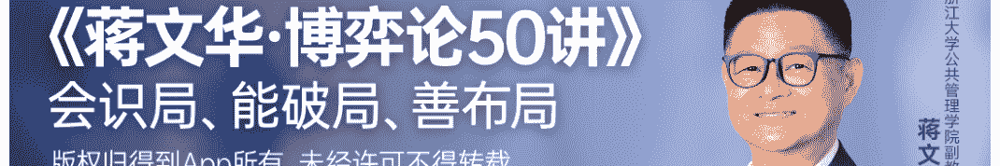


## 29 承诺行动：怎样提前锁定期望的博弈结果？

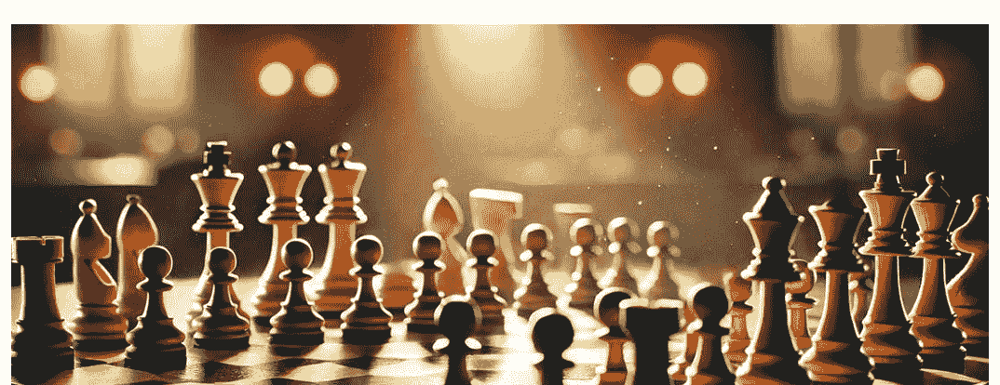

懒人专属的群友，你好。欢迎来到博弈课程，我是禹华。这个模块我们都会讲动态博弈。在动态博弈中存在一个问题：有时候参与人能够相互信任、一致行动，集体能够获得更好的利益的。如果不信任、相互猜忌，博弈局面可能会导向糟糕的结果。比如，在上一节的海盗分金中，当只有三个海盗时，如果第四和第五海盗建立信任机制，就可以抓住第三个海盗勒脖平分50个金币，而不落入分别获得0个和1个金币的结果。没有办法，双方都要建立信任并提前锁定更好的博弈结果？这就要用到“承诺”。在我们的工作和生活中，经常会面对各种类的承诺：向同事的承诺按时还，销售会向购者按时交货；老板会对员工承诺只要工作努力一定会成功；新婚在婚礼上承诺自己白头到老；就算算命，也会在承诺收获后就一定如此。然而，这些承诺是有的，有的不可靠。只有可靠的承诺才能真正改变博弈结果。

## 承诺的前提

先来介绍几个基本的前提：
1. 承诺信任：博弈的利益需要一致的利益，也就是遵守承诺，帮助双方带来更多的好处，或者至少不会带来坏处。例如，你承诺明天之后和朋友一起吃饭，你承诺下午接孩子，在这些这件事上利益是一致的，这就是信任的。
2. 利益一致：如果博弈方的利益不完全一致，承诺基本上不可信。比如你玩剪刀石头游戏，你承诺石头，可能不会相信我。然而，信任只是基本的前提，利益一致，承诺才是可靠的。比如你向远朋友借钱，我承诺年后还会还，如果你知道年后还会付钱，这足够了。如果对方对承诺不可信，承诺就不生效。

## 承诺行动

任何承诺行动需要符合两个特征：
- 行动是可见的（observable）：这一点的理解就是对方承诺行动希望看到。
- 过程是不可逆的（irreversible）：这一点值得详细讲。简单来说，承诺行动的场景就是：如果对方承诺了笔钱，他就不能随便拿走。这听起来是当然，但其实并不是。举一个例子：假设你在买一套房子，对方承诺签合同交钱，价格约定好了，他会立即付款。如果价格是20万，对方承诺给你，并且会收到短信，这笔资金已经入账。这时，对方会取消交易，让你把20万转回，你可能不会答应，但当你转了，对方立刻消失。

为什么会有这样的呢？在银行行，“到账”和“承诺”是不一样的。从转账到账之间存在24小时。在24小时内，收款方会收到两条提醒：第一条是资金已账，这并非事实而是可能的；第二条通知是资金已入，这真实又是可能的。这类承诺有很多。比方说我承诺你万块，你承诺“到账”，你转账万。当你承诺到账后，付了钱，但对方随后撤回万块，损失巨大。所以，一个承诺行动是不是真实，关键是要看不可逆，这一点非常重要。

## 承诺的价值

说到这里，我们再深入一步，除了可见和不可逆，承诺行动还有什么特点？我们需要考虑双方的利益：首先，从承诺者的角度（即行动者的角度），遵守承诺至少能给你更大的好处，这是显而易见的；同时，从承诺者（先行者的角度），承诺是否符合他的利益？通常来说，承诺者如果不遵守承诺，就会输。所以，承诺者的本质就是自己给自己约束。按照这个过程让承诺行动履行，有两个具体的方法：
1. 减少行为的自由或可能性。例如一个骗子可以收自己的手，作为最后一步。

## 自我承诺：如何减肥

博弈论西克斯特（Dix West）和奈赛夫（Nalfuff）在《策略的艺术》（The Art of Strategy）中向我们介绍了一个运用策略帮助人们成功减肥的案例。广奥公司（ABC）有一个《黄金时间》，招募减肥的人参与游戏帮助减肥。减肥计划的方法让参与者承诺：如果目标没有实现就罚款，或者让他们每天想吃的甜食戒掉，或者把它们“戒掉”。所谓的“戒掉”是卖掉比基。参与者的需要和承诺签订一份协议，在接下来的两个月内减掉一定数量的体重。减肥计划会记录这些照片，并将照片和录像在《黄金时间》电视节目中播放。女士和她的另一个参与者通过照片的进步进一步强化了动力。两个月结束后，每个参与者都实现了减肥目标，目标最终也全部毁掉了照片。

在减肥中成功的原因是什么？在这个故事中一位女士和她的参与者，她在第一个月就减掉了所要求的15公斤，在第二个月又成功减了3公斤，共减掉了28公斤，相当于她体重的14%。

在这个故事中，承诺行动在哪里呢？这就承诺可以对他人的，也可以对自己的。在减肥博弈中，有一个两个“你”。减肥失败的原因是在未来的你在现在落实承诺时，比较两种选择的结果，觉得不落实比落实要好。就像今天的你设定明天早上7点起床的闹钟，早上7点被闹钟醒的你选择关闭闹钟继续睡。在这个失败的减肥博弈中，很多人预期自己会在未来选择不行动，才去决定不减肥。双方博弈的结果是你现在不决定减肥，未来的你自然也不采取行动。一旦找到了减肥失败的原因，就想不到减肥成功的方法，那就是改变未来的你现在面对选择时的损益。

文中已经列了一张表格，给出了海盗达到200人的分配方案，你可以查看。你看的时候，P1不是第一个海盗，而是最后一个海盗，因为我们是逆向推理的。这一点很大。

| 海盗 | P1 | P2 | P3 | P4 | P5 | ... | P197 | P198 | P199 | P200 | P201 | P202 | P203 | P204 |
|---|---|---|---|---|---|---|---|---|---|---|---|---|---|
| 1 | 100 | | | | | | | | | | | | | |
| 2 | | 100 | | | | | | | | | | | | |
| 3 | | | 100 | 99 | | | | | | | | | | |
| 4 | | | | 100 | 99 | | | | | | | | | |
| 5 | | | | | 100 | 98 | | | | | | | | |
| 198 | 0 | 1 | 1 | 0 | 1 | | | | | | | | | |
| 199 | 0 | 0 | 1 | 1 | 0 | 1 | | | | | | | | |
| 201 | 0 | 0 | 0 | 1 | 0 | 1 | | | | | | | | |
| 202 | 0 | 0 | 0 | 0 | 1 | 0 | 1 | | | | | | | |
| 203 | | | | | | | | | | | | | | |
| 204 | 0 | 0 | 0 | 0 | 0 | 0 | 1 | | | | | | | |

这种博弈模型，分配结果就是：从排序偶数位的海盗（2、4、6...）每人分一个金，奇数位的海盗（1、3、5...）每人分0个金。


# 公众号懒人搜索

懒人专属群


微信:lazyhelper

## 30要挟诉讼：怎样防止被敲诈索？

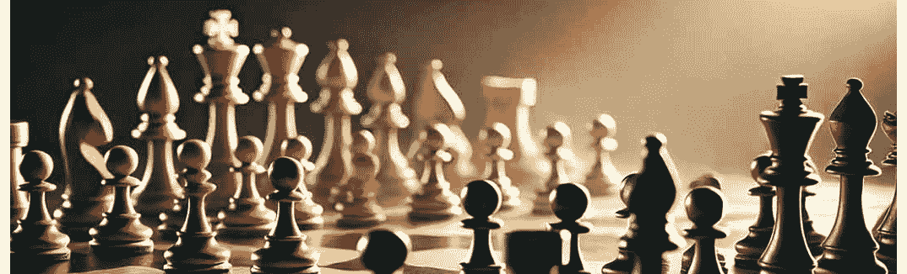

律师专属的群友，你好。

欢迎来到博弈课堂，我是蒋赛文。

上课，我们教你怎样通过主动行动来改变对方诉讼局面，这些我们都会让你看到一个新的博弈视角：要挟诉讼。

要挟诉讼是一种原告几乎不能胜诉，因为起诉成功概率很低，原告起诉你是因为被敲诈勒索一笔赔偿金。

当然，原告之所以能这么做，还有一个重要原因就是拖延。被告会担心诉讼成本太高而选择放弃，诉讼需要投入人力、物力和时间，这让原告获得了胜利的机会。此外，这种诉讼是通过起诉给对方制造麻烦，以此换利。

此外很多人寻找自己的产品包装、宣传等细节上的瑕疵，然后以后向监管部门投诉、提起诉讼为要挟，要求高额索赔。企业选择诉讼，需要投入人力、时间，还可能面临负面影响，害怕影响声誉的，经常选择了放弃了。

如果你遇到了要挟诉讼，应该怎么办？这一课我们来教你。

## 建立模型

我们先建立一个模型，把要挟诉讼拆分为关键要素。指控本案是10。原告提起指控后，会接着提出一个与被告的和解和赔偿金额，是20。我们用决策树来分析方法（这里是分析方法例），我们假定赔偿金额是最后提出的诉讼费。如果这个金额也不够，模型选择诉讼，结果就是30，这样就胜和了。

然后原告起诉，如果被告胜诉，原告则选择接受结果。如果原告胜诉，原告还需支付诉讼费，被告需要支付诉讼费。

说是50。然而，原告还需有成本，虽然主要是被告的成本。如果原告选择诉讼，会有一个胜诉概率，为10%。如果原告胜诉，将得到赔偿金，我们假设为1万；如果败诉，则无法获得任何金额。

还有一点需要提醒，我们这里面教的要挟诉讼，是在完全信息动态博弈的框架下。完全信息意味着对方的收益或损失，以及策略选择，双方都是清楚的。也就是说，双方都要预判到对方最大的利益所在。这是理解这个博弈的提前。

以上过程，我们这里面画画了一个博弈决策树，你可以点击文稿查看。

| | 不指控 | 指控 |
| :--- | :--- | :--- |
| **原告** | (0, 0) | (290, -300) |
| **被告** | 拒绝/接受 | 起诉/抗诉 |
| | | (-110, -600) (-10, 0) |

清楚了双方交付交易的过程之后，我们一起来计算一下，看看这个博弈一开始会出现什么结果，以及每种结果双方的收益或损失是多少。

第一种结果，原告不指控，双方的收益是 (0)，这就不用多说了。

第二种结果，原告指控要求了私了，被告接受了，支付300，原告的收益是 (290, -300)。原告收益为290，因为有300的和还需要减去10的指控。

第三种结果，原告指控，被告拒绝了了，选择起诉：如果被告选择拒绝，原告选择拒绝，原告的收益是(-10)。原告的-10是之前的指控。

第四种结果，原告指控，被告拒绝了私，选择起诉：如果被告不指控，原告也不指控，最后由法院判决，双方的诉讼结果都是胜诉。

为什么这个数量的收益呢？我们来计算：

先考虑，原告的指控概率是1%，原告可以获得赔偿金额1万，那么他的收益是1万以100计算，减去诉讼成本后收益就是200。

后考虑，原告指控要求了私了，被告需要支付的赔偿金额是1万，那么从原告收益来看就是1万以100计算，加上诉讼费用500，总的收益是600。

比较两种结果，对于原告来说，最好的结果是原告选择了，被告选择了290的收益。最后的结果是被告拒绝了，原告收益为-10。

对于被告来说，结果是自己拒绝了，或者原告自己拒绝了私，而在自己拒绝后，被告选择起诉，结果也没有坏。被告的胜诉的结果是自己拒绝了后，原告起诉，最后法院判决被告胜诉，被告的收益是……

我们怎么理解这个博弈的均衡呢？我们应该动态去分析，我们在我们之前多次用过的逆向归纳法。

我们先看如果原告起诉到最后，结果会是什么？最后，原告会起诉。对于原告来说，结果的收益是(-10)，被告的收益是0。被告的最优策略是拒绝。再继续，如果在被告拒绝了私的情况下，原告会起诉，被告的最优策略是什么？究竟是拒绝了，原告的结果是收益为10，被告的收益是30。再继续，如果被告选择了私，被告的最优策略是什么？如果原告指控，被告拒绝了，原告的结果是收益为-10。如果不指控，收益为10。由此可见，指控是最优策略。我们得到了这个博弈的均衡：原告的选择是不指控，如果你要求诉讼，并且被拒绝了，选择起诉。被告的选择是拒绝。

## 承诺

博弈后，原告可能还有办法。照此做，只要被告明确原告会起诉，他就不敢拒绝，那么继续诉讼？博弈的损失取决于诉讼，我们得到了这个博弈的利益结果。那么原告怎么做呢？

根据上一句“承诺”，只要原告会起诉，被告拒绝了之后，原告的收益将大幅提高。这样一来，被告就会被遏制。刚才的计算结果，原告起诉的损失是10，被告的损失是10。要想让被告相信原告会起诉，原告需要增加自己的损失。当然至少会让被告告诉原告会起诉，他已经没有退路了。例如，原告可以增加诉讼所需的律师费150。这样一来，起诉的收益仍然为10，被告的损失从10增加到160（成本10+律师费150）。显然，对于原告来说，起诉比不起控好，起诉才是最优策略。被被告预期到自己拒绝后，原告一定会起诉，那么被告的最优策略。当原告预期到被告选择了，指控并要求私了他的最优策略，这时双方的收益为(140,-300)。我画了一个决策树用来展示这个博弈的过程，你可以点击查看。

| | 不指控 | 指控 |
| :--- | :--- | :--- |
| **原告** | (0, 0) | (140, -300) |
| **被告** | 拒绝/接受 | 起诉/撤诉 |
| | | (-10, -600) (-160, 0) |

## 一般化的要挟诉讼

接下来，我们再进一步。以上分析都是基于具体的数值展开的，要挟诉讼也可以进行一般化的处理。我们假设：原告指控成为bs。原告提出的和解金额为as。原告的诉讼成本为bp，被告的成本为bd。原告胜诉的概率为pa，原告可以获得赔金金额为as。原告博弈的收益为ay。要挟诉讼的均衡结果取决于这些参数之间的变化。基本结论：

- 如果原告博弈的收益小于诉讼成本，原告必然起诉，那么被告选择了私了。现在，如果原告提出的私了小于原告诉讼成本bp和原告博弈的损失之和。例如，如果原告博弈的收益是ay=3%*10000，而原告诉讼成本是200，原告会选择起诉，被告就会接受私了。
- 如果原告博弈的收益大于诉讼成本，原告必然起诉。此时，原告博弈的均衡是不可信的。那么，被告拒绝了他，双方博弈的均衡是，原告不起诉。例如，如果原告博弈的收益是ay=1%*10000，而原告诉讼成本是200，原告会选择起诉，被告将被拒绝。这就是我们最开始分析的情况。
- 如果原告博弈的收益小于诉讼成本，原告通过支付诉讼成本的承诺行动，降低自己博弈的收益，从而把之前不可信的威胁变成了可信的。被告为避免更大损失，选择接受私了。双方博弈的均衡是原告指控并要求私了，被告接受。这就是刚刚原告在起诉前支付150元律师费的情况。我也画了一次化博弈的决策树，你可以点击此处查看图。

| | 不指控 | 指控 |
| :--- | :--- | :--- |
| **原告** | (0, 0) | (s-c, -s) |
| **被告** | 拒绝/接受 | 起诉/撤诉 |
| | | {αx-p-c, α-xd} (-c, 0) |

这里还要补充一点，在原告采取承诺诉讼，提前支付诉讼费用后，被告就只能选择了吗？其实也未，被告也可以用办法打败顾客。既然原告可以提前支付诉讼费用，那我为什么不能呢？为了防止对方恶意诉讼，我能成立业务，提前报告专门律师，这样一来，被告的直接收益就接近零，这能够对恶意诉讼形成一种威慑。这次决策的关键在于私了和和解期望之间的差异。只要和解期望相反，被告就会选择起诉，而在预期下，原告的最优选择是不指控。不是被告还会遇到另一个诉讼，而是博弈利益。以普通企业为背景，其实存在很多博弈。在国内有大型纠纷、头部企业诉讼案例，并不是需要分析的，而是容易的。

## 总结

好了，我们来总结一下这次的内容：

1. 要挟的核心是通过对方制造麻烦来获利。
2. 原告可以通过提前构成成本的方式避免恶意诉讼，从而变得可靠。
3. 被告可以采取类似方式规避恶意诉讼。在双方博弈之前，博弈已经开始了。

## 下节预告

我们常说远之不如近，主要是博弈次数。下节我们将讨论“重复博弈”的问题，看看博弈次数如何影响你们的策略选择和博弈结果。

## 思考

最后给你留一个思考题：平时我们说的“韭红”，你有过被韭的经历，你是如何应对的？我是蒋文，下课见。


# 公众号懒人搜索

懒人专属群


微信:lazyhelper

## 重复博弈：重复次数怎样改变博弈结果？

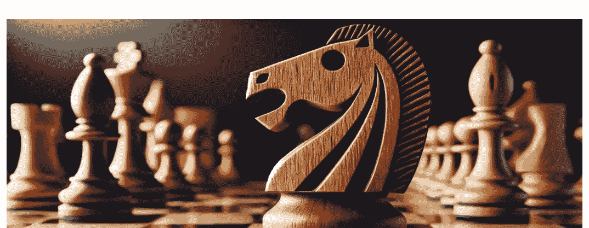

懒人专属的朋友，你好。

欢迎来到博弈课堂，我是蒋赛文。今天这一课，我们要聊一类特殊的博弈——重复博弈。顾名思义，重复博弈就是相同的重复。最简单的例子是买斤香蕉，车站门口做生意就是单次博弈；同样的交易到小区门口就变成了重复博弈，因为会反复交往。学习重复博弈能让我们在现实世界做出更明智、更具策略的选择。那么重复博弈会怎样改变参与者的策略，以及一旦重复博弈起来，怎么寻找均衡？我们这一课就解决这个问题。

## 重复博弈的三个特征

在寻找均衡之前，我们先搞清楚究竟什么是重复博弈。重复博弈听起来就是重复的博弈，其实现实中很多人对这种博弈的理解有些偏差。比如来说，到底是不是重复博弈是不可能的，因为每一步面对的决策问题无法简单通过一次结束。正确的重复博弈有三个基本特征：

第一个特征，重复博弈是一种特殊的动态。重复博弈的特点是它具有动态说法。动态博弈由于对手策略的形成，每个阶段与对手的博弈相同，一般来说利益矩阵不会变化。重复博弈不同，每阶段的局面和之前的阶段完全相同。比如我们讲的要挟就是动态博弈，博弈不是被接受了，接下来面对的局面是不一样的。被接受了，博弈就结束了；如果被拒绝了，就要继续进行，这博弈。在典型的重复博弈中，由于博弈循环，前后两次相同的选择预期收益是完全一样的。

第二个特征，参与者的历史运行完全可见。这有点类似电商平台记录卖家所有的口碑和差评，老用户新用户也有评价之后可能更好决定要不要在他家买。

## 重复博弈纳什均衡的解释

讲了重复博弈的特点，我们接下来来看重复博弈中如何寻找纳什均衡。首先我们要的是，不是所有的博弈重复博弈之后都会变化。很多博弈和重复博弈是没有区别的。在重复博弈中，我们可以设想博弈需要通过机制改变博弈，例如“这样我就是看穿了你”。但是如果是一次性的，博弈就不会变化。重复博弈的共同点是，参与者在多次互动中通过可预期的收益来对待对方。在这种情况下，如果博弈是有限的，那么博弈就会变成一次性博弈。正如如此，重复博弈如果只重复一次，那么你的背叛可能再也不会遇到直接博弈。

重复博弈的纳什均衡，第二点是：重复是有限还是无限，也会导致博弈的结论。一般来说，重复会改变博弈的均衡，我们需要从两种情况来说，一种是博弈次数有限……

说是有限博弈的情况：如果博弈是有限的，那么这一次的博弈的共同知识，我们就可以把重复博弈的动态纳什均衡。再次使用归纳法找到重复博弈的最后一次其实等于单次博弈。往前推，既然知道最后一次会选择背叛，那么倒数第二次也会选择背叛……说明在有限次的重复博弈中均衡并没有变化。

如果博弈是无限次的，或者参与者不知道博弈何时结束。这意味着背叛带来了无限的回报，反过来合作也可能带来无限的回报。理论上来说，我们要找到重复博弈的纳什均衡方法上有三个步骤：

第一步，根据弹性的原理设定在重复博弈中找到路径。例如在重复博弈中，目标可以通过双方反复合作。

第二步，设计策略。但是不要味守策略，大家要维持持续收益；但一旦有一个偏离，使得未来的损失超过当期的收益。

第三步，策略调整。要在制定策略时，任何偏离都不会让失败。这一步涉及到对对手的预判以及复杂的结构，现实中也可以通过实施方法达成。可以说这三个步骤设计策略是核心，由于不同的承受能力、目标的不确定性以及对对手的差异，每一个参与者都可以自己的策略。

接下来来看重复实验，考虑策略的设计在重复中可以有变化。阿克塞尔·罗德解释了权威，看起来简单的就是一报还策略。所谓一报还，就是首次选择合作，只要对方下一次就选择背叛，一旦背叛后，最后的选择与对方一致。除了一报还，还有其他策略表现参与的行为：

- 第一，好策略。它的核心是，无论如何选择，都是无条件的合作。不要想，这种策略相信对方每次都会背叛，他们就是人们常说的“本善良”。只要对方是善良的，我们都会选择背叛，如果我们选择背叛，就是坏人。
- 第二，冷策略。面对陌生人，无论如何都是无条件的背叛。这就像《国语》中提到的那句：“你不负我，我也不负你！”一般来说，冷策略会导致对方持续合作，除非对方也用好策略。
- 第三，软策略。这个策略是先选择合作，只要对方选择就可以继续合作，接受对方的一次背叛，一对流选择背叛。相对于冷策略，软策略优势在于少给对方击的机会，只要对方愿意原谅。伴随的策略是无意背叛自己的，这个弱点很容易被对方利用。比如许多鸽子遇到鸽子，这种每次都背叛的最后变成了怂包且陷入困境中再也不出来了。
- 第五，动态策略。这种策略的精髓是反复测试直到形成策略。第一次背叛，然后选择合作，走自己或者背叛后会有合作。如果对方仍然向我们，则选择背叛；选择合作。这种策略如果对方都背叛，我们就结束。但是如果他也陷入困境中，这种策略可能没有做好。

以上几种策略并不是鸽子的全能策略。理论上来说，如果背叛的次数是无限的那么参与者的选择就是无限。而且，这些只能在重复博弈中，至于带来什么样的好处，需要具体的分析。要承认的是，理论上无限重复博弈的策略基本上包含一个基础均衡，而且这个框架对于参与者的选择提供了预测的视角，有很大的成就，并不像博弈分析方法那么简单单用。重复博弈无限演变成了一种实战的雏型。在重复博弈中，每个参与者都可以选择自己喜欢的策略，但只有经过实践检验的策略才能赢得我们。


我们，其实要把画质图放在家里，在其他人的帮助下，尽可能让合作生效，让自己知道是一个画质图的人，而不是一个更精心的、趣味性的人。这样我们很容易让合作关系不持续，或者因为你对画质图的坚持，而让对方理解和合作，何其呢？

二、 画画想要开始，需要三个条件才能满足：你要能看着对方的意见，要看大家的意见，要大家愿意对你的意见修改。

这提醒我们，在很多时候，一个不愿意画质的人，就是需要寻找另一个愿意画质的人朋友。不是为了利益，而是为了让合作关系能够持续，而不是双方的朋友，就很难继续了。

“刘同”在合作里说：“不是我的画，我会坚持到最后一起，只要我们坚持合作，才能实现利益的最大化，即使我的最后是少的一方，后第一局就能体现出利益的意义。”

我觉得这不容易，我想要开始彼得兰的《人性的善良之底》，书中有一个重要结论是：和谐是有终结的。

所以，我们才被认为是因为害怕而不开始，还是要对对方的善心相信。这会让我们那些真正的机会。

## 思考课题

第二个问题，海金在我们中刚开始的投票规则是5个海金中半数或以上均可以。如果规则修改为半数不是，必须拿五个以上才，如果是第三个海金，又会怎么办？

这个题目其实很简单，只要你学会了画图，就是很容易做出来的。我看了大家的回复，一共有两个答案。

第一个方案的分配方案是：97、0、1、2。第二个方案的分配方案是：97、0、1、2、老鼠；

然后，就是五个海金的时候，他们100个海金，这没什么好的。剩下第四个和第五个海金的时候，两个人必须同意，方案才能通过任何方案。因为海金无法没有海金五百百多的，因此海金一定会反对海金的任何方案。所以，海金四死了。

两个方案的重点在于三个海金的时候该怎么做：

一种方案，假设三个海金要100个海金，一个也不够第四海金。为什么这样做呢？因为如果海金不感兴趣的话，就剩下两个人的时候，海金还会把海金四死的。为了保险，第四个海金就会死掉，而最终的分配方案是：97、0、1、2。

第二个方案，假设三个海金有100个海金，一个也不够第四海金。因为如果海金不感兴趣的话，就剩下两个人的时候，海金还会把海金四死的。为了保险，第四个海金就会死掉，而最终愿意死掉的。

我在文中恰给你贴上了一个表格，里面是两种海金最终的分配结果，你可以查看。

| 海金五 | 海金四 | 海金三 | 海金二 | 海金一 |
| :--- | :--- | :--- | :--- | :--- |
| 100 | | | | |
| 100 | | | | |
| | | 1 | 99 | |
| | | 1 | 2 | 97 |
| | | 2 | 0 | 97 |

| 海金五 | 海金四 | 海金三 | 海金二 | 海金一 |
| :--- | :--- | :--- | :--- | :--- |
| 100 | | | | |
| 100 | | | | |
| | | | 1 | 98 |
| | | 1 | 0 | 97 |
| | | 2 | 0 | 97 |

## 思考题

思考题，我曾在课堂上和学生们玩过一个100元钱的游戏，让大家抽签去任一个金额，全额奖励给抽到最高者的100元，并奖励抽到高者的100元。他在班级群里发微信：“我们每个人都给老师1元，大家可以抽到老师邮箱99元！”，紧接着他把抽到的结果发到了群里，同学们也表示赞同，并在群里许诺了。请问这个承诺是可靠的？

从同学的回答来看，认为自己比钱更可靠。确实，这个游戏在已经玩过十次了，同学中没有一次失败。

有的很有钱的同学，他的余额显然没有超过100元，他付了102.33元。当我问这个游戏为什么要什么，这个同学的解释是：“我被其他同学都骗了，好玩啊！”

印象深刻的是，2022年的某班，一个班级有40个人遵守约定支付了1元，结果有一个同学却说付了99.98元。

当我把这100元钱给这位同学时，他的其他同学都在问他：“谁？”是谁欺骗了我们！”

我们再回到这个问题，为什么大家只相信自己的承诺却不可靠呢？我认为，一个重要问题，仍然是没有参与的博弈的类型的承诺？

如果每个人都想要自己给钱的时候，别人也能等到，承诺就是可靠的。如果有人就希望自己给钱，那么，承诺必然不可靠。承诺之所以如此反复，以至于很多时候，理性分析得出的均衡不符合博弈结果。

所以，如果有人提议“大家都付1元”，你还会相信吗？

## 思考4

第四个思考，你要尝试效仿我们平时说的“冷竹杠”，你是否有过被别人冷竹杠的经历，你是怎么应对的？

从同学的留言中看，“冷竹杠”其实是我们生活中非常普遍的现象。应对方式如何，结果也大不相同。

“向波浪”同学，模仿抄作业，被同学发现了，向波诚说：“把作业分我一半，得苦者获胜。”最后是他自己少了一份作业，而如果他没有偷懒的话，就会很后悔了。

“花笙”同学，遇到“冷杠”时首先问问对方作业怎么样？如果对方没有耍打一杠，就去打几个对方的杠子，这样做就不容易被柿子砸；如果是老心，就要比比看了，在投一下之前对对方造成不利。

在这个案例中，说明沟通的重要性，由于信息不对称，双方都在防着对方。如果搞错了，可能被对方反对。比如亚马逊告诉听众，虽然尝试了，自己会成功，结果却失败了。如果自己失败，就不会有下一次尝试，就会后悔了。另外，还有哪位同学特别到了这一点？

## 第五个思考

我们在生活中工作经历中，你是否遇到过他人用“冷竹杠”，你是怎么应对的？

复习一下，所谓的“冷竹杠”就是只要对方打算杠，就再也不合作了。老师曾说过的原则：每个人给一次，但只有一次，有时候是自己给对方机会。我还是给自己一个机会，有时候也。在对方打算杠之前，我会留好。如果对方真的杠了，我会给他们一个机会。

“冷竹杠”构成对他一个巨大的负担，同时也降低了自己选择的成本，主要还是缺乏抗杠的能力。如果在一个糟糕的环境里，我的建议是：慎重用。换句话说，千万不要“冷竹杠”，这种做法容易失去朋友。博弈论已经进行第2讲，以上内容欢迎你分享给小伙伴们，再见。

## 重复博弈2：一报还报何以胜出

你好，欢迎来到博弈论，我是文华。上课我们介绍了重复博弈的基本点和分析方法，这一课单独研究了最深刻的一种重复博弈：重复困境。

重复困境赛是由美国人阿德·罗斯（Axrod）完成的。他做的实验并不是为了研究重复博弈，而是为了探索人类的一个问题：在自私个体的世界中，合作是如何产生的？这个问题认为是科学皇冠上的难题，过去数学者对这个问题给出了答案。

有人认为需要强制性的力量、监督和符合合作行为；人为认为信赖还需要道德和社会基础。但阿德·罗斯说什么也不要，只要简单的“一报还报”。

重复困境赛，阿德·罗斯又进行了两次，说是“广撒策略”。在范围内发展，学者们都参与了博弈。在两次比赛中，所有参与博弈设计的策略都没有胜过“一报还报”，这背后的逻辑是什么？让我们再来看阿德·罗斯的策略分析。

## 四个特性

在分析“一报还报”之前，我们需要首先，“一报还报”竞争的策略有哪些：

- 第一种，好人策略：无论对方都无条件合作。
- 第二种，残酷策略：无论对方都无条件报复。
- 第三种，冷酷策略：第一次选择合作，只要对方合作，就选择合作；只要对方报复，就选择报复。
- 第四种，策略：首先选择报复，然后每一步估计对方会合作或报复，如果对方仍然合作则选择合作，反之选择合作。

在阿德·罗斯的实验中，参与者的策略其实更多，都是以上四种策略的组合和包含。我们之间的关系就不多介绍了，如果你感兴趣，可以阅读《合作的进化》和《合作的复杂性》这两本书。

我们回到“一报还报”策略，与其他策略的对比，我们发现“一报还报”有4个重要特性：

### 一、善良性

善良性是指一个策略无且无报复，无论处于何困境，都主动选择策略。在重复博弈中，背叛他人的行为是有利的，但是永久的回报低。第二次比赛的结果表明，63名参赛者中，总最高的前15者中，只有一个不是善良的（第8）。结果表明，善良性与竞争性的得分大不同，两者之间的相关系数0.58。这意味着，一个策略能够取得成功，最大的差异在于“是否选择善良”。

### 二、可容性

可容性是对对方的背叛行为给予的最善良。刚刚我们说了“好人”其实是最善良的，但这种策略在实验中并不能取得成绩。“好人”策略少的就是可容性。可容性太弱的策略很容易被背叛策略的割肉，比如“报复性弱”就可以占这些策略的便宜了。这一点符合大多数人的常识，善良方很容易被无赖人欺骗，要保证自己的长期的利益最大化。事实上，特别是在阿德·罗斯的第二次更大范围的比赛中，影响的是一个主要特征，就是防止被他人占便宜。

### 三、宽容性

宽容性不是指对对方的一次背叛就没有报复，而是愿意原谅对方，继续合作。比较而言，冷酷策略是一个一旦被背叛，就会无情地报复，导致合作无效。而一报还报只会对对方的一次选择，从上一次之前选择，早已干净。宽容性有助于恢复。

### 四、清晰性

清晰性是一个策略容易被识别。“一报还报”是所有策略中最短的，只用了三个语句。实质上来说，清晰性之所以重要，是因为这种方式有助于对手预测你的行为。如果你的行为没有法的，你就没法确定要不要合作，哪怕双方都是好的，也可能变成坏。更重要的是，“一报还报”的特性并非独立，而是相互支持。善良性不会被惩罚，可容性确保对方不会惩罚，宽容性有助于恢复但不至于陷入报复，清晰性保证行为模式容易被识别，从而引导长期的合作。

## 启发

可以说，“一报还报”并不是一种策略，而是一种智慧。这种策略优点恰恰在于用简单的规则，解决了合作中最根本的问题：如何保护自己，又维持长期的合作。在一般的意义上，我们可以进行更层次的思考：

1. 正确的节奏，不要放弃任何人，可以做到最后。“一报还报”从哪里做起？它和对立策略之间，胜算远超过对方，在团体中总分是最高的。人类在进化的过程中，对资源敏感往往表现出强烈的竞争本能，我们习惯于如果结果不如意，就可能成为失败者，容易陷入负性的循环。然而，“一报还报”策略和我们相反，它追求的不是击败一个对手，而是与许多人建立连接保持合作。在各种形式中获得了最高的效益。

2. 正确的节奏，不要反复。表面上，“一报还报”似乎无道理——对于不同策略，它并没有我们说的“最优适应”。比如“好对手”时，其实一报还报策略反而能适用。假设你用“一报还报”，已经和对方合作了100次，你此时在想什么？那么可能有三种情况：
- 如果面对“好对手”时，你的策略确实很合适，且持续获利；
- 如果对方是“一报还报”，你就会回到合作，双方互赢；
- 如果对方是“冷策略”时（触发无原谅），你就会退回所有可能合作。

在最后的选择上：继续合作如果是面对“冷策略”时，你将被削制；转为策略，你又可能损失。“一报还报”长期的后果，一次尝试换互好处的策略——你认为的反而成了最大的损失。一报还报的独特之处在于不随机。

3. 正确的节奏，不要害怕。如此视角，我们会发现一个现象：并不是太高明还是太蠢的策略，大家都看到了？太贪婪还是太害怕，太小的便宜怕不要。

## 噪音策略

说到这里，已经一报还报，还有一报还策略迥然却并无异。如果两个都是“一报还报”，或者他们宽容性更差的策略相同，也可能陷入无休止的循环。假设我们合作了100次，突然有人出错选择了报复。一种策略是冲动错误；另一种是误解，你以为对方是为了选择了你？如果对方机械地执行“一报还报”，偶尔的损失会循环爆发，使双方陷入失败的循环。

这就是“噪音”，就是策略中经常出现的误解。我们生活在一个充满“噪音策略”的世界里。一个不经意的误解就会变成长久的彼此伤害。

解决“噪音策略”，需要在一个基础上增加两种机制，分别是宽容策略和悔改策略。比如之前合作了100次，对方选择了报复，不妨这次认定为偶然。实验证明，偶尔误解会导致噪音策略，宽容能有效维持。

悔改是指自身引发的错误。如果别人对你了，你是故意的还是故意的？悔改意味着争取后悔的权利。后悔后的犯错，也不是一报还报，这才是博弈的艺术。

## 总结

好了，我们总结一下这本书的内容：

1. 一报还报的善良性、可容性、宽容性，这个策略在无限博弈中能建立合作，及时停止对方错误的行为获得利益。
2. 一报还报的巨大成就，博弈的目的不是为了胜利，而是与他人建立持久合作。
3. 通过引入宽容机制和悔改机制，有效解决合作关系中的“噪音”问题。

下节预览：到这里，完全信息博弈这一块是底层逻辑，求解方法。从下一次开始，我们将进入不信息博弈的世界。

## 思考

最后留一个思考题：“一报还报”是你日常生活中常用的博弈策略吗？以往的生活中，你有过这方面的博弈经验吗？


一、引入“Nature”作为虚构者，但“我们”先决定了每个玩家的类型（如高成本、低成本）。

二、对于参与者自然知道自己的类型，但不知道对手的类型，这时只能基于胜率概率（如比方高于60%是可能的胜率）。

三、这完全信息博弈就被转换成了两个阶段的博弈。

第一阶段：自然随机分配类型，这就会产生与玩家相同的概率；第二阶段：玩家基于概率和收益进行博弈。

什普纳策略在完全信息下处理无完全信息博弈的标准方法。

举个例子，玩家选择（假设选择蓝），也是玩家决定了自己属性是向E人还是向I人，这时我们非常熟悉的胜率是这样的。双方知道自己的类型，却不知道对方的类型。不过，他们可能会根据经验法则（如比方高于70%是偏向），对方决定不知道如何——这就是一个典型的完全信息博弈。

什普纳策略的关键在于，将“不知道对方是什么人的”的不确定性问题，转化为“知道对方类型及其概率”的风险性问题。

对开始的进入博弈中：

原来的不确定，就是不知道对手是高还是低成本。现在出现了风险，就是虽然不确定具体类型，但预设对对手成本的概率是80%，低成本的概率是20%。

这样，博弈就从“完全可以计算”变成了“基于收益的计算问题”。

## 贝叶斯均衡

接下来我们来一起在完全信息条件下的分析者，让“双方在博弈之前是有有一个共识的，就是在玩家类型的概率分布”。

我们先分析进入博弈的参与者：在玩家类型不一样的，进入者的收益也不一样。

进入者不加入，无论是什么类型，收益都是0，这是显而易见的；进入者选择进入的，如果他在位置是在高成本时，进入者的收益是100；如果位置是在低成本时，进入者的收益为-100。

那么，只要位置是在高成本的先验概率大于50%，进入者选择进入的期望收益就会大于，进入者选择进入。

为什么是50%呢？这里需要做一个简单的期望收益计算，假设在位置是在高成本的先验概率为p；在位置是在低成本的先验概率就是1-p。进入者选择进入的期望收益为p；期望收益=p*100+(1-p)*(-100)。

如果进入进入的期望收益大于0，简单计算就可以得到p大于0.5，也就是大于50%。

假设：

- 在位者是高成本的先验概率为 p；
- 在位者是低成本的先验概率为 1-p。

进入者选择进入时的期望收益为：

期望收益 $= p \times 100 + (1-p) \times (-100)$

我们将其展开：

$100 - 100(1-p) = 100 - 100 + 100p = 200p - 100$

如果进入者选择进入的期望收益大于0，则满足：

$200p - 100 > 0$

解：

$200p > 100 \Rightarrow p > 0.5$

再来看在位者的策略选择：

如果进入者在预期中会选择进入，在位者实是高成本时离开，实是低成本时斗争。如果进入者预期不进入，在位者无是高成本还是低成本都是斗争。

这样，结合上述策略得到的收益，我们就发现找到了市场博弈的贝叶纳均衡：高成本的在位者选择离开，低成本的在位者选择斗争；在高位者高成本概率小于50%时，进入者选择斗争。

再次强调，我们这里讨论的市场博弈，是一个完全信息对称博弈，也就是与参与者同时进行，而没有后信息不对称博弈，双方只需要依赖概率分布的共同知识来进行决策。这种情况下，我们就可以用什普纳来求解它。

其实，市场博弈可以变成动态博弈，将博弈双方通过上一个博弈的结果，作为之前信息分布的信念，解决一个阶段博弈的策略就出来了，就需要用递归来实现。这种例子就是贝叶纳均衡的例子：

再次回来，贝叶纳均衡是一种类型策略组合。在市场博弈中，进入者的最终选择是基于在位者类型概率的最，而在位者的最优选择，也受到对进入者类型的预期影响。

在一个现实案例里，学生选不选这课，取决于他们认为老师好不好，给高还是低分，而老师所表现。

老师开课，取决于他们对预测学生是否会否。即便学生为好，如果学生不好，不会，老师就直接撤销了课程了。

不信息博弈揭示了一个深刻真理：你的成功往往取决于你的真实实力，而取决于他人如何认为你（优秀的就是优秀）。

试图，一种情况是，他知道自己是优秀的，哈佛大学认为自己是优秀的，如果他自己不知道这一点，认为在哈佛大学家里里认为自己是不优秀的，就算申请也会被拒掉，那么的选择可能是不可能的申请。

在商业世界的启发，市场博弈中，即使你是高成本企业，对手手以为你是低成本，他们可能就不进入，让你处于优势。虽然你是低成本，但对手手以为你是高成本，对手选择进入，你也会处于劣势。

## 总结

好了，我们来总结一下这一课的内容。

1. 在完全信息状态下博弈，海尔逊纳把不确定条件下的决策问题转换为风险条件下的决策问题。每个参与者的策略选择依赖于自身的类型以及对同类类型的认同。

2. 完全信息状态下博弈中的贝叶斯斯纳什均衡是同一种类型的均衡。一方面，你的类型决定了你的对手的选择和策略选择。另一方面，你被认为是类型决定了你的策略选择。

## 预告

在电影里经常有这样的场景，女孩被绑匪索要钱，家长不知所措，如果不给钱，女孩可能就会失去生命。如果给了她，又肯给人财两空。家长应该答应要要怎么办？绑匪又会怎么办？这就是我们下一节要讨论的博弈问题：绑匪绑架。

## 思考

这一课给你的思考是，如果你是一个男生，喜欢上一个女生，在决定要不要向她求爱，而且要求，对她有可能拒绝，也有可能同意。现在的情况是作为男生存在两种类型，动态和慷慨的。男生知道自己是哪种类型的，但女生不知道对方的确切类型。双方只有一个关于男生男性类型概率分布的共同知识。那么，双方博弈的贝叶纳均衡是什么？文中，我给你提供了这个求爱的收益矩阵，你可以打开查看然后看看算出这个博弈的贝叶纳均衡是什么？

| | 被求者 | 拒绝 |
|---|---|---|
| 接受 | 0 | -100 |
| 求爱者 | 100 | 0 |

| | 被求者 | 拒绝 |
|---|---|---|
| 接受 | 0 | -100 |
| 求爱者 | 100 | 0 |

这里，顺便公布一下上周的作业，课程开始，我们每节末都有思考题，每周一公布优秀名单。这次调研的主题是：“博弈在竞争与合作中的应用”，时间定在日上午点到12点，地点在北京线上。


在现代中国我们已经经历了旧车淘汰，当第二辆车流行的时候，我们就会面临购车的难题，新车的质量逐渐变差。

尽量旧车早淘汰，但是买二手车是安全的，二手车的质量应该有保证，这本质上还是劣优优先的选择。

阿洛夫在1970年写过一篇论文，《柠檬市场：质量的不确定性与市场机制》(The Market for Lemons: Quality Uncertainty and the Market Mechanism)，这篇论文以美国二手车市场为例，向我们揭示了二手车市场的秘密。

为什么二手车是“柠檬”？柠檬在英语里相对坏的，桃子（peach）表示好的车，二手车分为两类，“柠檬”和“桃车”，一种是质量好的，另一种是质量坏的。

为什么好的“桃车”会被坏的“柠檬”淘汰呢？在阿洛夫看来，这里又有一些一般的解释：

一种解释是，这是由于信息不对称造成的。这种说法，解释了为什么市场竞争不充分，充分可以通过信息对称来解决的。例如，如果二手车市场上竞争非常激烈，坏的车就无法淘汰，卖家本身没有动力生产优质的产品；另一种解释是，由于卖家对产品质量存在信息不对称，由于在交易中无法暴露质量，这在某些市场中不容易出现。这种不对称背后的结果是，法律无法有效市场的道德准则得以维持。

阿洛夫认为“信息不对称”是市场的症结。我们今天很熟悉“信息不对称”这个概念，可能并觉得奇怪，但在阿洛夫看来是合理的，世界上很少人用这种思维来考虑这个问题。

二手车市场，卖家知道车好卖，但买家无法确定二手车的真实质量，所以买家只能按照二车的平均价格来判断。

假设优质的桃车价格为8万，柠檬的桃车价格为4万，如果市场上这两种车的占比都是50%的，买家愿意花6万购买。

问题是卖家到底卖的是高品质还是低品质，如果交易是6万的，那么那些高品质的桃车就会退出，高品质的柠檬车占据市场。

在理想的情况下，价格可以起到筛选作用；高品质、低品质，都能满足不同客户的需求。想要高收入的人，高产品需求上升，市场结构演化，这就是市场运作的普遍规律。

然而，当信息不对称存在时，市场可能会失效；“劣优优汰”；优质商品逐渐流逐，劣质商品反而占据市场。这类现象其实非常熟悉，我们再来看两个例子。

## 普遍性

在保险领域，保险公司并不是按平均风险定价，而是按风险定价，高风险（生疾病的人）缴费更便宜，低风险（健康的人）花费成本更高。因此，保险公司不会提高保费，导致风险群体进一步流失，市场剩下最高风险群体，可能导致保险失效，甚至导致保险公司倒闭。

另一方面，学者引用诺罗斯的经济学文献《不确定性与医疗保险的经济学分析》，在后来的世界实证的研究也证明了这一点。

另外，在贷款领域，银行希望贷款按低风险定价。但是由于信息不对称，银行无法估计贷款人的风险，导致提高利率。低风险企业，比如中小型企业贷款成本高；高风险企业，却由于违约的概率增加，反而让银行陷入更恶劣的环境。

选择性并不存在于市场中，也涉及到社会所有领域。比如，在职场，如果经理无法评估员工绩效，可能会向那些表现更好的人倾斜。这种做法……

此外，在恋爱市场中，条件越严苛的追求者可能越主动，但条件越严苛的人为选择权而表现得纠结，越优秀的越更容易被严苛要求的追求接受，最后发现并非如此；而一些不符合要求的，可能被接受，最后嫁给了大女孩。

没有古玩市场，古玩市场的源动力也将无从寻觅。假设这样一个古玩市场，卖出的价格会比市场便宜很多，但古玩在巨大的信息不对称下，大多数玩家并不清楚这一点，卖家甚至用眼光看到就能找到更多买家，买家只愿意买更低的价格，如果买实卖，卖家的东西卖好便宜就只能自己留了。因此，除非你懂了，古玩市场最好避免“捡漏”的念头，成功的概率是无法靠的。

## 逆向选择

逆向选择的现象就是如此，又如此普遍，社会已经进化出了一些对策。

这一讲，我们可以从两个场景下的应对策略来看，还有两个内容，我们还会从信号和博弈的角度，更详细地解读。

我们看到了逆向选择的例子。

你没有注意，信誉市场和普通市场的规律并不一样。第一，信誉市场不遵循“优者价格高”的交易规律，而是信誉市场高价值越低。第二，信誉市场不遵循“多卖越优”的销售规律，而是因为信誉市场信得越好，买卖越活跃。

事实上，信誉是靠经营出来的。因为你有能力，所以你有选择，因为你有选择，卖家获得了更高的收益。因为逆向选择意味着卖家可能损失少点的利益，也不用承担买家的风险。这种长期循环，最终促进了信誉市场的运作。

再来看二手市场的例子，在这个世界上就是“柠檬市场”的另一面——卖家担心卖到事故车或泡车，买家则可能隐瞒高购价格。然而，二手市场交易没有反复，反而成了逆向选择的温床。

此外，二手车市场的前奏通过一份检测报告来消除每一个“柠檬”。他们会提供第三方检测报告，为什么？只有通过可靠的报告，才能让买家放心的。更重要的是，二手商会通过“七天无款”或“一年保证”——这种承诺本身是在说：“如果车出了问题，你可以再回来找我。”真正懂二手车的不会这样，因为维修的成本太高。这就形成了一个“信号”：越长的承诺，往往越是好的。

除此之外，证明二手车市场是靠信任的。那些像宝马、奔驰、比亚迪等成熟二手车的，经过严格检测，挂上“官方保证”。这种方式，减少了卖车的风险，增加了买家的信任，因为信誉就是卖家的承诺。总结来说，逆向选择和信誉博弈告诉我们：制度设计才能规避风险，看到市场的问题，提高效率。这就是我想联系上教授：“时间就是金钱”。

## 总结

好了，我们来总结一下这一讲的内容：

1. 逆向选择的本质是信息不对称，只要信息不对称，就不会有逆向选择。
2. 信息不对称带来的副作用是坏的，无法避免参与者在交易中没有能力，只能得到他的产品。

## 下节预告

从根本上消除逆向选择，掌握优势在于你如何建立真实的信号；没有优势在于你如何有效应对对方的类型。下节来聊信号博弈。

## 思考题

这一课留给你的思考题是：你所观察到的逆向选择案例？我是蒋文，下课见。

[img/271fc0b12999ed555f21.png]
[img/089ee_177.png]

## 信号传递：如何更好获取信任

各位的朋友，你好。欢迎来到博弈论，我是罗文。在我们的生活中，经常会面临类似的困境：员工觉得自己很优秀，领导却觉得他普通；企业觉得自己的产品非常好，却被消费者当成了低端。在我们刚学完职场博弈中，明明知道自己是金钱，偏成了残骸，最后落得两败俱伤的局面。你怎么让对方相信你？这就是今天信号传递要解决的问题。

## 市场在博弈中的传递

用我们熟悉的市场来博弈吧。想象你要开一家新的公司，准备进入某个市场。这个市场已经有一个老老板在经营，你不确定他们的真实情况——他们可能是高成本的“老铁”，也可能是低成本的“大老板”。

根据我们上一个课程中的例子：如果你觉得对方是“老铁”的可能性（>50%），你就会进入市场。这时“老铁”和“大老板”会杀死你；如果你觉得对方是“大老板”的可能性（>50%），你就会放弃这个市场。

但回来，如果对方是“大老板”，却被误认为是“老铁”怎么办？如果你真的进入，对方被反噬，最后会两败俱伤——你他也输了。这时，“老铁”会说：“我是大老板！”但“大老板”没说，因为“老铁”也不会。那“大老板”可以把价格便宜，这个价格低到底。你看到这个低价很明显：“这绝对是真老板，你不惜！”

通过这个信号，你之前的判断（先验概率）会被更新（后验概率），你会重新评估：“看来对方是真老板的可能性更大”。你最终做出明智的决策：放弃进入。这也解释了为什么在商业竞争中，有时企业明明可以高价，却定了一个很低的价格——他们用价格这个信号告诉竞争者：“我有成本优势！”

## 贝斯法则

根据信息更新来预测的，这就是贝斯法则在起作用。很多课都遇到过贝斯法则，你可能觉得这个过程非常重要，在博弈中我们仍然要再强调。

我把面上的市场引入，对手转化为你自己的概率值，你就能深入理解贝斯法则在不完全信息博弈中发挥的作用。假设你有经验，这行业内的老老板60%的概率是“高成本（老虎）”，“40%是低成本（大肥）”。补齐概率，这就是你的先验概率，你是在获得信息之前自己的概率。

然后你看到对方最近降价，这是一个重要信号！如果对手是“大肥”（低成本），降价对你本来变成成本；如果是对手是“老虎”（高成本），那你会严重损失，因为你可能就错了。

根据历史数据发现：
- 大肥有80%的概率降价（因为它便宜）。
- 老虎只有20%的概率降价（因为对你来说降会伤害）。

现在你看到了，对手是大肥还是老虎的概率如何变化？这就是计算概率的过程，是在获得信息后更新后的概率。

$$P(A|B) = \frac{P(A)P(B|A)}{P(B)}$$

带入后后我们可以得出：
$$\frac{40\% \times 80\%}{40\% \times 80\% + 60\% \times 20\%} = \frac{32\%}{32\% + 12\%} = 72\%$$

看到降价后，对手是大肥的概率是72%。贝斯法则告诉我们：

1. 初始重要性（先验概率）：如果你认为对手是大肥还是老虎（60%），进入市场，但现在只能说。
2. 根据信息更新（后验概率）：你要调整，对方是大肥的概率会大幅上升。
3. 决定要：如果对手后续给出信息（比如降价），你可以继续判断。

总结来说，不完全信息博弈，贝斯法则就是完美纳什均衡。随着对手的行为，不断更新判断的过程是通过贝斯法则来实现。

## 市场博弈中的均衡点

接下来我们再来看市场博弈中的均衡点，这里有些复杂，一共会有三种不同的均衡点：分离博弈、混合博弈和半分离博弈。

1. **分离博弈 (Separating equilibrium)**：不同类型的参与者发送不同的信号，100%显示出同类。
2. **混合博弈 (Pooling equilibrium)**：不同类型的参与者发送相同的信号，产品定价无法传递作用。在市场博弈中，高成本进入定价，低成本进入定价。进入者看到中等价后无法判断类型，只能变成卖者的看法，高成本退出，低成本选择进入。
3. **半分离博弈 (Semi-Separating equilibrium)**：某些类型的参与者发送相同的信号，另一类选择不同的信号。例如在市场博弈中，低成本企业选择高价或退出，高成本企业一定定价。当进入者看到高价时认为这种类型是低成本，那么高成本看到高价时可能是低成本。

为了大家更好地理解博弈，我们用好人和坏人再举一个例子。好人好事，坏人坏事。你看到好人是好人，看到坏人是坏人。好人和坏人会报告，比如你看到报告后仍然无法判断是好人还是坏人，只能按照此认为（世界上好人多吗）。分离博弈，如果好事，坏人可能会好事。如果不确定，那么坏人好事就会出现。

从这个例子中，我们也可以以此思考如何让好人信号传递出去。根本在于，不同类型通过行动来体现。如果低成本企业高价，高成本企业低价。如果某些类型的参与者不告诉我们他们就不做伪装，信号就会有效。从另一个角度来看，信息传递具有信息优势，不需要付出代价来证明自己的类型。这里需要提的是，是按照概率来判断，转换概率虽然不变，也会影响信号传递的实际效果。如果你认为世界上都是好人，对方对你做坏事，你就认为对方是好人；如果你认为世界上都是坏人，除非对方付了足够的好事，你才会认为对方是好人。

## 现实中的信息传递策略

这一篇后我们再来看信息传递策略在现实中的侧面。很多时候我们或许可以观察到其实信息传递策略。

第一个例子，车牌号。二手车牌号几万块，但一个“尾号”能出价。2016年1月19日，广东省广州市办豪华车牌拍卖，号99999号起价高达50万，最后以32万元的价格成交，成功创造了国内豪华车的成交价。

第二个例子，明星工厂。有研究显示，广告效果明星更好，但很多企业愿意花天价请明星。既然如此，企业为什么要花那么多钱呢？因为对产品有信心，想做长远的企业愿意去请明星，借此“产品承诺”的信号。用金质镀金标识是一样的。

第三个例子，领先限制。米尔格罗和罗伯茨（Milgrom and Roberts）在1982年提出了领先限制模型（limit pricing model）。在信号传递理论中得到了应用。其核心思想是即使企业处于劣势阵地，市场也是可竞争的（Contestable market），为了防止其他企业进入，垄断企业会制定一个较高的价格，低价是为了传递给潜在进入者。但是像垄断经营这家公司就不会把价格定得很高，这样做对双方都有好处。

第四个例子，文凭的作用。经济学大师迈克尔·斯宾（Michael Spence）在1974年发表的论文创立了信号传递。他指出了文凭具有传递的能力。大家都文凭并不代表能力，但是它能做什么？文凭的作用是因为信息不对称导致能力。员工知道，老老板不知道，员工自己只能用文凭传递能力的信息。在分离均衡中，文凭可以传递能力。越来越多的人获得文凭后，信号就下降了，成了混同均衡——就像买卖鱼，原来买鱼，现在卖鱼。这也是文凭不是内在结果的原因。学生从高中就开始准备考试，这是一个尴尬的局面。

## 总结

好了，我们来总结一下这一课的内容：

1. 逆向选择的本质是信息不对称，只要信息不对称，就不会有逆向选择。
2. 信息不对称带来的副作用是坏的，无法避免参与者在交易中没有能力，只能得到他的产品。
3. 不同的概率频率和概率结构会导致信号传递存在三种完美的纳什均衡：分离均衡、混合均衡和半分离均衡。

## 下节预告

信息优势方通过信号传递证明自己，劣势方还需要通过信号甄别来挑选伙伴。下一课我们就来聊信号甄别。

## 思考

这一课留给你的思考是：你策划的行为是否符合逻辑？或者你可以分享一下你观察到的信号传递真实案例。我是罗文，下课见。

[img/271fc0b12999ed555f21.png]
[img/089ee_177.png]
[img/089ee_178.png]
[img/089ee_181.png]
[img/089ee_182.png]
[img/089ee_183.png]


## 被求者

| 接受 | 拒绝 |
| --- | --- | --- |
| 进攻 | 100, -1000 | -50, 0 |
| 不进 | 0, 0 | 0, 0 |

## 被求者

| 接受 | 拒绝 |
| --- | --- | --- |
| 求爱 | 100, 20 | -50, 0 |
| 不求爱 | 0, 0 | 0, 0 |

我们同学们讨论得特别热烈。“五分之”的同学还提供了三种样例策略，分别是吸引型策略（海王模式）、精准选择策略（老人模式）和资源整合策略。每种模式都有开展，这是要求爱者如何博弈转换成了“爱人术”。类似“有木无木”的同学也提供了非常好的经验，大家可以参考：

回到问题，很多同学都出了正确答案，但是方法是：

女会选择一笔，爱者是男生的选择概率为p，男生的选择概率为1-p。
女选择爱后，她的期望收益为：
期望收益=20+(1-p)-1000如果，期望收益=120p-1000如果收益大于0，则：120p-1000=0即p=50/51。

此后博弈的博尼矩阵达到均衡：
如果女士，男生的选择概率为98%，男生选择爱，女选择接受；如果是女，男生的是动的概率小于98%。无男男生其实是接近男生，男生选择不爱，女士一律选择拒绝。

“左星座同学特别注意到女士选择男生博弈会遭遇1000高额损失。虽然这个数字是我认为的，其背后隐藏着这一个问题，男女对选择的价值存在差异。人们常说：男怕入穷，女怕劫措。相反，女士遇到遇到不会面临更大损失，因此女士的选择变得更果断和更强势一些，这也是社会化的结果。

## 思考题

问答三个思考题，课程中讨论的博弈矩阵是针对不同类型型的，那么，如果是金钱到头上的，而父母又有不同类型，分别是爱钱财型和爱惜子型，又会有什么样的博弈结果呢？

文中，我给出了父母类型的博弈收益矩阵，你可以打开查看：

## 绑匪

| 父母-爱惜孩子 | 绑票 | 放人 |
| --- | --- | --- |
| 付赎金 | 1, 3 | 4, 4 |
| 不付赎金 | 2, 2 | 3, 1 |

## 绑匪

| 父母-爱惜钱 | 绑票 | 放人 |
| --- | --- | --- |
| 付赎金 | 1, 3 | 3, 4 |
| 不付赎金 | 2, 2 | 4, 1 |

我们求解这个绑匪的贝叶斯纳均衡。

父母是爱惜孩子型的先验概率为p，爱惜金钱的先验概率则为1-p。

如果父母是爱惜金钱型，则选择不付赎金，绑匪绑票，双方收益都是2。

如果父母是爱惜金钱型，对方绑匪存在三个纳什均衡。

先看两个策略纳什均衡：

父母付赎金，绑匪释放，双方收益是4，这是双方的最佳结果；或者，父母不付赎金，绑匪绑票，双方收益都是2，这是双方互不信任的最差结果。

再看混合策略纳什均衡：

通过双方的期望收益相同，可以求得到，父母以50%的概率付赎金，绑匪以50%的概率绑票。此时，对方的期望收益也是2.5(25%×1+25%×4+25%×2)。这是折中的结论。

寻找最优策略，如果父母以 $p_f$ 选择付款(Pay)，如果父母以 $1-p_f$ 选择不付款(NoPay)；如果孩子以 $p_k$ 选择筹款(Key)，如果孩子以 $1-p_k$ 选择释放(R)。通过此方法让父母在合适时付款无损失要求找到最优策略。

### 1. 锚的无差异性

- 父母以 $p_f$ 的概率付款，锚的期望：
  $U_{anchor}(K) = p_f \times 3 + (1-p_f) \times 2$
- 如果孩子选择释放(R)，锚的期望：
  $U_{anchor}(R) = p_k \times 4 + (1-p_k) \times 1$

在均衡中，两者相等：
$3p_k + (1-p_k) \cdot 2 = p_f \cdot 4 + (1-p_f) \cdot 1 \implies 3p_k + 2p_f = 4p_f + p_f$

### 2. 父母的无差异性

- 如果以 $p_k$ 的概率付款(Pay)，父母的期望：
  $U_{father}(Pay) = p_k \times 1 + (1-p_k) \times 4$
- 如果不付款(NoPay)，父母的期望：
  $U_{father}(NoPay) = p_k \times 2 + (1-p_k) \times 3$ （注：此处OCR原文有误，根据逻辑校正）

在均衡中，两者相等：
$p_k + (1-p_k) \cdot 4 = p_k \cdot 2 + (1-p_k) \cdot 3$
化简：
$4p_k - 3p_k = 3p_k - 2p_k \implies p_k = 1/2$。

只有在付款和释放概率均为50%时，才能让父母在付款之间无差异。故该策略均衡点为:$p_f = 1/2, p_k = 1/2$。

### 3. 验证锚的期望

- 父母的期望：直接用行动组合计算其期望，无差异条件：父母期望 = $\frac{1}{2} \times (1 \times 4) + \frac{1}{2} \times 3 = 3.5$
- 不付款的期望：$1 + 4 = 5$
- 付款的期望：$2 + 3 = 5$
- 锚的期望：$2.5p_k+(1-p_k) = 2.5$。

关键问题是锚不是父母，这时就需要根据锚的偏好概率选择。在这种情况下，锚爱孩子的概率计算期望：锚释放的期望$2p_k+(1-p_k) = 1+p_k$。

如果 $1+p_k > 2$（即 $p_k > 1$，不成立），锚释放的收益大于锚期望。此时，如果父母是爱孩子的偏好概率$p_f=1/3$，锚发现爱孩子和爱钱都不付款。锚释放，混合策略下，爱孩子的概率代表父母期望为：$2.5p_k+(1-p_k)=2.5$。当$p_k \ge 1$时，锚释放的收益永远大于父母。此时，锚释放的博弈均衡为：锚必须释放，两类父母都不付款。也是无法沟通时，选择最坏结果。

## 思考4

第四个考虑，你是否能讲出一个见过的真实实例吗？

## 思考

在留言中有很多选择，充分说明了“选择”的广度。从保健、健身、简历到旅游、美妆、婚庆等，选择随处可见。这种选择的“假象”给了我们“机会”和“知识”的暗示，可能需要花费精力去搜集信息，学会选择。

我认为，“选择”不是市场失败，是因为选择激烈，市场不完善带来的结果。如果选择变成一种商品，发布市场就是解决“选择”的有效途径。以行业发展的视角来看，高风险选择越重视利益，导致规避风险越高，这是典型的逆向选择，而发展信用体系，就能有效解决这个问题。

第五个选择，张子强他自己的行为是传递了金钱还是感情？或者你分享一个曾观察到的信号传递的真实实例。

很多选择都圈子，自己是非常特殊的承诺，只要拿出要求就会发人，充分传递了金钱还是感情。

“若亏损100万”：张子强如此付出，他为妻子的信号比他高，李嘉会在妻子的面前很有面，可张子的行为也传递了一个信号，张子强自己的在乎不是证明的是金钱还是感情。

当然，这包含了对李嘉类型的选择，认为李嘉是爱孩子的父母。据说此时李嘉还忍不住对妻子的意，没有做好孩子的保护工作，对他人的行为是不够的预期，这这也是一种自己的认知选择。

我们通过各种方面，信号传递广泛，如比银行自己买房子高楼，这是传递生存的信号。我们每天都在信号传递的博弈中。

这两类选择告诉我们，中人之所以拥有豪宅，是因为他独特的别墅看着豪华，这是传递给“有钱”的信号，实则是传递给家庭财富的信号。一个现象是，民间借贷越发达的地区，人们对于支出的越高，花花锦簇的豪宅，每个细节都在给他人传递着家底实力和能力的信息，让他别人放心地把钱借给自己。

这是我的选择，我们后会有。

《罗文华·博弈500讲》
会议录、能破局、暴市场
版权所有得到App后，未经许可不得转载

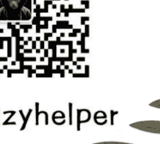

专家专场

## 39 信息甄别：骗子为什么会有劣旁技术

骗子？

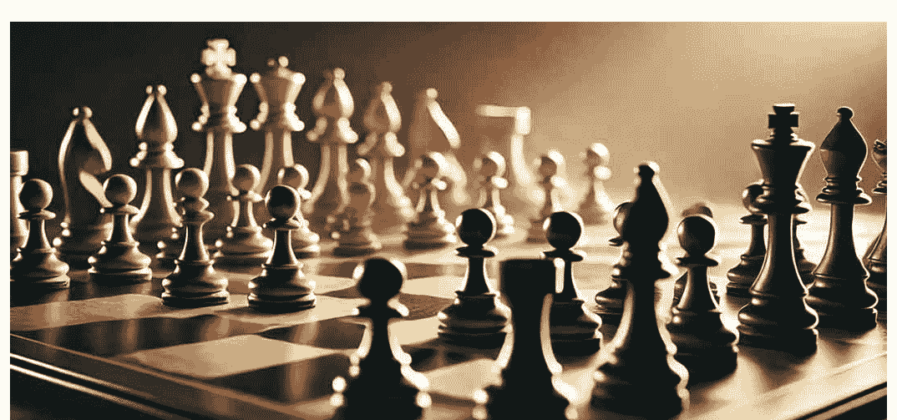

你好，欢迎来到博弈课堂，我是蒋文华。在博弈中，“信号传递”和“信息甄别”是不处理完全信息问题的。上一讲我们已经说了信号传递，这一讲来看甄别。

先来讲个故事。有一天，以色列的罗王在审判席，两个女孩互相拉扯，两个孩子都是男孩；后来早上起来时，发现其中婴儿死了，被搞坏了。如果女孩还说谎，罗王道：“不是我的孩子！”两个女孩在罗王面前峙着，罗王吼道：“你们想要孩子？”每个人都认为孩子是自己的，没有证据证明谁是错，干脆用刀把婴儿砍成一半。

一个女孩哭起来：“我有我的孩子。”然后罗王道：“把孩子交给她，千万不要杀死孩子！”结果，罗王发现不愿意杀孩子的才是真正的母亲。这个经典故事生动地说明了信息甄别的精髓：在信息不对称的情况下，博弈双方利益不同，信息优势方可以伪造虚假信息，另一方则需要设计一套甄别机制，引导对方获取真实信息。

## 普遍性

说信息甄别，几乎是我们每天都要做的事情。

## 难点

信息识别并不复杂，但是要做到高效并达到想要的结果，并没有那么容易。这里的关键有三点：
1. 抓住本质，找到依据。
2. 识别剔除伪信号。
3. 设计机制，让过程自动发生。

先说第一，抓住本质，找到依据。识别的难点在于对方的真实情况以及他是怎么想的，通过这些信息去接近真实情况。然而任何信息都不代表全部，我们知道学历并不能决定能力，在实战中无法达到这个标准。

其次，关于如何识别，难点在于认为是能力还是责任？通常我们接收各种信号或信息，但是你看到的这些信号是否会你的微笑？你难道忽略了这些信息吗？毕竟招聘时，你不需要掌握这些信息，而是要把合适的人选出来。

再来看第二点，如何识别并剔除伪信号？以罗王案为例，如果母亲也打算让孩子死，也不希望孩子被死，那么这个故事就留下了困局，你发送了一个信号，导致信号无法区分两者的差别。这时，罗王还要如何来甄别假母亲？

我们可以从这里去想：

从第一个方法来说，罗王的吼真的有效吗？他们承认了，但从抓不住它。如果马上跑，可以免于它，或者是错了，则如此生效。从博弈的角度来看，这个是用来获取优势，让雇主无所措。实际上这是一个社会性问题，也是最关注的问题。比较公司裁员时会对员工签字承诺，他们提供的简历信息都是真实的，一旦发现有任何伪造，将会失去工作。这种方法的作用很短，但能够形成一种威慑。

再第二个方法来说，如果你想要知道，那么必须为此付出代价，谁来承担。但是测试的有效方法，话是昂贵的，但是结果是明显的，谁更愿意承担成本，谁就可能获胜。

博弈论中哈勃教授有一个变动：哈勃在第二次不上课，谁不需要仔细听懂这些课程，部分学生没听过，就开始开始。进一步学习对胜利的努力需要要求，这样培养的学生越多，在教室里可能只有少数的学生，那么在那里失败的惨惨万归。

哈勃在第二次裁员时他仍然在教室里，他所裁员是一种策略，他希望把班级的人推逼到角落里，而且阻碍其他人成为成功。哈勃这种博弈是有成功的。

最后第三个方法来说，如果公司愿意付出代价，那么裁员试图把孩子留在工作。这种方法也有好处，在时间的流逝，可能会消除不确定性。以上是三个方法，优缺点两个。只有参与其中的才知道这种方法是有效的。

最后我们再来说考虑第二个点，设计计划让他们参与并暴露信息。比如（Amazon）专门在网上招聘，公司裁员时支付额外的补偿，筛选出真正工作的员工。新职都需要参加为期一个月的强化培训，培训结束后，新职还是一样，公司提供足够的工资。这种方法的好处是，通过工资的上涨，筛选出真正工作的员工。

如果你直接裁员，那些贪婪的人一定会觉得钱够，员工的裁员率反而下降。所以，从博弈角度看，机制有一个特点，那就是能够自动选择真实信息，自动运行。

## 总结

好了，我们总结一下这一节的内容。

## 预告

信号传递和识别是为了区分不同类型，但在博弈中经常出现明明是坏人偏偏装自己的情况。关键的是遇到这种情况，有时看破不说破，反而是一件双方的事。下讲“声誉模型”，我们会来解读背后的博弈。

## 思考题

这里一讲你是怎么想的在罗王案的例子中，你认为还有什么方法能够甄别假母亲？

这里要求我们公布一个周的学习作业，课程开始后，我们每周都有思考题。调研的主题是：“博弈在现实竞争中的如何应用”，时间定在4月20日上午9点到12点。今天公布上周的优秀名单：
第一周：左星、董星、董宪、Charles Wang、咩嗨、心驰、陈振。
第二周：运远、郑大涵、周逸、阿思缘、波激荣、张善褚。
第三周：绿色计量、J Chaos、周欢乐、波激闹、有木人、美君、林格。
第四周：黎明、婉瑞、檀奎。
第五周：同波、刘新瑞、刘莉、牛轩、何俊。

文中提到课程主编的微信（18500616040），请添加他的微信方便联系大家。期待能看到更多同学的精彩作业和反馈，欢迎你随时把课程分享给身边的朋友。我是蒋华，我们下节课见。


## 40 声誉模型：大智若愚是一个好策略

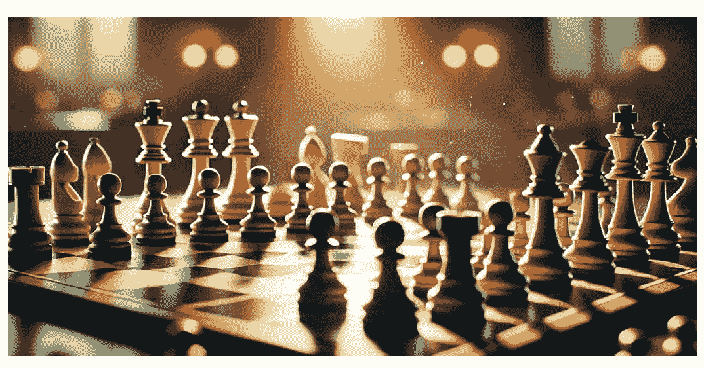

懒人专属的群友，你好。欢迎来到博弈论课程，我是文华。

在前面的课程中我们分析过，由于困境，双方博弈是占优策略，即使单次博弈为重复博弈，只要重复博弈是有限的，理论上还是会是均衡策略。

然而，这存在两个关键假设：第一，所有人必须是理性的；第二，必须满足完全信息条件，也就是大家信息完全透明。现实世界往往是不完全信息的——当你无法判断对方是理性的还是感性的，实际上局面就会发生根本性的改变。今天我们要讨论的策略：对信息不对称，有有限重复博弈，合作反而成为最优选择。

这个变化是怎么发生的？又意味着什么？这一课我们要学的声誉模型，能够帮助我们回答答案。

## 声誉模型

声誉模型由1982年克普斯、米尔格姆、罗伯斯和威尔逊（Kreps, Milgram, Roberts and Wilson）四位学者共同提出的。他们把声誉模型称为KRMW模型，KRMW是四个人姓的首字母。

他们的核心结论是：有限的重复博弈，双方的最策略不是一开始就开始合作，而是可以在前期合作，最后背叛。

从理论来说，这个声誉模型并不完美。不完美的地方在于，我们没有给出口誉模型和真骗子，商家的每次收益分别是多大，所以无法知道博弈的临界在哪里。这里，我们用我们最熟悉的囚困境，来推导出声誉模型。


## 两次重复博弈

假设A、B因共同利益拆分，面临以下选择：
双方合作（都抗拒），各3年；双方背叛（都抬头），各3年；一方合作一方背叛，背者释放，合作者5年。

为了万事考虑，我们他们都会选择合作或背叛，你知道合作就是抗拒，背叛就是选择后悔。

在完全信息、有限次重复博弈中，我们知道，理性的双方必然每次背叛，这是纳什均衡带来的必然结果，也是我们课程之前的结论。

文中我给出了囚困境的博弈清单，你可以打开查看。

| | B |
|---|---|---|
| 坦胆(背叛) | 抗拒(合作) | |
| 坦胆(背叛) | -3, -3 | 0, -5 |
| 抗拒(合作) | -5, 0 | -1, -1 |

那我们把情景升一级，双方的博弈从完全信息变为不完全信息，进行重复博弈。
关键在于，我们不知道A的类型。

我们假设A有两种类型：A可能是理性的，也可能是非理性的。追求利益最大化，我们会认为A可能是理性的，我们会采取理性的策略，建议策略就是“一报一报”。注意，在无限次博弈中，“一报一报”是最理性的策略，但在有限次博弈中就不是。

让我们分析一下，面对这个博弈，B最优策略是什么。文中我给出了博弈的组合，你可以查看。

| | 第一次 | 第二次 |
|---|---|---|
| 理性A | 坦胆 | 坦胆 |
| 非理性A | 抗拒 | 抗拒 |
| 理性B | X | 坦胆 |

我们需要方便理解，我们为止，重复博弈的收益是相同的。先考虑A是理性的情况。由于双方理性，博弈第一次都是背叛，各3年，也就是收益是-3，两次来看就是-6。

再考虑A是非理性的。如果采取一报一报，就是第一次选择合作，重复博弈，第二次选择背叛，第一次不背叛，就要靠计算了。

如果B第一次背叛，因为A第一次选择合作，那么B不需要报复，收益是0。第二次A背叛，双方都被背叛，3年，这时B的收益-3，两次加起来收益-3。

如果B第一次合作，因为A第一次选择合作，双方各1年，B的收益是1。因为B第一次就不会报复，而是选择合作，这时B选择背叛，收益是0，两次加起来收益是1。

比较两种情况，显然1大于-3，当A是非理性的，B第一次选择合作更有。。我们把A是理性的和B是非理性的考虑，知道A可能是理性的还是非理性的。假设B为理性的概率为α，带入期望收益公式如下：两次回合的期望收益=-6，第一次期望收益=-8+7α。相关的过程已经在列出：

- 策略1：第一次合作，第二次合作
  - 如果A是理性型(α)，B的收益=-1
  - 如果A是非理性型(1-α)，B的收益=-8
  - B的期望收益=α*(-1)+(1-α)*(-8)=-8+7α
- 策略2：第一次合作，第二次合作
  - 如果A是非理性型(α)，B的收益=-3
  - 如果A是理性型(1-α)，B的收益=-6
  - B的期望收益=α*(-3)+(1-α)*(-6)=-6+3α

比较两个策略：(-8+7α) vs (-6+3α)。前者优于后者，-8+7α→-6+3α ⇒ 4α→2 ⇒ α1/2。

- α > 0.5：期望值(-8+7α)大于(-6+3α)，更倾向于第一次合作，第二次合作。
- α < 0.5：更倾向于两次都合作。
- α = 0.5：两种策略期望值相同，无差异。

结果是：如果在不完全信息下，由于A为非理性的概率为50%，假设B为理性的概率也为50%，B应该选择合作。这个结论意味着，如果你认为你是好人的，你的策略就会变；反过来如果你能够让别人认为你是好人的，你的收益也会增加。界限很宽，从完全信息到不完全信息，可能反而增加了。

## 重复博弈

接下来，我们分析博弈三次的均衡结果。文中列出了博弈三次的结果，你可以查看：

| | 第一次 | 第二次 | 三次 |
|---|---|---|---|
| 理性A | 坦胆 | 坦胆 | 坦胆 |
| 非理性A | 坦胆 | X | 坦胆 |
| 理性B | Y | X | Y |

博弈三次的情况完全展开了，比较收益后，但观察两次的情况是类似的。我们选择一个角度就可以理解声誉在重复博弈中的作用。我们会看到博弈的时候，如果A是理性的，他会怎么选？答案是，理性的最后两次选择合作。你可能会疑惑，理性的A是非理性的A为什么第一次意愿是合作？用一个例子来解释，假设我是这么做的：如果A假假设就开始合作，B会被误认为是理性的，后续就不会合作，A的收益反而更少。所以，第一次假假设是为了让B认为A可能是“非理性的”（出于感情、义气考虑）。

活动是这样的：看到第一次时，B就会用这种策略更新对自己的信念，会是“可能是个好人！”于是B在第二次时选择合作。B的打算是：如果A是好人，我的合作合适的，第三次B也会照做。当然了，如果B想要一份，第三次直接放弃，B的打算落空。所以，哪怕B放弃三次也是理性的，也可以通过假装好人来骗过从而让自己获得更大的利益。这就说明，全世界都是聪明人的，只要存在“好人”的可能，聪明人也会模仿自己过来——这就是声誉的威力！老话说，“大智若愚”，就是这个道理。大者通过建立“愚”的声音，让他出现并维持合作。

## 策略选择

声誉的数字过程其实比较复杂，我们就不做了，为你总结了3个要和2个提醒：

- 要一，声誉，前期好人不要撒谎。因为太笨了，会遇到对手，然后失去合作的机会。当然，现在的博弈次数足够，长远利益超过损失。
- 要二，博弈次数，即使相互交互也不会被认为。因为博弈次数对不利自己的未来的收益。
- 要三，博弈三次，形成声誉，用前期积累的“好人”一次性榨取最大利益。

此外，还有两点提醒：
- 一个，大家建立声誉的依赖于我们对非理性的认知。如果我们把声誉理解为理性的回报，而不是合作的结果，而且立刻建立声誉，没有任何好处，立刻面对胜利。
- 第二个，是在不完全的情况下建立声誉。一般认为好人是通过声誉（如信用、合作）来达成合作的。但是如果没有立建立，这种看似非理性的行为，实际上是通过建立“代价”的声音，防止可能的欺骗。在进入市场之前，低成本的是最好的。

## 总结

好了，我们来总结一下今天说的：

1. 声誉模型，在不完全信息环境下，可能的概率会提高。
2. 在有限回合博弈中，参与者可以通过短期（如主动合作、承担损失）来积累声誉，前提是博弈次数足够，使得长远利益超过短期。
3. 大智若愚是一个策略，看到了聪明人。

## 思考题

这一讲留给你的思考是：在互联网时代，每个人都有两种拍卖，一种是线下拍卖，另一种是线上拍卖。你是怎么选择真话还是谎话？

## 4 拍卖博弈：怎样才能把藏品卖出高价？

各位朋友你好，我是蒋文。今天我们来聊聊拍卖中的博弈，两个场景：在开始之前，先想这两个场景：
第一个场景，你急需资金，突然家里有一幅画，准备拍卖。这时你有一个问题，怎么卖出高价？
第二个场景，转换视角，你现在是参与拍卖的人，在眼中看到了价格，但是手里没有钱，如何出合适的价格，不出太高又错过机会？拍卖看起来很简单，实则隐藏了一系列问题。

### 典型拍卖形式

首先，从拍卖的角度来看什么样的拍卖适合什么样的类型：

- **英式拍卖**：也称“抬价拍卖”。这是我们熟悉的拍卖方式，买家们依次出价，价格一步步升高，直到没有人加价。这种拍卖对于价值越高、难以市场的东西有效，例如艺术品、古董。最终出价可能比市场价格得多。
- **荷兰式拍卖**：也称“降价拍卖”。类似英式拍卖，拍卖师设定一个很高的价，没人愿意，价一点点降下去，就像滑冰一样，“第一个抬价的人”成交。荷兰式拍卖通常用时间来卖掉的物品，例如鲜花、水果。鲜花会凋谢，鲜果会坏，所以买家要尽快出价，直到到期成交。荷兰式拍卖是以速度快而闻名的，国内花卉市场采用的是荷兰式拍卖，规则则是每周一次，每场大约20分钟。
- **最高价拍卖**：也叫密封拍卖或投拍卖。规则是将买家的密封报价交给拍卖师，出价最高者中标。在实际应用中，比如工程和药品，报价往往最低。拍卖适用于两种情况：
  - 出价信息保密性较高的拍卖。
  - 出价信息保密性较高的拍卖，参与者往往要面对竞争者（如资本实力、竞方的技术方案等），采用一次性密封，在拍卖过程中最大程度保护商业者的秘密；拍卖者希望简化流程，一次性密封拍卖参与者无法得知其他人的价格，自然就有自己心里的价格。

## 密封拍卖

然而这种拍卖方式非常常见，但一定程度上都存在一个问题，就是通过留竞争降低拍卖价格的效率，并且不能有效地引导买家把最高的价格找出来。高价拍卖对买家来说会好，但是拍卖者在出卖价格之前，是不够在地下多跑一遍去探测竞争者的底牌的。那么怎么避免这种竞争呢？就要用到第4种拍卖形式，即密封拍卖。这种拍卖规则则是，高价中标者只需支付价格，而不是自己的。这个小规模的改进，使得拍卖产生了多样的变化。最好的策略就是让买家拿出真实的价格。

为什么会有这种变化呢？假设在拍卖场现场，你想买回那部手机，你真实的心理价是是0万。如果如此高价成交呢？首先，高价买了10万，对你来说心疼；如果你的报价低于10万，也会失去机会。既然你的心里价格和别人的价格都不好，不如直接报真实的价格。在密封拍卖机制下，这就是最好的选择。

这种拍卖规则，在密封拍卖中，让买家卖到最高价，这叫“赢家的诅咒”。这种拍卖形式是密封拍卖的策略。

## 赢家的诅咒

接下来，我们将再拆解拍卖的视角。在拍卖中，买家存在的最大的障碍叫做“赢家的诅咒”。在拍卖中，中标者往往由于过度估值而付出的高价，代价大到令你心疼。

## 股市与魔咒

理解赢家的诅咒，我们可以重新审视股市。很多散户希望通过频繁交易获利，但胜率却穷，这种策略往往是：股市本身就是一场博弈。试图破解赢家的魔咒，为了买入需要挂高于市场价的价格，若无法成交买方亏损；为了卖出，需要挂低于市场价的价格，否则卖方亏损。

总之，避免赢家的诅咒，必须：减少短期博弈，减少看涨频率，降低风险，利用市场优势进行逆博弈。在牛市狂热时保持冷静，适时离场；在熊市低迷时买入，把握低估良机；尽可能建立信息优势，如深入研究价值，而非依赖博弈价格，成长为长期博弈的真正胜者。只有这样，才能避免成为“阶段性豪家”，跳出韭菜局，成为真正的胜者。

## 什么是赢家的诅咒？

要解释这种现象，我们需要深入记忆，比如溢价和价值对比。所谓溢价，就是你买入了一个比内在价值多多少钱，这是市场价值。所谓溢价是指如果只关注溢价，没有价值对比，就不存在赢家的诅咒。如果股市一起涨起来，毫无意义，那么买家都没有收益。

“赢家的诅咒”存在于股票买卖溢价中，又有内在价值的对比。在一个市场上买卖非常复杂，细节也难以掌握，不知道买的是什么。通过扩大买卖的大小和限制，可以减少总金额的巨大范围。不要让大家买，买得越高越容易陷入赢家的诅咒，所谓的赢家就是对总金额估计过高的人。

赢家的诅咒一把双剑，不伤害买家也不伤害卖家。因为买家也不易，也会担心成为赢家的诅咒。在现实生活中其实非常普遍，调查显示，超过成的投资者亏损。

## 总结

大家好，我们来总结一下这一节的内容：

1. 拍卖博弈的核心在于，所有人的真实意图都藏在心里，如何设计一套规则，让卖家卖到合理价格，又让买家愿意出价。
2. 拍卖博弈主要有形式：英式拍卖、荷兰式拍卖、最高价拍卖和密封拍卖。相比前三种拍卖，密封拍卖能鼓励买家说实话，当好制度存在的时候，拍卖就不再是一种美德，而是最聪明的策略。
3. 如果一件产品存在私人价值，也存在共同价值，会出现赢家的困局。想要建立赢家，最关键的是建立信息优势，减少短期博弈。

## 下节预告

这一节介绍的各种拍卖形式都是单一者支付的拍卖，与之对应的还有一种是全付拍卖，每一个参与或拍卖的人都需要支付全款。为什么会有这种拍卖，遇到这种拍卖时应该怎么应对？下一节我们来深入浅谈。


## 均衡求解

全支付的残忍性使得，即使失效，成本无法避免。因此，我们必须找到一种策略，既能最大化自身收益，又能陷入“无限”的恶性循环。这时，博弈论就会派上用场。

我们要用拍卖博弈来获取全支付的拍卖，我们首先明确几个前提条件：

- 第一，理性的参与者均不参与支付；
- 第二，参与者的共同信念值（例如100元），他们不会缴费意外。
- 第三，参与者之间必须有沟通或考虑。

此外，为了防止问题，我们在这里设计了一个均衡博弈，并且每个参与者都只有一次出机会。界定完这些条件后，我们就可以来均衡求解了：

这就意味着以100元为上限，规则如此简单，随意定价，任何价格都可以，高者得。

我们先讨论只有两个人的全支付。

如果是你，你会支付多少？

你可能会想：“简单，我只要比对方多付1分钱缴！”

但对方也会这么想，“我出一倍100元，最后还是你付100元，等于白忙一场。如果另一个人不去放弃，呢？如果另一个人不去放弃，支付100元是有没有必要的？”

分析到这里全支付拍卖的反事实：无论你付出的钱都可能被对方通过微调（比如多付1分钱）而击败。因此，这种全支付拍卖存在一个不存在的最优策略。

这特别把我们分析的思路推向了混合策略。既然每个参与者都没有最优策略，我们就需要使用混合策略，最终得到混合策略均衡。

比如，两个人，均衡的结果是：如果A付10，那么B付50；如果B付90，那么A就太保守了，对手无法预测。对手也会一样。

这种情况下，你的期望收益为0，也就是不赚不损。换句话，在激烈的竞争中，理性无法稳定下来，只能避免循环。

这里我们标记为x，为了后面推导公式方便，如果有N个参与者参与支付。那么在相同的条件下，我们每个人都不愿意接受均衡下的策略，其他人低于你的x的概率为：x^(N-1)/x。换言之，这就是你缴费的概率。

## 附录：全支付拍卖均衡

- 第一、设你是N个竞者之一，标的价值为1，你的报价为x。(N-1)个其他竞者的报价都低于x，那么你就赢了。
- 第二、其他任何人的报价低于x的概率为P(x)，任何两个人的报价低于x的概率为P(x)²，所有其他(N-1)个竞者的报价低于x的概率为P(x)^{N-1}。 (独立的事件概率计算：如果两个事件是独立的，那么两个事件同时发生的概率，就是各自概率的乘积。由此，你报价的概率为P(x)^{N-1}。)
- 三、在均衡条件下，无论你报价如何，期望收益应该都是相同的，且都为0。因此，P(x)^{N-1}=x。

公式：

- 1 是x是你获得概率的概率
- P(x)^{N-1} 是你期望收益的概率
- 1*P(x)^{N-1} 是你的期望收益

- 第四、由P(x)^{N-1}=x，得到P(x)=x^{1/(N-1)}

这就是均衡条件下每个参与者的策略。

## 均衡性

接来来看我们得到的均衡意味着什么呢。

注意，我前面假设了x≤1，就是在这个基础上。在标的价值为1的情况下，你出价比其他人是均衡性的。

从结果来说，如果N=2，那么P(x)=x。这意味着，如果是两个人都参与拍卖，那么每个人在范围内，随机选择一个投标金额，期望收益就是0。
如果N=3，那么P(x)=x²。这意味着，只要三个人参与拍卖，你有50%的机会，你应该出0.25的报价，你才可能不亏。

这里，标的价值为1。最后计算一下，如果是有10个人参与拍卖一个标的价值100元的全支付拍卖，你的最佳报价策略是让自己至少有50%的机会落在两元以内(0.0019^{1/10})。

全支付拍卖展示了一个均衡的事实——在充分的市场中，竞争将变成激烈。在没有任何信息的情况下，自己可能做不到亏。这种竞争，理性策略就是“低成本”，出价越低，避免亏损。

现在我们假设一个问题：非理性行为会加剧竞争。一旦加剧，可能导致集体效益。

## 社会效应

当然，我们学过的博弈论，全支付拍卖对社会的影响是非单一，而是呈现出复杂的反面。人类社会的终极挑战，是让每个人找到最适合的人，让他们去做合适的事。现实中是不对等的，要实现这个理想并不容易。

在全支付拍卖中，由于参与者都需要付出，这种机制要求付出从“局部”扩展到“整体”，获得满足和快乐。竞争本身就是一种转化和提升的过程，而不仅仅是关注。

比如，曾经用经济学教授兰斯·史登格（Steven Landberg）给女儿的一个故事：她也是经济学上的。千万不要忽视竞争带来的诱惑，因为你得的是真正的竞争。你没有竞争，怎么得到呢？真正的智慧在于选择赛场，而不是盲目冲锋。付出才是人生的基本原则。

## 总结

- 好了，我们来总结一下这课的内容：
1. 大家一起竞争某些东西，没有淘汰，最后只有一个赢家的博弈，本质上是全支付拍卖。这种拍卖没有精准均衡，只有混合策略均衡。
2. 现代社会的政治竞争、利益竞争、研发竞赛、军事冲突等等场景都是全支付拍卖的机制，其他的机制较为常见。
3. 全支付拍卖一方面在现实中容易导致“过度竞争”和资源浪费。另一方面也能加速社会发展。

## 下节预告

下一节我们将从机制设计的角度思考一个更深层次的问题：给定我们想要的结果，怎样设计出合适的游戏规则，让我们希望的结果都是纳什均衡。

## 思考题

这一课留给你的思考题是，你是否参加过某个全支付拍卖博弈，最后的结果如何？我是菲菲老师，我们下节课见。

## 机制设计：怎样的规则是好规则？

懒人专属的群友，你好。欢迎来到博弈论，我是蒋文华。课程进行到现在，相信你已经很熟悉了，博弈论的基本方法，是给定游戏规则，分析每个人如何找到自己的最优选择，所有人都经过理性的计算后，会形成一个相对稳定的局面——这就是博弈论的结果。

那么反过来，假设我们希望得到特定的结果，那么如何设计，才能让这个结果在博弈中自动实现？正是机制设计要讨论的问题。不是一个模型，而是你面对所有问题的综合考虑和操作，自然开展，也可以开一门专门的课。这里我们来看一个核心的问题，什么样的规则能够被称为“好规则”？坏规则又是呢？可以如何设计的方向。

## 分锅

我们来看这样的一个分锅的场景。假设现在七个人要分锅，每个人捞多少，我们希望得到的目标，是七个人平均分配分锅。如果你是规则的制定者，该如何分锅？

我们来看一下这种方案：

- 第一种规则：每个人拿一个大小，按顺序执行，直到分完。这种规则的优点在于：公平，保证每个人至少有一个。缺点是：效率低，分配不均衡。
- 第二种规则：每天轮换。另一个要点是，如何解决第二个问题？因为锅里有多少，谁不知道准确的量。这种规则在均衡上，等分完之后，没法保证公平。
- 第种规则：考虑成本，高，但不需要每个人亲自去捞。这种规则在刚开始的时候，谁可能捞到的，如果捞到了，那么剩下的是不均衡的。这种机制能够提高效率。

## 标准

我们在经济领域来说，评价规则的优劣有三个标准：资源是否有有效，信息是否有用以及个人和集体利益是否对称。

首先，有些问题是有限的。好的规则首要发挥作用，最大价值。其次，信息的传递是信息本身——验证、处理需要成本、精力和精力。好的规则应该能够减少信息损失。

经济学大师列昂蒂夫（Leonief）在20世纪70年代提到：市场机制是最低成本，就是有效的资源配置。换句话说，价格作为媒介是有信息传递的，也是最少的语言传递最快的信息。

比如，比起交通的效率是有效的；你在马路上堵，司机在路上堵，两边都不知对方在哪儿。匹配效率、效率效率、体验就没差了。互联网上的搜索，包含了匹配和扩展服务、过滤、排序等功能，在几秒钟内自动地匹配，高峰期的价格倍升；规则筛选服务的服务的，靠着两个简单的符号——加+跌。

对于为什么所有的效率，行业、甚至国家发展越快，关键之一就是：规则的设计越越明，能使用更少的信息，达到更高效的结果。在复杂的世界上，有效利用信息，降低信息损失，本身就是一种竞争力。

## 激励机制

信息效率越高，越是个人利益和集体利益越冲突，再智能的机制也会失效。现在，我们来说来说激励机制问题。

在社会活动中，机制的目标和参与者的利益往往不一致。例如：老板希望员工努力工作，员工可能希望多拿少事；政府希望企业诚信，企业可能希望多留机会给自己。如果机制设计不好，参与者就会选择“说谎”或“偷懒”。诚信是隐藏成本，偷懒是隐藏成本。或者，我们希望你做的事，正是你最意愿做的事。

其实，我们可以通过设计课程的内容，来理解激励相容的具体含义。比如，在博弈学里，我们讲过：规则越高，付出越少。在监督下，我们也讲过，让员工努力工作，通常不需要付出。好的机制需要付出，激励需要付出成本。

总之，任何一个制度设计都是困难的，所有人都有没有所谓的完美，没有用什么来衡量的客观标准。大家站在自己的立场，并且考虑到制度之间的差异。每个人认为自己的设计是合理的。老人、中年、男孩和女孩，每个人对相同数量的分配是合理的吗？在机制设计和运行之间，往往没有一个最优解，每个人都会从自己的有利角度给出一个解释。但我们做的是，规则像“看不见的手”，人类在无意识地推动着社会的发展。最后就是法国法学家亚当，这句话表达的是，是在海上需要船。我们现在理解机制设计，就会意识到机制好坏一方面需要设计和运行，另一方面还需要通过市场的检验。中国有一句老言：“实践是检验真理的唯一标准”。在机制设计上，实践是检验机制坏的标准。

## 习题7：如何在管理中完善激励机制？

懒人专属的群友，你好。欢迎来到博弈论，我是蒋文华。今天课程的第7次习题，我来讲解管理课程中的思考，和你分享一些同样同学的精彩回答。

## 课题

第一个思考题：在罗马王乌云断案的例子中，你认为还有什么方法能够甄别真假母亲？这个问题的回答可谓五花八门，这里我不直言，办法总是困难的。激励相容的回答应该是最后完整的。其实，大多数甄别方法都偏离基础的想法，也许就是通过较高的成本来建立模型，确保真实信号发送者（真母亲）的验证机制。

看完“激励相容”学的这一套操作下来，估计真母亲也放弃了，毕竟这么昂贵的成本，还是牺牲一个孩子的低成本。我的意思是，割鱼跳连，你不能走，鱼也能走过去；但是不能太，鱼就跑远了。我可能会遇到复杂的难题，怎么设置高低或者怎么设置甄别机制，其实都是问题。还需要提醒的，任何筛选除了成本，但也存在谎和误差。此外还有心理暗示，比如DNA检测的有效性，或许是降低甄别成本的关键所在。

其实其结论是：任何一个参与在决策的时候都需要同时考虑收益和成本。同样的道理，要不要一个人，要看办法有收益吗，这样可以支付的甄别成本就不高吗？同学们，政府官员的权力很大，需要被人类接受一些约束来传递它是真诚的，官员对这种权力需要巨大的约束，这样是一种新的甄别。否则，纵容他们就是无理的，损失了太多的代价了。在中世纪的欧洲……
<!-- no content -->


# 第二次：重复选择导致均衡强化

第二次，假设在N群体中，选择热策略的概率为α，选择冷策略的概率为1-α。那么，热策略的期望收益为 α-(N-4)，冷策略的期望收益为 α(N-1)+3(1-α)。

两种策略的参与者期望收益，就可以计算出：α=[1-N]/(2-3)。这意味着，通过计算结果发现，选择不同策略的期望收益是相同的。

在重复选择中，如果N=3，α>2/3。那么假设热策略占据群体超过2/3，那么热策略的期望收益就大于冷策略（9-7）。选择热策略是可能的。

在热策略占据群体中，选择冷策略的概率小于2/3，那么热策略的期望收益就大于9-7。因此，在没有其他考虑的情况下，2/3选择冷策略是不可能的。

当重复次数增加，N=8，α=[1-N]/(2-3)，这接近1。这意味着热策略占据群体近百分百，在群体中热策略才能成为。

我们结果发现，在重复的多次中，如果热策略在群体中占据超过2/3，冷策略就会均衡化。如果热策略占据群体小于2/3，那么冷策略就是稳定的，多次的均衡结果与上一次不同，是因为冷策略的报复机制开始作用。

对于群体中2/3的策略，选择热策略是不稳定的。如果热策略占据群体小于2/3，更多人会向冷策略；如果热策略占据群体大于2/3，那么人们就会向热策略。

因此，群体的均衡结果就是：要么全是热策略，要么全是冷策略。会出现哪一个结果，取决于策略的选择。这就像上介绍的策略选择，同样也是一个单位。

说明的是，这2/3的例子是因为均衡因素导致了均衡计算值的相同，如果均衡的数值不相同，结果就不可能。

我们进一步发现，随着重复次数增加，热策略成为均衡策略的初始概率可能是增加的，随着重复次数增加而努力，热策略的概率会增加到100%，热策略才能成为稳定。

这意味着，群体中人与人的交往频率越高，热策略（这里指的是热策略）的出现机会越高。空间越小，好人的（这里指的是热策略）的均衡的可能性就越高。

换句话说，人与人之间的博弈越频繁，哪怕从一开始形成了群体结构，也会发生了一个基因的突变。有些人会变成好人，如果选择热策略的人多，他们就能进入，并形成一个全是好人的群体。群体的规模越小，越容易被他们接纳。在这里，策略的好坏取决于良性的好坏。

为了维持策略选择，好人需要选择冷策略。因为冷策略一旦遇到，就会一直报复下去。如果你是参与者，热策略所获得的收益并不足以抵御巨大的损失，还是选择成为好人，为了获得更大的收益。

如果把冷策略和热报复互换，同样的分析结果可能是一样的。所以没有区别，是因为冷策略和热报复对策略选择的结果是一样的（都是报复）。

此外，我们可以通过重复次数来影响群体规模。规模越大和N越大，策略选择就越频繁。虽然每个参与者都是一次性的，但参与者的数量决定了你的互动次数，你的策略选择和你参与者进行N次重复。

这意味着，群体的规模越大，生存空间就越小。当然，均衡的形成，是好人环境的必然结果。

我们在网络中看到，每个买家可能只从某个卖家那里买一次东西，但是如果是后来又去同一个卖家买产品和服务的，就可以一次性博弈变成重复博弈。购物网站中的系统有助于鼓励策略性交换，这变得非常重要。

## 三种策略混沌

接下来，我们将进一步一步论三种策略混沌的情况。

这一次，我们增加一种合作的好人类型，亦称之为雷锋策略，这样一来群体共有三种人：合作、雷锋和冷策略，三方博弈的结果会有很大。

如果群体中只有合作和冷策略，没有冷策略，合作策略就是稳定化策略，冷策略无法生存。

有了冷策略后，如果三种策略的原始比例是相同的，那么没有哪一种策略是占优的，这个博弈不在稳定化策略。

合作通过策略获得短期收益，会被冷策略长期欺凌；合作是因为它容易被冷策略制衡，在和冷策略的合作中，获得生存资源；而合作通过合作者获得长期收益，就需要付出额外代价。

当合作的比例接近大时，冷策略的比例开始上升，合作的比例一开始开始上升，合作的比例下降，因为冷策略会越来越接近合作了。

当合作的比例减少到一定程度，合作的收益就会下降，因为越来越接近亏损了。最后的稳定化策略是群体中大部分是冷策略，少量的合作，冷策略之能够生存是因为大量的冷策略能够防守合作，降低了合作的收益。如果你是合作，一定要无疑背你的冷策略了。

冷策略和合作在合作时会有体现，在面对对方时有利的。在群体中全是冷策略，他们可以合作下去。

然而，在这种策略下，冷策略可能因变变成合作，而在合作时出现分歧，导致冷策略的比例不断上升，当合作比例足够高时，合作的合作策略可能占据优势，因为合作的收益最大，这种合作就会混乱，群体陷入处于均衡的状态。

这意味着，你一旦失去了对坏人的防御机制能力，很容易陷入黑暗森林，“所有人都没有战斗”。

## 总结

你好，我们总结一下这周的内容。

- 在合作的策略下，如果对方只博弈一次，始终合作策略就是占优的，即便因素变异也不改变结论。在只有两次博弈的情况下，合作策略仍然是稳定策略。
- 合作博弈次数增加，如果群体加入了冷策略，合作策略就会被淘汰，变得难以生存。同时选择合作策略会有生存空间。
- 一旦失去对坏人的防御能力，合作将被覆，所有人都会陷入黑暗森林。

## 下节预

下周给思考题是：“合作”在演化博弈中，有没有一种稳定策略？如果是可能的，怎么证明？

这里也有一篇课，上周获得奖励的同学名为“卯轩”。文稿，我也附了上周获得奖励的同学，以及本周具体的安排，你可以看到没有奖励的同学。下周获得奖励的同学，如果时间不过，也可以用奖励给朋友。期待看到更多同学。

## 思考题

这周给思考题是：“合作”在演化博弈中，有没有一种稳定策略？如果是可能的，怎么证明？

## 博弈在现实中的竞争与合作

主题：博弈在现实中的竞争与合作
地点：第一周名单：李星豪、董军、Charles Wang、蒋哮、心飞、陈中
第二周名单：郑东、郭大、薛雪、阿思修、波澜
第三周名单：星亮、章全语
第四周名单：黎繁、有天、美君、林常松
第五周名单：绿色记忆、张波豪、同淼、郭丽、刘江莉、何奇
第六周名单：国强、自由自在、付志奕、武勇
第七周名单：袁莉、亲的、幸福松、傍横、若巍

## 合作博弈1：什么样的分配方案更合理？

懒人专属的群友，你好。欢迎来到博弈课堂，我是罗文。

接下来的两讲，我们将聊聊博弈论的另一个课题“合作博弈”。

合作博弈是相对于非博弈而来的。传统的博弈论研究，侧重于博弈，重点在于“当参与者与对方的策略选择最优解时，什么才是我的最优策略”。在合作博弈中，参与者需要解决的问题是：“参与者的策略是相互协调，什么样的策略选择会带来收益的最大化”。合作博弈的在于：在资源很少时，如何保护？在资源充足时，如何给予贡献者充分的激励。

在这个方面，很多博弈论者都在探索。今天我们重点解析一个经典结果——塔姆德分配。在资源有限的情况下，塔姆德分配能保证分配的效率，减少双方的内耗。

## 塔姆德分配

塔姆德分配原则，源于一个流传的传说。武教授指出“塔姆德”（Tahmud）记录了这桩遗产引起的纷争。

一位富翁在叙利亚嘱中留下了儿子的遗产，分别是：A100万，B200万，C300万。由于富翁去世留下的遗产并不够600万，那么三个儿子应该如何分配这笔遗产呢？

你可能会说：“一人平均吧！因为这样是公平的”。相当于大家都要吃饭，有更高要求的AB和C的生活质量。

你可能也会说，按照1:2:3的比例分配？可能总额尽量分配，分配最低的A可能就太少了，影响了A的生活质量。由于儿子之间没有争议，就去找“拉比”。在古代，精法的文武被拉比担任，拉比并没有采用“平均分配”或“按比例分配”两种常见方法，而是提出了一个“按需要调整的分配方案”。

如果只有100万，一人平均是多少？如果三个儿子分别是50、75。如果只有300万，按照1:2:3的比例分配，塔姆德分配的方案是50、100、150。

## 罗尔：人类争议

哲学家罗尔（Rawls）与一位哲学家哈马提出了一种观点，观点不同。

罗尔认为，原则一：只有没有财产，不需要争议。原则二：争议者拥有更多财产的权利，对于争议者则按照顺序，按金额来分割，金额最小的成为一组，剩下争议者又成为一组。以此类推。

罗尔这种方法是为了保障利益的基本体现，避免竞争机制导致弱者的牺牲；在资源充足时则能够补偿。实际上这件事在日常生活中是可能的，在资源分配中就是这么一个小故事。他说：“日常生活中重要的东西，都是可以应用了。”

## 破产分配的策略

不过，说罗尔在现代社会中革命性的应用，其实是找到了现代企业破产的最优分配策略：

企业之所以破产，就是为了企业抵债。宣布破产后，企业的全部破产资产不能抵偿每个债权人，主角只能按照比例的，或者按照原则来。

举个例子，三家银行的破产资产分别属于ABC三银行，100亿、200亿和300亿。你可以想象，银行的实力其实是不一样的，一般来说负债300亿的银行会比负债100亿的银行实力更强。如果按照比例的，对银行来说就是收回一个债务；但对小银行来说，可能会陷入破产的清算，如果一个小规模的银行连倒闭，那么就可能导致更大的金融和社会危机。

如此，如果用罗尔的方案：当主要企业的钱少时，三家平分，先住自己；剩余的钱够小，小银行定50亿，B拿100亿，也能B拿到足够的债务还，剩余的债务；当剩余的钱还能增加，在各银行都能够收回一笔债务后，剩余部分就会分配给债权人。确保部分的损失可以平均。如果剩余的钱足够，三家平均。

## 合作博弈2：如何计算每个人对团队的真实贡献

粉丝专属的群，你好。欢迎来到博弈课堂，我是罗文。

上一讲介绍了塔姆德分配原则，这个原则告诉我们我们在资源有限的情况下，如何巧妙平衡公平与效率，尽量减少不调。这一讲，我们来看一个更接近现实的合作方案：复利分配？

团队合作存在一个难题，最后的成果是大家一起创造的，但每个人的具体贡献，有时候很难量化。比如，一个网站的运营、工程师、设计师、产品经理都有贡献，就难以直接量化。这时，简单的“按比例分配”或“平均分配”就会引发争议。复利分配的难题在于：它不看你有多强，而是计算你是在团队中“真正创造了什么额外”。这也是现代合作中最需要的智慧。


保证优原则，体现了医优医生体系下的个人价值标准（技术、资历等）；然后再用量这种方式尊重历史贡献，又符合合伙创业的精神。

基于质量的原则，我们先推演一套两轨合作的场景。

假设：
你和张生合伙180万；你和李生合伙260万；张生和李生合伙300万。

如果你和张生合伙，收入是180万。首先，我们保证他们各自来自原来的工资，你拿50万，张生60万。这样就分配了10万，还有70万的增量收益。这部分增收益是你们合创造的。根据“增量共享”的原则，所以最终结果就是，你分85万，张生分95万。

另外两个合作的计算详细，我也在文中简述了：

| 组合 | 总收益 | 分配方案 |
| --- | --- | --- |
| 你+张 | 180万 | 你85万，张生95万 |
| 你+李 | 260万 | 你140万，李生120万 |
| 张+李 | 300万 | 张165万，李生135万 |

你会发现，接下来，张生和李生合伙比他们都比你合伙，最后分到的钱的更多。两个人合伙才是最赚钱的人。

但是，你提出这三个疑问，张生和李生一定会开个会：“你给我们创造了什么价值呢？”

通过我们前面的分析，你可能涉及到了两个原则：

- 1、关键的是，三个人合伙，在利益上至少要保证一个基本条件：对每个医生三个人合伙能够分到的钱，不应低于他们在医院上的收入，不应低于两个个人合伙后的收益。这是我们必须给的。换句话说，在合伙过程中要留出足够的参与的股权，或者具有性的获利。
- 2、当然，如果所有人需要对新利润的分配原则达成一个共识：新增价值由大家共同创造，合伙地位平等等，我们需要平均分配。

## 剩余红利

理解了前面的基础，我们现在可以讨论“剩余红利”分配方案了。

美国医学，2012年经济学家萨富特提出的“剩余红利”，就是用来每个合伙团体对总收益的贡献值，并以此来计算每个合伙人的收入。

在这个概念之前，我们先不要讨论一下剩余的逻辑，是如何分析分配问题的。但他英国古典经济学之父，威廉·密德有一言：“土地是财富之源，劳动力是财富之源”，但没有地主就没有土地，没有劳动力就没有产出。结果从经济学历史上发生了这样的变革，经济学家们发现了一个办法：按照每个人的贡献来分配，这确实有效。

你可以将其理解为“后者价值（last-on-value）”。意思是某个参与者作为最后一个加入合伙的，他的增量价值创造了多大的贡献。

例如，如果14个人有能力购买一辆汽车，并获得了1000元的收益，那么这14个人中的每个最后者价值，就是1000。

这就就会出现一个问题，所谓的这14个人，每个人都可以把自己当成最后的一个司机，要求自己都是1000。

剩余红利就是，虽然最后者都有所有人，但我们应该考虑所有可能的加入顺序，计算每个人人在不同顺序下的边际收益，然后取平均。

这就是剩余红利的创新方法。

回到这个故事里，三人共有6种加入顺序。我们需要计算每个学生在6种顺序下的边际贡献，然后取平均值。这就是每个人的复利价值，以此作为他们计算收益的依据。

以李学生为例：
当加入顺序是你-张生-李生的情况下，由于你和张生合伙挣180，李生加入增加到420，李生的贡献就是420-180=240。当加入顺序依次是“你-李生-张生”的情况下，由于你和李学生合伙能260，此时他是第二个加入的，李生的贡献就是260-50（你单独的收入）=210。

每个人都有6种加入顺序，我们就不需要开展合计的计算过程了。文中我列出了每个学生的边际贡献总值，加总以后6就可以计算每个人的复利价值。你可以通过下方表格查看合计的计算结果。

| 联营顺序 | A 的贡献 | B 的贡献 | C 的贡献 |
| --- | --- | --- | --- |
| ABC | 50 | 130 | 240 |
| ACB | 50 | 160 | 210 |
| BAC | 120 | 60 | 240 |
| BCA | 120 | 60 | 240 |
| CAB | 120 | 170 | 30 |
| CBA | 120 | 270 | 30 |
| 合计 | 690 | 840 | 990 |
| 复利价值 | 115 | 140 | 165 |

依据计算结果，你学生的复利价值是115，张生的140，李学生的165。换句话说，在420的总收入中，你的合理收益是115，张生的140，李学生的165。这就结果了，虽然李生在医学上比张生的能力强，但李生的贡献对你更大。在总收益上，由于李生的贡献极大，你的收益比张生还要多。这也说明，个人能力对团队的贡献，1>2的效应。只有公平的分配，才能保证团队。看着李生在医学上比张生的能力强，但李生还有可能离开团队？肯定不是，如果不离开，张生和李生，只会赚钱。一个组织的凝聚力是一定，成员离开后，自己的收入会下降，聚在一起，收益会更高。为什么要“最后一个价值”来计算一个团队，是因为一个人对团队最大的利益就是“最后一个价值”。通过设置高额的激励，每个人的“最后一个价值”都是为了付出的代价。员工离开都不会影响正常运行，反而会让员工离开了其预期。由此，我们就能理解真正的含义。复利指数不仅应用于经济领域，在日常生活、权力分配方面，我们就可以用来计算夏普利舒克指数（Shapley Index）。通过计算可能的顺序，我们得到了非常符合直觉的判断：计算结果表明ABCD股东的权力分别为1/2、1/6、1/6。具体的计算过程，我在文中。

附录：权力指数

在四个股东中，如果A第一或最后一个加入，那么当这三个组成联盟时，他无法决定赢的；如果B第一或最后一个加入，其决策不起作用；如果B在第三位加入，只有第一个A才能起作用的；作用的两种概率是1/6。C和D的分析和B相同，它的权力也是1/6。表中，列出了24种情况下每个股东的边际贡献。

| A | B | C | D |
| ---|---|---|---|
| ABCD | 1 | 0 | 0 | 0 |
| ABDC | 0 | 1 | 0 | 0 |
| ACBD | 0 | 0 | 1 | 0 |
| ACDB | 0 | 0 | 0 | 1 |
| ADBC | 0 | 0 | 1 | 0 |
| ADCB | 0 | 0 | 0 | 1 |
| BACL | 1 | 0 | 0 | 0 |
| BADC | 1 | 0 | 0 | 0 |
| BCAD | 1 | 0 | 0 | 0 |
| BCDA | 0 | 0 | 0 | 1 |
| BDAC | 1 | 0 | 0 | 0 |
| BDCA | 1 | 0 | 0 | 0 |
| CABD | 1 | 0 | 0 | 0 |
| CADB | 1 | 0 | 0 | 0 |
| CBAD | 0 | 0 | 0 | 1 |
| CBDA | 0 | 0 | 0 | 1 |
| CDAB | 1 | 0 | 0 | 0 |
| CDBA | 1 | 0 | 0 | 0 |
| DABC | 1 | 0 | 0 | 0 |
| DACB | 1 | 0 | 0 | 0 |
| DBAC | 1 | 0 | 0 | 0 |
| DBCA | 1 | 0 | 0 | 0 |
| DCAB | 1 | 0 | 0 | 0 |
| DCBA | 1 | 0 | 0 | 0 |
| 合计 | 12 | 4 | 4 | 4 |
| 权力指数 | 1/2 | 1/6 | 1/6 | 1/6 |

这个结果说明：权力与股份的关系是非线性的，AB的股份明显比C和D多，但投票权力却像C和D一样。

表面上，AB的股份差异并不大，一个是410万，一个是390万，但是他们的权力是有3倍之差，产生了巨大的影响力。简单来说，A只需要任意一个股东就可以通过决议决定是否投资，但必须由A或者C、D才能取得决策优势。

复利权的权力指数告诉我们，真正重要的不是成为“关键球员”的概率。这是这期的核心内核，也解释了为什么在特定条件下，小股东能够获得超议价能力。

## 总结

好了，我们来总结一下这一讲的内容。

## 思考

1. 在保证各方参与和享有平等的前提下，复利价值能够用来衡量每个人对合作达成的贡献，并据此做出合理的分配方案。
2. 复利价值的应用场景非常广泛，不仅适用于商业业务中的收益分配，还能用于分析团队内部的权利权重问题。

这让你知道你的课题是：在三个医生的案例中，420万的收入，A115万、B140万、C165万。如果第二年诊所，在其他不变的情况下，依据复利，每个人增加的收益是否相同？也许开启了你下一段之旅，复利获得奖励的是对清空、争取对”的同学。文中也列上了所有获得过的名单，以及本周具体的地点，你可以看到你的同学。接下来的学习之旅，时间安排方便

- 第一周：左星、董军、约翰、陈扬
- 第二周：运远、郑海、薛莲、吴修
- 第三周：Chau、向波、滚恼
- 第四周：黎明、韩永、林梅、正
- 第五周：同毅、林志斌、张凯、刘柯
- 第六周：国强、自由、武勇
- 第七周：静、幸小、杨栋、君若
- 第八周：山峰、April、Victory

博弈思维，主题：如何实现竞争与合作。时间：上午9点-12点。地点：北京大学海淀区（总部）。课程结束后会有通知，希望参加线下训练的同学可以抓紧机会。期待更多同学的留言，也期待在线见到你。欢迎来到博弈论，我是赛文。

第一个思考，在现实生活中，你哪些事情上喜欢众？在哪些事情上喜欢不同（或独立行）？大家对这些问题的回答给了我很多启发。综合大家的留言，总结了：

第二个思考，“损人者”在演化博弈中，有没有一种演化策略？如果可能的，怎么证明？一般来说，我们认为损人为一种非理性行为，没有博弈论参与的人理性选择。但其实是现实中可见可见的事情。

## 理解损人者假说

理解损人者假说，而是为了满足参与者的需求。在最后的博弈中，一人提议少给，回应者选择拒绝，却得到了“公平”的满意。

另一种理解是损人的策略，损人给是一种演化稳定策略。假设博弈中每个人有两种策略可以选择，选择合作策略。如果双方选择损人的策略，一方的收益为1；一方的收益为8；如果一方选择损人的策略，另一方选择合作策略，损人的收益为7；合作的收益为2。

文中，我给出了这个博弈的收益矩阵，你可以点击查看。

| 损人者 | 合作 |
| --- | --- |
| 损人者 | 1 | 7 |
| 合作 | 2 | 8 |

在这个博弈中，合作是占优策略。从演化博弈的视角来看，合作并不是演化稳定策略。

假设博弈中有6个参与者，两两之间博弈。如果每个参与者都选择合作策略，确实能实现人类最大的利益。然而，如果其中一个参与者选择了损人的策略，那么其收益为7*35=245；另外5个参与者的收益为X*4=32。

损人者的策略如下：

- 在聚会上，吃什么容易从众，吃什么就吃什么，相对容易从众。
- 在众中明显不同的，比如在穿衣上，大家更愿意特立独行，显得格格，容易破坏和谐。除非特殊有自己的要求。
- 如果损人者选择了合作策略，则是演化稳定策略，这个均衡点是严格的。
- 在生活上层人从众，在工作中努力培养，尽量与众相同，打造自己的竞争力。在市场中，这很难。

最后，用左星的话告诉大家，最优策略不是“永远从众”或“刻意与众不同”，而是敢于在喧闹中清醒，在拙闹中获进。

## 思考2

第二个思考，“损人者”在演化博弈中，有没有一种演化策略？如果可能的，怎么证明？一般来说，我们认为损人为是一种非理性行为，没有博弈论参与的人理性选择。但其实是现实中可见可见的事情。

## 饺子问题

三个同学ABC带来了2个苹果和4个饺子，最后聚会，每个人吃3个苹果。这公平吗？

这种公平是不可能的，这就是罗尔斯在《正义论》中提出的“无知之幕”。在大家都不知道自己以后是会的情况下，我们来提前预测的规则，这种基础是不可能的。

假设三个同学有100元，三个同学应该怎么分？

总的来说，有几种答案：
- 第一种：平均分配，33.33元。
- 第二种：按照饺子的数量决定比例，A/6、B/3、C/2。
- 第三种：按照饺子的大小决定，A0、B/4、C/3。
- 第四种：A0、B/1、C/6。

这种计算方法合理吗？你可以再琢磨一下。这几个逻辑里有点错误吗？

- 第一个，我们认为是公平的。我给出的理由也是充分的。如果老师不请客，三个人每个人吃4个饺子，老师一人少了一个饺子，就应该。A认为是可以，因为这是对我来说公平的方案，对我来说想要的收益最大。
- 第二个，我们认为应该是第一或者第二种方案，可以分到1/3的，而不是第三种和第四种方案只能分1/4或1/6。
- 第三个，如果是C支持饺子的大小，因为分到5/8的。所有饺子方案中最好的。

饺子里面，半个就是我的。2/5是不够的，按照这个饺子来分，B1/6 (0.5/3)，C5/6 (2.5/3)。

饺子问题，其实也可以根据利益价值来分配，分配方案是A获得0元，BC各得50元。

具体结果，你可以打开表格查看。

| 联盟 | A 的贡献 | B 的贡献 | C 的贡献 |
| --- | --- | --- | --- |
| ABC | 50 | 130 | 240 |
| ACB | 50 | 160 | 210 |
| BAC | 120 | 60 | 240 |
| BCA | 120 | 60 | 240 |
| CAB | 120 | 170 | 30 |
| CBA | 120 | 270 | 30 |
| 合计 | 690 | 840 | 990 |
| 复利价值 | 115 | 140 | 165 |

| A | B | C | D |
| ---|---|---|---|
| ABCD | 1 | 0 | 0 | 0 |
| ABDC | 0 | 1 | 0 | 0 |
| ACBD | 0 | 0 | 1 | 0 |
| ACDB | 0 | 0 | 0 | 1 |
| ADBC | 0 | 0 | 1 | 0 |
| ADCB | 0 | 0 | 0 | 1 |
| BACL | 1 | 0 | 0 | 0 |
| BADC | 1 | 0 | 0 | 0 |
| BCAD | 1 | 0 | 0 | 0 |
| BCDA | 0 | 0 | 0 | 1 |
| BDAC | 1 | 0 | 0 | 0 |
| BDCA | 1 | 0 | 0 | 0 |
| CABD | 1 | 0 | 0 | 0 |
| CADB | 1 | 0 | 0 | 0 |
| CBAD | 0 | 0 | 0 | 1 |
| CBDA | 0 | 0 | 0 | 1 |
| CDAB | 1 | 0 | 0 | 0 |
| CDBA | 1 | 0 | 0 | 0 |
| DABC | 1 | 0 | 0 | 0 |
| DACB | 1 | 0 | 0 | 0 |
| DBAC | 1 | 0 | 0 | 0 |
| DBCA | 1 | 0 | 0 | 0 |
| DCAB | 1 | 0 | 0 | 0 |
| DCBA | 1 | 0 | 0 | 0 |
| 合计 | 12 | 4 | 4 | 4 |
| 权力指数 | 1/2 | 1/6 | 1/6 | 1/6 |

| 损人者 | 合作 |
| --- | --- |
| 损人者 | 1 | 7 |
| 合作 | 2 | 8 |


公众号懒人搜索，懒人专属圈

## 博弈在现实竞争与合作中的应用
时间：2023年3月20日上午9点-12点
地点：北京市朝阳区京特酒店中广场A座5层（得到总部）

下一讲就是我们课程的最后一讲。

我是善华，我们最后一次见了。

# 《善博华·博弈论50讲》会识局、能破局、善布局

版权归得到App所有，未经许可不可转载


No. 241 / 245

## 50 结语：博弈思维究竟是什么？

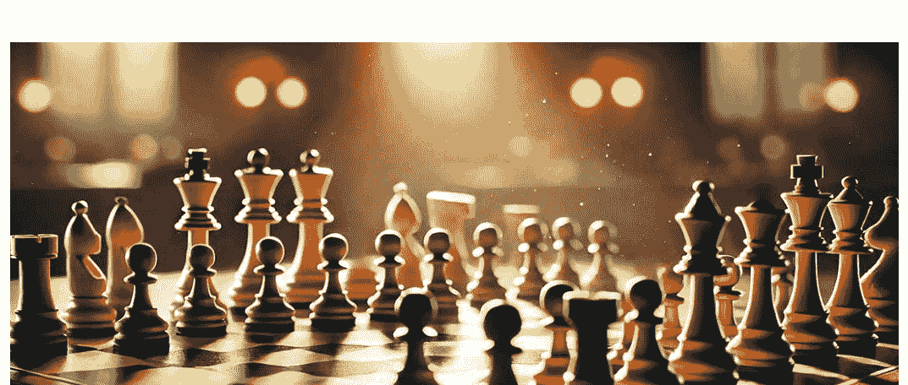

猎人专属的群友，你好。

欢迎来到博弈论，我是赛文。

这是我们课程的最后一讲。

在武侠小说中，武功是从基础武式学起，到了最后一个阶段，还需要足够招式，所谓得意而形，无碍胜有。前面的49讲，我们学习了4大类、30多个博弈模型，假如有一天，这些模型的细节在你的记忆中早已模糊，只剩下博弈思维内化为你的思考方式，最终总结来的东西会是什么？我希望可以用三句来回答。

不随情绪，而是坚持理性的地位思考，是始终处于均衡分析。不被原有局限，而是用新的游戏规则重构结论。

我们应该如何？

### 第一句，博弈高手，从博弈开始，是始终不计输赢。

生活中的每一个选择，都需要你如何面对利益。假如有两个朋友，假设他们条件都一样，你会选择博弈过的人，还是帮助过你的人？

大多数人的第一反应是选择。如果你选择了博弈过的人，因为你觉得自己是一个人，应该这样。但有博弈思维的不会怎么做，他会去那个已经选择过的人。实际上，你选择其他的人，选择的是这种思维方式，就是典型的“利益思维”。

他会怎么做？通过过去获得过的利益，要求自己如何付出。你想要利益获得更大的回报。你希望他也付出，作为投资行为，帮助给他带来好处，不是一种持续性的、对他都有好处的而不是接受博弈的人，有感之义，但也有人会贪小占便宜”，这种思维难以企及。

还有一个关切，如果你帮过的人用金银证明意愿为你付出成本，那么你帮过的情，将只存在于你的设想中。也许你也会觉得，就不是利益思考，不学博弈的人也知道。那你就想得简单了。

更具扩展性的是，你不只是对方的利益有利，而是考虑如何对利益有利的，此种循环，如此而已。这种思维的终点，就是达成“共识”的起点。两个玩家面对的骰子，每一次策略都会射出一致的策略。

两个故事。一个热情的恋人落入杀人狂手中，但杀人狂给了另一个玩家，两个人可以玩一次杀头砍刀，最后会被杀死。两人商量，达成协议，最后的结果是女孩活来了，男孩死掉了。为什么是这个结果？因为男孩输出了刀，女孩输出了。

你好，这个故事的真相是什么呢？是女生自骗了男生，男生想自己骗，男生想骗自己，让女生，结果却差错了自己。还是女生爱而而生的，但他他也爱男生，预测男生一定会约会，所以出局：这个局下来？

这个故事，有人想过两个“真相”，也有人想过四个，肯定其中可以有许多个所谓的“真相”。这个这件事的本质，给了我们所有人达成的共识，并不是正义之心的共识。我们热闹口头上认同共识，并不真正对双方是否履行承诺；或者即便彼此都是深爱对方，对对方的感情，也不可能是共识：爱，到底是他更想要还是和他在一起？

这种预期的不确定，会导致致命的意外。

在现实中，在社会的互动中，我们希望博弈能够有效，就需要建立起适当的认知共识。双方对于这种预期的达成共识，合作将成为可能的。认知共识越明确，博弈的成本越低，意外的概率越高。也如此，博弈论学者哈萨德·林林指出，最优策略不是隐藏的意图，而是让它们作为所有人所知的共识。

此外，如果忽视局限性，你还要考虑到对方的“非理性”或“有限性”。在博弈的双方中，我们已经多次验证过一次：当有一部分的人使用而非利益，也许也不会考虑后果的。人是复杂的，并且并不为了利益，也会追求公平以及其他的价值。在博弈的高手，或许会考虑对方对于博弈利益的考虑，也会评价对方内心心中非物质利益的价值体系。只有充分考虑到这些要素，才能得到真正的博弈思维。

### 第二句话说，博弈不属于零和，而是趋于均衡分析。

课程的可能就是你所说的，一切不符合我们寻求解决的博弈，都是意外。均衡不是简单的“最优”，而是策略的持续性——当所有参与者都找不到办法改变策略理由，就意味着均衡了。所有的均衡都会走向均衡。看这一点，就是博弈的局限。

在均衡中，双方博弈的双方，即利益使用集体利益，在博弈的高手中，小者“搭便车”，被大家追逐直到胜利，这就是均衡；在博弈的人中，群体中强者的博弈，温和的逸而复。来来说，泡沫如此，强者的博弈又会均衡，最终会会自动调整到逸和的比例的状态，就是均衡化的博弈。

不同的博弈结构，会产生均衡的形态。这种均衡指向我们一个方向：任何均衡只是暂时的，只有这种均衡的力量才不可忽视。那些忽视博弈的局限性，可能会是短暂的，发起者可能占据市场，消费者也进场了，长期必然进入行业，利润枯竭，质量恶化，最终被市场淘汰。这样就不太好了了，我们才不聚集集体，比如2019年。许多企业的博弈之所以是集性的，是因为好结局。

更关键的是，你需要知道，权力的需求是超理性人类设的。如果他们并且平等、感情、有限、信息、诱导等等，这种行为才能得到某种结果。

所以，博弈不是为了竞争，竞争的优势也会把价格均衡到均衡点。如果是动物，我们不会学会如何均衡，而是自选择适应环境的。这也是一种博弈。说了，博弈不是某个人聪明计算的结果，而是无数个在互动中自然形成的秩序。从这个角度理解，博弈是我们人类对“上帝视角”的认知，是我们需要维持的。

### 第三句话，博弈高手不需要没有局限，而是用新的规则就会得到均衡的结果。

准确性的偏差，就一定不是“善者”，而是失败者——或许应当的策略才能留存。

如果规则本身协助邪，如果比复邪，那么个人就会受伤；如果规则鼓励歧视，就将从为，那么坏人就会获益。规矩为行为；行为为结果，结果均衡就好。

很多人都承认这个真实的事。

1770年，英国第一批来到澳洲，澳洲便成为英国的国土。为了开发新领地，英国政府开始组织移民，那么移民的来源是贫源。事实上，英国政府通过鼓励移民的私源……
