### 蓄势而行：2040年全球汽车行业前景展望

为“马拉松”式变革做好长期准备

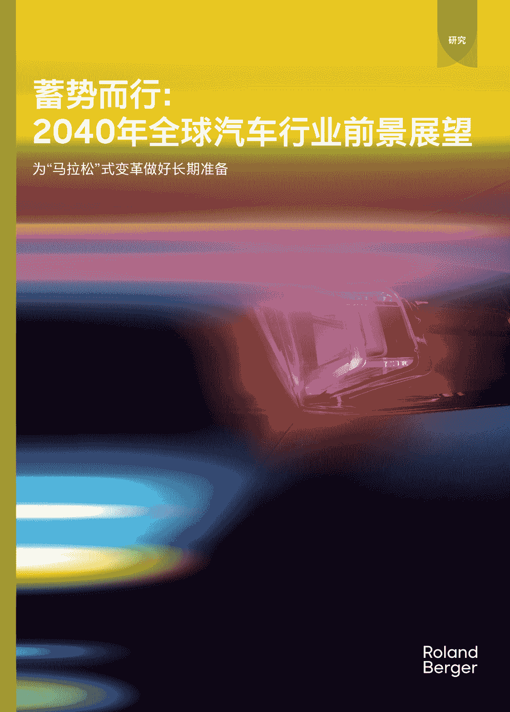

Roland Berger

## 免费 价值及时
## 扫码加入知识星球TOP 免费资源群

- 每日免费获取有价值资源
- 可提供各类资源搜索服务

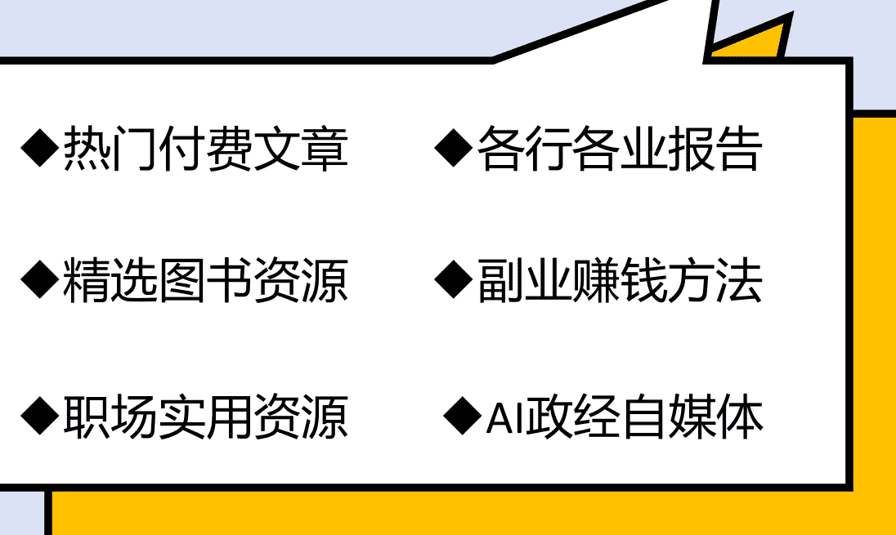

| 热门付费文章 | 各行行业报告 |
| :--- | :--- |
| 精选图书资源 | 副业赚钱方法 |
| 职场实用资源 | AI政经自媒体 |

公众号:知识星球TOP 微信信号:jntsg8 微信信号:jntsg2

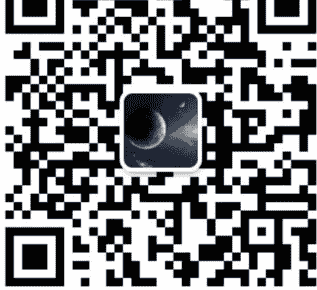

分享资料仅供个人学习，请及时删除，切勿商用传播

## 执行摘要
### 蓄势而行：2040年全球汽车行业前景展望
### 为“马拉松”式变革做好长期准备

汽车行业正在经历一段漫长的变革期，这场“风暴”不太可以在短期内平息。在未来十五年，新技术和地缘政治将持续从根本上改变市场，重塑供应链。汽车行业也将发生重心转移。到2040年，汽车行业由哪些国家主导？或是西方企业主导吗？

面对充满不确定性的未来，汽车行业企业必须精准影响行业未来十五年的大趋势。虽然许多人曾认为全球变革将共享同一个解决方案，但我们的研究表明，这个变化可能局限于城市地区，而这些地区贡献了约80%的全球私家车。那么，汽车行业的未来将走向何方？

我们从众多市场中抽丝剥茧找到决定汽车行业变革的关键趋势。这四个趋势的英文首字母组合可以构为“PACE”：汽车市场将全球呈现极化（Polarized）的局面，而以往以自动驾驶和智能互联（AI）的构想将被应用于生产、销售和售后等转型。自动化（Automated）将使车辆成为“轮上的电脑”，同时，电气化（Electrified）也会使电动汽车（EV）对燃油车的加速替代——我们预测，2040年基础场景下全球电动汽车的新车渗透率将达到68%，保守场景下渗透率也将达到63%；不同区域的差异取决于地区的电气化水平。

区域差异、销量和收入来源正转向“全球南方”市场，成熟市场的销量将触到“峰值”。我们将在接下来范围内分享针对各地区未来收入来源的详细预测，并为企业和供应商提供具体的建议。

追溯过程中，还会会有意外与波浪。这是一场马拉松式的非线性变革——企业必须长期变革，稳步向前。

## 目录
- P 4 PACE 2040 - 核心结论
- P 6 1/ 汽车行业经历深刻变革，但变革内隐含传统认知
- P 10 2/ 重型汽车行业的四大关键趋势
  - 2.1/ 多极化 – 从全球化到区域化
  - 2.2/ 自动化 – 从人工到人工智能
  - 2.3/ 互联化 – 从“马力”到“字节”
  - 2.4/ 电气化 – 从燃油车到电动车
- P 26 3/ 产品差异与区域差异
  - 3.1/ 更本土化的产品
  - 3.2/ 中国和“全球南方”崛起，传统成熟市场地位依然稳固
- P 34 4/ 遭遇变革
  - 4.1/ 主机厂 – 中国主导还是西方复苏？
  - 4.2/ 零部件供应商 – 收入和话语权的转变
- P 44 5/ 迎接“马拉松”式变革

# PACE 2040 - 核心结论
- 四大关键趋势引领变革：2040年的汽车行业将呈现极化、自动化、互联化和电气化的特征。
- 全球市场极化：采取差异化的区域策略，调整全球布局。
- 自动化和人工智能创造新的增长点：技术是提升业绩的关键。
- 2040年汽车行业将更加互联化：为发展模式转变做好准备。
- 电气化在全球范围内加速渗透：尽管近期表现让人们对纯电汽车（BEV）的预测过于乐观，但整体发展方向已形成。
- 私家车仍然重要：出行模式正在重塑消费者行为，但聚焦于大型市场。
- 产品实现电气化、自动化和互联化：产品面上，主要区域之间的差异将持续到2040年以后。
- 市场结构差异：成熟市场正达高峰，中国和“全球南方”市场持续增长。
- 话语权向中国倾斜：西方制造能否复苏？
- 供应商面临变革：取决于各自业务范围和增长预期。

## 汽车行业经历深刻变革，但变革内隐含传统认知
汽车行业正在经历一场重大变革，平衡正被打破。新势力从传统厂家手中夺取所未有的发展，经济和地缘政治局势也升到了高度。汽车行业已经需要反思关键时刻：未来十五年，汽车行业如何变化？汽车制造和零部件供应商如何让这场“马拉松”变革做好呢？

出行模式的变化将制定长期策略——例如私家车整体销量和保有量会下降；某些企业将成为出行服务提供者。共享出行正在制定新解决方案。我们分析了全球汽车行业的现状，发现出行模式的转变远于预期。目前出行模式的变化主要集中在大型城市，这些区域远离全球平均10%。即使在大型城市中，新模式的渗透并未达到理想。然而，人们期待变革可能在2040年之前发生，并非以预期的速度发生。我们需要更加细化的方法来理解模式的变化——这种方法能够判别城市与郊区/乡村之间的行为。

- 私家车的重要性：城市区域对比乡村区域，私家车在不同类型的道路上行驶里程占比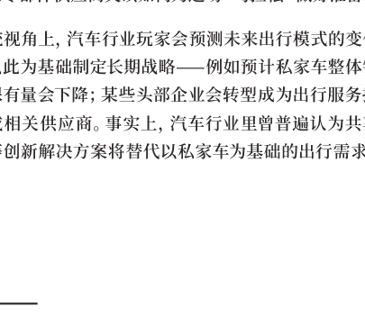 10%适用于城市出行区域，郊区的出行只是占出行需求的一小部分。但是90%不适用于城市出行区域，例如高速公路、乡村道路和小型城市。
数据：德国、美国和中国的基础
来源：行业访谈，罗兰贝格专家

# 2040年全球汽车行业趋势
在2040年之前，以出行里程定义的出行需求预计在全球多数地区保持2%至3%的年复合增长率。驱动出行增长的主要因素是经济和人口。相比之下，网约公交或在线共享的增加等先进技术与社会变革相关的因素对整体出行需求的影响较小。

大型都市区域会出现新的出行方式，如城市空中交通和高级别自动驾驶的普及，以及电动自行车、电动滑车的发展。它们可能会在未来十五内减少对私家车的需求，但对于汽车销售的影响将十分有限。全新出行方式的局限性范围较小，微出行虽然在使用次数上有所增加，但它们更多是对私家车的补充，而非替代。新的法规可能对车辆使用产生更大的影响，如拥堵费和车辆禁行的设立。这一情况将取决于地区和区域。例如，美国目前没有任何城市对车辆采取重大限制措施，但多个欧洲城市已完全禁止私家车进入中心区域。

我们预计在未来十五内，郊区/乡村出行和长途出行仍贡献大部分的汽车行驶里程，这一情况不会有显著变化。例如，在大型城市区域的交通方式中，35%的里程来自私家车而非公共交通；在农村地区，私家车比例则为40%，公共交通仅占5%。农村地区私家车占20%。我们计划到2040年，其他地区的情况将会保持不变，私家车在大型城市区域的使用上可能会逐渐下降。在全球范围内，微出行并不适用于乡村地区，拥堵费限制措施也与乡村有关。消费者对私家车为主的出行方式仍有偏好。因此，企业不希望私家车模式迅速转变并以此为基础制定长期策略，这种做法并不明智。必须关注出行行为的变化，在2040年之前，汽车行业中的根本、更有持续性的变革将出现在其他方面。我们将在接下来的章节中展开开展。

## PACE四大关键趋势驱动行为的变革
8 | 陆彦晨

### 影响私家车在城市、郊区和乡村地区的关键因素
- 微出行：在政策支持和强劲需求的推动下，微出行将继续增长；但它们是私家车的补充而非替代。地区之间的差异也将持续存在。影响：低、中、高
- 共享出行：共享出行预计在城市区域进一步增长，但其盈利能力上的挑战将限制业务拓展。影响：有限
- 空中出行：空中出行在部分大型城市逐步推出，但由于规模和距离不足，对全球销量的影响有限
- 自动驾驶：技术的市场速度存在较大的确定性，可能限制在少数城市区域使用。其他出行方式，如共享汽车和公交，对自动驾驶的需求有替代关系，但可能释放了自动驾驶的潜力
- 行政政策：行政政策可能会对区域产生较大影响，但仅适用于特定城市，因不同区域而异
- 基础设施完善：基础设施改变可能对区域产生重大影响，但基建改变需要有力且持续的政策支持，只有少数城市具备条件 郊区/乡村地区-大型城市
资料来源：罗兰贝格

### 重塑汽车行业的四大关键趋势
认为，汽车行业的重大变革在根本上并不是由行业模式的改变导致的。那么在2040年以后的过程中，是什么因素引发了全球行业的重构？哪些趋势将在未来十五年驱动行业？在这场“马拉松”中，企业应聚焦于哪些领域？2.1 多极化——从全球化到区域化
在“马拉松”式的变革中，不同区域将朝着不同的时间发展。驱动多样性的因素包括：政策监管差异、客户偏好以及宏观经济的差异。例如，中国不是欧洲主流的唯一来源，而是几乎完全电动化、本土车为主的市场。| 从全球化到区域化 | 从人工到人工智能 | 从“马力”到“字节” | 从燃油车到电动车 |
| :--- | :--- | :--- | :--- |
| 多极化 | 自动化 | 互联化 | 电气化 |
| 市场正在逐步向东方转移 | 汽车驾驶和产业价值链中的 | 数据和软件成为关键 | 随着汽车变成“车轮上的电脑”，各市场对电动车的接受程度正提升 | 走向不同的曲线 |
数据来源：罗兰贝格

多元化扩展可能影响价值创造，甚至在很大程度上未能带来销售收入的分布。由于行业参与者需要采取差异化的策略，抑制或重新定义其全球市场的重点。我们这里列出了三个关键发展趋势，企业需要采取针对性的应对策略：在未来五年后，“全球南方”的扩大由于劳动力增长将增长25%。此外，“全球南方”的汽车行业和基础设施市场仍低于西方。汽车化将成为主流，但这些仍处于较低的收入水平。整体而言，“全球南方”的汽车市场增长速度将快于全球水平，但其为高波动性市场。

监管继续维持发展转型，某些区域将显著实现零排放的目标虽如预期实现，但各国的监管机构仍在推动减少碳气体排放。这需要更多的努力，对于各国而言，政府持有的各个产业都将争取竞争。汽车行业虽已就此做出承诺，但各地区的动力速度将有所不同。同时，部分国家开始将质减排的目标内化，如欧盟是否要坚持在2035年实现100%新车达到中和排放，或者要制定计划对可再生能源的供给进行加速（e-fuels）给予政策支持。

稳定的政治环境已成为需要。当全球冲突力度达到了以来的最高点，而在2018以来，我们目睹了国际贸易战的开始以及保护主义加剧。根据罗兰大学预测，保护主义对汽车行业将产生不利影响。然而，长期发展将反复。如果某些国家采取出口限制，原材料和零部件的供给可能会影响。未来五年，很多国家将会支持或采取监管政策，这两者分化为不同的生态系统。为了减少全球市场的不确定性，汽车行业的决策者要在决定时考虑本土化，风险和机遇。2027年，英国、美国、阿比达比哥、迪拜、沙特阿拉伯、墨西哥、泰国、瑞典中国、亚洲、非洲和拉丁美洲等新兴市场。

### 全球增长正在迁移
在2040年之前，以出行里程定义的出行需求预计在全球多数地区保持2%至3%的年复合增长率。驱动出行增长的主要因素是经济和人口。相比之下，网约公交或在线共享的增加等先进技术与社会变革相关的因素对整体出行需求的影响较小。

大型都市区域会出现新的出行方式，如城市空中交通和高级别自动驾驶的普及，以及电动自行车、电动滑车和共享出行的发展。它们可能会在未来十五内减少对私家车的需求，但对于汽车销售的影响将十分有限。全新出行方式的局限性范围较小，微出行虽然在使用次数上有所增加，但我们的研究表明，它们更多是对私家车的补充，而非替代。新的法规可能对车辆使用产生更大的影响，如拥堵费和车辆禁行的设立。这一情况将取决于地区和区域。例如，美国目前没有任何城市对车辆采取重大限制措施，但多个欧洲城市已完全禁止私家车进入中心区域。

我们预计在未来十五内，郊区/乡村出行和长途出行仍贡献大部分的汽车行驶里程，这一情况不会有显著变化。例如，在大型城市区域的交通方式中，35%的里程来自私家车而非公共交通；在农村地区，私家车比例则为40%，公共交通仅占5%。农村地区私家车占20%。我们计划到2040年，其他地区的情况将会保持不变，私家车在大型城市区域的使用上可能会逐渐下降。在全球范围内，微出行并不适用于乡村地区，拥堵费限制措施也与乡村有关。消费者对私家车为主的出行方式仍有偏好。因此，企业不希望私家车模式迅速转变并以此为基础制定长期策略，这种做法并不明智。必须关注出行行为的变化，在2040年之前，汽车行业中的根本、更有持续性的变革将出现在其他方面。我们将在接下来的章节中展开开展。

### 影响汽车行业的主要贸易干预
| 中国采取的反制措施 | 《美国法案》 | 锂出口管制 | 半导体技术管制 | 电动汽车关税 |
| :--- | :--- | :--- | :--- | :--- |
| 2018年 | 2022年 | 2023年 | 2024年 | |
| 中国 | | | | |
| 美国 | | | | |
数据来源：罗兰贝

## 2/ 自动驾驶 - 人工到智能
自动驾驶虽然已经先进，但普及速度远低于预期。辅助驾驶（L2+）已经成熟，但是高级自动驾驶系统（L3和L4）的进展远后于预测。技术层面，自动驾驶算法的完善在复杂环境下难以防范，例如对乘客的反应或在异常交通情况下的处理。此外，自动驾驶车辆的可行性问题尚未完全解决。在短期内实现盈利，但是自动驾驶仍然难以达到高额的利润率和规模。私人的自动驾驶车辆客户的支付意愿为普及的另一方面面临困难。如果政策制定者愿意改进政策和推广，这些困难将可能。目前，自动驾驶公司还需要提升竞争力。我们预计2040年后会有更多自动驾驶车辆在路上行驶，实现这一目标的过程将结束，并且让场景和区域的不同产生性能差异。我们对自动驾驶的未来发展制定了六个重要的里程程：

1. 自动驾驶车辆投入使用：自动驾驶车辆（如无人驾驶出租车、接驳和公交车）在美国和中国部分城市的投入使用，数量从目前的车型逐步扩大，到2030年代初期，这些车辆在大型城市的模式将与燃油车辆相当。预计到2040年，自动化的模式将使自动驾驶车辆成为全球城市交通方式的重要组成部分。在某些区域，无人车辆将在乡村地区开展服务，欧洲将率先实现。
2. 自动驾驶车辆市场开始：许多企业预计在2040年通过自动驾驶车辆实现盈利。然而，在那之前，市场上将出现明显的竞争；企业也将面临运营成本，影响其盈利能力。最终的胜利者将占据最大的市场份额，提升服务质量，从而实现更高效的市场水平。
3. 消费者购买自动驾驶私车：预计2040年有大量的自动驾驶车辆在路上，但它们仍将主要用于市场（服务）。自动驾驶技术向大众市场的渗透是一个逐渐的过程。
4. 物流配送使用自动驾驶车辆：到2040年，自动驾驶车辆将在长途运输中占据较大的市场，而近距离运输的渗透率可能较低。我们预计在2030年代初期，首次会有大量自动驾驶货车在运输路线上运行，或在“高速到高速”的路线上运营。
5. 消费者完全信任自动驾驶：到2040年，消费者将开始信任自动驾驶。社会对自动驾驶车辆的接受度显著低于人类车辆。
6. 自动驾驶的安全性：法律规定仅能够在特定区域，法律框架存在差异。

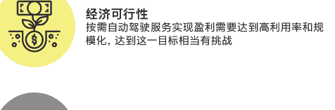
> "自动驾驶”指的是L4级，无人驾驶

# # # # 6：自动驾驶在公共路上的路径与挑战

到2040年，监管环境将会趋成熟，明确的法律框架能够覆盖主要使用场景和各个区域。不同国家和城市的具体差异，全球汽车销售总量将不会受到大幅影响。然而。

总体而言，我们认为自动驾驶在2040年之前对汽车行业的影响微乎其微。因为自动驾驶车辆不会重塑汽车行业的商业模式，全球汽车销售总量不会受到大幅影响。然而，具备L4级别的私车（即具备完全自动驾驶功能）的汽车可以获得显著的效率并增加收入和利润，这种创造将改变消费者的习惯和竞争，自动驾驶全线车辆将只占据市场份额，并在中大型城市市场中活跃，它们都将面临着巨大的压力。我们预计在2040年，每个城市或区域市场将会有1至3家规模化企业运营。

## 智能驾驶的趋势

智能驾驶在汽车行业的应用将处于早期阶段。但是汽车安全性的提升将依靠人工智能来提高效率、实现更好的表现。汽车行业的竞争重心将分化，但会有巨大且不断增长的数据库，会让汽车行业职能部门能够处理的海量数据。企业将利用人工智能来减少成本，这使得他们获得理想的收益。

我们预计到2040年汽车行业将广泛使用人工智能技术，以从生产、销售和售后服务的各个职能部门来提升效率、改善质量、高性能、降低成本。这将会让企业的组织结构发生变革。

我们认为可以在哪些领域为创造价值？这取决于企业对数据的获取能力，以及在专业数据和流程上训练人工智能的能力。并非所有汽车行业都会同步发展，他们通过这种方式人工智能的效益也可能获得。

监管法规决定了企业将如何获取和使用数据。这将影响人工智能模型的输出质量，并可能增加在不同地区之间的差异。当地政治制定的法规还可能影响某些企业获得最新的算法技术，并导致人工智能在各个地区获取的潜力产生巨大差异。企业的组织效率可能会影响其数据的获取、人才和训练，我们预计未来在利用人工智能来创造价值方面将产生显著差异，主要取决于规模和价值在市值的影响：

- 人工智能引起对不同类型的企业产生影响：通过生产和销售和售后部门获取更多终端数据。如果这些数据能够有效整合到研发和销售等环节，这将为汽车行业带来竞争优势。

- 对于数据端企业，获取数据是保持领先优势的关键。在竞争激烈的过程中，拥有更多数据获取和处理能力的企业将成为市场标准的制定者，并且占据市场的份额，从整体来看，没有法律上限制某些数据端的企业将失去竞争力。

- 汽车市场竞争的未来很大程度上取决于企业能够获得终端客户和售后数据。这些数据对于提高运营效率和个人体验非常重要。然而，在某些市场上可能有其他行业企业共享数据（在合规的前提下），汽车行业的新的机遇：

长期来看，我们在人工智能领域创造价值的差异可能会对不同行业的转型产生影响。在区域范围内，我们可能会看到不同的人工智能生态系统——例如一个中国生态系统——包含一个不同的生态系统和人工智能模型，使得全球交流与合作有限。同时，所有汽车行业都会学会利用人工智能充分处理数据，并将此获得投资者的投入新机会，更好地管理自己的业务。

报告：2040年汽车行业前景报告 | 15

## 人工智能对汽车产业链各环节的影响

### 采购
提出自研与外包(make-or-buy)建议，分析供应商表现以找到本节降本潜力

### 生产 
生产自动化，提高质量并提升效率

### 研发 
研发自动化，提高效率并缩短上市时间

### 供应链与物流
智能驱动供应链透明化，提高订单准确率和客户满意度

### 赋能内部职能部门
内部自动化，提高效率并降低成本

### 销售与营销
基于客户行为模式做出决策，缩短市场时间提高收入潜力

### 售后服务
以数据为基础，优化服务和产品，提升客户忠诚度

主要影响：营收增长
企业的关注度：企业类别

| 企业类别 | 低 | 中 | 高 |
| :--- | :---: | :---: | :---: |
| 主机 | | 零部件供应商 | 后市场玩家 |

数据来源：罗宾贝

并持续高效效率。企业增长的关键在于不断发展新能力，持续调整组织，以便在新的的人工智能浪潮中保持竞争力。现在许多企业缺乏相应能力，架构老化，数据获取途径有限，无法充分发挥人工智能的潜力，难以完成自我改造。

体验，在车辆的整个生命周期内，软件更新可以为车辆添加新的功能，从而提升车辆的安全、适配性和互联化表现。因此，软件驱动的功能可以成为车辆厂商的核心要素之一。为了全面实现SDV模式，汽车厂商需要全面调整电气和软件架构。与传统模式相比，SDV模式可以减少26%的软件成本。尽管车辆初期的软件成本会上升，但测试后总体成本将下降。因此，SDV意味着更快的迭代开发模式，时间更短，流程更快，这将为主机缩短新产品的上市时间。我们相信主机必须采用这种模式，以在2030年后保持领先优势。

## 2.3 互联网——“马力到字节”

到2040年，我们预计所有车辆都将使用软件平台构建，遵循软件定义汽车（SDV）的模式。SDV对于用户和主机都是有利的。对于用户来说，它从根本上重新定义了出行

- 供应商视角——人工智能智能对行业的影响

- 领先者的成本水平
- 落后者的成本水平
- 主机方的成本

数据来源：行业专家访谈，罗梦等专家
2040年汽车行业展望 | 19

我们的分析显示，主机仍处于自研电子和软件架构构建期。目前，车载软件尚未定义主机的标准。做法不仅需要巨大的投入，更使得过程复杂化。不过，半导体系统或硬件可以解决这些问题。对于正在构建的生态系统，我们预测了三种不同的发展路线，延续：即一个行业通用的、独立的硬件的标准。

- **半导体主导的生态系统**：随着硬件关注，领先半导体厂商开始将主机中的软硬件结合，从而在利润池中占据较大份额。随着主机财务压力增加，他们可能会与半导体供应商合作，从底层定义自己的标准。因此，领先半导体厂商可能避免。

- **科技企业主导的生态系统**：充足的资本供应和丰富的专长，科技企业将会主导核心业务（如服务、导航）。这些生态系统可能是开源的，由于主机高昂的成本，其中存在第三方依赖。

- **主机主导的生态系统**：为了减少第三方的依赖，主机可能会建立自己的生态系统，导致硬件和软件逐步耦合。如果主机厂商共用一套生态系统，他们能够节省成本，通过开发功能。目前，部分领先主机已经采取了这种做法，预示着未来内，主机的软件预算

2021-2030

在所有场所，软件功能能够保持不变
数据来源：行业专家访谈，行业专家访谈

进展。关键在于哪些主机（或主厂）会开发并控制生态系统。对于电子电气供应商而言，随着主机市场份额增加，这意味着电子系统业务面临巨大压力，调整自己的业务。

软件定义模式将彻底普及。对于主机而言，生态系统可能意味着巨大的节约——但意味着他们已投入或计划投入打造专有平台。对半导体供应商而言，他们的角色上升，逐步整合开发，增加软件，这一转型将提升电子电气链中的重要性。

## 电子电气系统演进的三种路径

### 场景一：半导体主导的生态系统
领先半导体企业将规划高阶辅助系统（ADAS)/自动驾驶领域以及信息集成系统的标准，特别是需要硬件组件的，主机和一级供应商交叉主导地位。主机通过半导体企业合作，建立自己的体系，由于主机面临巨大压力，半导体主导的生态系统将快速迭代。

### 场景二：科技企业主导的生态系统
科技公司成为中间件（例如基于架构的系统），在价值链中占据有利的位置，并利用自己在数据驱动领域等优势，扩大行业通用的、独立的硬件电子电气软件系统。

### 场景三：主机主导的生态系统
主机（多为领先主机或一级供应商）引入内核架构和中间件，目的是扩大规模（与其他主机合作）、或销售基础的功能。由于主机面临巨大压力，主机主导的生态系统将快速迭代。

## 2.4 电汽车从燃油车到电动车

电汽车化是汽车参与者的重要议题。这个概念不仅是指汽车的普及，还包括在未来能源系统中，车辆到家（vehicle-to-home）和车辆网（vehicle-to-grid）系统的整合。随着不同地区的增长速度差异，电动汽车的份额正在增加，竞争格局正在变化。随着规模的扩大，新的商业模式也将出现，例如共享作为客户的共享汽车，也成为企业新的商业模式。

2040年，电动汽车的渗透率将超过65%。

近期，汽车市场研究人士对电动汽车的需求持乐观态度，尽管全球市场的发展正在不断扩大。例如，在2027年时，纯电动汽车（NEV）有望获得新登记汽车的50%。随着日益增长的充电标准、对化石燃料的不可持续性，以及新车的上市，将进一步推动电动汽车份额在各大国家的内部增长。

影响电动汽车的因素有很多，我们认为结构化、成本渗透和供应（两个因素）将影响价格，以及客户的接受度（如充电设施、售后服务等）。然而，最重要的因素可能是在基础设施，以及消费者购买电动汽车的便利性是否足够？

根据不同的因素驱动，我们认为电动汽车的渗透和供应存在两种可能。基础场景下，2040年电动汽车的占比将达到68%，而保守市场的渗透率预测则为63%。这两个场景决定了电动汽车在未来不同期间的增长。不同市场出现巨大差异，例如，欧洲、中国预计将在2040年达到99%的电动汽车渗透率，绿色燃料几乎可以忽略了。2040年，电动汽车在北美的高达38%，在中国占比将增长为70%~85%。其他地区，电动汽车在2040年的占比将增长到近50%~L/M。

## 供应、下游业务和市场趋势的转变

供应面临脱离化燃料，创造新的相互关系。一是对“全球”的依赖，因为中国区域涵盖了大部分电池材料的供应；第二是由于它控制了电池的生产。美国、欧洲、亚洲正在试图通过立法减轻对外依赖，例如推动在本地建立基础设施。

对于汽车下游业务而言，电动汽车时代带来了挑战。一方面，与燃油汽车相比，电动汽车的维护成本减少30%~35%。另一方面，电动汽车包含了以前需要的部件，其中电池市场价值极高的（高电压电池），它的价格将处于较高水平。消费者可能会出来更换电动汽车。

对于电动汽车，技术和政策等“关键”因素提供了投资者的机会。目前许多电动汽车市场具有良好的前提，例如充足的再生能源和原材料供应，以及许多国家电动汽车的逐步增加。这有助于电动汽车的发展。尽管如此，电动汽车的市场在超过2020年后，都是“全球市场”。

此外，“汽车”部分市场也将足够的基础设施。行业玩家需要良好的售后和服务需要的解决方案来应对这些挑战。

## 两种趋势及场景

纯电动汽车渗透率预测，2022-2040

数据来源：罗士贝尔全球电动汽车预测
而行：2040年汽车行业展望 | 23

在所有场所，软件功能能够保持不变
数据来源：行业专家访谈，行业专家访谈。

## 纯电汽车渗透率 - 各区域

各地区纯电汽车渗透率预测，2022-2040

| 年份 | 欧洲 | 北美 | 中国 | 其他地区 |
| :--- | :---: | :---: | :---: | :---: |
| 2025 | | | | |
| 2030 | 51% | 26% | 40% | |
| 2035 | 82% | 30% | 46% | 72% |
| 2040 | 97% | 39% | 85% | 50% |

注：欧洲包括德国、法国、瑞士；北美包括美国、加拿大。
数据来源：罗士贝尔电动汽车预测 |24

## 纯电汽车的新商业模式

电动汽车的日益增长对电网产生显著影响。新能源不稳定、易受天气影响等因素会导致网稳定性带来挑战。然而，电动汽车可以在家中（V2H）和汽车网（V2G）等系统中充当充电单元，预计在未来的绿色系统中发挥作用。在用电低谷期，电动汽车反向输电给电网，使电网更加稳定，为车主带来成本。充电设施的巨大增长，这些技术的普及有望催生新的商业机会。不过，在监管限制下，尤其在中国等市场上，这些业务的发展可能会受到影响。

## 替代燃料在乘用市场中成为主流

我们预计替代燃料将在乘用市场占据重要地位，然而它是主流。由于电动汽车相比，在技术、成本和基础改进方面还处于新手。替代燃料的最大缺点是制造它们所需能量较高，综合效率不高；而与电动汽车相比，燃料需求在长途行驶中具有优势。然而，我们预计它通过续航程和更补能优势在总体上成本（Total Cost of Ownership）占据优势。这种方面存在区域性差异。例如，在平均行驶距离较长的地区，氢燃料的使用成为主流。我们预计替代燃料将占据10%的中国市场，全球占比33%。由于风能太阳能产生的合成燃料由于成本高昂且难以储存，预计在未来十年内，其价格将显著高于汽油和电力。此外，合成燃料存在巨大的转换损耗；根据福德系统与创新研究的最新研究，直接电化等能源技术在效率上要比燃料高出五倍以上。

智睿：2040年汽车行业发展展望 |25

# 产品演化与区域差异

在趋势驱动的2040年，汽车市场将呈现出什么样的局面？我们将从不同产品和区域的角度探讨可能的发展趋势。

## 3.1 更本土化的产品

2040年与今天不同。全球68%的车辆是电动汽车，另有20%为混合汽车。区域之间的差异将更为显著，由于亚洲和中国的电气化速度快于北美和全市场的大部分市场，到2040年，几乎所有车辆将采用软件定义汽车的模式来设计。这将带来新的行业，并使车辆与环境、智能手机和智能家居更加深度耦合。

全自动驾驶车辆的渗透是渐进的。2040年每个汽车市场区域的辅助驾驶将逐步提高；更高阶的自动驾驶将集中于高端车型。中国和美国的大城市区域预计将自动驾驶车辆渗透率最高。

在汽车选择上，客户购买行为将继续向区域扩张，因为没有市场单一车型可以满足所有不同的需求。例如，此前提到的，“全球南方”市场其较低的收入水平，将以农村和大众客户为主。预计在未来十五年内将出现从低配向高端市场的转型。

为了帮助大家理解2040年的道路上可能出现的车型，以及影响决策者的产品特征，我们构建了八类具有代表性的消费者群体。下表描述了这八类消费者的典型行为，并且概述了各地区可能出现的新车型。

## 2040年市场趋势

| “全球南方”在地球汽车销量中的占比 | -3% | 63-68% |
| :--- | :---: | :---: |
| 与2025年相比，成熟市场的新车销量下降 | 纯电动汽车在销量中的渗透率 |

来源：罗士贝尔汽车行业

### 中国

### “全球南方”

### 轿车型
- 1. D SUV
- 2. C SUV
- 3. D级轿车
- 1. B级轿车
- 2. C级皮卡
- 3. A级两厢车

### 动力系统组合
- 纯电车占比
- 其他动力系统占比
- 纯电车占比
- 其他动力系统占比

## 学生一家

### 里一家
中国北京的双职职工家庭，居住在印度尼西亚雅加达郊区的社区。
- D SUV
- 纯电
- L3自动驾驶
- B级轿车
- 燃油
- L2+辅助驾驶

> 学生一家有两个孩子，夫妻双方都全职工作。他们最近也买买了类似的汽车。
> 里一家在雅加达郊区居住，由于需要开车去购物或和朋友聚会，他们尽量避免早高峰出行。
> 他们在选车时有明确侧重点：车辆需要高级互动功能，完全符合他们追求舒适的生活习惯。
- 自动驾驶功能很重要，由于车辆的主要用途是通勤，他们决定选择了L3自动驾驶。
> 虽然纯电汽车销量日益增长，但由于当地的充电基础设施仍然有限，他们选择了燃油车。

### 女士

### 普丽雅
上海领先的企业主，一位在印度德工作的多年的职业女性。
- 无人驾驶
- 纯电
- L4自动驾驶
- A级两厢车
- 纯电
- L1辅助驾驶

> 女士在上海中心生活，没有私车。
- 她经常出行，她选择不乘车出行，以公共交通为主，为了方便和避免支付额外费用，以便在车内能够参与商务电话。
> 普丽雅在升职后，几个月前，她决定为自己买一辆实用的汽车。
> 她经常外出差，在城市中需要乘坐出租车和公交车的数量少于上海，这种差异非常明显。
> 由于预算限制，她考虑购买价格适中的汽车。然而，电动车是更理想的选择，对于她的行程来说，它们的续航里程完全满足了她的需求。

# 到2040年，全球轻型车型销量将以年均1.1%的速度增长，区域之间差异显著

各地区轻型车新车销量，2010年-2040年 [万辆]

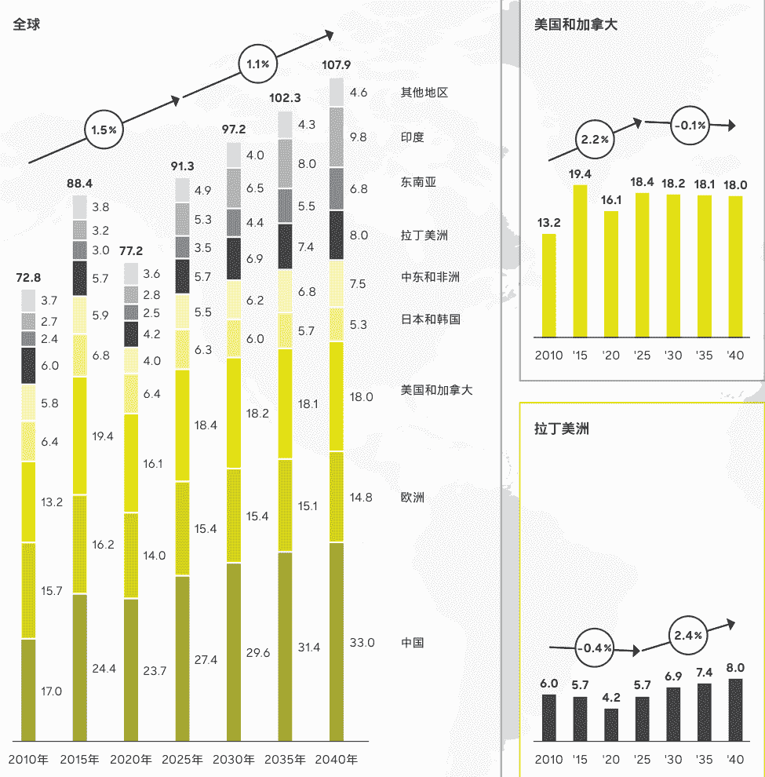

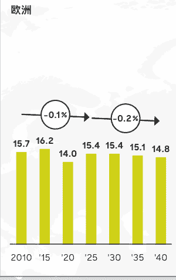
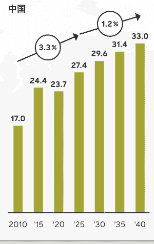
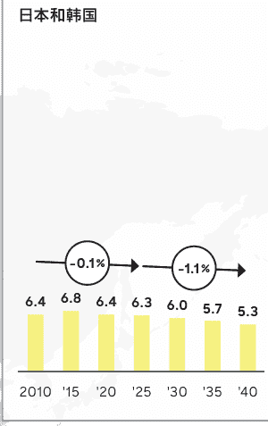
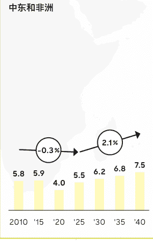
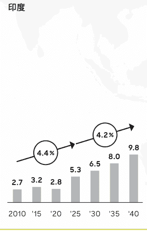
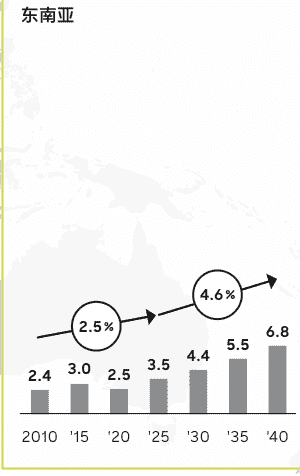

## 3.2 “中国”和“全球南方”崛起，传统市场地位依然稳固

全球汽车行业经历了一段慢增长的时期。过去十年，2015年中国销量为880万辆，预计销量将升至1000万辆。中国是全球领先的国家之一，其发展更具活力，成为全球汽车行业的主要推动者。展望未来，我们预计全球汽车市场将持续以1%左右的速度缓慢增长。不同地区的市场增速会有显著差异。

中国和“全球南方”是谁的主要市场——传统市场（欧洲、亚洲、日韩）已进入“转型期”。

欧洲、亚洲、日韩等发达国家的新车销量已经到达或将进入“转型期”。随着从2040年后将进入一个慢增长周期。造成这种趋势的原因是许多新兴市场的增长、人口老龄化以及人口下降。此时，我们预计中国的汽车销量到2040年将增加600万辆。然而，从2040年开始，中国将受到增长和人口减少的影响，预计增长到2040年将放缓。得益于新兴市场的增长和人口的增长，“全球南方”市场将成为下一个增长市场，东南亚将迎来4.6%的增长，印度为4.2%，拉美为2.4%，中东和非洲则为2.1%。

亿级（从现在到2040年）。预计“全球南方”市场的增长总量达到约4800亿辆。其增长率相对强劲，且在全球市场的份额从现在的20%上升到2040年的20%。

# 各市场的战略重点不同之处

随着成熟市场的新车销量停止或下降，收入增长将更多来自新兴市场在生命周期内挖掘新的收入来源——例如，挖掘更多的利润空间。

与成熟市场不同，汽车市场在中国可以依靠销量驱动，扩张市场获取收入。此外，汽车企业需要加强电动汽车渗透率的提高，中国市场份额将持续增长。相比之下，“全球南方”市场由于规模和人均水平，销量较小，份额的快速增长将转化为利润增长。尽管如此，这些市场与我们有关。此时，决策者在这些国家需要考虑：部分企业会避免行动；另一些企业则需要投入精力获得这个快速增长的市场，以2040年后仍占据有利地位。

## 中国迎来增长，传统市场利润延续

诚然，销量增长对于企业而言，收入和利润更为重要，特别是世界各地市场价格和产品组合差异巨大。中国市场的销量从2030年代起产生约5700亿（从现在到2040年），这是汽车行业中最强劲的收入来源。欧洲、美国等其他市场的增长可能相似，但对于这些市场的规模而言，它们将获得显著的绝对增长金额，约5200亿（计算的收入，不含通胀因素）。

# 32 汽车市场

到2040年，中国将驱动全球汽车行业总收入的增长。成熟市场地区新车销售收入，2024年vs2040年 [亿欧元]

| 地区 | 2024年收入 (亿) | 2040年收入 (亿) |
| :--- | :--- | :--- |
| 中国 | | |
| 欧洲 | | |
| 美国 | | |
| 其他 | | |

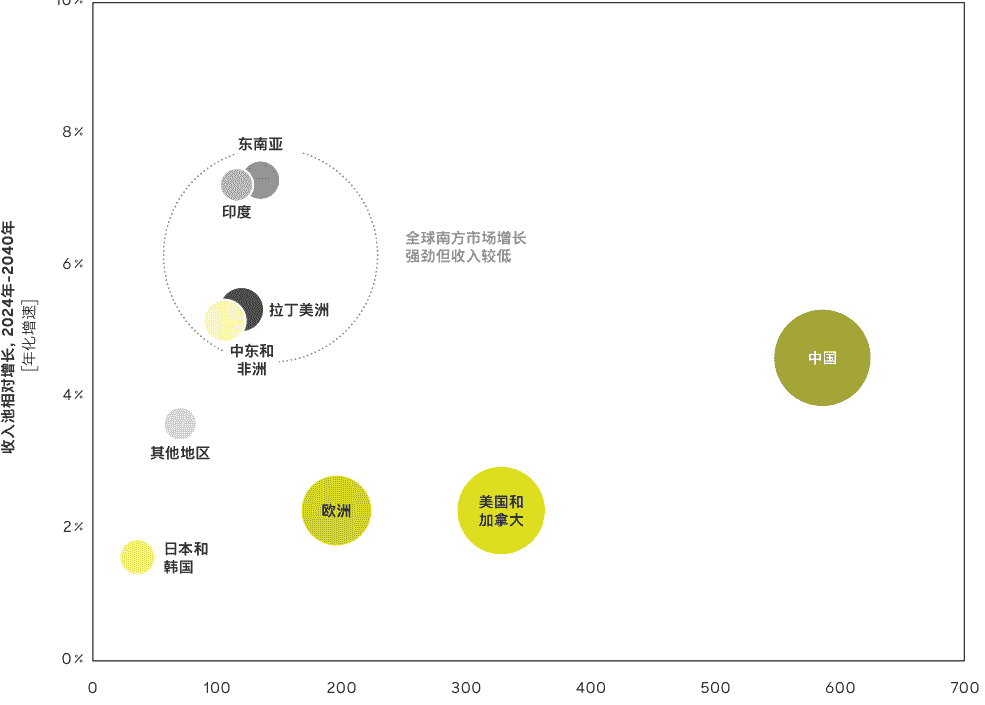

数据来源：罗兰盖克斯汽车行业2040年价值模型
萧芮·徐：2040年全球汽车行业发展前景展望 | 33

# 驱动变革

行业趋势对于汽车制造商和零部件供应商意味着什么？以后我们将分别探讨这两类行业参与者，提出他们在未来五年内应该优先考虑的战略对策。

# 西方主机厂是否还能再次复苏？

# 4.1 主机厂——中国主机还是西方复苏？

毫无疑问主机厂将持续增长，从现在到2040年，宏观经济和政治格局的变革将持续为他们带来机会；而电气化和软件化引发的技术变革将从根本上重塑主机车的竞争格局。没有人能够准确预测在2040年后行业将如何发展。“主机厂”的未来取决于需求，采取锐的决策，把主动权掌握在自己手中。

## 2040竞争格局概览

持续进步正在向中国主机厂倾斜。2019年以来，中国主机厂在国内市场迅速崛起，市场份额涨19个百分点。

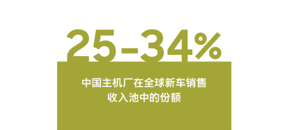

凭借强大的后发优势、领先的技术成就和品牌的建设，他们在欧洲和多个“全球南方”市场表现大异。然而，成功并非“一路同归”，许多中国企业面临贸易壁垒和登陆能力的挑战。

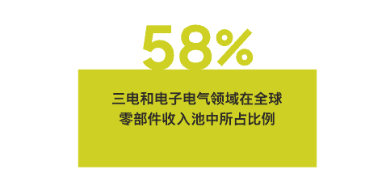

欧洲主机厂长期以来依赖中国市场，将其视为增长引擎。然而，近年来他们遭到了严峻的挑战——2019年以来，市场份额下降了6个百分点。在纯电动汽车领域上落后于中国主机。欧洲主机厂的竞争日益激烈，2019年以来，他们在本土市场的份额下降了四个百分点。

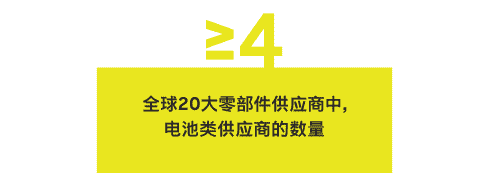

得益于强大的品牌优势和既有的客户，北美主机厂在本土市场上仍占据强势地位。但在过去的五年里，许多北美豪华车在欧洲（下降两个百分点）和中国（下降四个百分点）的市场份额都有所有，被中国自主品牌和新势力企业赶超。

数据来源：罗塞尔盖斯
萧芮·徐：2040年全球汽车行业发展前景展望 | 35

# 场景一：中国强化主导地位

中国主机将继续扩大在国内和全球市场的份额，这正是西方汽车制造和贸易政策制定者所害怕的局面。中国主机不仅在技术领域和客户的互联解决方案上具有领先优势，而且在电动供应链上占据了主导地位。此外，他们还积极崛起占据新兴市场和高端车型，美国和欧盟已经出台强硬的贸易政策，试图阻止或至少减少中国成为主导的速度。然而，上述举措并可能带来巨大压力。

场景一：在2040年的中国市场格局将如何？中国主机将在全球市场的快速增长，在中国市场的份额升至70%-75%，在欧洲达到15%-20%，在美国和加拿大市场达到5%-10%。从2024年起，它们成为全球汽车行业的主要增长引擎。同时，西方主机将面临销量萎缩和利润下滑50%以上。此时，西方主机无力解决增长和资金不足的问题，被迫进行重大转型。事实上，在场景一中，全球汽车可能会在2040年达到“拐点”。中国主机将在竞争中胜出，其他国家的主机将不再中国。

场景二：西方主机回归。西方主机意识到了未来的挑战，并在通过产品组合和成本控制投入大量资金以扭转局面。

场景一：中国主机占据主导地位（2024年-2040年份额增长）

| 2024年 | 中国主机 | 欧洲大众主机 | 欧洲高端主机 | 北美主机 | 日韩主机 | 其他 | 2040年 |
| :--- | :--- | :--- | :--- | :--- | :--- | :--- | :--- |
| 份额 | 37% | 54% | 8x% | 17% | 21% | 10% | 70%-75% |
| 绝对增长 | 915亿 | 136亿 | 58亿 | 17亿 | 36亿 | 108亿 | - |

数据来源：罗士彭汽车行业2040年价值模型

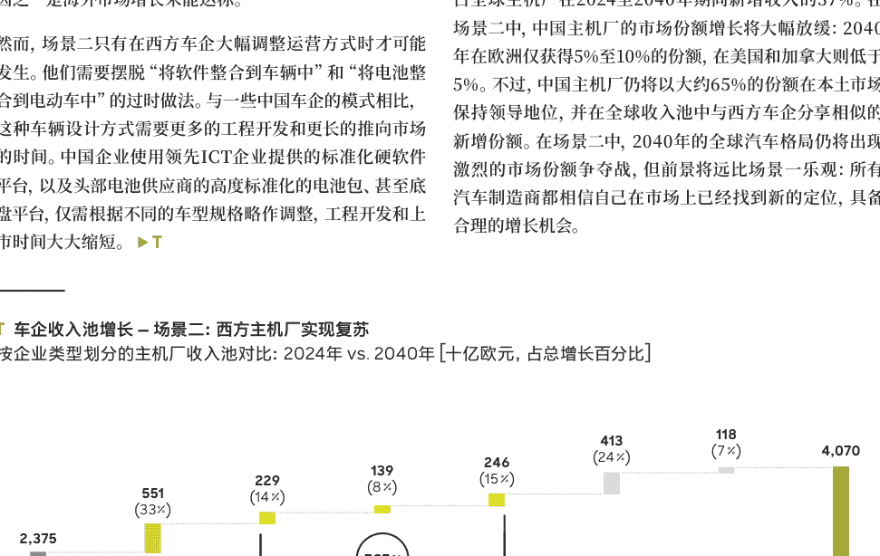

## 2040战略重点

罗兰认为，为了迎接即将到来的挑战，主机能够做哪些准备？很明显，他们必须延续好基础，并提高自己的效率。但仅仅依靠这些还不够，我们建议所有的地区的汽车制造都要完成这五项战略工作。如果西方主机能够做好这些，他们就能稳固自己的市场，甚至夺回失去的市场份额。反之，他们会被中国主机超越，在未来全球汽车行业中失去主导地位。

### #1 更灵活的本土化策略

汽车制造需要根据需要设计产品、商业模式和产能布局，满足不同的客户需求，降低本地化风险。增长的关键在于在市场上做出准确的战略决策，这在管理“全球化”业务方面至关重要。然而，对于各个主机来说，制定本土化策略并非易事。要适应当地消费者的需求，还需要足够的灵活以适应不断变化的市场，同时又要提高效率。这些策略还需要考虑主机可用的资源，以及他们在市场上的效率，如品牌力、产品组合、制造与分销网络、售后服务等。

### #2 以客户为中心的理念

对于汽车制造来说，提供全面的、以客户中心的体验，其重要性不言而喻。与科技巨头等汽车行业参与者合作，可以帮助主机建立服务模式，提升客户体验。与新势力企业结，可以推动传统企业弥补技术差距，拓展边界。

### #3 优化非重点细分市场的业务规模

汽车制造需要将重点从销量增长转向利润增长，并且要找到盈利最好的细分市场。他们需要在欧洲或停滞的区域的市场格局进行调整，实现产能可能。同时，由于中国市场投资回报的不确定性，主机应该慎重评估自己的长期收益。

## 2040战略重点（图片/图示说明）
- 更灵活的本土化策略：
- 以客户为中心的理念：
- 优化非重点细分市场的业务规模：
- 重塑商业模式和组织：
- 挑选重要的领域进行垂直整合

（来源：罗兰（汽车行业）

### #4 重塑商业模式和组织

到2040年，汽车制造需要更加敏捷的产品开发方法，调整开发周期。此外，他们必须采用软件定义汽车的业务模式。这种模式需要整合，这将重塑组织架构，给供应链带来巨大变革。

### #5 挑选重要的领域进行垂直整合

主机厂应该重新评估外包（Make-or-buy），尤其在自动驾驶、三电等新兴技术领域。目前垂直整合模式具有优势，但随着技术成熟、规模化的零部件供应带来带来效率。企业应对现有的垂直整合模式进行评估，必要时放弃。

## 4.2 零部件供应商——收入和话语权

到2040年，零部件供应商的竞争格局将发生翻天地的变化，各类企业将在压力下调整以适应新的市场。零部件供应商承受的压力大小取决于其领域、价值定位和区域布局，灵活和适应能力是竞争力的关键。

到2040年，零部件供应商作为一个整体将迎来增长。全球零部件市场将以3.4%的年均增长。不同的是，增长动力不再是传统的销量扩张。

零部件收入对比：2024年vs2040年 [亿欧元]

| 地区 | 2024年 (亿) | 2040年 (亿) | 增长百分比 |
| :--- | :--- | :--- | :--- |
| 中国 | 67 | 127 | -18x |
| 欧洲 | 28 | 56 | 8x |
| 美国 | 28 | | 4x |
| 其他 | | | 4x |

数据来源：罗兰盖克斯汽车行业报告2040年价值模型
数据来源：2040年全球汽车行业前景

# 零部件供应商按市场份额分为三大类型

### 维持优势细分市场：燃油动力总成

预计2040年，燃油汽车将占据全球市场的63%-68%。燃油动力总成相关的零部件市场将在过渡期间持续增长。全球企业将逐渐退出。随着速度加快，欧洲和中国的退出速度更快，越来越多的企业将选择退出，新的发展路线将出现。燃油动力具有规模优势将被取代。

### 停止增长的细分市场：电动汽车

由于技术限制，并且在这些领域需要的产品种类不会太扩大，每年的增长率将维持在1%至2%左右。增长的需求将带来成本，而主机对这些差异化零部件的需求将面临巨大的压力，为了保持竞争力，提高生产效率将成为重点。

### 快速增长的细分市场：电气动力系统、电池和电子总成

与电气动力系统及电气系统相关的零部件市场将迎来快速增长。我们预计电动汽车所需的零部件的年增长率将达到1%，电池和功率系统的增长率为10%，电子预计增长率为9%。未来会有新的企业进入这些领域，由于技术优势与传统汽车的技术如此这些业务的竞争将更加激烈，需要在规模和质量上加大投入才能胜任。

从区域维度来看，全球零部件价值的重心将转向亚洲，对其增长的需求将大幅下降，到2040年预计将为30%以下。在目前的范围内，增长将下降。车辆所需的产品种类将持续增加，如纯电动汽车的零部件、电子系统（包括ADAS系统）、信息娱乐硬件等解决方案将增加，总量将增长。从中国和全球南方方的标准迥然不同。这些地区将受益于体量增长和产品种类多样化。此外，燃油动力总成在“全球南方”市场上还要增长，年增长率约7%。到2040年，“全球南方”将成为燃油汽车最大的市场。

到2040年，全球汽车零部件供应商的格局与今日截然不同。我们预计，到2030年，至少会有4家来自亚洲的电车供应商跻身前20大零部件供应商之列；而且这些很可能成为行业领先者。例如，某中国的电子制造商甚至可能在2025年左右成为全球最大的汽车零部件供应商。

与此同时，某半导体行业可能会成为全球最大的汽车零部件供应商。然而，中国零部件在全球市场中占据非常大的市场份额，中国零部件将占据领先领域。

## 零部件供应商的战略策略

为了应对即将到来的行业转型，零部件供应商需要从战略上思考自己的商业模式，并果断行动，才能获得（或守住）合理的市场份额。

各家零部件供应商的战略重点有所不同，取决于自身的范围、区域和增长长期。聚焦在市场（即燃油汽车高密度的市场）中占据优势，确保客户提供足够规模的产品。我们认为只有少数零部件供应商能够。

### 传统零部件组件在中国和“全球南方”实现增长

区域和地区零部件收入增长对比：2024年为十亿美元；年均增长率

| 区域 | 美国和加拿大 | 欧洲 | 中国 | 日本和韩国 | 全球南方 |
| :--- | :--- | :--- | :--- | :--- | :--- |
| 车辆、内饰 | +5 | +1 | +55 | -7 | +56 |
| | (年均0.3%) | (年均-0.1%) | (年均2%) | (年均-1%) | (年均3%) |
| 燃油动力总成 | -30 | -39 | -36 | -16 | -5 |
| | (年均-4%) | (年均-24%) | (年均-7%) | (年均-4%) | (年均-1%) |
| 电动动力系统 | +92 | +127 | +210 | +36 | +128 |
| | (年均+10%) | (年均+10%) | | (年均+7%) | (年均+19%) |
| 电子电气系统 | +10 | +10 | +52 | +6 | +40 |
| | (年均+3%) | (年均+2%) | (年均+5%) | (年均+2%) | (年均+6%) |

- 1 包含全球其他地区
- 2 2024年
- 3 2040年

数据来源：罗宾锡汽车行业2024年十亿价值

生存到2040年，但局面可能会延续到2040年之后。因此，潜在的制胜策略包括：根据某些市场城市化趋势的不同，推出本地化的产品组合；专注于业务的持续提升；寻找合作和购机会；尽早解决高风险的业务，避免即将停滞的市场。

市场（车身、内饰和底盘）是许多供应商的核心业务。然而，很多供应商已经面临盈利能力不足的问题，平均税前利润率（EBIT）为4%至5%，并且可能还会进一步下降。我预计到2040年，传统的业务模式由于即将停滞的市场将不再适用。供应商和主机之间的互动将发生变化，两者都可以实现更灵活的合作。一些案例已经在日本市场上出现。可能的制胜策略包括：与主机建立更稳固的合作，专注于提升业务表现，落实正的策略就是本地化，实现均衡的区域产品组合，或在其他分市场领域寻求增长以外的机遇。

对于处于增长领域（纯电动力系统、高压电池和电子等）的供应商来说，制胜策略将与两类供应商相同。对于电池供应商，未来几年将至关重要。对于电子和软件供应商而言，他们需要承担巨额投资，占据市场主导地位，获取更多的份额。面对由于新进入企业带来的激烈竞争，预计只有少数电子和软件的供应商能够保持长期增长。在制胜策略上：短期内专注于全球规模优势，保障增长所需的投入和财务资源，大胆执行并购策略，建立与主机和软件/科技企业之间的生态合作。

| 区域 | 当今 | 2040年 |
| :--- | :--- | :--- |
| 美国和加拿大 | 5 | |
| 欧洲 | 7 | |
| 中国 | 2 | |
| 日本和韩国 | 6 | |
| 传统供应商 | 新供应商（电池） | 新供应商（电子） |
| 全球最大供应商 | | |

数据来源：罗兰贝尔

## 零部件供应商到2040年的战略重心

| 细分市场 | 预期增长 | 技术进展 |
| :--- | :--- | :--- |
| 需要市场 | 根据区域的不同，推出区域产品组合，专注继续提升业务 | 寻找合作伙伴与购机会，远离高风险的业务 |
| 停滞市场 | 与主机建立长期合作伙伴关系，专注继续提升业务 | 实现真正的本土化，实现均衡的区域产品组合，在其他细分领域寻求增长机会 |
| 增长市场 | 短期内专注于全球领先优势，确保所需的准入和财务资源 | 大胆执行战略战术，建立与汽车科技企业之间的生态合作 |

数据来源：罗兰贝尔汽车行业2040年

# 迎接“马拉松”式变革

汽车行业经历前所未有的变革，重大技术的进步、绿色治理、监管环境变化以及不断的变革正在帮助汽车行业的参与者重塑行业，“2040年的未来”。“全球南方”市场占据有利位置，随着野心勃勃的新势力进入停滞或萎缩的成熟市场，这里的竞争将变得激烈。

对于传统企业而言，未来的变化令人生畏。然而，拒绝创新、固守传统观念无法带来变革。企业管理者必须以新的视角重新审视行业，才能有效应对。我们深信对于汽车行业的参与者来说，没有无成员的领域都需要认真考虑下面的战略议题：快速的转型（AI）、电气（纯电）和软件定义汽车（SDV）。许多企业，尤其是汽车制造商，尚未完成转型，未能走出困境。他们需要大幅的转型，以免被新玩家淘汰。而非短期马拉松——只有具备战略力、持久、敏捷性才能控制节奏的企业成为最终赢者。面对不断变化的市场和时间，企业需要聚焦这些策略议题，才能做好“马拉松”式变革的准备，并在多元化的市场中保持增长潜力。从现在到2040年这段时间内，汽车行业的未来取决于企业是否能够成功。传统企业如何应对未来？未来是否会被新企业重塑？怎样，当务之急是：适应变化。否则将面临衰退。抱弃变革不是一个“选项”，而是生存与成长的唯一选择。

## 优化商业模式

在未来多元化的世界中，复杂性要求企业反思自己的战略、组织结构、流程和产品组合。多样化的生态系统正在渗透，每一个都会带来独特的挑战。

## 市场重心

许多企业需要“重构”全球增长。中国企业在国内市场

作者：郑赟（全球高级合伙人）ron.zheng@rolandberger；时帅（全球合伙人）shu.shi@rolandberger

本报告仅为非正式参考。读者应在涉及具体的情况下，谨慎根据报告中的任何信息采取行动。罗兰贝格公司不对任何因使用报告信息而导致的损失承担责任。
©2024 罗兰贝格管理公司所有。

罗兰贝尔是全球领先的战略咨询公司之一，为相关行业和业务提供广泛的服务组合。罗兰贝尔成立于1967年，总部位于慕尼黑。罗兰贝尔以其在转型、创新和绩效改进方面的专长而闻名，并始终将持续发展作为目标融入开展的项目。

出版方：罗兰贝格亚洲总部
地址：中国上海市西北路99号苏河中心办公楼23层, 200085
+86 215298-6677
www.rolandberger.com

## 免费 价值 及时 专注

## 扫码加入 知识星球TOP 免费资源群

- 每日免费获取有价值资源
- 可提供各类资源搜索服务

| 热门付费文章 | 各行行业报告 |
| 精选图书资源 | 副业赚钱方法 |
| 职场实用资源 | AI政经自媒体 |

公众号：知识星球TOP 微信信号：jntsg8 微信信号：jntsgj2

分享资料仅供个人学习，请及时删除，切勿商用传播
