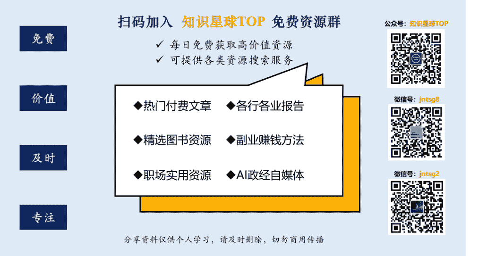

# 中国的底气

250718 虚走（付费）

我之前写过一篇文章，叫《巨人的孤独》，讲中国历史遭遇的一系列难题。现在地球上，中国博弈的对象并不是只有美国，还有欧盟、俄罗斯、日韩、中东油国，甚至一系列第三世界不起眼的国家。

中美关税战尚不痛快，中拉俄中欧又因稀土问题闹得不快，近期也因汽车和能源问题出现波动；中印领土纠纷和贸易纠纷，时时就会出现；中国和日韩关系也因美国的影响而阴暗不定，还有别小国时常对中国的行为如此等等等。这一个维度的关系，都要投入很多精力和资源。现阶段的中国还在坚持不结盟战略，主要方面还是搞经济。可以说放眼地球，很少国家能如同中国这很多战线同时出发。

那么中国这么做的底气是啥？

## 中国的底气：博弈谋略底蕴深厚

作为唯一从文明延续到现在的国家，这份历史传承辉煌，后历经持续不断的博弈斗争的考验。内部王朝更迭乱局，对外的国际博弈斗争，都是巨大的历史考验。当年汉国的对手匈奴；唐帝国的对手突厥；还有柔然、鲜卑、契丹等，所有这些古代的对手，要么被融合了，要么消失在历史长河中。尤其是匈奴和突厥，他们虽然在东方经历了斗勇失败了，但残兵一路向西，把亚洲大陆折腾得人仰马翻。因为他们在东方经历了顶级博弈权谋的考验，向西如同降维打击。

中国从来不缺智能型人才，从神秘的鬼谷子及其弟子们，到历朝历代的纵横派精英，再到毛泽东和周恩来奠定的大国博略，可以说从古代延绵到现在。

在斗智这一一块，中国不论处于历史高峰还是低谷，水平都在线。因为这种历史传承，普通中国人对博弈谋略的认知非常高。很多中国人看到一个国际事件，立刻就能联想到背后的博弈手段、因果、动机，谁受益、谁吃亏，头是道。这就是为什么美国那些对其他国家行的有效的策略手，到了中国这里就不灵的原因。

美国的那些套路都不新鲜，中国几千年历史上，什么样的场面没有？但是在晚清和民国时期，美国曾把中国玩弄于股掌之中。以后再也没法耍中国了，是因为毛泽东走到中国历史设计师的位置上。

## 中国的底气2：毛泽东

毛泽东美国建国两国百多年来，坑过兰西帝国，坑过日不落帝国，坑过德意志帝国，坑过日本帝国，坑过前苏联，唯独坑了中国。

为啥？除了中国人历史不缺博弈谋略的传承，另一个关键因素，就是毛泽东——一个历史级别的奢侈品。没有毛泽东，中国历史的走势必然是另一个模样。

因为近代中国遇到历史低谷，晚清和民国被列强侵战，让十九世纪中期到二十世纪中期的大部分中国精英（比李鸿章、袁世凯、蒋介石），虽无博弈策略在线，但骨子里因弱强大而软弱。比方说晚清的中法战争，原本没有失败，结果因两次鸦片战争失败的阴影，最后竟然签署了一个失败的条约，由此而丢掉了南半岛传统势力。再比方说第一次大战，北洋政府好歹是战胜国，让日本扩大了在山东的利益范围。

毛泽东成长于那个软弱的时代，但他一直硬气的。

大家都崇洋外的时候，他写下了《心之力》，展现出对华夏文明的信心。他用笔杆战斗（写下《论持久战》、《矛盾论》、《实践论》等文章），也用枪子战斗（领导军事改革、发动大战），最终把笔杆子和枪杆子融合贯通。

他重整了混乱的中国，让列强利用国内动乱而获利，甚至分解了中国的版算。他留下了毛泽东思想，让美苏等霸权渗透中国。他奠定了中国走向工业的基础，为中国再次崛起创造了条件。毛泽东本人也是博弈的大师级人物。但他最重要的贡献，还是把自己的硬气注入整个中国每一个维度，让中国站起来。

在毛泽东之前，中国精英是弯腰的。看世界战场上，毛泽东领导的志愿军真刀真枪对垒，给足了中国底气与胆。毛泽东也不是完人，他晚年的文化争议巨大。即便不是毛泽东，也是现代中国的底气之一。

在历史周期中，物质生产能力都是一切社会规律运行的基础。

## 中国的底气5：中国人自己

中国最大的底就是中国人自己。博略想要持久，必须有一个优秀的主体。正是中国人这个出色的族群，才有几千年源源不断的博弈精英出现。领袖的丰伟业绩，同样需要出色的群体为基础。为什么只有中国能出现毛泽东，那是因为只有中国能支持毛泽东横空世出的群体和文化传承。

所谓的气运加身，很多时候是中国拼出来的。举个例子，八国联军入侵时，中国确实有瓜分的风险。列强瓜分了全世界，所以所有有分中国的原因就是，当时中美实力差，应对全方位施压的难度远大于如今。但美国登台之后，搞了一场恐怖袭击，把美国拖入了战争泥潭，中国又得到多年巨大的机会。再如此，乌克兰战争爆发了，美国必须付出更多精力针对俄罗斯；后来以色列战争爆发了，美国也必须拿更多资源支持以色列。这也是气运。

从古至今，不论巅峰还是低谷，中国人的气运一直不差。如果说中国是特殊的，完全是因为物质基础的能力。抗美援朝那时候中国基本物资非常匮乏，志愿军依靠高涨的士气、无与伦比的组织能力、强悍的战术体系获得了胜利。那个时候中美物质基础太大了。然而70年后，中国已经建立了完美的工业体系。有人说是基建狂魔，实际上更准确的描述是中国物质生产狂魔。所谓的基建狂魔并不足以描述中国的特色，没有物质生产狂魔，就没有基建狂魔。

现实横向对比，联合产业分类中全部4个工业大类、207个工业中类、666个工业小类，中国全都有。中国物质生产的能力，涵盖了从原材料到高端装备制造，从传统产业到新兴产业的所有领域，是全球唯一具备全部门类的国家。正因如此，中国不惧何弈对手。美国也好，俄印也罢，愁奈何具备超级物质生产能力的中国。

从历史纵向对比，如今中国和历史上任何时候都不同。因为中国历史大部分时候都是物资匮乏，如今则是物资过剩。但这并不意味着中国没有自己的问题：贫困难以除根，贫富分化巨大，以及基层百姓挣钱不容易；简而言之，急需改进的分配机制，成了困扰中国走向星大海的巨大障碍。

如何解决分配问题？这很难。因为涉及到一种深入骨髓的社会性改革。自古以来，改革都很难，失败者众多而成功者少。以美国为例，特朗普上任初让马斯克领导尝试解决财政与债务问题，颇有几分差异的味道。结果百日未到，特朗普直接闭闸，所有变革也草草收场。有一点可以肯定，如果中国物质生产的能力继续增强，那么分配机制改革的难度就会随之下降。在周期中，物质生产能力都是一切社会规律运行的基础。
