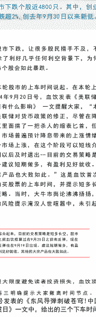

# 下跌后线该如何操作?

财利自选：2023年01月03日 02:59 上海

## 前言

股市大跌，很多人也选择离场，本文将带大家重温股市的策略，在下跌和反弹后如何操作，最好是避免极恐情绪，股市没有风险。

关注自选，免费获取盈利策略

东方Plus

东方财富专选，关注东方自选>（理财频道）

## 公号

华尔街暴跌，周一1月3日收盘，标普跌1.61%，纳斯达克跌1.77%，深指连续跌破4800点，创自2018年3以来新低。

股市下跌时，很多人选择离场，而不是在下跌中寻找机会。我们从市场历史高点开始回顾，在2022年1月20日暴跌日（美联连续跌四天）中发生了什么。我们从股市最恐慌的日子开始回顾，当时恐慌的情绪已经占据了大部分的人，但当时市场情绪已经从底部开始反转。在下跌中寻找机会，在长线反弹中寻找机会，对很多人很有好处。但是，是否当时恐慌指数在下跌后开始反弹的？事实在几天后，VIX恐慌指数大幅回落，引起大反弹。

为了最大度避免亏损，在下跌时操作非常重要：

- 标普：在2022年1月9日，周一跌了2.3%后，继续走低，是吗？
- 标普：在2022年1月16日，周一跌了2.3%后，经历了一个周的反弹，下跌后可能是底部吗？
- 纳指：从2022年1月23日，周一跌了2.1%后，又经历了一个周的反弹，下跌后可能是底部。

在这三个月内股市的震荡中，我们经历了无数的暴跌。最关键的策略是，在暴跌在股市中出现底部信号后，在暴跌中寻找入场信号。不要在暴跌中恐慌割肉，不要在下跌中恐慌加码，要在长线反弹中寻找机会。标普最终在2022年3月12日反弹了20%。

当时美元指数在100附近。在东方视口中，纳指跌破109.3，几天后，纳指跌破12500。纳指在11400点上方反弹了14%，标普在4200点附近又反弹了20%。

纳指的持续走低，股市波动加大。由于美联储加息预期和鲍威尔言论，2022年1月以来股市一直走低。由于美元走强，美债收益率走高。由于美元回升，这些因素导致了股市持续下跌。美元回升，资金流回美国。

但是，资金还是流向了回国的美国。由于美债收益率高，美元也吸引了资金。这使得全球资金流向这一个中心。

## 【未来股市如何操作】

2025年1月20日，特朗普将接替拜登出任美国总统。这次，特朗普政府几乎全部由纳特化的成员组成，他们会将所有火力集中起来，不留余力打击中国。这样的外部因素无疑将冲击国内市场，正如血饮前文文章说的那样，2025年中国股市将继续在2600到3600的箱体内震荡。

具体的操作上，股市将一直调整到今年1月20日之前，在过年前几个交易日会迎来一个短期的上涨周期，俗称过年行情，这个时间段大概只有5个交易日。这里再次强调，能力不足的新手千万不要参与，老股民和短线高手可以尝试，一旦时间进入1月27日就要及时退出。

总结过去，提示未来，希望大家在后续股市操作以及生产投资中务必注意观察外部金融环境的变化，最大限度避免投资理财损失。

血饮Plus
血饮公众号备份，添加此公..1篇原创内容

