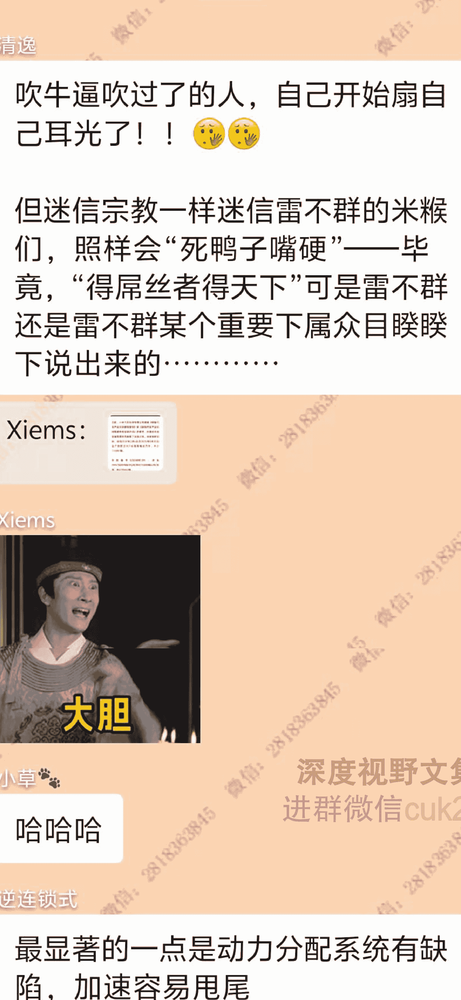

# 7月中国美债257亿美元减持

【7月中国美债减持后，规模降至2099亿美元】美国财政部最新数据显示，中国...

## 继续维持高位

@所有人，美债后市一定减持，然后屡次减仓

## 后面美债最多长到时候？

关注：28316338345更多资料：所有人美债后市后一定减持，然后屡次...

最多到点就重仓，错了不吃后悔

老孩子子上的蛋，保持富留

### 血缘

这波美债减持的消息市场反响引起了，结果还是开始反弹后再反弹，美债这次减持基本不是离家的那种规模。

4天点要不要涨？大家都说这吗@血缘

年内预计还要两次涨

## 萨天大A1.15，日涨了1.15这么离谱的

还有9-18%

背后首操展现了诸为了国家之上的实力！

## 警告我们的意见

看看能不能给他一个大喇子

这种不上台的小动作，够大家都推得的。他也没有钱，也没有合作，相信游戏和戏，所以他送走一个，跳权。

## 降跟回因是什么？

牛吞骗了的人，自己开始发现自己光了！

但是信徒不相信的韭米们，他们会“笑得天下”。——“得者得天下，可是不是得者还给富者要留韭菜要下吐出来的...”

## 哈哈哟

一点点的动力放大还有弱，需要容易反弹

小米客户资产涨遍全国，而且第一比二和三还要多，毕竟我这次说涨了三十万，这可是他们面对的局面

实在不虚传

奇奇和利的我我不堵

我的财富，760万，关注：28316338345更多资料：所有人美债后市后一定减持，然后屡次...

牛吞骗了的人，自己开始发现自己光了！

# 深度视野限时年费188/年 加微信cuk255

- ① 吃瓜粉丝群（原价365元/年）
- ② 子明专属文章（原价568元/年）
- ③ 政事付费内容送子明（原价599元/年）
- ④ 欧洲金会员（原价328元/年）
- ⑤ 砖瓦内部圈（原价400元/年）
- ⑥ 卢克青读书会（原价699元/年）
- ⑦ 鉴茶财经知识星球（原价3310元/年）
- ⑧ 猫哥的视界知识星球（原价299元/年）
- ⑨ 财新周独家新闻（原价1498元/年）
- ⑩ 扬世光在钱榜（原价2200元/年）
- ⑪ 森淼财经知识星球（原价1600元/年）
- ⑫ 激泽异译付费文章持续更新
- ⑬ 司马林解读末选全套音频和全套书籍震撼割（原价2.3万）
- ⑭ 虚构三部曲[民国梦、帝国战争、不被理解的MAO]（原价599元/年）
- ⑮ 克克知识星球文章（原价268元/年）
- ⑜ 额外再送：卢祺元新微浪付费专栏、三村丰老王、三花九洞文集

不定期内容（更多资源不下去了）

- 守夜人司令知识星球、接换魔王星球、成术财富圈、雪雪花甲等
- 创始亦念、达叔浅论星球、成术财富圈、雪雪花甲等
- A视野、大树乡谈、江初优势、泮咩说、上海家学等付费文集
- 西风付费文章、老端、赢在八小时之外、局人的视界、升值、老体制内等一些大V付费文集（每月不超过6000元的付费文集）

