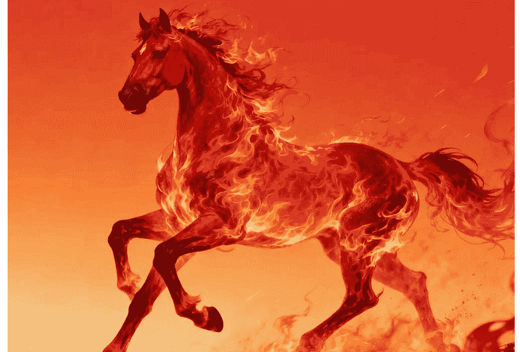
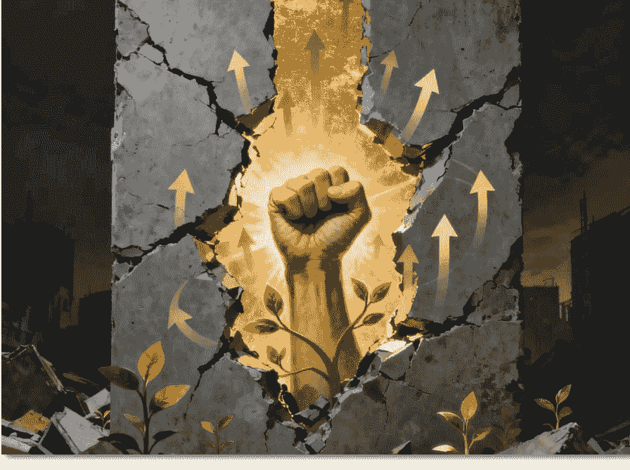

# 大众恐慌的2026决赛赛淘汰，为何我却说“精彩才刚刚开始”？（附环境+个人双指南）已付费

原创 望明易说 2025年12月23日21:00 辽宁

## 黑马赛49届决赛

阅读约12分钟

最近网络流传这么一句话：“2026年是道坎，很多人都撑不过去。”而说这句话的是已故国学大师曹仕强教授生前的预测。

但是事实真的会如此吗？2026到底会如何发展？显然我对此有更加细致判断和非常具有实用性的建议与你分享。

这一次与以往的十年预测不同，2026的会更加精准具体，避免某些读者看不明白其中暗藏的机会。就像去年的预测依然帮助了许多读者在25年至少获得了20万以上的收益，但还是有些人没有从中闹到精髓。

> 付费进群+V: cuk255
> 人工追踪 50+大V免费文章...
> 每日分享优质免费文章。

# 大思维2026:决赛赛，我是如何让精彩刚刚开始的？（附环境·个人双指南）

冬至，晚上和大家看到的大佬们约了一个饭局聊了对未来的发展，虽然早期的观点有所不同，但最后还是达成了一个共识——“精彩刚刚开始”。

但要说这个到底什么样的“精彩”，怎样才能刚刚精彩呢，这里面确实很有趣的内容，哪怕是在今后九百年的历史中也会被人类记录的。

去年的时候我给自己定了基调，以后要“把题留到哪里”，开心确实帮助了少数达成了良好的结果。

今年依旧如此，会在基础上加强更大的力度，不给你答案，还给你阶梯，甚至手把手带带路是可以的。

如果今年还是不能够“一起起来”，那只能说你没有认真按我所说的执行，因为这次的年度预测我讲的实在是在足够清晰详细的。

更何况2026是“决赛”，也可以说是“清算洗牌”，虽然它对某些人来说确实“劫难”，但恰恰是某些新人的入口，所以我说“精彩刚刚开始”。

再三十天就是春天了，但在传统领域人们是以冬至开始为新的一年的。所以我每年的年度预测都是冬至为节点。

而在在这个时间为你所做的提醒，刚好可以让你提前有所准备，做到良好的第一步布局以及承上启下的开展发展。

按照惯例，还是还要复盘去年预测和今年有多少“巧合”会应验，看看能否超越之前保持的93%以上的准确率。

# 大众恐惧的2026:决赛赛淘汰法，为何我却精彩刚刚开始？（附环境·个人双指南）

在正式开始之前，想先问你你两个问题：

1. 你会对即将将与你告别的2025说些什么？有什么遗憾吗？
2. 又对将到来的2026有何期望？有没有信心完成它？

今天在复盘之前，我又看了下去年的反馈，很多人超预期的完成了今年的目标，有的人即使在生活中遇到了一些危机，但也都化险为夷了。对此我感到很欣慰，觉得自己人生价值更有意义了。

现在身上发生了哪些“巧合”应了去年的预测？我们一起来看看吧。

去年说了2025年的主基调是“变”与“乱”。相信现在的每个人都应该会有这种感受，那么很多人不按套路出牌了，许多有效的经验也不够用了。

现实是这一年进入了如此不定的“高频震荡”。

以政策为例：年初国际贸易形势剧变，多项行业约定被打破，最后被我们通过“变通”的方式进行解决了。

深入了解解析的后应该知道我是什么意思，现在确实如此是做了变变的交换。这个词敏感，在此不多说，我们还是把逻辑尽可能的移动到更容易为你创造价值的去。

# 大众恐慌的2026:决赛赛淘汰，我是如何让精彩刚刚开始？（附环境*个人双指南）

回首这一年，即使发现今年的政策确实多且变，先来说层面的，单是地方的“政策”就如预期，但最后的结果基本都不是。

不过，许多听过的朋友也因此“一夜暴富”，赚了不少钱。有人会问哪面的钱，我直接回答你——跟趋势、做钱，并且完全合规。

要说去年预测中最动人心的，那应该是转机了。去年说就会震荡式上行，达到高点基本符合。但正如我预测的时候，已经创造了新高，但许多人依然保持着割肉的节奏，明显看到不少留言说“亏了”，结果还没到。

# 大众恐慌的2026:决赛赛后，我是如何躲过清算开始的？（环境·个人指南）

2025年的市场情况虽然很多人觉得政策上放水而利好，但我还是那句——市场需谨慎。因为全年的政策虽然很多，但是打的是组合拳，再加上政策之间的相互影响，所以市场是震荡式上行，恐怕突破困难，大部分人都是赔钱的。

而我一直看的，而且从2021就开始提醒大家可以长期买入，并且认为2025是一个上场的年份，但实在没想到年初的时候就到了预期。在那个时候预言了破位的，事实我们看到高峰已经到了，现在依然保持着割肉的节奏，到了底部。

为什么这点极其精准；是因为我要仔细观察规律，以最稳妥的方式保证你有收益。我不能让你冒险，但整体方向是对的。

房产方面，去年调整了整体价格下降，但是已经没有那么明显了，而且东方和南方的城市趋于稳定，甚至核心区域价格反而上涨。相信今年你一定看到这样的新闻，某某楼在开盘当天抢空，总体成交额到了新高。同时，在去年的调整中我也提醒大家今年是入手的好时机，身边很多大佬也因此抄底了不少资产，现在都已经获利了。

# 大众恐惧的2026年癸亥财运，我为何说“财运刚刚开始？(附锦鲤双指南)”

而这个月，就是我们需要煎亮的时期。这个时候火气渐些，土气升昂，这种交替会让人的心里越来越急起来。

有人开始不安，有人开始动念，有人终于准备好告别，就是赶上这段时间最急躁，因为火气旺上头，余热未散，很容易很多人觉得应该刺拉一把个好年了。但如若进得太快，事情半途而废且不说，反而容易引起灾灭。

所以接下来的这个多月尽量做好准备和收尾工作，不再适合有巨大的挑战。等到明年立春之后，再猛地发起攻势最为合适。

这段时间是天地给的一次喘息，运势在转换，人也该静下来。要知道，能稳住心的人才先走一步过去。

如果最近总觉得事事不顺，不妨先静静这些事，比如清理、学习、补觉这种看似没意思的事，反倒能让运气重新焕溜起来。

其实天地行急不不缓，只是看着你能跟上眼睛付调子。所以，这个多月不如心态致得佛一些，为来年做个很好的准备。

总的来说，2026是一个“火重生”的关键年，既是淘汰粗放模式的“清算年”，也是催生新秩序的“机遇年”。

# 大众焦虑的2026年靠转型没法，我是如何让“精彩从头开始的？”

所谓的“赤马劲”本质上是帮助你成长的一个阶段，这一年的核心逻辑从“乱中求存”转向“破后新生”，所有被动的改变都会变成养成成长的养分，对于属于亮自己、精准发力的，都能在烈火熔炼中焕出新意。

这一年，凡的光芒会照亮所有的阴暗，也会放大每一份努力的价值。只要你保持空怀心态主动学习，用稳健铁藻维持财富，以顺时方培养节奏健康，能够在在这场“浴重生”中，从“被时代推着走”变成“领者时代”。

更何况，我还为你准备了“赛马奔驰”（黄仰里的每日指导建议、随这篇文章的年度预算布局指南、以及增加额外的个人年度建议）在帮助你，你不必担心我。我不相信这么多手把帮扶着你还变不了了？望黎明的这个时候你能得到的良好反馈。

PS：马上进入2026年了，去年有朋友请岁礼的朋友可以准备准备送岁礼了，不知道方法的可以联系助理或企微客服。

如果不想自己处理的，可以邮寄过来帮你处理，邮寄时记得附上自己的姓名、性别和出生时间，到时候再问我就帮你免费送个折扣。

具体的邮箱地址，可以添加企微客服领取。

对了，上批太藏锦盒很多人没抢到。这次又为大家额外准备了足够的，暂时只能增加三百份，大家酌情浅，不要过多占用名额。需要的可以联系企微助理进行预定。

不知道怎么看到自己密码是否受影响的，也可以助理帮你查询一下。

# 更多售前售后问题解答
或是您有其他疑问请添加【企微微信】客服

预祝你2026丙午年得鸿运之吉，沐春之祥，破旧之桎，立新生之开局。

福慧双修，心火不躁而根基稳；财禄并臻，正偏两财皆随而至；家宅康宁，亲绥而灭灾不侵。遇人以扶青云，结良友以进退。

# 万事顺遂，福满乾坤，成就就！

# 付费进群+V: cuk255

- ▼ 人工追踪 50+ 大付费文集每日分享各类深度文章。

小助理有说：

【个人指南】老师会在最近一周内为大家准备好。

2026年的布局，因为要到立春之后才能进行，所以【2026年度布局指南】预计会计会在1月中旬发放大家。

大家可以提前添加【企业微信】，届时会通知大家携带“年度预测付费截图”来领取。非常感谢大家的支持与等待~

# 深度视野优质集圈，链接优质群群，助你成功

全部包含以下内容：限时费188/年 加微信cuk255

- 1 吃瓜群众倍信时圈加时群聊对话（原价365 元/年）
- 2 子明私享（会）内部文章
- 3 政事堂（原子明）付费内容再送顺子明群聊
- 4 米联储闲间【作者米糕】（原价599 元/年）
- 5 欧洲金准会员专属文章（原价328 元/年）
- 6 砖五厂内部圈文章（原价400 元/年）
- 7 卢克文青读书会专属文章（原价699 元/年）
- 8 鉴茶财经知识星球（原价3310 元/年）
- 9 猫哥的视界知识星球（原价299 元/年）
- 10 财经周刊【独新闻】（原价1498 元/年）
- 11 杨世光在金钱（原价2200 元/年）
- 12 森森财经知识星球（原价1600 元/年）
- 13 源泽译译付费文集（持续更新）
- 14 司马林解读毛选全套音频和全书珍藏版无割减（原价2.3 万）
- 15 虚走三部曲[民国梦、帝国战争、不被理解的MAO]（原价599 元）
- 16 卢克文再送：卢克文星球文章（原价268 元/年）

额外再送：卢麟元新浪微呗付费专栏、三村屯老王、三九九文集

不定内容：（更多资源不下去了……）

- ① 守夜人司令星球、接魂魔王知识星球、生财富知识星球、
- ② 创始笔记、达沃译论星球、财富财富园、雪球花甲老头等
- ③ A视野、大树乡谈、江衍知识后、咩说、上海海家学等付费文集
- ④ 西风付费文章、老端、汪在八小时之外、局外的视界、升值、老
- A 体制内等其它大V付费文章（每月低于600元付费文集）
