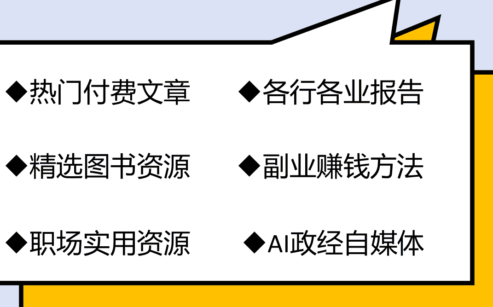

## 女人这辈子，究竟在逃什么？

原创碧树西人间罗盘 2025年04月28日 20:59浙江

我们来写一个话题，很多女读者问过的我的话题。她们问我，无论是网络上的，还是现实中，男性们似乎都对彩礼现象深感痛疼。可她们有一个疑问：100个男人，99个并没有打算娶，只有1个在求婚，那我我不问他要彩礼，难道我问另外99个去要？这就好比一个男人投了100份简历，最后只拿到了1份offer，你说我不跟她这家公司谈薪资，难道我去找她找99个？这是第一点，她们不想通，男人们哪儿来那么多恶意的，就像社会上普遍脑愁人力成本抬升的企业主的模样。

第二点，基于上面的这个问题，她们面对同一个困境。那就是就是发offer的那家公司，即使你把薪资谈成了，它往往是没钱的，可能3年后就关闭了。而不发offer的99家公司，连谈薪资的机会都没有。在男人身上就是，唯一愿意出彩礼的这个位，他实际上是透支了嫁给他之后的未来收入。也就是说，他相当于财务作假，他娶你的那刻，就是他的市值最高点，你买进之后，就被套牢，从此一直走。到这里，就是你受累了。

一个问题，一个困局，何解？我今天并不是专门为女读者开启思路，因为她们的这个问题非常有普遍性。男人的处境是一模一样的。男人照样可以说我买得起的房子都不保值，保值的都是买不起的。

加微信jnts2g，免费进资资料群。

### 免费 价值 及时 专注

### 扫码加入 知识星球TOP 免费资源群

- 每日免费获取有价值资源
- 可提供各类资源搜索服务

公众号：知识星球TOP 微信信号：jntsg8 微信信号：jntsg2

分享资料仅供个人学习，请及时删除，切勿商用传播

这已经是古代社会了，男人除了在非标领域或许有些许优势，其余和女人一样。所以，咱们今天就分三个话题，层层展开这件事，写给所有的男女读者，直到挖掘出根子。全文两万字，文中多处链接，俗称画，中文，阅读时留意莫错。此底面的留言，每一条我都会看到。

以下进入正文：

第一个标题：无论男女都陷入误区，而这个误区，是精心为你准备的。这个话题很敏感，我直接会惹麻烦，而且干巴巴的，你听起来也很难共情。所以我要拉个垫背的，咱们拿部电视剧来做案例。也就是说，这并不是我说的，都是电视剧里拍的，有你们视作没错的。这部剧是段亚宏导演的《沙鹰》，打分非常高，**我们应该好仔细看看四个女人一台戏，究竟是一台什么戏。**

剧情发生在西北高原荒壁沙漠地带的某个布满风沙的县城，某天，供暖站的锅炉里挣出一个被烧毁的女尸。虞当。晚班的师父、师舅、师父、师弟和站长。警察觉得如果是师父与师弟作案，女户早就被焚质烧掉了，不会被发现。于是就怀疑站长，而此时此刻，站长自己也跑路了，于是被捕入监狱，他承认是自己做的，判了死刑。入狱后，他又失口否认，后上诉，8年后，终于引起了重视，开始重新审查。案件的过程，中供暖站的炉子里又挣出一个男尸，是当年的师父......

整件事，要从20多年前说起。这个供暖站的师父，有一双儿女，还有一个从草山上捡来的流浪徒。他把这孩子养长大，儿女是当地有名的学霸，纷纷考上了省城里的大学。儿子去学了金融，女儿在一本医学，而考虑家里放弃了，改了大专，免了学费还得到了很多奖学金。

徒弟跟着师父一起进了供暖站，当了锅工，工资也给师父，供弟俩读大学。弟弟高三时，正值青春期，和夜市上的寡妇好上了。寡妇还想离开这个她眼里的鬼地方，想要去省城。就让这个男生带走自己，还助了两万块钱做学费。可是弟弟上了大学，开了眼界，傍上了领导家的女婿，就想割誓和寡妇撇清关系。某一次，一不留，推撞之间，寡妇跌倒，脑袋撞到了钉子，死了。

于是父子俩就杀了师父。供暖站的站长是个疯子，他娶了个漂亮媳妇，媳从是老乡，都是草原的。漂亮媳妇很想进步的那种。漂亮媳妇当初就是为了能进省城，才嫁疯子。但人的欲望是无止境的，进步还想进步，想去省城，于是就骗了站长，保护妻子。

站长为了保护妻子，顶罪。结果入狱后，才从别人那里得知，老婆早就给他戴了绿帽子。站长为了保护妻子，就顶罪。结果入狱后，才从别人那里得知，老婆早就给他戴了绿帽子。站长为了保护妻子，就顶罪。结果入狱后，才从别人那里得知，老婆早就给他戴了绿帽子。

加微信jntsg2，免费进资料群。

（由于后续文本存在大量重复和乱码，此处已根据逻辑进行语义合并与纠错）

你普通电视商只顾硬件，人家是有电视节目的，那么他们电视捆绑销售，就可以用软件的费用，去补贴硬件电视的价格，从而杀死传统电视商，方甲不留。如果他们坚持只做电视，或者围绕大屏扩展到智能家居领域，今天绝对是成功的企业。当你们要老板对付时候要做么多事的时候，问题就来了。互联网企业造车这个圈没问题的，特斯拉当初就造车了，小米今天也造车了。

关键的问题是你老板有没有马斯克的那种能力，同时进军这样的多行业，还能同时做好。有没有？这才是主要问题。即便你不真的输于马斯克，你的团队行不行？你的运气行不行？人家马斯克的运气非常好，他在美国美国实现实现不了的计划，跑到上海就能落地的。所以你看到，需要很多条件。你不是灵光乍现能如何。你某一晚说像郭德彻还精彩有什么用，你每一晚都能比他精彩吗？不能，你很快就会被淘汰掉。所以我从来给读者以幻想，我不会说你自己条件差一匹，听我三句话，就开窍了。从此像破天一样，大杀四亏。你是变的，不是真的。你或许看了今天的内容，仅仅是开通了一点，你变得没有那么轴了。渐渐的，你发现自己身上的固执变少了，你性格的变化，也会影响到你的孩子。也许你什么都不能帮到他，但至少给他带来的负面影响，减少了一部分。这是真实的人生。

加微微信jntg2，免费资料群

很多人一生来到别说没有好财产继承，他可能能够继承的，都是些负属性。我们打个比方，你比如现在我们国家有很多留学美国的人，这些人人也不懂当地的底层，沦活成那样，他们有些买来付去，你有些落魄流浪。你的总体感觉是那帮 USA 天生廉情，烂泥扶不上墙。否则他们天生就有身份，你为了个绿卡那么努力，结果他们还跑不了你。实际上这个事情是不这样的。我们国家出去留学的人，在国内经济条件都是中上，你受过很好的教育，你父母也为你支付了留学的高学费。

你等于是训练且有欠款的情况下，在美国找工作，试图立足，奔赴你的中产生活。但那些老底层的可不是这样的。他们可能能生的那个社区，醉酒，毒药，枪击，精神疾病，什么乱七八糟的事儿都有。没人教他们好，而是被天天带把他们学坏。即便是少数人出泥而不染，考上了大学，他们也要背负高昂的学费贷款，他们毕业后还要花 20 年，才能还清大学落下的荒仇。你想看到，到底是你这个个人占优势呢？还是他们那个个人占优势呢？

你看懂了这些国家的底层，你就不会指望三和大身上有自律。我们的年轻人里面受过高等教育的比例确实高，也许超过了一半。问题是，区域差异很大，城乡差异很大。有些大城市里面，也许超过了 90%，到了偏远地区的农村，10 个孩子里面也许只有 1 个读大学的。那么剩下的里面，有人能够吃学手艺的苦，有人就不可能。读书读不好，也没有从小学徒师傅传带，可能就是留守儿童，父母在外也管不上，奶奶就给孩子一个手机，玩去吧。那遇到了坏的，被坏了，染了一身的恶习，聪明也发挥不了作用。很多大神和，可能就被骗了，钱也没有，亲戚也没有，回路费也没有，也不好意思回老家。这时，再遇到几个骗子，可能一两百块钱就把他的身份证买走了。他没了身份证，怎么找份工作？进厂谁也不要呀。

人家买的身份证做生意去了，他在不知情的情况下，成了法人，背上了一官司。他那销销，手机也没用。他作销销？乍证清白？他一没钱，二是法，三没证据。所以最后只能沦到穷工，过有一天又一天的日子。这种现象，哪个大国都有。在美国也有。你做高交易的，如果他觉得他的行为有可能越界，或者他希望用多个分散的账户处理。当然，都是律师们自己代理。交易不需要操心这种细节了，律师们自己代理。

加微信jntsg2，免费进资料群

他渐渐发现，原来这种策略十年，比那就好，一百匹马在跑，你自己最后能跑出优秀的那匹。不同策略的十年数据，结局不同，过程不同，你都画出曲线了，还会优吗？那么时候，几千年之后，他在终点等谁？可见，我在终点等他，我早就写好的文章在终点等着他。他对我来说，同样是阅读我的文章，就不再被盗用了函数。我调用的函数是什么？他的两个千年。可是这两千年，现实中需要多久呢？即便一个金融小白，拿手去算，顶多只有三天。三天，两年，我在终点等你哟。所以你想想，到底是谁在起作用？其实是你自己在起作用。

就像我去年不去聊黄金，我还聊过三核坊，我们拥有读者，他看到去实地了三个月。他拿到了六百个故事，他拿到了六百个聊天记录，和他六百个家庭，谈谈。没有这些功夫，我讲什么，你都不能吸收的。因为我讲你什么策略，终端都只能调用你身上的函数，当没有你的时候，我只能调用空气函数。你发现我用此举的这个例子，其实是有对比的。我那时候你还喜欢房地产市场？还是喜欢金融市场？还是来说来说直接选择了国际市场，而且是高频模式。很简单，因为在我的看来，数据才是第一位的。

不同的方式，获取数据的效率是不一样的。如果你用计算机跑数据，你马上就可以看到不同的交易习惯，他几十十年来的交易体验是什么，结局是什么。你一分钟体验别人的一辈子，一个小时就体验了六十辈子，十个小时就能体验六百万辈子。十年之内你对交易这件事的体验就跟玉帝一个维度了，你是悟性有多低？活几亿年都不明白你？你这是宿世里积累了多少孽债？

但这里面有一个前提，你可以借助工具，可以借助算法，但你的人生荒芜，要到位。如果我们把别人的人生当作一段数据，你交交给一个 80 岁的孩子，他看了就会笑笑，为什么呢？因为他懂。你交给一个 8 岁的孩子，就没有感觉，数据可就是数据，因为他还没有没有过生活，他怎么懂？所以千万不要看着看着，误以为看完了这篇文章就懂了，家里蹲着跑跑数据就懂了。跑数据的人，肯定比看着看着的人理解要深。有生活经验结合的，肯定比没有生活经历，单纯跑数据的，理解要深。

这是一个层层递进的关系。所以以后实践种类，思想上的，身体上的什么重要？都重要。没有，你活不下去，没有水，你同样活不下。这三个话题如果你只是耳朵旁风，随便听听的，左耳进右耳朵，你的问题有吗？

没有。但这三个话题，如果你这一步执行下去，我想问你，最初的问题，还是什么问题？其实问题还在那里，我根本没有解决。

但是对于此时此刻的你，你还需要解决什么？三个话题走到终点的人，你需要男人吗？你还需要谁来拯救你？你已经变成天使好了。

问题永远在那里，但是已经和你无关了。因为三个话题执行完，你已经站在了金字塔的顶端。人家还在琢磨要找好哪个男人的时候，你琢磨的可是可口甜甜可胃，谁能让让自己更开心。人家还在琢磨到底是要去宰哪个老板给自己年终奖的时候，你霸气的说，我床底下下一罐糖糖一罐醋，我想醋哪个就醋哪个。

人家还在琢磨到底是要宰涨还是押跌的时候，你不屑一顾的讲，涨跌我都不赚，跌了就错了我就砸。因为回溯测试的阶段，问题已经跑出来，你已经清楚照着某种策略，它就是赢。问题还在，问题永远在，我并没有能力去解决问题。别说我没有能力，谁都没有能力，你再活一天，那些问题还在那里。

它只是别人的问题，可能已经不是你的问题了，如果你坚持把这三个阶段走完的。当你真正走到终点的时候，你再回头看这篇文章，你就笑了。因为你觉得一切都是那么自然，是那么简单。文末，因为满级读者在文章下面留言，是不脚本和助理筛选直达的，我每条都能看到。
