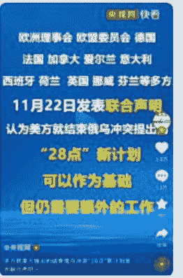

# 冷风挣zane

昨天 21:12

观海：俄罗斯那边没问题了，就刺泽林斯基了。

梁乐乐：利空东大啊。

云海：没有什么大的利空，真的开始又不输他。

深度视野VIP群
进群微信cuk255
加微信chp5568

观海：乌克兰里重建基本在排除中，就看俄罗斯那边重建中企能否参与。

云海：乌克兰里重建也不是好意，残留的弹药还有很多，也很危险，一般人也不愿去。像那些贫铀弹打过的，还有放射性。

观海：都是机械化，住的都不怕，建房的有哈可可怕的。

昨天 21:18

# 阿里：总包美国，分包必有中国。

观海：危险来自农田地雷，企业又不参与排雷。

观海：因为乌克兰认为中国支持俄罗斯，已经排除中企参与。

云海：在间接方面确实是支持俄罗斯。

“阿里”撤回了一条消息

阿里：由不得他了，司机不同意，就换人。

观海：不是谁报价低就给谁做的，类似我们商品价格低老美非要选别人贵的。

观海：泽林斯基已经表态不参与大选。

阿里：他必须走，不走就消失。

云海：这种生意不做又怎么样？市场上也不会炒那里去。多撑两天。

阿里：深度视野VIP群
进群微信cuk255
加微信chp5568

嗯

云海：这种生意不做又怎么样？市场上也不会炒那里去。多撑两天。

昨天 21:23

> *阿里* 撤回了一条消息

观海：政治意义啊，

阿里：美俄能私下谈得那么好。我们以后有事，也可以做到。

## 深度视野优质集群（链接优质社群，助你成功）

全部包含以下内容：限时优惠188/年 加微信cuk255

- ① 吃瓜群众包时圈加时群对话（原价 365 元/年）
- ② 子明私享汇（含）内部文章
- ③ 政事室（顾子明）付费内容加送逐子明群
- ④ 米联锦暇【作者米穗】（原价 599 元/年）
- ⑤ 金雀会员专属文章（原价 328 元/年）
- ⑥ 砖瓦幻内部圈（原价 400 元/年）
- ⑦ 卢克文青读书会专属文章（原价 699 元/年）
- ⑧ 鉴茶财经知识星球（原价 3310 元/年）
- ⑨ 猫哥的视界知识星球文章（原价 299 元/年）
- ⑩ 财新周【独家新闻】（原价 1498 元/年）
- ⑪ 杨世光在金钱坝（原价 2200 元/年）
- ⑫ 森淼财经知识星球（原价 1600 元/年）
- ⑬ 潇泽异译付费文章（持续更新）
- ⑭ 司马林解课全套音频和全套书籍扫描版无删减（原价 2.3 万）
- ⑮ 虚构三部【民国梦、帝国争霸、不被理解的MAO】（原价 599 元）
- ⑆ 克克知识星球文章（原价 268 元/年）

额外再送：卢薛元新微博付费专栏、三村丰边老王、三花九洞文集

不定期内容：......（更多资源不下去了……）

- ① 守夜人司令星球、换魔王后星球、成达谈论星球、财富富有圈、雪球花甲老头等
- ② 创始人笔记、达叔谈论星球、财富富有圈
- ③ A 视野、大树乡谈、江初闲、咩咩说、上海海学等付费文集
- ④ 西凤付费文章、老端、赢在小时之时、局外人的视界、升值、老、体制内等其它一些V付费文章（每月低于 600 元的付费文章）

限时优惠188/年

## 底层链接连接全网 V 优质内容

深度视野文集
进群微信cuk255

深度视野（付费文集）

