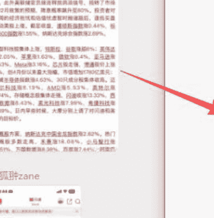
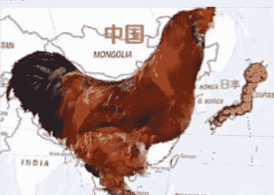

# 观海

中国海事局网站消息
大连海事局发布航行警告
11月23日16时至12月7日16时
渤海黄海北部
部分水域范围内
执行军事任务
禁止进入

法治日播：禁止进入！挂靠两周！执行军事任务

网友：这位置离日本还很远
网友：解放军在黄海湾演习什么什么

中国海事局网站消息
大连海事局发布航行警告
11月23日16时至12月7日16时
渤海黄海北部
部分水域范围内
执行军事任务
禁止进入

法治日播：禁止进入！挂靠两周！执行军事任务

网友：这位置离日本还很远
网友：解放军在黄海湾演习什么什么

# 军工

# 令佩赛zane

这位离小日本还很远

# 11月25日星期二

今天科技股AI还要涨一番

# 观望

[周直]美股12月涨预期暴升 美股涨涨、科技支撑纳指指数涨近2.7% 中概指指数涨2.82% 美股周一收高，科技股领涨，纳指上涨600点。AI交易重新行情，Alphabet股价大涨，帮助大盘在最近下跌后反弹。此外美股官员连续释放涨信信号，扭转了市场对12月政策的预期，压力胀率升至80%。投资者对上周的经济数据和估值犹豫谨慎，后续买盘推动美股上涨。

截至收盘，琼斯指数涨0.44%，标普500指数涨1.55%，纳达斯克综合指数涨2.69%。

# 大型科技股集体上涨，特斯拉、谷歌涨超6%；英伟达涨2.05%，普微涨0.4%，亚马逊涨2.53%，Meta涨3.16%。芯片股走强，博通股价上涨11%，创4月份以来最大涨幅，市值增加1780亿美元；费积林半导体集体涨8.19%，AMD涨5.53%，英特尔涨3.74%。存储股走强，闪迪收涨13.33%，美科技涨7.99%，希捷科技涨6.69%。日内早些时候，大摩分别上调了闪迪和美光的目标。

中概股方面，纳达斯克中国金龙指数涨2.82%。热门中概股多数大涨，韦运涨18.08%，小米智能涨12.51%，网格数据涨8.38%，百度涨7.44%，阿里巴巴*

观海

本月收阴，先把本月做好

25号：预判上午复苏反弹，下午反弹震荡。

如果眼光看的远一点，3816点类似今年4月的机会，此处可能是今年第二个比较好的介入点。

# 1、11月24日晚，国家主席习近平与台湾地区领导人进行普通电话。

11月24日晚，国家主席习近平与台湾地区领导人进行普通电话。习近平明确了在台湾问题上的原则立场，强调台湾回归是中国是战后国际秩序的重要组成部分。中美并肩抗击法西斯和军国主义，当前应该共同维护二战胜利成果。

明确表明，中国在二战胜利中发挥了重要作用，美方理解台湾问题对中国的重要性。

# 2、外交发言人宁宏主持例行记者会。记者就第十次中日领导人会议的会期提问，宁宏表示，中日韩三并没有就第十次中日领导人会议的会期达成共识。近期日本领导人在涉台问题上公开发表错误言论，损害了中日合作的基础和氛围，导致当前不具备举行中日领导人会议的条件。

2、日本大臣在11月23日视察琉球群岛一处自卫基地时表示，日本将在该基地部署中程防空导弹。距离中国台湾仅110公里。外交发言人宁宏主持的记者会。记者就第十次中日领导人会议的会期提问...

# 3、日本防卫大臣在11月23日视察琉球群岛一处自卫基地时表示，日本将在该基地部署中程防空导弹。报道称基地所在地距离中国台湾仅110公里。对此，外交发言人宁宏在主持的记者会会上表示，这一动向极其危险，需要引起周围国家和国际社会的高度警惕。

乌克兰危机：此前的计划已不存在

美联储加息和宽松监管12月下调

欧洲央行以宽松监管欧汇率

中国成品油价格已十次下调

央行今日将开展100亿元ML操作

云海还会谈

海军工厂

云海

## 军工还会涨

云海

观海

底部反复震荡，不可追高

云海

所谓的敌国条款，你强大就有效，不强大就无效

观海

中日不是一个体量

司卷1319

高开没跑了

令狐阵zane: 大盘别高开就行🤡🤡

通电话的意思是让特朗普管好自己的小弟，如果继续找事，就不客气了

只要高开，上午量化就会把张幅吃掉

观海

如果中美通话是为了降温，就要小心军工息火
