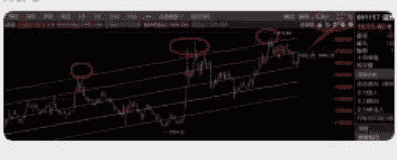
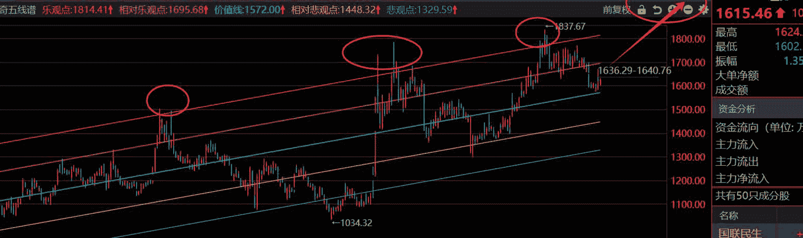

周一再跑吧

14:02

# 观海
再震荡两三次，就基本把散户震去了

14:02

# 朱明明发银行

# 观海
我在香港证券来回套利，虽没挣大钱，本周市值新高了，我打算一直套利到中金复牌

# 观海
R 513090 香港证券 侧边达
2.063 ↑ 0.046 +2.28% 沪市

ella -M
中金啥时候复牌呀？12月17号还是12月20多号?

15:41

ella -M
观大，中金复牌以后香港证券是中线长持不套利了吗😅

观海：我在香港证券来回套利，虽没挣大钱，本周市值新高了，我打算一直套利到中金复牌

# 观海
可能25号左右

基金新政后，资金回流A股，明年优先投资A股市场

ella -M
n观大，可以理解为明年香港证券ETF涨不过A股的证券ETF吗？

15:46

这不一定，香港证券可以T+0，有制度优势。如果中金复牌后，香港证券如果大涨，就没有价格优势，我就会卖了他换低估的A股@ella -M

证券在这个位置卖，只要突破最上方条线，就进入风险区，历史上都站久。

花王【绪情导】
有T+0，没涨跌停，港股割韭菜可以一日割几次

15:53

T+0对散户有利，发现不妙，马上溜，不像A股，明知道要跌，也不能卖出，看着主力割韭菜

# 周线 月线 季线 年线 1分 5分 15分 60分 ... 多周期 板块资料
# 881157 证券

五线谱 乐观点:1814.41↑ 相对观点:1695.68↑ 价值线:1572.00↑ 相对悲观点:1448.32↑ 悲观点:1329.59↑

前复权 1615.46 10
1837.67
1800.00
1624.00
1700.00
1602.00
1636.29-1640.76
涨幅 1.35
1600.00
成交额
1500.00
资金分析
资金流向 (单位:万)
主力流入
1300.00
主力流出
主力净入
1200.00
共有50只成分股
1100.00
名称
国运民生
-1034.32

# 观海
据报道，国内机构去香港市场，无一例外，都是被人割韭菜，离开A股什么都不是

# 观海
国内A股制度设计就偏向机构

# 观海
印度市场制度设计偏向散户，散户可以T+0，机构只能T+3

# 观海
新股发行也是，大部分新股都给了机构，只拿出零头让散户申购

15:57

# 观海
跑道不用说了，就够拿钱跑道，比散户跑的快

shuer223
太不公平了，所以这么多年都搞不好

和和美美
这个有利呀

观海：印度市场制度设计偏向散户，散户可以T+0，机构只能T+3
