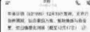
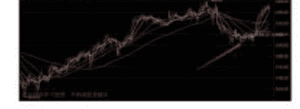
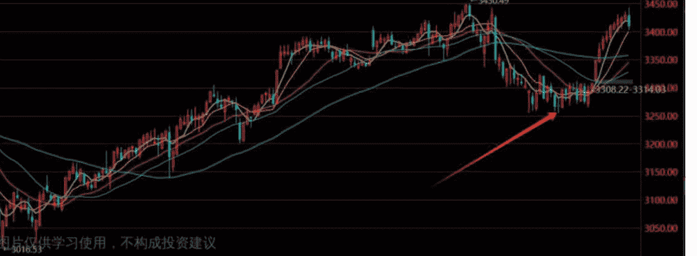

香港证券ETF从中金停牌开始，群里多次提示这个套利机会，祝贺买入的朋友们。。。

这帮家伙嫌弃24号复牌不吉利，选了18号提前复牌，关键是放在日本加息之前。

国泰海通是合并，中金是兼并重组，二者有差异，看明天市场如何定价吧。这个不一样吗？

观海：国泰海通是合并，中金是兼并重组，二者有差异，看明天市场如何定价... 38.38-42.22，至少本周五这样，提前算好了。

# 观海

2023-10-24 14:20
今天的心情有点复杂。本来以为行情要反转了，结果又大跌了。这种感觉真的太不好受了。在股市里生存，真的太考验心态了。虽然现在亏得不算多，但心里还是挺难受的。

# 朱明明广发银行

前高有个42.29

"一朵小黄花"撤回了一条消息。

# 观海

> 至少1个涨停，我昨天资金全部买入香港证券etf了，本次套利公开操作，算是成功。

# Alex

> 我早盘跟了，希望有 5%出来😂😂😂😂

观海：至少1个涨停，我昨天资金全部买入香港证券etf了，本次套利公开操...

# 中金公司（601995）12月18日复牌，无官方涨停预测，结合重组方案、板块情绪与资金面，给出情景化判断（截至12月17日）

- 核心基准：中金换股份36.91元（停牌前34.89元，溢价约5.8%），吸收合并东兴、信达，换股比例明确的。
- 保守情景：1个涨停。若大盘偏弱、券商板块量能不足、封单乏力，首日涨停后几次日冲高回落，对应目标价38.38元。
- 主流情景：1-2个涨停。市场情绪平稳、板块配合，可实现2连板，对应目标价42.22元，第3板大概率封不住。
- 乐观情景：3个涨停。仅在重组落地超预期、大盘强势、券商板块爆发、封单巨量可能出现，对应目标价46.44元，概率偏低。

关键观察点：首日封单（超100万手更稳）、换手率（低于1%有利于连板）、板块联。

@观海 您应该预测到明天复盘了吧？

预测哪有公司公告准，已经明确20-24号复牌，谁能想到18号就复牌，还好，我昨天提前买入了〇〇。

香港证券ETF这个套利机会百分百赚钱钱，在群里反复提示过，很多人就是看看上上。。。

提前复牌是不是国家看不住了，才让中金提前复牌呀？都控盘了还能护不住？都是预谋砸盘割韭的。。。

# 观海

已经挣钱了，就是挣多挣少的问题，机会好把握，买在最低点，卖在最高点难啊。

# 观海

我昨天 2.043买入，今天最低到了2.029，很多人买入价比我便宜。

20:51

# 观海

上次我上午买入香港证券，下午群里贴单，位朋友要求我买入马上贴单，这次买入可是马上贴单，也没见这位朋友买入😅

# 丁

a股的证券ETF也同步操作吗?

# 观海

证券etf主要套利春季上涨，明天可能跟着上涨

# 丁

🙏🙏

# 观海

2025.12.18 08:46

股市行情推演.docx131.docx 39.72KB

18号大盘: 上午高高回落，下午先跌后弹。
中期趋势: 初步判断中期回调在16号已经结束，还需要下周继续观察。

专注财经大V优质付费文：进群加微信cuk255, 每日更新。

# 观海

15:17
为了等下天的大雨，我这两天折腾了一整天，结果下天下还是不下雨，这忙活都白忙了，真是没天了。

08:54

# 观后

前两天急着割肉的那部分人，过这两天又会回来，回来几次，钱没了😅

为了说明当下及未来走势，特意从历史走势中截图了类似走势的一段，箭头所指的就是当下所处位置。此图仅表示未来一段走势有相似度，不代表未来走势一模一样。

图片仅供学习使用，不构成投资建议

# 深度视野优质集圈（链接优质社群，助你成功）

全部包含以下内容：限时年费188/年 加微信cuk255

- ① 吃瓜群众倍帝圈加微信时群对话（原价 365 元/年）
- ② 子明私享汇（含）内部文章
- ③ 政事室（顾子明）付费内容加送顺子子明群
- ④ 米联锦顶【作者米横】（原价 599 元/年）
- ⑤ 欧洲金雀会员专属文章（原价 328 元/年）
- ⑥ 砖万瓦内部图文（原价 400 元/年）
- ⑦ 卢克文青读书会专属文章（原价 699 元/年）
- ⑧ 鉴茶财经星球（原价 3310 元/年）
- ⑨ 狮哥的视界星球文章（原价 299 元/年）
- 十 财经周【独家新闻】原价 1498 元/年）
- 十一 杨世光在钱塔（原价 2200 元/年）
- ⑫ 森淼财经星球（原价 1600 元/年）
- ⑬ 激泽异读付费文章（持续更新）
- 十四 司马林解课选送全套音频和全套书籍无割（原价 2.3 万）
- 十五 虚走三部曲【国梦、帝国争亡、不被理解的MAO】（原价 599 元）
- 十六 卢克星球星球（原价 268 元/年）
- 十七 额外再送：卢源新浪博付费专栏、三村丰老王、三花九洞文集

定期内容：——（更多资源不下了......

- ① 守夜人司令星球、接换魔王优星球、成术财富圈、雪球花甲头部
- ② 创始小星球、达叔浅论星球、成术财富圈
- ③ A视野、大树乡谈、江初序、泮咩说、上海海家等付费文集
- ④ 西凤付费文章、老端、高在八之时、局外人的视界、升值、老A体制内等其它一些V付费文章（每月不超过600 元的付费文集）

低成本链接全网V优质内容

深度视野文集进群微信cuk255

深度视野（付费文集）

