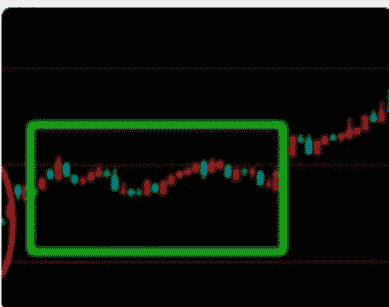
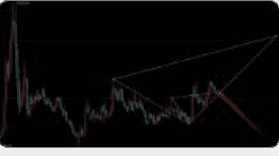

# 观海

本周提前给出了一段类似走势，文字容易产生理解误差

# 观海

# 观海

本周趋势：先跌后弹

付费文集+V: cuk255

# 观海

下周强势节奏：
第一种：先跌后弹的趋势。
预测周一回调震窄，周二触底反弹到周四，周五有所回调。

下周涨跌节奏：

第一种：先跌后弹的趋势。

预判周一回调震荡，周二震荡反弹到周四，周五有所回调。

# 别时容易

观海，今天的证券走势怎么理解呢

观海
上海浦回答，下周应底。初步判断中期回调在16号已经结束，还需要下周继续观察。

观海
证券一直都在强调，“年底前没啥行情”@别时容易

15:20

观海
证券这图贴过几次了，调整已经接近尾声了。。

观海

15:30

云海
请问这个阳历年底还是农历年底？

付费群+V: cuk255
人工陪50+天 V价格费...
每日分享各板块深度文章..

观海：证券一直都在强调，“年底前没啥行情”@别时容易

观海
还缺一根K线

观海
还缺一根K线

非诚勿抗
带下影线的下跌K？

观海：还缺一根K线

15:36

观海
上周预测里有300字解读

# 观海
2025.12.19 09:19

股市行情推演.docx131.docx
39.72KB

18号大盘: 上午冲高回落，下午先跌后弹。进群加微信cuk255

中期趋势: 初步判断中期回调在16号已经结束，还需要下周继续观察。

19号大盘: 上行还有阻力，上午反弹后回落，下午触底反弹震荡。

如果上午没出现反弹，那么反弹就会出现在下午。现在是震荡市，无非先后而之。

# # 深度视野优质集群（链接优质社群，助你成功）

全部包含以下内容：限时年费188/年 加微信cuk255

- ① 吃瓜群众含帝圈加微信时群对话（原价 365 元/年）
- ② 子明私享汇（含）内部文章（原价 568 元/年）
- ③ 政事（顾子明）付费内容内加送顾子明群聊
- ④ 米联锦顶【作者米横】（原价 599 元/年）
- ⑤ 欧洲金雀会员专属文章（原价 328 元/年）
- ⑥ 砖瓦斥内部文档（原价 400 元/年）
- ⑦ 卢克文青学读书会专属文章（原价 699 元/年）
- ⑧ 鉴茶财经知识星球（原价 3310 元/年）
- ⑨ 猫哥的视界知识星球文章（原价 299 元/年）
- ⑩ 财财经周【独家新闻】（原价 1498 元/年）
- ⑪ 杨世光在金钱塔（原价 2200 元/年）
- ⑫ 森淼财经知识星球（原价 1600 元/年）
- ⑬ 激源译译付费文章（持续更新）
- ⑭ 司马林解读选题全套音频和全套书籍收藏版无割减（原价 2.3 万）
- ⑮ 虞虚三部曲[民国梦、帝国争合、不被理解的 MAO]（原价 599 元）
- ⑜ 卢克文知识星球文章（原价 268 元/年）
- ⑰额外再送：卢涯元新微播付费专栏、三村丰老王、三花九术文集

不定期内容：（更多资源不下去了……——

- ① 守夜人知识星球、接换魔王后星球、成败财富圈、雪花甲老头等
- ② 创始姚念、达叔译论星球、成败财富圈
- ③ A视野、大树乡谈、江初你好、泮咩说、上海海家等付费文集
- ④ 西风付费文章、老端、赢在八小时之外、局外人的视界、升值、老体制内等其它一些大V付费文章（每月不低于600元付费文集）

## 深度视野文集进群微信cuk255

深度视野（付费文集）

## 限时年费188/年 低成本链接全网优质内容
