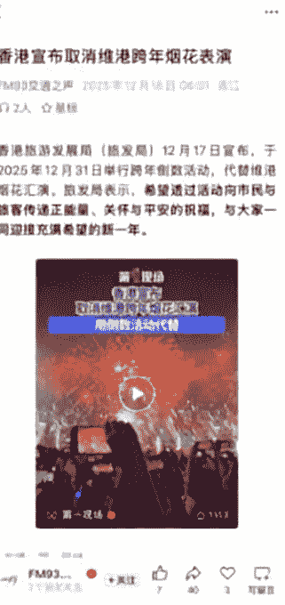
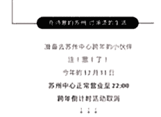
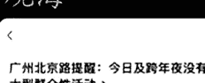
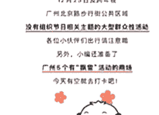
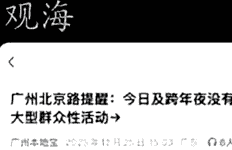

# 大白老师妃👑 iPhone 15 Pro Max

未来将临
股市会有很多人发财，也会很多股东出现，躲了尾巴的小人得志的也会越来越多。
说一个重大的预言，28年夏天，上证指数大蓝大概会碰到一万点，到2040年会两万点。

# ella -M

> @观海 观大，怎么看🤔

ella -M:

观海

> 点位按年涨？@ella -M

股市是资金堆积成的，点位不是单靠预测的，需要看央行资金供给，按照目前已知资金面，股市最高只能支持涨到1万点，那些在纸上画画画图就张口几万点，纯属胡说八道

# 财财经社报
2025-12-26 20:06:26 星期五

【央行报告：着力健健全有利于“长钱长投”的制度政策环境 显著提高各类中长期资金实际投资A股的规模和比例】

财经社12月26日，中国人民银行发布《中国金融稳定报告（2025）》，报告提出，下一步，中国证监会、财政部、人力资源社会保障部、中国人民银行、金融监管总局等相关部门将立足加大、加强合作，形成合力，在中央金融委员会统筹协调下，进一步提升工作整体性、主动性和针对性，着力健健全有利于“长钱长投”的制度政策环境，显著提高各类中长期资金实际投资A股的规模和比例，努力实现中长期资金保值、资本市场稳健运行与实体经济高质量发展的良性循环。

晚晚8点06分，央行发布《中国金融稳定报告（2025）》，报告强调要着力健健全有利于“长钱长投”的制度政策环境，显著提高各类中长期资金实际投资A股的规模和比例，这是个利好消息……。。

一手优质资源加微信：cuk255

# 观海

全国多地发文确定：跨年夜取消任何活动。不知道会不会影响消费。。。

# 观海

连香港也取消了。。

# 观海

以前是圣诞节不让玩，说是不能过洋节，现在跨年都不行了

# 速报！苏州中心跨年活动计划取消了

发布于 2023-12-31 19:12 · 2小时前

# 苏州生活

准备去苏州中心跨年的计划取消了
注意！
苏州中心跨年活动开始22:00
跨年活动对市民限流

苏州中心跨年活动取消了
苏州中心：由于天气因素影响，原定于今日的跨年活动取消。给给大家带来不便，深表歉意。
祝大家新年快乐！

苏州中心 2023年12月31日

# 广州资讯播：今日及跨年夜没有大型群众性活动

广州本地 · 2023-12-31 19:53 · 2小时前

12月31日跨晚公告
广州市发布：今日及跨年夜没有大型群众性活动
预计规模小的活动将正常开展
社区、商场等场所的活动
广州警方提醒大家：
天冷注意保暖

# 广州资讯播：今日及跨年夜没有大型群众性活动

广州本地 · 2023-12-31 19:53 · 2小时前

12月31日跨晚公告
广州市发布：今日及跨年夜没有大型群众性活动
预计规模小的活动将正常开展
社区、商场等场所的活动
广州警方提醒大家：
天冷注意保暖

一手优质资源加微信：cuk255

# 最新公告！合肥河路步行、狮豹公园不对开展

人民日报2025年12月30日 20:30 发布

合肥河路步行、狮豹公园不对开展
合肥官方宣布，2025年12月31日期间，合肥河路步行、狮豹公园不对开展周末活动。采取严格措施，禁止聚集、放飞无人机航拍；未经报备禁用外展。
温馨提示：请市民合理规划出行，对合肥周边区域游览，地铁将采取临时管控，感谢配合。

# 西安发布：跨年期间举办任何活动

西安发布2025年12月24日 17:51 发布

西安跨年期间周边区域管理
亲爱的市民、游客们：2026年春节期间，西安城内重点区域将调整，为大家保护平安和迎新年。
温馨提示如下：

# 历史大于一切

一句话叫：“历史往往惊相似，但不是简单的轮回”。

# 圣诞夜上海抓了一批

# 理由是奇的

2025年12月27日至28日，全国工作召开。

# 财政政策如何继续更加积极——解读2026年工作重点

新华社记者记者锐日前召开的中央工作会议提出，财政政策要继续积极。
刘国表示，2025年，各级部门认真贯彻中央、国务院部署，履行职责、稳进工作，完成全年社会发展任务。财政政策作为宏观调控的重要手段，具有扩大需求和引导结构重优势。

# 大盘连阳：预判周初终止连阳走势

1月30日预测大盘走势，下周的高点时间在26日（或下一个交易日），再到31号。提前一个月预测，预判大盘涨跌节奏。由于节日放假，低点有可能提前到周三或延迟到节后第一个交易日。29号大盘：有冲高回落趋势。预判上午反弹震荡，下午见短顶震荡回调。

# 深度视野优质圈

全部内容：限时年费188/年 加微信cuk255

- 1 吃瓜群众圈加时群对话（原价365 元/年）
- 2 子明私享会内部文章（原价568 元/年）
- 3 政事堂（原子明）付费内容精选顺子群聊
- 4 米联储间【作者楷】原价599 元/年）
- 5 欧洲金雀会员专属文章（原价328 元/年）
- 6 钛五厂内部圈（原价400 元/年）
- 7 卢克文读书会专属文章（原价699 元/年）
- 8 迭代财经知识星球（原价3310 元/年）
- 9 猫哥的视界知识星球（原价299 元/年）
- 10 财新周刊【独家新闻】原价1498 元/年
- 11 杨世光在金钱（原价2200 元/年）
- 12 森森财经知识星球（原价1600 元/年）
- 13 源泽译付费文章（持续更新）
- 14 司马南解读毛选全套音频和全书珍藏版无删减（原价2.3 万）
- 15 虚虚三部曲[民国梦、帝国争亡、不被理解的MAO](原价599 元）
- 16 卢克文知识星球文章（原价268 元/年）
- 17 额外再送：卢广元新微博付费专栏、三村丰老王、三花九树文集

不定期内容：（更多资源不下去了……）

- ① 守夜人司令知识星球、接鸽魔王星球、生才有知识星球
- ② 创始人笔记、达越译论星球、财富财富圈、雪花老头等
- ③ A视野、大树乡谈、江初知道、咩咩说、上海海学等付费文集
- ④ 西风付费文章、老端、赢在小时之外、局人的视界、升级优、老A体制内等其它一些大V付费文章集（每月不低于600元的付费文章集）

# 深度视野优质文集

 进群微信cuk255

深度视野（付费文集）

