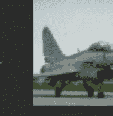
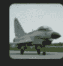

自得
2天前瞎买的工业富联，昨天大涨，为什么呢?原来克来来了。

攀登者
大盘今天还得涨

攀登者
以后的地点就是3800了

攀登者
3830到底了

自得
能把周二大绿棒子挣回来就好

观海
预测里不是写着周三涨到周五吗?谁还看不明白?

```
周二大盘: 利空落地，空方获胜。上午领先后跌，下午回抽震荡。
从销量主力意图来看，周一反向回撤，主力会有护盘行为，甚至有回调的可能，但由于到期预期所滤，以至于跌下去，周二可能有反转机会。
操作上，仓位低位的跟单，周一是极佳的机会(千万级跌去了），不要被反骗了。
预测周二调整需要三日，周三将触底及周五，然后回震荡。
```

观海
# 群公告

[股市行情推演.docx122.docx]

14 号大盘:利空淡化，今日预估收十字线或小阴线。

14 号预判大盘冲高回落调整之势。

15 号大盘:上午先跌后弹，下午反弹震荡。

16 号大盘:预测“周三触底反弹到周五”的观点不变。今日反弹还有阻力，重点关注本月沪深 300和上证 50 的投资机会。不是说两创不涨，是高位股回调中的反弹做好不好容易被套。

了解更多


观海
主板短期有创出新高的能力，
两创前期涨幅太大，需要休整一些日子

这老三样真强，只要有利空资金就往里冲

| 证券代码 | 类型 | 名称 | 状态 |
| :--- | :--- | :--- | :--- |
| 688416 | 融 | 恒炼股份 | - |
| 001309 | 陆 | 德明利 | - |
| 603986 | 陆 | 兆易创新 | - |

教员挥手我向前
# 印尼防长: 将采购中国歼-10战机

印尼国防部长沙沙夫里周三（15日）确认，该国将采购中国歼-10战机。



环球网
日月生
# 大盘今天继续吃药

日月生
# 忍了，中航成飞飞起来了

教员挥手我向前: 印尼防长: 将采购中国歼-10战机



10:12

观海
印尼摇摆不定，先是要订购歼10，后来取消，又采购土耳其战机，现在又要采购歼10，只要不交钱，就不算数

印尼摇摆不定，先是要订购歼10，后来取消，又采购土耳其战机，现在又要采购歼10，只要不交钱，就不算数

向阳花
观大 什么时候出证券的分析@ 观海 🍺🍺

观海
土耳其战机技术是巴基斯坦提供的，甚至把生产线拉到土耳其，让中国丢失大量订单，埃及及参观土耳其战机后，也取消了订单

观海
@向阳花 下午

# 深度视野优质集圈（链接优质社群，助你成功）

全部包含以下内容：限时年费188/年 加微信cuk255

- ① 吃瓜群众倍帝圈文加时群对话（原价 365 元/年）
- ② 子明私享汇（含）内部文章（原价 568 元/年）
- ③ 聚明私享汇内部文章（原价 568 元/年）
- ④ 聚明会员（原价 599 元/年）
- ⑤ 欧洲会员（原价 328 元/年）
- ⑥ 聚瓦（原价 400 元/年）
- ⑦ 卢克读书会（原价 699 元/年）
- ⑧ 鉴茶财经（原价 3310 元/年）
- ⑨ 猫哥的视界（原价 299 元/年）
- ⑩ 财新周【独家】（原价 148 元/年）
- 十一 杨世在金圈（原价 2200 元/年）
- 十二 森淼财经（原价 1600 元/年）
- 十三 激游译付费文章（持续更新）
- 十四 司马林解读末选全套音频和全套书籍隐藏（原价2.3 万）
- 十五 虚走三部曲[民国梦、帝国战争、不被理解的MAO]（原价 599 元）
- 十六 卢克星球文章（原价 268 元/年）
- 十七 额外再送：卢锐元新浪微博付费专栏、三村丰老王、三花九洞文集

不定期内容：（更多资源不下去了……）

- 守夜人知识星球、魔王星球、成术财富圈、雪花甲老头等
- 创始星球、达叔深度论星球、成术财富圈
- A视野、大树乡谈、江初序、泮咩说、上海海学等付费文集
- 西凤付费文章、老端、高在小时之时、局外人的视界、升值、老A体制内等一些大付费文集（每月不低于600 元）


