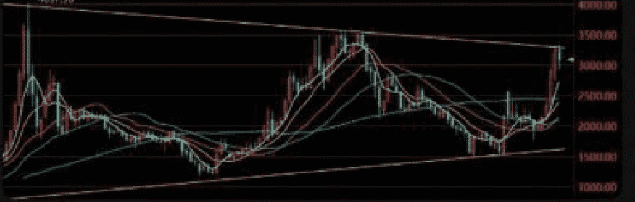
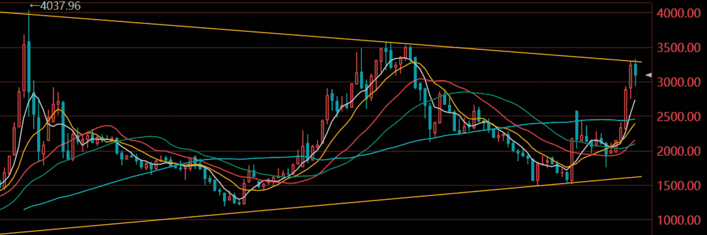
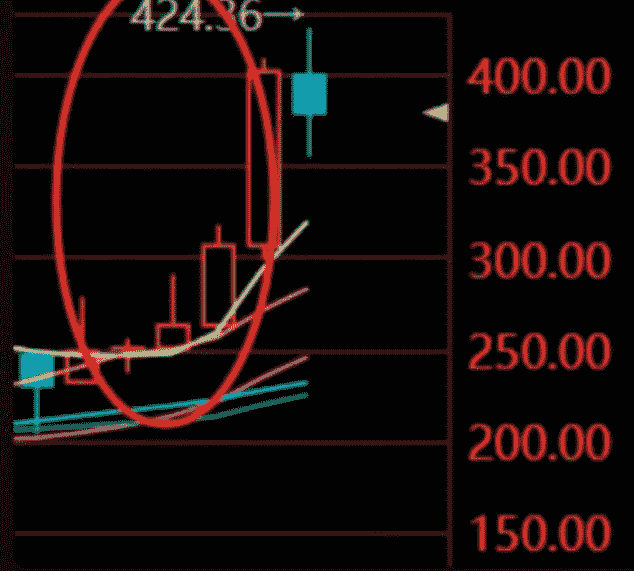

# 观海

别忘了我预测的 22 号高点

深度视野文集
进群微信cuk255

## 学习时报：努力稳股市让老百姓消费底气更足

学习时报 10分钟前 约7分钟

科技革命爆发、如何把握产业增长红利？

股市是经济发展的晴雨表，关乎亿万家庭的财富增减与消费底气。今年3月，中共中央办公厅、国务院办公厅印发《提振消费专项行动方案》强调，“多措并稳住股市，加强战略力量储备和稳市机制建设”，凸显稳股市在拓宽城乡居民财产性收入渠道、富实老百姓消费底气方面的重要性。

# 邓贺方

@观海 观大怎么看 拉券商

深度视野文集 进群微信cuk255

# 观海

通常重要会议期间都有稳股市举措，机构大户有不愿意找麻烦，不会主动卖出

# 观海

券商预测通过了，这里不讲了

# 观海

下午大盘整体以回落调整为主

通常重要会议期间都有稳股市举措，机构大户有意无意找麻烦，不会主动卖出。

券商预测过了，这里不讲了。

下午大盘整体以回落调整为主。

观大，券商ETF也到60日线了，布局要等大盘底再入手吗？

观海：券商预测过了，这里不讲了。

大盘逼近期高点了，重要会议期间稳定股市，大涨大跌都不允许的。

所以，前期高点附近，还会回调的。

# 观海

所以，前期高点附近，还会回调的。

观海

两创处于B反中，反弹后会继续探底。

# 观海

创业板

# 小鱼

观大，之前说过新能源储能电池池是核心科技，宁德作为创业板权重，能不能单独测一个，看看跟创业板总体指数走势的契合程度？

13:27

# 观海

# 观海

还用测啥啊，都是5根阳线，本月阴线，

主线还是科技，不过，很多科技股炒高了，需要调整一段时间时间。

# 观海

对付荷兰这种小国，有一百种方法……

深度视野文集
进群微信cuk255

观海

600745 闻泰科技
1.71 3.79 +9.99%

# 观海

16号群内提示大盘短期有创新高的能力，创业板和科创板只是一个B浪反弹，反弹后继续探底……

观海

10-16-25 6:43
主板短期有创新高的能力，两创前期涨幅过大，需要整一些日子。

观海
下个月60日均线就到3900点了，这波预测是下跌到60日均线，不是某个点位，很多人搞不清楚。

照峰：观大认为什么时候加仓合适合适？
江淮奇楚：磨刀霍霍
💕好好好运💕：那就老实看着吧
走出思维洛泽：同问

观海：农行又新高了。

| 码 | 画线 | 工具 | R 601288 农业银行 |
| :--- | :--- | :--- | :--- |
| | 7.86 | 0.11 | +1.42% | 国有 |
| | H: 5.760 | (1.95%) | | |
| 我们大型有商业银行之一 | | | |
| 明细 | 资金 | 财务 | | |
| 买入五档(手) | | | |

# 观海

农行又新高了。

深度视野文集
进群微信cuk255

# 观海

R 601288 农业银行
7.86 0.11 +1.42%

| | | | | |
| :--- | :--- | :--- | :--- | :--- |
| | H: 5.760 | (1.95%) | | |
| 我们大型有商业银行之一 | | | | |
| 明细 | 资金 | 财务 | | |
| 买入五档(手) | | | | |

# 观海

预测的明天高点还没验证，万一预测错了？

## 深度视野文集：子明会员圈

全部包含以下内容：时限188/年 加微信cuk255

- ① 三丰京东老内（原价365 元/年）
- ② 子明享内部（原价568 元/年）
- ③ 政事室顾子明
- ④ 米联闲兜（原价599 元/年）
- ⑤ 欧洲金雀专属（原价328 元/年）
- ⑥ 砖传瓦内部（原价400 元/年）
- ⑦ 卢克文读书会专属（原价699 元/年）
- ⑧ 鉴茶知识星球（原价3310 元/年）
- ⑨ 猫哥的视界知识星球（原价299 元/年）
- ⑩ 财经周刊独家新闻（原价1498 元/年）
- ⑪ 扬世光在钱塔（原价2200 元/年）
- ⑫ 蒜森财经知识星球（原价1600 元/年）
- ⑬ 卢源译异付费持续更新
- ⑭ 司马林解读末选全套音频和全套书籍隐藏（原价2.3 万）
- ⑮ 虚虚三部曲[民国梦、帝国争霸、不被理解的MAO]（原价599 元/年）
- ⑖ 克文知识星球（原价268 元/年）
- ⑱ 额外再送：卢薛元新浪付费专栏、三丰京东老、三花九树文集

- ① 守夜司令知识星球、接换魔王后星球、达达迷论星球、成术财富圈、雪花甲老头等
- ② 视野、大树乡谈、江宁后语、咩咩说、上海海家等付费文集
- ③ 西风兑付费文章、老端、赢在八小时之外、局人的视界、升值、老体制内等等一些大V付费文集
