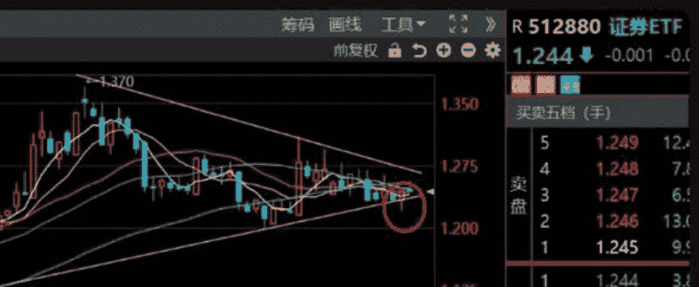
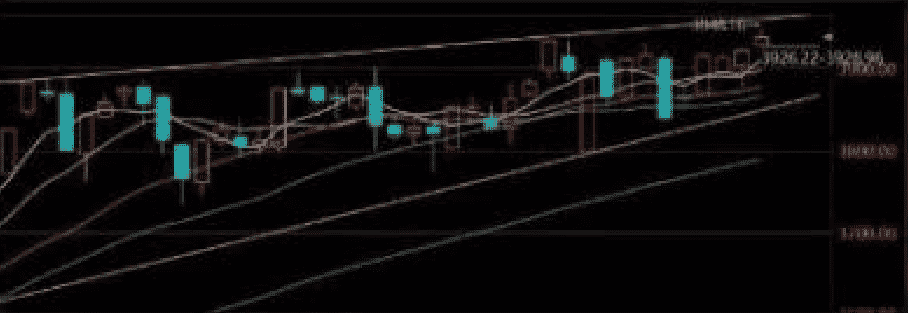
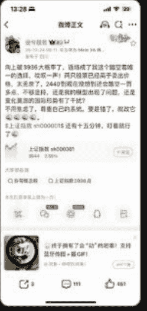
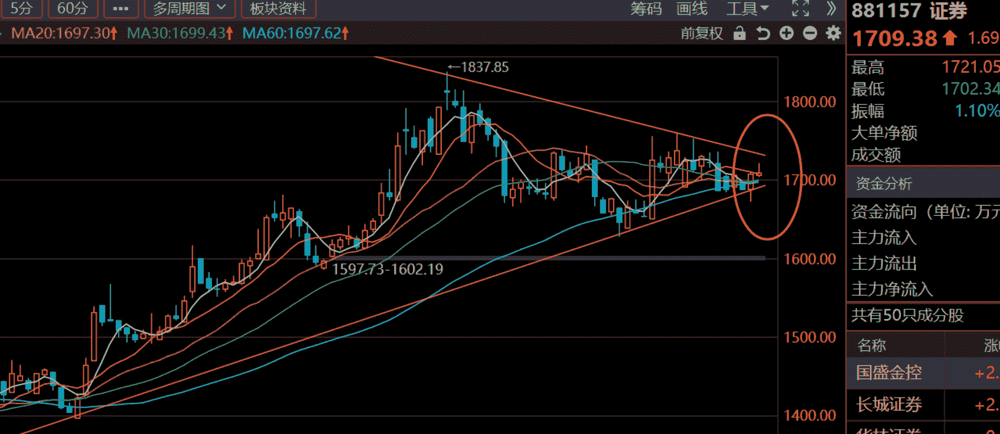
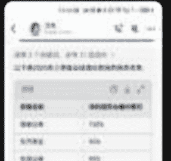
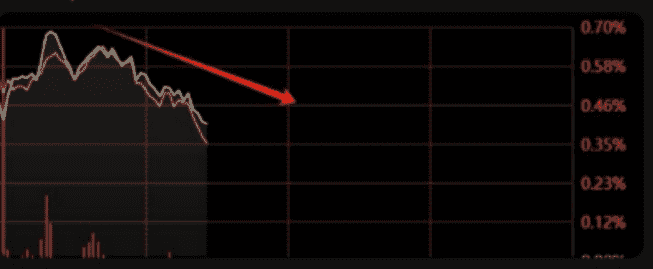

观海
我是昨天下突突突破的时候买的，我知道是假突破吓唬人的，捡了个便宜。

观海

观海
不要在上涨的时候去追，还没到启动拉升的时候，下周有机会的。

## 观海
有看懂大盘的就看这个图，上轨在3956点左右，今天最高3946点，已经在上轨附近了。

## 观海

## 观海
下轨低点是逐步抬高的，后面只有相对低点。

## 观海
手中有券商，心中不慌

## 观海
这老三样涨起来没完了

## 观海
| 股票代码 | 类型 | 股票名称 |
| :--- | :--- | :--- |
| 38416 | 融 | 恒灿股份 |
| 01309 | 融陆 | 德明利 |
| 03986 | 融陆 | 兆易创新 |

## 观海
大盘上轨在3956点左右，看看下午能否摸到。

主板是要到 4300，创业板是B反，都是上涨的。上涨性质不一样。

@令孤翀zane 你踏对节奏了，又狠狠狠赚了一把。
4300 来的那么早吗？
不会。

小鱼
这就开始着，来了？

观海
3956 点上轨受阻。

和和美美
👍

令狐狸zane:
观海
这么多利好，傻子才去做做空。

多一种思路，就会少一种挨套。

和和美美
@@观海 观大，今天持股不动吗？
还是需要减仓呢？

观海
创业板涨了 50%，上证横了 2个月，没法对比的。

令狐뺨zane

观海
持股和减仓要看持有什么，如果持有没怎么涨的，就拿着，炒高了就要减减，轮动操作。

今狐涯zane
今天一堆踏空的在补仓。

和美美
好的。

小鱼
牛市，不能空啊。

观海
不急着挣钱的，就潜伏券商，后面有主升浪。
观海
去追逐高位股，看似大涨其实风险太高。

小鱼
券商，最近这阵子，是时而而博起，最终软趴下来，每天如此，不乏是渣男称号。

和美美
券商哪个有潜力呀？

观海
在股市里比的不是挣钱多，比的是谁活的时间长。

券商目前处于相当于3500点，跑输市场几百个点，后面都会补回来的。现在潜进去，起码没风险不大。

北瑜
稳妥一点可以买证券ETF。

shuer223
东财今年还是负的。

向阳花
需要优选主板券商吗？

观海：券商目前处于相当于3500点，跑输市场几百个点，后面都会补回来的。现在……
观海
下周集中三报，下周优选行业增长大的

小鱼
现在还看不出来哪个潜力，要看主升浪真的来的时候，哪几个拉涨速度，才能知道主力在卖。

观海
我配置部分，稳妥一点。

翔宇
@观海 也是一直没涨。

小鱼
前阵子过一个，聪明，知道大盘调整前，砸跌停，里面有主力，就是好事。

丹青
令孤猴zane: 那我推荐太平。

观海
威胁制裁，有利空的，要等。

翔宇
@观海 证券三报，增加加仓。

走出思维洛泽
观海 预测回调，已经开始了。

观海
不要在涨的时候买，不是机会，我是在昨天跌时买的。

烟花月77厉害
观海: 预测回调，已经开始了。下周有机会，不用着急。

走出思维洛泽
观金证券。

观海
不要在涨的时候买，不是机会，我是在昨天跌时买的。

观海
券商探底还没完成，那篇分析券商有建仓时间，容易套。

陈康
下周大盘还有低点@观海
观海
比今天高低点，上面有图，爬楼就看到了。

## 深度视野优质（链接优质群，助你）
全部包含以下内容：限时年费188/年 加微信255
- ① 吃瓜群众群对话（原价365 元/年）
- ② 子明私享（含）内部文章
- ③ 数字室（子明）付费内容加送额外子群
- ④ 米联储闲友【作者米栖】（原价599 元/年）
- ⑤ 欧洲金雀会员专属文章（原价328 元/年）
- ⑥ 砖瓦仁内部圈（原价400 元/年）
- ⑦ 卢克文读书会专属文章（原价699 元/年）
- ⑧ 鉴茶财经知识星球（原价3310 元/年）
- ⑨ 猫哥的视界知识星球文章（原价299 元/年）
- ⑩ 财经周【独家新闻】（原价198 元/年）
- ⑪ 杨世金钱塔（原价2200 元/年）
- ⑫ 森淼财经知识星球（原价1600 元/年）
- ⑬ 激源异译付费文章（持续更新）
- ⑭ 司马林解读全套音频和全套书籍无删减（原价2.3 万）
- ⑮ 虚构三部曲[国梦、帝国扩张、不被理解的DAO]（原价599 元/年）
- ⑯ 卢克文知识星球文章（原价268 元/年）
- ⑰额外再送：卢祺新微播付费专栏、三村丰老王、三花九树文集

定期内容：（更多资源不写下去了）......
- ① 守夜司令知识星球、接换魔王知识星球、成达浅论星球、成就财富圈、雪花花甲头等
- ② 创始小聚、达叔浅浅论星球、成就财富圈、雪花花甲头等
- ③ A视野、大树乡谈、江初同学、泮咩说、上海家学等付费文集
- ④ 西凤付费文章、老端、高在八小时之外、局人的视界、升值、老A体制内等其它一些大V文集（每月不低于600 元付费文集）

限时年费188/年

# 低成本链接全网大优质内容
# 深度视野文集
# 群微微信255

深度视野（付费文集）

