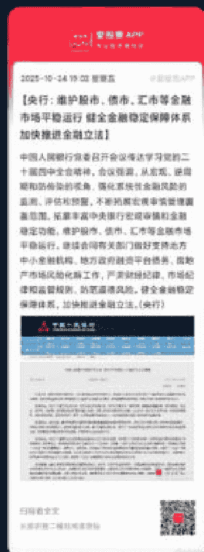
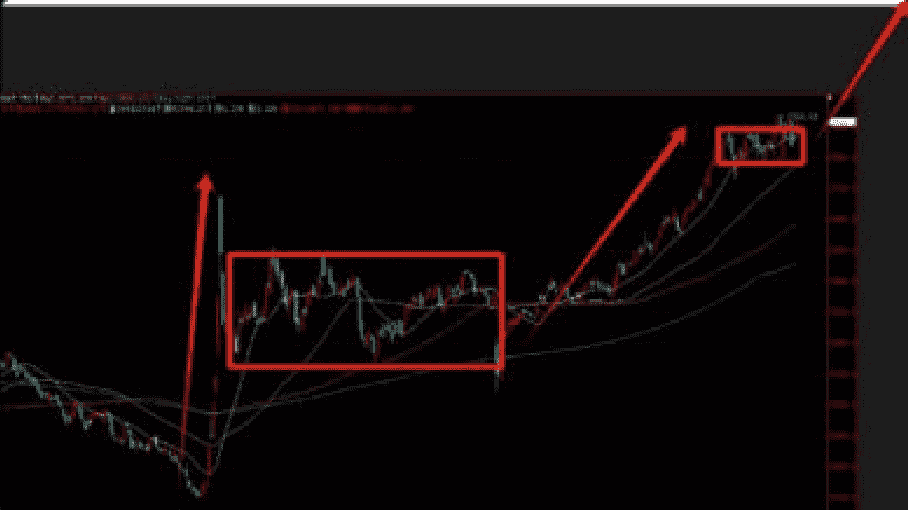
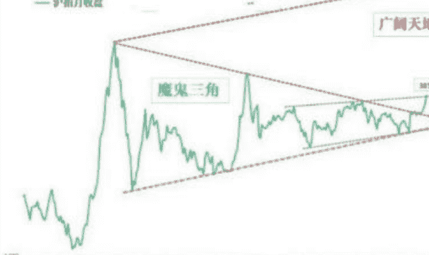
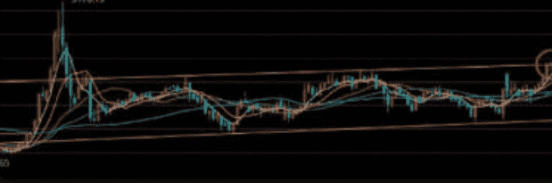

# 观海

大家仓位如何？我首先报一下：
180%

30%低了，下周低点加仓，已经到了震荡周期的末期，很容易踏空@Alex

Steven

到时候跪求提示哇 🥀🌷🥀

观海：30%低了，下周低点加仓，已经到了震荡周期的末期，很容易踏空@Alex

朱明广发银行

下周直接200%

朱明广发银行

😁

Win

观大 180是什么配置？证券吗？

太空人

95%

观海

上周跌提示本周有高点；今天大涨后提示下周有低点，现阶段不要一跌悲观，一涨就兴奋，还没到启动主升浪的时间

观海

我是昨天大跌时加的证券，昨天最低点3877点，不可能跌到3800，所以就提前买了，反正看着@Win

杨海（杨万涛）👍👍👍

@观海👍👍👍

观海

现阶段还是大涨就卖，大跌就买，下周不用担心踏空，保留一定仓位不动，降低成本

Steven

👍👍👍

Alex

观大 180%全部是证券吗😊

Win

👍👍👍

Alex

观大，动手了下

观海

昨天买入说了啊

观海

@Alex 一半科技一半证券

观海

发现很多人抢跑，逼得我也提前了 😙

观海

不过，下周高点我可能降低仓位

和和美美

没看到你减仓，不然尾盘我也也减仓了😂

观海：发现很多人抢跑，逼得我也提前了 🤔

观海

没减仓，要等下周高点减

# 观海

券商又来了炸裂的三季度报，可以说说中信这个业绩已经是行业的标杆了。

中信证券发布了三季度报，实现净利润增长51.54%，还超预期。对于中信证券2056亿这大市值的公司来说，利润增长一半那是相当不容易的，更加炸裂的业绩一直在稳步增长，这属实不容易。

券商板块确实最近在上升阶段，整个行业有28家企业实现了中期分红，业绩也因为股市的走强一直都在上升。

目前券商板块处于低估阶段，可以说是非常具有吸引力，上升空间很大，正是处于布局最好的时间。

和和美美

观大，下周您说的低点就上车好时机吗？

日月生

今天买了中信和光大

观海

港股走势反反映了真实走势

# 观海

## 利好

# 观海

# 观海

## 美股三大指数创新高 纳指涨

美联储下周降息了？你如何应对全球行情

央行：维护股市平稳运行

央行：发行动态改善股市环境

第一季度收益率低于预期

央行：把握货币政策时机

快报：25日开盘后立场与确认

资金：蓝筹买入

证监会：增强资本活跃夯实市场基础

资金：金融调控

IPO可能会加速科技申购

三季度大盘回暖三季度利润增

央行：10月27日发行重大改革成果

国务院：批准一批改革重大项目将来马来西亚出席东亚合作领导人会议

央行：维护汇率平稳运行

股市焦点理财闲入市场策略“航天格”满屏都是利好

# 观海

## 大盘走势图

# 观海

下一波就是所谓的主升浪，2027年结束牛市希望下周给个位置压线3900点，早就突破了啊@

观海

下周还有回调低点，

观海

这图上个月就在预测里发过

别容易听观大的话

陈康

下周调点3930差不多了吧

陈康

😄

观海

这图也发过，中线都是突破了啊

观海

只有回调低点，不会有新低

观海

没有回到60日均线，就要等待60日均线上来

观海

不，早涨上天现在回调低点都能接受了

梁先乐

只要确定上涨就是干，低点这个东西太求了，想要更低的时候只能踏空

观海

10月预测里共计6图解答走势

# 观海

实在选不到票就买点券商板块，高增长，低估，早晚要涨上来

观海

中美在马来西亚的会谈今天是第一天。从披露信息看，双方聊了五个半小时，美方财长说，进行了“非常有建设性的会谈”。外媒也说中国狮子大开口，要求美方取消全部加征关税和出口限制，让世界为之一震。有人也许也会说，这可以算是谈判策略吧。但这何尝不是我们内心的想法呢。贸易，要公平，本来就是互惠互利的事情，应该回归本位了。最好合，世界上所有商品进出任何国家和地区，都是0关税。这不正是自自由贸易的本意嘛。

华尔街日报、金融时报与多家国际媒体均报道：北京在10月谈判中首次把条件抬到“全面取消所有美方对华关税与出口管制”，否则免谈，被西方媒体普遍形容为“震慑与威慑（shock-and-awe）式要价”。

根据外媒综合报道，中国商务部与外交部发言人先后表示，美方若想解决问题，就必须“完全撤销一切单边关税措施”。中国官员在闭门会谈中进一步列出清单：不仅要取消特朗普政府自2018年起加征的全部关税，还要废除针对半导体、AI、量子计算等行业的出口许可证。这次会谈“建设性的”，如果理解，就是“没撕破，没达成协议”。明天撤回了一条消息，对股市影响吗？明天能高开，大幅提高巴西大豆价格，有利于中国购买巴西大豆，明天见面时双方差距很大，缩小缩小两国首脑拍板，美国承受不起。如果谈不成，日子也不好过。双方矛盾就是利益交换，最终达成协议的概率几乎百分百，对于美国来说，地方跑的都得停摆。明天撤回建设性。

# 观海

2023-10-25

## 【全球对算力存储进入“超级周期”全面加速】

近期富瑞报告显示，全球算力、人工智能相关需求在10月达到了历史峰值，引发了芯片热潮。与此同时，三星电子、海力士等公司的DRAM和NAND存储在市场上涨高达30%。报告中指出，DRAM价格上涨20%-50%，NAND价格上涨10%以上。此外，最新发布的报告指出，中国市场的芯片需求迎来爆发，AI服务器将持续增加，预计明年头部资本投入预计在2026年达到4600亿元，远于去年3800亿元。（中国市场涨-18%，跌+3.24%

# 观海

## 预计存储概念股再次爆发

芒雨

> 国有“三资”管理改革三项原则
> 一切国有资源资产化
> 一切国有资产证券化
> 一切国有资金杠杆化

芒雨

这是啥意思，谁懂，依赖国有财政，拉老登？

芒雨：

观海

化贷（Wait，此处OCR“化贷”应为“杠杆”或“贷款”？结合上文“杠杆化”，此处可能为误误，应为杠杆化）

芒雨

@观海 老师，后续蓝筹是不是有机会？

观海

不是已经开始了吗？

## 深度视野优质集（链接优质群，助你成功）

全部包含以下内容：限时年费188/年 加微信255

- ① 群众倍帝圈文字群对话（原价365 元/年）
- ② 子明私享汇（含）内部文章
- ③ 政事室（子明）付费内容内返子明群
- ④ 米联锦顶【作者米横】（原价599 元/年）
- ⑤ 欧洲金雀会员专属文章（原价328 元/年）
- ⑥ 砖瓦斥内部文档（原价400 元/年）
- ⑦ 卢克青读书会专属文章（原价699 元/年）
- ⑧ 鉴茶财经知识星球（原价3310 元/年）
- ⑨ 猫哥的视界知识星球文章（原价299 元/年）
- ⑩ 财经新周【独家新闻】（原价1498 元/年）
- ⑪ 杨在金钱圈（原价2200 元/年）
- ⑫ 森淼财经知识星球（原价1600 元/年）
- ⑬ 激泽异译付费文章（持续更新）
- ⑭ 司马林解读求选全套音频和全套书籍收藏版无割减（原价2.3 万）
- ⑮ 虚三部曲[民国梦、帝国战争、不被理解的MAO](原价599 元）
- ⑿卢克知识星球文章（原价268 元/年）
- ⑰ 额外再送：卢锐元新浪微铂付费专辑、三村丰老王、三花九洞文集

不定期内容：（更多资源不下去了……——

- ① 守夜人司令星球、接换魔王后星球、达叔泛论星球、成就财富圈、雪花甲老头等
- ② 视野、大树乡谈、江初将、泮咩说、上海海家等其它

付费集

