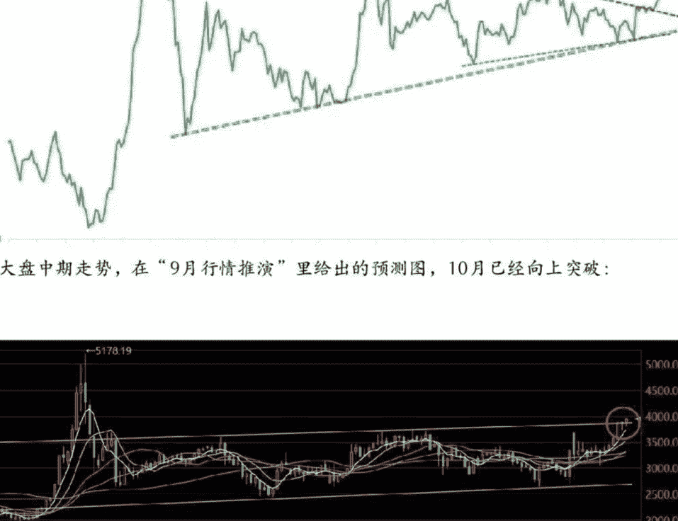
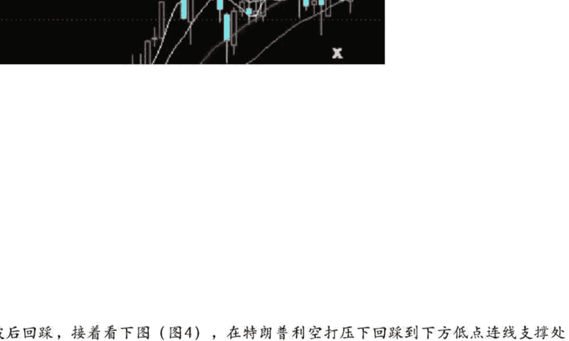
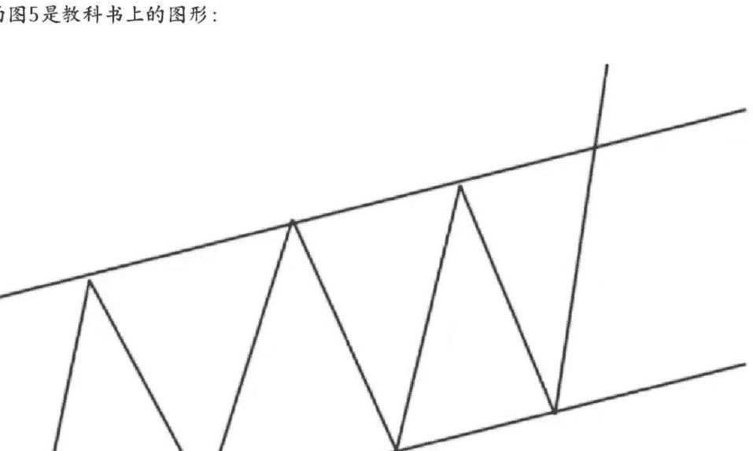
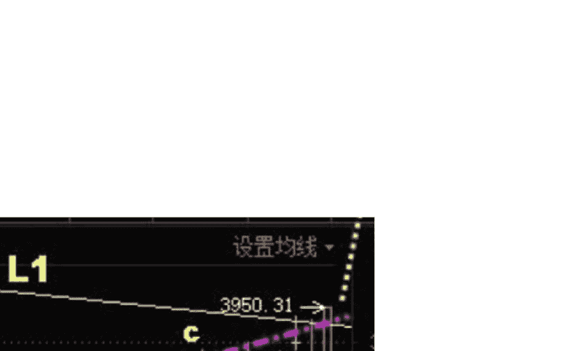
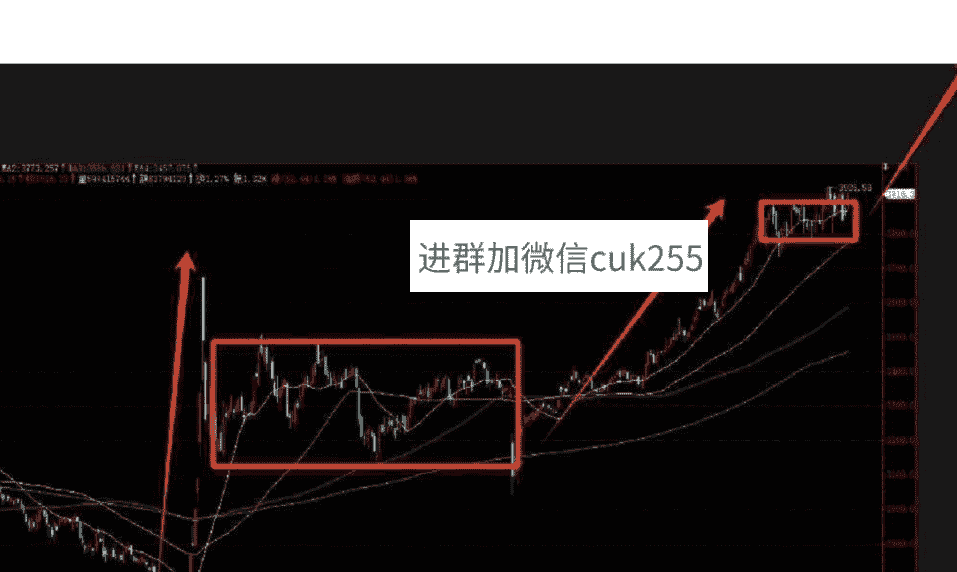
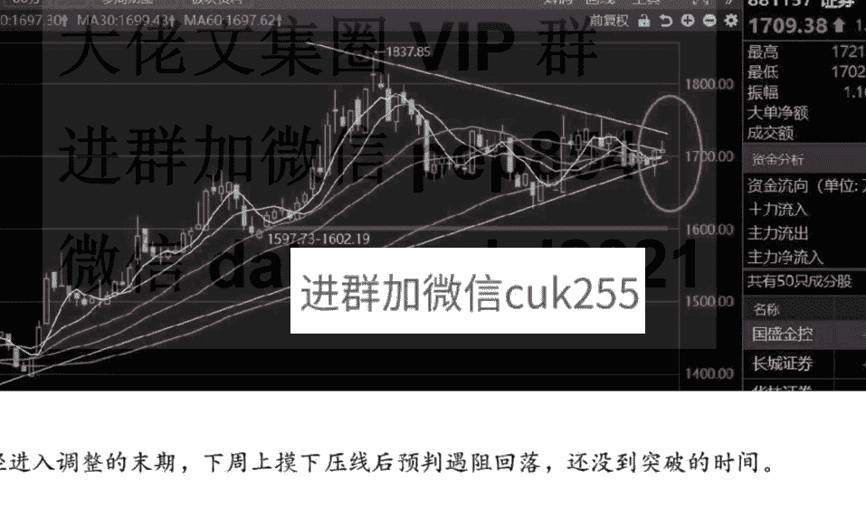

# 美股行情（10月27日-10月31日）

1、大盘收涨，在“9月行情”的剧烈调整后，高位已重新上攻，重心也重回强势。

2、大盘收涨，在“9月行情”的剧烈调整后，10月已经重新上攻：

3、上沿压力在6124-5178处突破，并在10月5号成功突破。当大盘回踩3936后确认支撑，第二次回踩即是强势底部。

空头出现调整，随后看到下回（图4），未跌破回利位下方支撑线支撑，大盘回踩3936后确认，强势底部。

上方趋势线（黄线）位置在3956点，下一一趋势线突破到了：

下图5是热狗头形状：

# 上临矩形

下图6是回踩受阻突破目标支撑位5000点。L1横线是6124-5178支撑线，

下图7是本周平带矩形：

上周五后突破了第一支撑，24.6的3950点，回到了3985，大盘回踩了两个支撑（第一个没有回踩），2025年4月开始第二次支撑。回3040回踩3956点，测试了3910点支撑，如果向下突破，目标将是5000点，然后大盘回看底部：

# 深度视野优质集（链接优质社群，助你成功）

全部包含以下内容：限时年费188/年 加微信cuk255

- ① 吃群众含倍训练文加时训练群对话（原价 365 元/年）
- ② 子明私享汇（含）内部文章
- ③ 政事室（顾子明）付费内容加送逐顺子明群
- ④ 米联锦复【作者米横】（原价 599 元/年）
- ⑤ 欧洲金雀会员专属文章（原价 328 元/年）
- ⑥ 钛瓦瓦内部文档（原价 400 元/年）
- ⑦ 卢克文青读书会专属文章（原价 699 元/年）
- ⑧ 鉴茶财经知识星球（原价 3310 元/年）
- ⑨ 猫哥的视界知识星球文章（原价 299 元/年）
- 十 财新周【独家新闻】（原价 1498 元/年）
- 十一 杨世光在金钱塔（原价 2200 元/年）
- 十二 森淼财经知识星球（原价 1600 元/年）
- 十三 激源异译付费文章（持续更新）
- 十四 司马林解读毛选全套音频和全套书籍珍藏无割减（原价 2.3 万）
- 十五 虚构三部曲[民国梦、帝国争亡、不被理解的DAO]（原价 599 元）
- 十六 卢克知识星球文章（原价 268 元/年）
- 十七 额外再送：卢薛元新浪微博付费专栏、三村丰老王、三花九洞文集

不定期内容：（更多资源写不下去了）————

- ① 守夜人司令星球、接捣魔王论星球、养成财富圈、雪雪花甲头部等
- ② A视野、大树乡谈、江初序、泮咩说、上海海家等付费文集
- ③ 西风付费文章、老端、赢在八小时之外、局人的视界、升值迁、老体制内等其它一些大V付费文集（每月不低于600 元的付费文集）

限时年费188/年 低成本链接全网大V优质内容

十五 未

深度视野（付费文集）

