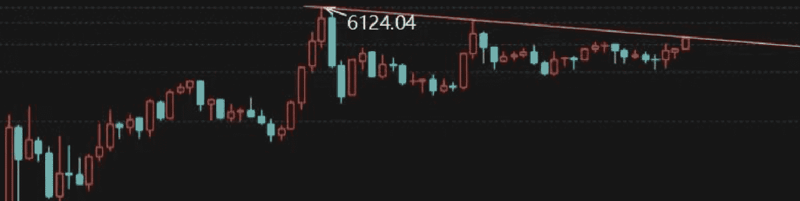
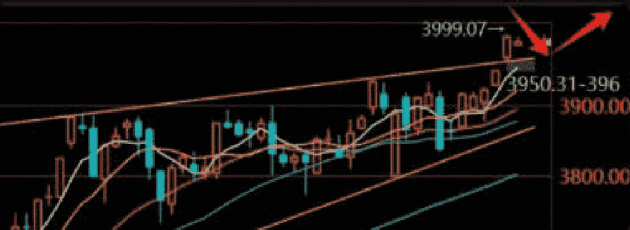
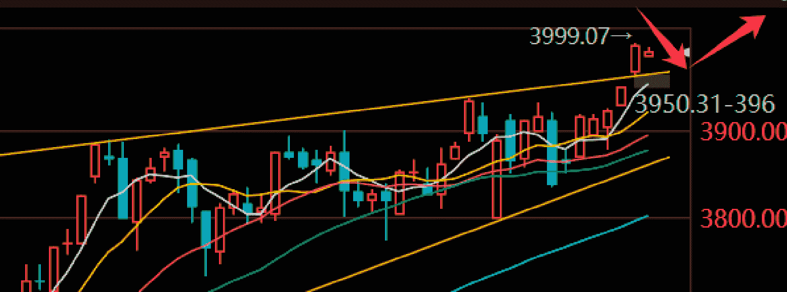

# 上证指数(半年线)
3996.94 +1.18%

观海

# 群公告

[File] 股市行情推演.docx124.docx

28号大盘: 上午反弹震荡，午盘后有所回落调整。

了解更多

# 观海

今明两天的回调是倒车接人，周四五继续上涨的。。

# 落日晚风

周五大盘涨的时候，证券能涨涨吗?

日月生

十五五前瞻的行业 量子科技，可控核聚变

观海

早日已经发了啊，看公众号文章@落日晚风

观海

明天可能是加仓机会

观海

# 观海

# 观海

突破后需要回踩确认

# 深度视野优质集团（链接优质社群，助你成功）

全部包含以下内容：限时年费188/年 加微信cuk255

- ① 吃瓜群众倍时文加时群群对话（原价 365 元/年）
- ② 子明私享汇（含）内部文章
- ③ 政事室（顾子明）付费内容加送顺子子明群
- ④ 米联储父文【作者米楼】（原价 599 元/年）
- ⑤ 欧洲金雀会员专属文章（原价 328 元/年）
- ⑥ 钨瓦片内部文档（原价 400 元/年）
- ⑦ 卢克文青读书会专属文章（原价 699 元/年）
- ⑧ 鉴茶财经知识星球（原价 3310 元/年）
- ⑨ 猫哥的视界知识星球文章（原价 299 元/年）
- ⑩ 财经周【独家新闻】（原价 1498 元/年）
- ⑪ 杨世光在金钱树（原价 2200 元/年）
- ⑫ 森淼财经知识星球（原价 1600 元/年）
- ⑬ 激源异译付费文章（持续更新）
- 十四 司马林解读毛选全套音频和全套书籍藏版无割减（原价 2.3 万）
- 十五 虚彦三部曲[民国梦、帝国争亡、不被理解的MAO]（原价 599 元/年）
- 十六 卢克文知识星球文章（原价 268 元/年）
- 十七 额外再送：卢薛元新浪微博付费专栏、三村丰老王、三花九术文集

定期内容：......（更多资源将下去了......）

- ① 守夜司令知识星球、接换魔王后星球、成败财富星球
- ② 创始星球、达叔天译论星球、成败财富圈、雪花甲老头等
- ③ A 视野、大树乡谈、江初序、泮咩说、上海海家等付费文集
- ④ 西风付费文章、老端、赢在八小时之外、局外人的视界、升值、老体制内等其它一些大V付费文章（每月不低于600 元的付费文章）

# 深度视野文集
进群微信cuk255
深度视野（付费文集）

# 限时年费188/年 低成本链接全网U优质内容
